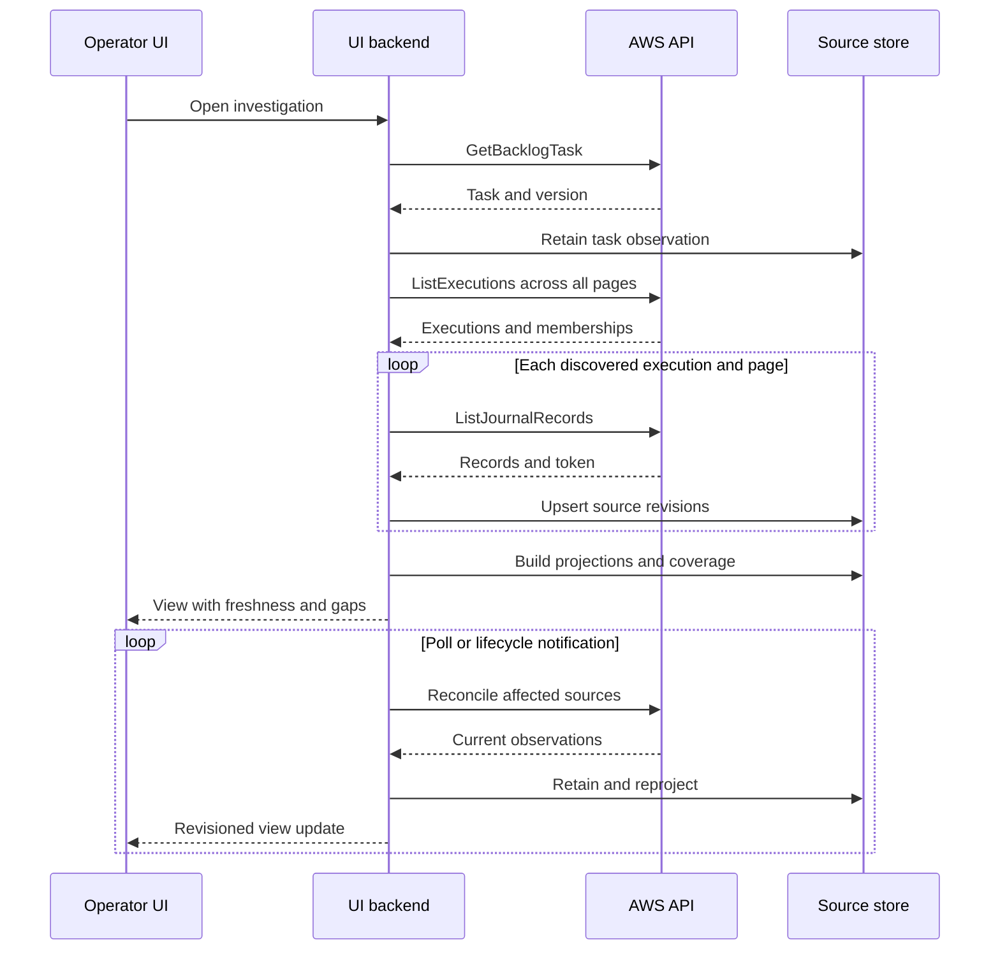
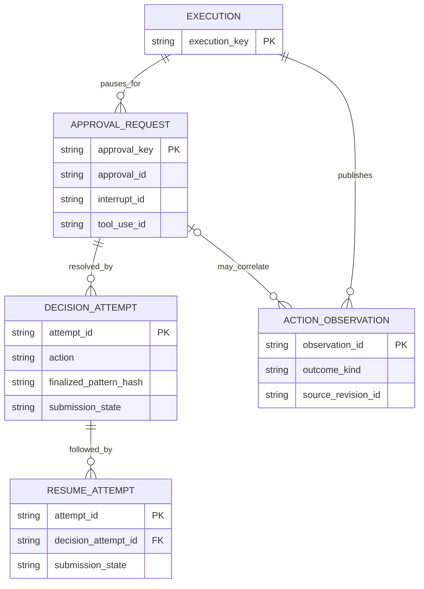
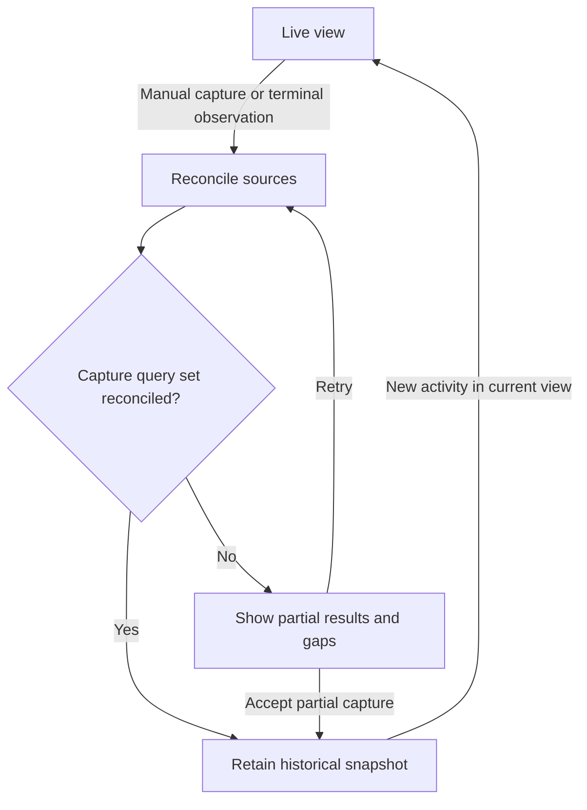

<!-- block: obsidian-devops-investigation-ui-contract-scope -->
# Investigation operator UI contract

## 1. Purpose and implementation boundary

This annex turns [reviewed model and report](../report.md) into a proposed production backend/frontend contract for **live observation and historical review**. It defines views, synchronization, provenance, action-state handling and acceptance evidence. The [accompanying prototype](../index.html) demonstrates selected read-model behavior with fictional data; its replay is not an AWS collector or a service transition contract.

All names such as `InvestigationView`, `CollectionCoverage`, `TimelineItem` and `snapshotId` are **application-owned** unless explicitly identified as native AWS fields. The exact AWS operation and field inventory is in [complete API catalog](Investigation_API_Catalog.md).

The first version should be reliable without a parser for every agent-produced payload: task details, execution hierarchy, journal browsing, summary retrieval, linked incidents and retained snapshots are a strong base. Rich tool activity, evidence graphs and action-resumption panels need validated content profiles and recovery semantics.

<!-- block: obsidian-devops-investigation-ui-contract-views -->
## 2. Operator views and their data contracts

| View | Primary source | Useful derived data | Required empty/error/partial states |
| --- | --- | --- | --- |
| Investigation inbox | ListBacklogTasks with taskType INVESTIGATION | Grouping, filters, last observed status | No results, permission denied, incomplete pages, stale cache |
| Investigation header | GetBacklogTask | State badge, priority, elapsed age, linked primary | Execution not yet assigned, linked task, unknown state, stale read |
| Live activity | Journal records, task/execution observations, lifecycle events | Timeline, grouping, validated activity labels | Fetching history, unsupported record type, partial coverage |
| Execution tree | ListExecutions + parentExecutionId | Root/child grouping, per-run state | Missing parent, late-discovered execution, unknown agent/subtask |
| Findings/results | Selected summary records and validated content | Root-cause/finding cards and result versions | No pointer, pointer unresolved, multiple candidates, parse unsupported |
| Evidence map | Provenance-backed derived nodes/edges | Support/contradiction/cause assertions | No supported graph data, unresolved references, inferred relations labeled |
| Artifacts | Explicit references; Asset APIs when resolvable | File preview, pinned version, hash, download | Not yet available, access denied, deleted, unknown media |
| Conversation | SendMessage stream; retained supported conversation records; pending queue | Block assembly, partial response, message attribution | Disconnected, incomplete response, queue-only coverage, no replay contract |
| Approvals/actions | Validated approval request + UpdateApprovalAction + resume context | Decision/resume/outcome tracking | Unknown submission outcome, missing interrupt IDs, readback unavailable |
| Historical snapshot | Application snapshot manifest and retained sources | Compare to current state; source/derivation audit | Partial at capture, missing external content, subsequent investigation updates |

Sources: [backlog reads](https://docs.aws.amazon.com/devopsagent/latest/APIReference/API_ListBacklogTasks.html), [executions](https://docs.aws.amazon.com/devopsagent/latest/APIReference/API_ListExecutions.html), [journals](https://docs.aws.amazon.com/devopsagent/latest/APIReference/API_ListJournalRecords.html), [SendMessage](https://docs.aws.amazon.com/devopsagent/latest/APIReference/API_SendMessage.html), [Asset APIs](https://docs.aws.amazon.com/devopsagent/latest/userguide/about-aws-devops-agent-managing-assets.html), [directed actions](https://docs.aws.amazon.com/devopsagent/latest/userguide/working-with-devops-agent-working-with-directed-actions.html).

### Header: separate the things an operator needs to know

Display the task lifecycle prominently, followed by result readiness and synchronization freshness. For example:

> **Investigation completed** · Referenced summary is being retrieved · Last successful sync 8 seconds ago · Journal history partially loaded

This is more informative than a single green “Done” badge. The eight-second age is a display example, not an AWS freshness guarantee. Show phase-specific mitigation status only when a source supports it. Do not derive mitigation completion from investigation completion.

Avoid a percentage progress bar. The public Task/Execution structures do not specify expected work, a complete step plan or a progress denominator. Use activity, elapsed time and observed per-execution status. [Task](https://docs.aws.amazon.com/devopsagent/latest/APIReference/API_Task.html) · [Execution](https://docs.aws.amazon.com/devopsagent/latest/APIReference/API_Execution.html)

### A proposed InvestigationView response

The following is synthetic **application JSON**, not an AWS response. Names and values illustrate a completed task whose exact summary is still being retrieved.

```json
{
  "schemaVersion": "investigation-view/v1",
  "investigationKey": "inv-example-a",
  "source": {
    "service": "devops-agent",
    "apiVersion": "2026-01-01",
    "partition": "aws",
    "accountId": "000000000000",
    "region": "us-east-1",
    "agentSpaceId": "space-a",
    "taskId": "task-a"
  },
  "connectionContext": {
    "connectionId": "connection-a",
    "authorizationContextId": "authorization-a"
  },
  "task": {
    "rawStatus": "COMPLETED",
    "taskType": "INVESTIGATION",
    "observedVersion": 12,
    "title": "Investigate elevated checkout errors",
    "priority": "HIGH"
  },
  "executions": [
    {
      "executionId": "execution-a",
      "rawStatus": "STOPPED",
      "parentExecutionId": null
    }
  ],
  "results": {
    "investigationSummary": {
      "availability": "expected_not_retrieved",
      "selectionBasis": "completion_event_record_id",
      "executionId": "execution-a",
      "recordId": "summary-a",
      "sourceEventId": "event-a"
    },
    "mitigationSummary": {
      "availability": "unknown",
      "selectionBasis": null
    }
  },
  "coverage": {
    "executionPagesExhausted": true,
    "journalPagesExhaustedByExecution": {"execution-a": false},
    "loadedRecordCount": 100,
    "unresolvedReferenceCount": 1,
    "unknownRecordTypeCount": 2,
    "crossEndpointSnapshotGuaranteed": false
  },
  "freshness": {
    "lastSuccessfulTaskReadAt": "2026-11-05T10:20:00Z",
    "lastSuccessfulJournalReadAt": "2026-11-05T10:19:58Z",
    "collectionState": "refreshing",
    "lastError": null
  },
  "history": {
    "latestSnapshotId": null,
    "isAwsImmutableFinalState": false
  },
  "projectionRevision": 31
}
```

`inv-example-a` is an illustrative opaque application locator for the owning partition/account/Region/Agent Space/task tuple, not an AWS identifier. A different connection to that same resource does not create another investigation. Connection and authorization context constrain access, caching and exports; they do not replace resource identity. URI encoding and the public locator format remain backend contract decisions.

Application responses should expose source and collection status for each section rather than hiding partial failure behind an HTTP 200. A summary panel can be ready while an artifact panel is unauthorized. Distinguish native absent fields from locally introduced nulls. This proposed response is separate from the prototype's implemented `DemoModel.view` shape; see the [model contract](../app/MODEL_CONTRACT.md) for the latter.

### Suggested application routes

These are optional application endpoint names, **not AWS endpoints**:

| Route | Meaning |
| --- | --- |
| `GET /api/investigations` | Authorized, indexed task-derived inbox |
| `GET /api/investigations/{key}` | Current InvestigationView |
| `GET /api/investigations/{key}/timeline` | Projected timeline with an application cursor |
| `GET /api/investigations/{key}/records/{recordKey}` | Retained raw record/revision inspector |
| `GET /api/investigations/{key}/graphs/{kind}` | Explicit graph kind and projection version |
| `GET /api/investigations/{key}/snapshots` | Snapshot manifests and comparison links |
| `GET /api/investigations/{key}/updates` | Application-owned SSE/WebSocket updates, if chosen |

A local record lookup can be efficient even though AWS has no native single-journal-record Get operation. Label the source and capture age. An application stream cursor is backed by the application's own update log; it must not be presented as an AWS journal replay token.

These route names are design candidates. The prototype exposes a local `DemoModel` JavaScript interface, not an HTTP implementation of this table. The proposed UI API still needs explicit request/response schemas, scope resolution, authorization, pagination ordering/cursors, errors and compatibility rules. Use an opaque or correctly encoded investigation locator rather than inserting the slash-separated illustrative key directly into a single path segment. Native AWS SDK types do not supply these application contracts.

<!-- block: obsidian-devops-investigation-ui-contract-sync -->
## 3. Read pipeline and live synchronization

### Diagram U01 — reconcile snapshots and journals

[Rendered SVG](../diagrams/U01-live-reconciliation.svg) · [Editable Mermaid](../diagrams/U01-live-reconciliation.mmd)

This is a proposed backend sequence, not a service-guaranteed ordering. Background notifications and user requests can both trigger reconciliation.



### Initial collection

1. Resolve the authenticated connection/account/Region/Agent Space. Authorize access before consulting a shared cache.
2. Read `GetBacklogTask`. If the task is not INVESTIGATION, route to the correct work-item view or show a clear type mismatch.
3. Traverse `ListExecutions` with the task ID. Retain task-to-execution membership from the request; do not rely only on `Task.executionId`.
4. Retrieve journals for each discovered execution. Render recent data early, but mark history partial until the chosen traversal is exhausted.
5. Reconcile any EventBridge summary pointers already retained. Filter by the appropriate summary record type and match the exact record ID.
6. Resolve explicit artifact/asset references. Do not scan all workspace assets and present them as investigation outputs.
7. Retain raw observations before semantic parsing. A parser failure should leave the record inspectable.
8. Publish an atomic application projection revision with section-specific coverage/freshness.

Additional executions may be discovered later. Repeat execution enumeration while the investigation can change. A missing parent can be retained as an unresolved relation; the public API has no separate GetExecution operation to invent as a fallback. [Actions](https://docs.aws.amazon.com/devopsagent/latest/APIReference/API_Operations.html) · [ListExecutions](https://docs.aws.amazon.com/devopsagent/latest/APIReference/API_ListExecutions.html)

Use the native SDK's endpoint resolution and per-operation host-prefix behavior. The reviewed model assigns operations to `cp.` or `dp.`; the separately documented MCP/A2A `connect.aidevops` endpoint is another transport. The [API catalog](Investigation_API_Catalog.md#6-transport-failures-and-the-application-boundary) records all 63 endpoint prefixes, success codes and modeled error sets. A successful read response proves that request succeeded, not that the combined view represents a service-wide atomic snapshot.

For versioned artifact collection, `GetAssetContent` returns a JSON structure whose SDK-decoded ZIP bytes are at `content.zipFile`; `GetAssetFile` returns the `file.content` text-or-bytes union. Retain the returned asset version and byte hash. Neither a raw `content` object nor the whole HTTP response is the downloadable ZIP. [GetAssetContent](https://docs.aws.amazon.com/devopsagent/latest/APIReference/API_GetAssetContent.html) · [GetAssetFile](https://docs.aws.amazon.com/devopsagent/latest/APIReference/API_GetAssetFile.html)

### Pagination and safe incremental behavior

For the inbox, each native type/status/priority filter accepts one value. A multi-select UI needs an application index or carefully merged queries, with scoped deduplication. A task leaving a status-filtered page is not evidence of deletion. Creation-time filtering is not an update feed: an older investigation that continues may remain outside a recent-created window. Retain tracked task identities and reconcile them directly or through lifecycle notifications. [ListBacklogTasks](https://docs.aws.amazon.com/devopsagent/latest/APIReference/API_ListBacklogTasks.html)

`ListJournalRecords` accepts space, execution, limit, next token, record type and order. It has no `since`/updated-time filter, durable cursor or published cross-page snapshot contract. Its maximum page size is 100. `ListExecutions` also uses next-token pagination but has no order filter. [ListJournalRecords](https://docs.aws.amazon.com/devopsagent/latest/APIReference/API_ListJournalRecords.html) · [ListExecutions](https://docs.aws.amazon.com/devopsagent/latest/APIReference/API_ListExecutions.html)

Recommended collector rules:

- Keep the exact filter/order/page-size context with every pagination run. Treat tokens as opaque and scoped to that query.
- Traverse until the token is absent, not until a page is empty. Detect repeated tokens/loops and report incomplete collection.
- Deduplicate records by scoped record identity; compare hashes and retain a revision if content differs.
- Use a fresh recent-page poll for responsiveness, with bounded overlap and periodic full reconciliation. A page containing known IDs is not proof that older or late-arriving content cannot exist.
- Keep independent checkpoints for each execution and record-type query. Do not use a summary-only traversal to mark the full journal complete.
- Treat page exhaustion as “this fetch completed,” not a global guarantee that all events are final.
- If a time/request budget ends the traversal, expose the coverage gap and resume appropriately. Do not call a truncated dataset complete.
- Avoid overlapping collectors overwriting a newer application projection with an older in-flight result. Preserve source observations and use application generation/transaction controls.

Polling cadence is a **deployment parameter**, not a documented service guarantee. Budget reads across all visible executions and viewers; use backoff/jitter on throttling and transient errors, shared authorized caching, and lower-frequency reconciliation for background views. A useful cost model is:

```text
reads per full refresh ≈ 1 task read
                      + execution page count
                      + sum(journal page counts for each execution)
                      + optional message/result/asset reads
```

There is no published native percent-complete or universal change feed to replace those reads. Ask AWS for incremental journal and consistency contracts before promising large-scale low-latency synchronization.

### EventBridge integration

Retain event ID, account, Region, detail type, schema version, task/execution IDs, timestamps and optional summary pointer. Use the event as a reason to refresh authoritative objects and as a lifecycle observation. Preserve duplicates/out-of-order observations safely; do not assume the reviewed service contract supplies a lossless ordered event history.

The documented event types cover investigation and mitigation lifecycles, not every journal append or every type of agent work. Missing optional fields are omitted. The event's time is the last investigation/mitigation update time, not receipt time. [EventBridge guide](https://docs.aws.amazon.com/devopsagent/latest/userguide/configuring-integrations-and-knowledge-integrating-devops-agent-into-event-driven-applications-using-amazon-eventbridge-index.html) · [Event detail](https://docs.aws.amazon.com/devopsagent/latest/userguide/integrating-devops-agent-into-event-driven-applications-using-amazon-eventbridge-devops-agent-events-detail-reference.html)

Keep separate investigation and mitigation phase observations even when they share a task ID. Both use task type INVESTIGATION. Never overwrite the entire native task state merely because a late mitigation notification arrives.

### Completion and summary absence: three different cases

Keep these collection states separate:

| Observation | Meaning and presentation |
| --- | --- |
| No completion event was captured | The authoritative summary pointer is unknown. Show available candidates with a stated selection policy. |
| A captured `Completed` event omits `summary_record_id` | The AWS guide says no summary is available for that execution. Show a bounded “No summary reported for this execution” state; absence is not a promise of a later result. |
| A captured event supplies execution and record IDs, but the record has not been retrieved | Retain the exact pointer and the retrieval state. A pending, inaccessible or exhausted search is a collection outcome, distinct from the task lifecycle. |

The meaning of the second row comes from the [EventBridge summary contract](https://docs.aws.amazon.com/devopsagent/latest/userguide/configuring-integrations-and-knowledge-integrating-devops-agent-into-event-driven-applications-using-amazon-eventbridge-index.html). A later lifecycle event or resumed investigation is a new observation; it does not retroactively change what an earlier notification contained.

### Error semantics

| Condition | Application behavior |
| --- | --- |
| 400/validation or invalid parameter | Preserve the native code and every `fieldList` violation when supplied; correct the request instead of retrying unchanged input. Multiple violations can refer to one field. |
| 402/service quota exceeded | Record a quota condition separately from throttling, suspend repeated failing work, and retain unfinished coverage. Do not interpret this service error as a payment instruction. |
| 403/access denied | Retain prior authorized view only under current access policy; show an access error, not “no data” |
| 404/not found | Show unavailable/not found; do not assume user cancellation or deletion without evidence |
| 409/conflict on a mutation | Refresh affected state; present the conflict instead of fabricating a successful action |
| 413/content size exceeded | Preserve the failure and adjust the supported request or collection plan; do not silently truncate retained evidence or repeat an oversized command unchanged |
| 429/throttling | Back off, keep freshness age visible, prioritize selected/live work |
| 5xx/network failure | Retry eligible reads, preserve last successful observation and partial sections |
| Response-stream failure after HTTP success | Retain the native `responseFailed` event and partial blocks; distinguish response failure from the accepted/opened HTTP stream |
| Unknown enum/record type | Preserve and display an unknown value/raw payload; no crash or silent coercion |
| Parse failure | Mark that renderer unsupported/failed; leave raw record and provenance accessible |

These are proposed client behaviors informed by the [native error contracts](Investigation_API_Catalog.md#modeled-exceptions); a particular error is not proof of a business-state transition. `ValidationException` HTTP 400 is documented in the API reference but lacks an explicit HTTP-status trait in this Botocore snapshot. Operator-app enable/disable operations also model `IdentityCenterServiceException` with an optional underlying error code. Preserve native exception names, HTTP codes and request IDs in diagnostics; an application error envelope must not imply these are interchangeable. Authentication, protocol, network and proxy failures can occur outside the modeled exception list. A2A uses its own error envelope and must be decoded by that adapter.

<!-- block: obsidian-devops-investigation-ui-contract-stream -->
## 4. Conversation streams and A2A

### Native SendMessage is a response stream

The native stream contains nine event variants: response created/in progress/completed/failed, summary, heartbeat, and content block start/delta/stop. The official model marks it as an event stream; the Smithy/API definition is a streaming union. A single event contains its selected variant, not a completed response with all variants populated. [SendMessageEvents](https://docs.aws.amazon.com/devopsagent/latest/APIReference/API_SendMessageEvents.html)

Store a local request/session identity. Preserve response IDs, event sequence numbers and block index/ID/parent ID when supplied. Those fields are optional in the public shape, so a collector must tolerate missing identifiers and unresolved parents.

For text deltas, append `textDelta.text` to the correct block. For `jsonDelta.partialJson`, buffer fragments before parsing a complete JSON value; a fragment is not guaranteed valid JSON. A contentBlockStop event can supply optional accumulated text; preserve it and compare with assembled content when available. responseCompleted contains response identity/usage/sequence data, not final content, and cannot repair a missing block. If an index or response/block mapping is absent or ambiguous, retain unassembled events rather than guessing their block or enabling an approval from them. Do not invent a global journal sequence from a stream sequence number. [Delta type](https://docs.aws.amazon.com/devopsagent/latest/APIReference/API_SendMessageContentBlockDelta.html) · [JSON delta](https://docs.aws.amazon.com/devopsagent/latest/APIReference/API_SendMessageJsonDelta.html) · [Block start](https://docs.aws.amazon.com/devopsagent/latest/APIReference/API_SendMessageContentBlockStartEvent.html)

A response-completed event concerns that response. A heartbeat concerns connection liveness. Neither proves the investigation progressed or completed. The stream and journal have no documented automatic one-to-one ID join; cross-link only through explicit payload references or a validated profile.

`ListPendingMessages` returns a pending queue, not a complete conversation archive or a stream-replay service. The model does not publish a replay cursor for an interrupted SendMessage response. Retain partial content, show interruption, reconcile durable data, and avoid blindly resending a mutating message: SendMessage has no modeled idempotency token. [Pending messages](https://docs.aws.amazon.com/devopsagent/latest/APIReference/API_ListPendingMessages.html) · [SendMessage](https://docs.aws.amazon.com/devopsagent/latest/APIReference/API_SendMessage.html)

Do not assume every ID returned by ListExecutions is a valid interactive chat target under every product workflow. Confirm the documented/validated investigation-to-conversation mapping and caller permissions before enabling controls.

### Optional A2A adapter

A2A provides a separate task/message interface and SSE subscriptions. Its guide differentiates chat streaming from investigation subscriptions, collapses some native outcomes into its task states, and documents terminal-state/result-artifact timing concerns. Its task IDs are not a universal alias for native backlog IDs: identity depends on the task kind. [A2A server guide](https://docs.aws.amazon.com/devopsagent/latest/userguide/connecting-to-devops-agent-remote-servers-integrating-with-the-devops-agent-a2a-server.html)

Keep A2A as a distinct adapter with explicit identity mapping. Preserve raw A2A state and artifact metadata; do not invent the availability-marker schema or claim a bounded result lag when the guide does not supply them. Subscription completion is not a native archive-finalized barrier. An already-terminal A2A task rejects SubscribeToTask with HTTP 400 UNSUPPORTED_OPERATION; use GetTask to inspect current state/results and preserve any artifact-readiness gap. Reconcile through the supported channel after disconnect; no documented Last-Event-ID replay contract was established.

The November 2 product update describes an All-chats UI filter, while the reviewed native ListChats model has no All/scope filter parameter and its userId parameter is deprecated. Treat app visibility behavior and native list capability separately until clarified. [What's new](https://docs.aws.amazon.com/devopsagent/latest/userguide/whats-new.html) · [ListChats](https://docs.aws.amazon.com/devopsagent/latest/APIReference/API_ListChats.html)


<!-- block: obsidian-devops-investigation-ui-contract-actions -->
## 5. Actions, approvals and operator decisions

For the first release, distinguish **read capability** from **action capability**. A user who can view a task may not be allowed to send messages, resolve approvals, read referenced artifacts or act on target resources. The service resolves chat user identity from the authenticated session; the deprecated userId request parameter is not an authorization mechanism. [SendMessage](https://docs.aws.amazon.com/devopsagent/latest/APIReference/API_SendMessage.html)

### Documented approval protocol

AWS surfaces directed-action approval requests **only in chat**. A mutating tool call outside chat, such as during an autonomous investigation, fails instead of presenting an approval request. The investigation view should display the published failure and offer the supported chat workflow where authorized; it must not manufacture an approval from a failed tool call or a task status. [Directed-action approval boundary](https://docs.aws.amazon.com/devopsagent/latest/userguide/working-with-devops-agent-working-with-directed-actions.html)

The directed-actions guide documents two stages:

1. `UpdateApprovalAction` records the scoped approval/rejection.
2. `SendMessage` resumes the paused execution with `context.userActionResponse = "APPROVAL_ACTION"` and the structured `approvalAction` including the supplied interrupt/tool/approval identifiers.

The finalized pattern must match or narrow the requested invocation; it must not widen it. Reusable approval is time-bounded to at most four hours; single-use approval has a different TTL rule. Persist exactly which scope the operator approved. [Directed actions](https://docs.aws.amazon.com/devopsagent/latest/userguide/working-with-devops-agent-working-with-directed-actions.html) · [ApprovalPattern](https://docs.aws.amazon.com/devopsagent/latest/APIReference/API_ApprovalPattern.html) · [ApprovalAction](https://docs.aws.amazon.com/devopsagent/latest/APIReference/API_ApprovalAction.html)

### Diagram U02 — decision, resume and observed outcome

[Rendered SVG](../diagrams/U02-approval-lifecycle.svg) · [Editable Mermaid](../diagrams/U02-approval-lifecycle.mmd)

These are application audit entities around the native command/value objects. APPROVAL_REQUEST identifies an observed request context, including execution/tool/interrupt IDs; it is not a claim that a reusable native approval can only be associated with one execution. Keep the space-scoped native approvalId separately. A decision does not prove a resume or action outcome.



Do not enforce request uniqueness solely by a guessed tool name or a displayed button label. Preserve the actual `approvalId`, `interruptId` and `toolUseId`. The typed ApprovalAction members are optional on the wire; service-side validation determines what is required for the paused invocation. A successful rejection decision is different from an API failure. An opened SendMessage stream or responseCreated event alone is not a published confirmation that the paused tool invocation resumed; retain the actual observations.

The action panel needs separate states:

| Dimension | Examples |
| --- | --- |
| Request availability | Validated request available / unsupported payload / missing identifiers |
| Decision submission | Not submitted / sending / API response observed / definitive API failure / ambiguous outcome |
| Resume submission | Not submitted / sending / stream opened / explicit resume observation if supplied / ambiguous outcome |
| Authorization lifecycle | Raw PENDING/APPROVED/REJECTED/REVOKED/REDEEMED when actually observed |
| Action/result | No observation / action published / failed / outcome published / verification available |

`REDEEMED` means the approval was consumed by a **credential mint at least once**. It does not prove that credentials were used, a tool call succeeded, the incident recovered, or a reusable approval expired. The service model also allows reuse until expiry for non-single-use approvals. [Pinned approval-status model](https://raw.githubusercontent.com/boto/botocore/27fc40eff0e85422e62858ee3d2e9a133bdb1038/botocore/data/devops-agent/2026-01-01/service-2.json)

### Recovery limitations

The reviewed native operation set has UpdateApprovalAction but no Get/List/Revoke approval operation. Its response description refers to later read states, without publishing a corresponding read operation in this model. The approval-request payload delivered through open stream content is not a complete typed request entity. Record both as contract gaps.

UpdateApprovalAction and SendMessage have no modeled idempotency token. If a response is lost, record an ambiguous outcome and use a verified recovery path; do not automatically broaden scope, submit a second approval, or resend a potentially mutating message. If decision submission succeeded but resumption failed, retain that partial success explicitly.

An expiring approval and a recovered application connection are independent. Check current authorization before showing controls or attempting a resume. Do not infer approval from a waiting task state or from “Approve” appearing in Markdown.

### Other mutations

| Operator intent | Published native surface | UI policy |
| --- | --- | --- |
| Create investigation | CreateBacklogTask with type INVESTIGATION/title/priority, optional description/reference/client token | Use a stable idempotency token per logical create; record returned task identity |
| Update task state | UpdateBacklogTask with taskStatus/client token | Expose only service-supported, tested transitions; enum membership alone is insufficient |
| Send message | SendMessage | Requires a validated conversation/execution target; do not retry blindly |
| Add/update feedback | Asset APIs with documented feedback profile | Distinguish draft local feedback from a successful AWS write |
| Approve and resume | Two stages above | Show exact scope and separate acknowledgements |
| Fork, unlink, unskip, resume completed case | Product behaviors documented, exact native wire recipes incomplete | Keep disabled or deep-link to the supported AWS experience until contract/implementation verified |

Task.version and other returned versions are useful observations. UpdateBacklogTask does not provide a native expected-version precondition; a local command serialization mechanism cannot prevent a separate external actor from changing AWS state. Refresh state around actions and present conflicts honestly. [UpdateBacklogTask](https://docs.aws.amazon.com/devopsagent/latest/APIReference/API_UpdateBacklogTask.html)

<!-- block: obsidian-devops-investigation-ui-contract-history -->
## 6. Completed views, capture and comparison

### Diagram U03 — application snapshot workflow

[Rendered SVG](../diagrams/U03-snapshot-workflow.svg) · [Editable Mermaid](../diagrams/U03-snapshot-workflow.mmd)

These are **application presentation states**, not AWS Task transitions. A historical snapshot remains readable while the current investigation changes.



The “required sources” set is an application policy: task observation, execution membership, chosen journal coverage, referenced summary records and declared artifact requirements. It cannot require a summary pointer when the completion event explicitly omitted one.

If the application policy permits partial archives, the explicit partial-capture path retains a stated gap manifest. Missing sources remain missing. A timeout is a collection outcome, not proof that AWS has no more results. New activity updates the current view while the retained snapshot stays immutable.

A snapshot should contain:

- Scope, task identity, observed task version and raw state.
- Capture start/end, trigger, source model version and collector version.
- All included execution IDs and task-membership provenance.
- Per-execution query parameters, page-exhaustion status, counts and collection errors.
- Exact record revisions and summary selection basis, including event pointer when available.
- Referenced asset versions/file hashes actually retrieved.
- Immutable projection revision IDs and retained payload hashes, parser versions, unsupported record types and unresolved references.
- The original completion/mitigation events and any A2A metadata used.
- A later-updates indicator maintained outside the immutable snapshot.

Do not present the capture end time as the incident recovery time. Actual recovery requires explicit evidence from the affected system, or a clearly attributed published conclusion.

### Metrics the model supports

| Metric | Computation | Qualification |
| --- | --- | --- |
| Task age | Observation time minus Task.createdAt | Task age, not necessarily incident duration |
| Execution observed span | Last observed execution update minus creation | Not guaranteed CPU/agent work time |
| First observed active time | Earliest retained IN_PROGRESS/RUNNING observation | Missed earlier history may make it late |
| Observed state duration | Intervals between retained state observations | Sampling-dependent; no complete history guarantee |
| Summary/completion timestamp offset | Summary record creation minus a correctly matched source completion timestamp | Not publication latency; the summary may precede completion; preserve clock differences |
| Observed result retrieval delay | First successful retrieval observation minus a defined completion-receipt observation | Collector-dependent; does not measure AWS internal write latency |
| Collection lag | Now minus last successful fetch per source | UI freshness, not agent progress |
| Loaded counts | Deduplicated records/executions/artifacts in captured coverage | Do not call a partial count the total |
| Evidence completeness | Explicit source/query coverage and unresolved gaps | A qualitative or application-defined score, not an AWS confidence value |
| Verified recovery time | Time supported by explicit health/telemetry evidence | Requires a defined recovery criterion and source |

If measured times come from different clocks or are absent, display unknown/estimated with the basis. Do not label Task.updatedAt - Task.createdAt as MTTR without a separately defined incident start and verified recovery.

### Compare live and historical views

Offer a “current” view and explicit snapshots. Compare native observations, added/changed records, summary selection, artifact versions and changed assertions. Keep raw and normalized differences available. Projection changes caused only by a parser upgrade should be labeled differently from new AWS evidence.

A snapshot can be stable even when incomplete. Stability means the application retained a fixed set of source revisions; completeness is a separate property.

<!-- block: obsidian-devops-investigation-ui-contract-security -->
## 7. Identity, authorization and rendering

Scope every cache, source object and export to the actual service-owning account/Region/Agent Space. Add principal-sensitive scope where an API is session/user-specific, particularly chat. Do not cache a privileged view and serve it to another viewer solely because the task ID matches.

A backend broker is a suitable application design: it signs calls using authorized AWS credentials, enforces viewer/action policy, stores raw source observations and publishes sanitized view updates. This is a design recommendation, not a requirement of the AWS API.

Retain original content separately from display rendering. Treat journal text, returned Markdown/HTML-like content, URLs, tool-result values and file previews as untrusted display data. Sanitize Markdown output, disable active HTML/script behavior, safely render JSON, and apply authorization to downloads and external retrieval. Files and result snippets must never execute because they were returned by an agent.

An approval request is operationally sensitive UI content: render its actual tool/pins/scope as structured fields, not as a free-form button emitted by arbitrary text. Require the authenticated action policy before enabling controls.

Store request IDs and diagnostic details useful for support, while excluding credentials and secrets from normal view models/logs. The dossier contains no live credential or customer payload.

<!-- block: obsidian-devops-investigation-ui-contract-validation -->
## 8. Capture matrix and acceptance criteria

The following is a **future implementation validation plan**. It has not been executed against a customer AWS account. Use authorized representative investigations and retain de-identified fixtures with consent appropriate to their data.

| Scenario to capture | Data contract to establish | Acceptance condition |
| --- | --- | --- |
| Newly queued investigation, no execution | Task with absent executionId; optional event fields | UI opens without fabricated run/result |
| Investigation with child executions | Complete ListExecutions pages and parent IDs | Every returned execution retained; unresolved parents visible |
| More than 100 journal records | Multiple journal pages, duplicate/overlap behavior | No records lost to pagination; coverage accurate |
| Same-time records | Timestamp collision | Stable display without claimed causal ordering |
| New or malformed record type | Unknown content type/object/array/scalar/null | Raw inspector works; known views continue |
| Detailed tool/subagent activity | Published nested payloads | Versioned parser with provenance and unknown-field preservation |
| Multiple summary records | Type plus event summary_record_id | Exact referenced summary selected |
| Completed event without summary pointer | Absent optional field | No invented summary or endless guaranteed-result spinner |
| Summary pointer temporarily unresolved | Event arrives before retrieval succeeds | Waiting/partial state, bounded retries, retained pointer |
| Failed/timed out/cancelled/skipped | Distinct source enums and result absence | States preserved; no success coercion |
| Linked incident | primaryTaskId, references, linked-task query | Original ticket/task remains navigable |
| Continued completed investigation | Task/run/journal changes after completion | Old snapshot intact; current view updates |
| Rich result with artifact references | Actual source/ID/version/URI forms | No assumed Asset join; unavailable state explicit |
| Asset updated after investigation | Multiple versions and files | Historical view reads pinned version or retained copy |
| Interrupted chat stream | Delta fragments, optional IDs, disconnect | Partial response retained; no blind resend |
| Approval accepted; resume fails | Actual decision and resume responses | Partial success and recovery gap visible |
| Approval ambiguous network result | No documented readback/idempotency | No duplicate broad action; operator informed |
| Cross-account/Region or different principal | Same-looking IDs and different access | No data/cache leakage; scope displayed correctly |
| Throttle/permission revocation mid-pagination | Partial fetch with error | Freshness and missing coverage visible |
| Review/feedback/fork/All-chats behavior | Exact supported public mapping or confirmed gap | Feature enabled only with evidence for its contract |
| Late/duplicate completion after continuation | Event ordering and dedupe | Old event cannot overwrite a newer task observation |
| Missing stream IDs or completion without block stop | Optional fields and partial assembly | Unassembled events retained; no guessed block or action |
| Pending message disappears | Queue-only contract | No inferred delivered/consumed state |
| A2A terminal result lag and terminal subscription | GetTask/results and subscription rejection | Correct fallback; no fabricated artifact-ready marker |

### Implementation gates

**Gate 1 — reliable read model.** Native fields and pagination work; source data survives renderer failures; unknown types remain visible; every screen reports freshness and coverage.

**Gate 2 — historical fidelity.** Captured sources, exact summaries, explicit asset versions and derivation versions reproduce a snapshot. Continued investigations do not mutate past snapshots.

**Gate 3 — rich semantics.** Each supported record/block profile has documented or validated fixtures, parser versioning, provenance, error behavior and a raw fallback. Graph relations distinguish observation from inference.

**Gate 4 — action recovery.** Approval scope, identity, decision/resume ordering, ambiguous outcomes and permission changes have an implemented and validated recovery path. Viewing a page never authorizes an action.

<!-- block: obsidian-devops-investigation-ui-contract-questions -->
## 9. Questions to resolve with AWS before promising full parity

1. Is there a supported, versioned schema catalog for journal record types and streamed block types, including tool calls, hypotheses, topology, artifacts, authentication events and Reviews?
2. What consistency, late-arrival, retention and mutation guarantees apply to journals and execution lists? Are pagination tokens snapshot-bound or reusable across refreshes?
3. Is there a supported incremental journal/change subscription and replay mechanism?
4. Which identity/relationship maps investigation task, execution, chat, subagent, mitigation and A2A IDs? What does Task.executionId guarantee?
5. How should approval requests be recovered after a stream disconnect, and which supported operation reads current approval state or resolves ambiguous submissions?
6. Which task-state transitions are accepted through UpdateBacklogTask, and what are the official recipes for cancel, continue, fork, link correction and unskip?
7. How should the newly documented All-chats visibility be requested through the native API?
8. Are complete results and a durable finalization marker available through a supported API? If not, what result-write delay and summary/artifact conventions are guaranteed?
9. Which asset versions and integration/configuration versions can be identified as actually consumed by a run?

These questions limit feature guarantees; they do not block the first release described here. The implemented UI should expose verified data and preserve uncertainty until richer contracts are established.
