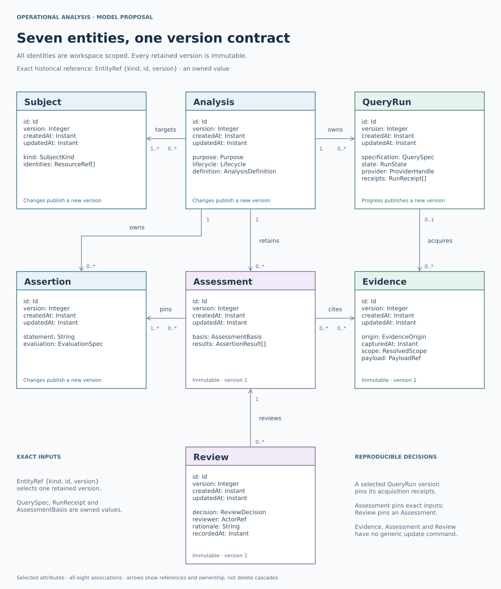

# Operational analysis: a generalized seven-entity model

## 1. Recommendation

**Model an analysis as a set of assertions about identified subjects over a stated interval, evaluated against retained evidence and reviewed by operators.** Use seven domain entities: **Subject, Analysis, Assertion, QueryRun, Evidence, Assessment and Review**.

An investigation is one purpose of an Analysis. The same model supports deployment verification, infrastructure review, incident diagnosis, alarm-path verification and operational readiness. AWS DevOps Agent becomes an evidence source and an optional reasoning participant. Its native Task and Execution contracts remain behind the adapter boundary.

The core sentence is: **an Analysis asks; QueryRuns collect; Evidence records; an Assessment concludes; a Review records the operator's decision.** Assertions state the questions precisely, and Subjects identify what those questions concern.

This is a new design proposal, not an implemented replacement for the reviewed Lens application or a new AWS API. The existing [investigation report](../../report.md) and [quality review](../../QUALITY_REVIEW.md) remain the baseline. The proposal deliberately preserves their hard-earned identity, provenance and history guarantees while reducing the number of concepts operators and API clients must manage.

### Reading map

| Material | Purpose |
| --- | --- |
| This document | Complete entity inventory, ownership, class diagram, assertions, time and extension rules |
| [API proposal](API.md) | Coherent application operations, requests, asynchronous acquisition and API guarantees |
| [AWS evidence contracts](AWS_EVIDENCE.md) | Current query boundaries and the worked alarm/SNS evidence chain |
| [Design challenge record](DESIGN_REVIEW.md) | Counterexamples, dispositions and implementation acceptance cases |
| [Class diagram SVG](diagrams/OA01-domain-classes.svg) | Portable rendered figure |
| [Class diagram source](diagrams/OA01-domain-classes.drawio) | Editable Draw.io class diagram |
| [Diagram validation](diagrams/render-report.json) | Draw.io engine, geometry checks and source/output hashes |
| [Validation record](qa/VALIDATION.md) | Executed document checks and visual review scope |

## 2. Design principles carried forward

The latest committed [consolidated design principles](../../../../../consolidated-operations-console/DESIGN_PRINCIPLES.md) record the user's 5 November 2026 correction: **every entity is versioned; a version does not create another entity; presentation diagrams use Draw.io**. Its [RPC protocol](../../../../../consolidated-operations-console/api/PROTOCOL.md) establishes the current integration convention. This proposal adopts those choices. Earlier personal conversations could not be retrieved because Personal Context was disabled; no unseen preference is attributed to the user. The visible adversarial review, [FIS model](../../../../fis/analysis/workflow/model.md), [FIS API](../../../../fis/analysis/workflow/api.md), [Resilience protocol](../../../../resilience-hub/analysis/api/protocol.md) and [validation-console design](../../../../../applications/aws-validation-console/docs/DESIGN.md) supply the remaining evidence.

1. **An entity earns its identity and lifecycle.** A named type does not automatically need a database table, identifier or CRUD endpoint.
2. **One relationship has one writable owner.** Reverse lists, timelines, graphs and dashboards are projections of that authority.
3. **Separate intention, execution, observation, interpretation and review.** A successful query is an execution fact; a supported assertion is an interpretation; an accepted assessment is an operator decision.
4. **Pin what was used.** Retain exact definition versions, resolved targets, query specifications, selected evidence, coverage receipts and evaluator versions.
5. **Preserve uncertainty.** Missing, empty, zero, null, unsupported, failed and not applicable have different meanings.
6. **Make temporal meaning explicit.** A fact's occurrence time, its capture time and the time at which it informed a decision are separate.
7. **Use narrow commands and tolerant provider reads.** Computed verdicts, producer authority and reviewer identity are server outputs, not editable request fields.
8. **Version every entity consistently.** A stable identity has immutable published versions; owned values inherit that version. An immutable fact may remain at version 1. Versioning does not imply public update operations or a separate Version entity.
9. **Make history reproducible without duplicating every concept.** Immutable captures and assessment manifests are sufficient domain primitives; physical source/blob/version tables may normalize their storage.

## 3. Complete entity inventory

These are the only identity-bearing entities introduced by this proposal. IDs are opaque application identifiers scoped by workspace. Resource-owning identity and authorization context remain separate.

### Common identity and version contract

Every entity carries `id`, `workspaceId`, `version`, `createdAt` and `updatedAt`. The owning authority allocates a positive integer version; each retained representation is immutable. `createdAt` identifies creation of the application identity, while `updatedAt` identifies publication of that version. Neither replaces source-event, capture, execution or review time.

Exact references use `{kind, id, version}` in an authorized workspace. ID-only references are reserved for explicit live navigation. Historical reads return that version or an explicit unavailable result; they never substitute the current head. Owned values use their owner's version. Provider native versions, schema versions and evaluator versions retain their specific meanings.

Subject, Analysis and Assertion can publish new authored versions; the runtime publishes QueryRun progress versions. Evidence captures, Assessments and Reviews are append-only facts and remain at version 1 under the initial contract. A new capture, evaluation or review is a new occurrence with a new identity. This preserves one common version mechanism without inventing public mutation for immutable facts.

| Entity | Meaning | Ownership and lifecycle |
| --- | --- | --- |
| **Subject** | A deployed service, system or resource whose behavior is being examined | Reusable identity with immutable definition versions. May resolve to an existing service catalogue instead of creating another inventory authority. |
| **Analysis** | A continuing workspace with a purpose, subjects, interval and selected criteria | Owns Assertions, QueryRuns and Assessments. Authoring changes create immutable versions; open/closed describes work management. |
| **Assertion** | A proposition, hypothesis or operational requirement with an evaluation specification | Owned by one Analysis. Stable ID and immutable versions support editing, comparison and exact assessment references. |
| **QueryRun** | One admitted acquisition of evidence using a complete frozen QuerySpec | Owned by one Analysis. The runtime publishes successive versions for progress and attempts; native job state and collection state remain distinct. Rerunning creates another QueryRun. |
| **Evidence** | An immutable capture of what a source, adapter, subscription or person supplied under a stated context | Workspace-owned, with one original origin. Reusable through authorized references. It is not automatically an established fact. |
| **Assessment** | An immutable evaluation of exact assertion instances against an exact evidence and coverage basis | Owned by one Analysis. Re-evaluation creates a new Assessment. Results are owned values within it. |
| **Review** | An attributed operator decision about one exact Assessment | Append-only. A later review may explicitly supersede an earlier review by that reviewer; neither modifies the assessed evidence or verdicts. |

**Subject identity.** A deployed service can have an application identity such as checkout/production, with provider-native references for its current resources. A native identity retains provider, owning partition/account/location and opaque native ID or ARN where applicable. Native identifiers are never reconstructed by splitting an unescaped display string. A connection name or assumed role does not define a new service.

**Analysis versions.** An AnalysisDefinition contains exact Subject references, the semantic interval, criterion bindings and any chosen requirement-rollup policy. Each criterion binds an exact Assertion version to a target domain, applicability rule and role: required_requirement, optional_requirement or diagnostic. Changing this definition creates a new Analysis version. QueryRun progress advances that QueryRun's common version; it does not publish another Analysis version because it does not change the Analysis-owned definition. Evidence arrival changes the composed view, not that definition. A view publication sequence supports stable pagination; it is not an alternative entity-version mechanism. Closing an Analysis does not make the service healthy or erase its history; reopening permits additional work.

**Evidence reuse.** An Analysis can include references to captures originally obtained for another Analysis in the same authorized workspace. The original producer, source scope and capture time stay fixed. Reusing a content-addressed blob does not grant access to it. Copy/import operations preserve original provenance and record the new import context separately.

### Class diagram: all seven entities

Field types such as QuerySpec, AssessmentBasis and AssertionResult are owned values, defined below. The diagram shows selected fields and common version metadata for every entity. Associations express domain ownership and references, not unrestricted database delete cascades. Assessment references pin exact entity versions; the lines do not point to mutable current definitions. Workspace is an existing platform scope, not an eighth entity introduced by this proposal.



[Editable Draw.io class diagram](diagrams/OA01-domain-classes.drawio)

Manual, imported and subscription Evidence can have no QueryRun. A QueryRun can produce no usable payload, one result manifest, or several explicitly distinguished partial/final result captures. An Assessment can cite zero captures and still truthfully report inconclusive results; it must select at least one assertion instance.

## 4. Keep the richer structures as owned values

| Value | Owner and minimum responsibility |
| --- | --- |
| **EntityRef** | Exact `{kind, id, version}` within the authorized workspace, for every entity including immutable Evidence, Assessment and Review |
| **AnalysisDefinition** | Analysis version; subjects, interval, criterion bindings and optional requirement policy |
| **CriterionBinding** | AnalysisDefinition; Assertion version, target/phase expansion, requirement/diagnostic role and applicability rule |
| **ResolvedScope** | QueryRun, Evidence and Assessment basis; declared selector, pinned Subject versions, actual resource bindings and resolution gaps |
| **TimeRange** | Named start/end, clock basis, precision and boundary convention |
| **QuerySpec** | QueryRun; versioned adapter, operation/language, exact resolved request, scope, interval, limits and access-context reference |
| **RunReceipt** | Immutable owned value retained in an exact QueryRun version; attempt references, selected result manifest, native state, errors and coverage at that point |
| **Coverage** | RunReceipt/Evidence; traversed queries/pages, scope resolution, sampling, limits, retention and lateness assumptions |
| **PayloadRef** | Evidence; content identity, media type, schema/profile version, hash algorithm and retained-byte locator |
| **EvidenceRef** | Assessment input/citation; exact Evidence EntityRef plus row, event, series range or document locator and evaluator input role. A result citation's supporting/refuting/context stance is named separately. |
| **AssertionResult** | Assessment; exact assertion instance, input bindings, evaluator version, verdict, explanation and citations |
| **ActorRef** | Trusted producer/reviewer reference to the existing identity system, with human/agent/system attribution |

These values have schemas. They are not unstructured extension bags. Provider payloads may remain arbitrary JSON or bytes inside a PayloadRef, but the surrounding identity, time, scope, origin and result contracts are typed. Unsupported profiles remain inspectable and produce an explicit interpretation limitation.

**Why QueryDefinition is not an entity in the first version.** Ad hoc execution needs a frozen QuerySpec, not a saved-query catalogue. A recipe library can later compile a versioned recipe into that same value. If independent sharing, approval and publication of recipes becomes a real requirement, add a catalogue bounded context; keep QueryRun's executed specification self-contained.

**Why Evaluation is not an entity.** An AssertionResult has meaning within the exact Assessment basis. Re-evaluating one criterion creates another Assessment; unchanged input bindings may be reused explicitly, and the remaining expected instances stay visible. Omitting a required instance cannot make the whole Analysis pass. Deliberately narrowing the requirement domain needs an explicit new definition/version or named subset policy, with the narrower claim displayed. Introduce an independent Evaluation only if it later acquires an independent lifecycle, ownership or sharing requirement.

**Why Assertion remains an entity.** Operators need to revise a question, refer to it across assessments and track its interpretations over time. Its stable identity is useful independently of one result. Reusable assertion templates can remain catalogue values compiled into analysis-owned assertions.

## 5. Evidence and reproducibility

Evidence has one meaning: **a captured observation or supplied record**. The model preserves four identities without turning them into four public resources:

| Identity | Example | Consequence |
| --- | --- | --- |
| Capture | evidence-42 | A particular observation under a particular collection context |
| Content | SHA-256 of retained payload bytes under a declared encoding | Identical bytes can share storage |
| Logical source item | Owning scope plus CloudTrail event ID, SNS message ID/topic, or native record ID | Repeat reads need not create duplicate operational events |
| Observed source rendition | Native version, when available, or payload digest | Changed content is retained without inventing a native version guarantee |

Two reads may produce two captures with the same bytes. Two SNS delivery attempts may concern one logical message. One query payload may contain thousands of records. Therefore evidence-capture counts, record counts, source revisions, delivery attempts and logical messages are separate quantities.

Every retained payload has declared representation semantics: original bytes when available, or an explicitly named normalized serialization. Hashing normalized JSON does not preserve original transport bytes or authenticate the origin. Source authenticity checks, import status, schema validation and evidentiary meaning are separate provenance attributes.

**Do not union all asynchronous polls.** A query may expose a partial result, then a larger result, then paginated final results. Each published QueryRun version pins its coherent selected result manifest and RunReceipt. The AssessmentBasis selects that exact QueryRun version, its pages/captures and any declared deduplication policy. There is no independent resultEpoch version counter. Overlapping reruns are not silently summed. A later successful retry cannot rewrite an earlier partial assessment's coverage.

An immutable AssessmentBasis contains:

- Exact Analysis version and expected assertion-instance manifest.
- Resolved Subject/resource scope, interval and any baseline/incident/recovery phases.
- Exact selected Evidence versions and QueryRun versions/result manifests.
- Frozen run receipts, failed/empty attempt outcomes, coverage limits and gaps.
- Parser, adapter and evaluator/runtime versions used.
- Evidence knowledge cutoff and application publication sequence.
- Requirement-rollup policy, if requested, and input/content digests.

An evidence-selection digest is not a substitute for retaining its members. Historical reading and export obey current authorization and retention policy. If source bytes are later unavailable, retain an explicit availability state; do not silently fetch a current substitute and call it historical evidence.

## 6. General assertions and evaluation

An Assertion states a proposition plus the contract needed to interpret supporting observations. Its statement is readable; its EvaluationSpec supplies versioned, typed evaluation semantics.

| Assertion family | Example | Appropriate method |
| --- | --- | --- |
| Scalar or aggregate | Checkout p95 is at most 500 ms in the recovery window | Typed value, unit, reducer, population and missing-sample rule |
| Existence | The expected endpoint received message M | A correctly correlated witness |
| Absence | No unapproved security-group change occurred in W | Adequate coverage of the relevant event population and interval |
| Universal/relational | Every qualifying ALARM transition reached the required endpoint within 60 seconds | Complete anchor population, stable target domain and temporal correlation |
| Configuration | The alarm action referred to the required topic at transition time | Historical configuration evidence or explicit inference limitation |
| Hypothesis | Pool reduction explains the observed latency increase | Attributed reasoning with supporting and counterevidence; correlation alone is not causal proof |
| Human operational judgment | The runbook's escalation instructions are usable | Recorded human evaluation, rationale and cited observations |

The initial evaluator interface should support a small number of versioned primitives: comparison, existence, absence, aggregation, bounded temporal matching and attributed manual/reasoned evaluation. Specialized evaluators can implement that interface. The model does not require an unrestricted scripting language.

### Four per-assertion verdicts

| Verdict | Meaning |
| --- | --- |
| **supported** | The selected evidence meets the declared predicate and adequacy requirements |
| **refuted** | The selected evidence establishes a violation or counterexample under those semantics |
| **inconclusive** | Evidence, coverage, applicability or interpretation is insufficient or conflicting |
| **not_applicable** | A declared applicability rule excludes the instance, with a retained reason/basis |

Reason codes explain the verdict: missing_evidence, query_failed, partial_result, insufficient_samples, conflicting_evidence, unsupported_profile, ambiguous_correlation, unresolved_scope and similar versioned codes. A skipped or denied query cannot turn a required criterion into not_applicable.

Adequacy is **predicate-specific**:

- One reliable witness can support an existential claim even when the wider collection is partial.
- One reliable counterexample can refute a universal claim even when other collection is partial.
- No returned rows normally means not observed. Supporting an absence claim additionally requires adequate instrumentation, selectors, permissions, retention, completed traversal and a justified lateness/window-closure policy.
- Numeric reductions require the declared sample population, units, aggregation and missing-data policy. Averages and percentiles are not reconstructed by casually averaging page aggregates.
- An explicitly defined logical predicate may permit an empty population, but that does not establish operational readiness. A readiness rollup requires its nonempty required/applicable target domain; unresolved/empty domains remain inconclusive, or explicitly not applicable when that exclusion is proven. Minimum target/sample counts belong in the evaluation contract.
- Apparent conflicts must first be aligned by subject, resource version and valid time. A normal state change is not conflicting evidence. Genuine unresolved conflicts remain inconclusive with both citations.

**Assertion instances matter.** The result key is the tuple of exact Assertion version, target binding, interval and phase. A criterion evaluated for two Regions or two recipients produces separate owned results. The expected instance set is frozen before evaluation, so a failed collection cannot shrink the denominator. An incompletely resolved target domain prevents a universal success conclusion.

**Optional requirement rollup.** General hypotheses need not all be true. Only criteria designated by the pinned requirement policy participate in readiness aggregation. With that policy requested, a supported applicable required set meets the requirements; a known required refutation establishes a violation even if another criterion is inconclusive; unresolved required instances prevent success. An empty required set produces no readiness pass, and a wholly proven inapplicable required set is explicitly not applicable. If no requirement rollup was requested, omit it and present the individual results.

### Illustrative assertion definition

This is proposal-owned YAML, not a native AWS schema or an implemented expression language. The evaluator named here has the semantics described in this document; a production implementation would publish its formal input/output schema.

```yaml
id: assertion-alarm-delivery
version: 1
statement: >
  Every qualifying checkout ALARM transition in the analysis window
  reaches the operations endpoint within 60 seconds.
evaluation:
  mode: deterministic
  evaluator: {key: correlated-delivery-within, version: "1"}
  inputs:
    transitions: alarm-transition/v1
    envelopes: sns-envelope/v1
    deliveries: endpoint-delivery/v1
  condition:
    anchorState: ALARM
    recipient: operations-endpoint
    maximumDelay: PT60S
    transitionJoin: [alarmArn, stateChangeTime, newState]
    deliveryJoin: [topicArn, messageId, destination]
  adequacy:
    minimumAnchors: 1
    requireResolvedRecipient: true
    requireCompleteAnchorPopulationForSupport: true
    missingReceipt: inconclusiveUnlessAbsenceIsEstablished
```

The concrete input bindings live in the Assessment, not in an implicit query-to-verdict association. A query can support several assertions; one assertion can require several queries, pushed notifications and human observations.

## 7. Query execution as a small extension boundary

**QueryRun executes one frozen acquisition specification.** Synchronous reads, asynchronous queries and composed paginated reads use the same contract. Polling, retries and paging are owned attempts within that run; they are not additional domain entities.

A QuerySpec pins adapter/version, native operation or language, exact resolved query/parameters, resolved scope, requested interval, native interval translation, result limits, deadline, connection/authorization-context reference, and output profile. Provider query IDs and continuation tokens remain opaque adapter values. Effective authorization and caller identity are resolved by the backend.

The worker admits the run durably, executes the permitted adapter, records its native handle when available, retains responses/attempt outcomes, and produces immutable Evidence and RunReceipts. The UI can display progress and provisional evidence before an Assessment is issued. A partial result remains labeled partial.

The local run has a technical state such as queued, running, succeeded, failed, cancelled or indeterminate. Native provider status is retained separately. Accepted cancellation is an intent; it does not establish remote termination. A provider job can complete while result-page retrieval fails. A lost start response can leave dispatch indeterminate; application idempotency must not be presented as native exactly-once execution.

Budgets bound pages, result volume and collection duration. A byte/cost estimate is not an enforceable hard spending cap if the provider only reports consumption after scanning. A configured row limit is a coverage limitation, not a universal completeness guarantee.

| Adapter example | Evidence it can supply |
| --- | --- |
| CloudWatch Logs Insights | Log records, query aggregates, query statistics and collection status |
| CloudWatch alarms | Current configuration/state and separate historical state/action observations |
| CloudTrail | Captured management/data activity, subject to the configured source/backend and event categories |
| SNS receiver or delivery-log adapter | Captured message envelopes, endpoint-specific delivery/handoff observations |
| Application receipt adapter | Explicit processing/acknowledgement events with a documented meaning |
| AWS DevOps Agent adapter | Native Task/Execution/journal observations and attributed agent conclusions |
| Human/import adapter | Supplied observations or documents with preserved origin and explicit trust limitations |

The exact current AWS restrictions and official sources are in [AWS_EVIDENCE.md](AWS_EVIDENCE.md). In particular, a generic CloudTrail adapter must not assume that LookupEvents includes SNS Publish data events or that CloudTrail Lake is available to new customers.

## 8. Time, timeline and operational state

The timeline is a **derived view**, not another truth-owning entity. It combines source events, query activity, evidence arrival, assessments and reviews, with the relevant clock labeled on each entry.

| Clock | Question answered |
| --- | --- |
| Source event/valid time | When did this happen, or which interval does the claim concern? |
| Captured/observed time | When did the collector or receiving endpoint obtain this observation? |
| Recorded sequence/time | When did this application retain it, and in what stable ingestion order? |
| Assessment cutoff/creation time | Which evidence was eligible when this conclusion was produced? |
| Review time | When did this operator decide about that exact assessment? |

Unknown event time remains unknown. UI sorting may use a disclosed fallback; it must not relabel capture time as occurrence time. Source precision and clock uncertainty matter when testing a deadline. Events near a 60-second boundary can be inconclusive if their clock uncertainty prevents a defensible comparison.

The RPC contract uses finite UTC epoch seconds with millisecond precision; readable examples use ISO dates. Semantic intervals are half-open [start, end). Source precision, uncertainty and original timestamps are retained separately. An adapter translates provider-specific bounds explicitly. For an API using inclusive epoch seconds, requesting a conservative superset and filtering exact event boundaries can be suitable for raw rows. Aggregated queries must apply the semantic boundary before aggregation or disclose the coarser effective interval. A post-filter cannot repair an already mixed aggregate. [AWS StartQuery](https://docs.aws.amazon.com/AmazonCloudWatchLogs/latest/APIReference/API_StartQuery.html)

Late evidence for yesterday's incident creates a new Assessment for the same valid interval and a later knowledge cutoff. It does not rewrite yesterday's accepted conclusion. The UI should offer:

- **Service timeline:** deduplicated source events, state intervals, deployments and observations.
- **Analysis activity:** collection, reasoning, assessments and operator decisions.
- **Assessment view:** exact frozen basis, per-assertion results, coverage and reviews.
- **Comparison:** changed evidence, changed criteria/scope and changed interpretation shown separately.

An alarm's last observed state is not an unbounded statement that it stayed in that state. Derived state intervals carry continuity/coverage limits. A service's readiness is a scoped assessment against named criteria, not the Analysis lifecycle or a universal score.

## 9. Worked operational workflow

Suppose the operator asks: **Did checkout detect elevated latency and deliver the resulting alarm notification to the operations endpoint within 60 seconds?**

1. Select the deployed checkout Subject and pin its resource scope and interval.
2. Author assertions for latency/detection, the intended alarm/topic relation, matching notification delivery and, if needed, consumer processing. Mark only the desired validation requirements as required.
3. Start bounded query runs for relevant log data, alarm history/configuration, enabled CloudTrail records and endpoint/consumer logs. Retain push notification envelopes when available.
4. Review collection status and gaps. A failed query remains a failed acquisition; its assertion remains in the expected instance set.
5. Create an Assessment using explicit evidence bindings and frozen run receipts. Match the alarm transition to the captured SNS payload, then its message identity to the intended destination.
6. Present supported, refuted and inconclusive assertions separately. Show exact timestamps, matched IDs, excluded records and limitations.
7. Record an operator Review of that Assessment. Accepting an accurate failed/inconclusive assessment does not claim the service met the requirements.
8. When new evidence arrives or a criterion is corrected, issue another Assessment and obtain a new review where required.

Alarm transition, topic targeting, publication, endpoint delivery and business processing are separate propositions. A successful topic-level count, an action-history entry or a nearby timestamp cannot supply a missing exact join. The [AWS annex](AWS_EVIDENCE.md) makes these boundaries concrete.

## 10. Operator review

Review decisions mean **accept the assessment as accurate**, **challenge it**, or **request more evidence**. The reviewer identity and recorded time come from trusted execution context. Rationale and optional cited Evidence explain the decision.

A Review targets one exact Assessment EntityRef `{kind, id, version}`. Additional result-level comments can use owned result locators. The first version need not introduce independently approved result lifecycles. Multiple reviewers can disagree; preserve their decisions and apply an explicit policy if a product needs consensus. Do not silently use the last review as an authoritative override.

Manual/reasoned evaluation and review remain separate acts. A human or agent can supply an attributed interpretation with rationale and citations through an explicit attestation Evidence profile. The backend assigns the producer identity and origin; a pinned evaluator applies the declared attestation policy, and the resulting human/agent method remains visible in the AssertionResult. This is not a client patch of a machine verdict or a relabelling of the attestation as a cloud measurement. A subsequent Review decides whether the Assessment is acceptable. It does not silently replace the interpretation or its method.

Risk acceptance and remediation approvals are separate policy concerns. If added later, they must identify their scope, authority and expiry. They cannot turn a measured violation into a supported assertion.

## 11. API and extension choices

Use semantic operations that match the entity boundaries: create/revise an Analysis or Assertion, start/read/cancel a QueryRun, ingest/read Evidence, create/read an Assessment, and record/list Reviews. Timeline and graph reads are projections. No endpoint patches a computed verdict.

The [API proposal](API.md) gives one consistent RPC binding aligned with the consolidated console convention. Its preconditions are local application contracts. An idempotency key prevents duplicate command admission; it does not imply provider-level idempotency. A view's pagination cursor pins its query, scope and publication sequence; it is not a repurposed AWS NextToken.

Extensibility belongs in versioned adapters, payload profiles and evaluators. A new cloud source should normally require an adapter and profile, not another core entity. A new assertion should normally require a definition or evaluator, not another result table. Rich graph visualization can derive from typed citations and relations without introducing graph-layout entities into the operational truth model.

| Proposed addition | Promote to a separate entity only when |
| --- | --- |
| Query recipe | Independent sharing, publication or governance requires its own identity/lifecycle |
| Evaluation | It must be managed or reused independently of an immutable Assessment |
| Artifact | Content has its own governed lifecycle beyond an Evidence PayloadRef |
| Action/remediation run | The product deliberately adds authorized operational effects and recovery tracking |
| Service topology | An inventory/topology bounded context owns and versions it; analysis references its snapshots |

Keep credentials, integrations and identity-provider users in their existing bounded contexts. QueryRun is evidence acquisition, not a general-purpose operational command bus. Tests that deliberately publish SNS messages or inject faults would use a separate action model and feed their observations back into this one.

## 12. Mapping from the reviewed AWS investigation model

| Existing concept | Generalized representation |
| --- | --- |
| Native investigation Task | External reference on Analysis and retained native Evidence; native lifecycle is preserved independently |
| Native Execution/task membership | Captured provider data inside Evidence; it is not automatically the application's QueryRun |
| JournalRecord | Source item in a retained Evidence capture, with exact native scope and content locator |
| Source revision and observation | Evidence capture plus source-item identity/rendition and shared PayloadRef; storage may normalize these internally |
| Finding/hypothesis/root-cause claim | Assertion and attributed AssertionResult; the original agent statement remains cited Evidence |
| Collection pass/read attempts/coverage | QueryRun's owned attempt history and immutable RunReceipts, pinned in assessments |
| Timeline/evidence graph | Derived read views over captured events and citations |
| Artifact | PayloadRef and availability, with an entity added only for independent lifecycle requirements |
| Historical UI snapshot | Retained historical source; only becomes an Assessment when exact criteria, inputs and evaluation semantics are supplied |
| Operator validation | Review of an exact Assessment |

The existing Lens prototype can evolve incrementally: introduce the generalized read model behind its current views, make assertions and evidence bindings explicit, add QueryRun adapters, then add immutable assessments and reviews. Migration must preserve existing native IDs, source provenance and original capture contents. This proposal does not perform that migration.

### Fit with the consolidated console

The [consolidated model](../../../../../consolidated-operations-console/MODEL.md) covers a broader product, including inventory, AWS Health, Resilience Hub, workflow and operational commands. These seven entities define the **analysis bounded context**, not a replacement for those domain modules.

| Existing responsibility | Integration rule |
| --- | --- |
| Service, System and Resource catalogue | A Subject references the authoritative catalogue and pins the versions actually assessed. It does not become a second editable inventory. |
| Connection and identity providers | QuerySpec pins the authorized external connection context; credentials and actor management remain outside this model. |
| Source, Observation, Collection and ReadAttempt | An Evidence capture and QueryRun receipt can reference their exact retained versions. The seven-entity facade does not require duplicating their physical records or erasing capture/source distinctions. |
| Native Investigation, Execution and JournalRecord | Remain provider observations. A provider-neutral Analysis can include several such observations and other evidence sources. |
| Snapshot and Projection | Can implement retained manifests and derived views. An Assessment adds the explicit assertion-instance/evaluator contract; a generic snapshot is not automatically an assessment. |
| WorkItem and Command | Keep operator assignment and infrastructure effects in their existing owners. Analysis lifecycle controls the analysis case; it must not mirror another independently writable ticket status. Review judges the assessment, not operational-effect authorization. |

The public analysis contract still uses one uniform entity-version/reference mechanism. Provider identifiers, native statuses and existing domain distinctions remain available through typed references and retained payloads. Sharing storage or lower-level acquisition services does not authorize silently changing the meaning of the public seven entities.

## 13. Quality bar and implementation sequence

The [design challenge record](DESIGN_REVIEW.md) specifies counterexamples to test before implementation claims. The proposal has a closed entity inventory and a checked class diagram; it is not a formal proof of a backend contract or a live AWS integration.

A practical first implementation would support one service/analysis scope, Logs Insights plus alarm-history reads, immutable raw evidence, deterministic existence/comparison/temporal-match evaluators, an Assessment manifest and operator Review. Then add CloudTrail backends, received SNS envelopes, multi-subject instance expansion and reusable recipes as their requirements become concrete.

Before claiming operational validity, prove representative payload profiles, source/retention coverage, exact correlation, ambiguous dispatch recovery, immutable input selection and current authorization for historical evidence. Before claiming UI readiness, test the operators' ability to distinguish query failure, unsupported claims, assessed violations and review decisions.

### Reproduce the document and figure checks

From the parent service analysis directory, install the already pinned diagram/checker dependencies if needed, then run:

```bash
npm ci --prefix tools --ignore-scripts --no-audit --no-fund
python3 -m pip install -r tools/requirements.txt
python3 tools/render-proposal-drawio.py --check
python3 tools/check.py
```

After an intentional diagram change, regenerate the SVG using the pinned Draw.io engine, update its hash-bound evidence and visually review the figure. The [validation record](qa/VALIDATION.md) gives the render command and scope. The diagram check verifies the exact seven-entity inventory, uniform version metadata, declared associations and retained Draw.io source/render hashes. The package checker verifies the linked SVG, YAML and local links. These are documentation/diagram checks, not executions of the proposed APIs or design acceptance cases.
