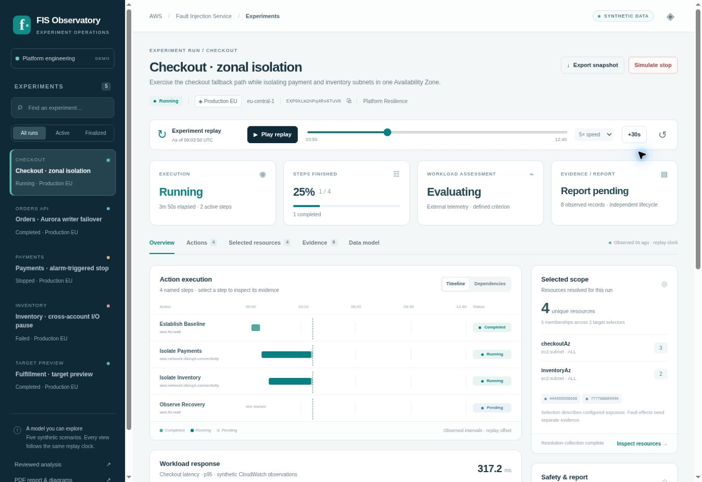

# AWS FIS: reviewed model and operator UI

This package contains an analysis of the official AWS Fault Injection Service (FIS) API, five entity relationship diagrams, a review record, and **FIS Observatory**, a static single-page application that makes the model explorable. The UI focuses on understanding an experiment while it runs and after it finishes: action execution, selected scope, workload response, and available evidence.

**The application uses synthetic data only.** It does not call AWS, request credentials, run fault actions, retrieve CloudWatch data, or download S3 report objects. The accounts, workloads, resources, events, alarm observations, telemetry, and report references are fictional. “Simulate stop” changes the browser's local replay only.



## Run the application

Open [`index.html`](index.html) in a current browser with JavaScript enabled. Keep the `app/` and `diagrams/` directories beside it. There is no build step, package installation, backend, or external JavaScript dependency.

Alternatively, serve this directory locally:

```bash
cd aws/fis/analysis
python3 -m http.server 8080
```

Then open [http://localhost:8080](http://localhost:8080). Stop the local server with `Ctrl+C`.

All displayed times are UTC. Replay timestamps come from a fixed synthetic clock, not the browser's current time. Source citations in the report link to the official AWS documentation and require internet access when opened.

## Explore the model

The sidebar selects one of five experiments and supports text search and Active/Finalized filters. A scenario opens at a useful point in its replay. The replay controls can play or pause, change speed to 1×/5×/15×, advance 30 seconds, or scrub to any point. **Reset returns to the beginning and clears that scenario's simulated stop.**

| View or control | What it demonstrates |
| --- | --- |
| **Overview** | Named action timeline or dependency layout, workload telemetry with an explicit criterion, selected scope, alarm observations, report state, and recent evidence. |
| **Actions** | Separate executions even when catalog `actionId` values repeat. Select an action to inspect state, reason, parameters, timing, predecessors, successors, target-slot bindings, and selected memberships. Dependency links open the related action; “Related evidence” filters the evidence view. |
| **Selected resources** | Deduplicated identities with every target membership retained. Filter by selector or search for a resource, account, or action. Selector snapshots remain inspectable. An incomplete collection is distinguished from a confirmed empty result. |
| **Evidence** | Source and text filters, account/action context, and separate event occurrence and observation timestamps. A record appears only after its observation time. |
| **Data model** | Entity identity rules, the five diagrams, Mermaid sources, the reviewed report, the review record, and the official source register. |
| **Report artifact reference** | Inspect the separate report lifecycle and fictional S3 artifact references after a report is ready. The references are not downloadable AWS objects. |
| **Export snapshot** | Download observed data as of the replay time, static configuration, and derived values as JSON, marked with its schema and synthetic provenance. Future simulator schedules and outcomes are excluded. The export is an application snapshot, not a raw AWS API response. |
| **Copy experiment ID** | Copy the selected synthetic experiment ID when the browser allows clipboard access; otherwise show it in a notification. |
| **Simulate stop** | Request a local interruption for an active, non-preview run. Active steps enter `stopping`, unstarted steps become `cancelled`, and the mock experiment becomes `stopped` after 30 replay seconds. The prior workload conclusion and report are invalidated. This timing is a scenario script, not an AWS guarantee. |

Changes are held in browser memory. Reloading restores the original fixtures. Use Reset before replaying a scenario without an earlier local intervention. Opening action or report details pauses the replay for inspection. Keyboard arrow keys, Home, and End navigate the main view tabs; dialogs can be closed with their buttons or the browser's standard dialog behavior.

## Scenarios

| Scenario | Initial snapshot | Model distinction |
| --- | --- | --- |
| **Checkout · zonal isolation** | Running across two target accounts in `eu-central-1` | Two separately named actions share the same `aws:network:disrupt-connectivity` catalog ID. Overlapping selectors produce five memberships but four unique subnet resources. Recovery assessment and report readiness arrive later. |
| **Orders · Aurora writer failover** | Execution completed; workload criterion failed | Successful completion of the configured FIS actions does not establish workload resilience. The mock recovery takes 145 seconds against a 90-second objective; report generation completes separately. |
| **Payments · alarm-triggered stop** | Stopped after a CloudWatch alarm observation | The replay includes a `stopping` period for post actions, a stopped action, and cancelled dependent steps. The independent report remains pending at the opening snapshot. |
| **Inventory · cross-account I/O pause** | Failed | An account-scoped permission failure is represented by the experiment's structured error and supporting evidence. Pending work is cancelled; an inconclusive workload assessment and a report-generation failure remain distinct. |
| **Fulfillment · target preview** | Completed with every action skipped | `actionsMode=skip-all` resolves target selection without fault execution: 100% terminal steps, zero completed actions, no workload assessment, and no experiment report. |

The fictional orchestrator account is `111122223333`; target accounts are `444455556666` and `777788889999`. The fixture catalogue uses real FIS action identifiers, while all operational data is invented for demonstration.

## Four independent outcome dimensions

The top-level cards deliberately keep these conclusions separate:

1. **Execution:** the experiment's AWS-shaped lifecycle state and observed elapsed time. `stopping` is still active; `completed` describes execution.
2. **Steps finished:** the fraction of configured action executions in terminal states. Completed, stopped, failed, cancelled, and skipped remain separate counts. A preview can be 100% finished with zero completed actions. This fraction is not an estimate of elapsed-time progress or fault coverage.
3. **Workload assessment:** an application-owned conclusion from external telemetry and a stated criterion: evaluating, passed, failed, inconclusive, or not assessed. The FIS execution response does not supply this verdict.
4. **Evidence/report readiness:** observed evidence and the report's independent lifecycle. Experiment completion does not imply that a report is ready, downloadable, or proof that the workload met its objective.

Selected-resource scope is a separate fact throughout the views. A selected resource is not proof of an applied fault, a successful action effect, or successful recovery. Generic FIS action responses do not provide a universal result for each selected resource. These boundaries and their AWS sources are explained in [`report.md`](report.md).

## Files

| Path | Purpose |
| --- | --- |
| [`index.html`](index.html) | Static single-page entrypoint and accessible page/dialog structure. |
| [`app/styles.css`](app/styles.css) | Responsive layout and visual states. |
| [`app/app.js`](app/app.js) | Browser rendering, navigation, replay controls, local stop simulation, and JSON export. |
| [`app/fixtures.js`](app/fixtures.js) | Five deterministic scenarios, catalogue labels, typed target selectors, mock schedules, and synthetic evidence. |
| [`app/model.js`](app/model.js) | Pure snapshot projection, action derivation, membership deduplication, evidence filtering, and fixture validation. Browser globals and CommonJS exports support the same model in the app and tests. |
| [`app/tests/model.test.cjs`](app/tests/model.test.cjs) | Node built-in test suite for meaningful identity, timing, scope, outcome, and replay invariants. |
| [`report.md`](report.md) | Maintained, source-cited API analysis and reviewed logical model, including all five Mermaid diagrams. |
| [`REVIEW.md`](REVIEW.md) | Review findings, API boundaries, corrections, and documentation validation scope. |
| [`sources.json`](sources.json) | Official AWS source register used by the reviewed report. |
| [`VALIDATION.md`](VALIDATION.md) | Automated checks, browser scenarios, corrections, and validation limits. |
| [`tools/README.md`](tools/README.md) | Reproducible SVG/PDF generation instructions and dependency details. |
| [`preview.jpg`](preview.jpg) | Screenshot of the operator overview. |
| [`diagrams/`](diagrams/) | Paired editable `.mmd` sources and rendered `.svg` diagrams: execution; templates/catalog; targeting; evidence/reports; workload assessments. |
| [`aws_fis_experiment_action_model.pdf`](aws_fis_experiment_action_model.pdf) | Portable reviewed report with the rendered diagrams. |

The replay's `schedule` and `_mock` fields, display labels, application assessment, observation metadata, and telemetry are explicitly application/demo data. Dates are normalized ISO 8601 strings for the app; a real adapter must normalize the API/SDK timestamp representation it receives. `experiment` is an AWS-shaped aggregate, not a promise that the surrounding fixture envelope is an AWS response schema.

## Verify the model

From this directory, run the tests with a current Node.js release that supports the built-in test runner:

```bash
node --test app/tests/model.test.cjs
```

The suite covers duplicate catalogue IDs under distinct action names; dependencies and overlapping memberships; preview terminal counts; incomplete target collections and unknown identities; snapshot polling versus event occurrence/observation; future evidence, telemetry, and verdict suppression; stopping/post-action semantics; completed execution with a failed workload criterion; experiment-level errors; immutable replay; unknown action states; UI-supplied snapshot overrides; and stale polling.

The current model suite contains **19 tests**, including as-of export filtering and preservation of observed errors, report artifacts, and local interventions. Passing it verifies those data-model invariants; it does not establish live AWS integration, service-side permissions, browser rendering, or fault behavior. Documentation review checks are recorded separately in [`REVIEW.md`](REVIEW.md).

## Intended use and next integration step

Use this package to review entity boundaries, operator terminology, state presentation, and the distinction between API facts and application conclusions. It is an initial UI/model showcase, not a connected experiment controller.

A production integration would replace the fixture adapter with hydrated FIS snapshots and complete paginated target collections, retain observation/source provenance, ingest appropriate logs/events and workload telemetry, and evaluate versioned workload criteria. It would preserve unknown values and unknown future state strings instead of fabricating defaults. The operation inventory, mutation boundaries, entity model, and derived-measure assumptions in the reviewed report define that work in more detail.
