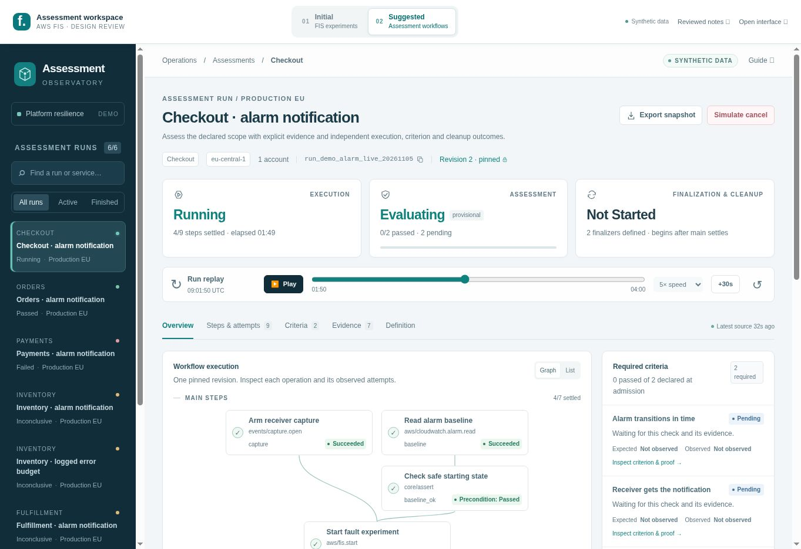
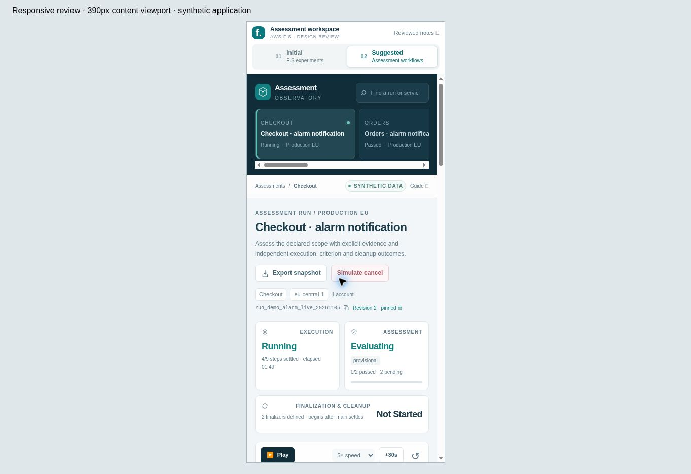

# Revised package validation

This record covers the revised package checked on **2026-11-05**. Earlier validation is retained in the baseline notes with its original scope. No AWS account was connected; no experiment, query, notification or cancellation was executed against a live service.

## Automated checks

| Check | Result | What it establishes |
| --- | --- | --- |
| Revised package checker | Passed; **33 Markdown notes**, **8 canonical diagrams**, **53 official FIS sources** | Required YAML properties, unique IDs, relative links, embedded Mermaid parity, SVG XML/title/description, source citation set, literal application assets and preservation hashes. |
| Documentation provenance | **61 file hashes/sizes** and **41 import hashes** verified | The packaged report, diagrams, examples, reference checks and historical records match their declared inventory. DOC01 is an explicit substantive adapter clarification. |
| Initial UI model tests | **27/27 passed** | Native FIS identities, observations, unknowns, selected scope, telemetry gaps, reports, replay, export and simulated stop behavior. |
| Suggested UI model tests | **32/32 passed** | Six-entity identity, pinned inputs, criteria, attempts, evidence, remote effects, finalization, replay, export, cancellation and source freshness. |
| Recorded operation DTO schemas | **87/87 valid**, included in the suggested suite | Every recorded step-start input and successful step-finish output conforms to its retained pinned operation schema. |
| Workflow reference validator | Passed for **2 examples**, **39 decision cases**, **3 model diagrams** | Declared input/reference scope, lock consistency, dependencies, finalizer rules and diagram parity. No workflow or CEL expression is executed. |
| Workflow reference unit tests | **68/68 passed**, including the 39 independent cases | Selected counterexamples for publication/admission, conditions, retries, cancellation, evidence and verdict rules. |
| Initial interface preservation | **6/6 files verified against the source commit** | Model, fixtures, styles and tests remain byte-identical; two interface files have only declared documentation/navigation adaptations. |

The three unit suites total **127 passing tests**. The 87 schema-validated DTOs and 39 independent decision cases are included checks, not additional unit-test counts.

The suggested suite sweeps every event boundary across all six runs. It checks a frozen required denominator, no future evidence/output in a projection or export, atomic dispatch-intent/effect visibility, absent values, immutable sealed attempts, consistent predicate identity, true window closure, receipt/source linkage and source freshness. It also covers a cancellation racing an unacknowledged Start and cancellation before any dispatch.

Run from the repository root with Node.js, Python 3.10 or later, `PyYAML` and `jsonschema`:

```bash
python3 aws/fis/analysis/revised/tools/check_package.py
node --test aws/fis/analysis/revised/initial/app/tests/model.test.cjs
node --test aws/fis/analysis/revised/suggested/app/tests/model.test.cjs
python3 aws/fis/analysis/revised/docs/suggested/contract.py
python3 -m unittest discover -s aws/fis/analysis/revised/docs/suggested/tests -v
```

The package checker does not rewrite deliverables. The initial manifest's original hashes were independently compared with `git show` from source commit `1b5ae1bd11fc61a2701d74ea89ccce2721889ef0`. All eight Mermaid/SVG pairs remain byte-identical to that baseline. The suggested diagram renderer was also checked after relocation; the current package does not rerun or duplicate the historical PDF pipeline.

## Browser checks

The browser review used an isolated static copy of the revised package. The HTML, JavaScript and styles in the preview were compared with the deliverable bytes. The final fixes were reloaded and checked before screenshots were captured. A model test is not a browser observation, and synthetic state is not live provider evidence.

| Interaction or view | Observed result |
| --- | --- |
| Comparison entry point | Initial appears first and is selected by default. Suggested is second and also has a direct hash entry point. Both standalone interfaces load. |
| Switching and keyboard mode tabs | Arrow keys changed the selected interface. Suggested retained its 140-second cursor and Initial its 260-second cursor when switching between them. |
| Six suggested scenarios | Live execution; finalized pass; succeeded execution with failed notification criterion; indeterminate ambiguous start with incomplete cleanup/hold; successful query with inconclusive coverage; blocked precondition with no injection attempts. |
| Live progress | Advancing Checkout from 110 to 140 seconds exposed the subsequently observed receipt/checks. Assessment became provisionally passed while finalization remained running. |
| False criterion | Payments showed execution **Succeeded**, assessment **Failed**, finalization **Complete**, and no protective hold. The receipt inspector showed 75 seconds versus the 60-second deadline, exact receiver identity, receipt/ingestion timestamps and the synthetic clock bound. |
| Blocked mutation | Fulfillment's injection inspector showed **Skipped**, `PRECONDITION_NOT_PASSED` and **0 observed attempts**. |
| Cancellation | Accepting cancellation at 110 seconds entered finalization. At 170 seconds the local branch showed **Indeterminate / Inconclusive / Incomplete**, with unresolved effects. Last source observations remained 09:01:18 UTC for alarms and 09:00:51 UTC for FIS. |
| Rewind and reset | Rewinding to zero showed queued history before the saved cancellation. Changing runs and returning retained that cursor. Reset removed the intervention and restored the original replay. |
| Evidence filters | The collect step's exact filter returned 1 of 7 records. An unmatched text search showed 0 of 7 with a clear empty state. Clearing the step filter and selecting AWS FIS showed its 2 records. |
| Source provenance | The freshness dialog showed one row per authority after alias normalization. Local control state and provider observations were explicitly labelled. |
| Definition and diagrams | Published YAML/locks were inspectable. All three suggested diagram dialogs loaded their SVGs and exposed Obsidian/Mermaid links. All five initial diagrams loaded through their relocated paths. |
| Keyboard dialogs and view tabs | Escape closed detail dialogs and restored useful focus. End selected the Definition tab. Diagram dialogs hid the inapplicable JSON-copy button. |
| Export | The standalone download parsed as `assessment-observed-snapshot/1`: the live cutoff was 09:01:50 UTC, with 7 observed records, 2 pending requirements and no future receipt/event stream. Downloads from the comparison page were also shown as completed by the browser. |
| Narrow layout | A 390-pixel iframe viewport exercised the complete comparison shell and both interfaces. Each application had 375-pixel content width after its scrollbar and no page-level horizontal overflow. The suggested freshness dialog and diagram view remained usable. |

The narrow-layout check uses a real rendered iframe viewport, not mobile-device emulation. It does not establish touch-target behavior or a particular device's browser implementation. The download-event helper did not capture nested-frame downloads, so those completions were verified through the browser's download UI; the standalone exported JSON was additionally read and checked. No application-origin warning/error was observed in the inspected console records; browser-extension metadata messages were excluded.

### Captured views

The desktop screenshot shows the live suggested view with separate outcomes and dependency routing. The narrow screenshot shows the comparison shell and stacked operator layout. Both are synthetic observations of the delivered interface.





## Limits

This package does not implement a generalized workflow engine, durable command store, API server, CEL compiler, authenticated evidence collector, production notification receiver or cloud adapter. The exported presentation DTO is not a validated HTTP response implementation. Browser-local simulation is not proof of source completeness, remote cessation, recovery or permissions.

The reports are Markdown notes with YAML properties and verified local navigation. Native Obsidian rendering and plugin behavior were not exercised. No new PDF, PDF accessibility certification, broad browser compatibility or screen-reader certification is claimed. Historical PDF and renderer validation remain explicitly scoped to the baseline records. There are no uncompleted implementation claims hidden in the test totals.
