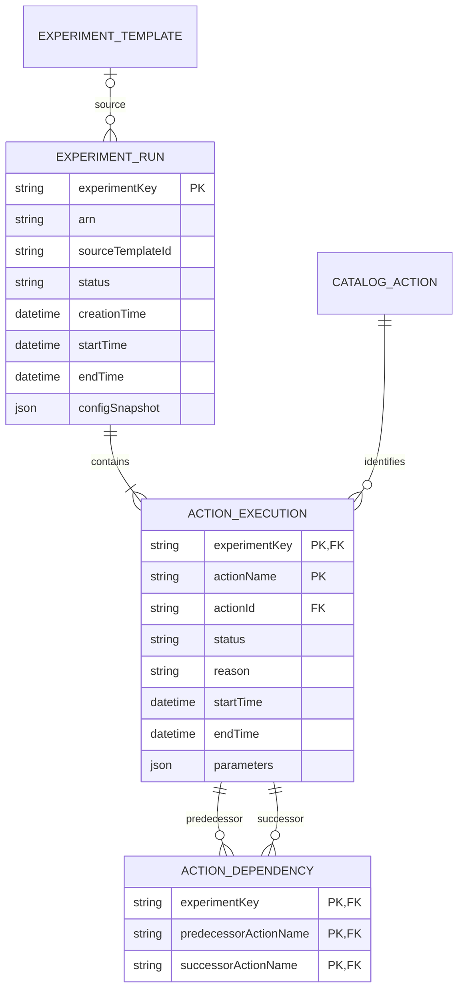
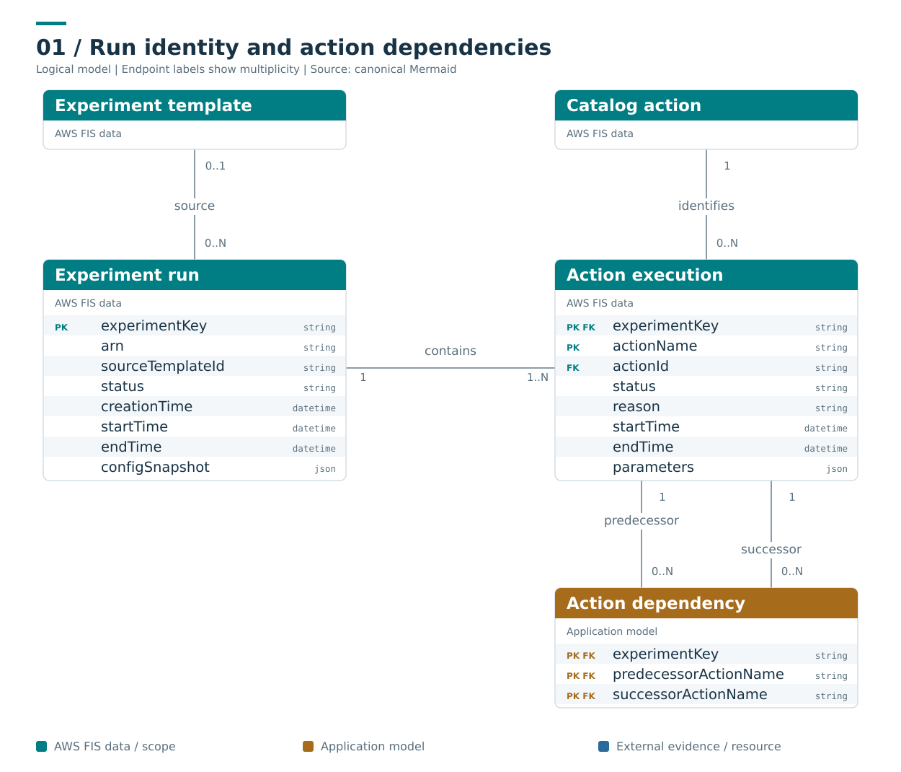

# Run identity and action dependencies

**Caption:** One run contains one or more logical action executions. A dependency identifies two steps in the same run. The source template can be missing from retained/current catalogue data after deletion; the source ID is still retained.

**Ownership and interpretation:** ExperimentRun and ActionExecution are native execution projections. ActionExecution identity is scoped to the experiment and action map key. ActionDependency is an application normalization of the named predecessor relation; both ends must belong to the same run.

[Model and invariants](../../docs/initial/report.md#2-core-execution-model) · [Editable Mermaid](01_execution.mmd) · [Standalone SVG](01_execution.svg) · [Diagram index](README.md)

## Mermaid

## Portable rendering

The Mermaid block above is identical to the canonical `.mmd` source. The SVG is provided for viewers that do not render Mermaid and carries an accessible title and description. Read the linked model for identity scope, logical cardinalities, conditional relationships and missing-data rules.
