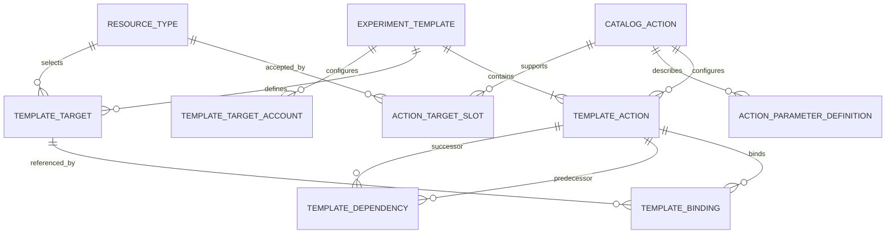
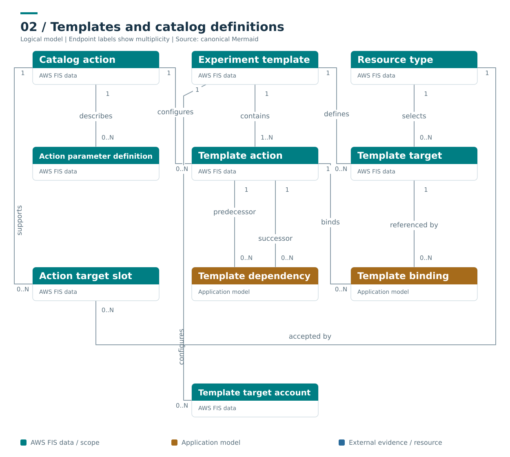

# Definitions, catalogue and templates

**Caption:** A template contains named steps, selectors and eligible account configurations. Target-slot bindings and predecessor edges are normalized relations. Catalogue metadata describes supported inputs and resource types; an unavailable metadata lookup should not prevent display of a recorded run.

**Ownership and interpretation:** TemplateAction and TemplateTarget are template-owned named members. Catalogue action and resource-type metadata describe capabilities, not executions. A target slot and an action map key are different identifiers.

[Model and invariants](../../docs/initial/report.md#3-definitions-catalog-metadata-and-templates) · [Editable Mermaid](02_catalog_templates.mmd) · [Standalone SVG](02_catalog_templates.svg) · [Diagram index](README.md)

## Mermaid

## Portable rendering

The Mermaid block above is identical to the canonical `.mmd` source. The SVG is provided for viewers that do not render Mermaid and carries an accessible title and description. Read the linked model for identity scope, logical cardinalities, conditional relationships and missing-data rules.
