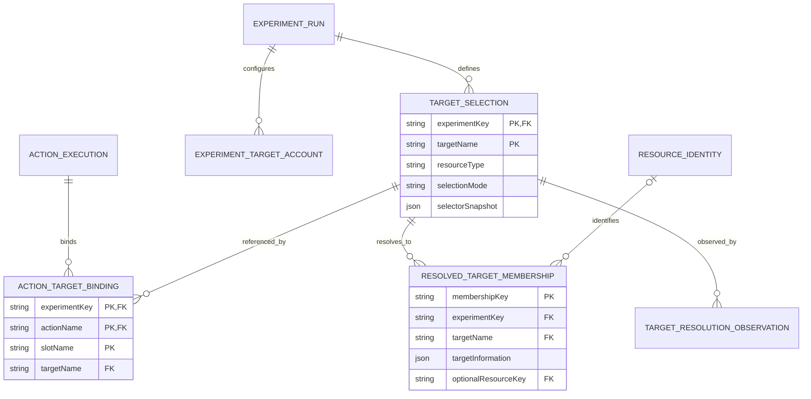
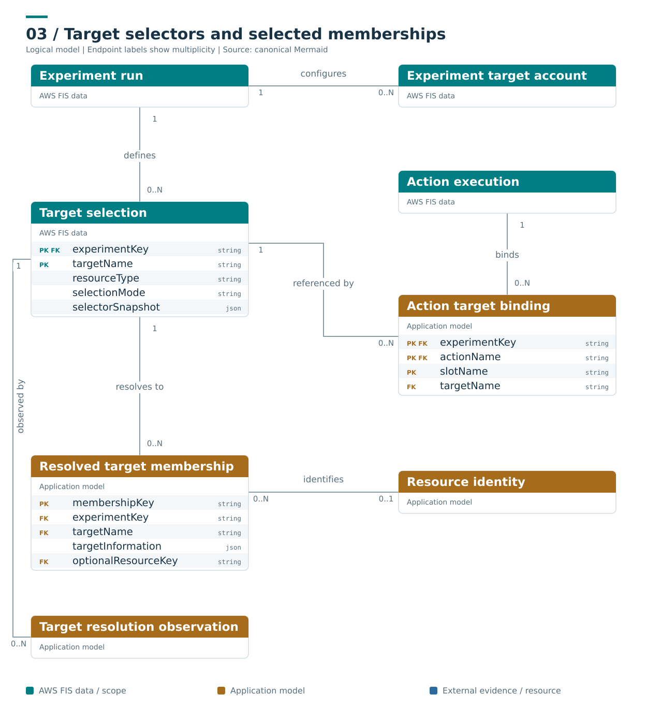

# Selected target scope

**Caption:** Selectors describe intended selection; memberships describe resources resolved for the run. ResourceIdentity is optional application normalization. A selector can feed several actions, and a resource can appear in several selectors. Action effects are a separate evidence layer.

**Ownership and interpretation:** Target selections and account configurations belong to one experiment. Membership is scoped to the run, selector and account. An observed membership is not proof that a fault was applied or recovery occurred; unidentified membership is retained without inventing resource identity.

[Model and invariants](../../docs/initial/report.md#5-target-selectors-resolved-memberships-and-accounts) · [Editable Mermaid](03_targeting.mmd) · [Standalone SVG](03_targeting.svg) · [Diagram index](README.md)

## Mermaid

## Portable rendering

The Mermaid block above is identical to the canonical `.mmd` source. The SVG is provided for viewers that do not render Mermaid and carries an accessible title and description. Read the linked model for identity scope, logical cardinalities, conditional relationships and missing-data rules.
