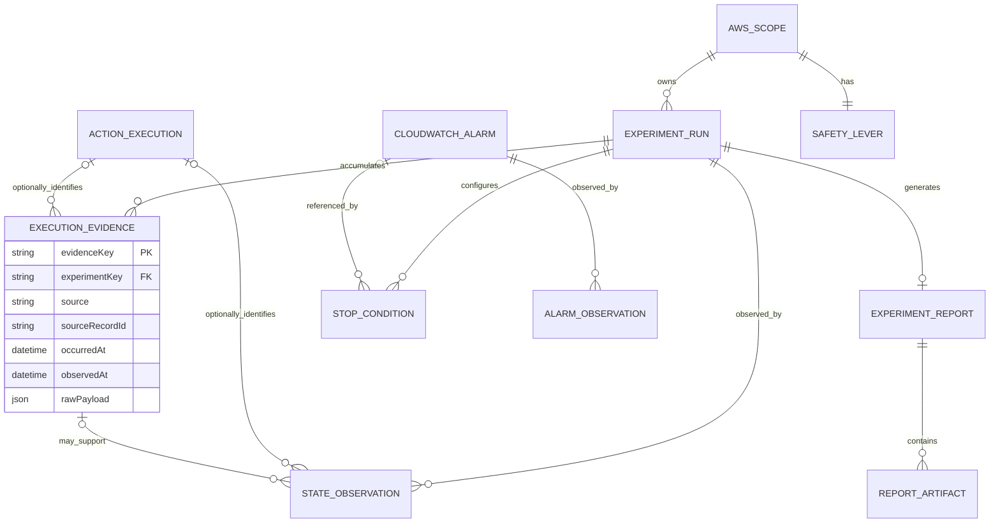
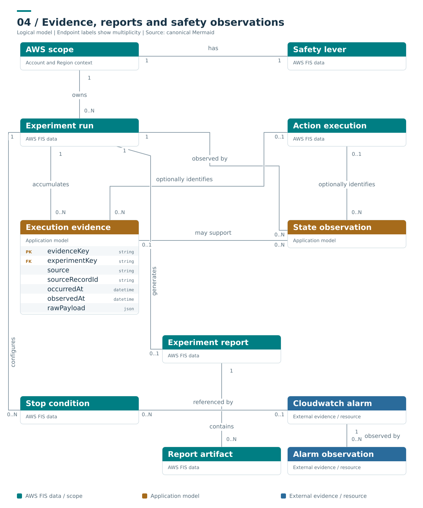

# Evidence, reports and safety observations

**Caption:** ExecutionEvidence and StateObservation are retained application records, with optional named-action correlation. Report state is independent from execution. CloudWatchAlarm is an external identity shared by condition references; its observations remain timestamped external evidence. AWS_SCOPE is the owning account/Region scope, not a target-account child.

**Ownership and interpretation:** FIS report objects are experiment projections. Logs, control intent and retained observations preserve their source and observation times. CloudWatch alarm state belongs to the external alarm, while the safety lever belongs to its owning AWS account/Region scope.

[Model and invariants](../../docs/initial/report.md#8-evidence-and-audit-model) · [Editable Mermaid](04_evidence_reports.mmd) · [Standalone SVG](04_evidence_reports.svg) · [Diagram index](README.md)

## Mermaid

## Portable rendering

The Mermaid block above is identical to the canonical `.mmd` source. The SVG is provided for viewers that do not render Mermaid and carries an accessible title and description. Read the linked model for identity scope, logical cardinalities, conditional relationships and missing-data rules.
