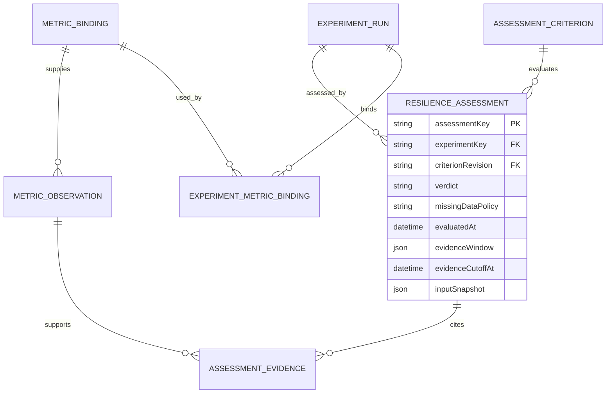
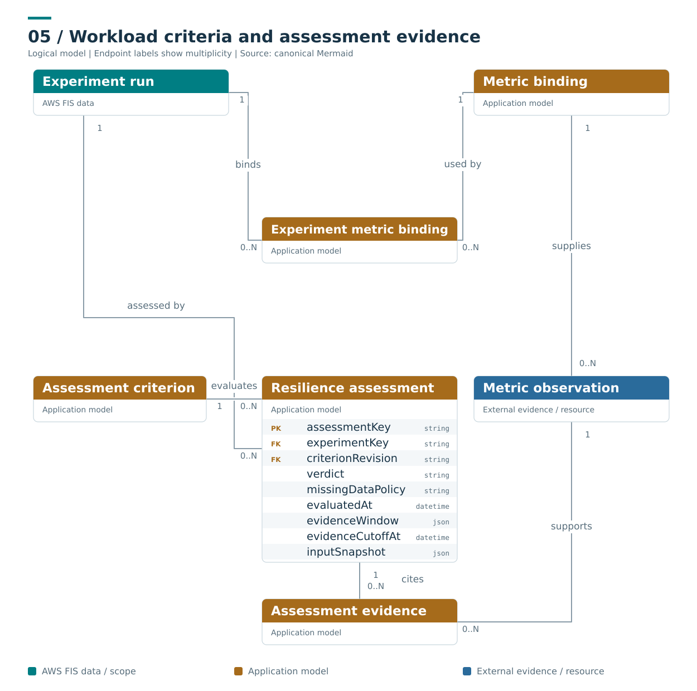

# Criteria and workload evidence

**Caption:** These are proposed application evaluation entities. A run can bind several telemetry queries and assessments. Every assessment retains its criterion revision, immutable input snapshot, evidence window and observation cutoff; changing a policy or query later does not silently rewrite a historical verdict.

**Ownership and interpretation:** These assessment concepts are application-owned extensions, not native AWS FIS result fields. Criteria define acceptance, observations provide evidence and an assessment pins the exact interpretation used for its historical verdict.

[Model and invariants](../../docs/initial/report.md#9-workload-assessment-model) · [Editable Mermaid](05_assessments.mmd) · [Standalone SVG](05_assessments.svg) · [Diagram index](README.md)

## Mermaid

## Portable rendering

The Mermaid block above is identical to the canonical `.mmd` source. The SVG is provided for viewers that do not render Mermaid and carries an accessible title and description. Read the linked model for identity scope, logical cardinalities, conditional relationships and missing-data rules.
