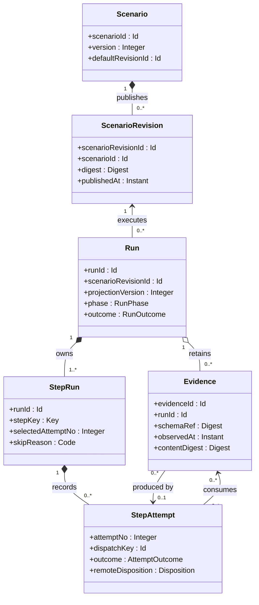
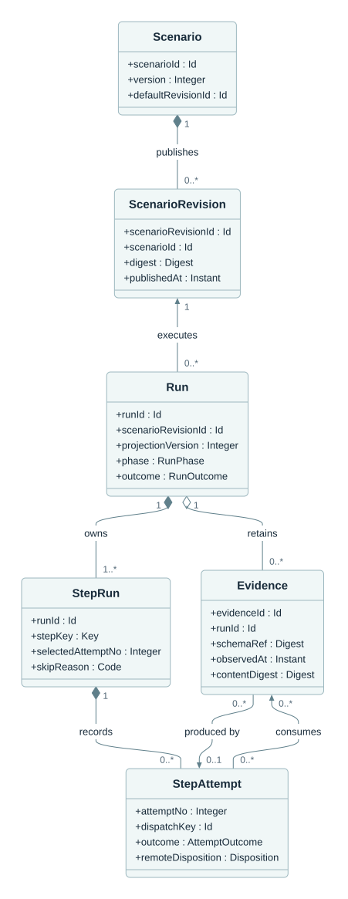

# All assessment workflow entities

**Caption:** All six identity-bearing concepts are included: Scenario, ScenarioRevision, Run, StepRun, StepAttempt and Evidence. Scenario and Run are aggregate roots; StepRun and StepAttempt are owned execution children. The model does not imply six independently writable CRUD APIs.

**Ownership and interpretation:** Scenario owns published ScenarioRevisions. A Run executes one revision and owns its StepRuns and attempts. Evidence is immutable and retained for one Run, with an optional producer attempt and explicit consumption references. The workspace is supplied by authenticated server context.

[Model and invariants](../../docs/suggested/model.md#1-entities-ownership-and-identity) · [Editable Mermaid](01_entities.mmd) · [Standalone SVG](01_entities.svg) · [Diagram index](README.md)

## Mermaid

## Portable rendering

The Mermaid block above is identical to the canonical `.mmd` source. The SVG is provided for viewers that do not render Mermaid and carries an accessible title and description. Read the linked model for identity scope, logical cardinalities, conditional relationships and missing-data rules.
