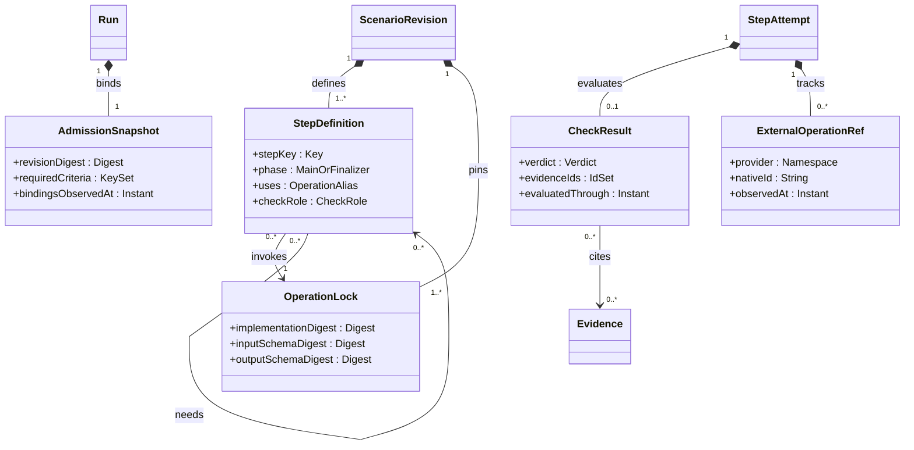
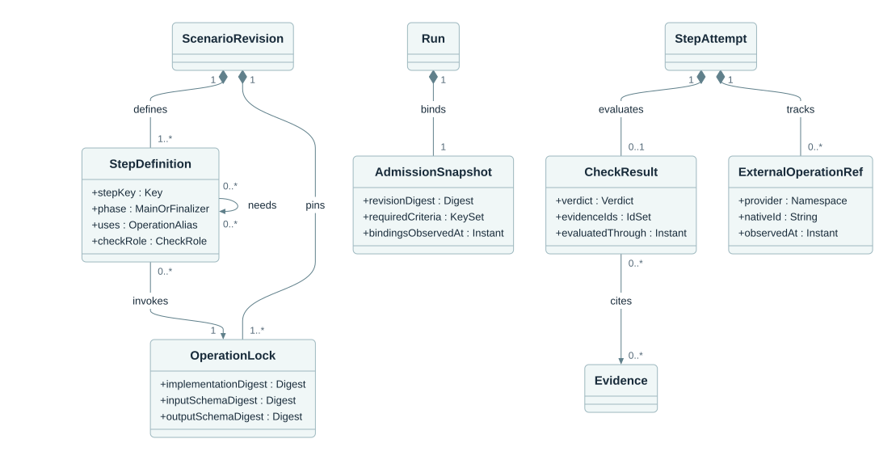

# Owned workflow values and references

**Caption:** Step definitions, immutable operation locks, admission snapshots, check results and external operation references are owned values. The diagram shares entity boundaries with the all-entity view and does not introduce extra aggregate roots.

**Ownership and interpretation:** Definitions and locks belong to the published revision. Admission freezes the run meaning, bindings and criterion denominator. Check results and provider handles belong to attempts. Their scoped references and cited evidence must resolve within the owning revision or run.

[Model and invariants](../../docs/suggested/model.md#owned-values-and-external-references) · [Editable Mermaid](02_owned_values.mmd) · [Standalone SVG](02_owned_values.svg) · [Diagram index](README.md)

## Mermaid

## Portable rendering

The Mermaid block above is identical to the canonical `.mmd` source. The SVG is provided for viewers that do not render Mermaid and carries an accessible title and description. Read the linked model for identity scope, logical cardinalities, conditional relationships and missing-data rules.
