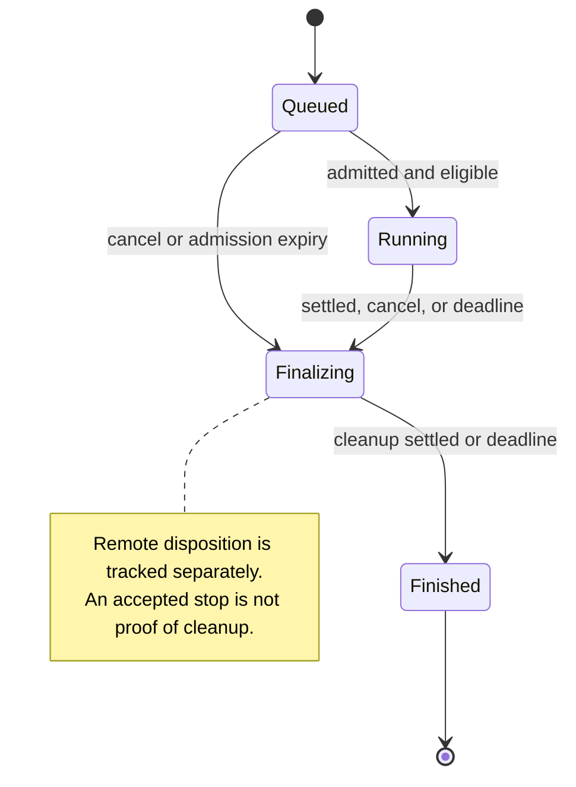
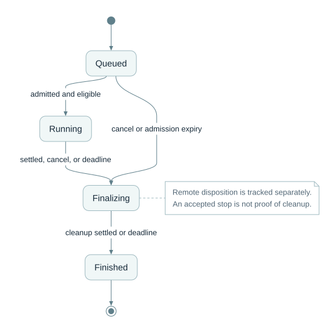

# Local run lifecycle

**Caption:** The lifecycle describes local orchestration phases. Execution outcome, assessment verdict/finality and remote-effect/finalization disposition remain separate; a terminal local phase does not prove remote work has ceased.

**Ownership and interpretation:** The Run owns orchestration phase and monotonic cancellation intent. Sealed attempt facts are not rewritten by later reconciliation; new evidence can update the projection of the originating remote effect. Finalizers inspect original step intents even when no provider handle was returned.

[Model and invariants](../../docs/suggested/model.md#4-execution-and-assessment-are-separate-facts) · [Editable Mermaid](03_lifecycle.mmd) · [Standalone SVG](03_lifecycle.svg) · [Diagram index](README.md)

## Mermaid

## Portable rendering

The Mermaid block above is identical to the canonical `.mmd` source. The SVG is provided for viewers that do not render Mermaid and carries an accessible title and description. Read the linked model for identity scope, logical cardinalities, conditional relationships and missing-data rules.
