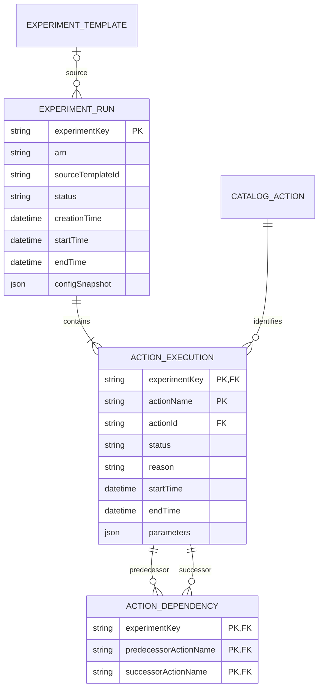
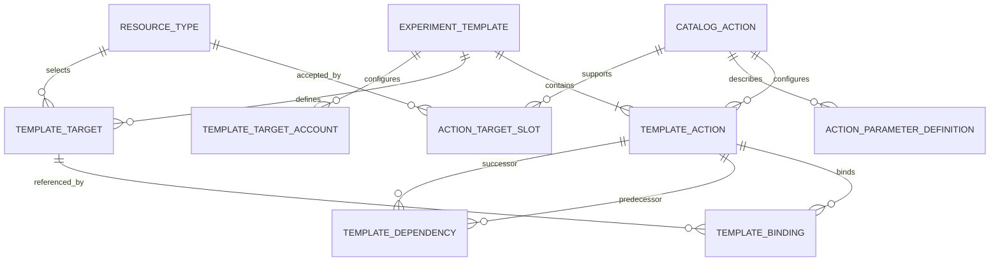
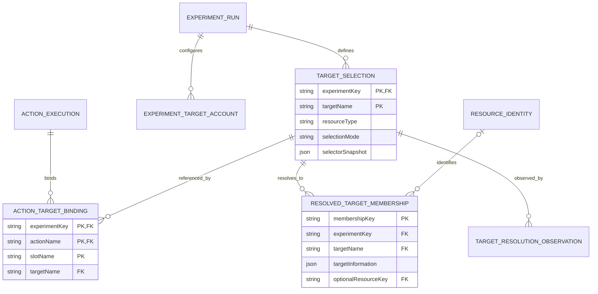
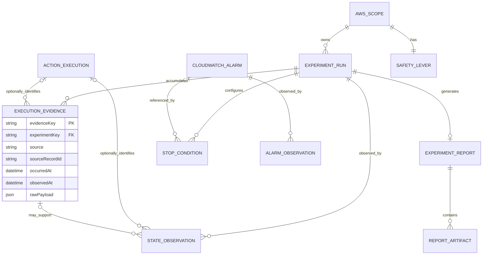
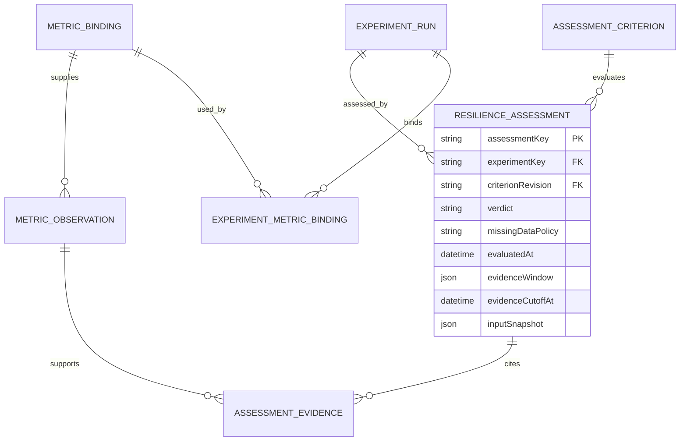

# AWS FIS experiment and action model

## 1. Purpose and recommended design

Build the operator experience around an **ExperimentRun containing named ActionExecution records**. Preserve the configuration that belongs to the run, the selected resource memberships, and timestamped execution evidence. Represent workload assessment as a separate product concept.

This separation answers four operator questions without conflating their evidence:

| Question | Model responsibility |
| --- | --- |
| What was configured? | Run configuration, named actions, dependencies, selector rules, account roles, and stop conditions. |
| What was selected? | Resolved target memberships and optional normalized resource identities, with completeness information. |
| What executed? | AWS experiment/action states, boundary timestamps, errors, and observed control operations. |
| What did the workload demonstrate? | External telemetry evaluated against explicit, versioned criteria. |

The generic FIS response describes execution. It contains no universal per-resource fault result or application resilience verdict. CloudWatch or other workload telemetry supplies the additional evidence needed for impact and recovery analysis. [S01] [S03] [S39]

### Scope and provenance

This is a logical model of the public AWS API and the additional information needed by a live/history UI. It is not a claim about AWS's internal database design. It covers all fields of the returned Experiment and ExperimentAction shapes, the related configuration and catalog objects, and useful generic derived data. It does not enumerate every parameter or possible service-specific output of every FIS action; those remain extension points backed by the action reference. [S48]

The repository package is a standalone study at the user-requested `aws/fis/analysis/revised` location. This edition preserves the reviewed native model; the suggested generalized workflow is documented separately in [the next model](../suggested/README.md). It does not change the existing operational-agent guide compiler or frozen catalog records. [REVIEW.md](../review/baseline-review.md) records the review. [sources.json](sources.json) is the machine-readable source register.

The diagrams use the following kinds:

| Kind | Examples | Meaning |
| --- | --- | --- |
| AWS resource | ExperimentTemplate, CatalogAction, SafetyLever | A documented FIS resource or catalog capability. |
| AWS configuration member or execution projection | TemplateAction, ActionExecution, TargetSelection, ExperimentReport | A named/embedded object in the documented contract; not necessarily an independently mutable resource. |
| External resource or observation | CloudWatchAlarm, MetricObservation | Data obtained outside the FIS experiment response. |
| Application normalization or derived entity | ActionDependency, ActionTargetBinding, ExecutionEvidence, ResilienceAssessment | A proposed representation for reliable joins, history, or evaluation. |

Cardinalities describe the logical domain. A missing API field or an unloaded cache row remains an ingestion state, rather than changing that domain cardinality. A historical run may no longer have a retrievable source-template record.

## 2. Core execution model

### Three meanings of action

| Concept | Logical entity | Identity |
| --- | --- | --- |
| A capability such as `aws:ec2:stop-instances` | CatalogAction | Returned catalog ID/ARN, with catalog retrieval scope. |
| A named configured step in a template | TemplateAction | Template key + action map key. |
| That named step within one run | ActionExecution | Experiment key + action map key. |

AWS permits the same catalog action type to occur under different names in one template. The `actionId` is therefore not an execution identifier. `startAfter` references the named steps, and action target bindings reference named selectors. Preserve those map keys exactly. [S03] [S06] [S09]

### Diagram 1: run identity and action dependencies

<!-- diagram-source: ../../diagrams/initial/01_execution.mmd -->

**Caption:** one run contains one or more logical action executions. A dependency identifies two steps in the same run. The source template can be missing from retained/current catalog data after deletion; the source ID is still retained.

### Keys and invariants

| Entity | Recommended key / invariant |
| --- | --- |
| ExperimentRun | Experiment ARN, or `(partition, orchestratorAccountId, region, experimentId)`. |
| ActionExecution | `(experimentKey, actionName)`. No independent action execution ID/ARN is returned. |
| ActionDependency | `(experimentKey, predecessorActionName, successorActionName)`; both references must belong to the same run. |
| TargetSelection | `(experimentKey, targetName)`. |
| ActionTargetBinding | `(experimentKey, actionName, slotName)`; one named selector per slot in the response map. |
| ExperimentTargetAccount | `(experimentKey, accountId)`. |

These keys are application normalization choices. Use surrogate keys if useful, but enforce the scoped uniqueness constraints and preserve original identifiers.

Within a hydrated run, dependency endpoints and target bindings must resolve to children of that same run. The dependency graph must be acyclic, with no self-edge or duplicate edge. A partial collection cannot establish that a reference is invalid; record its validation as incomplete until the required children are loaded. These are application integrity rules, not additional AWS response fields.

### Runtime configuration snapshot

AWS takes a template snapshot at start. Later template changes or deletion do not alter the experiment. Render a historical run from its own returned action and target configuration, not from current template children. [S08]

Store `experimentTemplateId` as provenance. An application-generated configuration fingerprint can support comparisons, but it is not an AWS template revision. Template description and template `lastUpdateTime` are not returned as experiment metadata; if captured separately, keep their source and capture time. Run tags are mutable metadata and should be kept distinct from immutable execution settings when historical tagging matters. [S01] [S07]

## 3. Definitions, catalog metadata, and templates

### Diagram 2: definition model

<!-- diagram-source: ../../diagrams/initial/02_catalog_templates.mmd -->

**Caption:** a template contains named steps, selectors, and eligible account configurations. Target-slot bindings and predecessor edges are normalized relations. Catalog metadata describes supported inputs and resource types; an unavailable metadata lookup should not prevent display of a recorded run.

| Official shape | Complete returned fields / interpretation |
| --- | --- |
| Action | `id`, `arn`, `description`, `tags`, `parameters`, `targets`. The last two are maps of parameter and target-slot metadata. [S04] |
| ActionParameter | `description`, `required`. No typed schema, unit, enum, default, min/max, or validation expression is returned here. [S05] |
| ActionTarget | `resourceType`. The enclosing map key is the target slot, such as `Instances`. [S50] |
| ExperimentTemplateAction | `actionId`, `description`, `parameters`, `startAfter`, `targets`. Identity comes from the template's action map key. [S06] |
| TargetResourceType | `resourceType`, `description`, `parameters`; parameter metadata contains `description` and `required`. [S23] |
| TargetAccountConfiguration | `accountId`, `roleArn`, `description`; keyed to the template. [S51] |

The complete ExperimentTemplate top-level field set is `id`, `arn`, `creationTime`, `lastUpdateTime`, `description`, `actions`, `targets`, `stopConditions`, `roleArn`, `tags`, `logConfiguration`, `experimentOptions`, `targetAccountConfigurationsCount`, and `experimentReportConfiguration`. The template options describe account targeting and empty-target behavior; run action mode is chosen at start. [S07] [S15]

Keep raw parameter strings. A UI can add typed adapters for known action IDs, but it should preserve their raw values and adapter version. Action-specific duration or rollback semantics should come from the corresponding official action documentation. [S48]

Catalog metadata has no returned revision identifier. Capture the catalog lookup and its observation time when historical rendering depends on its descriptions or parameter interpretation. The run's original values remain authoritative; a later catalog lookup must not silently reinterpret a recorded action. [S04] [S05]

## 4. ExperimentRun and ActionExecution field inventory

The AWS response reference marks these fields optional. That is a wire-contract property; create/start request requirements differ. Ingestion should preserve absent fields and distinguish a summary from a full-detail response.

### ExperimentRun

| Group | AWS fields | Model treatment |
| --- | --- | --- |
| Identity | `id`, `arn`, `experimentTemplateId` | Scoped identity and logical source-template association. |
| Timestamps | `creationTime`, `startTime`, `endTime` | Nullable UTC instants. Creation differs from execution start. |
| Current state | `state.status`, `state.reason`, `state.error` | Preserve raw status/text and optional error details. |
| Named graph | `actions`, `targets` | Child projections; map keys become actionName/targetName. |
| Authority | `roleArn` | Experiment role reference. |
| Safety | `stopConditions` | Stop-condition references or explicit `none`. |
| Options | `experimentOptions` | Account targeting, actions mode, empty-target resolution mode. |
| Account scope | `targetAccountConfigurationsCount` | Configured count; retrieve the separate run-account collection. |
| Logging | `logConfiguration` | Destinations and schema version, not actual log records. |
| Reporting | `experimentReportConfiguration`, `experimentReport` | Requested report inputs/window/output and independent generated-report state. |
| Metadata | `tags` | String map; retain versions if tag history matters. |

This table covers every top-level field of Experiment. The response has no run name, description, last-update timestamp, template revision, actor, progress percentage, completion ETA, or resilience verdict. [S01] [S02]

`ExperimentState` contains `status`, `reason`, and `error`. The optional `ExperimentError` contains `accountId`, `code`, and `location`. `location` is context for a failed part of the configuration; do not assume an undocumented parsing grammar. [S10] [S12]

### ActionExecution

| Field | Source / meaning |
| --- | --- |
| `actionName` | Application field extracted from the enclosing map key. |
| `actionId` | AWS catalog capability ID. |
| `description` | Configured description of the named step. |
| `parameters` | String-to-string input map. |
| `startAfter` | Predecessor action names within this run. |
| `targets` | Target-slot-to-selector-name map. |
| `state.status`, `state.reason` | Current step status and explanation. There is no structured action-state `error` member. |
| `startTime`, `endTime` | Nullable action execution boundary timestamps. |

This is the complete generic runtime action contract. There is no per-resource success map, generic action output payload, retry-attempt ID, or independent execution ARN. [S03] [S11]

An execution start timestamp establishes action initiation. It does not establish that a fault was successfully applied to every selected resource. Model stronger effect evidence as action-specific extensions with provenance.

### Application metadata

Suggested fields are `firstSeenAt`, `lastSuccessfulFetchAt`, `hydrationStatus`, `rawSnapshot`, `configurationFingerprint`, `archiveState`, `displayLabel`, and evidence references. These are application fields. Preserve raw AWS status strings alongside any normalized grouping.

Use source-preserving timestamps. REST examples encode timestamps as numbers; SDKs may expose date objects. Convert consistently at the ingestion boundary. Do not fill a missing boundary time with the time a browser happened to poll.

## 5. Target selectors, resolved memberships, and accounts

### Diagram 3: selected scope

<!-- diagram-source: ../../diagrams/initial/03_targeting.mmd -->

**Caption:** selectors describe intended selection; memberships describe resources resolved for the run. ResourceIdentity is optional application normalization. A selector can feed several actions, and a resource can appear in several selectors. Action effects are a separate evidence layer.

### Exact target and account fields

| Object | Returned fields / extraction |
| --- | --- |
| ExperimentTarget | `resourceType`, `resourceArns[]`, `resourceTags{}`, `parameters{}`, `filters[{path, values[]}]`, `selectionMode`. `targetName` comes from the enclosing map key. [S16] |
| ResolvedTarget | `targetName`, `resourceType`, `targetInformation{string:string}`. [S18] |
| ExperimentTargetAccountConfiguration | `accountId`, `roleArn`, `description`; a run-scoped snapshot. [S21] |

`ResolvedTarget.targetInformation` promises no universal ARN, account, Region, state, or result field. Keep the complete information map. Normalize a ResourceIdentity only when a resource-type adapter can establish its identity, and retain the adapter/correlation method. [S18]

The action slot name is distinct from both the selector name and resource identity. For example, `actions.stopPrimary.targets.Instances = primaryInstances` binds slot `Instances` to selector `primaryInstances`. [S09]

### Selection semantics

FIS resolves targets before action execution and uses that selected set throughout the run. Selection modes include `ALL`, `COUNT(n)`, and `PERCENT(n)`; count/percentage selection is random. Selectors can overlap. The resource type must be compatible with the action slot. [S17]

Resource identifiers cannot be combined with tags or filters for the same target. Multiple tags and filters are conjunctive; alternative values inside a filter are disjunctive. Preserve the selector as supplied rather than attempting to reconstruct a selection from the current AWS inventory. [S17]

### Availability and completeness

Resolved target information is available after resolution has ended. `ListExperimentResolvedTargets` accepts optional `targetName`, `maxResults`, and `nextToken`. Its page result contains no total-count or resolution-complete flag. Exhaust pagination, retain ingestion status, and distinguish unavailable, partially loaded, and confirmed complete membership data. [S19] [S20]

Keep resolution progress separate from collection progress. A TargetResolutionObservation records the selector, resolution-ended evidence or supported inference, collection identity, query scope, pages fetched, observation interval, and collection status. An exhausted page sequence establishes completeness only for that collection's scope after resolution has ended. A successful empty response without that context is not proof that no resources were selected. Log resolution records carry their own paging and completion information; retain that source-specific evidence rather than inventing equivalent fields on the list API. [S31]

A membership key can be an ingestion ID with source provenance. Deduplicate ResourceIdentity when reliable; retain every `(run, selector, resource)` membership and every action binding. A common resource can legitimately occur under several named target sets.

### Multi-account interpretation

The orchestrator account owns the experiment. Eligible target account configurations are not child experiments or complete per-account execution results. Their count does not establish how many accounts actually had selected or affected resources. The run-account list already returns account ID, role ARN, and description. [S15] [S21] [S22]

Keep configured account count, accounts with resolved resources, accounts with action errors, and accounts with verified effects as separate measures. Global resource types and type-specific identities can also make a Region dimension unavailable or inapplicable; do not automatically assign the run Region to every resource.

## 6. Supporting configuration and report objects

| Object | Fields / known values |
| --- | --- |
| ExperimentOptions | `accountTargeting`: `single-account` or `multi-account`; `actionsMode`: `run-all` or `skip-all`; `emptyTargetResolutionMode`: `fail` or `skip`. [S14] |
| ExperimentStopCondition | `source`, `value`; alarm ARN where applicable. `source=none` is an explicit marker. [S24] [S25] |
| SafetyLever | `id`, `arn`, `state{status, reason}`. [S26] |
| SafetyLeverState | `disengaged`, `engaging`, or `engaged`. Update input accepts engaged/disengaged with a required reason. [S28] [S49] |
| ExperimentLogConfiguration | `logSchemaVersion`; `cloudWatchLogsConfiguration.logGroupArn`; `s3Configuration{bucketName, prefix}`. [S02] [S30] |
| ExperimentReportConfiguration | `dataSources.cloudWatchDashboards[].dashboardIdentifier`; `outputs.s3Configuration{bucketName, prefix}`; `preExperimentDuration`; `postExperimentDuration`. [S02] [S37] |
| ExperimentReport | `state{status, reason, error{code}}`; `s3Reports[]`. [S02] [S34] [S35] |
| ExperimentReportS3Report | `arn`, `reportType`; reportType is an open-ended string. [S36] |

Report artifacts are a collection. The response provides no report generation start/end times, percentage, or authorized download URL. Track first/last observation times as application metadata and resolve authorized artifact access when needed. [S34] [S35] [S36]

Reports can include one dashboard's eligible metric widgets. The default pre/post windows are 20 minutes each; documented maxima are 30 minutes before and two hours after. Cross-region metrics are excluded. Cancelled experiments and target previews do not generate reports. AWS directs troubleshooting of failed runs to experiment logs. [S38]

Keep report configuration, report generation state, and evidence-collection status separate. An absent report payload is not by itself proof that generation failed. The product can classify a known preview as not eligible while preserving the original AWS fields.

## 7. Lifecycle and operator controls

### Known state vocabularies

| Object | Known nonterminal states | Known terminal states |
| --- | --- | --- |
| Experiment | pending, initiating, running, stopping | completed, stopped, failed, cancelled |
| ActionExecution | pending, initiating, running, stopping | completed, stopped, failed, cancelled, skipped |
| ExperimentReport | pending, running | completed, cancelled, failed |

The vocabularies come from current API shapes. These terminal groupings are an application interpretation for presentation, not a complete promised AWS transition graph. Preserve unknown future values and avoid deriving a final action status from an experiment's terminal state. [S10] [S11] [S35]

An action cancelled before start differs from a skipped action. With `actionsMode=skip-all`, a preview resolves scope but skips actions; it does not verify permission to perform the faults and may select different resources from a later run. With empty-target `skip`, missing criterion-based selections can skip actions, whereas missing explicit unique identifiers still fail. [S13] [S15]

Stopping is asynchronous. Outstanding post actions finish before the experiment stops. Post actions are action-specific, and some resource changes cannot be undone. A stopped run therefore does not establish workload recovery. [S09] [S45]

### Stop conditions and the scope safety lever

Stop conditions store configuration references. Historical alarm state, metric expressions, thresholds, and trigger attribution require external observations. The same alarm can be used by several stop-condition entries, and `source=none` has no alarm relationship. [S24] [S25]

Every supported account/Region scope has a safety lever. A local view can have an unknown lever observation, but the logical resource relationship remains one-to-one. For multi-account runs, the relevant scope is the orchestrator account and experiment Region. [S27] [S29]

An engaged lever stops in-progress experiments and prevents new starts. The specific safety guide distinguishes a running run ending stopped from an attempted start becoming cancelled. Preserve the actual returned state rather than reconstructing it from a guessed cause. [S27]

### Available controls

`StartExperiment` requires a template ID and idempotency clientToken, with optional run tags and actionsMode. It accepts no arbitrary action/parameter/target overrides. `StopExperiment` uses HTTP DELETE semantically to stop execution. There is no individual runtime-action stop/retry/pause/update operation and no run pause/resume operation in the public inventory. Repetition creates a new experiment. [S43] [S44] [S46]

Template changes affect future runs. The current update-options shape includes emptyTargetResolutionMode only; do not offer an accountTargeting update based solely on the broader returned options object. [S47] [S52]

## 8. Evidence and audit model

### Diagram 4: retained observations, reports, and safety evidence

<!-- diagram-source: ../../diagrams/initial/04_evidence_reports.mmd -->

**Caption:** ExecutionEvidence and StateObservation are retained application records, with optional named-action correlation. Report state is independent from execution. CloudWatchAlarm is an external identity shared by condition references; its observations remain timestamped external evidence. AWS_SCOPE is the owning account/Region scope, not a target-account child.

### Source roles

| Source | Contribution | Collection implication |
| --- | --- | --- |
| GetExperiment | Current run/action configuration and state | Reconcile the current execution projection. |
| EventBridge | Experiment state-change notification | Refresh trigger and historical evidence; delivery is best effort. [S32] [S33] |
| FIS logs | Execution boundaries, resolution details, account errors | Parse by source schema and event type. [S31] |
| Resolved-target API | Selected memberships | Complete pagination after resolution. [S19] [S20] |
| CloudWatch or workload telemetry | Metrics, alarms, recovery evidence | Bind explicit queries and windows. [S39] |
| CloudTrail / application command record | Operation and actor evidence | Support start/stop audit and cautious correlation. [S40] |
| Report artifacts | Delivered report and related files | Observe report state separately and retain artifact references. [S34-S38] |

FIS logs are disabled by default. Schema v2 includes experiment-start/end, action-start/end/error, and target-resolution-start/detail/end. The top-level log `id` is the experiment ID, not an event ID. Account errors and type-specific resolved objects provide additional context; resolution records can span pages. [S31]

Store source type and source record identity/location, experiment key, optional action/target/account association, event timestamp, any embedded lifecycle boundary timestamp, ingestion timestamp, schema version, raw payload, and completeness. A payload hash can assist duplicate detection; it must not discard distinct legitimate records merely because their contents match.

EventBridge provides an experiment-state event, not a generic action-state feed. Use periodic API reconciliation as well. Late notifications can enrich history without replacing a newer current projection. [S32] [S33]

### Time and completeness semantics

| Fact | Required treatment |
| --- | --- |
| API boundary timestamp | Retain the returned instant and source. |
| Event timestamp | Retain independently from ingestion and embedded start/end times. |
| State first found by polling | Record observedAt and, when useful, the interval since the previous successful observation. |
| Partial list/log pagination | Retain observed count and incomplete status; do not present it as a final total. |
| Source access failure | Display last known data with source freshness/access status. |
| Logging not configured | Make the evidence gap explicit; do not synthesize missing events. |

The experiment-level error can expose only the first failed action when several actions fail. Preserve all separately observed action/account errors. AWS warns that reasons and most error codes can change; InternalFailure is the documented exception suitable for automation. `location` remains context, and parsing free-form text should never be the sole basis of stop attribution. [S41]

CloudTrail supplies caller/operation evidence. A target-service API record may establish an experiment association without establishing a specific named FIS action. Leave that action association empty unless supported. [S40]

## 9. Workload assessment model

### Diagram 5: explicit criteria and evidence

<!-- diagram-source: ../../diagrams/initial/05_assessments.mmd -->

**Caption:** these are proposed application evaluation entities. A run can bind several telemetry queries and assessments. Every assessment retains its criterion revision, immutable input snapshot, evidence window, and observation cutoff; changing a policy or query later does not silently rewrite a historical verdict.

MetricBinding should identify provider, account/Region where applicable, query or metric identity, dimensions, statistic, unit, period, and observation windows. AssessmentCriterion should identify threshold/recovery rules, stable-window requirements, timing anchor, and missing-data policy. ResilienceAssessment should retain verdict, evaluation time, evidence window, policy revision, and evidence references.

The assessment's inputSnapshot pins the query/metric binding, normalization and evaluator versions, resolved threshold parameters, units, timing anchor, and accepted evidence identities. References to immutable revisioned records can replace duplicated values. EvidenceCutoffAt limits which observations were known to the evaluator; it is distinct from the event-time evidenceWindow. Late samples or changed policies produce a new assessment linked to the prior result. They do not mutate the evidence or silently overwrite a historical verdict. This is a proposed persistence contract; this telemetry-oriented model is specific to the FIS UI study, while general query and assertion evidence belongs in the generalized workflow model.

Suggested verdicts are `not_assessed`, `in_progress`, `passed`, `failed`, and `inconclusive`. They are application classifications. Preserve a four-part result summary:

| Dimension | Example |
| --- | --- |
| AWS execution outcome | Completed, failed, stopped, or cancelled as returned. |
| Execution coverage | Outcome counts, selected membership completeness, verified effect evidence where available. |
| Workload assessment | A versioned criterion and pass/fail/inconclusive result. |
| Evidence/report readiness | Source availability and freshness plus independent report status. |

FIS's usage metric is AWS/Usage ResourceCount, with ActiveExperiments and ExperimentTemplates among the resource dimensions. These are service-usage measurements. Application impact requires relevant workload metrics, and numerical evaluations require values rather than only dashboard images. [S39]

## 10. Derived data catalog

All calculations below are proposed product behavior. Attach source references, formula or policy version, computedAt, and quality/completeness. Zero, unknown, inapplicable, and not yet available should remain distinguishable.

### Execution timing and progress

| Derived field | Calculation | Conditions and limits |
| --- | --- | --- |
| Run elapsed | End minus start; for active runs, now minus start | Require start. For terminal runs missing end, do not keep a live clock running. |
| Preparation interval | Start minus creation | Includes preparation; cannot isolate pure queue time. |
| Action duration | Action end minus start | Missing boundaries remain unknown; skipped/cancelled steps may not have a meaningful duration. |
| Action outcome counts | Count each raw/normalized status | Include unknown; retain skipped, cancelled, stopped, and failed separately. |
| Terminal-step fraction | Terminal action count / fully hydrated configured count | Label steps finished; N=0 or incomplete action map produces unavailable/partial presentation. |
| Completed-step fraction | Completed count / configured count | Supply mode/skip context; not per-resource fault success. |
| Active counts | Counts of initiating/running/stopping | Keep categories separate. |
| Observed concurrency | Count intervals covering t | Use half-open intervals; live/stale or missing boundaries qualify the result. |
| Observed dependency gap | Action start minus latest predecessor end | Requires all predecessor ends; does not determine why the scheduler waited. |
| Time in stopping | Terminal time minus stopping transition | Poll-based transition time yields an estimate/interval. |
| Freshness | Now minus last successful fetch | Collection health, not execution state. |
| Ingestion lag | Observed time minus event time | Preserve clock/source uncertainty. |

The terminal numerator includes completed, skipped, cancelled, stopped, and failed. It excludes stopping. A terminal run never forces missing step observations to completed or its progress display to 100%.

### Graph and selected scope

| Derived field | Derivation / qualification |
| --- | --- |
| Predecessor/successor lists | Directed dependency traversal, within one run. |
| Dependency layers | Topological grouping for layout; no promise of simultaneous scheduling. |
| Potential downstream disruption | Transitive successors of a failed/stopped step; actual states remain authoritative. |
| Estimated configured path duration | Longest path weighted by type-aware duration interpretation and explicit normal-execution assumptions. |
| Selected memberships per target | Complete membership count with retrieval status. |
| Unique selected resources | Distinct recognized identities; unidentified memberships stay visible. |
| Resources selected for an action | Join its named slot bindings to memberships; retain provenance. |
| Shared/concurrent selection | Resource intersections plus overlapping observed action intervals. |
| Account/type/Region breakdown | Group available normalized identities; unknown dimensions remain unknown. |
| Preview-versus-run difference | Set comparison of two compatible complete snapshots. |
| Configuration drift | Canonical snapshot comparison; define canonicalization and separate mutable metadata. |

A generic duration sum is not a reliable ETA. Duration-like inputs can represent a maintained fault, monitoring interval, delay, or timeout. Preparation, post actions, and scheduling gaps can lengthen elapsed time; skips and early stop/failure can shorten it. When duration semantics are unknown, do not turn a conditional estimate into an unconditional lower bound. [S09]

Illustration: selector T1 selects r1/r2 and selector T2 selects r2/r3. Two actions using those selectors produce four memberships and four action-resource associations but three unique selected resources. These counts do not establish successful fault applications.

### Results and recovery

| Derived question | Evidence and rule |
| --- | --- |
| What failed? | Aggregate run error, action reasons, and observed account errors; state the evidence scope. |
| What caused the stop? | Correlate command, audit, alarm, and lever evidence; preserve unknown or confidence where ambiguous. |
| How did the workload change? | Compare compatible baseline/execution statistics and units. |
| Absolute/relative impact | Difference; relative difference only with a meaningful nonzero baseline. |
| Degradation duration | Explicit threshold, sampling/aggregation, window, and missing-data policy. |
| Recovery time | First qualifying stable healthy window after a defined anchor; insufficient observation produces inconclusive. |
| Did the hypothesis pass? | Versioned criterion, accepted evidence, and explicit evaluation result. |
| Are artifacts ready? | Report status and artifact list; local observation times do not become AWS generation times. |
| How does this compare historically? | Compatible configuration/mode/scope and assessment-policy cohorts. |

Report configuration supports baseline `[start-preDuration, start)`, execution `[start, end]`, and recovery observation `(end, end+postDuration]` windows. The post window establishes what to observe, not that recovery occurred. Fault-specific effect times may be more appropriate evaluation anchors. [S37]

## 11. API operations and mutation boundaries

| Operation family | Model / UI responsibility |
| --- | --- |
| ListExperiments / GetExperiment | Discover summaries and hydrate full runtime aggregates. |
| ListActions / GetAction | Catalog choices and parameter/target metadata. |
| ListTargetResourceTypes / GetTargetResourceType | Supported target types and parameter metadata. |
| Create/Get/List/Update/DeleteExperimentTemplate | Manage reusable definitions; history retains independent snapshots. |
| StartExperiment / StopExperiment | Create a run / request termination. |
| ListExperimentResolvedTargets | Collect selected memberships after resolution. |
| Create/Get/List/Update/DeleteTargetAccountConfiguration | Manage template-scoped account configuration. |
| Get/ListExperimentTargetAccountConfigurations | Read run-scoped account configuration. |
| GetSafetyLever / UpdateSafetyLeverState | Read/change the account/Region control. |
| ListTagsForResource / TagResource / UntagResource | Read/change resource metadata. |

The operation inventory is the authoritative boundary for available controls. GetAction describes a catalog capability, not a named runtime execution. [S46]

ListExperiments returns only id, arn, creationTime, experimentTemplateId, experimentOptions, state, and tags. It supports template-ID filtering and pagination. Rich status/date/tag history searches need a product index. A summary refresh must not erase previously hydrated detail-only fields. [S42]

ListActions includes target-slot metadata but omits parameter descriptions; GetAction supplies the full catalog shape. Paginated lists must be fully read when the UI claims a complete collection. [S04] [S53]

## 12. Collection architecture and operator surfaces

### Proposed collection lifecycle

1. Discover runs in each authorized account/Region scope and hydrate active/visible detail.
2. Reconcile current state using GetExperiment; let EventBridge trigger additional refreshes.
3. Ingest configured logs, control/audit evidence, and workload telemetry.
4. Capture run target-account configuration and fully paginated resolved membership.
5. Persist terminal run/action detail while continuing independent report/evidence/recovery collection.
6. Archive snapshots and relevant evidence under the product retention policy.

Serialize or sequence concurrent fetches per run. A slower old request must not overwrite newer observations. Deduplicate source events and keep raw evidence. Treat source gaps, access failures, and schema changes as data-quality states, not experiment outcomes.

AWS explicitly removes stopped, completed, and failed runs after 120 days. Retain the required history outside the FIS record before expiry. The cited sentence does not explicitly enumerate cancelled runs; use an application retention policy for all modes/states instead of assuming cancelled runs persist indefinitely. [S13]

### Suggested surfaces

| Surface | Live run | Finalized run |
| --- | --- | --- |
| Header | AWS status, mode, elapsed time, source freshness | Final execution status, duration, assessment, evidence readiness |
| Action graph/timeline | Named dependencies, active intervals, reasons | Actual intervals, outcome counts, preserved step settings |
| Scope | Selector rules, resolution, observed counts/completeness | Memberships, overlap, separately verified effect evidence |
| Safety | Alarm observation times, scope lever, stop intent | Control/alarm timeline and supported attribution |
| Workload | Baseline, thresholds, action overlays | Impact, recovery, criterion and policy revision |
| Evidence | Recent events, source health, lag | Audit, logs, reports, archive completeness |

## 13. Demonstration contract and remaining limits

The companion application is a mock showcase of this model. All account IDs, resources, run records, telemetry, identities, and outcomes in the demonstration are synthetic. Its controls must describe simulation behavior. They must not imply calls to an AWS account.

Fixtures should exercise repeated catalog action types under different names, parallel/dependent steps, a completed run with a failed workload criterion, a stopped run with cancelled unstarted steps, a failed run, a target preview with skipped actions, late report generation, and partial/unknown evidence. Those examples demonstrate why the model's distinctions matter.

The model does not supply workload-specific success criteria, acceptable live latency, user permissions, retention duration, or evidence access policy. Those are product decisions. A production integration also needs action-specific adapters wherever it promises typed configuration, exact effect boundaries, individual resource outcomes, or verified recovery.

## 14. Official sources

All factual contract references below are AWS primary documentation checked for the initial analysis or this review on 5 November 2026. Product schema choices, formulas, mock scenarios, and collection policies are engineering proposals.

- **[S01]** Experiment API shape
- **[S02]** GetExperiment
- **[S03]** ExperimentAction
- **[S04]** Action catalog shape
- **[S05]** ActionParameter
- **[S06]** ExperimentTemplateAction
- **[S07]** ExperimentTemplate
- **[S08]** Start from a template: snapshot semantics
- **[S09]** Action sequence and duration semantics
- **[S10]** ExperimentState
- **[S11]** ExperimentActionState
- **[S12]** ExperimentError
- **[S13]** Lifecycle states and retention
- **[S14]** ExperimentOptions
- **[S15]** Experiment options and previews
- **[S16]** ExperimentTarget
- **[S17]** Target selection semantics
- **[S18]** ResolvedTarget
- **[S19]** ListExperimentResolvedTargets
- **[S20]** Resolved target availability
- **[S21]** Experiment target account configuration
- **[S22]** ListExperimentTargetAccountConfigurations
- **[S23]** TargetResourceType
- **[S24]** ExperimentStopCondition
- **[S25]** Stop conditions
- **[S26]** SafetyLever
- **[S27]** Safety lever behavior
- **[S28]** UpdateSafetyLeverStateInput
- **[S29]** Multi-account safety and alarms
- **[S30]** ExperimentLogConfiguration
- **[S31]** Experiment log schema and delivery
- **[S32]** EventBridge notifications
- **[S33]** FIS EventBridge event catalog
- **[S34]** ExperimentReport
- **[S35]** ExperimentReportState
- **[S36]** ExperimentReportS3Report
- **[S37]** ExperimentReportConfiguration
- **[S38]** Report configuration and limitations
- **[S39]** CloudWatch impact and usage metrics
- **[S40]** CloudTrail audit records
- **[S41]** Troubleshooting and error stability
- **[S42]** ListExperiments
- **[S43]** StartExperiment
- **[S44]** StopExperiment
- **[S45]** Stop and post-action cleanup
- **[S46]** All FIS API operations
- **[S47]** UpdateExperimentTemplate
- **[S48]** AWS FIS action-specific reference
- **[S49]** SafetyLeverState
- **[S50]** ActionTarget
- **[S51]** TargetAccountConfiguration
- **[S52]** UpdateExperimentTemplateExperimentOptionsInput
- **[S53]** ListActions

[S01]: https://docs.aws.amazon.com/fis/latest/APIReference/API_Experiment.html
[S02]: https://docs.aws.amazon.com/fis/latest/APIReference/API_GetExperiment.html
[S03]: https://docs.aws.amazon.com/fis/latest/APIReference/API_ExperimentAction.html
[S04]: https://docs.aws.amazon.com/fis/latest/APIReference/API_Action.html
[S05]: https://docs.aws.amazon.com/fis/latest/APIReference/API_ActionParameter.html
[S06]: https://docs.aws.amazon.com/fis/latest/APIReference/API_ExperimentTemplateAction.html
[S07]: https://docs.aws.amazon.com/fis/latest/APIReference/API_ExperimentTemplate.html
[S08]: https://docs.aws.amazon.com/fis/latest/userguide/start-experiment-from-template.html
[S09]: https://docs.aws.amazon.com/fis/latest/userguide/action-sequence.html
[S10]: https://docs.aws.amazon.com/fis/latest/APIReference/API_ExperimentState.html
[S11]: https://docs.aws.amazon.com/fis/latest/APIReference/API_ExperimentActionState.html
[S12]: https://docs.aws.amazon.com/fis/latest/APIReference/API_ExperimentError.html
[S13]: https://docs.aws.amazon.com/fis/latest/userguide/view-experiment-progress.html
[S14]: https://docs.aws.amazon.com/fis/latest/APIReference/API_ExperimentOptions.html
[S15]: https://docs.aws.amazon.com/fis/latest/userguide/experiment-options.html
[S16]: https://docs.aws.amazon.com/fis/latest/APIReference/API_ExperimentTarget.html
[S17]: https://docs.aws.amazon.com/fis/latest/userguide/targets.html
[S18]: https://docs.aws.amazon.com/fis/latest/APIReference/API_ResolvedTarget.html
[S19]: https://docs.aws.amazon.com/fis/latest/APIReference/API_ListExperimentResolvedTargets.html
[S20]: https://docs.aws.amazon.com/fis/latest/userguide/list-experiment-resolved-targets.html
[S21]: https://docs.aws.amazon.com/fis/latest/APIReference/API_ExperimentTargetAccountConfiguration.html
[S22]: https://docs.aws.amazon.com/fis/latest/APIReference/API_ListExperimentTargetAccountConfigurations.html
[S23]: https://docs.aws.amazon.com/fis/latest/APIReference/API_TargetResourceType.html
[S24]: https://docs.aws.amazon.com/fis/latest/APIReference/API_ExperimentStopCondition.html
[S25]: https://docs.aws.amazon.com/fis/latest/userguide/stop-conditions.html
[S26]: https://docs.aws.amazon.com/fis/latest/APIReference/API_SafetyLever.html
[S27]: https://docs.aws.amazon.com/fis/latest/userguide/safety-lever.html
[S28]: https://docs.aws.amazon.com/fis/latest/APIReference/API_UpdateSafetyLeverStateInput.html
[S29]: https://docs.aws.amazon.com/fis/latest/userguide/multi-account-prerequisites.html
[S30]: https://docs.aws.amazon.com/fis/latest/APIReference/API_ExperimentLogConfiguration.html
[S31]: https://docs.aws.amazon.com/fis/latest/userguide/monitoring-logging.html
[S32]: https://docs.aws.amazon.com/fis/latest/userguide/monitoring-eventbridge.html
[S33]: https://docs.aws.amazon.com/eventbridge/latest/ref/events-ref-fis.html
[S34]: https://docs.aws.amazon.com/fis/latest/APIReference/API_ExperimentReport.html
[S35]: https://docs.aws.amazon.com/fis/latest/APIReference/API_ExperimentReportState.html
[S36]: https://docs.aws.amazon.com/fis/latest/APIReference/API_ExperimentReportS3Report.html
[S37]: https://docs.aws.amazon.com/fis/latest/APIReference/API_ExperimentReportConfiguration.html
[S38]: https://docs.aws.amazon.com/fis/latest/userguide/experiment-report-configuration.html
[S39]: https://docs.aws.amazon.com/fis/latest/userguide/monitoring-cloudwatch.html
[S40]: https://docs.aws.amazon.com/fis/latest/userguide/logging-using-cloudtrail.html
[S41]: https://docs.aws.amazon.com/fis/latest/userguide/troubleshooting.html
[S42]: https://docs.aws.amazon.com/fis/latest/APIReference/API_ListExperiments.html
[S43]: https://docs.aws.amazon.com/fis/latest/APIReference/API_StartExperiment.html
[S44]: https://docs.aws.amazon.com/fis/latest/APIReference/API_StopExperiment.html
[S45]: https://docs.aws.amazon.com/fis/latest/userguide/stop-experiment.html
[S46]: https://docs.aws.amazon.com/fis/latest/APIReference/API_Operations.html
[S47]: https://docs.aws.amazon.com/fis/latest/APIReference/API_UpdateExperimentTemplate.html
[S48]: https://docs.aws.amazon.com/fis/latest/userguide/fis-actions-reference.html
[S49]: https://docs.aws.amazon.com/fis/latest/APIReference/API_SafetyLeverState.html
[S50]: https://docs.aws.amazon.com/fis/latest/APIReference/API_ActionTarget.html
[S51]: https://docs.aws.amazon.com/fis/latest/APIReference/API_TargetAccountConfiguration.html
[S52]: https://docs.aws.amazon.com/fis/latest/APIReference/API_UpdateExperimentTemplateExperimentOptionsInput.html
[S53]: https://docs.aws.amazon.com/fis/latest/APIReference/API_ListActions.html
