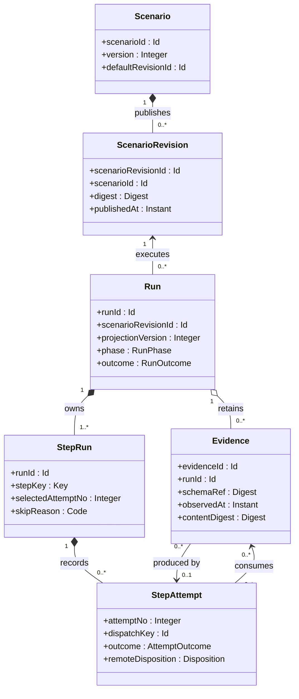
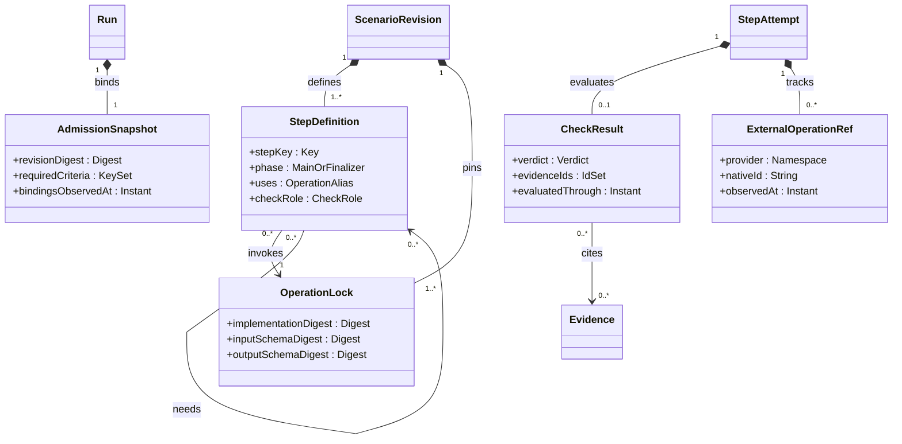
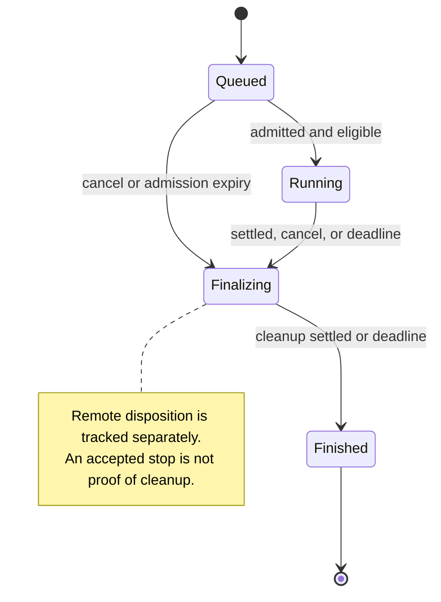

# Assessment workflow model

A **Scenario** describes an operational assessment. A published **ScenarioRevision** fixes its program. A **Run** executes that exact program against one bound deployment and records execution attempts, evidence and assessment results. The model answers three separate questions: what work occurred, what the evidence establishes, and whether remote work or cleanup remains unresolved.

The previous proposal's six concepts were a reasonable starting point. Its semantics were incomplete: a floating operation tag could change a revision, a skipped check could disappear from the assessment, and an accepted cancellation could be mistaken for a stopped fault. The rules below replace those ambiguities with explicit invariants.

## 1. Entities, ownership and identity

All application IDs are opaque and scoped to a trusted workspace. Names and content digests are not identities. The workspace is established by authenticated server context, not by a caller-supplied owner field.

| Entity | Identity | Kind and ownership | Mutable information |
| --- | --- | --- | --- |
| **Scenario** | `scenarioId` | Authoring aggregate root. Owns published revisions and mutable catalogue metadata. | Display name, description, archived flag and default revision pointer, under an explicit version check. |
| **ScenarioRevision** | `scenarioRevisionId`; belongs to one Scenario | Immutable published configuration entity. Contains the compiled definitions and full dependency lock. | None. A changed program creates a new revision. |
| **Run** | `runId` | Execution aggregate root. Owns its admission snapshot, control intent, StepRuns and StepAttempts. `scenarioRevisionId` references one revision. | Server-managed execution facts and projections; monotonic cancellation intent. Final result is sealed. |
| **StepRun** | `(runId, stepKey)` | Named execution member of a Run. Exactly one for every compiled main or finalizer step, including steps never attempted. | Server-managed scheduling facts and projection from attempts. No independent retry or status-edit command. |
| **StepAttempt** | `(runId, stepKey, attemptNo)` | Durable attempt record owned by one StepRun. `attemptNo` starts at 1. | Intent, checkpoint, external handles and evidence references append during execution; terminal facts are sealed. |
| **Evidence** | `evidenceId` | Immutable evidence record retained for one Run. Optional producer attempt; imported source provenance is explicit. | None. Additional observations create additional records. Retention/access metadata belongs to the store. |

The six identity-bearing concepts do not imply six independent CRUD APIs or six storage services. StepRun and StepAttempt are owned children. A query result, a check result and a report object are typed content or owned values, not new lifecycle roots.

### All-entity class diagram

This diagram contains every domain entity in this proposal. The second diagram describes owned values and external references; those do not acquire independent domain identity merely because a schema names them. Cardinalities describe the logical model, not which rows a partially hydrated client has loaded.

### Owned values and external references

| Value or reference | Owner and invariant |
| --- | --- |
| `StepDefinition` | Revision member keyed by `stepKey`, containing `uses`, input bindings, dependencies, timeout, retry policy, optional check role and graph phase. It has no global step ID. |
| `OperationLock` | Revision value mapping every operation alias to its immutable implementation digest, input/output schema digests and contract version. Includes nested composition when such composition is supported. |
| `AdmissionSnapshot` | Run value containing validated inputs, exact revision digest, resolved deployment/connection/resource references and their observed versions, enabled step set, criterion denominator and effective policy. It is not a second editable scenario. |
| `DeploymentRef`, `ConnectionRef`, `ResourceRef` | External references. Deployment inventory and credentials belong to other bounded contexts. A reference does not grant permission. ARN/account/Region/resource kind remain explicit where relevant. |
| `CheckResult` | Immutable attempt result value: verdict, reason code, predicate/evaluator digest, actual/expected summary, evidence IDs and evaluation cutoff. It is written once at final evaluation; interim evaluations are evidence observations. |
| `Observation` | Typed evidence content plus collection and coverage facts. A successful API request can still yield partial or unavailable observations. |
| `ExternalOperationRef` | Attempt value containing provider, account, Region, native identity and source observation time. A stable `originEffectKey` identifies the originating dispatch intent and effect ordinal even before a native ID is known. FIS experiment IDs and Logs Insights query IDs belong here. |
| `CancellationIntent` | Run-owned singleton value: first accepted time, principal, reason and command identity. It is monotonic and separate from remote stop confirmation. |
| `ArtifactRef` | Evidence value: store locator/version, media type, byte length and digest when known. Download authorization and temporary URLs are resolved separately. |
| `ExecutionError` | Structured attempt fact: code, category, safe message and provider details. A technical error is distinct from a false assertion. |

The two diagrams intentionally share boundary classes. They are one model split into readable views, not different alternative models. CheckResult evidence and all dependency references must resolve within the same Run or revision respectively. Imported evidence is copied into a run-owned immutable envelope with origin references and authorization checks; a dangling ID is invalid.

## 2. Publication and admission

Authoring documents can use a readable alias such as `aws/fis.start@1`. **Publication resolves every alias and freezes the complete lock.** Published revisions cannot contain an unresolved floating reference. The same revision therefore denotes the same executable contracts on every run. A later major-tag update requires publishing a new revision, even if the visible YAML is otherwise unchanged.

The immutable revision contains the source, normalized program, operation/schema lock, expression language/runtime contract, time semantics and versioned reducer rules. Its digest covers those fields. A digest provides content integrity; it does not establish author identity, authorization or immutable external cloud configuration.

Admission resolves the stored lock through an immutable operation registry by digest. Rotation of a current authoring alias cannot invalidate or alter a previously published revision while its pinned artifacts remain available and permitted. A missing or revoked pinned artifact rejects execution; it never triggers silent substitution. The example catalogue separates mutable alias pointers from retained revision contracts to exercise this rule. Its implementation digests are explicitly synthetic labels, not hashes of available executable packages.

StartRun validates inputs and authorization, resolves references and applies admission-only `enabledWhen` conditions. It stores their results and the list of required criteria before any execution. `enabledWhen` may depend only on declared inputs and the bound deployment snapshot. A false condition records `not_applicable` and a reason; it does not silently delete the definition. Runtime failure, skipping or cancellation cannot shrink the denominator. The complete example validator currently supports declared input references; a production compiler must type-check the broader expression environment.

The snapshot pins the inventory version observed at admission. It does not freeze the deployed system. Drift observed later is evidence. An `expectedDeploymentRevision` compares the referenced inventory revision; it is not a distributed lock on AWS. Before a mutating action, the adapter rechecks any required provider-specific precondition and records the result.

Secrets are connection/secret references. Resolved secrets never enter stored authoring inputs, normal outputs, evidence previews or logs. The scheduler assigns trusted operation capabilities; an author cannot make an arbitrary plugin read-only by setting a field.

## 3. One step contract, two graphs

An operation is a versioned adapter with typed input, output, effect classification, timeout behavior, retry classification, cancellation behavior and evidence schema. A command, query, observation and assertion all use this contract. Provider extensions belong in registered operation schemas, not unvalidated bags of fields on Run.

Each revision has a nonempty main `steps` map and an optional `finally` map. Step keys are unique across both. Dependencies form a DAG within their graph; main steps cannot depend on finalizers. A finalizer can read any main-step result after the main graph barrier and can `need` other finalizers to impose order. Within either graph, a reference to another step's outputs must name a dependency ancestor; sibling completion is not an implicit ordering guarantee. A reference to a main step from a finalizer is the explicit barrier exception.

`needs` waits for dependency settlement. The default `after: success` also requires their technical success. `after: settled` permits a diagnostic observation or check to run after failure, with missing outputs represented explicitly. It is restricted to non-mutating operations in the main graph. Finalizers use settled ordering so failure of one cleanup operation does not suppress a later cleanup operation. In v0.2 finalizers are unconditional compensation operations: they cannot carry `if`, `enabledWhen` or assessment roles. An adapter returns successful no-op with a stable reason when the original effect was conclusively never dispatched; an ambiguous start is not a no-op.

`assessmentRole: precondition` additionally gates mutating descendants: its check must pass. A failed, inconclusive or unexecuted precondition prevents those descendants from starting, including through an `after: settled` path. `assessmentRole: criterion` contributes to the assessment but does not implicitly block subsequent work when its predicate is false. An explicit precondition is the mechanism for blocking a perturbation. Informational checks do not affect the required denominator.

Runtime `if` is evaluated after dependency eligibility, in a fixed CEL environment. It cannot override cancellation or a precondition gate. A required criterion skipped by `if`, a failed dependency or cancellation remains required and yields inconclusive when the Run is sealed. Use admission-time `enabledWhen` for intentionally inapplicable criteria. The two concepts are distinct because only the latter can change what the assessment promises to evaluate.

The authoring syntax borrows named steps, `uses`, `with` and explicit dependencies from GitHub Actions. GitHub's own `needs` is a **job** relationship; this proposal deliberately defines a flat step DAG and is not GitHub Actions YAML compatibility. [GitHub workflow syntax](https://docs.github.com/en/actions/reference/workflows-and-actions/workflow-syntax)

### Expressions and missing values

A string consisting entirely of `${{ expression }}` is a typed binding; it is not string interpolation. Other strings are literals. `if`, `enabledWhen` and assertion `expect` are CEL expressions without wrappers. The declared environment is `inputs`, `bindings`, `deployment`, `steps` and, inside an assertion, `value`. Each step exposes its always-present scoped `ref`, `execution`, `outputs` and optional `check`; output access is valid only when that output exists. `bindings` contains only declared, authorized connection references. CEL's `has` macro can guard optional fields. There is no network, clock read, secret lookup or arbitrary host-language `eval` inside expressions.

Missing, null, empty and zero remain distinct. Bindings are evaluated once per new attempt and then sealed with their digest; resume does not silently re-resolve current outputs. The catalogue's resolved input schema validates the result. A missing input or schema mismatch is an execution error, never a successful zero/empty observation. The package's static validator checks structure and reference scope; it does not claim to be a CEL compiler. [CEL design overview](https://cel.dev/overview/cel-overview)

## 4. Execution and assessment are separate facts

Run execution has `phase: queued | running | finalizing | finished`. Before `finished`, `outcome` is null. The terminal execution outcome is `succeeded | failed | blocked | cancelled | timed_out | indeterminate`.

`indeterminate` means a required external effect or its termination cannot be established when the Run seals after finalization, including when its deadline expires. It is not hidden as ordinary cancellation. A Run can be finished as an orchestration record while remote work remains unresolved; `finalization.status` stays `incomplete` and lists `unresolvedEffects`. No generic “finished” badge should imply the cloud is restored.

StepRun has `phase: pending | running | finished` and a terminal outcome including `skipped`. Zero attempts is valid for a skipped step. A StepAttempt can be pending/running and then sealed with an outcome; transport polling and checkpoint resume remain the same attempt. `remoteDisposition: none | active | terminal | unknown` records the last established external state, independently of a local timeout or stop request.

Attempt facts and durable scheduler/control facts are authoritative. StepRun summaries select the latest actual attempt under the retry policy; Run summaries are deterministic projections with `projectionVersion`, `reducerVersion` and `asOfSequence`. Clients cannot PATCH any of these statuses. A late or out-of-order provider message is appended as evidence and cannot roll a terminal attempt backward.

An originating attempt's sealed remote observation is historical. Later reconciliation evidence from another attempt cites its `originEffectKey`; the Run's current effect projection reduces those observations without editing the sealed start attempt. Thus a successful FIS start can retain its original `active` observation while an ensure-stopped attempt establishes the same effect as terminal. The terminal Run result records the effect state at sealing. Later operational reconciliation may resolve a protective hold and append evidence, but cannot silently change that historical result.

| Situation | Execution result | Assessment result |
| --- | --- | --- |
| All required criteria pass and all required operations/finalizers succeed | `succeeded` | `passed` |
| Assertion evaluates correctly and finds the objective false | `succeeded`, if other work succeeds | `failed` |
| Precondition does not pass; perturbation never starts | `blocked`, unless a technical failure has higher precedence | `inconclusive` if required criteria remain unevaluated |
| Query cannot execute or its output violates its schema | `failed` | `inconclusive` unless another required criterion conclusively failed |
| Query finishes but collection/coverage cannot support the claim | `succeeded` | `inconclusive` |
| Required criterion is skipped at runtime | Determined by the reason and other work | `inconclusive`; criterion remains in denominator |
| All criterion definitions are inapplicable at admission | Determined by executed work | `not_evaluated` |
| Cancellation is accepted and external work is confirmed stopped | `cancelled` unless a substantive technical failure must also be reported | Prior conclusive checks retained; remaining criteria inconclusive |
| Local deadline expires and remote termination cannot be established | `indeterminate` | Determined by evidence; never automatically passed |
| Criteria pass, but required finalizer fails | `failed` or `indeterminate` | `passed`; cleanup failure remains a separate operator issue |

For a single execution summary, terminal precedence is: unresolved external disposition → `indeterminate`; substantive operation/finalizer failure → `failed`; accepted deadline termination → `timed_out`; accepted cancellation → `cancelled`; precondition block → `blocked`; otherwise `succeeded`. Expected cancellation errors caused by an accepted stop are recorded as cancellation, not promoted into unrelated technical failure. All contributing reasons remain accessible; precedence does not erase them.

The assessment projection includes `final`, `requiredCount`, `passedCount`, `failedCount`, `inconclusiveCount` and `pendingCount`. While required checks remain outstanding, the verdict is `inconclusive` with `final: false` unless a conclusive failure is already known. “Evaluating” is a UI label derived from these fields, not a fifth durable truth value. A provisional all-pass projection is also `final: false` until the Run seals. The Run exposes one public `projection.version` for its ETag, alongside `reducerVersion` and `asOfSequence`; there is no second independently writable Run version.

At sealing: no required criteria → `not_evaluated`; any conclusive required failure → `failed`; all required criteria passed → `passed`; otherwise → `inconclusive`. Preconditions are reported separately from workload criteria. Unknown check outcomes fail closed to inconclusive. Informational checks cannot make the assessment pass.

## 5. Retries, cancellation and finalization

Every StepAttempt persists a dispatch intent and stable `dispatchKey` before a provider call. A lost response can mean the effect occurred. The adapter reconciles that possibility using a native idempotency token, a known remote identity or a documented lookup mechanism. A new attempt is forbidden while the previous attempt's mutating effect is unresolved. An unresolvable outcome becomes `indeterminate`; the engine does not claim exactly-once effects across services. [AWS guidance on idempotent APIs](https://aws.amazon.com/builders-library/making-retries-safe-with-idempotent-APIs/)

After cancellation, reconciliation must not reissue a potentially creating Start call, even with the same token: if the original request never arrived, the retry could create new work. Use non-creating reads or retain unknown disposition. Step references allow a finalizer to inspect the original intent even when no successful output exists.

Transport retry, provider polling and worker recovery reuse the same attempt and dispatch key. A deliberate operation retry creates a new attempt and new key, only after the previous effect has been reconciled. Reads may have an explicit bounded retry policy. Mutations default to one attempt; retry requires an adapter capability and an eligible technical error. A false assertion is not a retryable technical error. “Eventually” is an explicit observation/check window, not retry-until-green.

Cancellation is an irreversible control intent on the Run. Its atomic acceptance fences further main-step dispatch. Work whose dispatch was committed before the fence is reconciled and stopped where supported; a racing request cannot make that remote effect vanish. A replay returns the original command receipt. A cancellation arriving after the Run is sealed returns the terminal Run with `accepted: false`; it cannot rewrite its outcome.

The main execution budget and the finalization budget are separate. Once main work settles, fails, is cancelled or exhausts its budget, the Run enters `finalizing`. Finalizers receive results/handles actually observed, not invented ones. If an external start outcome is ambiguous, reconciliation of the attempt is required even when no output handle exists. An `if: has(...)` guard is not permission to abandon unknown remote work.

Finalizers form a DAG. The notification example explicitly stops/reconciles the FIS experiment before closing capture. Capture close runs even if stop cleanup fails, after the stop attempt has settled, and preserves its last cursor and coverage gaps. A finite finalization deadline avoids an indefinitely running UI record. Expiration with unresolved remote effects yields `indeterminate`; without unresolved effects, ordinary timeout/failure precedence applies. Independent report collection is optional evidence work: a missing report must not prolong a fault. Critical cleanup and an asynchronous report cannot share an implicit completion condition. All finalizers declared in v0.2 are required cleanup; optional post-run report collection is outside their completion denominator.

Concurrency is scoped by trusted workspace, deployment identity and an explicit resource-lock key, not an arbitrary author-controlled string alone. Queuing a new conflicting run is safer than automatically cancelling an infrastructure operation. A production runner requires durable leases and fencing. A worker-lease expiration does not establish that remote work stopped; unresolved remote effects keep a protective hold until reconciliation or an audited administrative resolution. The v0.2 proposal specifies that invariant but does not implement a lock service.

## 6. Evidence and assertions

Evidence records the source namespace/account/Region, connection reference, resource or query identity, adapter/schema versions, exact collection specification, source event/window time, observation time and collector coverage. Pagination exhausted, query terminal and source coverage sufficient are different facts.

An observation separates `collection: complete | partial | unavailable` from `coverage: sufficient | insufficient | unknown`. The latter is relative to a stated claim and scope, with its rationale retained. A terminal query is not a universal source watermark. Time windows are half-open `[start, end)` in normalized UTC; adapters record any native endpoint conversion and precision. A check also freezes its `evaluatedThrough` observation cutoff and allowed ingestion delay.

For `core/assert`, `proof: complete` requires a successfully decoded, complete collection, a closed decision window and sufficient scope/coverage before a true or false predicate becomes conclusive. A point-in-time observation has a closed point scope once collected. `proof: witness` can pass from a qualifying positive witness in a partial collection or an open window. Without a witness, absence is conclusive only when the window is closed and collection and coverage are sufficient. Elapsed time alone does not establish that closure/coverage. An unavailable, malformed or unauthenticated source never produces a trustworthy witness. The adapter contract defines a witness-compatible predicate and records the matching evidence; a general arbitrary expression is not automatically monotone.

For this initial contract, `proof: witness` is restricted to the built-in `exists` assertion form over matching records. Arbitrary CEL predicates use `proof: complete`. This prevents a caller from labelling a non-monotone expression such as “exactly one receipt” as witness proof.

Temporal checks use `core/check`: `once`, `eventually` or `during`, with explicit sample interval, decision deadline, collection cutoff and gap tolerance. `eventually` can conclude on a positive witness before the window ends. `during` can fail on one violating sample but cannot prove continuous behavior between samples; its positive conclusion is explicitly about the declared sampling policy. These temporal operations are extension contracts described in [adapters.md](adapters.md), not implemented by the static reference reducer.

Once an assessment is sealed, later evidence cannot silently rewrite it. A corrected conclusion requires a new Run whose revision explicitly performs a read-only reassessment against retained evidence, with an origin-run reference. Evidence access, retention and evaluator versions must still be checked. A dedicated independent reassessment entity is deferred until there is a product requirement for multiple assessment histories within one execution.

## 7. FIS and operator UI mapping

| Existing FIS concept | Generalized representation |
| --- | --- |
| Experiment template | Provider configuration reference in an operation input; optionally a revisioned scenario input. It is not automatically a ScenarioRevision. |
| Experiment | An external execution referenced by a StepAttempt. One Run can launch zero, one or several FIS experiments. |
| Named FIS action | Provider detail keyed by experiment identity and action name. It is not an independently controllable core StepRun. |
| Target selectors and resolved memberships | Typed provider evidence with run/target/account provenance and collection completeness. |
| Experiment stop condition and safety lever | Provider safety configuration/observations, independent of application check criteria and cancellation intent. |
| CloudWatch query or alarm observation | An observation adapter result and immutable Evidence. |
| Workload criterion | An explicitly required check step with a pinned predicate and evaluation cutoff. |
| FIS report | A provider artifact reference with its own lifecycle; optional acquisition step or later evidence collection. |

The UI should present execution, assessment and remote cleanup independently. The workflow graph shows core steps; the FIS inspector shows native action details. A failed query, a false criterion, an inapplicable criterion, a stale observation and an unresolved remote stop must have different labels and explanations. Percentage of steps settled is not elapsed-time progress, fault coverage, or resilience confidence.

## 8. Remaining implementation gates

The model is suitable for reviewing and prototyping a contract. A production design still needs a selected CEL runtime with conformance tests, durable scheduler/lease recovery, adapter-specific idempotency and cancellation reconciliation, source-specific coverage policies, authorization and retention enforcement, and a receiver instrumented to establish notification claims. Those are concrete integration gates. The repository checks do not certify them.
