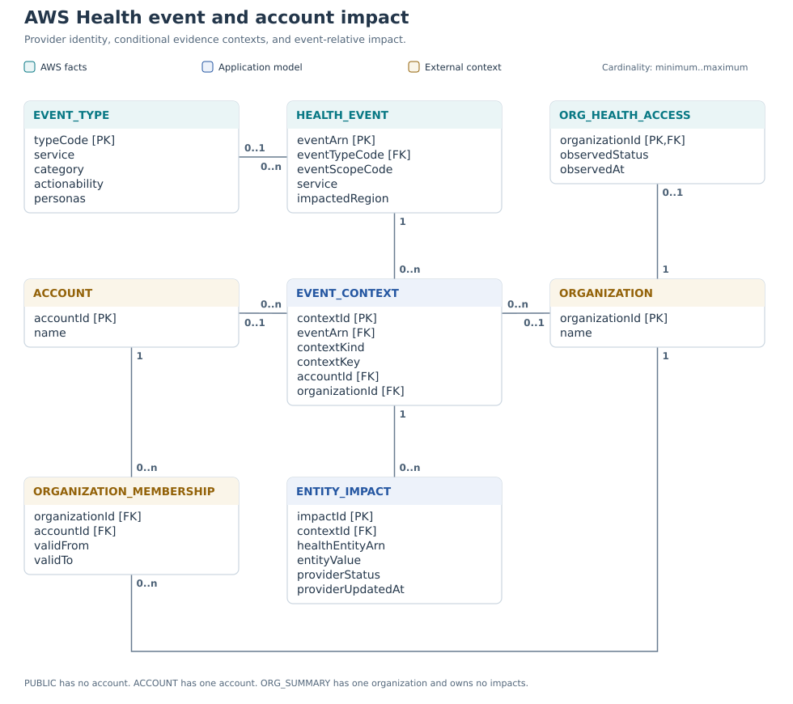
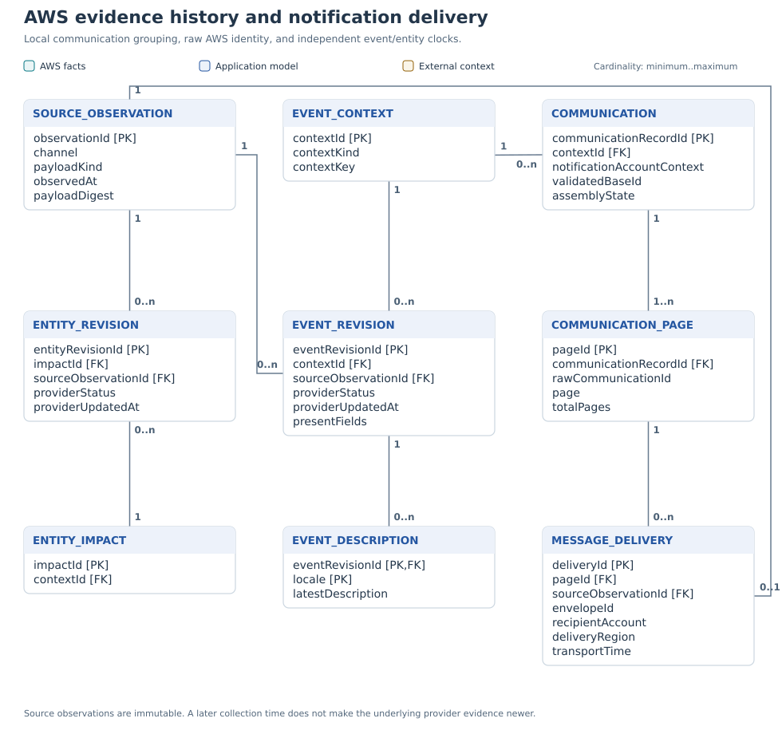
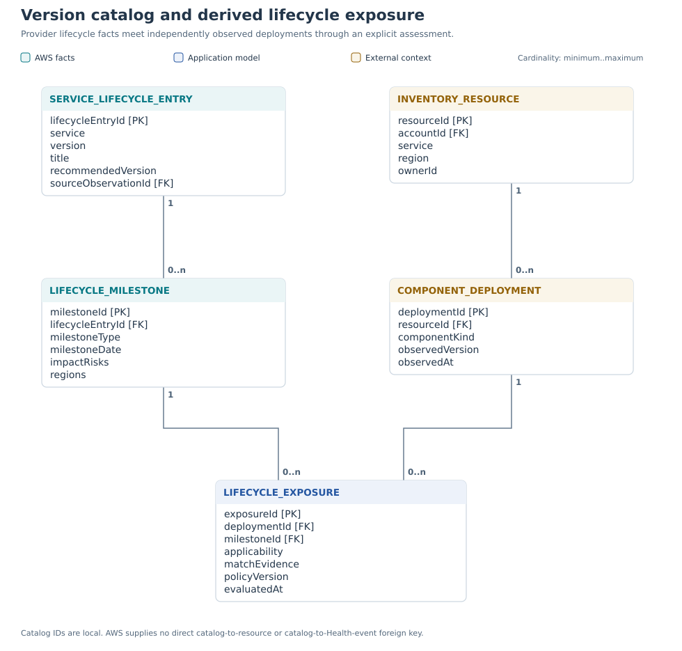
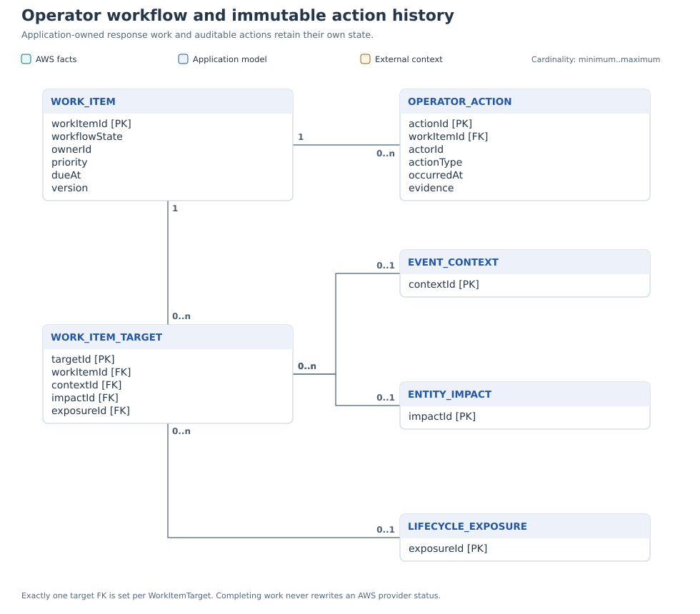

# AWS Health API and abstract data model

**Reviewed design report · 5 November 2026 · Revision 1.1**

This report establishes a data model for an operator application that presents AWS-reported health events, account and entity impact, lifecycle exposure, and response work. The source analysis covers the official AWS Health API Reference and User Guide. It is a documentation analysis; no customer AWS environment was inspected.

The accompanying application is a fictional, deterministic scenario. Its organization, accounts, resources, incidents, descriptions, and milestone dates are mock data. Familiar AWS service names and event shapes make the scenario realistic without representing a live AWS status feed. Application behavior and validation are documented in [README.md](README.md).

## Design recommendation

Use **HealthEvent → EventContext → EntityImpact** as the operational core. Keep four related domains explicit:

| Domain | Question it answers |
|---|---|
| AWS Health evidence | What did AWS report, for which event, service, account, and affected construct? |
| History and delivery | What changed, when did AWS update it, when did the application receive it, and is the view complete? |
| Lifecycle posture | Which observed deployments face support, billing, or availability milestones? |
| Operator workflow | Who owns the response, what was done, and what remains to verify? |

AWS state, local workflow, derived posture, and collection coverage remain separate dimensions. An action can be complete locally while AWS still reports a pending entity. A public service incident can be relevant without establishing account-specific impact. Missing observations must remain visible as uncertainty.

The current API has 15 operations: 13 reads and two organization-integration controls. The contract includes event actionability and personas, affected-entity metadata and URLs, and a service-version lifecycle catalog. These are current provider fields, not proposed extensions. [1] [2] [4] [5] [17]

**Notation:** AWS response-shape names retain their documented capitalization. Proposed entity names describe application abstractions. The diagrams use cardinalities and an explicit ownership legend: AWS facts, application model, and external context. Source content and storage ownership differ; storing an AWS field locally does not make its provider state writable.

<!-- pagebreak -->

## 1. API capability inventory

Listings, details, account associations, affected entities, aggregates, catalogs, and organization integration are separate capabilities. An event listing is not a complete event record. [7] [8]

| Operation | Returned or manipulated concept | Request and completeness constraints |
|---|---|---|
| `DescribeEvents` | Account-visible event summaries, including public events | Optional `EventFilter`; `maxResults` 1–100. Details, metadata, and entities require additional retrieval. [7] |
| `DescribeEventsForOrganization` | Organization event summaries | Optional `OrganizationEventFilter`; `maxResults` 1–100. The summary omits affected accounts, descriptions, metadata, and entities. [8] |
| `DescribeEventDetails` | Event, latest description, and metadata | 1–10 event ARNs; `successfulSet` and `failedSet`; affected entities are excluded. [9] |
| `DescribeEventDetailsForOrganization` | Contextual event details | 1–10 event/account filters. An account is required for account-specific events and null for public events. [10] |
| `DescribeAffectedAccountsForOrganization` | Reported event-to-account associations and scope | One event ARN; `maxResults` 10–100. `PUBLIC` has an empty affected-account list. [11] |
| `DescribeAffectedEntities` | Affected constructs and event-relative states | At least one event ARN; `maxResults` 1–100. [12] |
| `DescribeAffectedEntitiesForOrganization` | Affected constructs for event/account pairs | Up to 10 pairs in `organizationEntityAccountFilters`; `maxResults` 1–100; includes `failedSet`. Older `organizationEntityFilters` is deprecated. [13] |
| `DescribeEventTypes` | Type code, service, category, actionability, and personas | Filtered catalog; `maxResults` 10–100. [4] [14] |
| `DescribeEntityAggregates` | Per-event count and entity-status counts | Up to 50 event ARNs. Counts refer to Health entities. [15] |
| `DescribeEntityAggregatesForOrganization` | Per-event organization totals and optional account breakdowns | 1–25 event ARNs; optional 1–25 account IDs. Omitting account IDs produces an empty `accounts` array, including when totals are nonzero. [16] [19] |
| `DescribeEventAggregates` | Event-category counts | Only `aggregateField=eventTypeCategory` is supported; `maxResults` 10–100. The operation inventory has no organization counterpart. [1] [18] |
| `DescribeServiceLifecycle` | Service-version catalog entries and milestones | Optional service filter; `maxResults` 1–20. Version filtering is a local capability. [17] |
| `DescribeHealthServiceStatusForOrganization` | Organization aggregation configuration | `ENABLED`, `DISABLED`, or `PENDING`; management-account operation. [20] |
| `EnableHealthServiceAccessForOrganization` | Enables organization aggregation | Management-account control; creates a service-linked role; empty success body. [21] |
| `DisableHealthServiceAccessForOrganization` | Disables organization aggregation | Management-account control; empty success body; does not remove the service-linked role. [22] |

The `maxResults` ranges constrain the requested maximum. They do not guarantee that a response contains the lower bound or fills the requested maximum. Enumeration is complete only when no continuation token remains.

### Response wrappers and value objects

`Event` and `OrganizationEvent` describe the same event domain. `EventDetails` and `OrganizationEventDetails` compose an event with contextual content; they do not create additional incident identities. Organization summaries omit `availabilityZone`; detailed responses can contain it. [2] [3] [6] [38]

`EventAggregate`, `EntityAggregate`, `AccountEntityAggregate`, and `OrganizationEntityAggregate` map to query-scoped aggregate snapshots. `EventDetailsErrorItem` and the organization error-item shapes map to collection errors. Event, organization, entity, account, event-type, and service-lifecycle filters, together with `DateTimeRange`, are request value objects. Persist a filter when the product supports a saved view; a pagination token is a cursor rather than a domain identity. [40]

### Writable boundary

The operation inventory contains no event creation, acknowledgement, assignment, comment, mute, severity update, remediation execution, manual close, or delete operation. Such operator interactions belong in the application or an external work-management system. Resource-changing actions use the relevant AWS service or automation interface. This boundary follows from the complete supported-operation list. [1]

Represent the native organization controls as `OrganizationHealthAccess {organizationId, observedStatus, observedAt}`. A requested `desiredState` and command audit are local additions. After enable/disable, query `DescribeHealthServiceStatusForOrganization`; an empty mutation response does not establish readiness. Initial organization loading and historical backfill have separate timing. [20] [21] [22] [34]

<!-- pagebreak -->

## 2. ERD: event and account impact

Editable source: [01-core-model.mmd](diagrams/01-core-model.mmd).

The full event ARN is the provider event identity. `EventContext` is a local abstraction for the context in which evidence applies. An organization summary is retained separately from account-specific details. [2] [8] [10]

`OrganizationMembership` comes from external organizational context and can preserve membership history. Health supplies affected account IDs rather than a complete account directory. Organizational event visibility can outlast an account's membership. [33]

Known account entities route to their matching ACCOUNT context. An ORG_SUMMARY context owns summary evidence only. Unresolved entity/account associations remain unresolved observations; the application must not invent affected accounts.

<!-- pagebreak -->

## 3. Core entity dictionary and keys

| Entity and ownership | Identity and principal fields | Interpretation |
|---|---|---|
| `HealthEvent` — AWS fact with a local projection | Full `eventArn`; indexed `service`, `eventTypeCode`, category, scope, impacted region | Preserve the raw ARN. Indexed classifications are projections; source revisions retain corrections and conflicts. [2] |
| `EventType` — AWS catalog | Provider type code; service, category, actionability, `personas[]` | Preserve observed event classifications rather than blindly replacing them with catalog values. [4] |
| `EventContext` — local abstraction | `contextId`; `eventArn`; `contextKind`; non-null `contextKey`; conditional account/organization references | Unique within tenant: event ARN, context kind, and context key. |
| `EventRevision` — local history of AWS evidence | `eventRevisionId`; context and source observation; status; start/end/update times; AZ; actionability; personas; metadata; field presence | Immutable contextual source observation. A summary must not erase richer fetched content. [2] [6] |
| `EventDescription` — AWS text, versioned locally | Event revision and locale; `latestDescription` | API locale comes from the request; English is currently supported. Stream descriptions carry language. [6] [9] [25] |
| `EntityImpact` — normalized affected-entity fact | Local `impactId`; context; Health entity ARN; entity value; account; status; independent update time; metadata; URL | Participation of an affected construct in an event. It is not a generic inventory-resource record. [5] [12] |
| `Account`, `Organization`, `OrganizationMembership` — external context | AWS IDs; optional names, OU, ownership, and membership validity | Account IDs are strings. Names, organizational topology, and ownership need enrichment. |
| `OrganizationHealthAccess` — observed AWS control state | Organization/integration ID; observed state; observation time | Configuration of aggregation. Desired state and command outcomes are separate local records. [20] |

### Exact context invariants

These are application rules, not additional AWS `eventScopeCode` values:

| Local kind | `contextKey` | Required references | Forbidden ownership |
|---|---|---|---|
| `PUBLIC` | Constant `PUBLIC` | No account or organization reference | No reported account association solely from notification receipt |
| `ACCOUNT` | Account ID | Exactly one account; organization context comes through membership | No organization-summary entity bucket |
| `ORG_SUMMARY` | Organization ID | Exactly one organization; no account reference | No entity impacts or presumed account detail |

Use `(tenant, eventArn, contextKind, contextKey)` for uniqueness. A non-null context key avoids database-specific NULL uniqueness behavior. Scope all local identities and source data to the intended tenant/integration boundary.

For account-specific organization details, the API uses `(eventArn, awsAccountId)`; public-event requests use no account. That is a direct reason to preserve contextual observations rather than one globally overwritten detail row. [10]

A PUBLIC notification can contain recipient or notification-account metadata. Retain those fields on communication/delivery provenance without creating an ACCOUNT context. The affected-accounts API explicitly returns an empty account list for public events. `NONE` is an invalid/nonexistent-event lookup result and should not be normalized into a healthy event. [11] [25]

### Entity identity and inventory matching

`entityArn` identifies an AWS Health entity. `entityValue` identifies the affected construct and may be a resource ID or ARN. AWS permits individual resources, resource groups, and other constructs, including indications of broad or unknown impact. [5] [12]

Retain a local `impactId` and the provider identity. Where available, a normalized key can use `(contextId, healthEntityArn)`. A stream observation with only `entityValue` needs a provisional, context-specific identity or reconciliation. Do not make that value globally unique. If redundant `awsAccountId` is supplied, require it to agree with the ACCOUNT context.

An optional `EntityResourceMatch {impactId, resourceId, matchMethod, confidence, evidence}` bridge supports zero, one, or several inventory matches. Keep unresolved identifiers and group records. Resource names, tags, owners, dependencies, and criticality are external context; Health's `tags` property is explicitly unsupported. [5]

<!-- pagebreak -->

## 4. State, status, and missing evidence

| Dimension | Provider values | UI meaning |
|---|---|---|
| Event lifecycle | `open`, `closed`, `upcoming` | AWS lifecycle for this event context. [2] |
| Entity state | `IMPAIRED`, `UNIMPAIRED`, `UNKNOWN`, `PENDING`, `RESOLVED` | Entity state relative to the event. [5] |
| Category | `issue`, `accountNotification`, `scheduledChange` | Event classification; `investigation` is listed but documented as unsupported. [2] [4] |
| Scope | `PUBLIC`, `ACCOUNT_SPECIFIC`, `NONE` | Public/account specificity; `NONE` indicates invalid or nonexistent lookup. [11] |
| Actionability | `ACTION_REQUIRED`, `ACTION_MAY_BE_REQUIRED`, `INFORMATIONAL` | Whether customer action is required, conditional, or informational. [2] |
| Persona | `OPERATIONS`, `SECURITY`, `BILLING` | Multivalued audience classification, not an assigned person. [4] |
| Organization integration | `ENABLED`, `DISABLED`, `PENDING` | Aggregation configuration. [20] |

Maintain independent product dimensions: `providerEventStatus`, `providerEntityStatus`, `operatorWorkflowState`, `assessedOperationalState`, `lifecycleRisk`, and `coverageState`. A future change can require action without present impairment; an AWS closure can precede completion of local verification.

AWS notes that service-issue events lack actionability because recovery depends on application architecture. Missing actionability must not become `INFORMATIONAL` or “no action needed.” Operational incidents still belong in an operator's attention queue when appropriate. [24]

Preserve four different cases: an explicit provider `UNKNOWN`; a source value that was not supplied; a field not yet fetched; and a failed or stale retrieval. Formal response optionality must not disappear through invented schema defaults. Preserve unfamiliar enum strings for forward-compatible ingestion. [2] [5]

An event-relative `UNIMPAIRED` or `RESOLVED` entity state does not establish a global resource-health verdict. Likewise, `PENDING` identifies an outstanding action state in relevant events; it does not itself establish current impairment.

<!-- pagebreak -->

## 5. ERD: history and delivery

Editable source: [02-history-delivery.mmd](diagrams/02-history-delivery.mmd).

The local **`communicationRecordId`** deliberately differs from AWS **`rawCommunicationId`**. The former identifies an application grouping; the latter preserves `detail.communicationId` exactly. One logical page can have redundant deliveries without creating another Health event or entity impact.

`SourceObservation` preserves raw API responses and messages with channel, payload kind, digest, and receipt time. A response can support several event/entity revisions. API observations can exist without a `MessageDelivery`. Entity revisions carry their own provider update clock; their freshness must not be inferred from the parent event's timestamp.

Public communications retain their notification-account context for deduplication while referring to one shared PUBLIC event context. Account delivery metadata does not assert impact.

<!-- pagebreak -->

## 6. Ingestion and temporal integrity

Use EventBridge for notifications and the Health API for hydration and reconciliation. AWS Health documents durable, at-least-once delivery attempts to EventBridge. Consume idempotently and keep the history the product requires locally. [26]

| Identity or clock | Store as | Distinction |
|---|---|---|
| API `arn` / `detail.eventArn` | Health event provider key | Separate from EventBridge envelope `id`. |
| `detail.communicationId` and page | Raw logical-page identity | Do not discard later communications by deduplicating solely on event ARN. |
| Envelope `id`, `account`, `region` | Delivery provenance | Recipient and delivery region can differ from affected account and impacted region. |
| Event `lastUpdatedTime` | Provider event clock | Separate from arrival order. |
| Entity `lastUpdatedTime` | Provider entity clock | Independent of event update time. |
| Envelope `time` | Transport time | Separate from event start. |
| Local `observedAt` | Collection/receipt time | A later fetch can still contain old provider evidence. |

The envelope/detail distinctions are documented by the EventBridge schema. Use API `region` or `detail.eventRegion` for impact geography. [25]

### Idempotency and page assembly

A proposed logical-page key is `(eventArn, notificationAccountContext, rawCommunicationId, page)`, within the tenant boundary. The ARN already encodes partition. Exclude delivery region, receiving account, backup flag, and envelope ID from this logical key; retain them on deliveries. This preserves updates and collapses redundant backup delivery. [25] [28]

AWS describes shared communication identity across pages while also documenting page-number suffixes. Preserve the raw string. Derive a communication-group base only when its suffix matches the parsed page number. Retain unrecognized formats provisionally and reconcile them. Require all expected pages before claiming a complete resource list; page order is immaterial. Processing only page 1 is unsuitable for a complete impact UI. [27]

Store `expectedPages`, received page identities, assembly state, and any conflicting payloads. The UI can explain an incomplete set instead of silently showing a partial count as a total.

<!-- pagebreak -->

### Projection rules

- Advance each current field from suitable, contextual source evidence. Missing summary fields never erase fetched detail or metadata.
- Preserve payload kind and field presence; source absence differs from explicit null and from a retrieval gap.
- Retain and reconcile conflicting equal-timestamp observations. Arrival order alone does not prove semantic precedence.
- An absent entity in a partial, filtered, failed, or expired response is not resolution evidence.
- Preserve flexible provider transitions. Scheduled events can be reported open before their future start date; do not calculate AWS status from calendar comparisons. [25]
- Keep event, entity, transport, and observation clocks separate in both storage and the timeline.

The API returns the latest description rather than an independent description-history object. Local revision storage supplies a reliable operator timeline. [6]

### Deterministic mock behavior

The showcase uses an explicitly displayed scenario clock. Deadlines and relative ages are calculated against that clock so the demo remains reproducible. A refresh can update collection time without changing AWS's provider-update time. Simulated AWS updates and local operator actions must be distinct, labeled transitions. The mock must never imply an actual AWS write or live connection.

<!-- pagebreak -->

## 7. ERD: lifecycle posture

Editable source: [03-lifecycle-posture.mmd](diagrams/03-lifecycle-posture.mmd).

`ServiceLifecycle` and its `LifecycleEvent` values describe a version catalog. The normalized name `LifecycleMilestone` distinguishes these values from ARN-identified Health events. Catalog milestones supply no direct account, resource, or Health-event association. [17] [23] [29]

`LifecycleExposure` is an application assessment that joins independently observed deployments to catalog milestones. There is no mandatory event-to-milestone foreign key. A verified local correlation may link related evidence without asserting an AWS-provided association.

<!-- pagebreak -->

## 8. Catalog identity and applicability

| Object | Principal fields | Modeling rule |
|---|---|---|
| `ServiceLifecycle` / `ServiceLifecycleEntry` | `service`, `title`, `version`, `recommendedVersion`, milestones | Use a local entry ID and source snapshots; no provider stable ID or source-update timestamp is supplied. [23] |
| `LifecycleEvent` / `LifecycleMilestone` | `date`, description, type, risk strings, regions | Use local identity and preserve source order and explicit dates. Type/risk strings remain extensible. [29] |
| `ComponentDeployment` | Resource, component kind, observed version, account/region, observation time | External inventory evidence; a service name or unqualified version alone may be ambiguous. |
| `LifecycleExposure` | Deployment, milestone, applicability, reason, matching rule/version, assessment time, policy version | Locally derived assessment with explicit provenance. |

Do not declare `(service, version)` a provider-guaranteed unique key. Reconcile stable local identities against retained snapshots and evidence. A changed title or milestone date must not silently erase history. Keep `recommendedVersion` as supplied even when it cannot be resolved to another returned catalog entry. [17] [23] [29]

The guide documents `regions=["all"]` as all Regions. Missing regions remains unspecified. Example milestone types include `END_OF_SUPPORT`, `BLOCK_RESOURCE_CREATE`, and `BLOCK_RESOURCE_UPDATE`; example risks include `END_OF_SUPPORT`, `BILLING`, and `AVAILABILITY`. Interpret the tag with the actual milestone description: a create/update restriction does not prove that an existing workload is down. [30]

### Assessment and matching

Join catalog milestones to current, service-specific component/version evidence. Preserve matching method, source observations, confidence, evaluation time, and policy version. Applicability can be confirmed, candidate, excluded, or unknown. An absent or ambiguous catalog match remains unknown rather than automatically unsupported, healthy, or zero risk.

The AWS guide explicitly proposes cross-referencing the catalog with resource inventory. The inventory observation time is therefore part of confidence in any posture result. [30]

<!-- pagebreak -->

### Account-specific planned lifecycle events

These remain ordinary Health events, generally categorized `scheduledChange`. For planned lifecycle events, `startTime` is the earliest change-impact date; `endTime` is not a reliable remediation deadline. `PENDING` indicates outstanding resource action. `RESOLVED` can reflect action completion or deletion. [31]

Resource updates can exceptionally lag by up to 72 hours. Some events do not provide dynamic entity states, and state updates are unsupported in GovCloud and China Regions. Large organizations can receive several Health ARNs for a single lifecycle change. A cross-event campaign is consequently a local grouping with evidence. [31]

Support “operator completed; awaiting AWS or inventory confirmation.” Completing a work item does not rewrite `PENDING` or clear a lifecycle exposure while the deployed-version evidence remains unchanged.

### Retention

General event and organization guidance describes a 90-day visibility window. Planned-lifecycle guidance documents unresolved events remaining open for four years after the later start/end date. Avoid one universal expiry rule and do not assume every retrieval path exposes identical history. Preserve the operational history needed by the product independently. Source disappearance, access loss, account departure, and provider closure are different states. [24] [31] [33]

<!-- pagebreak -->

## 9. ERD: operator workflow

Editable source: [04-operator-workflow.mmd](diagrams/04-operator-workflow.mmd).

Each `WorkItemTarget` references exactly one context, impact, or exposure. Multiple targets support coordinated work without inventing a provider incident-group identifier. Separate typed link tables are an equivalent physical implementation.

Operator actions preserve actor, action, time, before/after values where useful, comments, and evidence. Use an optimistic work-item version to prevent concurrent overwrites. Local priority and due dates retain their own source and rationale. AWS personas can inform routing rules; they are not named assignees.

<!-- pagebreak -->

## 10. UI capabilities and read models

| Capability | Owning system | Displayed outcome |
|---|---|---|
| Filter and group | Product query or supported Health filters | A scoped view of the same source evidence; saved views are local. |
| Acknowledge, assign, comment | Work item and operator action | Operator progress changes while provider state remains visible. |
| Snooze or suppress attention | Local preference or separate notification service | Scope, expiry, and reason for a time-bounded attention preference. |
| Complete remediation | Local workflow and any external resource action | Completion evidence and verification state; AWS confirmation is separate. |
| Change an AWS resource | Relevant service API, runbook, or automation | External operation result linked as work evidence. Health has no remediation-execution operation. [1] |
| Enable/disable organizational view | Native Health integration control | Requested state, observed state, readiness, and error. [20] [21] [22] |

| UI surface | Primary inputs | Honest interpretation |
|---|---|---|
| Situation overview | Events, contexts, entity states, relevant inventory | Distinguish AWS-reported account impact from public exposure. |
| Service/region matrix | Event evidence, monitored scope, coverage | “Active issue reported,” “no active issue reported within coverage,” or unknown/partial coverage. |
| Account/entity drilldown | ACCOUNT contexts, impacts, inventory matches | Event-relative state, ownership, unmatched identifiers, and missing evidence. |
| Action center | Actionability, pending obligations, owners, work | Required/conditional response and verification; include relevant incidents lacking actionability. |
| Lifecycle posture | Milestones, deployed versions, scheduled events | Applicable milestones, date risk, and matching confidence. |
| Event timeline | Event/entity revisions and operator actions | Distinct authorship and clocks for AWS updates, receipt, and local activity. |
| Coverage panel | Capabilities, collection runs, failed items, page assembly | Freshness and limits of the selected assessment. |

A combined overview can summarize these dimensions, but a single status or percentage loses their meanings. Keep reported operational evidence, future exposure, workflow progress, and coverage visible. Any numerical score would require an explicit policy and supporting evidence.

This model supports AWS-reported health exposure and lifecycle posture. Broad workload-health or security/compliance conclusions require additional telemetry, assessment, and business context.

<!-- pagebreak -->

## 11. Counts, aggregates, and worked example

| Metric | Suggested definition |
|---|---|
| Health events | Distinct event ARNs within selected scope; deliveries and account contexts do not multiply the count. |
| Open issues | Distinct event ARNs whose relevant visible context is `open` and category is `issue`. |
| Reported affected accounts | Distinct account IDs from ACCOUNT contexts backed by account-specific evidence. |
| Affected entities | Distinct impact records within relevant contexts, including non-resource constructs. |
| Impaired entities | Distinct impact records currently reported `IMPAIRED`. |
| Pending entity actions | Distinct impact records currently reported `PENDING`; separate from work-item state. |
| Inventory resources at risk | Distinct resource IDs from verified matches and applicable exposures. |
| Lifecycle exposures | Distinct deployment–milestone assessments, if this separate unit is shown. |
| Work awaiting verification | Completed local work items lacking required verification evidence. |
| Coverage and freshness | Known scope, successful reconciliation time, source age, missing pages, and errors. |

Counts must follow the same filters and scope as the visible records. Keep historical/resolved entity records distinct from the narrower “currently impaired” population. Avoid an “affected resources” label when the source is merely an entity count.

### Aggregate snapshots

Cache aggregate results with scope, filter signature, observation time, requested breakdown, count/status map, and completeness. Do not add parent totals to child account counts. `OrganizationEntityAggregate.accounts` is empty if account IDs were omitted from the request; that does not imply zero affected accounts. Entity aggregates are not automatically distinct inventory-resource totals across events. [15] [16] [19]

<!-- pagebreak -->

### Illustrative example

An account-specific lifecycle event E affects accounts A and B. A/r1 is `PENDING`, A/r2 is `RESOLVED`, and B/r3 is `PENDING`. All three match inventory resources. An operator completes work for A/r1, but the latest provider entity observation remains `PENDING`.

| Question | Representation |
|---|---|
| Event, accounts, entities | 1 event, 2 reported affected accounts, 3 entity records |
| Matched resources | 3 distinct verified inventory resources |
| Provider action state | 2 pending entities and 1 resolved entity, with source-update time |
| Local state for A/r1 | Completed; verification/source confirmation pending |
| Present availability | `PENDING` alone does not establish impairment |
| Lifecycle risk | Derived from applicable milestones and current deployment evidence |
| Additional public incident | Public exposure; receipt creates no affected-account association |

A burndown must publish its population and as-of time. Resources can enter the affected set after a baseline; incomplete enumeration or a changing denominator makes a fixed completion percentage misleading. Pending/resolved/unknown counts are often clearer.

<!-- pagebreak -->

## 12. Coverage and collection model

Coverage is part of health interpretation. Zero results do not establish complete service health without a known population, successful retrieval, and a fresh observation window.

| Supporting entity | Principal fields | Role |
|---|---|---|
| `SourceConnection` | Connection, partition, caller, account/org scope, capabilities, integration state | Establishes source scope and available operations. |
| `CollectionRun` | Operation, filter signature, start/completion times, pagination, result state | Completion is scoped to the requested query. |
| `CollectionItemError` | Run, event/account references, error name/message, retry state | Preserves `failedSet`, including HTTP 200 responses. [9] [10] [13] |
| `CoverageAssessment` | Scope, freshness, last successful reconciliation, unavailable capabilities, incomplete pages | Explains uncertainty without changing provider health state. |
| `AggregateSnapshot` | Query scope, filters, as-of time, counts, requested breakdown, completeness | Cached answer rather than a mutable business object. |
| `SourceObservation` | Run/delivery reference, channel, payload kind, raw payload, observed time, digest | Provenance for event, entity, catalog, configuration, and aggregate evidence. |

### Collection sequence

1. Establish credentials/capabilities, monitored scope, and organization readiness; collect catalogs and external inventory context.
2. Enumerate event summaries through every page. For account-specific organizational events, enumerate affected accounts and hydrate details/entities for the correct pairs. Public detail requests use no account. [8] [10] [11]
3. Ingest notifications idempotently and schedule targeted refreshes. Use overlapping update-time windows and periodic reconciliation of the active working set, including independent entity states.
4. Publish projections with provenance, counts, and coverage. Partial API enumeration and partial notification assembly remain partial results.

Use the active Health endpoint for the latest evidence and restart interrupted enumeration when failover requires it. Model support entitlement, authorization, and connection failures as capability/coverage failures. The guide recognizes both new and legacy eligible support-plan names, so observed capability is a better domain attribute than a hard-coded plan-name enum. [35]

Initial organization loading and historical backfill require their own progress states. “Integration enabled” does not necessarily mean that all historical data has arrived. [34]

<!-- pagebreak -->

## 13. Implementation decisions and review

| Decision | Reason |
|---|---|
| Preserve raw values and field presence | Unknown future enum values, absent fields, and failed hydration have different meanings. [2] [5] |
| Keep context in keys | Account details, organization summaries, and public observations must not overwrite one another. |
| Normalize source-specific field names | API entity `statusCode` corresponds to stream entity `status`; API region corresponds to `detail.eventRegion`. [5] [25] |
| Keep scope filtering local for API lists | `EventFilter` and `OrganizationEventFilter` do not expose an `eventScopeCode` request property. [36] [37] |
| Enrich resource-tag filtering externally | Native Health tags are unsupported. [5] [36] |
| Inspect per-item errors and all pages | A successful HTTP status does not establish complete batch success. [9] [10] [13] |
| Match catalog entries explicitly | No stable provider catalog key or direct resource-applicability key is supplied. [23] [29] |
| Preserve optional enrichment | Missing inventory, owner, dependency graph, or denominator must remain unknown. |

The EventBridge schema table uses `OPERATIONAL` while the API and examples use `OPERATIONS`. Preserve raw personas and normalize the known alias deliberately. Examples also serialize page counts and backup flags as strings. The communication-ID description has inconsistent wording around page suffixes; retain raw IDs and validate any derived base. [2] [25] [27]

Region setup determines coverage. In the standard partition, simplified ingestion in `us-west-2` captures account-specific events but not public events and does not provide high availability. Public backup delivery requires a valid rule in the impacted Region. Global-event routing also needs explicit treatment. [28] [32]

### Review changes in revision 1.1

- Made context-key uniqueness and conditional references explicit.
- Required entity/account agreement and unresolved-observation handling.
- Renamed the local communication key to `communicationRecordId` to distinguish it from AWS identity.
- Kept the independent entity revision clock visible in the temporal ERD.
- Added deterministic mock-time and fictional-provenance rules.
- Defined filter-aware counters and prohibited workflow completion from rewriting provider state or clearing unverified exposure.

The review found no material contradiction in the retained API inventory or core model. Detailed review findings are in [REVIEW.md](REVIEW.md). The application validation record is in [README.md](README.md).

### Acceptance scenarios for the model

Exercise a public event received through several accounts; one account-specific ARN across accounts; duplicate backup deliveries; missing/out-of-order pages; partial successful/failed batches; summary-after-detail observations; entity resolution while the event remains open; local completion awaiting AWS confirmation; a changed catalog date; and an ambiguous inventory match.

These scenarios verify the semantic boundaries rather than reproducing implementation details. They are the intended basis for the showcase interactions and subsequent production integration.

<!-- pagebreak -->

## 14. Official source index

All sources are official AWS documentation reviewed for the original analysis on 5 November 2026. Revision 1.1 reviews the retained source mappings and the model's implementation semantics. Context identities, revision storage, matching policies, operator workflow, and UI projections are recommendations derived from those contracts.

1. [Actions index](https://docs.aws.amazon.com/health/latest/APIReference/API_Operations.html)
2. [Event](https://docs.aws.amazon.com/health/latest/APIReference/API_Event.html)
3. [OrganizationEvent](https://docs.aws.amazon.com/health/latest/APIReference/API_OrganizationEvent.html)
4. [EventType](https://docs.aws.amazon.com/health/latest/APIReference/API_EventType.html)
5. [AffectedEntity](https://docs.aws.amazon.com/health/latest/APIReference/API_AffectedEntity.html)
6. [EventDetails](https://docs.aws.amazon.com/health/latest/APIReference/API_EventDetails.html)
7. [DescribeEvents](https://docs.aws.amazon.com/health/latest/APIReference/API_DescribeEvents.html)
8. [DescribeEventsForOrganization](https://docs.aws.amazon.com/health/latest/APIReference/API_DescribeEventsForOrganization.html)
9. [DescribeEventDetails](https://docs.aws.amazon.com/health/latest/APIReference/API_DescribeEventDetails.html)
10. [DescribeEventDetailsForOrganization](https://docs.aws.amazon.com/health/latest/APIReference/API_DescribeEventDetailsForOrganization.html)
11. [DescribeAffectedAccountsForOrganization](https://docs.aws.amazon.com/health/latest/APIReference/API_DescribeAffectedAccountsForOrganization.html)
12. [DescribeAffectedEntities](https://docs.aws.amazon.com/health/latest/APIReference/API_DescribeAffectedEntities.html)
13. [DescribeAffectedEntitiesForOrganization](https://docs.aws.amazon.com/health/latest/APIReference/API_DescribeAffectedEntitiesForOrganization.html)
14. [DescribeEventTypes](https://docs.aws.amazon.com/health/latest/APIReference/API_DescribeEventTypes.html)
15. [DescribeEntityAggregates](https://docs.aws.amazon.com/health/latest/APIReference/API_DescribeEntityAggregates.html)
16. [DescribeEntityAggregatesForOrganization](https://docs.aws.amazon.com/health/latest/APIReference/API_DescribeEntityAggregatesForOrganization.html)
17. [DescribeServiceLifecycle](https://docs.aws.amazon.com/health/latest/APIReference/API_DescribeServiceLifecycle.html)
18. [DescribeEventAggregates](https://docs.aws.amazon.com/health/latest/APIReference/API_DescribeEventAggregates.html)
19. [OrganizationEntityAggregate](https://docs.aws.amazon.com/health/latest/APIReference/API_OrganizationEntityAggregate.html)
20. [DescribeHealthServiceStatusForOrganization](https://docs.aws.amazon.com/health/latest/APIReference/API_DescribeHealthServiceStatusForOrganization.html)
21. [EnableHealthServiceAccessForOrganization](https://docs.aws.amazon.com/health/latest/APIReference/API_EnableHealthServiceAccessForOrganization.html)
22. [DisableHealthServiceAccessForOrganization](https://docs.aws.amazon.com/health/latest/APIReference/API_DisableHealthServiceAccessForOrganization.html)
23. [ServiceLifecycle](https://docs.aws.amazon.com/health/latest/APIReference/API_ServiceLifecycle.html)
24. [Concepts for AWS Health](https://docs.aws.amazon.com/health/latest/ug/aws-health-concepts-and-terms.html)
25. [AWS Health EventBridge schema](https://docs.aws.amazon.com/health/latest/ug/aws-health-events-eventbridge-schema.html)
26. [Monitoring events with EventBridge](https://docs.aws.amazon.com/health/latest/ug/cloudwatch-events-health.html)
27. [Paginated Health events on EventBridge](https://docs.aws.amazon.com/health/latest/ug/pagnation-of-health-events.html)
28. [Account-specific / public events and backup rules](https://docs.aws.amazon.com/health/latest/ug/about-public-events.html)
29. [LifecycleEvent](https://docs.aws.amazon.com/health/latest/APIReference/API_LifecycleEvent.html)
30. [Version catalog for AWS Health](https://docs.aws.amazon.com/health/latest/ug/aws-health-version-catalog.html)
31. [Planned lifecycle events](https://docs.aws.amazon.com/health/latest/ug/aws-health-planned-lifecycle-events.html)
32. [EventBridge region coverage](https://docs.aws.amazon.com/health/latest/ug/choosing-a-region.html)
33. [Aggregating Health events across accounts](https://docs.aws.amazon.com/health/latest/ug/aggregate-events.html)
34. [Enabling organizational view](https://docs.aws.amazon.com/health/latest/ug/enable-organizational-view.html)
35. [Integrating with the AWS Health API](https://docs.aws.amazon.com/health/latest/ug/health-api.html)
36. [EventFilter](https://docs.aws.amazon.com/health/latest/APIReference/API_EventFilter.html)
37. [OrganizationEventFilter](https://docs.aws.amazon.com/health/latest/APIReference/API_OrganizationEventFilter.html)
38. [OrganizationEventDetails](https://docs.aws.amazon.com/health/latest/APIReference/API_OrganizationEventDetails.html)
39. [Document history](https://docs.aws.amazon.com/health/latest/ug/doc-history.html)
40. [Data types index](https://docs.aws.amazon.com/health/latest/APIReference/API_Types.html)

[1]: https://docs.aws.amazon.com/health/latest/APIReference/API_Operations.html
[2]: https://docs.aws.amazon.com/health/latest/APIReference/API_Event.html
[3]: https://docs.aws.amazon.com/health/latest/APIReference/API_OrganizationEvent.html
[4]: https://docs.aws.amazon.com/health/latest/APIReference/API_EventType.html
[5]: https://docs.aws.amazon.com/health/latest/APIReference/API_AffectedEntity.html
[6]: https://docs.aws.amazon.com/health/latest/APIReference/API_EventDetails.html
[7]: https://docs.aws.amazon.com/health/latest/APIReference/API_DescribeEvents.html
[8]: https://docs.aws.amazon.com/health/latest/APIReference/API_DescribeEventsForOrganization.html
[9]: https://docs.aws.amazon.com/health/latest/APIReference/API_DescribeEventDetails.html
[10]: https://docs.aws.amazon.com/health/latest/APIReference/API_DescribeEventDetailsForOrganization.html
[11]: https://docs.aws.amazon.com/health/latest/APIReference/API_DescribeAffectedAccountsForOrganization.html
[12]: https://docs.aws.amazon.com/health/latest/APIReference/API_DescribeAffectedEntities.html
[13]: https://docs.aws.amazon.com/health/latest/APIReference/API_DescribeAffectedEntitiesForOrganization.html
[14]: https://docs.aws.amazon.com/health/latest/APIReference/API_DescribeEventTypes.html
[15]: https://docs.aws.amazon.com/health/latest/APIReference/API_DescribeEntityAggregates.html
[16]: https://docs.aws.amazon.com/health/latest/APIReference/API_DescribeEntityAggregatesForOrganization.html
[17]: https://docs.aws.amazon.com/health/latest/APIReference/API_DescribeServiceLifecycle.html
[18]: https://docs.aws.amazon.com/health/latest/APIReference/API_DescribeEventAggregates.html
[19]: https://docs.aws.amazon.com/health/latest/APIReference/API_OrganizationEntityAggregate.html
[20]: https://docs.aws.amazon.com/health/latest/APIReference/API_DescribeHealthServiceStatusForOrganization.html
[21]: https://docs.aws.amazon.com/health/latest/APIReference/API_EnableHealthServiceAccessForOrganization.html
[22]: https://docs.aws.amazon.com/health/latest/APIReference/API_DisableHealthServiceAccessForOrganization.html
[23]: https://docs.aws.amazon.com/health/latest/APIReference/API_ServiceLifecycle.html
[24]: https://docs.aws.amazon.com/health/latest/ug/aws-health-concepts-and-terms.html
[25]: https://docs.aws.amazon.com/health/latest/ug/aws-health-events-eventbridge-schema.html
[26]: https://docs.aws.amazon.com/health/latest/ug/cloudwatch-events-health.html
[27]: https://docs.aws.amazon.com/health/latest/ug/pagnation-of-health-events.html
[28]: https://docs.aws.amazon.com/health/latest/ug/about-public-events.html
[29]: https://docs.aws.amazon.com/health/latest/APIReference/API_LifecycleEvent.html
[30]: https://docs.aws.amazon.com/health/latest/ug/aws-health-version-catalog.html
[31]: https://docs.aws.amazon.com/health/latest/ug/aws-health-planned-lifecycle-events.html
[32]: https://docs.aws.amazon.com/health/latest/ug/choosing-a-region.html
[33]: https://docs.aws.amazon.com/health/latest/ug/aggregate-events.html
[34]: https://docs.aws.amazon.com/health/latest/ug/enable-organizational-view.html
[35]: https://docs.aws.amazon.com/health/latest/ug/health-api.html
[36]: https://docs.aws.amazon.com/health/latest/APIReference/API_EventFilter.html
[37]: https://docs.aws.amazon.com/health/latest/APIReference/API_OrganizationEventFilter.html
[38]: https://docs.aws.amazon.com/health/latest/APIReference/API_OrganizationEventDetails.html
[39]: https://docs.aws.amazon.com/health/latest/ug/doc-history.html
[40]: https://docs.aws.amazon.com/health/latest/APIReference/API_Types.html
