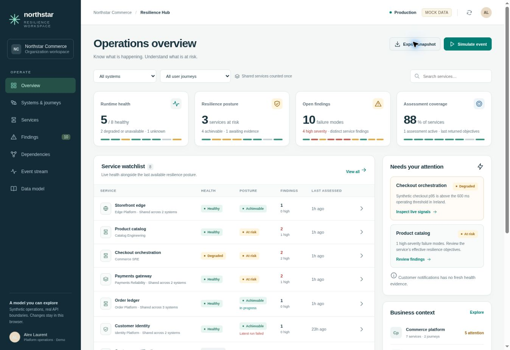

# AWS Resilience Hub — reviewed model and operator prototype

An interactive, single-page operator workspace demonstrating the reviewed **next-generation AWS Resilience Hub** entity model. The fictional **Northstar Commerce** portfolio makes shared service ownership, resilience posture, runtime health, discovery coverage and event-driven updates visible together.

The application is a static HTML/CSS/JavaScript page. It has no build step, external runtime dependency, CDN, AWS SDK, credentials or backend. All records, events, telemetry, cost estimates and operator actions are synthetic. State changes persist in the current browser through `localStorage` when available.



## Open the application

From the repository root:

```sh
python3 -m http.server 8080 --bind 127.0.0.1
```

Then open:

```text
http://localhost:8080/aws/resilience-hub/analysis/
```

The entry point is [index.html](index.html). Direct file opening also renders the application because it uses ordinary deferred scripts and local assets, but HTTP provides consistent browser-storage behavior. No installation is needed to run the application.

The **Simulate event** button advances a fixed demo clock. There is no background timer or connection to live AWS data. **Export snapshot** downloads the full synthetic state and its provenance as JSON. The reset control in the top bar restores the initial portfolio after confirmation.

## What to explore

| Workspace | Working behavior |
| --- | --- |
| Overview | Independent health, posture, open-finding and assessment-coverage cards; scoped service watchlist; attention priorities; business context; recent events. |
| Systems & journeys | Three systems and five user journeys, their policies, shared member services and deduplicated attention counts. |
| Services | Search and system/journey filters; service identity; permission model; input sources; associations; discovery configuration. |
| Findings | Status/severity filters, all three recommendation categories, local estimates and editable operator disposition/comments. |
| Dependencies | Consumer-scoped DNS relationships, criticality editing, local governance labels, query-window observations and discovery gaps. |
| Event stream | EventBridge, entity-timeline, telemetry and local-action provenance; occurrence/receipt timestamps; refresh outcomes; normalized event inspection. |
| Data model | The ten requested concepts, the five reviewed ER diagrams, editable Mermaid downloads, the report PDF and review record. |

Each service has six detail tabs: overview, findings, policy and posture, dependencies, topology, and assessments. Topology nodes can be inspected, and typed edges can be filtered. Arrow direction represents the captured source/destination relationship; it does not assert failure propagation.

### Suggested walkthrough

1. Start at **Overview**. Customer identity is healthy with retained achievable posture even though its latest assessment failed. Customer notifications has expired health evidence and no assessed posture. These conditions remain distinct.
2. Open **Systems & journeys**. Order ledger and Customer notifications belong to three systems. Portfolio totals count each service once; the same service may appear in several business contexts.
3. Select **Simulate event → Payment latency rises**. Payments health becomes degraded while its resilience posture and findings stay unchanged.
4. Select **Dependency discovered**, then inspect the new fraud-screening dependency. Edit its consumer criticality and comment. Its local allow-list review and runtime health remain separate.
5. Open Checkout orchestration → **Assessments → Start assessment**. Use the simulator inside that service dialog and select **Assessment completes**. The new Checkout run completes; the unrelated active Orders run is untouched.
6. Open a finding, mark it resolved and record a comment. The UI explicitly says verification is pending. Triage does not directly make runtime health or posture green.
7. Simulate **Duplicate and delayed events**, then inspect the event stream. Older evidence remains historical and cannot replace a newer current observation. **Telemetry goes stale** advances the clock beyond signal expiry and makes affected health unknown.

## Mock portfolio

The initial dataset contains **3 systems, 5 journeys, 8 services, 4 policies, 9 assessments, 14 findings, 25 recommendation instances, 9 dependencies and 8 topology captures**. It also includes scoped finding captures/observations, effective-target observations, policy context, health/posture history and provenance-bearing events.

Initial displayed totals are **5 healthy, 2 degraded and 1 unknown service; 3 services with at-risk posture; 10 open findings, including 4 high severity; and 7 services with assessment evidence**. One assessment is active. The broader attention rule identifies six services because it also includes failed assessment execution, stale/missing evidence and discovery gaps.

Each topology intentionally shows a **six-resource representative mock subgraph**, with its scope and the broader mock inventory count displayed. A completed collection is not presented as a complete real-world service graph or an atomic provider snapshot.

## Model decisions embodied in the UI

The detailed rationale and official API references are in [report.md](report.md); the review corrections are recorded in [review.md](review.md).

- **Shared ownership:** systems and journeys associate with services through scoped many-to-many relationships. Membership does not imply a request sequence.
- **Separate dimensions:** assessment execution, component achievability, live health, finding disposition, discovery coverage and evidence age are independent.
- **Conservative business summaries:** a journey's member services can need attention without proving that the journey failed its own potentially looser objectives. Aggregates retain distinct contributors and membership context.
- **Historical evidence:** findings belong to a service. A local capture may correlate them with an assessment without inventing a native assessment-to-finding foreign key. Recommendations belong to immutable detail observations.
- **Optional fields:** missing, null, zero, empty, unknown and stale have different meanings. Unestimated remediation cost is not zero. Summary refreshes preserve omitted detail.
- **Policy provenance:** `SELF`/`CROSS_ACCOUNT` denotes ownership; direct/inherited assignment is separate evidence. A local policy-context capture is not a provider-evaluated policy revision.
- **Event handling:** native events prompt synthetic authoritative refreshes; duplicate identity is scoped by channel and stream. Older evidence cannot roll back current health.
- **Local extensions:** runtime-health rules, recommendation names/costs/complexity, dependency governance, topology snapshots and aggregate attention are explicitly application-owned.

The fixture generator chooses effective targets from fictional policy inputs to make the demo coherent. A production adapter should consume AWS-returned effective values; this demo is not an independent implementation or certification of AWS policy evaluation.

## Files

| Path | Purpose |
| --- | --- |
| [index.html](index.html), [app.css](app.css), [app.js](app.js) | Single-page user interface and accessible interactions. |
| [data.js](data.js) | Deterministic Northstar fixtures and mock clock. |
| [model.js](model.js) | Scoped selectors, evidence projections, event ingestion and local mutation scenarios. |
| [report.md](report.md) | Reviewed analysis, logical model, operation mapping and 48 official AWS references. |
| [reviewed-report.pdf](reviewed-report.pdf) | Rendered 22-page report containing all five diagrams. |
| [review.md](review.md) | Review findings, applied corrections and integration boundaries. |
| [validation.md](validation.md) | Automated and browser verification record. |
| [diagrams/](diagrams/) | Five Mermaid sources and SVGs, plus deterministic presentation layouts. |
| [tests/](tests/) | Dependency-free Node domain and UI contract tests. |
| [scripts/](scripts/) | Optional report/diagram rebuild tools; not required by the application. |

## Verify

From this directory, using a modern Node.js runtime with the built-in test runner:

```sh
node --check app.js
node --check data.js
node --check model.js
node --test tests/*.test.cjs
```

The tests cover scoped keys, shared-service counts, policy provenance, independent health/posture, failed-run preservation, triage, selected-service assessment completion, immutable recommendation history, omitted/empty detail, expiry, duplicate/delayed events, discovery/governance separation, partial summary hydration, rendering and safe comment escaping. In-memory UI contract checks complement the actual browser checks documented in [validation.md](validation.md).

## Rebuild the documentation

The Markdown and Mermaid files are the maintained analysis sources. The renderer uses `diagrams/diagram-layouts.json` for stable presentation geometry; it checks entity declarations, relationships, routes and field bounds. The PDF is built from the reviewed Markdown and those rendered diagrams.

```sh
python3 -m pip install -r scripts/requirements.txt
python3 scripts/render_diagrams.py
python3 scripts/build_report.py
```

The optional documentation tools use ReportLab and PyMuPDF and require DejaVu Sans fonts; see the scripts for font discovery. They are not browser/runtime dependencies.

## Integration scope

This prototype demonstrates the model and operator interactions. It does not connect to an AWS account, implement authentication, synchronize multiple operators, run real telemetry subscriptions or validate production IAM permissions. Before enabling live writes, verify association replacement/removal, clearing semantics, authorization, pagination and concurrent edits against the selected SDK and controlled account responses, as detailed in the report.
