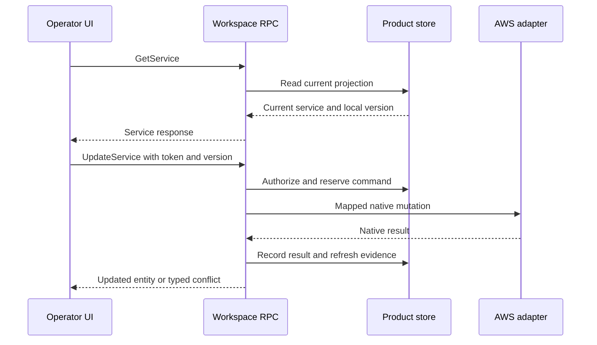
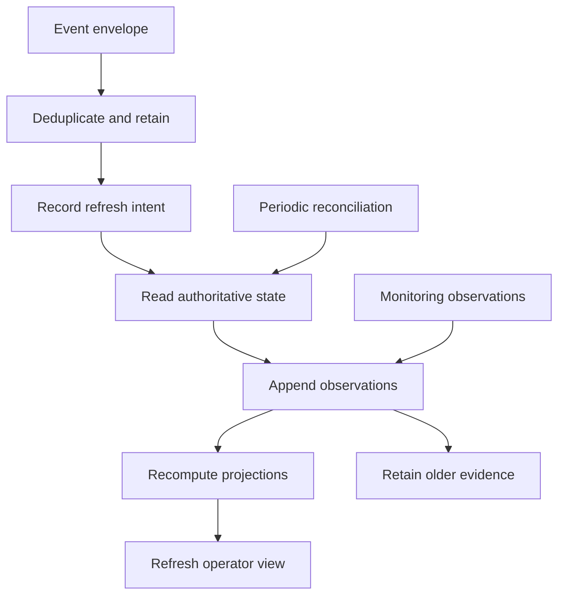

# Operator workflows and event reconciliation

These workflows show how the RPC operations support the redesigned UI. The API and browser prototype share the reviewed model and realistic fixtures. They currently run as separate mock states: browser buttons still use the local browser model, while HTTP requests use the server's in-memory runtime. Connecting the UI to the RPC client is a subsequent adapter change, not an implied feature of this deliverable.

## Page-to-operation map

| UI task | Read operations | Explicit commands |
| --- | --- | --- |
| Portfolio and system overview | ListSystems, ListUserJourneys, ListServices, GetWorkspaceSummary | CreateSystem, UpdateSystem, DeleteSystem |
| Journey membership and policy | GetUserJourney, GetService, GetPolicy | CreateUserJourney, UpdateUserJourney, DeleteUserJourney; UpdateService for membership |
| Service detail and coverage | GetService, GetServiceStatus, ListInputSources | CreateService, UpdateService, DeleteService; CreateInputSource, DeleteInputSource |
| Policy editor | ListPolicies, GetPolicy | CreatePolicy, UpdatePolicy, DeletePolicy |
| Assessment activity | ListFailureModeAssessments, GetFailureModeAssessment | StartFailureModeAssessment |
| Findings work queue | ListFailureModeFindings, GetFailureModeFinding, ListRecommendations, GetRecommendation | UpdateFailureModeFinding, UpdateRecommendationEnrichment |
| Dependencies and governance | ListDependencies, GetDependency | UpdateDependency, UpdateDependencyGovernance |
| Topology history | ListTopologySnapshots, GetTopologySnapshot | CaptureTopologySnapshot |
| Event timeline and health | ListEvents, GetServiceStatus, GetWorkspaceSummary | IngestEvent, PutHealthObservation through a trusted integration context |

The [operation catalogue](index.md) contains the exact parameters and examples. Before an edit, read the resource and retain its local version. The UI submits only the relevant writable properties, `expectedVersion` where required, and one stable `clientToken` for that user intent.

## Create a service in a journey

1. Create or select a system, policy and user journey. Journey creation carries the parent `systemArn` and can reference a policy.
2. Create a service with its provider-compatible name, permission model and Regions. Add associations containing the system ARN and journey IDs. The runtime validates that each journey belongs to that system.
3. Create one or more input sources with exactly one resource configuration per call. A CloudFormation stack and an EKS selection are separate input sources.
4. Read `GetServiceStatus` to show discovery and assessment state. Creating configuration does not create monitoring evidence or establish resilience achievability.
5. Start an assessment when appropriate. Show its pending state alongside the previous posture; poll or reconcile subsequent authoritative evidence in a production integration.

## Read, edit, reconcile

The AWS adapter interaction in this diagram is the production design. The runnable mock executes the command against its local store and records local events; it makes no AWS calls. Local optimistic concurrency prevents lost updates between callers of that store. A production integration must additionally handle remote success followed by a lost response, delayed observations and writes made outside the product.

## Findings: disposition and verification

Read a finding in service scope. When its `representation` is `DETAIL`, load its current normalized recommendations by passing the returned `observationId` as `ListRecommendations.findingObservationId`. Without that filter, the list includes retained recommendation instances across observations. The current fixtures all contain detail observations; a future summary-only result must retain the last known detail identity and observation age instead of treating a summary ID as detailed evidence. `UpdateFailureModeFinding` changes supported disposition fields. `UpdateRecommendationEnrichment` changes local implementation estimates and metadata. Neither command changes the observed severity or establishes a new assessment result.

An operator can mark a finding resolved after implementing a change, but the UI should retain an unverified state until fresh evidence supports the disposition. A finding marked irrelevant remains a suppression decision. Starting an assessment provides a run identity; the eventual refreshed finding set is a new observation capture. It must not be relabelled as an immutable finding set owned by the assessment.

## Events trigger reads

`IngestEvent` implements dedupe, envelope retention and a refresh intent in the mock. The steps that call AWS and hydrate findings are a production worker design. The event body is not authoritative service state. A complete refresh can require multiple paginated native list calls followed by detail reads; capture metadata must preserve each coverage gap.

The periodic route is necessary because AWS documents native EventBridge delivery as best effort. An absent event therefore cannot prove that nothing changed. A CloudTrail invocation record also cannot prove that asynchronous assessment work finished. See [EventBridge notifications](https://docs.aws.amazon.com/resilience-hub/latest/userguide/next-gen-eventbridge-notifications.html) and [CloudTrail events](https://docs.aws.amazon.com/resilience-hub/latest/userguide/next-gen-cloudtrail-events.html).

## Health and posture are independent

| Situation | Health display | Posture display | Assessment display |
| --- | --- | --- | --- |
| New telemetry says checkout is degraded | New monitoring state and expiry | Last observed provider achievability remains | Existing run state remains |
| A late older telemetry event arrives | Retain newest applicable observation | Unchanged | Unchanged |
| Telemetry expires | Unknown, with the last signal and age available | Last observed posture with its own age | Existing run state |
| A new assessment starts | Current monitoring evidence | Previous posture remains visible | Pending/in progress |
| A new assessment fails | Current monitoring evidence | Previous successful posture remains visible and may age | Failed, with available error detail |
| Assessment succeeds but objectives are missed | Current monitoring evidence | Not achievable where supported by refreshed evidence | Success |

These are product projection rules, not a new universal AWS health field. `GetServiceStatus` presents each dimension and `GetWorkspaceSummary` counts distinct affected services. The summary expresses attention and coverage; it does not certify that every journey target is achievable.

## Topology capture and dependency governance

Capture a topology to preserve the graph that an operator inspected. The mock copies the available graph, retains its source observation time and exposes its incomplete coverage. A production capture gathers resources and edges, keeps unresolved endpoints and records list/detail coverage without promising an atomic AWS graph.

`UpdateDependency` handles the native-backed classification. `UpdateDependencyGovernance` records the product's allow/deny decision and justification. The governance decision does not remove a physical dependency or prove that an observed DNS target is safe. Historical captures remain readable after a later classification change.

## Reproducible local walkthrough

Run the server as described in the [API index](index.md). Start with `ListSystems` and `ListServices`, then use a returned service ARN for `GetServiceStatus`. Inspect its findings and topology. Mutation examples in the operation notes are generated against a fresh runtime and carry known starting versions. Reset the server between independent examples, or re-read versions and choose fresh tokens when running them against an already modified process.

Deletion examples include setup commands that create unreferenced fixtures first. Run those prerequisites in order; the expected response is intentionally not a deletion of the shared checkout, policy or system used by the rest of the demo.
