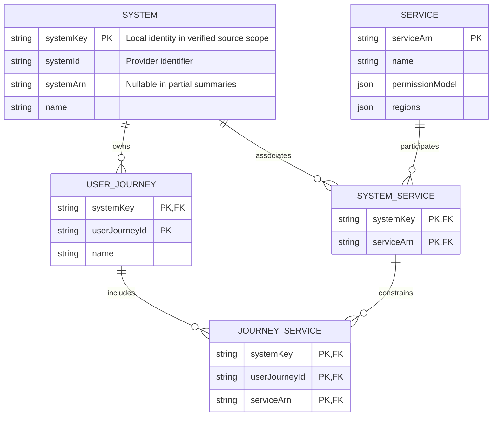

# Systems, services and user journeys

Membership is many-to-many and constrained through the same system.

This note is the editable semantic source. Obsidian renders the Mermaid block below; the [SVG rendering](01-business-structure.svg) provides the layout used by the application and report.

## Entity relationships

## Relationship constraints

- JourneyService must reference both (systemKey, serviceArn) and (systemKey, userJourneyId).
- A service may belong to a system without a journey. Membership does not establish execution order.

The SVG uses navy for AWS-backed identities and values, and teal for local relationships, captures or observations. These colors describe ownership of the model element, not operational status.

## Related notes

- [Reviewed data-model report](../report.md)
- [Model review decisions](../review.md)
- [API operation reference](../api/index.md)

## Official sources

- [S03 — System](https://docs.aws.amazon.com/resilience-hub/v2/APIReference/API_System.html)
- [S04 — SystemSummary](https://docs.aws.amazon.com/resilience-hub/v2/APIReference/API_SystemSummary.html)
- [S05 — AssociatedSystem and nested journey membership](https://docs.aws.amazon.com/resilience-hub/v2/APIReference/API_AssociatedSystem.html)
- [S06 — Service and GetService response](https://docs.aws.amazon.com/resilience-hub/v2/APIReference/API_GetService.html)
- [S07 — CreateService and required configuration](https://docs.aws.amazon.com/resilience-hub/v2/APIReference/API_CreateService.html)
- [S47 — UserJourney](https://docs.aws.amazon.com/resilience-hub/v2/APIReference/API_UserJourney.html)
