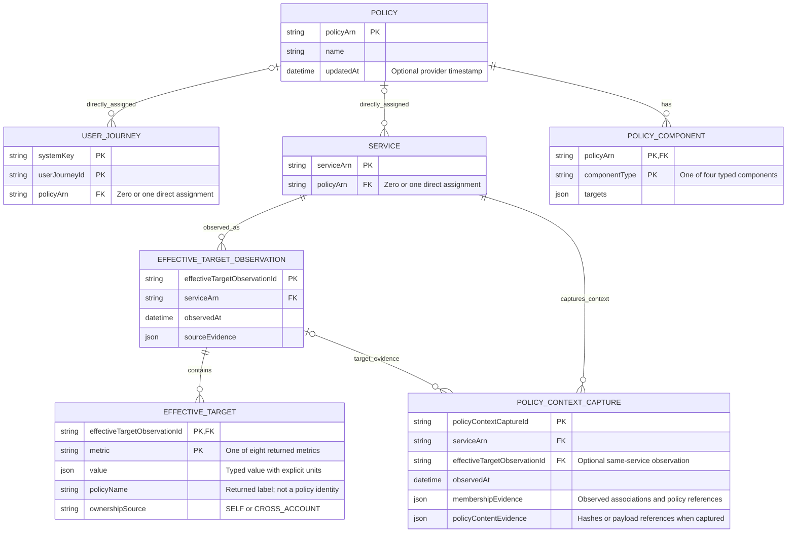

# Policies, assignments and effective targets

Current provider assignments and locally captured target evidence have separate identities.

This note is the editable semantic source. Obsidian renders the Mermaid block below; the [SVG rendering](02-policy-context.svg) provides the layout used by the application and report.

## Entity relationships

## Relationship constraints

- Inherited applicability follows journey membership; it is not encoded by ownershipSource.
- policyName is a returned label. Any policy identity match must be verified and remain optional.
- A captured context is not proof of the policy revision that AWS evaluated.
- A context's effective-target observation must have the same service ARN. Captured membership and policy-content evidence describe what was observed; they do not establish a provider effective time.
- Policy-content hashes or payload references are optional evidence. The current mock captures associations and policy references; a complete historical provider collector remains separate implementation work.

## Implementation boundary

`GetService` and `GetServiceStatus` expose the target observation and policy-context capture through `effectivePolicyEvidence`. The DTO's `associations` and `applicablePolicies` represent the diagram's membership evidence. Full historical policy payload capture and proof of the evaluated provider revision remain outside the mock. Current coverage derives expected components from the context captured with the posture, never from a subsequently edited policy. See the [traceability matrix](../report.md#1-implementation-traceability).

The SVG uses navy for AWS-backed identities and values, and teal for local relationships, captures or observations. These colors describe ownership of the model element, not operational status.

## Related notes

- [Reviewed data-model report](../report.md)
- [Model review decisions](../review.md)
- [API operation reference](../api/index.md)

## Official sources

- [S08 — GetPolicy](https://docs.aws.amazon.com/resilience-hub/v2/APIReference/API_GetPolicy.html)
- [S10 — MultiRegionTargets](https://docs.aws.amazon.com/resilience-hub/v2/APIReference/API_MultiRegionTargets.html)
- [S11 — Policy inheritance and multi-level evaluation](https://docs.aws.amazon.com/resilience-hub/latest/userguide/next-gen-policy-inheritance.html)
- [S12 — EffectivePolicyValues](https://docs.aws.amazon.com/resilience-hub/v2/APIReference/API_EffectivePolicyValues.html)
- [S13 — SloSource ownership provenance](https://docs.aws.amazon.com/resilience-hub/v2/APIReference/API_SloSource.html)
