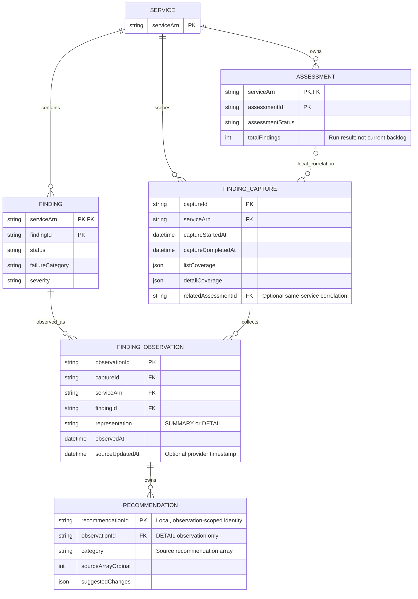

# Assessments, finding captures and recommendations

Findings are service-scoped. Captures preserve observation history without inventing run ownership.

This note is the editable semantic source. Obsidian renders the Mermaid block below; the [SVG rendering](03-assessments-findings.svg) provides the layout used by the application and report.

## Entity relationships

## Relationship constraints

- Observation uniqueness: (captureId, serviceArn, findingId, representation). Recommendations require DETAIL.
- relatedAssessmentId joins with the capture serviceArn. It records correlation, not an authoritative result set.
- List coverage and detail hydration coverage are independent. Missing recommendation data is not an empty set.

The SVG uses navy for AWS-backed identities and values, and teal for local relationships, captures or observations. These colors describe ownership of the model element, not operational status.

## Related notes

- [Reviewed data-model report](../report.md)
- [Model review decisions](../review.md)
- [API operation reference](../api/index.md)

## Official sources

- [S16 — AssessmentSummary](https://docs.aws.amazon.com/resilience-hub/v2/APIReference/API_AssessmentSummary.html)
- [S17 — Finding](https://docs.aws.amazon.com/resilience-hub/v2/APIReference/API_Finding.html)
- [S19 — ListFailureModeFindings](https://docs.aws.amazon.com/resilience-hub/v2/APIReference/API_ListFailureModeFindings.html)
- [S20 — GetFailureModeFinding](https://docs.aws.amazon.com/resilience-hub/v2/APIReference/API_GetFailureModeFinding.html)
- [S21 — Viewing findings and managing disposition](https://docs.aws.amazon.com/resilience-hub/latest/userguide/next-gen-viewing-findings.html)
- [S22 — InfrastructureAndCodeRecommendation](https://docs.aws.amazon.com/resilience-hub/v2/APIReference/API_InfrastructureAndCodeRecommendation.html)
- [S45 — StartFailureModeAssessment](https://docs.aws.amazon.com/resilience-hub/v2/APIReference/API_StartFailureModeAssessment.html)
- [S46 — UpdateFailureModeFinding](https://docs.aws.amazon.com/resilience-hub/v2/APIReference/API_UpdateFailureModeFinding.html)
- [S48 — ListFailureModeAssessments](https://docs.aws.amazon.com/resilience-hub/v2/APIReference/API_ListFailureModeAssessments.html)
