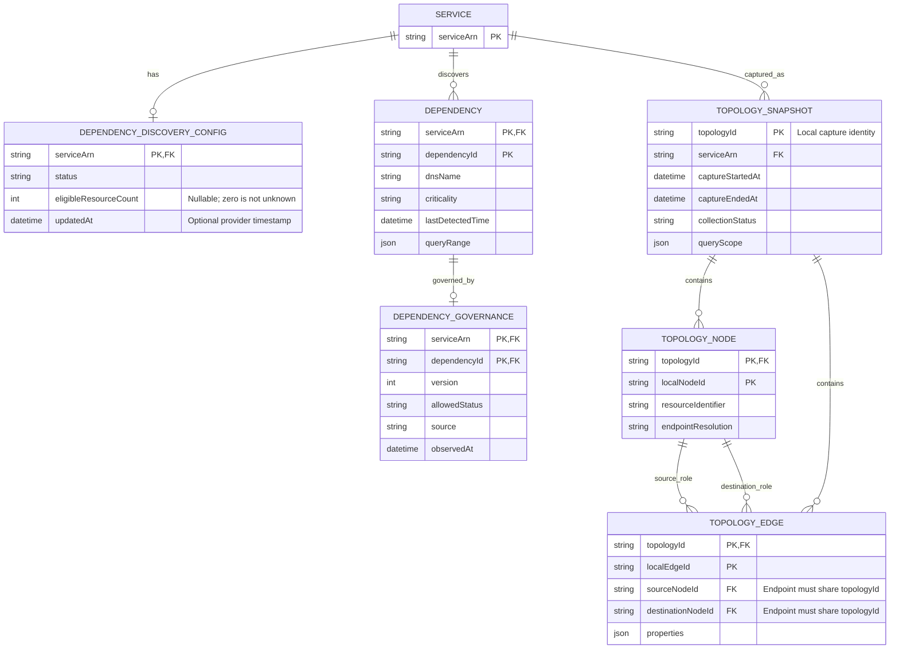

# Dependency discovery and captured topology

DNS dependencies, discovery coverage and graph relationships remain distinct kinds of evidence.

This note is the editable semantic source. Obsidian renders the Mermaid block below; the [SVG rendering](04-dependencies-topology.svg) provides the layout used by the application and report.

## Entity relationships

## Relationship constraints

- Both endpoint foreign keys include topologyId; unresolved endpoints remain snapshot-scoped stubs.
- No native dependency-to-topology foreign key exists. COMPLETE is collector completion, not an atomic graph.
- Governance belongs to the same scoped dependency and has its own version. Its allowed status is a product decision; it neither changes observed DNS evidence nor grants network access.

The SVG uses navy for AWS-backed identities and values, and teal for local relationships, captures or observations. These colors describe ownership of the model element, not operational status.

## Implementation boundary

The mock implements discovery state, criticality, local governance and topology captures from retained inventory. Native dependency `queryRange` belongs to this abstract model; the initial DTO/UI omits the full timestamped DNS series. Topology edge DTOs project one type/label; the native `properties[]` and full resource descriptors need a richer adapter mapping. The enclosing topology ID scopes the DTOs' node/edge IDs. The mock does not call AWS to collect resources or edges, and no DNS-to-service match establishes outage propagation. See the [traceability matrix](../report.md#1-implementation-traceability).

## Related notes

- [Reviewed data-model report](../report.md)
- [Model review decisions](../review.md)
- [API operation reference](../api/index.md)

## Official sources

- [S23 — DependencyDiscoveryConfig](https://docs.aws.amazon.com/resilience-hub/v2/APIReference/API_DependencyDiscoveryConfig.html)
- [S24 — Monitoring discovery status](https://docs.aws.amazon.com/resilience-hub/latest/userguide/next-gen-discovery-status.html)
- [S25 — ResourceDiscoveryStatus](https://docs.aws.amazon.com/resilience-hub/v2/APIReference/API_ResourceDiscoveryStatus.html)
- [S26 — DependencySummary](https://docs.aws.amazon.com/resilience-hub/v2/APIReference/API_DependencySummary.html)
- [S27 — ListResources and billable default](https://docs.aws.amazon.com/resilience-hub/v2/APIReference/API_ListResources.html)
- [S28 — UpdateDependency](https://docs.aws.amazon.com/resilience-hub/v2/APIReference/API_UpdateDependency.html)
- [S29 — How dependency discovery works](https://docs.aws.amazon.com/resilience-hub/latest/userguide/next-gen-how-discovery-works.html)
- [S30 — ListServiceTopologyEdges](https://docs.aws.amazon.com/resilience-hub/v2/APIReference/API_ListServiceTopologyEdges.html)
- [S31 — EdgePropertySummary](https://docs.aws.amazon.com/resilience-hub/v2/APIReference/API_EdgePropertySummary.html)
