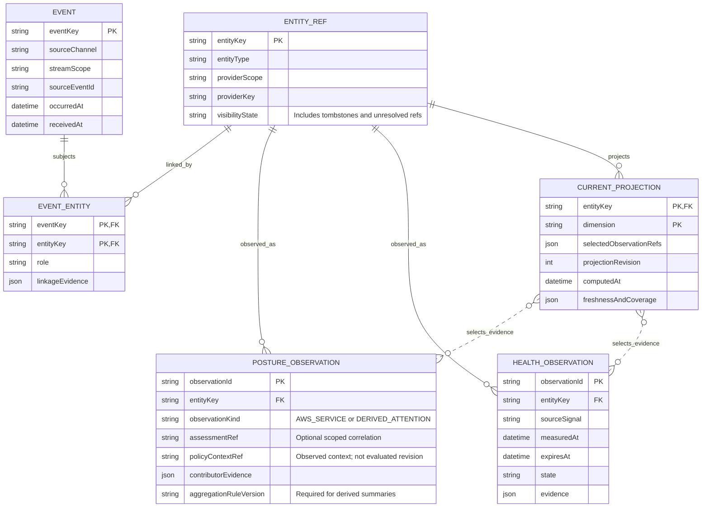

# Events, observations and the current operator view

Proposed application model: provider events trigger hydration; projections select qualified evidence.

This note is the editable semantic source. Obsidian renders the Mermaid block below; the [SVG rendering](05-events-observations.svg) provides the layout used by the application and report.

## Entity relationships

## Relationship constraints

- Event uniqueness: (sourceChannel, streamScope, sourceEventId). Subjects retain type, provider scope and key.
- Aggregate attention summaries retain distinct contributor identities, membership context and rule version.
- computedAt belongs to the projection. occurredAt, receivedAt and observation timestamps remain separate.

The SVG uses navy for AWS-backed identities and values, and teal for local relationships, captures or observations. These colors describe ownership of the model element, not operational status.

## Related notes

- [Reviewed data-model report](../report.md)
- [Model review decisions](../review.md)
- [API operation reference](../api/index.md)

## Official sources

- [S32 — Native EventBridge notification support and delivery](https://docs.aws.amazon.com/resilience-hub/latest/userguide/next-gen-eventbridge-notifications.html)
- [S33 — Assessment completed event](https://docs.aws.amazon.com/resilience-hub/latest/userguide/next-gen-eventbridge-assessment-completed.html)
- [S34 — Assessment failed event](https://docs.aws.amazon.com/resilience-hub/latest/userguide/next-gen-eventbridge-assessment-failed.html)
- [S35 — Assessment queued event](https://docs.aws.amazon.com/resilience-hub/latest/userguide/next-gen-eventbridge-assessment-queued.html)
- [S36 — Finding resolved or irrelevant event](https://docs.aws.amazon.com/resilience-hub/latest/userguide/next-gen-eventbridge-finding-resolved.html)
- [S37 — Dependency discovered event and stabilization](https://docs.aws.amazon.com/resilience-hub/latest/userguide/next-gen-eventbridge-dependency-discovered.html)
- [S38 — ListServiceEvents](https://docs.aws.amazon.com/resilience-hub/v2/APIReference/API_ListServiceEvents.html)
- [S39 — ListSystemEvents](https://docs.aws.amazon.com/resilience-hub/v2/APIReference/API_ListSystemEvents.html)
- [S40 — ListPolicyEvents](https://docs.aws.amazon.com/resilience-hub/v2/APIReference/API_ListPolicyEvents.html)
- [S41 — CloudTrail logging](https://docs.aws.amazon.com/resilience-hub/latest/userguide/next-gen-cloudtrail-events.html)
- [S42 — Achievability](https://docs.aws.amazon.com/resilience-hub/v2/APIReference/API_Achievability.html)
- [S43 — CloudWatch achievability metrics emission](https://docs.aws.amazon.com/resilience-hub/latest/userguide/next-gen-cloudwatch-metrics.html)
- [S44 — Dependency discovery and operational observability](https://docs.aws.amazon.com/resilience-hub/latest/userguide/next-gen-discovery-vs-observability.html)
