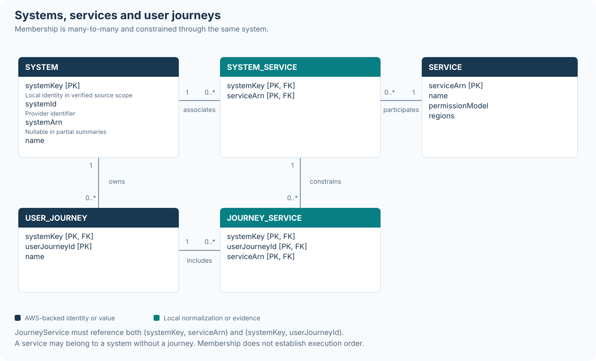
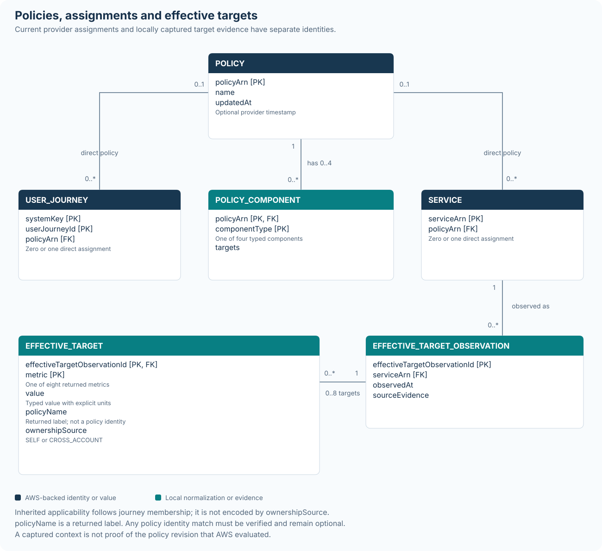
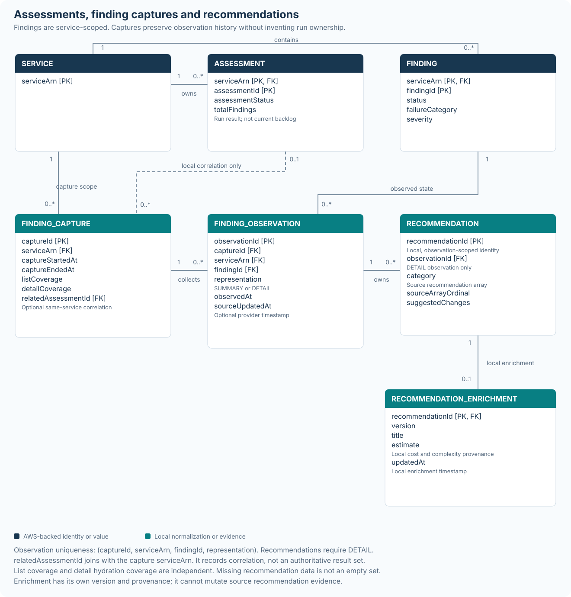
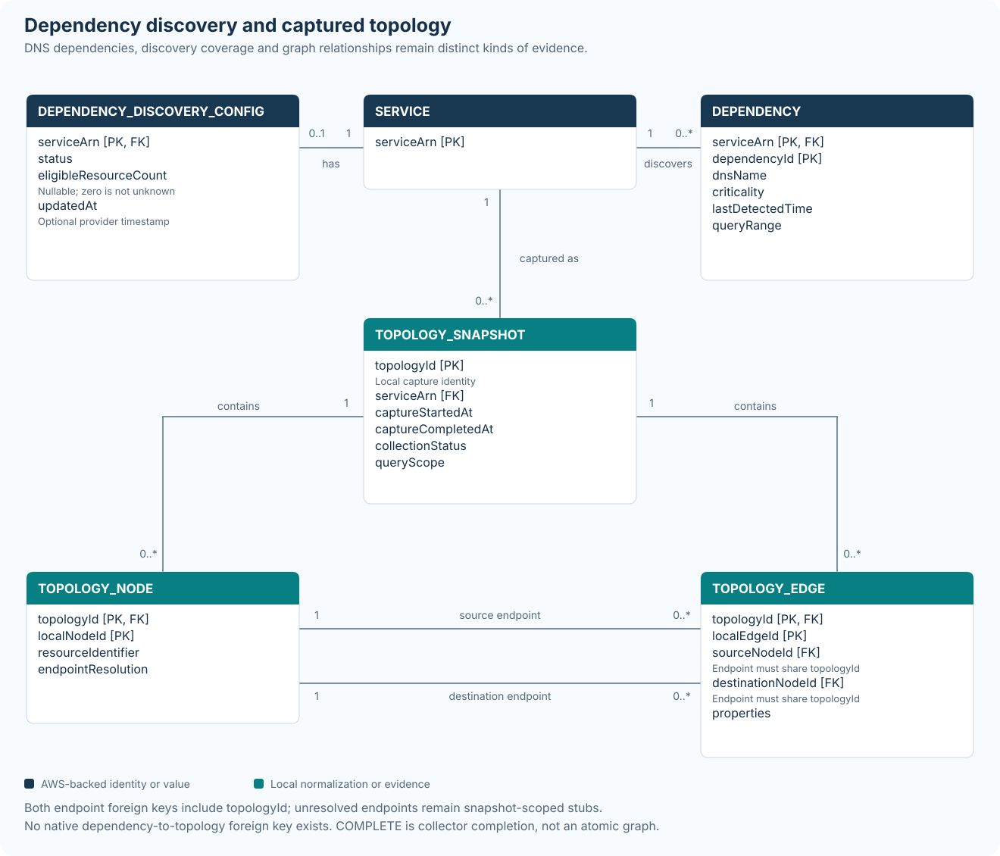
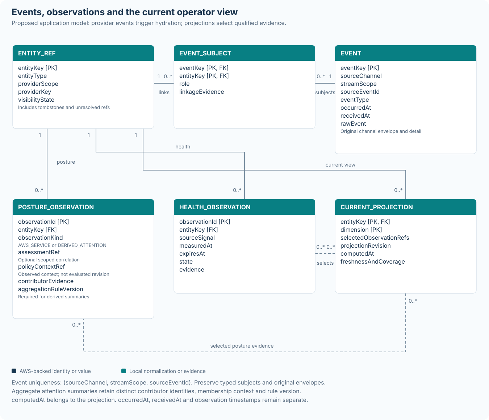

# AWS Resilience Hub — Data model for an operator UI

Official API analysis and logical entity relationship model — Reviewed 5 November 2026

**Review status:** the conceptual model and the executable mock were reviewed separately against the detailed v2 contracts. The follow-up review found material gaps between the original report, API and UI: lost policy evidence, incomplete attention rules, stale evidence counted as current, unsupported identity restrictions, and missing mutation subjects in the timeline. See [quality-review.md](quality-review.md) for findings and closure evidence, and [review.md](review.md) for the design decisions. The implementation traceability table below states the remaining boundaries. A reviewed design does not imply that every proposed collector or historical view is implemented.

The five diagrams are maintained as Obsidian Markdown notes with fenced Mermaid source and portable SVG assets. The [API operation reference](api/index.md) applies this model to a locally executable RPC-style facade; it is not the native AWS wire protocol.

> **Recommended design:** use the next-generation Resilience Hub API as the source for architecture, assessment, findings and dependency information. Add a temporal application layer for history and event processing, and use monitoring evidence for live operational health.

This report maps the ten requested entity concepts to current AWS response and mutation shapes, then proposes normalized relationships and the additional observations needed for an event-driven UI. AWS facts are cited by source IDs. Items described as **local**, **derived** or **proposed** are product design decisions, not additional AWS fields.

| Requested concept | Current contract and modeling decision |
| --- | --- |
| SystemEntity | System / SystemSummary; retain systemId and ARN, including limited-visibility summaries. |
| UserJourneyEntity | UserJourney; parent supplied by request scope and service membership represented separately. |
| ServiceEntity | Service / ServiceSummary; primary assessment unit with multiple system and journey associations. |
| ResiliencePolicyEntity | Policy; four typed components and per-service effective target values. |
| AssessmentEntity | AssessmentSummary; service-scoped asynchronous run with status, cost and result counts. |
| FindingEntity | Finding / FindingSummary; service-scoped mutable finding, without an exposed assessment foreign key. |
| RecommendationEntity | Local normalization of three nested suggested-change groups; enrichment fields remain product-owned. |
| DependencyDiscoveryConfig | Embedded service value object; observed state and caller-settable configuration differ. |
| DependencyEntity | DependencySummary; DNS-oriented discovered dependency with criticality and usage data. |
| TopologyEntity | Local snapshot assembled from ListResources and ListServiceTopologyEdges. |

The guide uses the requested Entity names, while current generated contracts use the formal shapes above. The official SDK identifies service resiliencehubv2, API version 2026-02-17. This analysis does not mix in the older application-centric API. [S01] [S02]

## 1. Implementation traceability

**Implemented** means that the stated behavior is executable with the fictional fixtures, not that it has been validated in an AWS account. **Partial** identifies an implemented subset and the missing evidence or integration. **Deferred** identifies a deliberate design boundary. The [contract](api/contract.cjs), [runtime](api/runtime.cjs), [shared UI model](model.js), and [review evidence](quality-review.md) are the implementation references; operation counts alone do not establish model coverage.

| Model concern | Status | Executable evidence and remaining boundary |
| --- | --- | --- |
| Systems, journeys and shared service membership | Implemented | Entity CRUD and constrained `associatedSystems` in the RPC mock; portfolio and journey views deduplicate service identities. A service may belong to a system without a journey. Figure 1 records both required membership constraints. |
| Partial, cross-account system visibility | Partial | The logical `systemKey` and nullable ARN accommodate limited summaries; the demonstration primarily uses fully addressable system fixtures. Account-specific authorization, unresolved cross-account reference reconciliation and complete summary-to-detail collection are not implemented. |
| Native policies and effective target evidence | Implemented | Policy CRUD, four native component types, and eight typed target values. `GetService` and `GetServiceStatus` expose captured target and policy-context evidence, including ownership and qualified identity resolution. Figure 2 includes the context capture; names are not policy foreign keys. |
| Historical policy and membership evaluation | Partial | Captured associations, applicable policy references and target observations are retained. The mock does not collect full policy payload histories or reconstruct a provider-evaluated policy revision. Exact historical membership replay and independently evaluated journey policies remain unimplemented. |
| Assessment execution and posture | Partial | List/get/start operations, independent completion fixtures in the browser, retained prior posture after a failed run, and nullable progress/cost observations. The RPC server accepts assessment starts but has no provider polling worker that completes them. Execution success and operator disposition never generate a resilience conclusion. |
| Findings, recommendation evidence and counts | Partial | Service-scoped findings, immutable captured projections, separate list/detail coverage, inline evidence on finding/status reads and independently versioned recommendation enrichment are implemented. Unknown recommendation content differs from an observed empty array; exact counts require complete coverage. A complete archive of native detail bodies and a live pagination/hydration collector remain design work. |
| Dependency discovery and governance | Partial | The RPC and UI expose discovery state, eligibility, explanation, dependency criticality and separate local allowed-status governance. Native DNS usage `queryRange` is part of the abstract model; the initial DTO/UI does not expose its full timestamped series. Figure 4 distinguishes governance from observation. |
| Topology captures | Partial | Local capture/get/list operations implement snapshot-scoped endpoints, unresolved stubs and completeness from retained inventory. The initial edge DTO projects one type/label; the native `properties[]` array and full resource descriptors require a richer adapter mapping. The capture is not atomic AWS evidence and edge direction does not prove failure propagation. |
| Operational health, attention and evidence coverage | Implemented | Independently expiring health observations; shared selectors for attention, current assessment coverage and finding collection coverage; reason lists and separate current versus last-known counts. Policy-context changes, local reassessment obligations and native rerun requests remain separate reasons. Section 13 defines their precise local meaning. |
| Event evidence and local timeline | Implemented | Typed scoped subjects, event envelope retention, duplicate detection, late-event preservation and generated-identity subjects for create-command events. Selected current health/posture evidence is retrievable inline rather than through orphan IDs. |
| Live event ingestion and durable temporal history | Deferred | The recommended receive/hydrate/capture/project/reconcile loop is a design for an AWS adapter. No EventBridge subscription, live hydration, persistent event store, worker, streaming client transport or authenticated AWS connector is supplied. |
| Browser-to-RPC integration | Deferred | The standalone page and RPC server execute the same fixture/model concepts through separate adapters. The browser does not call the RPC endpoint; transport integration is a separate implementation step. |

The ERDs express relational identities; the API sometimes nests the corresponding records. In topology DTOs, the enclosing `topologyId` scopes each node/edge `id`; the diagrams spell out both parts of that key. The logical `Event` maps to the facade's `EventEntity`, and logical `EventSubject` links map to its `subjects[]`. Diagram terms `sourceChannel`/`streamScope` correspond to facade `channel`/`streamOwner`. These mappings do not make a local record a new AWS resource.

## 2. Contract boundaries and identity

### Use detailed operation schemas as the integration contract

AWS overview pages and detailed schemas are not completely aligned. Performance targets, recommendation cost and complexity, dependency allowed status, and a versioned topology object appear in conceptual descriptions but are absent from the current shapes examined. Keep these as explicit extensions if the product needs them. Current operation names also differ from some overview examples. [S01] [S02] [S08] [S17] [S22] [S26]

| Entity | Recommended identity | Identity rule |
| --- | --- | --- |
| System | Local systemKey; retain systemId and nullable systemArn | The full System has an ARN. SystemSummary can omit it. Reconcile identifiers only within verified source scope; do not invent hidden account data. |
| User journey | (systemKey, userJourneyId) | Operations address a journey within a system; retain parent context even when absent from the body. |
| Service / policy | serviceArn / policyArn | Treat full ARNs as opaque provider identities. Names are display values, not joins. |
| Assessment / finding / dependency | (serviceArn, provider object ID) | Matches service-scoped addressing and prevents unsafe assumptions about global uniqueness. |
| Input source / service function | (serviceArn, inputSourceId or serviceFunctionId) | Separate child records preserve source context and support targeted loading. |
| Topology / recommendation | Local ID scoped to capture or observation | Neither native topology IDs nor native recommendation IDs are exposed in the examined shapes. |

The System/SystemSummary distinction is material for organization views: systemId is exposed for cross-account use, whereas organization and OU metadata can depend on access. Keep partially visible references rather than deleting or fabricating their attributes. [S03] [S04]

An ARN's resource portion is opaque. Do not validate it as a UUID or as only a resource name: the official assessment-completed example uses `arn:aws:resiliencehub:us-east-1:111122223333:service/my-service:abc123`. The native GetService pattern permits the colon in that suffix. Validate the supported ARN envelope while preserving the full resource identifier. [S06] [S33]

### Common observation metadata

For every ingested object retain source account and Region or connection scope, API family/version, retrieval operation, observedAt, providerUpdatedAt when present, raw payload or payload reference, field presence, and a local projection revision. A timestamp that the API does not return must remain unknown. Normalize timestamps to UTC internally and localize display.

In particular, an input-source observation time is not its creation time, and a policy's creation time is not its last-update time. Keep absent provider timestamps nullable. `localUpdatedAt` records an application mutation; `observedAt` records evidence receipt; a configuration `version` is independent of `projectionVersion`, which can change when new evidence arrives without a configuration edit.

Preserve separate states for an omitted property, an explicit null, an empty collection, zero, disabled, inaccessible and stale. A lightweight list response must not erase fields previously obtained from a detailed Get. Incoming unknown enum strings should remain visible and diagnosable rather than crashing the projection.

> **Response optionality is not create-form optionality.** For example, the Service response requires only its ARN and name, while CreateService requires name, permissionModel and regions. Generated command input types should drive editing forms; response schemas should drive read-model tolerance. [S06] [S07]

## 3. Systems services and user journeys

[Editable diagram note](diagrams/01-business-structure.md) · [SVG](diagrams/01-business-structure.svg)

**Figure 1.** Normalized relationships derived from Service.associatedSystems. Endpoint labels show cardinalities. Join records are local relational representations of API arrays; they are not standalone AWS resources. [S05] [S06]

| Entity | Principal fields beyond identity |
| --- | --- |
| SystemEntity | name; description; createdAt; updatedAt; organizationId; ouId; sharingEnabled; kmsKeyId; tags. Summary counts are projections. |
| UserJourneyEntity | name; description; policyArn; createdAt; updatedAt. The body has no embedded service list or parent system ARN. [S47] |
| ServiceEntity | name; description; accountId; organizationId; ouId; createdAt; updatedAt; regions; permissionModel; policyArn; reportConfiguration; tags; kmsKeyId; optional DevOps Agent integration; optional native rerunAssessment. |

A system has zero or more journeys. A service can participate in zero or more systems and zero or more journeys within each associated system. A system association with an empty journey list is valid. The source currently limits associatedSystems to 20 entries, and each association to 20 journey IDs. [S05] [S06]

Enforce JourneyService(systemKey, serviceArn) against SystemService, and JourneyService(systemKey, userJourneyId) against UserJourney. Stage unresolved references during partial or out-of-order ingestion; do not discard valid observations just because the related detail has not been fetched. Membership carries no documented journey execution order, branching, redundancy or critical-path weighting.

## 4. Policy structure and inheritance

| Policy component | Typed values | Interpretation |
| --- | --- | --- |
| availabilitySlo | target: number | Availability percentage; preserve unconfigured separately from zero. |
| dataRecovery | timeBetweenBackupsInMinutes: integer | Backup interval objective in minutes. |
| multiAz | rtoInMinutes; rpoInMinutes; disasterRecoveryApproach | Targets for recovery across availability zones. |
| multiRegion | rtoInMinutes; rpoInMinutes; disasterRecoveryApproach | Targets for recovery across Regions. |

Policy additionally has policyArn, name, description, createdAt, updatedAt, tags, kmsKeyId, organizationId, sharingEnabled and associatedServiceCount. The last field is a returned aggregate. There is no current latency/error-rate PERFORMANCE component in this wire shape. [S08]

Model PolicyComponent with key (policyArn, componentType), or use four typed value objects. Avoid one unrestricted JSON blob if the UI must compare individual targets. Retain the original payload for compatibility. DR approach values are ACTIVE_ACTIVE, HOT_STANDBY, WARM_STANDBY, PILOT_LIGHT and BACKUP_AND_RESTORE. [S10]

### Assignment and effective targets

A service and a journey each have zero or one directly assigned policy. A service can consequently have several applicable policies: its direct policy plus the policies of its journeys. AWS resolves conflicting requirements using the stricter value. The documented example chooses an RTO of 15 minutes over 30 minutes. There is no direct system policy field in the current System shape. [S03] [S08] [S11]

Use GetService.effectivePolicyValues as the authoritative returned effective target projection. Normalize its eight optional metrics: availabilitySlo; dataRecoveryTimeBetweenBackups; multiAzDrApproach; multiAzRpo; multiAzRto; multiRegionDrApproach; multiRegionRpo; multiRegionRto. Each returned value can have policyName and source. [S12]

> **Provenance trap:** source is SELF or CROSS_ACCOUNT, describing account ownership. It does not mean direct versus inherited. The returned policyName is not a policy ARN. Any resolvedPolicyArn must be optional and based on a verified identity match. [S13]

### Historical context

Capture effective target values and units, source policy name and ownership source, contributing policy references when known, membership context, capture time and hashes of the policy payloads observed. Policy content is mutable. A locally captured policy revision is not a provider revision identifier, and observing targets before a run does not prove they were the exact targets used by that run.

A service failing a stricter combined target does not establish that every looser journey policy failed. Show which service and effective requirement need attention; avoid claiming independently measured journey compliance from the service summary alone.

### Reviewed policy observation model

`EffectiveTargetObservation(effectiveTargetObservationId, serviceArn, observedAt, sourceEvidence)` owns zero to eight `EffectiveTarget` rows keyed by `(effectiveTargetObservationId, metric)`. A missing metric remains absent; it is not a zero value. `PolicyComponent` is unique by `(policyArn, componentType)` and has at most four rows: `availabilitySlo`, `dataRecovery`, `multiAz`, and `multiRegion`. These are normalized forms of the returned value objects, not new AWS resource types.

`PolicyContextCapture` has its own local ID, `serviceArn`, observation time, membership evidence and optional effective-target observation reference. Enforce the same service scope on that reference. Policy content hashes or raw payload references, capture intervals and visibility belong in the broader collector model when available; the current fixtures capture associations and applicable policy references. Keep `resolvedPolicyArn` nullable, together with the evidence used to resolve it. A matching name alone is insufficient, especially with cross-account policies. Store a separately evidenced direct/inherited assignment classification when needed; do not derive it from `SELF` or `CROSS_ACCOUNT`. [S08] [S11] [S12] [S13]

The facade returns `effectivePolicyEvidence` inline from service and status reads. Its `effectiveTargetObservation` and `policyContextCapture` objects let a client inspect the values and associations behind a displayed posture. A policy update must invalidate current context without rewriting the evidence captured for an earlier assessment.

Any assessment-to-context association is a **local temporal correlation**. Neither the observation ID nor a payload hash is an AWS policy revision or proof of the exact context evaluated in that assessment.

## 5. Policy entity relationship diagram

[Editable diagram note](diagrams/02-policy-context.md) · [SVG](diagrams/02-policy-context.svg)

**Figure 2.** Native policy assignment is separate from locally retained EffectiveTargetObservation and PolicyContextCapture records. Each consumer has at most one direct policy; inherited applicability follows journey membership. Context and target evidence share the same service scope. Effective target policy names are retained without an unverified foreign key. [S08] [S11] [S12] [S13]

### Supporting service configuration

**PermissionModel** is an execution/access configuration: invokerRoleName and optional crossAccountRoles, whose entries hold crossAccountRoleArn and optional externalId. It is not the new UI's authorization model. Writes require the documented invoker role and valid role entries; reads must tolerate missing permission configuration and the SDK-documented null crossAccountRoleArn for the Admin profile. Use separate input and observation shapes so an incomplete read cannot be mistaken for a valid create request. [S07] [S14] [S49]

**InputSourceEntity** is service-scoped and separately listed. Retain inputSourceId, type, createdAt and the appropriate configuration: CloudFormation stack ARN, resource tags, EKS configuration, Terraform state file URL or design-file S3 URL. The read enum also contains MONITORING. Do not assume every read discriminator has a corresponding CreateInputSource union member. [S15]

**ServiceResource** relates a service-local resourceIdentifier to the resource descriptor and optional input source. Resolve a global Resource identity only when sufficient account, Region, type and identifier evidence exists. Preserve unresolved or service-scoped identities otherwise. [S27]

**ServiceFunction** is a useful supporting entity because detailed findings refer to serviceFunctions. Preserve their source references and resolve them against the service function inventory. Do not invent direct resource-ARN references on Finding. [S17]

## 6. Assessments and findings

| Entity | Fields and scope | Modeling rule |
| --- | --- | --- |
| AssessmentEntity | assessmentId + serviceArn; assessmentStatus; assessmentStep; startedAt; endedAt; totalFindings; achievability; assessmentCost; billableAssessmentUnitCount; errorCode; errorMessage. | Service owns many runs. Keep optional values nullable. totalFindings is a run result, not the current open backlog. |
| FindingEntity | findingId scoped by serviceArn; name; description; reasoning; failureCategory; severity; status; policyComponent; comment; serviceFunctions; updatedAt; investigationDeepLink; three recommendation arrays. | Get/Update request scope supplies serviceArn when absent from the detail body. Current findings are service children, not mandatory children of an assessment. |

AssessmentSummary requires assessmentId and serviceArn; the remaining listed properties are optional. The detailed Finding shape permits all properties to be absent. Promote identity from the request context when it is known, and treat truly unidentified responses as ingestion errors instead of silently manufacturing AWS identity. [S16] [S17]

| Dimension | Native values |
| --- | --- |
| Assessment execution | NOT_STARTED; PENDING; IN_PROGRESS; FAILED; SUCCESS |
| Finding disposition | OPEN; RESOLVED; IRRELEVANT |
| Finding severity | LOW; MEDIUM; HIGH |
| Failure category | SHARED_FATE; EXCESSIVE_LOAD; EXCESSIVE_LATENCY; MISCONFIGURATION_AND_BUGS; SINGLE_POINT_OF_FAILURE |
| Finding policy component | AVAILABILITY_SLO; MULTI_AZ_DISASTER_RECOVERY; MULTI_REGION_DISASTER_RECOVERY; DATA_RECOVERY |

The assessment current-step field supports progress explanation but does not define a percentage-complete calculation. SUCCESS means successful execution. Assessment cost is the cost of the assessment, not a recommendation implementation estimate. [S16] [S18]

> **Do not create an authoritative Assessment-to-Finding foreign key.** ListFailureModeFindings is filtered by service, severity, category and status; it has no assessmentId filter. GetFailureModeFinding also lacks that relationship. Historical finding bodies therefore require local captures, with any assessment association explicitly marked as correlation. [S19] [S20]

Finding disposition and evidence of remediation are different facts. AWS explains that the next assessment verifies a resolved fix, while an irrelevant finding stays suppressed across subsequent assessments. Keep both statuses visible in history and do not count suppression as validated repair. [S21]

A later successful run is not, by itself, finding-specific verification. The mock's completion scenario supplies independent assessment outcomes and preserves the original finding evidence; it does not infer achievability or verified remediation from an operator marking findings `RESOLVED` or `IRRELEVANT`. A production reconciliation needs fresh provider evidence about the finding before displaying a verified outcome.

## 7. Finding history and recommendations

[Editable diagram note](diagrams/03-assessments-findings.md) · [SVG](diagrams/03-assessments-findings.svg)

**Figure 3.** A finding capture is a local collection interval. Its optional association with an assessment records when and why the collection occurred; it does not assert that AWS supplied an immutable finding set for that assessment. RecommendationEnrichment is a separately versioned overlay on an observation-scoped recommendation.

### RecommendationEntity as an owned value

The three native recommendation types are infrastructure/code, observability and testing. Each item contains only optional suggestedChanges[], with up to ten strings; each category array on a Finding permits up to five items. No recommendation ID, cost, complexity or standalone recommendation lifecycle is exposed. [S17] [S22]

Normalize each nested item as recommendationId, observationId, category, sourceArrayOrdinal, suggestedChanges[], payloadHash and capturedAt. Preserve grouping and order. A position or matching content hash does not establish a stable identity across future generated results.

If the UI needs title, implementation cost, effort, complexity, owner, work item or completion tracking, add RecommendationEnrichment or a separate RemediationTask. Retain estimate provenance, units/currency, cost basis, confidence and estimation time. Several recommendation instances can link to one local remediation task without falsely merging provider entities.

FindingCapture should retain captureStartedAt, captureEndedAt, filters, page coverage, collection outcome and optional relatedAssessmentId plus correlationBasis. Keep FindingObservation immutable within that capture, including updatedAt and raw source content in the full collector model. The mock retains selected observation fields and recommendation instances. Do not infer first occurrence, resolution, or run ownership from a missing item or from a capture taken after a particular run.

### Reviewed capture identity and detail coverage

| Record | Reviewed key and integrity rule |
| --- | --- |
| `FindingCapture` | `captureId` is a local primary key; `serviceArn` scopes the collection. Record filters, list pagination outcome, detail hydration outcome and both collection intervals. |
| `FindingObservation` | `observationId` is a local primary key. `captureId` references its capture; `(serviceArn, findingId)` references the stable finding identity. The observation and capture must have the same `serviceArn`. |
| Observation uniqueness | One final immutable observation per `(captureId, serviceArn, findingId, representation)`, where representation is `SUMMARY` or `DETAIL`. Later fetches become new observations in a new capture, preserving the earlier evidence. |
| Assessment correlation | When present, `(FindingCapture.serviceArn, relatedAssessmentId)` references `(Assessment.serviceArn, assessmentId)`. Keep `correlationBasis`; the relationship never asserts exact finding ownership. |
| `Recommendation` | `recommendationId` is local. `observationId` references a `DETAIL` finding observation. Enforce uniqueness of `(observationId, category, sourceArrayOrdinal)` and preserve nested grouping. |

`ListFailureModeFindings` and `GetFailureModeFinding` are separate reads. A fully paginated list does not mean all detail bodies have been fetched. Capture `sourceOperation`, `observedAt`, optional `sourceUpdatedAt`, field presence and the raw response for each representation. A failed detail hydration must not erase previously observed recommendations or become a known empty array. Recommendation completeness is known only for the detailed category fields actually returned. [S17] [S19] [S20]

Recommendation `category` identifies the source array: `INFRASTRUCTURE_AND_CODE`, `OBSERVABILITY`, or `TESTING`. It is distinct from `Finding.failureCategory`. Cost, complexity, estimated effort and display titles remain separately sourced application enrichment. Position and payload equality are useful change signals but do not prove that a future generated recommendation is the same provider entity.

The initial facade exposes `findingCapture` and `findingObservation` on a finding read, and collection scope/count meaning through `ServiceStatus.findingCoverage`. A summary, a failed detail fetch or an incomplete collection cannot establish an exact zero. Recommendation field presence remains explicit; a nullable recommendation-ID collection means content is not yet known, while an empty collection means the relevant detail fields were observed empty.

## 8. Dependency configuration and discovery

| DependencyDiscoveryConfig field | Type | Meaning |
| --- | --- | --- |
| serviceArn | Local parent key | One optional current configuration value object per service. |
| status | Required native enum | INITIALIZING, ENABLED or DISABLED. |
| eligibleResourceCount | Nullable integer | Eligible compute-resource count; missing/unknown is distinct from zero. |
| message | Nullable string | Explanation returned by AWS; retain verbatim as diagnostic data. |
| updatedAt | Nullable timestamp | Provider update time; keep separate from collector observation time. |

GetService and ListServices return the configuration object. CreateService and UpdateService accept only ENABLED or DISABLED as configuration intent; INITIALIZING is provider-managed. An observed state object must therefore not be reused as a write DTO. [S07] [S23]

| Observed state | Operator interpretation |
| --- | --- |
| INITIALIZING + count unknown | Resource eligibility is still being established. |
| INITIALIZING + count 0 | No eligible resources have been identified. |
| INITIALIZING + count greater than 0 | Dependency analysis is in progress. |
| ENABLED + count 0 | Enabled, with no eligible-resource coverage. |
| ENABLED + count greater than 0 + no message | Discovery results are ready for retrieval. |
| DISABLED | Discovery is turned off; old observations are historical evidence. |

These interpretations follow the documented discovery-status combinations. Do not use a zero count or an empty list as proof that the architecture has no dependencies. [S24]

### Resource discovery remains an independent process

Service.resourceDiscovery has its own status, lastRunAt, errorCode and errorMessage. Native statuses are RUNNING, SUCCEEDED, FAILED, COMPLETED_WITH_FAILURES and NOT_STARTED. Partial resource discovery should surface as partial coverage even when dependency discovery is enabled. [S25]

The UI should display discovery readiness, observed dependency inventory and evidence freshness independently. dependencyDiscovery.updatedAt is not a universal timestamp for the last DNS observation; individual dependencies have lastDetectedTime.

## 9. Dependencies and topology

[Editable diagram note](diagrams/04-dependencies-topology.md) · [SVG](diagrams/04-dependencies-topology.svg)

**Figure 4.** Discovery and dependency records are AWS-backed. DependencyGovernance is an independently versioned local decision; TopologySnapshot, TopologyNode and TopologyEdge are locally captured representations. There is no required relationship from a DNS dependency to a topology node or another managed service.

**DependencyEntity** uses (serviceArn, dependencyId), and retains dependencyName, dnsName, location, lastDetectedTime, sourceRegions[], criticality, provider?, comment? and queryRange. Criticality is HARD, SOFT or UNKNOWN. queryRange contains startTime, endTime, HOURLY/DAILY granularity and timestamped query counts. Store usage buckets with their query-window context. [S26]

UpdateDependency changes criticality and/or comment. Its response is smaller than DependencySummary; merge returned fields without discarding DNS or usage data. The current contract has no allowedStatus and no first-detection timestamp. The local DependencyGovernance overlay has key `(serviceArn, dependencyId)`, its own version, allowedStatus and decision provenance. Actor, rationale and effective interval should be retained when captured. An allowed-status change neither alters observed DNS evidence nor changes network permissions. Label firstObservedAt as the collector's first observation. [S28]

Do not equate DNS query counts with request success, latency or availability. Criticality represents the consequences of losing a dependency, not its current condition. Any relationship between a discovered DNS name and a Resource or Service must have explicit matching evidence and a nullable resolution. [S29]

## 10. Topology snapshots and graph meaning

| Object | Proposed fields and constraints |
| --- | --- |
| TopologyEntity / TopologySnapshot | local topologyId; serviceArn; captureStartedAt; captureEndedAt; collectionStatus; queryScope; resourceDiscoveryLastRunAt?; resourceCount; unresolvedCount; edgeCount; contentHash? |
| TopologyNode | (topologyId, localNodeId); source resourceIdentifier; resource descriptor; optional resolved global resource key; resolution status and evidence |
| TopologyEdge | (topologyId, localEdgeId); sourceNodeId; destinationNodeId; raw endpoint identifiers/account/Region; properties[] |
| EdgeProperty | topologyType?; label?; preserve each returned property without treating a missing type as data flow |

ListServiceTopologyEdges returns source and destination resource identifiers, optional account/Region values, and properties. It exposes no topology ID, capture timestamp, edge ID, resource count, assessmentId or atomic snapshot token. Generate local snapshot IDs and times, and state that COMPLETE means the collector finished its requested pages, not that AWS supplied a transactionally consistent graph. [S30]

Use ListResources for node inventory and retain unresolved edge endpoints as stubs. Record the filters used: ListResources defaults billable to true, which restricts its result to billable resources. Choose and verify the needed inventory scope deliberately. Count unique resolved inventory nodes separately from endpoint stubs and eligible compute resources. [S27]

| Edge kind | Permitted UI interpretation |
| --- | --- |
| CONTAINMENT | Structural membership or hosting context; does not alone establish outage propagation. |
| DATA_FLOW | Directed data relationship; propagation still depends on criticality, redundancy and evidence. |
| OBSERVABILITY | Monitoring relationship; avoid treating the monitor as a required transaction dependency. |
| PERMISSIONS | Authorization relationship; not by itself a live call or failure path. |

These are native topologyType values. AWS documents the optional label as present only for LLM-inferred edges. Preserve that provenance and avoid presenting inferred relationships as observed runtime traffic. [S31]

> **Historical accuracy:** an edge collection and a resource collection can change while being paginated. Record both collection intervals and failure/coverage information. A later assessment does not retroactively turn the captured graph into that assessment's exact input graph.

### Snapshot-scoped graph integrity

The node primary key is `(topologyId, localNodeId)` and the edge primary key is `(topologyId, localEdgeId)`. An edge must reference `(topologyId, sourceNodeId)` and `(topologyId, destinationNodeId)` in that **same** snapshot. Do not connect an edge to a current inventory node from another capture simply because its display name matches. Store endpoint raw account, Region and resource identifier evidence before resolution.

`resourceCount` counts unique inventory nodes within the recorded query scope; `unresolvedCount` counts separate stubs. Neither is the service's eligible-compute-resource count. `DependencyGovernance` and any DNS-to-resource matching are local overlays with their own provenance; they do not create an AWS foreign key or a live-health signal.

## 11. Events available from AWS

Next-generation Resilience Hub documents native EventBridge notifications with source aws.resiliencehub. Service ARNs appear in the envelope resources array; the envelope also carries event ID, time, account and Region. Delivery is best effort and can be delayed or missed. [S32]

| Native detail type | Relevant detail | Refresh action |
| --- | --- | --- |
| Failure Mode Assessment Completed | assessmentId; status SUCCESS; findingsCount; highSeverityCount | Refresh assessment list and service; capture current findings with qualified run correlation. |
| Failure Mode Assessment Failed | assessmentId; status FAILED; failureReason | Refresh run diagnostics; retain last completed posture with its age. |
| Failure Mode Assessment Queued | assessmentId | Track queued progress; poll the specific run through ListFailureModeAssessments. |
| Failure Mode Finding Resolved | findingId; status RESOLVED or IRRELEVANT; severity; category | Refresh the finding and relevant service aggregates. |
| New Dependency Discovered | dependencyId; dependencyName; dnsName; location; provider; sourceRegions | Refresh dependency inventory and coverage; invalidate affected graph matching. |

Assessment event shapes and counts are documented separately from AssessmentSummary. Preserve event-reported counts as event evidence, and reconcile them with hydrated API state. New-dependency events are emitted after a stabilization period, so event time is not necessarily first detection time. [S33] [S34] [S35] [S36] [S37]

### Three event channels with different semantics

**Native EventBridge notifications** describe selected domain changes. They do not cover every finding transition or every configuration mutation. **ListServiceEvents, ListSystemEvents and ListPolicyEvents** expose entity timelines, with actor information and event details. **CloudTrail** records API calls, including console requests; a recorded request is not proof that an asynchronous workflow completed. [S38] [S39] [S40] [S41]

Keep these channels distinct in storage. The same logical change can appear in multiple channels with unrelated IDs. Treat timeline events as invalidations or evidence, not as a guaranteed complete stream of state transitions. Do not derive unsupported commands from event-type names: system-policy event labels, for example, do not create a policyArn field on System.

## 12. Temporal model for the operator view

[Editable diagram note](diagrams/05-events-observations.md) · [SVG](diagrams/05-events-observations.svg)

**Figure 5.** Proposed local model for history, evidence and current UI state. EventSubject provides a many-to-many connection between events and typed subjects. The facade nests these links in the EventEntity envelope's `subjects[]`; the envelope and relationship are different records. Posture and health remain independently sourced.

| Record | Essential fields |
| --- | --- |
| Event | eventKey; sourceChannel; streamOwner/scope; sourceEventId; eventType; occurredAt; receivedAt; actor?; raw payload; schema version |
| EventSubject | eventKey; entityKey; role; asserted/inferred relationship; linkage evidence |
| PostureObservation | entityKey; observationKind; native service achievability OR derived aggregate attention measures; scoped assessment correlation when known; observed policy-context reference; finding counts with scope; capture interval; completeness; provenance |
| HealthObservation | subject; telemetry source and signal ID; observation window; measuredAt; receivedAt; expiresAt; health state; reason; evidence; aggregation-rule version |
| CurrentProjection | entityKey + dimension; typed selected evidence references; projectionRevision; freshness and coverage; computedAt |

Uniqueness for provider events should include channel, stream namespace/owner and provider event ID. Keep occurredAt separate from receivedAt; arrival order is not event order. Deletions create tombstones so old observations still have resolvable subjects. Retain provenance for inferred links and preserve raw events for reprocessing.

Keep the original channel envelope, including event detail, account, Region and resources, alongside normalized typed subjects. A create-command event uses the generated entity identity, so the new entity's own timeline includes its creation. A correlation or request ID is supplementary evidence, not a substitute for the affected entity's key.

Version membership and policy observations so a historical screen does not use today's topology or associations to explain yesterday's posture. Use observed validity intervals when that is all the evidence supports. Do not invent a provider effective time or evaluated policy version.

### Typed subjects, observation kinds and projection times

`EntityRef` carries a local `entityKey`, `entityType`, verified `providerScope` and `providerKey`. A scope includes the enclosing service for findings, assessments and dependencies; it includes the enclosing system for journeys. Do not merge references based on display names or a hidden account assumption. Tombstones preserve historical references without suggesting that a deleted entity is still active.

A `PostureObservation` must distinguish `AWS_SERVICE` evidence from a `DERIVED_ATTENTION` summary. Native service evidence retains the returned component outcomes. A derived system or journey summary retains its distinct contributor service/finding identities, membership observation or capture reference, source observation references, coverage, and aggregation-rule version. It does not populate an AWS achievability field with an invented journey outcome.

`CurrentProjection.computedAt` is when the application assembled the view. It is separate from event `occurredAt` and `receivedAt`, source `observedAt`, provider update timestamps, and health measurement windows. Store typed selected evidence references so the UI can explain each badge. A late event may appear in the timeline without rolling back a newer hydrated value.

## 13. Status health posture and coverage

| UI dimension | Data source | Display rule |
| --- | --- | --- |
| Assessment progress | assessmentStatus and assessmentStep | Show queued/running/failed/completed separately from conclusions. |
| Resilience posture | Achievability per policy component | Native values: ACHIEVABLE or NOT_ACHIEVABLE. Missing results need an explicit unknown or unconfigured explanation. |
| Finding disposition | OPEN / RESOLVED / IRRELEVANT | Expose open risk, claimed remediation and suppression separately. |
| Resource discovery | resourceDiscovery status/errors | Show partial success and access failure as coverage conditions. |
| Dependency discovery | Config state, eligibility and message | Enabled is not sufficient evidence of useful coverage. |
| Operational health | External monitoring, SLO or incident evidence | Proposed local states: UNKNOWN / HEALTHY / DEGRADED / UNAVAILABLE, with evidence window and expiry. |
| Freshness and completeness | Collector timestamps, scope and success | Separate stale, partial and inaccessible from current healthy or achievable. |

Achievability describes resilience targets based on assessment results. Resilience Hub's CloudWatch achievability metrics are emitted on assessment completion rather than continuously. Its dependency-discovery documentation distinguishes resilience validation from operational observability. Live health therefore needs an additional evidence source. [S42] [S43] [S44]

### Rollup rules for systems and journeys

For the first UI version, aggregate **distinct services needing attention, open findings by severity, assessed-service coverage, and oldest evidence age**. Keep native component outcomes on each service. A journey-level resilience or availability conclusion requires a separately defined composition model and evidence; service membership alone supplies neither execution order nor redundancy.

Deduplicate portfolio counts by provider identity: one service can be in several journeys and systems. A failing strict effective objective is not proof of failure against every looser inherited requirement. A critical dependency indicates potential impact if unavailable; do not mark its consumer unavailable just because the dependency is classified HARD.

> **Example operator summary:** Operational health: Healthy, measured 2 minutes ago. Resilience posture: Multi-Region recovery not achievable, assessed yesterday. Assessment: New run in progress. Discovery: Enabled, coverage partial. These facts can all be true at once; preserve the distinctions.

When the latest assessment fails, show that execution failure next to the previous successful posture and its age. When telemetry expires, health becomes unknown/stale according to the product rule; it must not remain green indefinitely.

### Concrete aggregate rules for the first UI

1. **System service set:** take the union of service ARNs directly associated with the selected system, including services with no journey membership. Do not obtain the total by summing journey totals.
2. **Journey service set:** use the distinct service ARNs in that journey's constrained membership rows.
3. **Findings:** deduplicate by `(serviceArn, findingId)` before counting open severity. A shared service's finding can appear in each relevant journey view, but appears once in the enclosing system or portfolio total.
4. **Assessment coverage:** use distinct visible in-scope services as the denominator. Report current qualified evidence separately from retained last-known assessed evidence. Determine expected result components from the policy context captured with the posture; optional, unconfigured components are not automatic gaps. Distinguish not assessed, stale, inaccessible, and partial evidence; an unavailable denominator is not a zero denominator.
5. **Attention:** show separate reasons for unmet/unknown posture, partial/unassessed assessment evidence, open findings of any severity, incomplete finding collection, stale evidence, assessment failure, discovery gaps, changed policy or service configuration, a provider request to rerun assessment, and nonhealthy/expired telemetry. A combined attention total is the union of qualifying service identities, not the sum of those overlapping categories. A healthy service can require attention because of unresolved resilience evidence.
6. **Health:** compose system/journey health only under a named, versioned product rule with telemetry evidence and a validity window. Until a business composition model is defined, report impacted or unknown member services rather than a claimed end-to-end availability measurement.

A policy edit, association edit, or newer discovery observation can make a previous assessment's context less representative. Preserve the original observation and its age, record the current configuration separately, and expose the need for reassessment when supported by the returned state or an explicitly labelled local rule.

### Executable evidence rules

The mock's shared selectors implement named product rules. The 24-hour posture age limit is a demonstration decision, not an AWS guarantee or a universal operating threshold.

| Rule | Exact local meaning |
| --- | --- |
| `assessment-evidence-24h-v2` | Current coverage requires usable posture, a retained successful assessment, a same-service captured policy context that identifies the expected components, known outcomes for those components, non-partial posture collection, successful resource discovery, no current policy-context invalidation, local reassessment requirement or native rerun request, and evidence age at most 24 hours. A missing/empty target context cannot prove sufficient coverage. A policy with only an availability objective does not require three unconfigured DR outcomes. |
| Coverage status | `INACCESSIBLE`, `UNASSESSED`, `PARTIAL`, `STALE`, or `CURRENT`, in that precedence order. `stale` and `partial` flags remain independently visible: an old partial capture has status `PARTIAL` and can also be stale. A recent failed assessment does not erase a still-qualified previous successful observation. |
| `distinct-service-attention-v2` | Union of service identities with nonhealthy/expired health, unmet/unknown/stale posture, partial/unassessed assessment evidence, any open finding, incomplete/stale/missing finding collection, failed latest assessment, resource discovery other than `SUCCEEDED`, dependency discovery disabled/initializing or eligible count unknown/zero, a local policy-context invalidation, a local reassessment requirement, or native `rerunAssessment=true`. `ASSESSMENT_EVIDENCE_GAP` and `FINDING_COLLECTION_INCOMPLETE` ensure that absent evidence requires attention even when retained posture says achievable and all known findings are closed. Each reason retains its dimension, severity, explanation and evidence time. |
| Finding collection coverage | Exact open counts require a complete unfiltered list, complete detail coverage, recognized dispositions and a valid, sufficiently recent capture end time. Otherwise expose observed counts and qualified coverage; unknown time or an empty local store cannot establish an exact zero. A newer incomplete attempt must qualify the view even if an older complete capture remains available. Local disposition changes are included in the count but do not prove remediation. |
| Discovery explanation | A returned message is diagnostic text. Nonempty text alone is not a failure classifier; state, eligibility and resource-discovery outcomes determine the coverage condition. |
| Assessment refresh signals | Native nullable `rerunAssessment` preserves the provider's boolean indication that an assessment should be rerun. Local `policyContextRefreshRequired` records policy/membership invalidation; local `reassessmentRequired` records material service changes such as resources, Regions, permissions or discovery, or a claimed remediation that needs assessment evidence; broader `refreshRequired` requests a projection refresh. A subsequent run alone does not verify a particular fix. Neither missing native data nor a generic detail-refresh request means that AWS reported `rerunAssessment=false` or `true`. [S06] [S21] [S49] |

At the fixture's initial time, six of eight services have current qualifying assessment evidence (**75%**). Seven retain last-known assessed evidence (**88%**, rounded); the older Fulfillment evidence is also partial, and one service is unassessed. All eight require attention for at least one reason, including low-severity findings on otherwise healthy services. Advancing the fixture clock by 48 hours leaves zero current assessments while preserving the seven last-known observations. These are reproducible fixture expectations, not AWS portfolio measurements. [Implementation evidence](quality-review.md)

An operational badge must resolve to its evidence. `GetServiceStatus.selectedObservations` returns the selected health and posture records inline; `effectivePolicyEvidence` and `findingCoverage` explain target context and finding counts. The UI shows current coverage and last-known history separately so old successful execution cannot remain a green coverage statistic indefinitely.

## 14. API read and mutation map

| Domain | Read surface | Mutation surface |
| --- | --- | --- |
| System | GetSystem; ListSystems | CreateSystem; UpdateSystem; DeleteSystem |
| User journey | GetUserJourney; ListUserJourneys | CreateUserJourney; UpdateUserJourney; DeleteUserJourney |
| Service | GetService; ListServices | CreateService; UpdateService; DeleteService |
| Membership | Service.associatedSystems and service list filters | CreateService / UpdateService.associatedSystems |
| Policy | GetPolicy; ListPolicies | CreatePolicy; UpdatePolicy; DeletePolicy |
| Input sources | ListInputSources | CreateInputSource; DeleteInputSource |
| Assessments | ListFailureModeAssessments | StartFailureModeAssessment |
| Findings | ListFailureModeFindings; GetFailureModeFinding | UpdateFailureModeFinding: status required; comment optional |
| Recommendations | Nested in detailed findings | No standalone recommendation mutation in the current contract |
| Discovery config | GetService; ListServices | CreateService / UpdateService.dependencyDiscovery |
| Dependencies | ListDependencies | UpdateDependency: criticality and/or comment |
| Resources / topology | ListResources; ListServiceTopologyEdges | No topology-object CRUD in the examined operation inventory |
| Entity timelines | ListSystemEvents; ListServiceEvents; ListPolicyEvents | Provider-generated; local notes remain separate |

This map uses the generated v2 SDK operation inventory and operation schemas. It intentionally does not require GetFailureModeAssessment, StartServiceTopologyDiscovery, ClassifyDependency or CreateResiliencePolicy, which are absent from that inventory despite appearing in some guide examples. [S02] [S07] [S09] [S19] [S20] [S28] [S45] [S46]

### Command handling

Represent a user operation as a local command with a command ID, target identity, input, actor, submitted time, request result and reconciliation state. Reuse clientToken for retries only on operations that expose it, such as starting an assessment. After success, merge the returned projection and re-read the affected entities as needed. Do not optimistically mark an assessment complete or claim a finding fix has been independently verified. [S45]

Separate confirmed provider values from pending edits. For association arrays, policy detachment, clearing optional fields and concurrent edits, validate exact semantics with the chosen SDK and controlled integration calls before exposing destructive editing behavior.

## 15. Event processing and implementation checks

### Recommended ingestion loop

**1. Bootstrap.** Enumerate visible systems, services and policies; load journeys and required service children. Complete pagination before replacing a collection. Record filters, account/Region and visibility scope.

**2. Receive.** Persist the raw event, deduplicate within its source stream, and record occurrence and receipt times. Resolve subject references without discarding unresolved ones.

**3. Hydrate.** Use the event as a targeted refresh trigger. Read the authoritative service, run, finding or dependency state. Use the recorded assessment ID when matching ListFailureModeAssessments results.

**4. Capture.** Append new observations with collection intervals and provenance. Correlate finding or topology captures to a run only as explicitly qualified local evidence.

**5. Project.** Recompute affected service and aggregate views from current evidence; advance a local projection revision and push that revision to connected UI clients.

**6. Reconcile.** Poll active workflows and periodically refresh inventories and entity timelines independently of EventBridge. Retain last trustworthy data and expose a stale/partial indicator when refresh fails. Best-effort delivery makes this reconciliation necessary. [S32]

### Acceptance checks for the model and UI

| Scenario | Expected behavior |
| --- | --- |
| A service joins two systems and several journeys | One service identity; constrained membership joins; no duplicate portfolio findings. |
| An assessment completes with high-severity findings | Execution shows success; posture and findings can still require attention. |
| An operator marks a finding irrelevant | Suppression remains distinct from a verified remediation and is preserved in history. |
| Discovery is enabled with zero eligible resources | Show coverage gap, not a successful dependency-free architecture. |
| A page is missing or a permission check fails | Do not remove unseen objects or reset counts to zero; flag incomplete collection. |
| An old event arrives after a newer observation | Retain event history; avoid rolling back the current projection from stale payloads. |
| A policy or membership changes during a run | Keep old observations and current configuration separate; qualify evaluation-context correlation. |
| An edge endpoint cannot be resolved | Keep an endpoint stub and evidence, without assigning an invented resource or service. |
| A summary omits detail-only properties | Preserve previously hydrated fields and their timestamps. |

## 16. Official sources

All sources below are AWS primary documentation. Reviewed on **5 November 2026**. The original 48 references are retained; S49 records the SDK read-shape clarification added in the follow-up review. The generated v2 operation and shape contracts take precedence over inconsistent overview terminology. Sources document the API; the local identities, temporal records and composition rules are the design proposed in this report.

| ID | Official source |
| --- | --- |
| S01 | [User guide conceptual data types](https://docs.aws.amazon.com/resilience-hub/latest/userguide/next-gen-api-data-types.html) |
| S02 | [Official SDK operation and shape inventory for resiliencehubv2](https://docs.aws.amazon.com/aws-sdk-php/v3/api/api-resiliencehubv2-2026-02-17.html) |
| S03 | [System](https://docs.aws.amazon.com/resilience-hub/v2/APIReference/API_System.html) |
| S04 | [SystemSummary](https://docs.aws.amazon.com/resilience-hub/v2/APIReference/API_SystemSummary.html) |
| S05 | [AssociatedSystem and nested journey membership](https://docs.aws.amazon.com/resilience-hub/v2/APIReference/API_AssociatedSystem.html) |
| S06 | [Service and GetService response](https://docs.aws.amazon.com/resilience-hub/v2/APIReference/API_GetService.html) |
| S07 | [CreateService and required configuration](https://docs.aws.amazon.com/resilience-hub/v2/APIReference/API_CreateService.html) |
| S08 | [GetPolicy](https://docs.aws.amazon.com/resilience-hub/v2/APIReference/API_GetPolicy.html) |
| S09 | [UpdateService association and discovery input](https://docs.aws.amazon.com/resilience-hub/v2/APIReference/API_UpdateService.html) |
| S10 | [MultiRegionTargets](https://docs.aws.amazon.com/resilience-hub/v2/APIReference/API_MultiRegionTargets.html) |
| S11 | [Policy inheritance and multi-level evaluation](https://docs.aws.amazon.com/resilience-hub/latest/userguide/next-gen-policy-inheritance.html) |
| S12 | [EffectivePolicyValues](https://docs.aws.amazon.com/resilience-hub/v2/APIReference/API_EffectivePolicyValues.html) |
| S13 | [SloSource ownership provenance](https://docs.aws.amazon.com/resilience-hub/v2/APIReference/API_SloSource.html) |
| S14 | [PermissionModel](https://docs.aws.amazon.com/resilience-hub/v2/APIReference/API_PermissionModel.html) |
| S15 | [ListInputSources](https://docs.aws.amazon.com/resilience-hub/v2/APIReference/API_ListInputSources.html) |
| S16 | [AssessmentSummary](https://docs.aws.amazon.com/resilience-hub/v2/APIReference/API_AssessmentSummary.html) |
| S17 | [Finding](https://docs.aws.amazon.com/resilience-hub/v2/APIReference/API_Finding.html) |
| S18 | [AssessmentCost](https://docs.aws.amazon.com/resilience-hub/v2/APIReference/API_AssessmentCost.html) |
| S19 | [ListFailureModeFindings](https://docs.aws.amazon.com/resilience-hub/v2/APIReference/API_ListFailureModeFindings.html) |
| S20 | [GetFailureModeFinding](https://docs.aws.amazon.com/resilience-hub/v2/APIReference/API_GetFailureModeFinding.html) |
| S21 | [Viewing findings and managing disposition](https://docs.aws.amazon.com/resilience-hub/latest/userguide/next-gen-viewing-findings.html) |
| S22 | [InfrastructureAndCodeRecommendation](https://docs.aws.amazon.com/resilience-hub/v2/APIReference/API_InfrastructureAndCodeRecommendation.html) |
| S23 | [DependencyDiscoveryConfig](https://docs.aws.amazon.com/resilience-hub/v2/APIReference/API_DependencyDiscoveryConfig.html) |
| S24 | [Monitoring discovery status](https://docs.aws.amazon.com/resilience-hub/latest/userguide/next-gen-discovery-status.html) |
| S25 | [ResourceDiscoveryStatus](https://docs.aws.amazon.com/resilience-hub/v2/APIReference/API_ResourceDiscoveryStatus.html) |
| S26 | [DependencySummary](https://docs.aws.amazon.com/resilience-hub/v2/APIReference/API_DependencySummary.html) |
| S27 | [ListResources and billable default](https://docs.aws.amazon.com/resilience-hub/v2/APIReference/API_ListResources.html) |
| S28 | [UpdateDependency](https://docs.aws.amazon.com/resilience-hub/v2/APIReference/API_UpdateDependency.html) |
| S29 | [How dependency discovery works](https://docs.aws.amazon.com/resilience-hub/latest/userguide/next-gen-how-discovery-works.html) |
| S30 | [ListServiceTopologyEdges](https://docs.aws.amazon.com/resilience-hub/v2/APIReference/API_ListServiceTopologyEdges.html) |
| S31 | [EdgePropertySummary](https://docs.aws.amazon.com/resilience-hub/v2/APIReference/API_EdgePropertySummary.html) |
| S32 | [Native EventBridge notification support and delivery](https://docs.aws.amazon.com/resilience-hub/latest/userguide/next-gen-eventbridge-notifications.html) |
| S33 | [Assessment completed event](https://docs.aws.amazon.com/resilience-hub/latest/userguide/next-gen-eventbridge-assessment-completed.html) |
| S34 | [Assessment failed event](https://docs.aws.amazon.com/resilience-hub/latest/userguide/next-gen-eventbridge-assessment-failed.html) |
| S35 | [Assessment queued event](https://docs.aws.amazon.com/resilience-hub/latest/userguide/next-gen-eventbridge-assessment-queued.html) |
| S36 | [Finding resolved or irrelevant event](https://docs.aws.amazon.com/resilience-hub/latest/userguide/next-gen-eventbridge-finding-resolved.html) |
| S37 | [Dependency discovered event and stabilization](https://docs.aws.amazon.com/resilience-hub/latest/userguide/next-gen-eventbridge-dependency-discovered.html) |
| S38 | [ListServiceEvents](https://docs.aws.amazon.com/resilience-hub/v2/APIReference/API_ListServiceEvents.html) |
| S39 | [ListSystemEvents](https://docs.aws.amazon.com/resilience-hub/v2/APIReference/API_ListSystemEvents.html) |
| S40 | [ListPolicyEvents](https://docs.aws.amazon.com/resilience-hub/v2/APIReference/API_ListPolicyEvents.html) |
| S41 | [CloudTrail logging](https://docs.aws.amazon.com/resilience-hub/latest/userguide/next-gen-cloudtrail-events.html) |
| S42 | [Achievability](https://docs.aws.amazon.com/resilience-hub/v2/APIReference/API_Achievability.html) |
| S43 | [CloudWatch achievability metrics emission](https://docs.aws.amazon.com/resilience-hub/latest/userguide/next-gen-cloudwatch-metrics.html) |
| S44 | [Dependency discovery and operational observability](https://docs.aws.amazon.com/resilience-hub/latest/userguide/next-gen-discovery-vs-observability.html) |
| S45 | [StartFailureModeAssessment](https://docs.aws.amazon.com/resilience-hub/v2/APIReference/API_StartFailureModeAssessment.html) |
| S46 | [UpdateFailureModeFinding](https://docs.aws.amazon.com/resilience-hub/v2/APIReference/API_UpdateFailureModeFinding.html) |
| S47 | [UserJourney](https://docs.aws.amazon.com/resilience-hub/v2/APIReference/API_UserJourney.html) |
| S48 | [ListFailureModeAssessments](https://docs.aws.amazon.com/resilience-hub/v2/APIReference/API_ListFailureModeAssessments.html) |
| S49 | [GetService — SDK read semantics, permission nullability and rerunAssessment](https://docs.aws.amazon.com/botocore/latest/reference/services/resiliencehubv2/client/get_service.html) |

### Implementation decisions to verify

Validate association-array replacement, policy and component detachment, account-specific visibility, pagination behavior, evidence freshness rules, resource-to-dependency matching and the business rules for composing journey health. The broader v2 API also exposes tests, test runs, assertions and reports; these can be added as evidence entities when the UI includes resilience validation workflows. [S02]

### Scope and evidence limits

This is a documentation-based design and an executable fictional-data demonstration, not validation of a particular AWS account. No account-specific API responses or permissions were supplied. Local keys, captures, governance fields, health states, rollups and ingestion rules are distinguished from provider fields throughout. Section 1 separates implemented behavior from partial or deferred integration. The full native adapter still needs payload/SDK compatibility checks, read-shape forward compatibility, account-specific visibility handling, hydration and periodic reconciliation. The accompanying application does not connect to AWS or establish actual workload health.

### Diagram maintenance

The five diagram `.md` notes are the editable semantic sources. Each has YAML front matter and one fenced `mermaid` block that Obsidian can render directly. `diagrams/diagram-layouts.json` supplies SVG presentation coordinates and labels. Run `python3 scripts/render_diagrams.py` after changing a diagram to regenerate the SVG assets; the renderer reads the Mermaid block from the note and needs only the Python standard library. All prose documentation is maintained as Markdown with YAML properties. No remote diagram renderer or CDN is used.

[S01]: https://docs.aws.amazon.com/resilience-hub/latest/userguide/next-gen-api-data-types.html "User guide conceptual data types"
[S02]: https://docs.aws.amazon.com/aws-sdk-php/v3/api/api-resiliencehubv2-2026-02-17.html "Official SDK operation and shape inventory for resiliencehubv2"
[S03]: https://docs.aws.amazon.com/resilience-hub/v2/APIReference/API_System.html "System"
[S04]: https://docs.aws.amazon.com/resilience-hub/v2/APIReference/API_SystemSummary.html "SystemSummary"
[S05]: https://docs.aws.amazon.com/resilience-hub/v2/APIReference/API_AssociatedSystem.html "AssociatedSystem and nested journey membership"
[S06]: https://docs.aws.amazon.com/resilience-hub/v2/APIReference/API_GetService.html "Service and GetService response"
[S07]: https://docs.aws.amazon.com/resilience-hub/v2/APIReference/API_CreateService.html "CreateService and required configuration"
[S08]: https://docs.aws.amazon.com/resilience-hub/v2/APIReference/API_GetPolicy.html "GetPolicy"
[S09]: https://docs.aws.amazon.com/resilience-hub/v2/APIReference/API_UpdateService.html "UpdateService association and discovery input"
[S10]: https://docs.aws.amazon.com/resilience-hub/v2/APIReference/API_MultiRegionTargets.html "MultiRegionTargets"
[S11]: https://docs.aws.amazon.com/resilience-hub/latest/userguide/next-gen-policy-inheritance.html "Policy inheritance and multi-level evaluation"
[S12]: https://docs.aws.amazon.com/resilience-hub/v2/APIReference/API_EffectivePolicyValues.html "EffectivePolicyValues"
[S13]: https://docs.aws.amazon.com/resilience-hub/v2/APIReference/API_SloSource.html "SloSource ownership provenance"
[S14]: https://docs.aws.amazon.com/resilience-hub/v2/APIReference/API_PermissionModel.html "PermissionModel"
[S15]: https://docs.aws.amazon.com/resilience-hub/v2/APIReference/API_ListInputSources.html "ListInputSources"
[S16]: https://docs.aws.amazon.com/resilience-hub/v2/APIReference/API_AssessmentSummary.html "AssessmentSummary"
[S17]: https://docs.aws.amazon.com/resilience-hub/v2/APIReference/API_Finding.html "Finding"
[S18]: https://docs.aws.amazon.com/resilience-hub/v2/APIReference/API_AssessmentCost.html "AssessmentCost"
[S19]: https://docs.aws.amazon.com/resilience-hub/v2/APIReference/API_ListFailureModeFindings.html "ListFailureModeFindings"
[S20]: https://docs.aws.amazon.com/resilience-hub/v2/APIReference/API_GetFailureModeFinding.html "GetFailureModeFinding"
[S21]: https://docs.aws.amazon.com/resilience-hub/latest/userguide/next-gen-viewing-findings.html "Viewing findings and managing disposition"
[S22]: https://docs.aws.amazon.com/resilience-hub/v2/APIReference/API_InfrastructureAndCodeRecommendation.html "InfrastructureAndCodeRecommendation"
[S23]: https://docs.aws.amazon.com/resilience-hub/v2/APIReference/API_DependencyDiscoveryConfig.html "DependencyDiscoveryConfig"
[S24]: https://docs.aws.amazon.com/resilience-hub/latest/userguide/next-gen-discovery-status.html "Monitoring discovery status"
[S25]: https://docs.aws.amazon.com/resilience-hub/v2/APIReference/API_ResourceDiscoveryStatus.html "ResourceDiscoveryStatus"
[S26]: https://docs.aws.amazon.com/resilience-hub/v2/APIReference/API_DependencySummary.html "DependencySummary"
[S27]: https://docs.aws.amazon.com/resilience-hub/v2/APIReference/API_ListResources.html "ListResources and billable default"
[S28]: https://docs.aws.amazon.com/resilience-hub/v2/APIReference/API_UpdateDependency.html "UpdateDependency"
[S29]: https://docs.aws.amazon.com/resilience-hub/latest/userguide/next-gen-how-discovery-works.html "How dependency discovery works"
[S30]: https://docs.aws.amazon.com/resilience-hub/v2/APIReference/API_ListServiceTopologyEdges.html "ListServiceTopologyEdges"
[S31]: https://docs.aws.amazon.com/resilience-hub/v2/APIReference/API_EdgePropertySummary.html "EdgePropertySummary"
[S32]: https://docs.aws.amazon.com/resilience-hub/latest/userguide/next-gen-eventbridge-notifications.html "Native EventBridge notification support and delivery"
[S33]: https://docs.aws.amazon.com/resilience-hub/latest/userguide/next-gen-eventbridge-assessment-completed.html "Assessment completed event"
[S34]: https://docs.aws.amazon.com/resilience-hub/latest/userguide/next-gen-eventbridge-assessment-failed.html "Assessment failed event"
[S35]: https://docs.aws.amazon.com/resilience-hub/latest/userguide/next-gen-eventbridge-assessment-queued.html "Assessment queued event"
[S36]: https://docs.aws.amazon.com/resilience-hub/latest/userguide/next-gen-eventbridge-finding-resolved.html "Finding resolved or irrelevant event"
[S37]: https://docs.aws.amazon.com/resilience-hub/latest/userguide/next-gen-eventbridge-dependency-discovered.html "Dependency discovered event and stabilization"
[S38]: https://docs.aws.amazon.com/resilience-hub/v2/APIReference/API_ListServiceEvents.html "ListServiceEvents"
[S39]: https://docs.aws.amazon.com/resilience-hub/v2/APIReference/API_ListSystemEvents.html "ListSystemEvents"
[S40]: https://docs.aws.amazon.com/resilience-hub/v2/APIReference/API_ListPolicyEvents.html "ListPolicyEvents"
[S41]: https://docs.aws.amazon.com/resilience-hub/latest/userguide/next-gen-cloudtrail-events.html "CloudTrail logging"
[S42]: https://docs.aws.amazon.com/resilience-hub/v2/APIReference/API_Achievability.html "Achievability"
[S43]: https://docs.aws.amazon.com/resilience-hub/latest/userguide/next-gen-cloudwatch-metrics.html "CloudWatch achievability metrics emission"
[S44]: https://docs.aws.amazon.com/resilience-hub/latest/userguide/next-gen-discovery-vs-observability.html "Dependency discovery and operational observability"
[S45]: https://docs.aws.amazon.com/resilience-hub/v2/APIReference/API_StartFailureModeAssessment.html "StartFailureModeAssessment"
[S46]: https://docs.aws.amazon.com/resilience-hub/v2/APIReference/API_UpdateFailureModeFinding.html "UpdateFailureModeFinding"
[S47]: https://docs.aws.amazon.com/resilience-hub/v2/APIReference/API_UserJourney.html "UserJourney"
[S48]: https://docs.aws.amazon.com/resilience-hub/v2/APIReference/API_ListFailureModeAssessments.html "ListFailureModeAssessments"
[S49]: https://docs.aws.amazon.com/botocore/latest/reference/services/resiliencehubv2/client/get_service.html "GetService SDK read semantics and nullable permission metadata"
