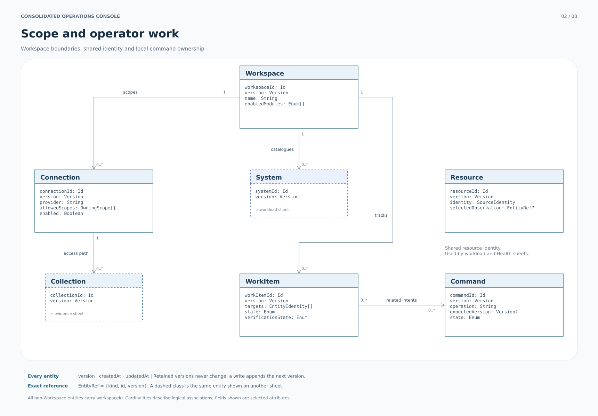

# Consolidated modular data model

## Design decision

Use a shared foundation for **scope, evidence, collection, immutable interpretation, history, local work and command intent**, then compose typed workload and provider modules around it. The model contains **37 entities across seven modules**. Only 11 belong to the shared foundation. Values such as a target selector, graph edge, policy component, communication page, operation lock or approval decision attempt stay with their owner.

The canonical structural contract is [model/schema.json](model/schema.json). [model/REFERENCE.md](model/REFERENCE.md) lists every field and relationship. [MAPPING.md](MAPPING.md) accounts for all source-model concepts, including concepts preserved as adapter DTOs or derived profiles. [DESIGN_PRINCIPLES.md](DESIGN_PRINCIPLES.md) distinguishes repository-backed guidance from new decisions.

This is a logical application model. Its classes do not prescribe a table per shape, eager loading of every child, an inheritance hierarchy in code, or a particular database. API operations return bounded records or paginated child collections. Large immutable payloads may use the same value contract in separately stored content.

## All-entity class diagrams

**[Complete class diagram: all 37 entities](diagrams/complete-model.svg)** · [Editable Mermaid](diagrams/complete-model.mmd) · [Graphviz source](diagrams/complete-model.dot)

The complete diagram is vertically organized for zoomable review, with at most three class boxes per row. Focused views are easier to read when implementing one module. Every class in the following table occurs in the complete diagram; generated checks compare the names with the schema.

| Module | Entities | Focused diagram |
| --- | --- | --- |
| Shared foundation (11) | Workspace, Connection, Resource, Collection, ReadAttempt, SourceRevision, Observation, ProjectionRevision, Snapshot, WorkItem, Command | [Foundation](diagrams/foundation.svg) |
| Workload catalog (4) | System, UserJourney, Service, Dependency | [Workload](diagrams/workload.svg) |
| Health (6) | HealthEvent, EventContext, EntityImpact, Communication, LifecycleEntry, ComponentDeployment | [Health](diagrams/health.svg) |
| Resilience (4) | ResiliencePolicy, ResilienceAssessment, Finding, Recommendation | [Resilience](diagrams/resilience.svg) |
| Investigation (6) | AgentSpace, Investigation, Execution, JournalRecord, ApprovalRequest, Asset | [Investigation](diagrams/investigation.svg) |
| Workflow (5) | Scenario, ScenarioRevision, Run, StepRun, StepAttempt | [Workflow and FIS](diagrams/workflow.svg) |
| FIS (1) | Experiment | [Workflow and FIS](diagrams/workflow.svg) |

Relationships in diagrams express logical cardinality. Conditional constraints, source-supported joins and partial hydration are governed by the rules below. Every application relationship is within one Workspace. A referenced provider object can remain explicitly unresolved without creating a fabricated application entity.

## 1. Identity and scope

### Application identity

Every entity has an opaque application ID named for its type, such as `serviceId`, `sourceRevisionId` or `runId`, and carries `workspaceId`. Workspace itself has `workspaceId`. IDs do not encode credentials, mutable names or provider status. Importers preserve native identifiers as aliases and record their mapping to application IDs; they do not silently replace existing IDs on each refresh.

Child identity has additional uniqueness constraints. A UserJourney belongs to one System. A Finding and Dependency are scoped to one Service. A StepRun is unique by `(workspaceId, runId, stepKey)`, and a StepAttempt by its StepRun plus `attemptNo`. A JournalRecord is scoped by AgentSpace, Execution and native record ID. The opaque surrogate never removes these constraints.

### Native identity and access

`SourceIdentity` is an owned value containing provider, service, resource type, owning scope, native ID and provider aliases. Its scope includes partition, account, Region, organization where applicable, and a map of explicitly named parent keys. Encode identity as a canonical structured tuple; do not concatenate opaque values with unescaped separators. For a native identity, the canonical key is the RFC 8785 serialization of the named identity members excluding display aliases. For provisional identities, use the recorded provisional key and scope until an evidence-backed alias mapping is accepted.

The provider-owning account and Region are distinct from the Connection's principal, collection endpoint, notification recipient and delivery Region. A role change does not create a new native resource. A second Connection can observe the same object, while authorization context continues to control caches, access and exports.

`Resource` represents inventory identity. An EntityImpact, integration Association, journal evidence item or selected target does not automatically become a Resource. An explicit ResourceMatch records match state, rule and evidence. For EKS targets, a cluster/namespace/pod name may identify a pod only within the captured experiment; it does not prove a stable incarnation across runs. Container selection is membership data. Unidentified memberships remain countable as unidentified observations without inflating identified-resource counts. These distinctions preserve the [FIS](../aws/fis/analysis/QUALITY_REVIEW.md) and [Health](../aws/health/analysis/report.md) models.

## 2. Ownership and mutation

| Record kind | Examples | Write authority |
| --- | --- | --- |
| Local configuration | Workspace, Connection, System, UserJourney, Service, Scenario draft | Narrow version-checked application commands |
| Provider-observed entity | HealthEvent, Execution, Experiment, Finding, ResiliencePolicy | Trusted ingestion/reconciliation selects source evidence; provider commands request changes separately |
| Execution fact | Collection, ReadAttempt, Run, StepRun, StepAttempt | Owning collector or scheduler; settled attempts cannot be reopened by a client |
| Immutable retained evidence | SourceRevision, Observation | Append through trusted ingestion; no public update operation |
| Immutable interpretation/history | ProjectionRevision, Snapshot, ScenarioRevision | Publish a new immutable identity; previous references remain stable |
| Local operator overlay | WorkItem, Dependency.governance, Recommendation.enrichment | Separate local version and explicit allowed fields |
| External intent | Command | Durable server-owned admission/dispatch/reconciliation lifecycle |

`version` belongs to the local configuration or overlay being edited. `projectionVersion` belongs to a changing read publication. A native version remains a separate provider field. Adding observations cannot consume a Service's configuration edit token. Editing Recommendation enrichment cannot alter the immutable suggestion. Dependency governance and native classification are separate operations.

The workload catalog owns local names, descriptions and membership. Service.memberships is the single writable source of System/Journey membership; reverse lists are projections. A membership can cite an imported source revision. Native Resilience assignments and effective policy context remain provider evidence, so a catalog edit cannot imply that AWS changed policy inheritance. ProviderBinding makes the association explicit.

## 3. The evidence model

### Four questions, four representations

| Question | Representation | Example |
| --- | --- | --- |
| Which source object is this? | SourceIdentity value | Task in one owning scope and AgentSpace |
| Which exact payload did we retain? | SourceRevision | That task's detail response at a particular provider version/content digest |
| When and how did we see it? | Observation | A successful read at a particular time, Connection and authorization context |
| What did a rule conclude from it? | ProjectionRevision | A phase-scoped investigation result or service status with exact input references |

A repeated identical poll creates a new Observation of the same SourceRevision. A changed payload for the same native identity creates a new SourceRevision. A new parser/evaluator or changed input selection creates a new ProjectionRevision. Distinct native messages with identical bodies remain distinct because source identity participates in revision uniqueness; a payload hash alone cannot deduplicate them.

SourceRevision uniqueness is scoped by Workspace, SourceIdentity, representation/profile, source operation and content digest. SUMMARY and DETAIL are independent representations. A new incomplete summary qualifies the current view without deleting retained detail or claiming that detail was freshly collected. Provider `updatedAt` can remain null. The first retained source revision and later successful observations have different clocks.

`payloadStorage=INLINE` preserves native JSON in `payload`, including a genuine JSON null and arbitrary DevOps JournalRecord content. `payloadStorage=ARTIFACT` instead requires a durable ArtifactRef and a null inline placeholder, so external/unavailable bytes cannot be mistaken for a native null value. `profile` and `profileVersion` identify the bounded interpretation, while FieldPresence distinguishes present, absent, unrequested, unavailable and redacted fields. Raw content does not become an arbitrary writable extension map for local entities.

`digestProfile` states whether a digest covers retained raw bytes or RFC 8785 canonical JSON. Raw-byte mode requires the corresponding immutable artifact/bytes to be retained; normalized JSON alone cannot reproduce that digest. Snapshot manifests and publication digests use canonical JSON with sorted reference sets where the set is unordered. Digests identify content; they do not authenticate the provider. Native API payloads, local generated evidence and synthetic fixtures keep their provenance labels. The canonical JSON specification is [RFC 8785](https://www.rfc-editor.org/rfc/rfc8785).

### Collection and coverage

Collection is one finite pass over a declared query set. ReadAttempt records each request, including failures and successful empty pages. Its request and response SourceRevision references preserve page parameters, cursor/order evidence and response envelopes. CollectionQuery keeps normalized structured filters and a request digest. ReadAttempt has its own timing and result; an empty response must not disappear because it created no object Observation.

API Observations require a ReadAttempt and Connection. EventBridge, stream and local observations may have no read attempt; the model does not fabricate a native request to accommodate a pushed event. The event envelope, channel/owner identity, receiver context and source/transport/receipt clocks are retained. A duplicate ingestion replay and a second genuine receipt have different meanings.

Coverage records separate **pagination, detail hydration, resource-resolution completion, identity completeness and sufficiency for the named claim**. It includes the exact scope digest, half-open `[start, end)` window, whether the decision window is closed/open/point/unknown, known gaps, rationale and relevant attempts. A completed API page traversal establishes only its bounded traversal. It cannot independently establish universal history, complete target resolution or a negative assertion. The [DevOps D07 model](../aws/devops-agent/analysis/diagrams/D07-collection-observations.mmd) and [workflow proof rules](../aws/fis/analysis/workflow/model.md) are the source of these distinctions.

An unavailable or malformed source produces no trustworthy witness. A restricted positive existential check can conclude from an authenticated matching record even if unrelated data is missing. An absence/universal/general numeric conclusion requires a closed or point scope and adequate evidence for that claim. A timeout alone is not such evidence.

### Current selection

Current read models select within a named source/representation/profile and explicit rule. They expose the selected observation/revision, their source age and coverage. Source-time ties with conflicting content remain conflicting or use a documented deterministic tie rule; receipt order alone cannot establish provider order. Recomputing a projection never refreshes the input source clock. Unknown raw provider enums are preserved and map to unknown normalized meaning, rather than a safe default.

## 4. Projections, snapshots and reproducibility

There are five initial typed ProjectionRevision profiles:

| Profile | Meaning and pinned inputs |
| --- | --- |
| EVALUATION | Required criteria, individual results, immutable input snapshot, evidence cutoff, evaluator digest, verdict and finality |
| LIFECYCLE_EXPOSURE | ComponentDeployment observation, exact lifecycle catalog revision/milestone, applicability rule and optional policy snapshot |
| INVESTIGATION_RESULT | Phase, selection basis, exact summary reference/candidates, completion observation and explicit availability |
| SERVICE_STATUS | Separate health, posture, assessment execution, discovery, finding coverage, selected policy context and attention reasons |
| WORKSPACE_SUMMARY | One authorized distinct-service population, attention/current-coverage/retained-evidence sets, known gaps and qualified percentage |

A Snapshot freezes an immutable manifest of source revisions, observations, projection revisions, subject identities, settled read-attempt facts and coverage values. `captureStartedAt` and `captureFinishedAt` preserve the capture interval; `capturedAt` records publication. It has typed content for topology, policy context and run admission; investigation and catalog captures close over their pinned source/profile records. Historical access resolves that retained closure, independently of current refresh success. Authorization and retention policy still apply.

Snapshot capture is a product observation of a bounded collection. It is not an atomic snapshot of several AWS APIs. `capturedAt` is the time of capture; it never replaces source time. Expired/unavailable artifact content is reported explicitly, and cannot be made available by following a current `latest` link.

PolicyContext pins **one** effective-target observation and its exact source revision, assignment evidence and configured component set. A posture references its own policy context, even if a newer policy or target observation exists. `providerEvaluatedRevisionKnown` says whether AWS actually supplied an evaluated revision; captured content alone cannot make that claim.

Graphs use Snapshot-owned GraphNode/GraphEdge values. Their keys and endpoints are scoped to one snapshot; every endpoint must exist in that capture. Provider topology, dependency, hypothesis and causal claim are different relation meanings. An unresolved endpoint is represented explicitly with evidence and no fabricated resource identity.

## 5. Domain modules

### Health

HealthEvent is the shared native event identity. EventContext separates `PUBLIC`, `ACCOUNT` and `ORG_SUMMARY` evidence. PUBLIC has no account/organization owner. ACCOUNT has exactly one account, with organization association supplied through time-bounded membership. ORG_SUMMARY has one organization, no account and **no EntityImpact children**. Receiving a public notification in an account creates delivery evidence; it does not create provider-reported account impact.

EntityImpact is scoped to its context. It retains the Health entity ARN/value and explicit inventory matches. Communication groups validated logical pages; each candidate retains the raw communication ID, page/total, digest and delivery Observation references. Conflicting duplicates remain visible. Grouping cannot strip arbitrary communication-ID suffixes without a validated provider profile.

LifecycleEntry uses local identity because the reviewed native catalog does not establish a stable entry ID. Its milestones are revision-owned values. ComponentDeployment is inventory evidence. Applicability is a LifecycleExposure projection with exact version/milestone/matching-rule provenance. WorkItem handles acknowledgement, assignment, due dates, snoozing and local completion. Verification has its own state and evidence; local completion cannot clear a provider Health event. AssigneeRef permits a human, group/team or service, while audit ActorRef identifies the authenticated actor.

### Resilience

ResilienceAssessment is a service-scoped native execution. Finding is also service-scoped and has **no required assessment foreign key**. A relation to an assessment is recorded only when supported by source evidence; selecting a nearby timestamp is insufficient.

Recommendation is the observation-scoped suggested-change record from Resilience finding detail, with separate local enrichment. A new detail revision can produce new recommendations. DevOps native Recommendation has different identity/ownership and remains an explicit retained adapter DTO in this phase.

Optional policy components determine expected assessment coverage. Retained prior posture survives a failed newer assessment; it can become stale or context-invalid without disappearing. Finding detail/summary presence, recommendation absence and collection coverage remain inspectable. Native finding disposition and dependency classification have separate commands from local WorkItem/enrichment/governance edits. A resolved disposition requests verification; it does not manufacture successful posture or repair evidence. See the [reviewed Resilience contract](../aws/resilience-hub/analysis/api/entities.md).

### Investigations

AgentSpace is a provider resource. Investigation is the application aggregate over a native Task with `taskType = INVESTIGATION`. Execution is scoped to AgentSpace. TaskExecutionMembership records the request/response relation from native `ListExecutions`; an Execution has no single invented `investigationId`. `Task.executionId` remains an optional pointer, with no implied latest/root/only meaning. A parent execution can remain unresolved.

JournalRecord retains its native envelope and exact SourceRevisions. Open `recordType` and arbitrary content do not become invented native hypothesis/root-cause fields. Parsed analyses use declared local profiles with source/evaluator provenance. InvestigationResult distinguishes a referenced available result, expected-but-unavailable content, pending hydration, explicit no-summary, unknown availability and ambiguous candidates. Its phase prevents a mitigation event from replacing an investigation result.

ApprovalRequest identifies the source action request and action digest. Decision and resume create separate Commands; each can have an ambiguous remote outcome. An accepted decision, accepted resume, observed action execution and operational recovery are four distinct facts. Asset versions and files retain exact version/path identities and availability; linking an asset does not prove a past execution consumed it. [The source investigation model](../aws/devops-agent/analysis/annexes/Investigation_Data_Model.md) records these boundaries.

### Workflow and FIS

Scenario is editable metadata and a draft. `archived` prevents new admission while preserving published revisions and run history. ScenarioRevision is a publication with the entire definition, input schema, expression profile and operation implementation/input/output digests locked. The publisher verifies capability/effect declarations against a trusted adapter registry; author-provided values cannot grant authority.

Run admission freezes validated inputs, deployment/subject identity, named connection bindings, constrained account/Region/resource scope, concurrency identity, enabled steps and the required criterion denominator in a RUN_INPUT Snapshot. Admission-only `enabledWhen` can mark criteria inapplicable. Runtime `when`, failed dependencies, cancellation or errors cannot remove required criteria.

Run has one public projection version, reducer version and observation sequence. Its phase, technical execution outcome, assessment verdict/finality, finalization state and remote effect state are separate. Terminal execution precedence follows the reviewed workflow: unresolved effects → INDETERMINATE; substantive technical/finalizer failure → FAILED; deadline → TIMED_OUT; accepted cancellation → CANCELED; precondition gate → BLOCKED; otherwise SUCCEEDED. All contributing reasons remain inspectable.

At assessment sealing, zero required criteria yields NOT_EVALUATED; any conclusive required failure yields FAIL; all required criteria passed yields PASS; otherwise INCONCLUSIVE. A successful check operation can correctly establish FAIL. PASS can coexist with failed cleanup. A skipped required criterion remains in the denominator. The [source workflow](../aws/fis/analysis/workflow/model.md) defines the retained evaluation rules.

StepRun owns the step lifecycle and selected attempt. StepAttempt persists dispatch identity before an external call. Transport retries/polling reuse the same attempt; an intentional operation retry creates a new attempt only after the prior effect is reconciled. Settled attempt facts remain immutable. Late reconciliation adds observations tied to `originEffectKey` and can resolve a protective hold without rewriting a historical sealed run.

Cancellation records a monotonic intent and fences new main dispatch. The finalizer DAG remains eligible, with a separate budget and explicit settled dependencies. Finalizers cannot carry conditional guards or assessment roles. After cancellation an uncertain Start is reconciled through non-creating reads; blindly replaying Start could create the effect that cancellation intended to prevent. An unresolved effect retains its protective hold.

Experiment is native AWS FIS execution. A StepAttempt can reference zero or more Experiments, and an Experiment can be observed without any workflow. Named FIS actions stay owned provider values; the application cannot invent per-action stop/retry operations. Target selection does not prove fault application. Template/catalog records, safety levers, stop conditions, target-account configuration and reports are retained through declared source profiles and immutable references. Report readiness remains independent of experiment execution and workload acceptance.

**Consolidation extension:** an independent reevaluation may publish a new EVALUATION ProjectionRevision over a frozen EVALUATION_INPUT Snapshot. It carries new rule/input/cutoff identity and leaves the original Run/Experiment conclusion unchanged. The earlier workflow required a new read-only Run; that execution option remains available when orchestration is useful.

## 6. Small, explicit extension points

A new module adds its owned entity schemas, source profiles, immutable projection profiles where needed, operations, diagram relationships and source crosswalk. It reuses Workspace/SourceIdentity/evidence/Command/Snapshot contracts. It does not add a status field to every existing entity or inject unvalidated fields into an existing module.

New provider output enum values are preserved as raw values and normalized conservatively. New writable members require an explicit contract release. Changing identity scope, status meaning, units, null/absence semantics, proof conditions, replay or cursor behavior is a breaking change even if the JSON still parses.

## 7. Storage and retention implications

Use foreign-key/uniqueness enforcement where records are local and resolved; use explicit unresolved source references where evidence is partial. Enforce append-only settled facts and immutable revision/snapshot publications at the persistence boundary. Transactions can cover local admission, idempotency reservation and an outbox intent. They cannot make AWS and the application one atomic system.

Archive configuration before hard deletion. Do not cascade-delete retained evidence through a friendly-name owner. A later privacy/retention deletion may make content unavailable while preserving an authorized tombstone and the reason; historical views must not silently substitute new content. Exact periods, storage tiering and physical indexes are implementation decisions in [the consolidation plan](CONSOLIDATION_PLAN.md).
