<!-- block: obsidian-devops-aws-devops-agent-framework-body -->
# AWS DevOps Agent: foundations, capabilities and operational design

## Reading map

This dossier explains agents before applying the ideas to AWS DevOps Agent. It then connects roles to platform functions, follows complete operational workflows, and extends an illustrative established system with custom agents. The main narrative is self-contained. The accompanying reference notes retain the detailed configuration, interface, security, cost and lifecycle material needed for technical questions.

| Part | Learning objective | Companion note |
| --- | --- | --- |
| 1. Agent primer | Define model, agent, runtime, workflow and service | [[Agent_Foundations]] |
| 2. Mechanisms | Distinguish control, tools, context, state and evaluation | [[Mechanism_Catalog]] |
| 3. DevOps roles | Map responsibilities to documented AWS agent names | [[Agent_Roles_and_Capabilities]] |
| 4. Platform | Understand scope, access, knowledge and execution surfaces | [[Platform_Capabilities]] |
| 5. Orchestration | Allocate service, customer and specialist responsibilities | [[Orchestration_and_Use_Cases]] |
| 6. Operational cases | Implement recovery, prevention and release acceptance | [[Orchestration_and_Use_Cases]] |
| 7. Extensions | Add task-specific agents to existing systems | [[Orchestration_and_Use_Cases]] |

### Evidence conventions

**General concept** means a teaching model that can be applied across agent frameworks. **Documented AWS behavior** means a capability supported by the linked primary references. **Customer design** means a proposed implementation or operating practice that the organization must provide. A diagram may combine documented capabilities with customer steps; its caption identifies that boundary.

All factual feature descriptions use a **31 October 2026** source cutoff. This is a public-documentation dossier, not evidence of a deployment or live test in a customer AWS account. The fictional payments environment supplies consistent examples; it is not an inventory of your systems. Full current-source differences are retained in [[Reference_Evidence_Gaps_and_Demo]].

### The framework used throughout

For each task, identify its **goal, trigger, evidence, permitted tools, decision points, outputs and acceptance criteria**. The agent's role gives the task a purpose. Mechanisms explain how it performs the task. Platform capabilities provide its context, interfaces and controls. Orchestration connects the task to a durable operational process.

A successful run can still leave an operational question unanswered. A useful report can still require a human decision. A proposed change can still be unapplied. The acceptance criteria make these differences observable: recovery requires service evidence; an improvement requires implementation evidence; a release decision requires evidence tied to the candidate and tested environment.


## Part 1 — Agent foundations and mechanisms

An operational agent becomes easier to understand when you separate the model that proposes a next step from the software that supplies context, executes tools and controls access. This note develops that distinction before introducing AWS DevOps Agent terminology. Its categories are a teaching framework for examining a system. They are not a universal standard or a claim about AWS's internal implementation.

### Model, agent, workflow and service

A **model** processes supplied input and generates an output. That output might be an explanation, a classification, a proposed plan or a structured request to use a tool. A model response does not itself establish that an external operation happened. For example, Claude's Messages API is stateless: the application supplies the conversation history needed for each request. Continuity therefore depends on how the surrounding application retains and resubmits context. [F02](https://platform.claude.com/docs/en/build-with-claude/working-with-messages)

An **agent** combines a model with an execution system, often called a runtime or harness. The surrounding software handles tool execution, results, context and stopping conditions. An agent can select another action after observing what happened. A **workflow** describes how work proceeds. Some workflows follow predefined steps; others contain decisions delegated to a model. Anthropic uses this distinction to separate predefined workflows from agents that dynamically direct their process. Products sometimes use “agent” more broadly, so inspect the actual behavior rather than relying on the label. [F01](https://www.anthropic.com/research/building-effective-agents)

A fixed workflow can still contain a model call whose answer varies. “Predefined” describes the allowed path through the process, not a guarantee of identical outputs. Conversely, an agent can operate inside a tightly controlled workflow: it might investigate freely within one stage, then return a report to a conventional approval process.

A **service** is the deployed product through which users and other systems access these capabilities. AWS DevOps Agent, for example, provides operational workflows and configuration surfaces. An Agent Space defines the accounts, integrations, access and context available for its work. A service can contain several agent roles and workflows without exposing their physical hosting arrangement. [S001](https://docs.aws.amazon.com/devopsagent/latest/userguide/about-aws-devops-agent.html) [S104](https://docs.aws.amazon.com/devopsagent/latest/userguide/about-aws-devops-agent-what-are-devops-agent-spaces.html)

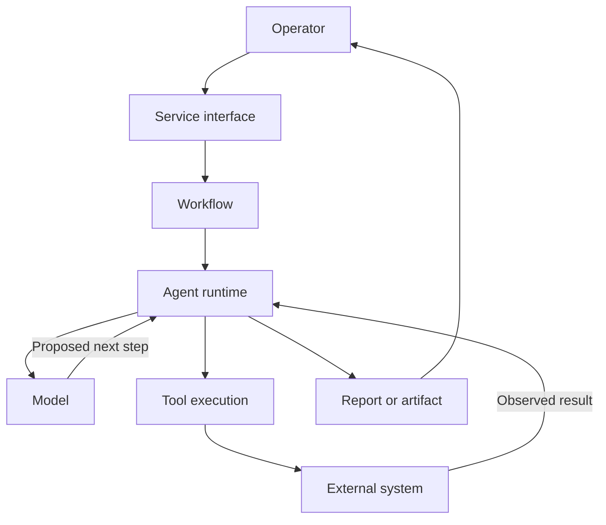

*Conceptual diagram 1: responsibilities within an agent-enabled service. Arrows show requests and results, not AWS deployment topology. An external change requires an executed operation.*

### Bounded autonomy and the agent loop

**Autonomy** concerns decisions the system can make without another instruction. **Bounded autonomy** makes those decisions conditional on a task, available tools, permissions, approval rules and execution limits. An agent might choose which logs to examine while being unable to restart a service. Investigation freedom and change authority are separate dimensions. AWS DevOps Agent illustrates this distinction through its separately configured, approved directed-action path. [S108](https://docs.aws.amazon.com/devopsagent/latest/userguide/working-with-devops-agent-working-with-directed-actions.html)

The central loop is straightforward: supply context, obtain a model decision, execute an allowed tool request, return its result, and decide again. The runtime also handles errors and termination. A failed query can become evidence about a missing permission or unavailable system; it should not become an invented query result. Strands documents this repeated model/tool exchange and explicit limits and stop reasons. [F07](https://strandsagents.com/docs/user-guide/sdk/agents/agent-loop/)

The environment supplies observations the system cannot obtain from its instructions alone. If an agent predicts that a restart will restore service, the restart result and subsequent health checks test that prediction. Merely repeating the prediction more confidently supplies no new evidence. This makes the observation step essential even when the proposed action seems familiar.

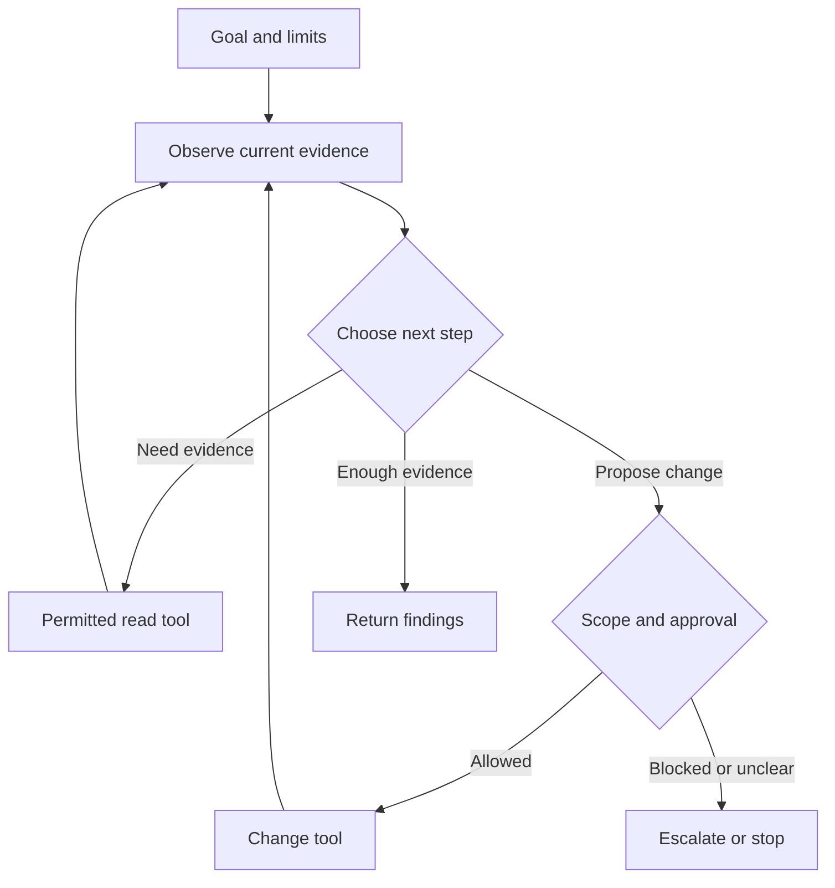

*Conceptual diagram 2: an agent loop with separate read and change paths. The gate represents applicable controls; it does not specify any product's complete approval protocol.*

A useful task therefore states what success means and what ends the attempt. For an investigation, “identify the cause with supporting evidence, or explain the unresolved gap” is more assessable than “keep investigating.” Time, cost and iteration limits make an unsuccessful attempt observable and bounded.

### A functional taxonomy of agent mechanisms

The following seven groups answer different design questions: what chooses the work, what can execute it, what informs it, what coordinates it, what authorizes it, what starts and finishes it, and how its quality is judged. A single agent normally combines several groups. These mechanisms should not be confused with job titles such as investigator, reviewer or release tester.

#### 1. Reasoning, planning and execution state

**Instructions** describe the goal, constraints and expected behavior. **Planning** organizes possible steps and dependencies. **Reasoning**, as used here, is the model's task analysis and selection of a response or action. A plan can change when evidence contradicts an assumption. Its existence does not prove that the proposed steps ran.

**Execution state** records what is actually happening: the current task, completed operations, pending approvals, errors and results needed to continue. **Conversation history** records exchanges. **Session persistence** preserves enough information to resume later. These are related but distinct responsibilities; the Strands anatomy reference separates state, conversation management, sessions and snapshots. [F10](https://strandsagents.com/docs/user-guide/sdk/agents/)

For example, a narrative might say “next, inspect the database.” The execution record must still distinguish a queued query, a successful result and a permission failure. This is why operational systems need durable identifiers and explicit states as well as readable explanations. A saved conversation alone is not a reliable replacement for a task ledger.

#### 2. Tools, integrations and protocols

A **tool** is a callable operation with an advertised purpose, inputs and result. It might retrieve deployment history, inspect a metric or submit an approved change. Good tool design explains scope, parameters, errors and side effects. A broad function named `execute` provides less guidance than a focused operation whose contract describes what it reads or changes. Tools also need useful, bounded results that the agent can interpret. [F05](https://www.anthropic.com/research/writing-tools-for-agents)

An **integration** is the configured connection that makes an external capability usable: endpoint, credentials, network path, selected resources and associated tools. A **protocol** specifies how participants exchange requests and results. MCP defines host, client and server roles and supports tools, contextual resources and reusable prompts. It does not prescribe the host's reasoning or context-management strategy. [F03](https://modelcontextprotocol.io/docs/2026-07-28/learn/architecture)

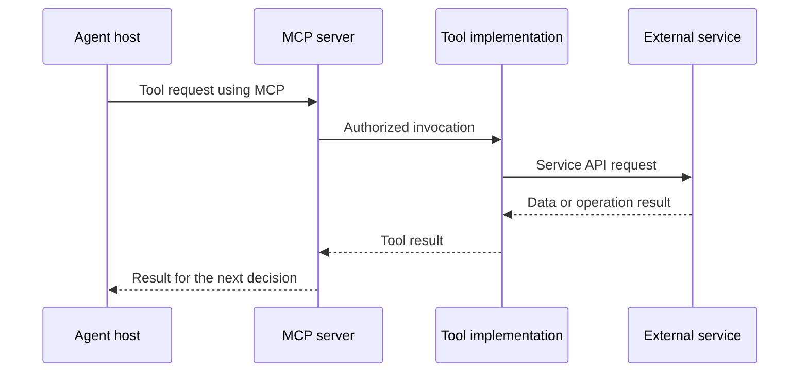

*Conceptual diagram 3: a tool integration using MCP. The exchange protocol, tool implementation and external service have different responsibilities. This illustration does not imply that every server has this exact internal layering.*

Thus, “we connected MCP” does not answer which resources are available or which operations are allowed. AWS DevOps Agent separately configures server authentication and the tools exposed to an Agent Space. Protocol compatibility is one prerequisite within a larger integration contract. [S038](https://docs.aws.amazon.com/devopsagent/latest/userguide/configuring-integrations-and-knowledge-connecting-mcp-servers.html)

#### 3. Context, skills, knowledge and memory

**Context** is the information available to the model for its current decision. It can include instructions, recent exchanges, tool descriptions, retrieved documents and observations. It is a selected working set, not necessarily everything the organization stores. Context engineering determines which information to include, refresh, summarize or retrieve as work continues. Adding more material does not automatically make the next decision better. [F04](https://www.anthropic.com/research/effective-context-engineering-for-ai-agents)

**Knowledge** is the information available for use, such as architecture records or deployment conventions. **Retrieval** selects relevant pieces of that information. A **skill** packages a procedure: when to apply it, what steps to follow and how to interpret results. In AWS DevOps Agent, skills use `SKILL.md` and can include supporting material; standing instructions use `AGENTS.md`. Procedural guidance does not grant infrastructure permissions. [S060](https://docs.aws.amazon.com/devopsagent/latest/userguide/about-aws-devops-agent-devops-agent-skills.html) [S004](https://docs.aws.amazon.com/devopsagent/latest/userguide/about-aws-devops-agent-agent-instructions.html)

**Memory** retains information for later use. It may preserve environmental understanding, a preference or a lesson from an earlier task. AWS DevOps Agent exposes managed and custom memory stores, with assignment rules controlling custom-agent access. Stored memory must still be selected and interpreted in the current context. [S059](https://docs.aws.amazon.com/devopsagent/latest/userguide/about-aws-devops-agent-devops-agent-memories.html)

Saving a memory changes what the application can provide on a later turn. It does not, by itself, retrain the model. A record also needs enough provenance to judge its relevance: where it came from, when it was true and whether later evidence supersedes it. Treat “the system learned this” as a question about what changed, rather than assuming the underlying model changed. This follows from separating persistent information from the context supplied for inference. [F04](https://www.anthropic.com/research/effective-context-engineering-for-ai-agents)

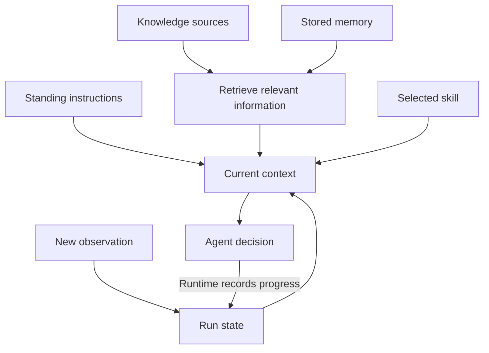

*Conceptual diagram 4: the runtime assembles context from several sources. Persistent memory and current run state are separate. The diagram describes information use, not model training.*

For a checkout incident, a skill might explain how to compare deployments, knowledge might describe the service dependencies, and memory might record a previously observed connection-pool failure. The current metric still determines whether that explanation fits today's incident. Remembering a past answer should not replace checking new evidence.

#### 4. Identity, authorization and guardrails

**Identity** establishes who is invoking the system or making a downstream call. **Authorization** determines which actions that identity can perform on which resources. These questions occur at multiple boundaries: operator to service, service to AWS account, and service to a connected provider. AWS DevOps Agent distinguishes operator-app permissions from the account roles used for investigation and the separate elevated access used for directed actions. [S058](https://docs.aws.amazon.com/devopsagent/latest/userguide/aws-devops-agent-security-devops-agent-iam-permissions.html)

**Guardrails** are additional constraints on execution or content. They can reject a prohibited operation, validate an argument or constrain a tool surface. **Human approval** is a decision about a specified proposed action. Neither an instruction nor an approval should be interpreted as permission to perform every related action. In AWS DevOps Agent, approved changes remain subject to supported-operation restrictions and scoped execution permissions. [S108](https://docs.aws.amazon.com/devopsagent/latest/userguide/working-with-devops-agent-working-with-directed-actions.html)

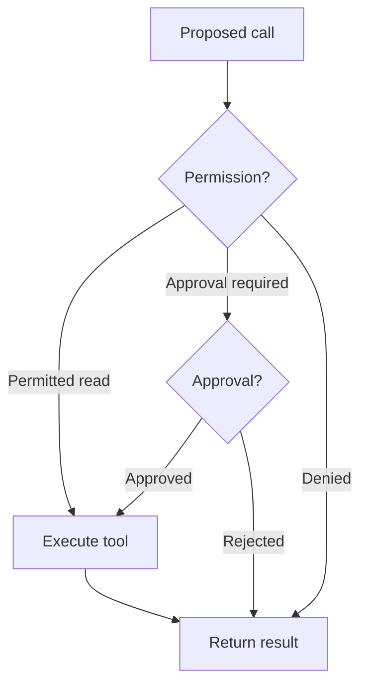

*Conceptual diagram 5: permission and approval checks answer separate questions; client identity and service entry are established before this per-call example. Real products may enforce additional checks or a different order. The diagram is not the AWS approval API sequence.*

This separation is useful when diagnosing failures. An unreachable endpoint, an invalid credential, a denied permission and a rejected approval are different problems. Rewriting a prompt cannot repair all four.

#### 5. Orchestration and collaboration

**Orchestration** controls the actual movement of work: dispatching tasks, respecting dependencies, collecting results, handling failure and deciding when to continue. A plan expresses intended work; orchestration makes a process run. It can coordinate conventional code, model calls, agents and people.

Common patterns include a fixed sequence, routing to an appropriate specialist, parallel independent tasks, delegation by a coordinator, and evaluation followed by revision. Strands distinguishes fixed task graphs, graphs with branching or loops, and agent handoffs. These are alternative arrangements of control, not maturity levels that every system must progress through. [F08](https://strandsagents.com/docs/user-guide/sdk/multi-agent/multi-agent-patterns/)

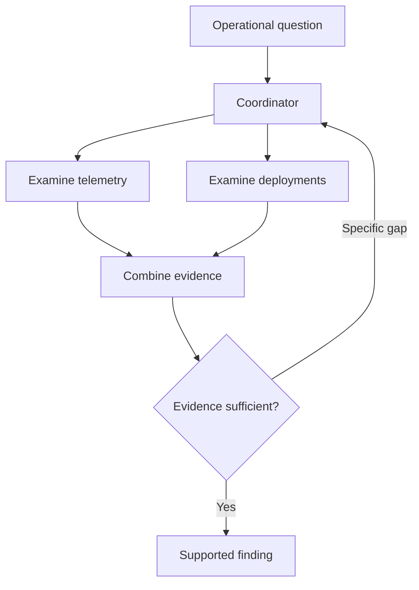

*Conceptual diagram 6: coordination of complementary work. The two branches are illustrative responsibilities, not asserted AWS DevOps Agent subagents or a disclosed internal architecture.*

Collaboration works best when each assignment has an objective, scope, available tools and expected output. Otherwise, workers can duplicate effort or leave the same gap unexamined. Anthropic's account of its research system also emphasizes preserving substantive worker results rather than repeatedly compressing them through handoffs. Its implementation is an example, not evidence of how AWS runs its service. [F09](https://www.anthropic.com/research/multi-agent-research-system)

Use a fixed step for an invariant requirement, such as verifying a required field. Use model judgment where the next useful question depends on evidence. Keep an explicit owner for the final decision when multiple branches contribute findings.

Retries need the same care. A repeated evidence query and a repeated change request have different consequences. For example, retrying ticket creation after an ambiguous timeout might create a second ticket. A robust orchestration design tracks the logical request and verifies its outcome before repeating side effects. The Strands Python SDK can coalesce concurrent invocations on the same agent when their idempotency tokens match; the general lesson is to design retry behavior explicitly. [F07](https://strandsagents.com/docs/user-guide/sdk/agents/agent-loop/)

#### 6. Triggers, outputs and effects

A **trigger** starts work. It may be a person, schedule or incoming event. Trigger configuration determines when a task is eligible to run and what context accompanies it. AWS custom agents support manual, scheduled and integration-event invocation; generic incident webhooks have their own authentication and payload contract. Arrival of an event is therefore separate from accepting it as a valid task. [S063](https://docs.aws.amazon.com/devopsagent/latest/userguide/custom-agents-executing-custom-agents.html) [S072](https://docs.aws.amazon.com/devopsagent/latest/userguide/configuring-integrations-and-knowledge-invoking-devops-agent-through-webhook.html)

An **output** is a returned result: prose, structured data, an artifact, a recommendation or a notification. An **effect** is a change in another system. A proposed repair and an applied repair are distinct outcomes. AWS custom agents can produce persistent artifacts and recommendations, while release testing sends real requests that can modify the application under test. The workflow determines which output and effect contracts apply. [S055](https://docs.aws.amazon.com/devopsagent/latest/userguide/custom-agents-custom-agent-outputs.html) [S090](https://docs.aws.amazon.com/devopsagent/latest/userguide/release-management-release-testing.html)

#### 7. Evaluation, feedback and improvement

**Evaluation** measures behavior against defined criteria. Inspect both the execution record and the actual outcome: a convincing completion message does not prove that the intended state exists. A test case needs a starting condition and success criteria; repeated trials help expose variation. Anthropic distinguishes transcripts from final environmental outcomes and treats the model plus harness as the system being evaluated. [F06](https://www.anthropic.com/research/demystifying-evals-for-ai-agents)

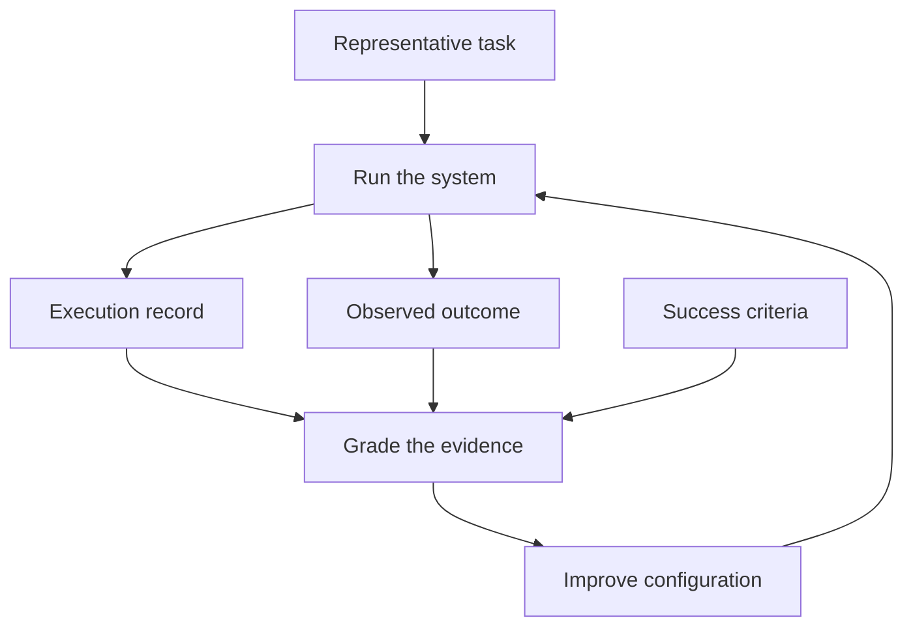

*Conceptual diagram 7: evaluation compares recorded behavior and observed outcomes with explicit criteria. A grader's judgment is itself subject to review.*

**Feedback** supplies a correction or judgment about a particular run. **Improvement** changes future behavior through configuration, instructions, skills, memory or engineering work. AWS DevOps Agent's investigation Review grades a completed investigation; its prevention workflow examines incident history for recommendations. These address related but different questions: “was this investigation useful?” and “what should we change to reduce future incidents?” [S091](https://docs.aws.amazon.com/devopsagent/latest/userguide/working-with-devops-agent-reviewing-investigations.html) [S084](https://docs.aws.amazon.com/devopsagent/latest/userguide/production-operations-proactive-incident-prevention.html)

### Applying the framework to DevOps agent roles

Mechanisms explain **how** a system works. Roles explain **what job** it performs. AWS documents managed roles for conversation, incident work, grading, release testing and learning. Custom agents add team-defined tasks. An investigation role needs evidence tools and context; a release-testing role needs a target and test intent; a learning role maintains useful knowledge. Their requirements differ even when several mechanisms are shared. [S077](https://docs.aws.amazon.com/devopsagent/latest/userguide/working-with-devops-agent-managed-agents.html) [S052](https://docs.aws.amazon.com/devopsagent/latest/userguide/custom-agents-creating-a-custom-agent.html)

For any proposed operational use case, describe its trigger, goal, evidence sources, permitted tools, decision points, outputs and acceptance criteria. Then identify the existing product workflow that meets those needs. Add a custom integration when a specific missing capability prevents the task, and retain the established system's identity, network and change-control boundaries. This is a design method for the later role, workflow and integration notes, not a promise that every useful pattern is built into AWS DevOps Agent.
### Mechanism coverage checklist

The seven families encompass model decisions and planning; tool contracts, APIs, adapters, MCP and delegated-agent interfaces; code, browser and HTTP execution; context selection, retrieval, procedures and memory; identity, credentials, permissions, guardrails and isolation; state, routing, parallelism, persistence and retries; manual, scheduled and event triggers; structured results, artifacts, notifications and mutations; and traces, metrics, evaluation, feedback and improvement.

Use [[Mechanism_Catalog]] for the detailed mechanism-by-mechanism questions. The taxonomy organizes functional responsibilities, without claiming that every framework or AWS capability implements every possible mechanism.


## Part 2 — DevOps roles and AWS managed agents

### Separate responsibilities, agent identities, and permissions

A **DevOps role** describes work: incident response, release engineering, observability, quality assessment, knowledge maintenance, or recurring operational automation. These functional labels are useful for assigning human ownership. They do not establish that AWS ships a separately configurable agent with that name.

**AWS DevOps Agent** is the service. Its **managed agents** are platform-owned components exposed through the Agents page; **custom agents** are definitions your team creates. An **IAM role** supplies an authorization identity. Operator permissions, investigation permissions, elevated action permissions, and service-linked permissions are security concepts, not additional agent personalities. [S077](https://docs.aws.amazon.com/devopsagent/latest/userguide/working-with-devops-agent-managed-agents.html) [S056](https://docs.aws.amazon.com/devopsagent/latest/userguide/working-with-devops-agent-custom-agents-index.html) [S058](https://docs.aws.amazon.com/devopsagent/latest/userguide/aws-devops-agent-security-devops-agent-iam-permissions.html)

The following responsibility mapping is an organizing model for this dossier, not an AWS product taxonomy.

| Functional responsibility | Relevant documented capability |
|---|---|
| Operational question answering | Chat and on-demand tasks |
| Incident response | Triage, investigation, mitigation proposals, investigation presentation |
| Continuous reliability improvement | Prevention evaluations and recommendation management |
| Investigation quality assurance | Review, powered by Grader |
| Knowledge maintenance | Learning, skills, instructions, memories |
| Release engineering | Readiness code reviews, verification builds, deployed-application testing |
| Team-specific automation | Custom agents with selected tools and knowledge |

These capabilities are documented separately; one responsibility can use several of them. Conversely, a capability can serve multiple responsibilities. [S083](https://docs.aws.amazon.com/devopsagent/latest/userguide/working-with-devops-agent-on-demand-devops-tasks.html) [S010](https://docs.aws.amazon.com/devopsagent/latest/userguide/production-operations-autonomous-incident-response.html) [S084](https://docs.aws.amazon.com/devopsagent/latest/userguide/production-operations-proactive-incident-prevention.html) [S091](https://docs.aws.amazon.com/devopsagent/latest/userguide/working-with-devops-agent-reviewing-investigations.html) [S088](https://docs.aws.amazon.com/devopsagent/latest/userguide/working-with-devops-agent-release-management-index.html)

### Documented managed-agent roster

Read each role as a goal implemented through inputs, mechanisms, outputs and an authority boundary. AWS says the available managed agents **can include** the following nine names. This is a documented roster, not a guarantee that every Agent Space exposes every entry. The matrix is divided into two tables so it remains readable in Markdown. “Entry” identifies a public workflow, not an undocumented internal invocation contract. [S077](https://docs.aws.amazon.com/devopsagent/latest/userguide/working-with-devops-agent-managed-agents.html)

#### Purpose, entry, and inputs

| Named managed agent | Purpose | Public workflow or trigger | Documented input context |
|---|---|---|---|
| **Chat** | Answer operational questions | User conversation | Request, conversation and page context, connected operational data. [S083](https://docs.aws.amazon.com/devopsagent/latest/userguide/working-with-devops-agent-on-demand-devops-tasks.html) |
| **Incident triage** | Filter, classify, and scope incoming incidents | External incident event | Incoming incident, active investigations, relevant correlation or skip guidance. [S010](https://docs.aws.amazon.com/devopsagent/latest/userguide/production-operations-autonomous-incident-response.html) |
| **Incident RCA** | Determine causes using evidence | Incident investigation workflow | Incident scope and evidence gathered from connected systems. [S010](https://docs.aws.amazon.com/devopsagent/latest/userguide/production-operations-autonomous-incident-response.html) |
| **Incident mitigation** | Propose near-term responses and durable fixes | Investigation mitigation workflow | Investigation findings and operational context. [S010](https://docs.aws.amazon.com/devopsagent/latest/userguide/production-operations-autonomous-incident-response.html) |
| **Incident UI** | Generate investigation outputs | Within the investigation workflow | A separate input schema is not specified. [S077](https://docs.aws.amazon.com/devopsagent/latest/userguide/working-with-devops-agent-managed-agents.html) |
| **Evaluation** | Assess performance and policy compliance | Not separately specified in the roster reference | Not separately specified. [S077](https://docs.aws.amazon.com/devopsagent/latest/userguide/working-with-devops-agent-managed-agents.html) |
| **Grader** | Assess investigation quality | User launches Review on a completed investigation | Problem, collected evidence, conclusion, configured criteria. [S091](https://docs.aws.amazon.com/devopsagent/latest/userguide/working-with-devops-agent-reviewing-investigations.html) |
| **Release testing** | Exercise deployed UI and REST behavior | Test profile, Chat, IDE, or pipeline | Target URL/profile, change context or test intent, configured authentication. [S090](https://docs.aws.amazon.com/devopsagent/latest/userguide/release-management-release-testing.html) |
| **Learning** | Maintain environmental knowledge | Managed schedules or supported refresh requests | Topology, dependencies, pipelines, investigation history, directives. [S059](https://docs.aws.amazon.com/devopsagent/latest/userguide/about-aws-devops-agent-devops-agent-memories.html) [S077](https://docs.aws.amazon.com/devopsagent/latest/userguide/working-with-devops-agent-managed-agents.html) |

#### Mechanisms, outputs, and boundaries

| Named managed agent | Mechanism | Outputs | Boundary or limitation |
|---|---|---|---|
| **Chat** | Context-aware queries and tool use | Answers, artifacts, investigation steering | A conversation can lead to a separately created investigation. [S083](https://docs.aws.amazon.com/devopsagent/latest/userguide/working-with-devops-agent-on-demand-devops-tasks.html) |
| **Incident triage** | Correlation and skip-rule application | Linked, Skipped, or Proceed decision | Unlink/unskip corrects a decision; this is not an independent Run Now agent. [S010](https://docs.aws.amazon.com/devopsagent/latest/userguide/production-operations-autonomous-incident-response.html) |
| **Incident RCA** | Evidence collection and hypothesis validation | Findings, cause analysis, investigation record | Results depend on available evidence and access. [S010](https://docs.aws.amazon.com/devopsagent/latest/userguide/production-operations-autonomous-incident-response.html) |
| **Incident mitigation** | Corrective-action planning | Inline proposals or mitigation plan | A proposal is distinct from approved execution through directed actions. [S010](https://docs.aws.amazon.com/devopsagent/latest/userguide/production-operations-autonomous-incident-response.html) [S108](https://docs.aws.amazon.com/devopsagent/latest/userguide/working-with-devops-agent-working-with-directed-actions.html) |
| **Incident UI** | Investigation-output generation | UI outputs, including externally posted outputs | No independent worker topology is published. [S077](https://docs.aws.amazon.com/devopsagent/latest/userguide/working-with-devops-agent-managed-agents.html) |
| **Evaluation** | Performance scoring and policy checks | Scoring/check results | Skills guidance also labels Evaluation as proactive recommendations; terminology differs between guides. [S060](https://docs.aws.amazon.com/devopsagent/latest/userguide/about-aws-devops-agent-devops-agent-skills.html) [S077](https://docs.aws.amazon.com/devopsagent/latest/userguide/working-with-devops-agent-managed-agents.html) |
| **Grader** | Criteria-based assessment | Overall verdict and criterion results | Does not rerun or modify the original investigation. [S091](https://docs.aws.amazon.com/devopsagent/latest/userguide/working-with-devops-agent-reviewing-investigations.html) |
| **Release testing** | Browser interaction or HTTP testing | Findings, reproduction steps, UI screenshots | Requests can modify application data. [S090](https://docs.aws.amazon.com/devopsagent/latest/userguide/release-management-release-testing.html) |
| **Learning** | Synthesize and refresh managed context | Managed environmental and monitor knowledge | AWS owns its scheduled tasks. [S077](https://docs.aws.amazon.com/devopsagent/latest/userguide/working-with-devops-agent-managed-agents.html) |

### What users configure

Managed definitions have no editable system prompt or direct Run Now control. The Agent definition tab exposes editable global and agent-specific `AGENTS.md` guidance; its Knowledge tab shows skills and memories but is read-only. Learning additionally exposes History and Triggers. Its schedules cannot be created, edited, or deleted by the user. Activity for incident agents belongs to the investigation record. [S077](https://docs.aws.amazon.com/devopsagent/latest/userguide/working-with-devops-agent-managed-agents.html)

Users can also create skills and target them to supported managed roles; the managed-agent Knowledge view itself remains read-only. [S060](https://docs.aws.amazon.com/devopsagent/latest/userguide/about-aws-devops-agent-devops-agent-skills.html)

Instructions are loaded at session start. New sessions receive saved changes; existing sessions retain their initial content. A global change therefore needs deliberate review because its scope is broad. Agent-specific guidance is suitable for a targeted rule, such as the evidence a Grader should demand. Instructions guide behavior; IAM and tool configuration govern access. [S004](https://docs.aws.amazon.com/devopsagent/latest/userguide/about-aws-devops-agent-agent-instructions.html) [S058](https://docs.aws.amazon.com/devopsagent/latest/userguide/aws-devops-agent-security-devops-agent-iam-permissions.html)

Chat history is isolated by Agent Space. A new conversation does not inherit earlier chats; resuming an existing conversation retains its history. Switching pages keeps the conversation but updates page-specific context. Investigation steering applies from the relevant investigation detail page. [S083](https://docs.aws.amazon.com/devopsagent/latest/userguide/working-with-devops-agent-on-demand-devops-tasks.html)

Treat “configurable managed agent” as **customizable guidance within an AWS-owned capability**, not ownership of its runtime, tools, or scheduler.

### Knowledge mechanisms and the Learning relationship

Three knowledge mechanisms solve different problems. Instructions supply standing guidance. Skills encode procedures selected for the task. Memories provide relevant information about the environment and past work. Memory selection uses store descriptions, then item descriptions, before opening full content; it does not load every memory into every session. [S004](https://docs.aws.amazon.com/devopsagent/latest/userguide/about-aws-devops-agent-agent-instructions.html) [S060](https://docs.aws.amazon.com/devopsagent/latest/userguide/about-aws-devops-agent-devops-agent-skills.html) [S059](https://docs.aws.amazon.com/devopsagent/latest/userguide/about-aws-devops-agent-devops-agent-memories.html)

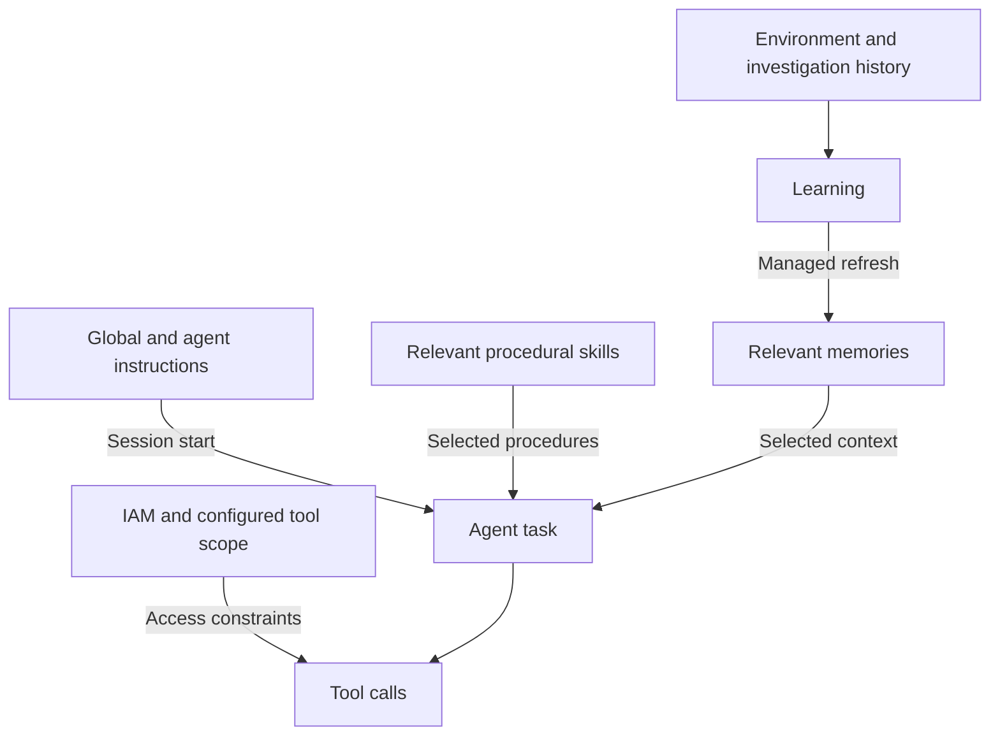

The arrows show knowledge supply and access constraints, not a scheduler sequence. Knowledge can improve a decision without granting a new permission. [S004](https://docs.aws.amazon.com/devopsagent/latest/userguide/about-aws-devops-agent-agent-instructions.html) [S059](https://docs.aws.amazon.com/devopsagent/latest/userguide/about-aws-devops-agent-devops-agent-memories.html) [S074](https://docs.aws.amazon.com/devopsagent/latest/userguide/aws-devops-agent-security-limiting-agent-access-in-an-aws-account.html)

Managed stores include `monitors`, `directives`, `reflections`, `understanding-agent-space`, `understanding-dependencies`, `understanding-pipeline-topology`, and `tool-use-best-practices`. They distinguish incident patterns, standing preferences, corrective lessons, architecture, dependencies, delivery structure, and effective tool usage. Memories are versioned, so their evolution can be inspected. [S059](https://docs.aws.amazon.com/devopsagent/latest/userguide/about-aws-devops-agent-devops-agent-memories.html)

Learning is not an assertion of immediate synchronization. Monitor memory has a daily refresh under the documented recent-investigation condition. Scheduled environmental understanding refreshes occur no more than once every three days in active spaces; tool-use learning also requires sufficient new completed investigations. Separate discovery, integration-change, and requested refresh paths exist. [S059](https://docs.aws.amazon.com/devopsagent/latest/userguide/about-aws-devops-agent-devops-agent-memories.html)

Older environmental **learned skills** migrate to managed memories when refreshed. Temporary older skill entries are compatible with that migration; they do not establish two permanently independent knowledge systems. User-authored procedural skills remain a separate mechanism. [S073](https://docs.aws.amazon.com/devopsagent/latest/userguide/about-aws-devops-agent-learned-skills.html) [S060](https://docs.aws.amazon.com/devopsagent/latest/userguide/about-aws-devops-agent-devops-agent-skills.html)

A recommended knowledge design is to place mandatory session guidance in instructions, reusable diagnostic steps in a skill, and service facts in a memory. For example, an instruction can require evidence links; a skill can describe diagnosing queue backlog; a memory can identify the queue's owners and downstream consumers. This allocation is an implementation recommendation, not a new AWS asset type.

### Review, prevention, and learning have different outputs

A completed investigation can support several independent activities. **Review** assesses the work already done. **Prevention** examines incident patterns to propose engineering improvements. **Learning** maintains reusable context. Their shared input does not mean one must automatically invoke the others. [S091](https://docs.aws.amazon.com/devopsagent/latest/userguide/working-with-devops-agent-reviewing-investigations.html) [S084](https://docs.aws.amazon.com/devopsagent/latest/userguide/production-operations-proactive-incident-prevention.html) [S059](https://docs.aws.amazon.com/devopsagent/latest/userguide/about-aws-devops-agent-devops-agent-memories.html)

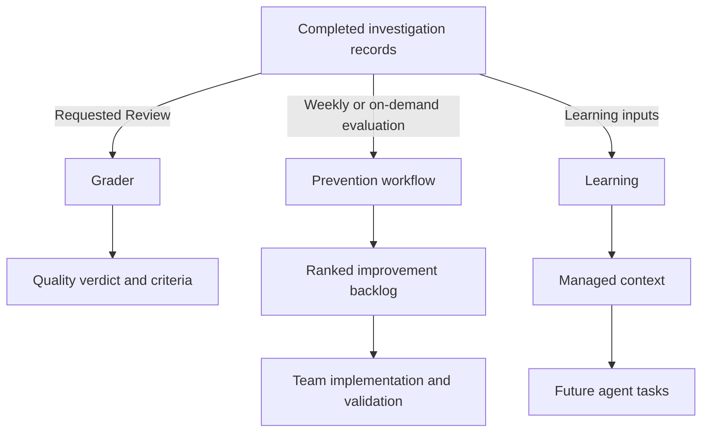

This diagram describes consumption of records. The prevention box names the workflow because current guides use Evaluation inconsistently: the managed-agent roster describes performance and policy assessment, while the Skills guide labels the Evaluation target as proactive recommendations. Keep this naming difference visible and keep Grader Review distinct. [S077](https://docs.aws.amazon.com/devopsagent/latest/userguide/working-with-devops-agent-managed-agents.html) [S060](https://docs.aws.amazon.com/devopsagent/latest/userguide/about-aws-devops-agent-devops-agent-skills.html) [S084](https://docs.aws.amazon.com/devopsagent/latest/userguide/production-operations-proactive-incident-prevention.html)

Grader's default criteria are scope alignment, evidence grounding, completeness, environment impact, and accuracy against a linked incident's recorded cause. Results contain an overall helpful/not-helpful judgment and pass/fail/not-applicable criteria. Missing ground truth can make accuracy inapplicable. Grader instructions can adjust, add, or remove criteria; unmentioned defaults remain unless replacement is explicitly requested. These are review criteria, not proof of production safety. [S091](https://docs.aws.amazon.com/devopsagent/latest/userguide/working-with-devops-agent-reviewing-investigations.html)

Prevention runs weekly by default or on demand. The schedule can be paused; an active evaluation can be stopped. Its UI categories are Observability, Infrastructure, Governance, and Code optimization. Operators Keep, Discard, or mark items Implemented. Ranking can combine AI assessment with deterministic scoring; a code-oriented recommendation may contain an implementation specification. Engineering ownership and validation still matter before recording completion. [S084](https://docs.aws.amazon.com/devopsagent/latest/userguide/production-operations-proactive-incident-prevention.html)

Corrective investigation feedback supplies another learning path: reflections capture what the investigation missed. This is distinct from merely obtaining a Grader verdict. Neither a favorable Review nor a saved recommendation should be presented as proof that a fix was executed. [S059](https://docs.aws.amazon.com/devopsagent/latest/userguide/about-aws-devops-agent-devops-agent-memories.html) [S091](https://docs.aws.amazon.com/devopsagent/latest/userguide/working-with-devops-agent-reviewing-investigations.html)

### Custom agents: team-owned definitions with selected scope

A custom agent packages a system prompt, selected tools, skills, and attached memory stores. It starts without memory access. Attached managed stores are readable; attached custom stores can also receive writes. Configuration therefore selects both the work to do and the information available for doing it. Create through the form, guided Chat, or a supported GitHub Markdown import. Configure tools through Chat; the form edits prompt, skills and memory assignments. GitHub import supplies the Markdown system prompt, not the complete tool and trigger configuration. [S056](https://docs.aws.amazon.com/devopsagent/latest/userguide/working-with-devops-agent-custom-agents-index.html) [S052](https://docs.aws.amazon.com/devopsagent/latest/userguide/custom-agents-creating-a-custom-agent.html)

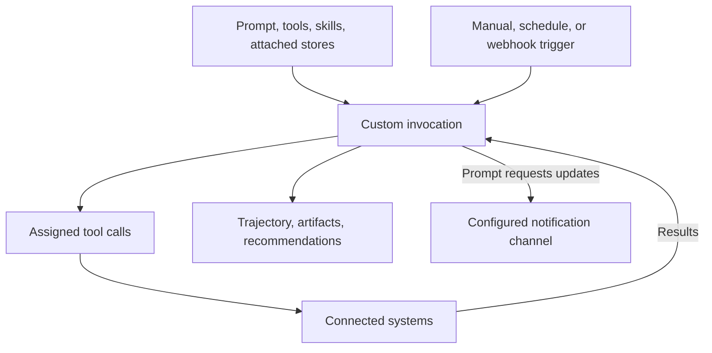

The same invocation can produce a report and use external tools. Tool permission is still required for external activity. Artifacts and recommendations are built-in output capabilities; no additional skill assignment is required. Notifications additionally need instructions describing when to notify and an associated destination. Recommendations appear beside built-in prevention recommendations on Improvements. [S055](https://docs.aws.amazon.com/devopsagent/latest/userguide/custom-agents-custom-agent-outputs.html)

Run Now, Run with prompt, and Chat support manual invocation. Automatic invocation can use cron/rate schedules or connected integration webhooks; optional JMESPath filters select and project event context. These are user-configured triggers, distinct from Learning's AWS-owned schedules. A custom agent supports one concurrent invocation; the published default space-wide limit is five. [S063](https://docs.aws.amazon.com/devopsagent/latest/userguide/custom-agents-executing-custom-agents.html) [S086](https://docs.aws.amazon.com/devopsagent/latest/userguide/quotas.html)

Dynamic delegation is documented for complex custom runs, including continuation near a context-window limit, with the parent's tools and skills. Investigation timelines also expose parallel subagent work. These runtime workers are not extra configurable roster types. Do not invent permanent “database agent,” “observability agent,” or “scheduler agent” identities from an example task label. [S056](https://docs.aws.amazon.com/devopsagent/latest/userguide/working-with-devops-agent-custom-agents-index.html) [S010](https://docs.aws.amazon.com/devopsagent/latest/userguide/production-operations-autonomous-incident-response.html)

Recommended ownership is concrete: nominate the prompt owner, permitted tools, intended outputs, run trigger, and acceptance evidence. Inspect an on-demand trajectory before enabling recurrence. Cancellation may leave an in-flight tool call completing; deleting a definition prevents future runs but does not itself cancel existing invocations. [S063](https://docs.aws.amazon.com/devopsagent/latest/userguide/custom-agents-executing-custom-agents.html) [S079](https://docs.aws.amazon.com/devopsagent/latest/userguide/custom-agents-managing-custom-agents.html)

### Release capability names do not imply extra roster entries

Release readiness code review analyzes proposed code for standards, dependency, and access-control risks, optionally building and testing it in a managed verification environment. Release testing exercises a deployed application. Only **Release testing** appears as a distinct name in the current managed-agent roster. “Release readiness reviewer” is a functional description, not an additional documented configurable agent type. [S089](https://docs.aws.amazon.com/devopsagent/latest/userguide/release-management-release-readiness-code-review.html) [S090](https://docs.aws.amazon.com/devopsagent/latest/userguide/release-management-release-testing.html) [S077](https://docs.aws.amazon.com/devopsagent/latest/userguide/working-with-devops-agent-managed-agents.html)

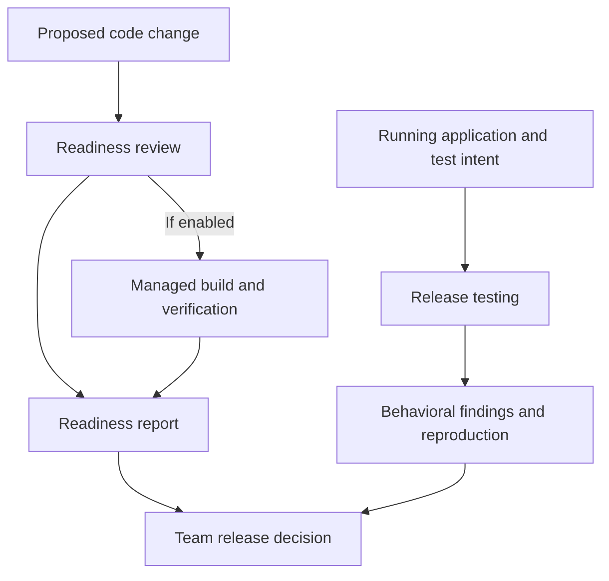

The final arrows represent recommended decision inputs, not automatic cross-feature orchestration. A readiness report can influence a configured repository gate. Release testing makes real UI/API requests, including writes; its application identity and network scope therefore need separate consideration. A read-only AWS guardrail in readiness review does not make application testing read-only. [S089](https://docs.aws.amazon.com/devopsagent/latest/userguide/release-management-release-readiness-code-review.html) [S090](https://docs.aws.amazon.com/devopsagent/latest/userguide/release-management-release-testing.html)

### Trace platform capabilities to their consumers

| Platform capability | Consumers and responsibility | Configuration or evidence surface |
|---|---|---|
| Agent Space and topology | Operational context for investigation, Chat, and knowledge | Associated environment and discovered relationships. [S104](https://docs.aws.amazon.com/devopsagent/latest/userguide/about-aws-devops-agent-what-are-devops-agent-spaces.html) [S105](https://docs.aws.amazon.com/devopsagent/latest/userguide/about-aws-devops-agent-what-is-a-devops-agent-topology.html) |
| Instructions, skills, memories | Standing guidance, procedures, and context | Agent definition, knowledge assets, relevant attached stores. [S004](https://docs.aws.amazon.com/devopsagent/latest/userguide/about-aws-devops-agent-agent-instructions.html) [S078](https://docs.aws.amazon.com/devopsagent/latest/userguide/about-aws-devops-agent-managing-assets.html) |
| Integration toolbox and IAM | Access to evidence and supported actions | Provider/account permissions, tool selection, elevated-action controls. [S058](https://docs.aws.amazon.com/devopsagent/latest/userguide/aws-devops-agent-security-devops-agent-iam-permissions.html) [S108](https://docs.aws.amazon.com/devopsagent/latest/userguide/working-with-devops-agent-working-with-directed-actions.html) |
| Records and reusable outputs | Operator inspection and subsequent workflows | Investigation timeline, invocation trajectory, artifacts, recommendation backlog. [S010](https://docs.aws.amazon.com/devopsagent/latest/userguide/production-operations-autonomous-incident-response.html) [S055](https://docs.aws.amazon.com/devopsagent/latest/userguide/custom-agents-custom-agent-outputs.html) |
| Investigation Sandbox | Analysis computation during investigations | Optional ephemeral environment; read-only AWS proxy and network rules. [S093](https://docs.aws.amazon.com/devopsagent/latest/userguide/configuring-integrations-and-knowledge-sandbox.html) |
| Usage and operational telemetry | Service operators and automation owners | Activity metrics, delivery logs, concurrency quotas. [S102](https://docs.aws.amazon.com/devopsagent/latest/userguide/configuring-integrations-and-knowledge-vended-logs-and-metrics.html) [S086](https://docs.aws.amazon.com/devopsagent/latest/userguide/quotas.html) |

This mapping separates **what an agent does** from **what the platform supplies**. For example, a memory store is a context resource, an artifact is an output, a webhook is an invocation path, and an IAM role is an authorization identity. None should be drawn as another reasoning agent.

### Source audit and presentation caveats

- **Roster wording matters.** Preserve the nine AWS names and “can include” qualification. The reference says managed-agent pages show a Preview badge. Use capability-specific release documentation to establish availability; do not infer every underlying capability's status from that badge. [S077](https://docs.aws.amazon.com/devopsagent/latest/userguide/working-with-devops-agent-managed-agents.html) [S013](https://aws.amazon.com/about-aws/whats-new/2026/06/aws-devops-agent-release-management/)
- **Record the Evaluation naming inconsistency.** The managed-agent roster describes performance and policy assessment; the Skills guide labels the Evaluation target as proactive recommendations. Grader is explicitly Review's agent. Use workflow names when explaining prevention and preserve this source difference. [S077](https://docs.aws.amazon.com/devopsagent/latest/userguide/working-with-devops-agent-managed-agents.html) [S060](https://docs.aws.amazon.com/devopsagent/latest/userguide/about-aws-devops-agent-devops-agent-skills.html) [S091](https://docs.aws.amazon.com/devopsagent/latest/userguide/working-with-devops-agent-reviewing-investigations.html)
- **Prefer specific workflow guidance.** The custom overview still mentions schedule-only triggers; the execution guide documents event triggers. The overview also loosely associates outputs with skills, while the output guide explicitly makes artifacts and recommendations built in. [S056](https://docs.aws.amazon.com/devopsagent/latest/userguide/working-with-devops-agent-custom-agents-index.html) [S063](https://docs.aws.amazon.com/devopsagent/latest/userguide/custom-agents-executing-custom-agents.html) [S055](https://docs.aws.amazon.com/devopsagent/latest/userguide/custom-agents-custom-agent-outputs.html)
- **Interface coverage differs.** CloudFormation currently documents time-based custom triggers. Console event support does not prove every IaC option has equivalent coverage. [S026](https://docs.aws.amazon.com/AWSCloudFormation/latest/TemplateReference/aws-resource-devopsagent-trigger.html)
- **Guidance location has changed.** Review prose mentions an older Knowledge-page route; the managed-agent and instructions guides identify Agents → managed agent → Agent definition for editable guidance. [S091](https://docs.aws.amazon.com/devopsagent/latest/userguide/working-with-devops-agent-reviewing-investigations.html) [S004](https://docs.aws.amazon.com/devopsagent/latest/userguide/about-aws-devops-agent-agent-instructions.html)

Diagram edges show documented data or knowledge relationships; recommended team decisions are labeled. The section makes no claim about an unpublished scheduler, fixed internal worker graph, or universal automatic handoff between capabilities.

## Part 3 — Platform capabilities and functions


An agent role names a responsibility. A platform capability supplies something that makes the responsibility possible: scope, evidence, execution, knowledge, a result surface, or a control. Design from both directions. A cause-analysis role without the relevant telemetry cannot establish a well-supported cause; an integration with no defined task or owner adds a connection without an operational purpose.

### Scope and access

The Agent Space organizes the permitted operational environment, users, integrations and knowledge. Provider registration establishes a connection at account level; an association exposes selected provider capabilities or resources to a space. The exact selection controls depend on the provider. Topology helps agents and operators navigate relationships, while effective IAM and provider permissions determine access. [S104](https://docs.aws.amazon.com/devopsagent/latest/userguide/about-aws-devops-agent-what-are-devops-agent-spaces.html) [S029](https://docs.aws.amazon.com/devopsagent/latest/userguide/configuring-integrations-and-knowledge.html) [S105](https://docs.aws.amazon.com/devopsagent/latest/userguide/about-aws-devops-agent-what-is-a-devops-agent-topology.html)

Human entry and resource inspection have distinct identities. Operator access can use the supported console or identity-provider paths. Investigation roles provide account access; elevated roles participate in the approved-action path. Each connected account has its own investigation role. A human's access to the operator app does not by itself grant every downstream permission. [S058](https://docs.aws.amazon.com/devopsagent/latest/userguide/aws-devops-agent-security-devops-agent-iam-permissions.html) [S074](https://docs.aws.amazon.com/devopsagent/latest/userguide/aws-devops-agent-security-limiting-agent-access-in-an-aws-account.html)

### Capability traceability

| Platform capability | Function and consuming workflow | Evidence of useful operation |
| --- | --- | --- |
| Agent Space | Establish a coherent application and operating scope | Correct accounts, associations and authorized operators |
| Topology | Orient investigation and environmental understanding | Relevant dependencies linked to current evidence |
| Integration toolbox | Query telemetry, code, incidents and specialist context | Successful scoped calls with source and time information |
| Identity and IAM | Authorize people, service calls and supported actions | Effective permissions match intended resources |
| Instructions | Apply standing guidance at session start | New session follows the reviewed guidance |
| Skills | Supply task-specific procedures | Relevant diagnostic procedure is selected and applied |
| Memory | Retain and retrieve contextual information | Referenced knowledge is current and relevant |
| Investigation records | Expose hypotheses, calls, findings and interaction | Operator can inspect the evidence supporting a conclusion |
| Custom trajectory and outputs | Expose run activity, artifacts and recommendations | Requested output exists and meets the task contract |
| Review / prevention | Assess quality and generate improvements | Criteria results or actionable recommendations |
| Directed-action controls | Scope eligible operator-requested mutations | Correct proposal, approval, execution and verification |
| Release evidence | Assess proposed code and deployed behavior | Findings match the commit and application assessed |
| Metrics / quotas / audit | Observe usage, activity and capacity | Limits and failures are visible to the operating team |
| Assets / IaC | Manage reusable configuration and changes | Versioned assets and supported deployment configuration |

The first column uses documented capability families. The third column proposes customer acceptance evidence; it is not a list of AWS-enforced completion criteria. Sources: [S004](https://docs.aws.amazon.com/devopsagent/latest/userguide/about-aws-devops-agent-agent-instructions.html) [S059](https://docs.aws.amazon.com/devopsagent/latest/userguide/about-aws-devops-agent-devops-agent-memories.html) [S060](https://docs.aws.amazon.com/devopsagent/latest/userguide/about-aws-devops-agent-devops-agent-skills.html) [S010](https://docs.aws.amazon.com/devopsagent/latest/userguide/production-operations-autonomous-incident-response.html) [S055](https://docs.aws.amazon.com/devopsagent/latest/userguide/custom-agents-custom-agent-outputs.html) [S091](https://docs.aws.amazon.com/devopsagent/latest/userguide/working-with-devops-agent-reviewing-investigations.html) [S084](https://docs.aws.amazon.com/devopsagent/latest/userguide/production-operations-proactive-incident-prevention.html) [S108](https://docs.aws.amazon.com/devopsagent/latest/userguide/working-with-devops-agent-working-with-directed-actions.html) [S089](https://docs.aws.amazon.com/devopsagent/latest/userguide/release-management-release-readiness-code-review.html) [S090](https://docs.aws.amazon.com/devopsagent/latest/userguide/release-management-release-testing.html) [S102](https://docs.aws.amazon.com/devopsagent/latest/userguide/configuring-integrations-and-knowledge-vended-logs-and-metrics.html) [S078](https://docs.aws.amazon.com/devopsagent/latest/userguide/about-aws-devops-agent-managing-assets.html).

### Execution environments are capability-specific

An environment that executes analysis code is different from the application being tested. Keep that distinction visible in access reviews and demonstrations.

| Environment | Task | Boundary |
| --- | --- | --- |
| Investigation Sandbox | Compute on evidence during an investigation | Optional ephemeral environment with read-only AWS proxy and network controls |
| Managed readiness verification | Build and test proposed code | Separate managed verification environment and readiness guardrails |
| Deployed test application | UI interaction and API behavior checks | Real application requests, including writes, under test credentials |
| External integration | Retrieve evidence or perform a permitted operation | Provider authorization, tool scope and connectivity |

These are different product paths. Investigation Sandbox is not the runtime for every Chat or custom invocation. Readiness guardrails should not be used to describe the effects of application testing. [S093](https://docs.aws.amazon.com/devopsagent/latest/userguide/configuring-integrations-and-knowledge-sandbox.html) [S089](https://docs.aws.amazon.com/devopsagent/latest/userguide/release-management-release-readiness-code-review.html) [S090](https://docs.aws.amazon.com/devopsagent/latest/userguide/release-management-release-testing.html)

### Connect platform operation to a named owner

The following ownership assignment is recommended practice. A platform administrator owns space and provider configuration. An identity owner governs operator and service permissions. A responder owns incident interpretation and recovery acceptance. An engineering owner implements prevention recommendations. A release owner accepts versioned release evidence. A custom-agent owner maintains the task definition, trigger and output contract.

This ownership model resolves a common ambiguity: an agent can produce the work product while a different person or workflow owns the consequential operational decision. Record both responsibilities in the task contract.

### Implementation reference

- [[Reference_Agent_Spaces_and_Access]] — setup, roles, identity, topology, provider association, EKS/Azure and retirement.
- [[Reference_Network_Security_and_Regions]] — private paths, availability, encryption, inference geography and audit.
- [[Reference_Integrations_and_Events]] — provider surfaces, webhooks, MCP, A2A, EventBridge and summaries.
- [[Reference_Prevention_and_Operations]] — prevention, Sandbox, assets, IaC, price, metrics and complete quota tables.

## Part 4 — Orchestration, cases and custom extensions

AWS DevOps Agent can perform a substantial investigation or custom analysis inside one execution. A complete operational process usually extends beyond that execution: accepting an incident, coordinating owners, recording decisions, changing a system, checking recovery and retaining evidence. Design those responsibilities explicitly before connecting more agents.

The organization, service names and operating procedures below are **invented examples**. They illustrate how a team could connect documented capabilities to an established environment. “Documented contract” identifies behavior described by AWS; it does not mean the illustrated system has been implemented. “Customer design” identifies orchestration, business rules and integration work the organization must supply.

### 1. Three layers of orchestration

#### Service-managed execution

An Agent Space supplies the configured operational context. A custom agent receives its prompt, selected tools, skills and attached memory stores. Its invocation records tool activity and outputs. AWS also documents dynamic subagent delegation: near a context-window limit, a custom agent can create a continuation subagent with the same tools and skills, without additional configuration. This establishes continuation behavior; it does not establish a customer-authored dependency graph, independently scheduled child jobs or a distributed transaction. [S056](https://docs.aws.amazon.com/devopsagent/latest/userguide/working-with-devops-agent-custom-agents-index.html)

Describe visible behavior rather than assigning undocumented internal components to boxes. The investigation timeline, custom-agent trajectory and produced artifacts are useful observation surfaces. They do not expose a contractual implementation topology. A long analysis that succeeds still needs a separate judgment about whether its evidence answers the operational question.

#### Customer-owned workflow

The customer owns the durable process that crosses systems or outlives an agent run. In these examples, an existing integration service maintains a work ledger, routes human decisions, records external identifiers and reconciles outcomes. Its responsibilities include deciding whether to start new work, holding a release, deduplicating notifications and checking that an accepted change actually reached production.

Those are proposed responsibilities, not hidden AWS DevOps Agent features. The ledger remains the process record even if a chat session closes, a notification fails or a controller restarts. It stores observed facts separately from business conclusions: “analysis completed” and “incident resolved” are different fields.

#### External agent delegation

An external client can invoke the DevOps Agent A2A server. In the other direction, DevOps Agent can call a registered remote A2A provider. These directions have separate configuration and authorization. A remote agent is not the automatic continuation subagent described above. AWS documents remote-agent discovery, supported bindings and credentials; the organization defines the specialist's responsibility and validates its output. [S070](https://docs.aws.amazon.com/devopsagent/latest/userguide/connecting-to-devops-agent-remote-servers-integrating-with-the-devops-agent-a2a-server.html) [S043](https://docs.aws.amazon.com/devopsagent/latest/userguide/configuring-integrations-and-knowledge-connecting-remote-a2a-agents.html)

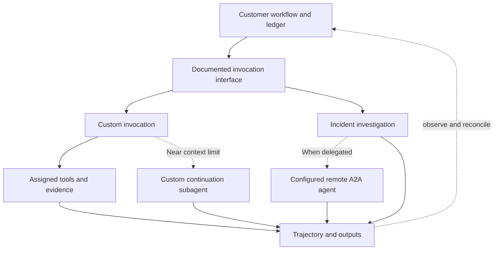

**Diagram meaning:** the service relationships follow the documented custom-agent and A2A capabilities. The surrounding ledger and reconciliation loop are customer design. The drawing is not an internal AWS architecture or a promise that every execution delegates. Sources: [S056](https://docs.aws.amazon.com/devopsagent/latest/userguide/working-with-devops-agent-custom-agents-index.html) [S043](https://docs.aws.amazon.com/devopsagent/latest/userguide/configuring-integrations-and-knowledge-connecting-remote-a2a-agents.html) [S070](https://docs.aws.amazon.com/devopsagent/latest/userguide/connecting-to-devops-agent-remote-servers-integrating-with-the-devops-agent-a2a-server.html).

### 2. The illustrative established environment

Assume a fictional payments organization already runs `checkout` on Amazon EKS. CloudWatch supplies AWS telemetry, Datadog supplies application observations, PagerDuty handles paging and ServiceNow holds the incident and change records. GitHub holds application and deployment definitions. Responders use an associated private Slack channel. An internal MCP server exposes selected ownership, deployment and policy information. An EventBridge consumer stores the documented investigation and mitigation events.

This is an assumed inventory, not a claim that registration automatically connects every workflow. EKS resource access needs its documented setup; the Slack conversation path needs a private channel, application membership, role and binding. Provider associations select the resources or capabilities available to the space. [S024](https://docs.aws.amazon.com/devopsagent/latest/userguide/configuring-integrations-and-knowledge-aws-eks-access-setup.html) [S045](https://docs.aws.amazon.com/devopsagent/latest/userguide/connecting-to-ticketing-and-chat-connecting-slack.html) [S029](https://docs.aws.amazon.com/devopsagent/latest/userguide/configuring-integrations-and-knowledge.html)

### 3. Case one: incident to verified recovery

**Documented contract.** Configured incidents can enter triage, which can link them to existing work, skip them or proceed with an independent investigation. Responders can inspect evidence, add context and correct findings. Directed changes require explicit operator direction and the applicable approval and capability controls; an autonomous investigation does not itself obtain approval and perform a mutating call. [S010](https://docs.aws.amazon.com/devopsagent/latest/userguide/production-operations-autonomous-incident-response.html) [S108](https://docs.aws.amazon.com/devopsagent/latest/userguide/working-with-devops-agent-working-with-directed-actions.html)

**Invented customer flow.** PagerDuty reports rising checkout failures. The integration service records its incident identifier and the linked ServiceNow record, then checks whether this delivery belongs to an existing work item. The team uses one agreed intake route. It does not deliberately start separate investigations from PagerDuty, Datadog and ServiceNow for the same incident and hope that downstream correlation repairs the duplication.

If triage links the incident, the operator follows the primary investigation and preserves the association in the ledger. A skipped result is recorded with its observed explanation; it is not treated as healthy service. For independent analysis, the agent correlates the failure window with CloudWatch, Datadog, EKS state and GitHub deployment evidence. The internal MCP source provides the owner and deployment record. An unavailable source becomes an explicit evidence gap.

The investigation suggests that a recent change altered connection-pool behavior. This remains a cause assessment until the responder checks timing and contrary evidence. The responder may ask for a mitigation in chat, approve an eligible scoped operation, or use the existing deployment process to roll back. The choice is recorded as an operator decision. A suggestion to revert a commit is not evidence that the revert happened.

The customer workflow then verifies error rate, latency and business transaction success over its chosen observation window. It records the actual deployment identifier and any remaining uncertainty. Only that customer acceptance step permits incident closure. Corrective feedback and a Review serve different purposes: feedback can inform future investigations; Review assesses the completed investigation's quality. [S010](https://docs.aws.amazon.com/devopsagent/latest/userguide/production-operations-autonomous-incident-response.html) [S091](https://docs.aws.amazon.com/devopsagent/latest/userguide/working-with-devops-agent-reviewing-investigations.html)

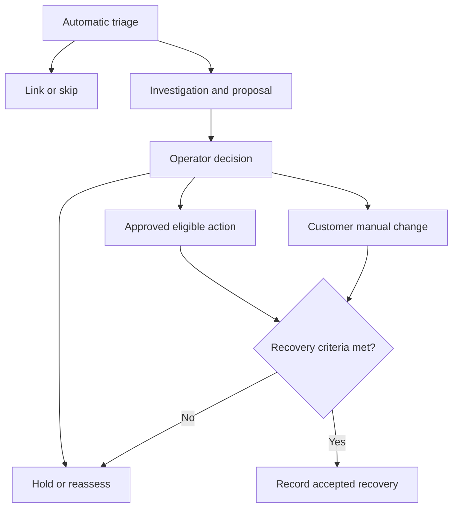

**Diagram meaning:** triage, investigation and approval are documented capabilities. The customer's closure criteria, manual change route and recovery verification are proposed operating practice. The hold branch authorizes no change or closure. Feedback and investigation Review are separate activities and need not wait for incident closure. Sources: [S010](https://docs.aws.amazon.com/devopsagent/latest/userguide/production-operations-autonomous-incident-response.html) [S108](https://docs.aws.amazon.com/devopsagent/latest/userguide/working-with-devops-agent-working-with-directed-actions.html) [S091](https://docs.aws.amazon.com/devopsagent/latest/userguide/working-with-devops-agent-reviewing-investigations.html).

### 4. Case two: recurrence prevention to implementation

**Documented contract.** Prevention evaluates incident history and produces recommendations. The current workflow supports weekly or on-demand evaluation, pausing scheduled evaluation and stopping an active run. Improvements-page actions and API status values must be interpreted within their own interfaces. A recommendation is not a deployed fix. [S084](https://docs.aws.amazon.com/devopsagent/latest/userguide/production-operations-proactive-incident-prevention.html) [S087](https://docs.aws.amazon.com/devopsagent/latest/APIReference/API_Recommendation.html)

**Invented customer flow.** Several checkout incidents reveal the same observability gap: dependency saturation appears only after customer-facing errors begin. The team reviews a recommendation to improve detection. It keeps the candidate, assigns an owner and creates a normal implementation item in ServiceNow or GitHub through its existing integration service.

The work item carries a measurable acceptance condition: the proposed signal must detect a representative saturation scenario in the test environment without generating unacceptable normal-load noise. Engineers change the instrumentation and alert definition, review the pull request, run tests and release through their established process. A kept recommendation does not bypass these steps.

A scheduled audit later compares the recommendation, ticket, merged commit, deployed version and observed signal. A merged commit alone is insufficient: the affected service may still run an older build. Conversely, a temporary reduction in incidents does not demonstrate that the recommended control exists. The reviewer records implementation only when the chosen evidence supports it, then monitors recurrence over a meaningful period.

The customer ledger owns the cross-system relationship and exceptions. A failed evaluation, inaccessible repository or absent deployment record remains unresolved work. Do not wait for a prevention-completed event from the documented DevOps Agent EventBridge integration: those event families exclude prevention and custom invocations. [S069](https://docs.aws.amazon.com/devopsagent/latest/userguide/configuring-integrations-and-knowledge-integrating-devops-agent-into-event-driven-applications-using-amazon-eventbridge-index.html)

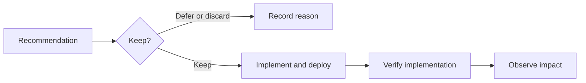

**Diagram meaning:** evaluation and recommendation disposition use documented service concepts. Ticket linkage, delivery, acceptance evidence and recurrence monitoring are the proposed customer process. Sources: [S084](https://docs.aws.amazon.com/devopsagent/latest/userguide/production-operations-proactive-incident-prevention.html) [S087](https://docs.aws.amazon.com/devopsagent/latest/APIReference/API_Recommendation.html).

### 5. Case three: change to a human release gate

**Documented contract.** Release readiness reviews analyze proposed changes and can use optional managed build verification. Release testing operates against a deployed application through UI or API interactions and can modify application data. These are different execution environments and evidence types. Release management remains preview in the reviewed documentation. [S089](https://docs.aws.amazon.com/devopsagent/latest/userguide/release-management-release-readiness-code-review.html) [S090](https://docs.aws.amazon.com/devopsagent/latest/userguide/release-management-release-testing.html) [S013](https://aws.amazon.com/about-aws/whats-new/2026/06/aws-devops-agent-release-management/)

**Invented customer flow.** A GitHub pull request changes checkout retry behavior. The customer workflow pins the commit, relevant repositories and review configuration. It requests a readiness review and collects the report and any managed verification results. A different commit invalidates the earlier decision unless the team explicitly accepts the difference.

The pipeline then deploys that candidate to an appropriate test environment. A configured release-test profile supplies target and authentication details; the pipeline invokes the documented AWS-maintained release-testing action where appropriate. Test users and data are scoped to the environment. The controller records the tested deployment and profile revision alongside the findings and reproduction evidence. [S021](https://github.com/aws-actions/devops-agent-qa)

The release owner assesses readiness findings, verification coverage, application-test results and unresolved exceptions. A review recommendation informs this gate; it is not unconditional deployment authorization. Missing artifacts, incomplete tests and mismatched versions remain explicit conditions. A human release decision is stored before the existing pipeline proceeds to production.

This ordering is a customer policy. Some teams may run application tests earlier or repeat them after a staged deployment. Preserve the identity of the code and environment actually assessed rather than equating any green report with the proposed release.

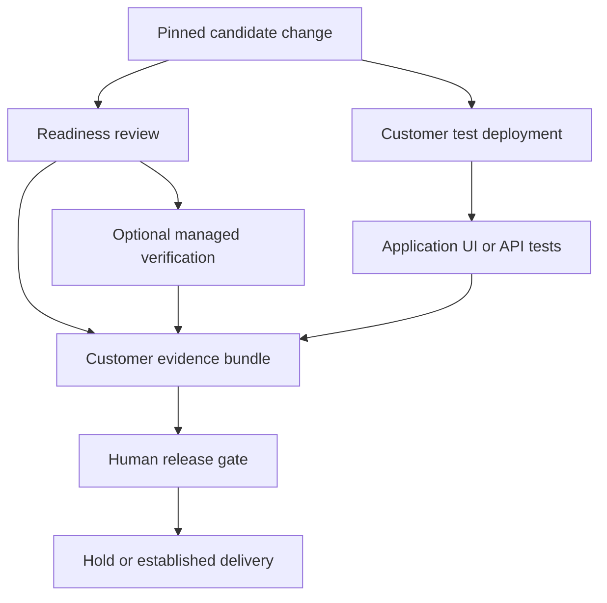

**Diagram meaning:** the two analysis/testing capabilities are documented; their sequencing, evidence bundle and release gate are customer design. The production delivery decision is outside the agent's report. Sources: [S089](https://docs.aws.amazon.com/devopsagent/latest/userguide/release-management-release-readiness-code-review.html) [S090](https://docs.aws.amazon.com/devopsagent/latest/userguide/release-management-release-testing.html) [S021](https://github.com/aws-actions/devops-agent-qa).

### 6. Advanced custom agents within those systems

#### A. Incident context assembler

**Documented building blocks:** assigned tools and memory, an active integration webhook trigger, event filtering, trajectory and artifact output. A predicate or projection must be written against the actual provider payload; a generic severity field cannot be assumed. [S052](https://docs.aws.amazon.com/devopsagent/latest/userguide/custom-agents-creating-a-custom-agent.html) [S063](https://docs.aws.amazon.com/devopsagent/latest/userguide/custom-agents-executing-custom-agents.html)

**Proposed specialization:** a custom agent enriches a checkout incident with the deployed commit, owner, recent approved ServiceNow change and relevant runbook. It reads CloudWatch and Datadog through assigned tools and the internal MCP server through its private connection. It produces a concise artifact containing observations, timestamps, source links and missing evidence, plus a progress notification in the configured Slack channel.

This agent does not replace incident triage or decide incident closure. The responder reviews its artifact and adds relevant context to the formal investigation. The customer ledger associates both executions with the incident. Separating enrichment from the investigation allows the team to improve the enrichment prompt without changing its incident acceptance rules.

#### B. Recurrence implementation auditor

**Documented building blocks:** scheduled custom invocation, selected tools, attached memory stores and persisted outputs. Custom agents can read their attached stores and write to attached custom stores; managed stores remain read-only. [S056](https://docs.aws.amazon.com/devopsagent/latest/userguide/working-with-devops-agent-custom-agents-index.html) [S059](https://docs.aws.amazon.com/devopsagent/latest/userguide/about-aws-devops-agent-devops-agent-memories.html)

**Proposed specialization:** each week the auditor reads accepted improvement candidates, ServiceNow implementation records, GitHub changes and deployment evidence exposed by internal MCP. It classifies each candidate as evidence complete, evidence missing or contradictory. These are customer report categories, not AWS recommendation enums.

Its artifact separates completed engineering work from verified operational impact. It can retain reviewed correlation notes in a dedicated custom memory store. The memory is analytical context; the ticket system and durable ledger remain authoritative for commitments and approvals. The reviewer, or a separately authorized customer integration, updates business records after examining the evidence. No autonomous status mutation is implied.

#### C. Release evidence coordinator

**Documented building blocks:** custom agents can receive Release Manager tools through Chat. AWS documents creating, listing, retrieving and canceling Release Manager tasks and analyzing readiness reports. This is a supported tool capability, not a reason to invent additional managed-agent roster entries. [S052](https://docs.aws.amazon.com/devopsagent/latest/userguide/custom-agents-creating-a-custom-agent.html)

**Proposed specialization:** a coordinator collects the candidate SHA, service dependencies and test-environment identity, requests the appropriate review task using its assigned tools, and summarizes the report for the release owner. The customer pipeline supplies application-test evidence. The customer controller may independently invoke a remote A2A specialist to assess an internal dependency policy and merge its advisory evidence. This proposed external step does not assert native custom-agent A2A tool support.

The customer controller persists the task references and resumes reconciliation if the coordinator times out. It does not ask the agent to hold an entire multi-day release process in context. A changed candidate starts a new assessment generation. Production deployment remains behind the human gate.

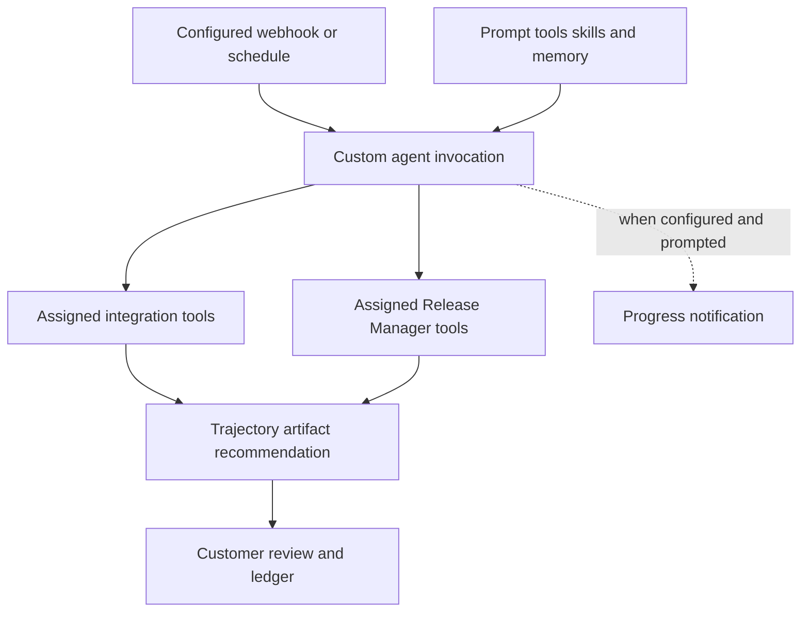

**Diagram meaning:** configuration, triggers, assigned tools and output capabilities are documented. The specializations and downstream ledger are invented customer designs. Tool branches are alternatives selected for each agent, not requirements for every custom agent. Sources: [S052](https://docs.aws.amazon.com/devopsagent/latest/userguide/custom-agents-creating-a-custom-agent.html) [S063](https://docs.aws.amazon.com/devopsagent/latest/userguide/custom-agents-executing-custom-agents.html) [S055](https://docs.aws.amazon.com/devopsagent/latest/userguide/custom-agents-custom-agent-outputs.html).

Artifacts can contain text, charts, tables and topology views. Recommendations and notifications are separate outputs; notifications require a configured destination and appropriate prompt instructions. A message arriving in Slack proves neither successful completion nor an accepted finding. Preserve the trajectory and output references for review. [S055](https://docs.aws.amazon.com/devopsagent/latest/userguide/custom-agents-custom-agent-outputs.html)

#### Output acceptance is a customer contract

For these examples, require every assessment to identify the service, environment, incident window or candidate commit, queried sources, material observations, contrary evidence and unresolved gaps. Keep proposed actions separate from observed changes. Specify who accepts the result and what evidence would cause rejection. These requirements belong to the customer's operating policy; they are not a claim that AWS automatically validates such a schema.

A completed analysis may still be unusable for its intended decision. It might inspect yesterday's deployment, lack access to the decisive log source or produce a recommendation without enough evidence to select a target. The reviewer should preserve that distinction instead of promoting execution success into operational certainty. Qualitative uncertainty should remain explicit; do not invent a numerical confidence score that the interface did not supply.

If the integration service consumes structured content, validate it at the customer boundary. Check required fields, identifier consistency and allowed values before updating a ticket or gate. Narrative instructions inside an artifact are evidence to inspect, not commands for the controller to execute. An output link can enter the record immediately while the associated business decision remains pending.

### 7. A conceptual configuration and trigger contract

The following YAML is an **invented design specification, not deployable AWS API, CloudFormation or custom-agent import schema**. Capability names describe intent, not actual tool identifiers. Translate them into discovered, assigned tools and documented configuration surfaces. GitHub import supplies a Markdown system prompt; it does not deploy this entire specification. [S052](https://docs.aws.amazon.com/devopsagent/latest/userguide/custom-agents-creating-a-custom-agent.html)

```yaml
example_contract_version: 1
illustrative_only: true
deployable_aws_schema: false
agent:
  conceptual_name: checkout-incident-context
  agent_space_reference: payments-production
  goal: Produce a sourced incident context artifact for responders.
  capabilities_to_resolve:
    - read_cloudwatch_and_datadog_evidence
    - read_github_change_and_deployment_context
    - read_servicenow_change_records
    - read_internal_ownership_and_policy_context
  memory_intent:
    read: [reviewed-checkout-context]
    write: []
  outputs:
    artifact: observations_sources_gaps_and_time_window
    notification: material_finding_and_completion_summary
trigger:
  intended_surface: configured_integration_webhook
  source_reference: existing-pagerduty-association
  predicate_intent: checkout production incident creation
  jmespath_expression: null # Author from an observed raw payload.
  projection_intent: incident_identity_service_time_and_reference_links
customer_controller:
  correlation_key: provider_incident_id_and_assessment_generation
  completion_rule: inspect_status_and_required_artifact
  retry_rule: reconcile_existing_work_before_resubmitting
  approval_boundary: no_production_mutation_in_this_agent
```

`memory_intent.write: []` expresses design intention, not an AWS per-store read-only permission. Attaching a custom memory store allows the custom agent to write to it; attached managed stores remain read-only. An omitted webhook filter runs on every event from its source: the null filter above is an unfinished placeholder, not the stated checkout predicate. [S056](https://docs.aws.amazon.com/devopsagent/latest/userguide/working-with-devops-agent-custom-agents-index.html) [S063](https://docs.aws.amazon.com/devopsagent/latest/userguide/custom-agents-executing-custom-agents.html)

The execution guide documents truthy filter results, projections and a 10,000-character context limit. Test representative payloads, including missing fields. Keep identifiers and links in the projected context instead of copying large logs. A source integration or webhook disappearing prevents the trigger from running even if its configuration remains listed. These are runtime dependencies, not properties the YAML can enforce. [S063](https://docs.aws.amazon.com/devopsagent/latest/userguide/custom-agents-executing-custom-agents.html)

### 8. Durable execution and reconciliation

#### Timing and identity

A synchronous response, a streamed conversation and a background investigation are different contracts. A2A chat returns a completed answer or streams it; investigation returns working-task information and supports polling or subscription. Use the explicit interface tenant. An interrupted client connection does not establish that the underlying operation stopped. [S070](https://docs.aws.amazon.com/devopsagent/latest/userguide/connecting-to-devops-agent-remote-servers-integrating-with-the-devops-agent-a2a-server.html)

The proposed ledger stores the following identities independently:

| Identity | Purpose in the customer workflow |
| --- | --- |
| External incident or change ID | Correlates PagerDuty, ServiceNow and repository work. |
| Agent Space and task ID | Identifies the service work item and its scope. |
| Execution ID | Identifies the particular run whose evidence is being inspected. |
| Output, summary or artifact ID | Identifies a result; availability is checked separately. |
| Candidate SHA and assessment generation | Prevents an older result from approving a newer change. |
| Customer operation key and attempt | Separates a logical action from repeated delivery or retries. |

These are proposed storage fields, not one composite AWS request schema. Preserve identifiers returned by each interface rather than guessing a mapping from their spelling.

For EventBridge summary retrieval, read `detail.metadata.agent_space_id` and `detail.metadata.execution_id` from the full event envelope and pass them as `agentSpaceId` and `executionId` to `ListJournalRecords`. Select the investigation or mitigation summary record type, paginate and match the returned record ID to `detail.data.summary_record_id`. Do not substitute `detail.metadata.task_id`. A completed event can omit the summary identifier entirely. [S069](https://docs.aws.amazon.com/devopsagent/latest/userguide/configuring-integrations-and-knowledge-integrating-devops-agent-into-event-driven-applications-using-amazon-eventbridge-index.html) [S075](https://docs.aws.amazon.com/devopsagent/latest/APIReference/API_ListJournalRecords.html)

#### State, retries and duplicate effects

Store the original status alongside its interface. Custom History uses labels including Pending start, Running, Succeeded, Failed, Timed out and Canceled. EventBridge uses its own status vocabulary, while A2A failure can also represent an internal timeout or skip. A customer's state such as `awaiting_human_acceptance` is an additional business state, not an AWS enum. [S079](https://docs.aws.amazon.com/devopsagent/latest/userguide/custom-agents-managing-custom-agents.html) [S017](https://docs.aws.amazon.com/devopsagent/latest/userguide/integrating-devops-agent-into-event-driven-applications-using-amazon-eventbridge-devops-agent-events-detail-reference.html) [S070](https://docs.aws.amazon.com/devopsagent/latest/userguide/connecting-to-devops-agent-remote-servers-integrating-with-the-devops-agent-a2a-server.html)

Design for repeated observations and uncertain outcomes. The proposed controller records an intent before submission, saves returned identifiers and reconciles them after a restart. `CreateBacklogTask` exposes a `clientToken` for idempotency; reuse the appropriate token when retrying that same logical creation. This does not make every tool invocation or external ticket update idempotent. [S051](https://docs.aws.amazon.com/devopsagent/latest/APIReference/API_CreateBacklogTask.html)

For transient read failures, use bounded retry with backoff. For an uncertain write, inspect the target's state and recorded operation identifiers before resubmitting. Deduplicate customer notifications and ticket updates using the ledger and provider-supported controls. If evidence cannot distinguish “not executed” from “executed but response lost,” hold for reconciliation. Never convert that ambiguity into a blind replay of an approved production action.

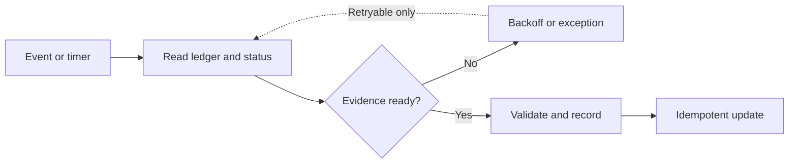

**Diagram meaning:** this entire controller is proposed customer architecture. It reconciles observations with authoritative state; it makes no exactly-once processing claim. EventBridge supplies the documented investigation/mitigation observations, not a universal completion bus for custom agents or prevention. Source boundary: [S069](https://docs.aws.amazon.com/devopsagent/latest/userguide/configuring-integrations-and-knowledge-integrating-devops-agent-into-event-driven-applications-using-amazon-eventbridge-index.html).

For event consumers, preserve outcomes such as `LINKED`, `SKIPPED`, `COMPLETED`, `FAILED`, `TIMED_OUT` and `CANCELLED`; they convey different operational results. Do not normalize them all into a successful HTTP delivery. [S017](https://docs.aws.amazon.com/devopsagent/latest/userguide/integrating-devops-agent-into-event-driven-applications-using-amazon-eventbridge-devops-agent-events-detail-reference.html)

#### A concrete recovery example

In the proposed design, suppose the consumer observes completion twice before the result is available. The first delivery records the observation and schedules reconciliation. The second updates the same logical work item rather than posting another ServiceNow comment. A later read either retrieves the matching result, records the documented absence of a summary or raises an exception at a customer-defined deadline. The deadline is a local operating rule, not an assumed AWS consistency guarantee.

Likewise, a new incident event arriving while a custom agent is occupied should not create an unbounded retry storm. The customer records pending demand, coalesces equivalent requests when appropriate and inspects the existing invocation before submitting more work. Do not assume the service deduplicates every external event or preserves every delivery during saturation. Rehearse that behavior against the actual configured trigger and available capacity.

#### Authorization, cancellation and capacity

Keep client authentication, tool credentials and change approval separate. A2A requires version `1.0`; bearer tokens select their bound space, while SigV4 requests specify the space header. Internal MCP permissions must enforce the actual read scope. A prompt requesting read-only behavior is not a substitute for tool classification or authorization. [S070](https://docs.aws.amazon.com/devopsagent/latest/userguide/connecting-to-devops-agent-remote-servers-integrating-with-the-devops-agent-a2a-server.html) [S038](https://docs.aws.amazon.com/devopsagent/latest/userguide/configuring-integrations-and-knowledge-connecting-mcp-servers.html)

For directed actions, the customer interface must preserve the operation and approval identifiers. Recording the decision with `UpdateApprovalAction` and resuming the paused execution through the documented message context are distinct steps. Approval cannot grant missing IAM permissions or make a different target eligible. [S099](https://docs.aws.amazon.com/boto3/latest/reference/services/devops-agent/client/update_approval_action.html) [S092](https://docs.aws.amazon.com/devopsagent/latest/APIReference/API_SendMessageContext.html) [S108](https://docs.aws.amazon.com/devopsagent/latest/userguide/working-with-devops-agent-working-with-directed-actions.html)

Cancellation also requires reconciliation. Custom invocation cancellation preserves prior trajectory activity, and an in-flight tool call may still finish. Deleting the agent does not terminate an already running invocation. Record cancellation intent, observe the eventual outcome and inspect any relevant target state. [S063](https://docs.aws.amazon.com/devopsagent/latest/userguide/custom-agents-executing-custom-agents.html) [S079](https://docs.aws.amazon.com/devopsagent/latest/userguide/custom-agents-managing-custom-agents.html)

Remote A2A has a separate transport constraint: AWS documents a one-minute idle timeout, requiring periodic data during long operations. A live connection is not evidence of task progress, and a dropped connection is not proof of cancellation. [S043](https://docs.aws.amazon.com/devopsagent/latest/userguide/configuring-integrations-and-knowledge-connecting-remote-a2a-agents.html)

At the reviewed defaults, a space permits five concurrent custom invocations, with one per individual custom agent and a one-hour invocation limit. Investigation concurrency defaults to three; prevention to one; readiness reviews and release tests to four each. Queue or coalesce customer work accordingly, and verify current quotas before sizing. Automatic continuation should not be interpreted as permission to exceed the invocation limit. [S086](https://docs.aws.amazon.com/devopsagent/latest/userguide/quotas.html)

### 9. Keep the vault aligned with the system

Use this note as a conceptual hub. Link each implemented agent note to its prompt revision, assigned capabilities, trigger owner, example payloads, expected outputs and acceptance evidence. Link each operational case to its customer workflow record and interface contract. Keep credentials outside the vault.

The useful maintenance question is specific: which documented interface or customer decision changed, which examples now need revision, and which acceptance checks must be repeated? Preserve that answer next to the diagram instead of allowing a polished workflow drawing to become an unsupported promise.

## Part 5 — Implementation reference and evidence audit

The reference notes below preserve the detailed documented concepts and workflow contracts. Start with the core narrative above; use these notes to answer configuration, interface and operating questions.

| Reference note | Topic chapters |
| --- | --- |
| [[Reference_Agent_Spaces_and_Access]] | Service scope and operating model; Agent Space boundaries and account access; Creating and validating an Agent Space; IAM roles and effective permissions; Operator identity and access lifecycle; Topology discovery and investigation context; Provider registration and scoped associations; Kubernetes and Azure resource access; Migration maintenance and retirement |
| [[Reference_Network_Security_and_Regions]] | Capability status and service boundaries; Private tool connectivity; Private service ingress and connection validation; Regional availability and processing geography; Encryption audit and evidence quality |
| [[Reference_Incident_Response_and_Actions]] | Incident intake and automatic triage; Evidence findings and operator visibility; Feedback review forks and human support; From mitigation proposal to approved change; Action eligibility and approval API |
| [[Reference_Integrations_and_Events]] | Telemetry and operational evidence sources; Tickets collaboration and repository context; Webhook delivery and payload validation; Client access and outbound tool calls; Protocol contracts and authentication boundaries; Lifecycle events and status vocabulary; Retrieving the summary behind a completion event |
| [[Reference_Knowledge_and_Custom_Agents]] | Managed agents and standing instructions; Skills and the knowledge model; Memory stores and continuous learning; Create and scope a custom agent; Invoke custom agents and configure triggers; Custom agent outputs and lifecycle |
| [[Reference_Prevention_and_Operations]] | Evaluate incidents and prevent recurrence; Rank recommendations and prepare implementation; Sandbox computation during investigations; Manage assets and deploy configuration as code; Price usage and observe the service; Platform quotas and operating capacity; Custom agent quotas and adoption practice |
| [[Reference_Release_Management]] | Release readiness workflow; Release reports and trigger controls; Release testing workflow; Test profiles authentication and delivery integration; Execution environments and mutation boundaries |
| [[Reference_Evidence_Gaps_and_Demo]] | Source conflicts and current interpretation; Feature and interface differences to preserve; Demonstration and adoption rehearsal |
| [[Glossary]] | Concept glossary for presenters |

### Sources and verification boundary

Every source ID is a direct primary-source link. The full register is in [[Source_Index]]. Diagram semantics, rendering checks and known limits are recorded in [[Validation_and_Use]]. The fictional examples are design patterns; their YAML is not a deployable AWS schema.
