<!-- block: obsidian-devops-aws-devops-agent-presentation-body -->
## 01 · AWS DevOps Agent: from foundations to operations

**A framework for understanding, operating and extending agents**

Agent primer → mechanisms → DevOps roles → platform capabilities → orchestration → operational cases → custom extensions

Documentation reviewed **31 October 2026**.

---

## 02 · The questions this presentation answers

1. What makes a system an agent?
2. Which mechanisms let it observe, decide and act?
3. Which DevOps jobs do different agents perform?
4. What does the AWS platform provide?
5. Who orchestrates a complete operational process?
6. How do custom agents fit an existing system?

---

## 03 · An agent combines a model with an execution system

An **agent** selects a next step, uses available capabilities, observes the result and continues toward a goal.

- The **model** proposes a response or tool call.
- The **runtime** supplies context and executes allowed calls.
- The **environment** supplies observations.
- **Limits and controls** bound the work.

Sources: [F01](https://www.anthropic.com/research/building-effective-agents) [F07](https://strandsagents.com/docs/user-guide/sdk/agents/agent-loop/)

---

## 04 · The observation loop makes actions testable

Each new observation can confirm, refine or reject a hypothesis.

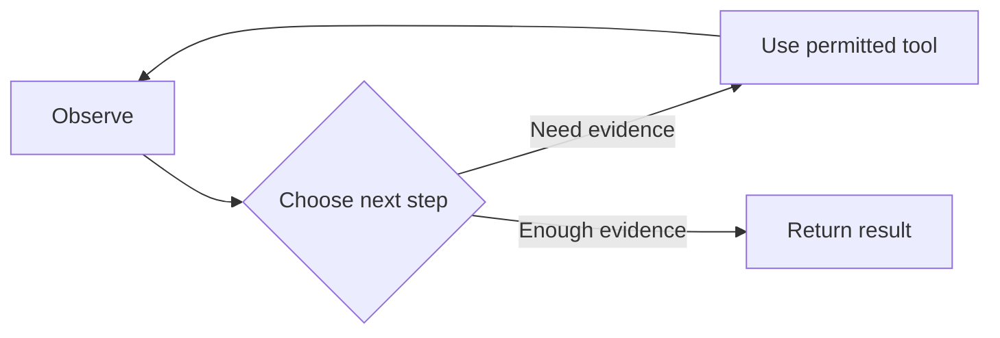

Sources: [F07](https://strandsagents.com/docs/user-guide/sdk/agents/agent-loop/)

---

## 05 · Model, workflow, agent and service are different layers

| Layer | Responsibility |
| --- | --- |
| Model | Generate an answer or proposed action |
| Workflow | Define how work proceeds and branches |
| Agent | Choose steps using evidence and available tools |
| Runtime | Execute calls, maintain state and enforce limits |
| Service / platform | Expose workflows, configuration and access |

Sources: [F01](https://www.anthropic.com/research/building-effective-agents) [F10](https://strandsagents.com/docs/user-guide/sdk/agents/) [S001](https://docs.aws.amazon.com/devopsagent/latest/userguide/about-aws-devops-agent.html)

---

## 06 · Autonomy and authority are separate

| Question | Example boundary |
| --- | --- |
| What may the agent decide? | Which evidence to query next |
| What may it access? | Selected accounts and integrations |
| What may it change? | Supported, permitted operations |
| What needs a human decision? | A scoped production action |
| What stops the attempt? | Evidence, limit, error or escalation |

Sources: [S108](https://docs.aws.amazon.com/devopsagent/latest/userguide/working-with-devops-agent-working-with-directed-actions.html) [F07](https://strandsagents.com/docs/user-guide/sdk/agents/agent-loop/)

---

## 07 · Seven families of agent mechanisms

| Family | Main question |
| --- | --- |
| Reasoning, planning, state | What should happen next? |
| Tools, integrations, protocols | What can execute or connect? |
| Context, knowledge, memory | What informs this decision? |
| Identity, authorization, guardrails | What is allowed? |
| Orchestration and collaboration | Who coordinates the work? |
| Triggers, outputs, effects | What starts and finishes it? |
| Evaluation and improvement | Did it work, and what changes? |

---

## 08 · A tool is an operation; an integration makes it usable

| Mechanism | Concrete meaning |
| --- | --- |
| Tool | Named operation with inputs, result and side effects |
| Integration | Endpoint, credentials, network path and scope |
| Protocol | Rules for exchanging requests and results |
| API / adapter | Implementation that reaches the target system |

The tool contract must explain errors and the evidence it returns.

Sources: [F03](https://modelcontextprotocol.io/docs/2026-07-28/learn/architecture) [F05](https://www.anthropic.com/research/writing-tools-for-agents) [S038](https://docs.aws.amazon.com/devopsagent/latest/userguide/configuring-integrations-and-knowledge-connecting-mcp-servers.html)

---

## 09 · Protocol exchange sits inside a larger tool contract

The returned observation becomes input to the next agent decision.

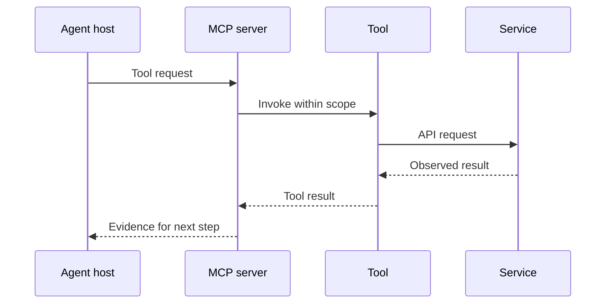

Sources: [F03](https://modelcontextprotocol.io/docs/2026-07-28/learn/architecture) [F05](https://www.anthropic.com/research/writing-tools-for-agents)

---

## 10 · Context, skill, memory and state serve different purposes

| Mechanism | Example |
| --- | --- |
| Instructions | Require evidence links in every finding |
| Skill | Procedure for diagnosing queue saturation |
| Knowledge | Architecture and ownership information |
| Memory | Reviewed lessons from past incidents |
| Current context | Selected material for this decision |
| Run state | Completed calls, pending approval, errors |

Sources: [F04](https://www.anthropic.com/research/effective-context-engineering-for-ai-agents) [F10](https://strandsagents.com/docs/user-guide/sdk/agents/) [S004](https://docs.aws.amazon.com/devopsagent/latest/userguide/about-aws-devops-agent-agent-instructions.html) [S059](https://docs.aws.amazon.com/devopsagent/latest/userguide/about-aws-devops-agent-devops-agent-memories.html) [S060](https://docs.aws.amazon.com/devopsagent/latest/userguide/about-aws-devops-agent-devops-agent-skills.html)

---

## 11 · Relevant context is assembled for each decision

Current observations test whether stored knowledge still applies.

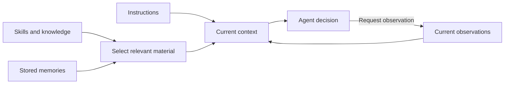

Sources: [F04](https://www.anthropic.com/research/effective-context-engineering-for-ai-agents) [S059](https://docs.aws.amazon.com/devopsagent/latest/userguide/about-aws-devops-agent-devops-agent-memories.html)

---

## 12 · Controls, lifecycle and evaluation complete the system

| Mechanism | Required distinction |
| --- | --- |
| Identity and authorization | Who calls; what that identity may do |
| Guardrails and approval | Allowed operation; accepted scoped proposal |
| Trigger and state | Work requested; actual execution status |
| Output and effect | Proposed fix; change actually applied |
| Evaluation and learning | Evidence judged; future configuration improved |

Sources: [F06](https://www.anthropic.com/research/demystifying-evals-for-ai-agents) [S058](https://docs.aws.amazon.com/devopsagent/latest/userguide/aws-devops-agent-security-devops-agent-iam-permissions.html) [S055](https://docs.aws.amazon.com/devopsagent/latest/userguide/custom-agents-custom-agent-outputs.html) [S108](https://docs.aws.amazon.com/devopsagent/latest/userguide/working-with-devops-agent-working-with-directed-actions.html)

---

## 13 · Orchestration patterns are choices, not maturity levels

| Pattern | Suitable responsibility |
| --- | --- |
| Sequence | Required steps with known dependencies |
| Routing | Select the relevant specialist |
| Parallel work | Collect independent evidence |
| Coordinator and workers | Decompose an uncertain investigation |
| Evaluate and revise | Improve a result against explicit criteria |
| Human gate | Accept a consequential operational decision |

Sources: [F08](https://strandsagents.com/docs/user-guide/sdk/multi-agent/multi-agent-patterns/) [F09](https://www.anthropic.com/research/multi-agent-research-system)

---

## 14 · DevOps agent types begin as responsibilities

| Functional role | Operational contribution |
| --- | --- |
| Assistant / investigator | Explain state and determine causes |
| Triage / coordinator | Scope, route and correlate work |
| Mitigation planner | Propose an operational response |
| Reviewer / tester | Assess evidence, code or behavior |
| Improvement analyst | Reduce recurring operational problems |
| Knowledge maintainer | Preserve useful environmental context |
| Custom specialist | Perform a defined team-specific task |

---

## 15 · AWS DevOps Agent supplies workflows within an Agent Space

An **Agent Space** defines the configured operational context.

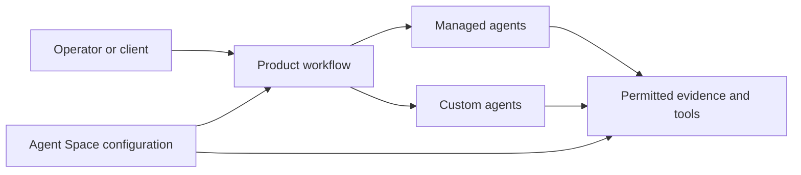

Sources: [S104](https://docs.aws.amazon.com/devopsagent/latest/userguide/about-aws-devops-agent-what-are-devops-agent-spaces.html) [S105](https://docs.aws.amazon.com/devopsagent/latest/userguide/about-aws-devops-agent-what-is-a-devops-agent-topology.html) [S077](https://docs.aws.amazon.com/devopsagent/latest/userguide/working-with-devops-agent-managed-agents.html) [S056](https://docs.aws.amazon.com/devopsagent/latest/userguide/working-with-devops-agent-custom-agents-index.html)

---

## 16 · Named managed agents: conversation and incident work

| AWS name | Public responsibility |
| --- | --- |
| Chat | Operational questions and requests |
| Incident triage | Filter, classify and scope incidents |
| Incident RCA | Collect evidence and assess causes |
| Incident mitigation | Propose response and durable fixes |
| Incident UI | Generate investigation outputs |

AWS says the roster **can include** these entries.

Sources: [S077](https://docs.aws.amazon.com/devopsagent/latest/userguide/working-with-devops-agent-managed-agents.html) [S010](https://docs.aws.amazon.com/devopsagent/latest/userguide/production-operations-autonomous-incident-response.html) [S083](https://docs.aws.amazon.com/devopsagent/latest/userguide/working-with-devops-agent-on-demand-devops-tasks.html)

---

## 17 · Named managed agents: assurance, tests and knowledge

| AWS name | Public responsibility |
| --- | --- |
| Evaluation | Performance scoring and policy checks |
| Grader | Review a completed investigation |
| Release testing | Exercise deployed UI and APIs |
| Learning | Refresh managed environmental knowledge |

Prevention evaluation and release-readiness review are **capabilities**; their names do not establish additional roster entries.

Evaluation terminology differs across current guides.

Sources: [S077](https://docs.aws.amazon.com/devopsagent/latest/userguide/working-with-devops-agent-managed-agents.html) [S060](https://docs.aws.amazon.com/devopsagent/latest/userguide/about-aws-devops-agent-devops-agent-skills.html) [S091](https://docs.aws.amazon.com/devopsagent/latest/userguide/working-with-devops-agent-reviewing-investigations.html) [S084](https://docs.aws.amazon.com/devopsagent/latest/userguide/production-operations-proactive-incident-prevention.html) [S089](https://docs.aws.amazon.com/devopsagent/latest/userguide/release-management-release-readiness-code-review.html) [S090](https://docs.aws.amazon.com/devopsagent/latest/userguide/release-management-release-testing.html)

---

## 18 · Managed and custom agents expose different control surfaces

| Decision | Managed | Custom |
| --- | --- | --- |
| Definition and lifecycle | AWS-owned | Team-created |
| System prompt | Platform-owned | Team-configured |
| Tools | AWS-managed within integrations | Explicitly selected |
| Skills | Managed and user-added, role-targeted | Explicitly assigned |
| Guidance | Global / agent instructions | Prompt and assigned knowledge |
| Invocation | Product workflows | Manual, schedule or event |

Sources: [S077](https://docs.aws.amazon.com/devopsagent/latest/userguide/working-with-devops-agent-managed-agents.html) [S004](https://docs.aws.amazon.com/devopsagent/latest/userguide/about-aws-devops-agent-agent-instructions.html) [S052](https://docs.aws.amazon.com/devopsagent/latest/userguide/custom-agents-creating-a-custom-agent.html) [S063](https://docs.aws.amazon.com/devopsagent/latest/userguide/custom-agents-executing-custom-agents.html) [S059](https://docs.aws.amazon.com/devopsagent/latest/userguide/about-aws-devops-agent-devops-agent-memories.html) [S060](https://docs.aws.amazon.com/devopsagent/latest/userguide/about-aws-devops-agent-devops-agent-skills.html)

---

## 19 · Platform capabilities provide context and execution

| Capability | What it provides | Primary consumer |
| --- | --- | --- |
| Agent Space / topology | Scope and relationships | Investigation, Chat |
| Integrations / IAM | Evidence and permitted calls | Tool-using workflows |
| Instructions / skills / memories | Guidance and relevant knowledge | Managed and custom work |
| Invocation / execution records | Start, observe and inspect runs | Operators and automation |

Sources: [S104](https://docs.aws.amazon.com/devopsagent/latest/userguide/about-aws-devops-agent-what-are-devops-agent-spaces.html) [S105](https://docs.aws.amazon.com/devopsagent/latest/userguide/about-aws-devops-agent-what-is-a-devops-agent-topology.html) [S058](https://docs.aws.amazon.com/devopsagent/latest/userguide/aws-devops-agent-security-devops-agent-iam-permissions.html) [S004](https://docs.aws.amazon.com/devopsagent/latest/userguide/about-aws-devops-agent-agent-instructions.html) [S059](https://docs.aws.amazon.com/devopsagent/latest/userguide/about-aws-devops-agent-devops-agent-memories.html) [S063](https://docs.aws.amazon.com/devopsagent/latest/userguide/custom-agents-executing-custom-agents.html)

---

## 20 · Platform capabilities also support acceptance and operation

| Capability | Function |
| --- | --- |
| Artifacts and recommendations | Preserve findings and proposed work |
| Review and prevention | Assess investigations and recurring problems |
| Directed actions | Apply eligible operator-approved changes |
| Release review and tests | Assess a candidate and deployed behavior |
| Metrics, quotas and audit | Observe usage, capacity and activity |

Sources: [S055](https://docs.aws.amazon.com/devopsagent/latest/userguide/custom-agents-custom-agent-outputs.html) [S091](https://docs.aws.amazon.com/devopsagent/latest/userguide/working-with-devops-agent-reviewing-investigations.html) [S084](https://docs.aws.amazon.com/devopsagent/latest/userguide/production-operations-proactive-incident-prevention.html) [S108](https://docs.aws.amazon.com/devopsagent/latest/userguide/working-with-devops-agent-working-with-directed-actions.html) [S089](https://docs.aws.amazon.com/devopsagent/latest/userguide/release-management-release-readiness-code-review.html) [S090](https://docs.aws.amazon.com/devopsagent/latest/userguide/release-management-release-testing.html) [S102](https://docs.aws.amazon.com/devopsagent/latest/userguide/configuring-integrations-and-knowledge-vended-logs-and-metrics.html) [S086](https://docs.aws.amazon.com/devopsagent/latest/userguide/quotas.html) [S093](https://docs.aws.amazon.com/devopsagent/latest/userguide/configuring-integrations-and-knowledge-sandbox.html)

---

## 21 · Permissions remain separate from agent roles

IAM roles authorize calls. Agent roles describe jobs.

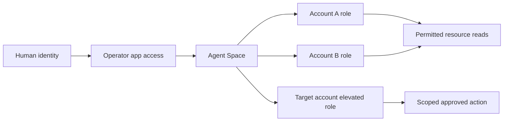

Sources: [S058](https://docs.aws.amazon.com/devopsagent/latest/userguide/aws-devops-agent-security-devops-agent-iam-permissions.html) [S074](https://docs.aws.amazon.com/devopsagent/latest/userguide/aws-devops-agent-security-limiting-agent-access-in-an-aws-account.html) [S108](https://docs.aws.amazon.com/devopsagent/latest/userguide/working-with-devops-agent-working-with-directed-actions.html)

---

## 22 · Incident workflow: triage controls intake

Link, skip and proceed produce different operational outcomes.

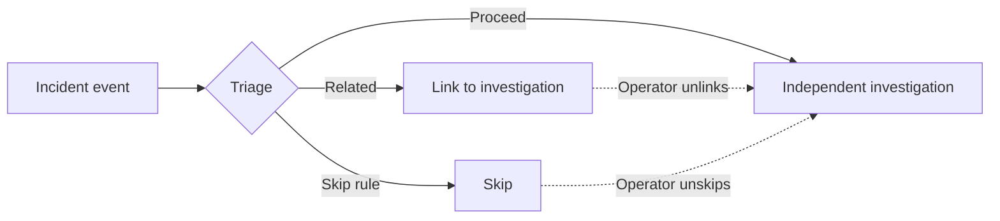

Sources: [S010](https://docs.aws.amazon.com/devopsagent/latest/userguide/production-operations-autonomous-incident-response.html)

---

## 23 · Incident workflow: evidence drives the cause assessment

A hypothesis becomes useful when observations support it and gaps are visible.

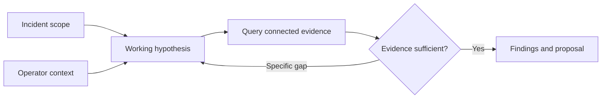

Sources: [S010](https://docs.aws.amazon.com/devopsagent/latest/userguide/production-operations-autonomous-incident-response.html)

---

## 24 · A mitigation proposal is followed by explicit action controls

The autonomous investigation path does not execute an approved chat action.

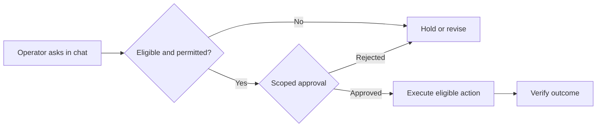

Sources: [S108](https://docs.aws.amazon.com/devopsagent/latest/userguide/working-with-devops-agent-working-with-directed-actions.html) [S099](https://docs.aws.amazon.com/boto3/latest/reference/services/devops-agent/client/update_approval_action.html) [S092](https://docs.aws.amazon.com/devopsagent/latest/APIReference/API_SendMessageContext.html)

---

## 25 · Review, prevention and Learning answer different questions

Was the investigation useful? What should improve? What should future work know?

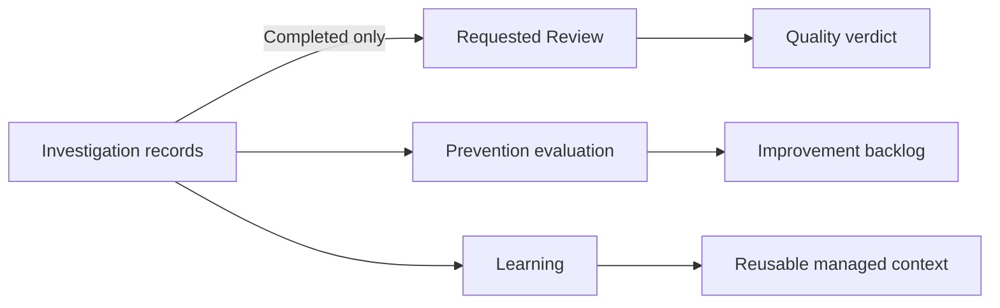

Sources: [S091](https://docs.aws.amazon.com/devopsagent/latest/userguide/working-with-devops-agent-reviewing-investigations.html) [S084](https://docs.aws.amazon.com/devopsagent/latest/userguide/production-operations-proactive-incident-prevention.html) [S059](https://docs.aws.amazon.com/devopsagent/latest/userguide/about-aws-devops-agent-devops-agent-memories.html) [S077](https://docs.aws.amazon.com/devopsagent/latest/userguide/working-with-devops-agent-managed-agents.html)

---

## 26 · Release readiness and release testing produce different evidence

Readiness examines a change; testing exercises a running application.

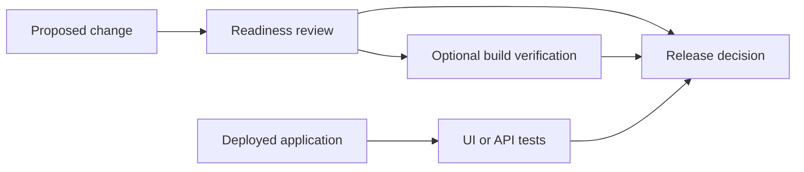

Sources: [S089](https://docs.aws.amazon.com/devopsagent/latest/userguide/release-management-release-readiness-code-review.html) [S090](https://docs.aws.amazon.com/devopsagent/latest/userguide/release-management-release-testing.html) [S097](https://docs.aws.amazon.com/devopsagent/latest/userguide/about-aws-devops-agent-supported-regions.html)

---

## 27 · Integration direction determines the contract

Client access to the agent differs from tools and agents the service calls.

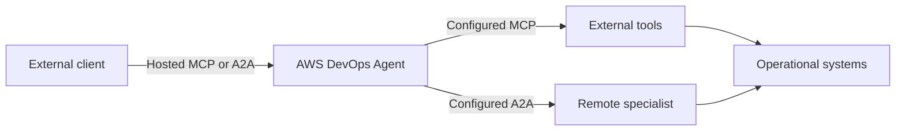

Sources: [S070](https://docs.aws.amazon.com/devopsagent/latest/userguide/connecting-to-devops-agent-remote-servers-integrating-with-the-devops-agent-a2a-server.html) [S038](https://docs.aws.amazon.com/devopsagent/latest/userguide/configuring-integrations-and-knowledge-connecting-mcp-servers.html) [S043](https://docs.aws.amazon.com/devopsagent/latest/userguide/configuring-integrations-and-knowledge-connecting-remote-a2a-agents.html) [S049](https://docs.aws.amazon.com/devopsagent/latest/userguide/connecting-to-devops-agent-remote-servers-connecting-to-the-devops-agent-mcp-server.html) [S011](https://github.com/aws-samples/sample-aws-devops-agent-acp-mcp)

---

## 28 · Private connectivity has two separate paths

Check the connection in the direction the request actually travels.

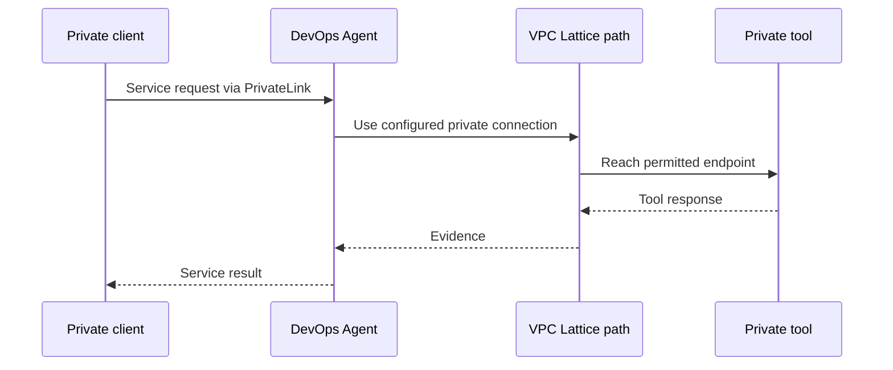

Sources: [S103](https://docs.aws.amazon.com/devopsagent/latest/userguide/aws-devops-agent-security-vpc-endpoints-aws-privatelink.html) [S048](https://docs.aws.amazon.com/devopsagent/latest/userguide/configuring-integrations-and-knowledge-connecting-to-privately-hosted-tools.html)

---

## 29 · Three owners coordinate a complete process

| Layer | Owns |
| --- | --- |
| AWS service execution | Managed workflows and run behavior |
| Customer orchestration | Durable state, gates and cross-system updates |
| Remote specialist | Its delegated task and evidence contract |

Automatic custom-agent continuation does not create a customer-owned durable workflow.

Sources: [S056](https://docs.aws.amazon.com/devopsagent/latest/userguide/working-with-devops-agent-custom-agents-index.html) [S043](https://docs.aws.amazon.com/devopsagent/latest/userguide/configuring-integrations-and-knowledge-connecting-remote-a2a-agents.html) [S070](https://docs.aws.amazon.com/devopsagent/latest/userguide/connecting-to-devops-agent-remote-servers-integrating-with-the-devops-agent-a2a-server.html)

---

## 30 · The customer process observes and reconciles results

Persist identifiers, inspect outputs and record accepted state transitions.

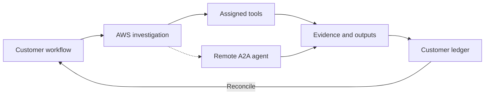

Sources: [S056](https://docs.aws.amazon.com/devopsagent/latest/userguide/working-with-devops-agent-custom-agents-index.html) [S069](https://docs.aws.amazon.com/devopsagent/latest/userguide/configuring-integrations-and-knowledge-integrating-devops-agent-into-event-driven-applications-using-amazon-eventbridge-index.html) [S051](https://docs.aws.amazon.com/devopsagent/latest/APIReference/API_CreateBacklogTask.html)

---

## 31 · Example environment: extend what already exists

**Illustrative payments platform:** EKS, CloudWatch, Datadog, PagerDuty, ServiceNow, GitHub, private Slack and internal MCP.

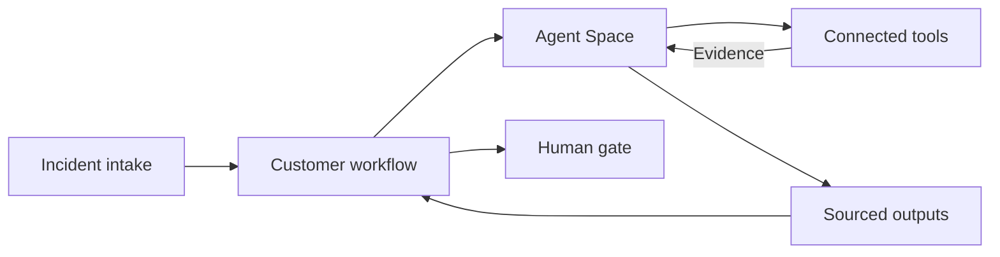

Sources: [S029](https://docs.aws.amazon.com/devopsagent/latest/userguide/configuring-integrations-and-knowledge.html) [S024](https://docs.aws.amazon.com/devopsagent/latest/userguide/configuring-integrations-and-knowledge-aws-eks-access-setup.html) [S038](https://docs.aws.amazon.com/devopsagent/latest/userguide/configuring-integrations-and-knowledge-connecting-mcp-servers.html) [S045](https://docs.aws.amazon.com/devopsagent/latest/userguide/connecting-to-ticketing-and-chat-connecting-slack.html)

---

## 32 · Case 1: incident to verified recovery

Acceptance: error rate, latency and transaction success recover over a defined window.

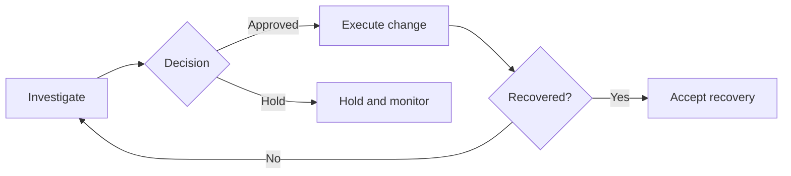

Sources: [S010](https://docs.aws.amazon.com/devopsagent/latest/userguide/production-operations-autonomous-incident-response.html) [S108](https://docs.aws.amazon.com/devopsagent/latest/userguide/working-with-devops-agent-working-with-directed-actions.html) [S091](https://docs.aws.amazon.com/devopsagent/latest/userguide/working-with-devops-agent-reviewing-investigations.html)

---

## 33 · Case 2: recurring incidents to an implemented improvement

Acceptance: the control is deployed and passes its operational test.

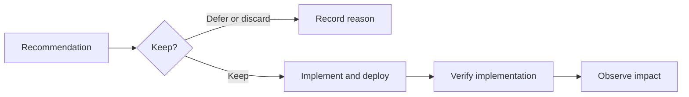

Sources: [S084](https://docs.aws.amazon.com/devopsagent/latest/userguide/production-operations-proactive-incident-prevention.html) [S087](https://docs.aws.amazon.com/devopsagent/latest/APIReference/API_Recommendation.html) [S069](https://docs.aws.amazon.com/devopsagent/latest/userguide/configuring-integrations-and-knowledge-integrating-devops-agent-into-event-driven-applications-using-amazon-eventbridge-index.html)

---

## 34 · Case 3: candidate change to a human release gate

Acceptance: evidence matches the candidate commit and tested deployment.

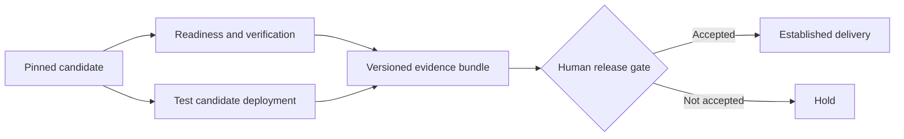

Sources: [S089](https://docs.aws.amazon.com/devopsagent/latest/userguide/release-management-release-readiness-code-review.html) [S090](https://docs.aws.amazon.com/devopsagent/latest/userguide/release-management-release-testing.html) [S021](https://github.com/aws-actions/devops-agent-qa)

---

## 35 · Custom agents package a task within selected scope

Start with one measurable output and an owner who accepts it.

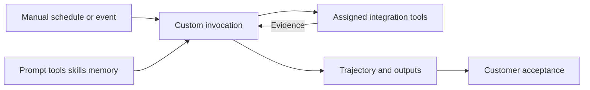

Sources: [S052](https://docs.aws.amazon.com/devopsagent/latest/userguide/custom-agents-creating-a-custom-agent.html) [S059](https://docs.aws.amazon.com/devopsagent/latest/userguide/about-aws-devops-agent-devops-agent-memories.html) [S063](https://docs.aws.amazon.com/devopsagent/latest/userguide/custom-agents-executing-custom-agents.html) [S055](https://docs.aws.amazon.com/devopsagent/latest/userguide/custom-agents-custom-agent-outputs.html)

---

## 36 · Triggers and outputs need explicit contracts

| Surface | Contract to define |
| --- | --- |
| Manual run | Task scope and requested evidence |
| Schedule | Frequency, concurrency and stale inputs |
| Integration webhook | Actual payload, filter and projection |
| Artifact / recommendation | Required fields and acceptance criteria |
| Notification | Destination, timing and meaning |

Sources: [S063](https://docs.aws.amazon.com/devopsagent/latest/userguide/custom-agents-executing-custom-agents.html) [S055](https://docs.aws.amazon.com/devopsagent/latest/userguide/custom-agents-custom-agent-outputs.html) [S026](https://docs.aws.amazon.com/AWSCloudFormation/latest/TemplateReference/aws-resource-devopsagent-trigger.html)

---

## 37 · Extension A: incident context assembler

| Contract | Example |
| --- | --- |
| Trigger | Configured checkout incident event |
| Inputs | Incident ID, timeframe, service |
| Tools | Telemetry, GitHub, ServiceNow, internal MCP |
| Output | Sourced context artifact and evidence gaps |
| Acceptance | Responder checks freshness and relevance |

The formal investigation and incident closure keep their existing owners.

Sources: [S052](https://docs.aws.amazon.com/devopsagent/latest/userguide/custom-agents-creating-a-custom-agent.html) [S063](https://docs.aws.amazon.com/devopsagent/latest/userguide/custom-agents-executing-custom-agents.html) [S055](https://docs.aws.amazon.com/devopsagent/latest/userguide/custom-agents-custom-agent-outputs.html)

---

## 38 · Extension B: recurrence implementation auditor

| Contract | Example |
| --- | --- |
| Trigger | Weekly custom schedule |
| Inputs | Accepted improvements and work records |
| Evidence | Ticket, commit, deployment, signal test |
| Output | Complete, missing or contradictory evidence |
| Acceptance | Owner confirms the improvement status |

A dedicated custom memory store can retain reviewed correlation notes.

Sources: [S056](https://docs.aws.amazon.com/devopsagent/latest/userguide/working-with-devops-agent-custom-agents-index.html) [S059](https://docs.aws.amazon.com/devopsagent/latest/userguide/about-aws-devops-agent-devops-agent-memories.html) [S063](https://docs.aws.amazon.com/devopsagent/latest/userguide/custom-agents-executing-custom-agents.html) [S055](https://docs.aws.amazon.com/devopsagent/latest/userguide/custom-agents-custom-agent-outputs.html)

---

## 39 · Extension C: release evidence coordinator

| Contract | Example |
| --- | --- |
| Inputs | Candidate SHA, dependencies, test deployment |
| Tools | Assigned Release Manager tools and context |
| Optional external input | Controller-obtained specialist evidence |
| Output | Versioned release evidence summary |
| Acceptance | Release owner decides; pipeline records it |

Persist task references outside the agent run.

Sources: [S052](https://docs.aws.amazon.com/devopsagent/latest/userguide/custom-agents-creating-a-custom-agent.html) [S043](https://docs.aws.amazon.com/devopsagent/latest/userguide/configuring-integrations-and-knowledge-connecting-remote-a2a-agents.html)

---

## 40 · A durable controller handles incomplete evidence

Investigation and mitigation events are observations; they are not the summary itself.

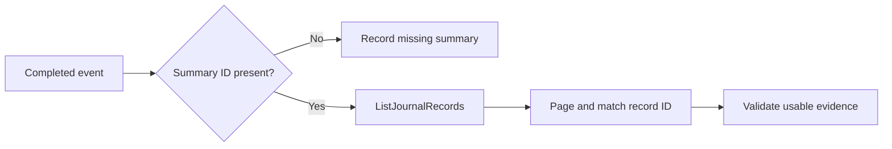

Sources: [S069](https://docs.aws.amazon.com/devopsagent/latest/userguide/configuring-integrations-and-knowledge-integrating-devops-agent-into-event-driven-applications-using-amazon-eventbridge-index.html) [S075](https://docs.aws.amazon.com/devopsagent/latest/APIReference/API_ListJournalRecords.html)

---

## 41 · Retries, cancellation and approval need separate handling

| Situation | Customer controller response |
| --- | --- |
| Repeated event | Match the logical operation before starting work |
| Read timeout | Bounded retry and backoff |
| Uncertain write | Reconcile target state before replay |
| Cancellation | Observe final status and in-flight effects |
| Approved action | Preserve operation, scope and approval identity |

Sources: [S051](https://docs.aws.amazon.com/devopsagent/latest/APIReference/API_CreateBacklogTask.html) [S063](https://docs.aws.amazon.com/devopsagent/latest/userguide/custom-agents-executing-custom-agents.html) [S079](https://docs.aws.amazon.com/devopsagent/latest/userguide/custom-agents-managing-custom-agents.html) [S099](https://docs.aws.amazon.com/boto3/latest/reference/services/devops-agent/client/update_approval_action.html) [S092](https://docs.aws.amazon.com/devopsagent/latest/APIReference/API_SendMessageContext.html)

---

## 42 · Operate within current feature and capacity boundaries

| Item | Source-cutoff position |
| --- | --- |
| Production operations | Generally available; 15 Agent Space Regions |
| Release management | Preview; us-east-1 |
| Investigation Sandbox | Preview; 4 Regions; separate runtime |
| Custom concurrent runs | 1 per agent; 5 per space by default |
| Custom run duration | 1 hour maximum |

Use the reference notes for IAM, regions, quotas, pricing and retirement.

Sources: [S019](https://aws.amazon.com/about-aws/whats-new/2026/03/aws-devops-agent-generally-available/) [S097](https://docs.aws.amazon.com/devopsagent/latest/userguide/about-aws-devops-agent-supported-regions.html) [S086](https://docs.aws.amazon.com/devopsagent/latest/userguide/quotas.html) [S093](https://docs.aws.amazon.com/devopsagent/latest/userguide/configuring-integrations-and-knowledge-sandbox.html) [S020](https://aws.amazon.com/devops-agent/pricing/)

---

## 43 · Validate the whole operational contract

1. Confirm trigger, identity, tool and network scope.
2. Run representative success, missing-data and failure cases.
3. Inspect trajectory, evidence links and actual outcomes.
4. Exercise duplicate delivery, timeout, cancellation and rejection.
5. Prove the human or workflow acceptance gate.
6. Version prompts, skills, configuration and acceptance criteria.

Sources: [F06](https://www.anthropic.com/research/demystifying-evals-for-ai-agents)

---

## 44 · Use one contract from primer to advanced system

**Goal → trigger → evidence → permitted tools → decision → output → acceptance**

- Agent mechanisms explain how the task runs.
- Roles explain which job the task serves.
- Platform capabilities provide context and controls.
- Orchestration connects the task to an operational outcome.

Detailed chapters, implementation reference and source audit accompany these slides.
