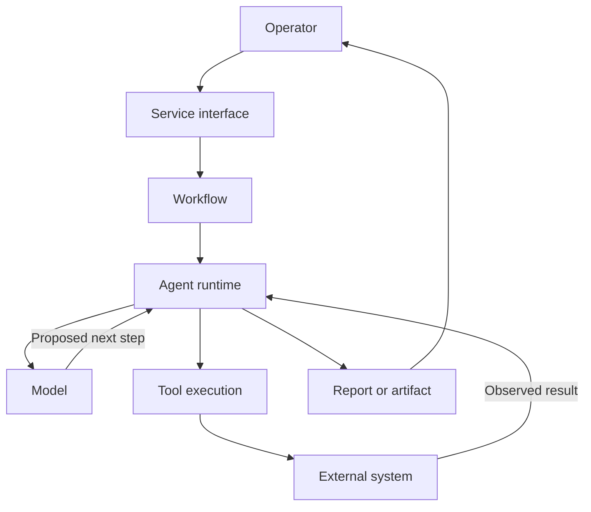
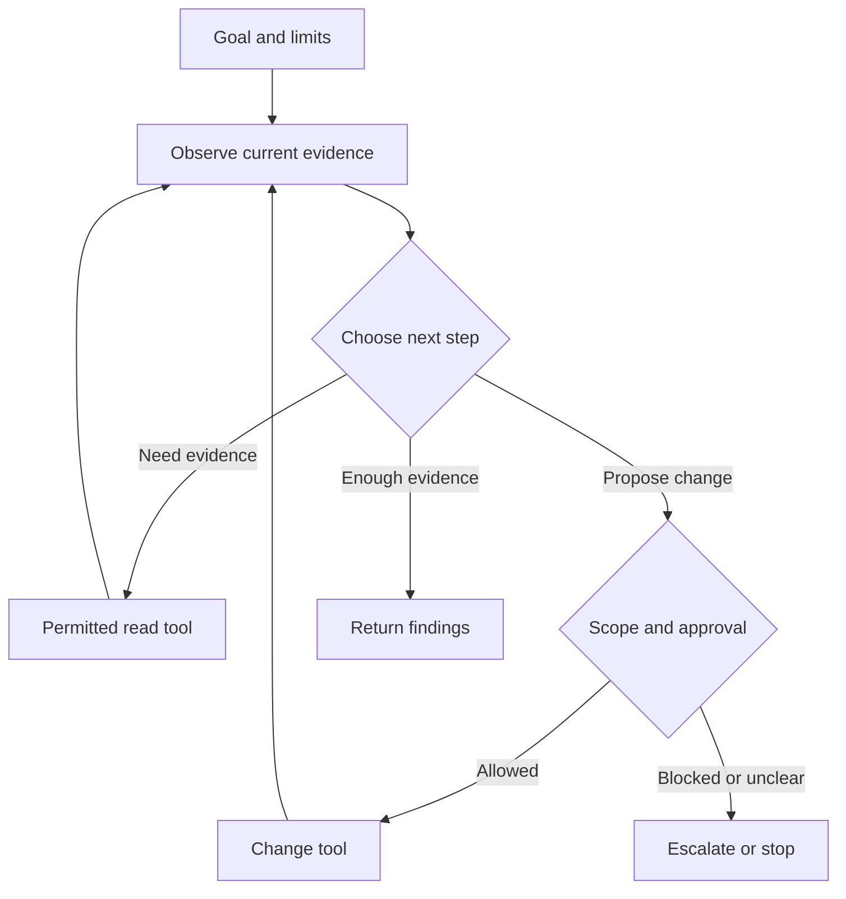
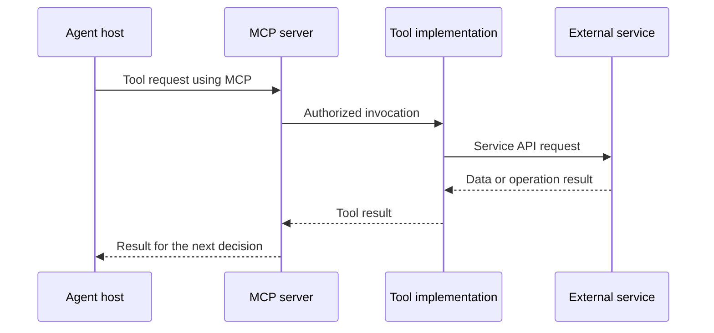
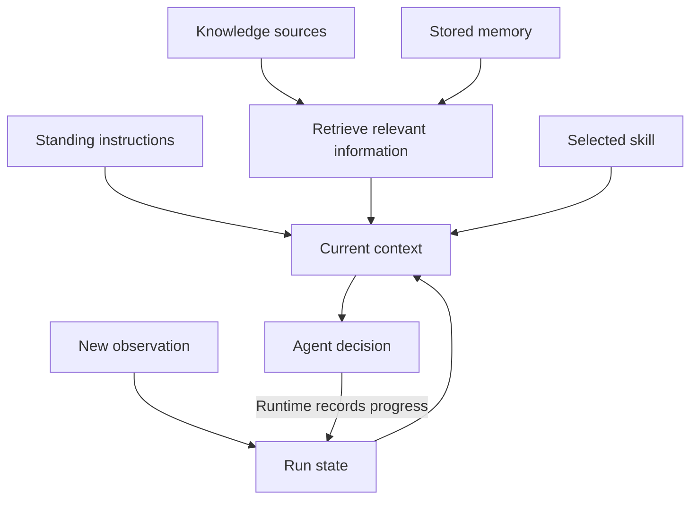
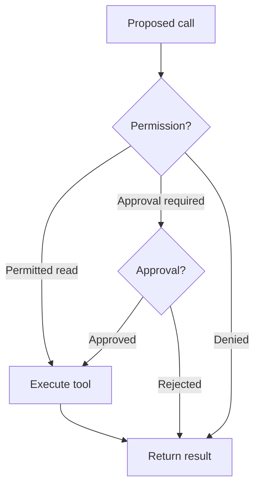
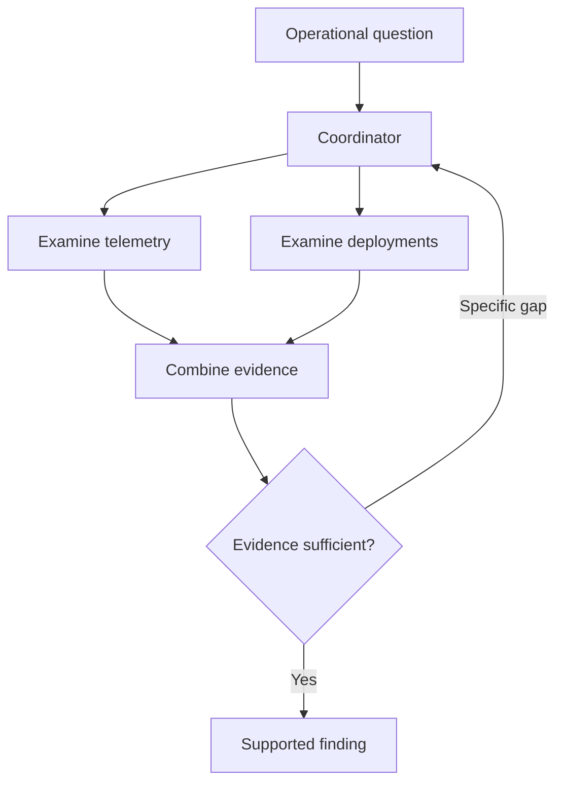
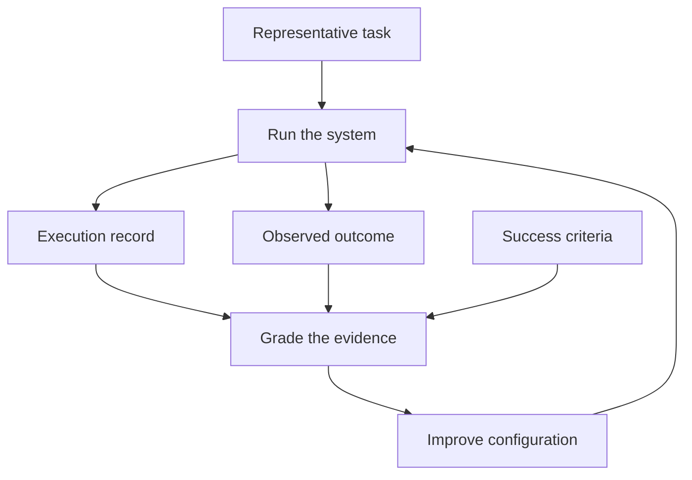

<!-- block: obsidian-devops-agent-foundations-body -->
# How agents work

An operational agent becomes easier to understand when you separate the model that proposes a next step from the software that supplies context, executes tools and controls access. This note develops that distinction before introducing AWS DevOps Agent terminology. Its categories are a teaching framework for examining a system. They are not a universal standard or a claim about AWS's internal implementation.

## Model, agent, workflow and service

A **model** processes supplied input and generates an output. That output might be an explanation, a classification, a proposed plan or a structured request to use a tool. A model response does not itself establish that an external operation happened. For example, Claude's Messages API is stateless: the application supplies the conversation history needed for each request. Continuity therefore depends on how the surrounding application retains and resubmits context. [F02](https://platform.claude.com/docs/en/build-with-claude/working-with-messages)

An **agent** combines a model with an execution system, often called a runtime or harness. The surrounding software handles tool execution, results, context and stopping conditions. An agent can select another action after observing what happened. A **workflow** describes how work proceeds. Some workflows follow predefined steps; others contain decisions delegated to a model. Anthropic uses this distinction to separate predefined workflows from agents that dynamically direct their process. Products sometimes use “agent” more broadly, so inspect the actual behavior rather than relying on the label. [F01](https://www.anthropic.com/research/building-effective-agents)

A fixed workflow can still contain a model call whose answer varies. “Predefined” describes the allowed path through the process, not a guarantee of identical outputs. Conversely, an agent can operate inside a tightly controlled workflow: it might investigate freely within one stage, then return a report to a conventional approval process.

A **service** is the deployed product through which users and other systems access these capabilities. AWS DevOps Agent, for example, provides operational workflows and configuration surfaces. An Agent Space defines the accounts, integrations, access and context available for its work. A service can contain several agent roles and workflows without exposing their physical hosting arrangement. [S001](https://docs.aws.amazon.com/devopsagent/latest/userguide/about-aws-devops-agent.html) [S104](https://docs.aws.amazon.com/devopsagent/latest/userguide/about-aws-devops-agent-what-are-devops-agent-spaces.html)

*Conceptual diagram 1: responsibilities within an agent-enabled service. Arrows show requests and results, not AWS deployment topology. An external change requires an executed operation.*

## Bounded autonomy and the agent loop

**Autonomy** concerns decisions the system can make without another instruction. **Bounded autonomy** makes those decisions conditional on a task, available tools, permissions, approval rules and execution limits. An agent might choose which logs to examine while being unable to restart a service. Investigation freedom and change authority are separate dimensions. AWS DevOps Agent illustrates this distinction through its separately configured, approved directed-action path. [S108](https://docs.aws.amazon.com/devopsagent/latest/userguide/working-with-devops-agent-working-with-directed-actions.html)

The central loop is straightforward: supply context, obtain a model decision, execute an allowed tool request, return its result, and decide again. The runtime also handles errors and termination. A failed query can become evidence about a missing permission or unavailable system; it should not become an invented query result. Strands documents this repeated model/tool exchange and explicit limits and stop reasons. [F07](https://strandsagents.com/docs/user-guide/sdk/agents/agent-loop/)

The environment supplies observations the system cannot obtain from its instructions alone. If an agent predicts that a restart will restore service, the restart result and subsequent health checks test that prediction. Merely repeating the prediction more confidently supplies no new evidence. This makes the observation step essential even when the proposed action seems familiar.

*Conceptual diagram 2: an agent loop with separate read and change paths. The gate represents applicable controls; it does not specify any product's complete approval protocol.*

A useful task therefore states what success means and what ends the attempt. For an investigation, “identify the cause with supporting evidence, or explain the unresolved gap” is more assessable than “keep investigating.” Time, cost and iteration limits make an unsuccessful attempt observable and bounded.

## A functional taxonomy of agent mechanisms

The following seven groups answer different design questions: what chooses the work, what can execute it, what informs it, what coordinates it, what authorizes it, what starts and finishes it, and how its quality is judged. A single agent normally combines several groups. These mechanisms should not be confused with job titles such as investigator, reviewer or release tester.

### 1. Reasoning, planning and execution state

**Instructions** describe the goal, constraints and expected behavior. **Planning** organizes possible steps and dependencies. **Reasoning**, as used here, is the model's task analysis and selection of a response or action. A plan can change when evidence contradicts an assumption. Its existence does not prove that the proposed steps ran.

**Execution state** records what is actually happening: the current task, completed operations, pending approvals, errors and results needed to continue. **Conversation history** records exchanges. **Session persistence** preserves enough information to resume later. These are related but distinct responsibilities; the Strands anatomy reference separates state, conversation management, sessions and snapshots. [F10](https://strandsagents.com/docs/user-guide/sdk/agents/)

For example, a narrative might say “next, inspect the database.” The execution record must still distinguish a queued query, a successful result and a permission failure. This is why operational systems need durable identifiers and explicit states as well as readable explanations. A saved conversation alone is not a reliable replacement for a task ledger.

### 2. Tools, integrations and protocols

A **tool** is a callable operation with an advertised purpose, inputs and result. It might retrieve deployment history, inspect a metric or submit an approved change. Good tool design explains scope, parameters, errors and side effects. A broad function named `execute` provides less guidance than a focused operation whose contract describes what it reads or changes. Tools also need useful, bounded results that the agent can interpret. [F05](https://www.anthropic.com/research/writing-tools-for-agents)

An **integration** is the configured connection that makes an external capability usable: endpoint, credentials, network path, selected resources and associated tools. A **protocol** specifies how participants exchange requests and results. MCP defines host, client and server roles and supports tools, contextual resources and reusable prompts. It does not prescribe the host's reasoning or context-management strategy. [F03](https://modelcontextprotocol.io/docs/2026-07-28/learn/architecture)

*Conceptual diagram 3: a tool integration using MCP. The exchange protocol, tool implementation and external service have different responsibilities. This illustration does not imply that every server has this exact internal layering.*

Thus, “we connected MCP” does not answer which resources are available or which operations are allowed. AWS DevOps Agent separately configures server authentication and the tools exposed to an Agent Space. Protocol compatibility is one prerequisite within a larger integration contract. [S038](https://docs.aws.amazon.com/devopsagent/latest/userguide/configuring-integrations-and-knowledge-connecting-mcp-servers.html)

### 3. Context, skills, knowledge and memory

**Context** is the information available to the model for its current decision. It can include instructions, recent exchanges, tool descriptions, retrieved documents and observations. It is a selected working set, not necessarily everything the organization stores. Context engineering determines which information to include, refresh, summarize or retrieve as work continues. Adding more material does not automatically make the next decision better. [F04](https://www.anthropic.com/research/effective-context-engineering-for-ai-agents)

**Knowledge** is the information available for use, such as architecture records or deployment conventions. **Retrieval** selects relevant pieces of that information. A **skill** packages a procedure: when to apply it, what steps to follow and how to interpret results. In AWS DevOps Agent, skills use `SKILL.md` and can include supporting material; standing instructions use `AGENTS.md`. Procedural guidance does not grant infrastructure permissions. [S060](https://docs.aws.amazon.com/devopsagent/latest/userguide/about-aws-devops-agent-devops-agent-skills.html) [S004](https://docs.aws.amazon.com/devopsagent/latest/userguide/about-aws-devops-agent-agent-instructions.html)

**Memory** retains information for later use. It may preserve environmental understanding, a preference or a lesson from an earlier task. AWS DevOps Agent exposes managed and custom memory stores, with assignment rules controlling custom-agent access. Stored memory must still be selected and interpreted in the current context. [S059](https://docs.aws.amazon.com/devopsagent/latest/userguide/about-aws-devops-agent-devops-agent-memories.html)

Saving a memory changes what the application can provide on a later turn. It does not, by itself, retrain the model. A record also needs enough provenance to judge its relevance: where it came from, when it was true and whether later evidence supersedes it. Treat “the system learned this” as a question about what changed, rather than assuming the underlying model changed. This follows from separating persistent information from the context supplied for inference. [F04](https://www.anthropic.com/research/effective-context-engineering-for-ai-agents)

*Conceptual diagram 4: the runtime assembles context from several sources. Persistent memory and current run state are separate. The diagram describes information use, not model training.*

For a checkout incident, a skill might explain how to compare deployments, knowledge might describe the service dependencies, and memory might record a previously observed connection-pool failure. The current metric still determines whether that explanation fits today's incident. Remembering a past answer should not replace checking new evidence.

### 4. Identity, authorization and guardrails

**Identity** establishes who is invoking the system or making a downstream call. **Authorization** determines which actions that identity can perform on which resources. These questions occur at multiple boundaries: operator to service, service to AWS account, and service to a connected provider. AWS DevOps Agent distinguishes operator-app permissions from the account roles used for investigation and the separate elevated access used for directed actions. [S058](https://docs.aws.amazon.com/devopsagent/latest/userguide/aws-devops-agent-security-devops-agent-iam-permissions.html)

**Guardrails** are additional constraints on execution or content. They can reject a prohibited operation, validate an argument or constrain a tool surface. **Human approval** is a decision about a specified proposed action. Neither an instruction nor an approval should be interpreted as permission to perform every related action. In AWS DevOps Agent, approved changes remain subject to supported-operation restrictions and scoped execution permissions. [S108](https://docs.aws.amazon.com/devopsagent/latest/userguide/working-with-devops-agent-working-with-directed-actions.html)

*Conceptual diagram 5: permission and approval checks answer separate questions; client identity and service entry are established before this per-call example. Real products may enforce additional checks or a different order. The diagram is not the AWS approval API sequence.*

This separation is useful when diagnosing failures. An unreachable endpoint, an invalid credential, a denied permission and a rejected approval are different problems. Rewriting a prompt cannot repair all four.

### 5. Orchestration and collaboration

**Orchestration** controls the actual movement of work: dispatching tasks, respecting dependencies, collecting results, handling failure and deciding when to continue. A plan expresses intended work; orchestration makes a process run. It can coordinate conventional code, model calls, agents and people.

Common patterns include a fixed sequence, routing to an appropriate specialist, parallel independent tasks, delegation by a coordinator, and evaluation followed by revision. Strands distinguishes fixed task graphs, graphs with branching or loops, and agent handoffs. These are alternative arrangements of control, not maturity levels that every system must progress through. [F08](https://strandsagents.com/docs/user-guide/sdk/multi-agent/multi-agent-patterns/)

*Conceptual diagram 6: coordination of complementary work. The two branches are illustrative responsibilities, not asserted AWS DevOps Agent subagents or a disclosed internal architecture.*

Collaboration works best when each assignment has an objective, scope, available tools and expected output. Otherwise, workers can duplicate effort or leave the same gap unexamined. Anthropic's account of its research system also emphasizes preserving substantive worker results rather than repeatedly compressing them through handoffs. Its implementation is an example, not evidence of how AWS runs its service. [F09](https://www.anthropic.com/research/multi-agent-research-system)

Use a fixed step for an invariant requirement, such as verifying a required field. Use model judgment where the next useful question depends on evidence. Keep an explicit owner for the final decision when multiple branches contribute findings.

Retries need the same care. A repeated evidence query and a repeated change request have different consequences. For example, retrying ticket creation after an ambiguous timeout might create a second ticket. A robust orchestration design tracks the logical request and verifies its outcome before repeating side effects. The Strands Python SDK can coalesce concurrent invocations on the same agent when their idempotency tokens match; the general lesson is to design retry behavior explicitly. [F07](https://strandsagents.com/docs/user-guide/sdk/agents/agent-loop/)

### 6. Triggers, outputs and effects

A **trigger** starts work. It may be a person, schedule or incoming event. Trigger configuration determines when a task is eligible to run and what context accompanies it. AWS custom agents support manual, scheduled and integration-event invocation; generic incident webhooks have their own authentication and payload contract. Arrival of an event is therefore separate from accepting it as a valid task. [S063](https://docs.aws.amazon.com/devopsagent/latest/userguide/custom-agents-executing-custom-agents.html) [S072](https://docs.aws.amazon.com/devopsagent/latest/userguide/configuring-integrations-and-knowledge-invoking-devops-agent-through-webhook.html)

An **output** is a returned result: prose, structured data, an artifact, a recommendation or a notification. An **effect** is a change in another system. A proposed repair and an applied repair are distinct outcomes. AWS custom agents can produce persistent artifacts and recommendations, while release testing sends real requests that can modify the application under test. The workflow determines which output and effect contracts apply. [S055](https://docs.aws.amazon.com/devopsagent/latest/userguide/custom-agents-custom-agent-outputs.html) [S090](https://docs.aws.amazon.com/devopsagent/latest/userguide/release-management-release-testing.html)

### 7. Evaluation, feedback and improvement

**Evaluation** measures behavior against defined criteria. Inspect both the execution record and the actual outcome: a convincing completion message does not prove that the intended state exists. A test case needs a starting condition and success criteria; repeated trials help expose variation. Anthropic distinguishes transcripts from final environmental outcomes and treats the model plus harness as the system being evaluated. [F06](https://www.anthropic.com/research/demystifying-evals-for-ai-agents)

*Conceptual diagram 7: evaluation compares recorded behavior and observed outcomes with explicit criteria. A grader's judgment is itself subject to review.*

**Feedback** supplies a correction or judgment about a particular run. **Improvement** changes future behavior through configuration, instructions, skills, memory or engineering work. AWS DevOps Agent's investigation Review grades a completed investigation; its prevention workflow examines incident history for recommendations. These address related but different questions: “was this investigation useful?” and “what should we change to reduce future incidents?” [S091](https://docs.aws.amazon.com/devopsagent/latest/userguide/working-with-devops-agent-reviewing-investigations.html) [S084](https://docs.aws.amazon.com/devopsagent/latest/userguide/production-operations-proactive-incident-prevention.html)

## Applying the framework to DevOps agent roles

Mechanisms explain **how** a system works. Roles explain **what job** it performs. AWS documents managed roles for conversation, incident work, grading, release testing and learning. Custom agents add team-defined tasks. An investigation role needs evidence tools and context; a release-testing role needs a target and test intent; a learning role maintains useful knowledge. Their requirements differ even when several mechanisms are shared. [S077](https://docs.aws.amazon.com/devopsagent/latest/userguide/working-with-devops-agent-managed-agents.html) [S052](https://docs.aws.amazon.com/devopsagent/latest/userguide/custom-agents-creating-a-custom-agent.html)

For any proposed operational use case, describe its trigger, goal, evidence sources, permitted tools, decision points, outputs and acceptance criteria. Then identify the existing product workflow that meets those needs. Add a custom integration when a specific missing capability prevents the task, and retain the established system's identity, network and change-control boundaries. This is a design method for the later role, workflow and integration notes, not a promise that every useful pattern is built into AWS DevOps Agent.
