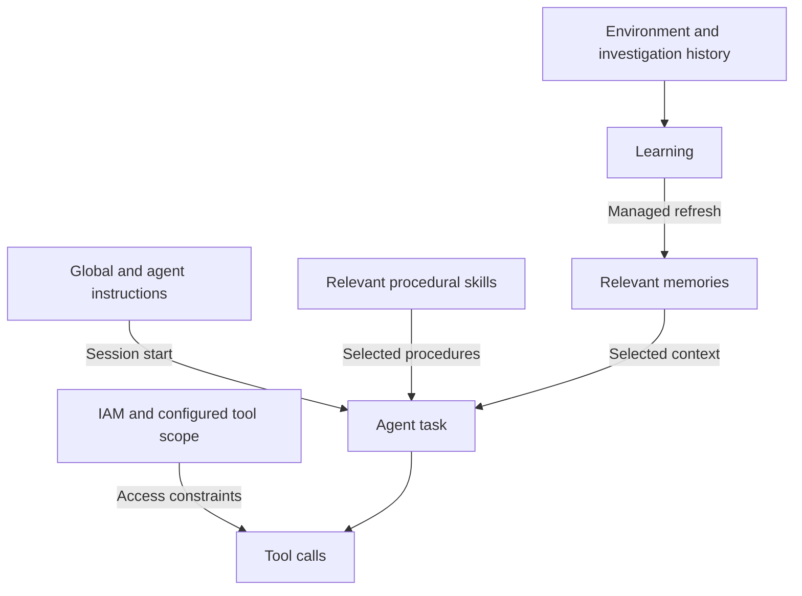
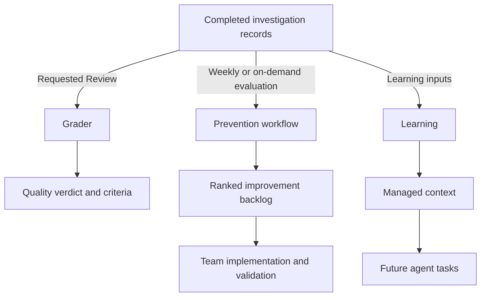
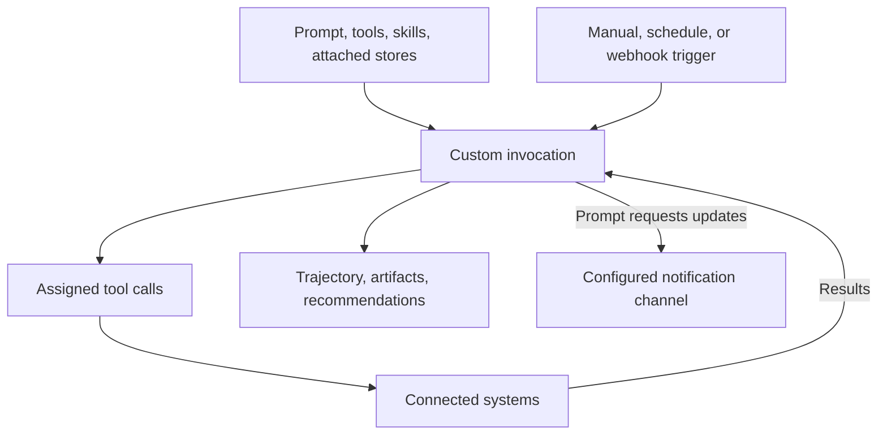
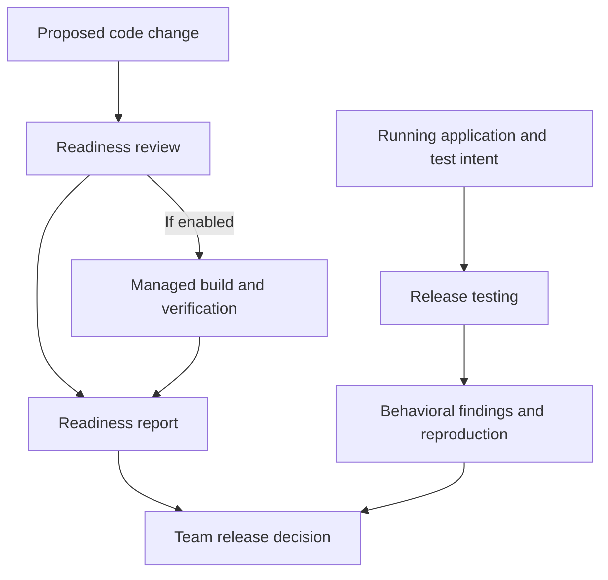

<!-- block: obsidian-devops-agent-roles-and-capabilities-body -->
# Agent roles and AWS capability mapping

## Separate responsibilities, agent identities, and permissions

A **DevOps role** describes work: incident response, release engineering, observability, quality assessment, knowledge maintenance, or recurring operational automation. These functional labels are useful for assigning human ownership. They do not establish that AWS ships a separately configurable agent with that name.

**AWS DevOps Agent** is the service. Its **managed agents** are platform-owned components exposed through the Agents page; **custom agents** are definitions your team creates. An **IAM role** supplies an authorization identity. Operator permissions, investigation permissions, elevated action permissions, and service-linked permissions are security concepts, not additional agent personalities. [S077](https://docs.aws.amazon.com/devopsagent/latest/userguide/working-with-devops-agent-managed-agents.html) [S056](https://docs.aws.amazon.com/devopsagent/latest/userguide/working-with-devops-agent-custom-agents-index.html) [S058](https://docs.aws.amazon.com/devopsagent/latest/userguide/aws-devops-agent-security-devops-agent-iam-permissions.html)

The following responsibility mapping is an organizing model for this dossier, not an AWS product taxonomy.

| Functional responsibility | Relevant documented capability |
|---|---|
| Operational question answering | Chat and on-demand tasks |
| Incident response | Triage, investigation, mitigation proposals, investigation presentation |
| Continuous reliability improvement | Prevention evaluations and recommendation management |
| Investigation quality assurance | Review, powered by Grader |
| Knowledge maintenance | Learning, skills, instructions, memories |
| Release engineering | Readiness code reviews, verification builds, deployed-application testing |
| Team-specific automation | Custom agents with selected tools and knowledge |

These capabilities are documented separately; one responsibility can use several of them. Conversely, a capability can serve multiple responsibilities. [S083](https://docs.aws.amazon.com/devopsagent/latest/userguide/working-with-devops-agent-on-demand-devops-tasks.html) [S010](https://docs.aws.amazon.com/devopsagent/latest/userguide/production-operations-autonomous-incident-response.html) [S084](https://docs.aws.amazon.com/devopsagent/latest/userguide/production-operations-proactive-incident-prevention.html) [S091](https://docs.aws.amazon.com/devopsagent/latest/userguide/working-with-devops-agent-reviewing-investigations.html) [S088](https://docs.aws.amazon.com/devopsagent/latest/userguide/working-with-devops-agent-release-management-index.html)

## Documented managed-agent roster

Read each role as a goal implemented through inputs, mechanisms, outputs and an authority boundary. AWS says the available managed agents **can include** the following nine names. This is a documented roster, not a guarantee that every Agent Space exposes every entry. The matrix is divided into two tables so it remains readable in Markdown. “Entry” identifies a public workflow, not an undocumented internal invocation contract. [S077](https://docs.aws.amazon.com/devopsagent/latest/userguide/working-with-devops-agent-managed-agents.html)

### Purpose, entry, and inputs

| Named managed agent | Purpose | Public workflow or trigger | Documented input context |
|---|---|---|---|
| **Chat** | Answer operational questions | User conversation | Request, conversation and page context, connected operational data. [S083](https://docs.aws.amazon.com/devopsagent/latest/userguide/working-with-devops-agent-on-demand-devops-tasks.html) |
| **Incident triage** | Filter, classify, and scope incoming incidents | External incident event | Incoming incident, active investigations, relevant correlation or skip guidance. [S010](https://docs.aws.amazon.com/devopsagent/latest/userguide/production-operations-autonomous-incident-response.html) |
| **Incident RCA** | Determine causes using evidence | Incident investigation workflow | Incident scope and evidence gathered from connected systems. [S010](https://docs.aws.amazon.com/devopsagent/latest/userguide/production-operations-autonomous-incident-response.html) |
| **Incident mitigation** | Propose near-term responses and durable fixes | Investigation mitigation workflow | Investigation findings and operational context. [S010](https://docs.aws.amazon.com/devopsagent/latest/userguide/production-operations-autonomous-incident-response.html) |
| **Incident UI** | Generate investigation outputs | Within the investigation workflow | A separate input schema is not specified. [S077](https://docs.aws.amazon.com/devopsagent/latest/userguide/working-with-devops-agent-managed-agents.html) |
| **Evaluation** | Assess performance and policy compliance | Not separately specified in the roster reference | Not separately specified. [S077](https://docs.aws.amazon.com/devopsagent/latest/userguide/working-with-devops-agent-managed-agents.html) |
| **Grader** | Assess investigation quality | User launches Review on a completed investigation | Problem, collected evidence, conclusion, configured criteria. [S091](https://docs.aws.amazon.com/devopsagent/latest/userguide/working-with-devops-agent-reviewing-investigations.html) |
| **Release testing** | Exercise deployed UI and REST behavior | Test profile, Chat, IDE, or pipeline | Target URL/profile, change context or test intent, configured authentication. [S090](https://docs.aws.amazon.com/devopsagent/latest/userguide/release-management-release-testing.html) |
| **Learning** | Maintain environmental knowledge | Managed schedules or supported refresh requests | Topology, dependencies, pipelines, investigation history, directives. [S059](https://docs.aws.amazon.com/devopsagent/latest/userguide/about-aws-devops-agent-devops-agent-memories.html) [S077](https://docs.aws.amazon.com/devopsagent/latest/userguide/working-with-devops-agent-managed-agents.html) |

### Mechanisms, outputs, and boundaries

| Named managed agent | Mechanism | Outputs | Boundary or limitation |
|---|---|---|---|
| **Chat** | Context-aware queries and tool use | Answers, artifacts, investigation steering | A conversation can lead to a separately created investigation. [S083](https://docs.aws.amazon.com/devopsagent/latest/userguide/working-with-devops-agent-on-demand-devops-tasks.html) |
| **Incident triage** | Correlation and skip-rule application | Linked, Skipped, or Proceed decision | Unlink/unskip corrects a decision; this is not an independent Run Now agent. [S010](https://docs.aws.amazon.com/devopsagent/latest/userguide/production-operations-autonomous-incident-response.html) |
| **Incident RCA** | Evidence collection and hypothesis validation | Findings, cause analysis, investigation record | Results depend on available evidence and access. [S010](https://docs.aws.amazon.com/devopsagent/latest/userguide/production-operations-autonomous-incident-response.html) |
| **Incident mitigation** | Corrective-action planning | Inline proposals or mitigation plan | A proposal is distinct from approved execution through directed actions. [S010](https://docs.aws.amazon.com/devopsagent/latest/userguide/production-operations-autonomous-incident-response.html) [S108](https://docs.aws.amazon.com/devopsagent/latest/userguide/working-with-devops-agent-working-with-directed-actions.html) |
| **Incident UI** | Investigation-output generation | UI outputs, including externally posted outputs | No independent worker topology is published. [S077](https://docs.aws.amazon.com/devopsagent/latest/userguide/working-with-devops-agent-managed-agents.html) |
| **Evaluation** | Performance scoring and policy checks | Scoring/check results | Skills guidance also labels Evaluation as proactive recommendations; terminology differs between guides. [S060](https://docs.aws.amazon.com/devopsagent/latest/userguide/about-aws-devops-agent-devops-agent-skills.html) [S077](https://docs.aws.amazon.com/devopsagent/latest/userguide/working-with-devops-agent-managed-agents.html) |
| **Grader** | Criteria-based assessment | Overall verdict and criterion results | Does not rerun or modify the original investigation. [S091](https://docs.aws.amazon.com/devopsagent/latest/userguide/working-with-devops-agent-reviewing-investigations.html) |
| **Release testing** | Browser interaction or HTTP testing | Findings, reproduction steps, UI screenshots | Requests can modify application data. [S090](https://docs.aws.amazon.com/devopsagent/latest/userguide/release-management-release-testing.html) |
| **Learning** | Synthesize and refresh managed context | Managed environmental and monitor knowledge | AWS owns its scheduled tasks. [S077](https://docs.aws.amazon.com/devopsagent/latest/userguide/working-with-devops-agent-managed-agents.html) |

## What users configure

Managed definitions have no editable system prompt or direct Run Now control. The Agent definition tab exposes editable global and agent-specific `AGENTS.md` guidance; its Knowledge tab shows skills and memories but is read-only. Learning additionally exposes History and Triggers. Its schedules cannot be created, edited, or deleted by the user. Activity for incident agents belongs to the investigation record. [S077](https://docs.aws.amazon.com/devopsagent/latest/userguide/working-with-devops-agent-managed-agents.html)

Users can also create skills and target them to supported managed roles; the managed-agent Knowledge view itself remains read-only. [S060](https://docs.aws.amazon.com/devopsagent/latest/userguide/about-aws-devops-agent-devops-agent-skills.html)

Instructions are loaded at session start. New sessions receive saved changes; existing sessions retain their initial content. A global change therefore needs deliberate review because its scope is broad. Agent-specific guidance is suitable for a targeted rule, such as the evidence a Grader should demand. Instructions guide behavior; IAM and tool configuration govern access. [S004](https://docs.aws.amazon.com/devopsagent/latest/userguide/about-aws-devops-agent-agent-instructions.html) [S058](https://docs.aws.amazon.com/devopsagent/latest/userguide/aws-devops-agent-security-devops-agent-iam-permissions.html)

Chat history is isolated by Agent Space. A new conversation does not inherit earlier chats; resuming an existing conversation retains its history. Switching pages keeps the conversation but updates page-specific context. Investigation steering applies from the relevant investigation detail page. [S083](https://docs.aws.amazon.com/devopsagent/latest/userguide/working-with-devops-agent-on-demand-devops-tasks.html)

Treat “configurable managed agent” as **customizable guidance within an AWS-owned capability**, not ownership of its runtime, tools, or scheduler.

## Knowledge mechanisms and the Learning relationship

Three knowledge mechanisms solve different problems. Instructions supply standing guidance. Skills encode procedures selected for the task. Memories provide relevant information about the environment and past work. Memory selection uses store descriptions, then item descriptions, before opening full content; it does not load every memory into every session. [S004](https://docs.aws.amazon.com/devopsagent/latest/userguide/about-aws-devops-agent-agent-instructions.html) [S060](https://docs.aws.amazon.com/devopsagent/latest/userguide/about-aws-devops-agent-devops-agent-skills.html) [S059](https://docs.aws.amazon.com/devopsagent/latest/userguide/about-aws-devops-agent-devops-agent-memories.html)

The arrows show knowledge supply and access constraints, not a scheduler sequence. Knowledge can improve a decision without granting a new permission. [S004](https://docs.aws.amazon.com/devopsagent/latest/userguide/about-aws-devops-agent-agent-instructions.html) [S059](https://docs.aws.amazon.com/devopsagent/latest/userguide/about-aws-devops-agent-devops-agent-memories.html) [S074](https://docs.aws.amazon.com/devopsagent/latest/userguide/aws-devops-agent-security-limiting-agent-access-in-an-aws-account.html)

Managed stores include `monitors`, `directives`, `reflections`, `understanding-agent-space`, `understanding-dependencies`, `understanding-pipeline-topology`, and `tool-use-best-practices`. They distinguish incident patterns, standing preferences, corrective lessons, architecture, dependencies, delivery structure, and effective tool usage. Memories are versioned, so their evolution can be inspected. [S059](https://docs.aws.amazon.com/devopsagent/latest/userguide/about-aws-devops-agent-devops-agent-memories.html)

Learning is not an assertion of immediate synchronization. Monitor memory has a daily refresh under the documented recent-investigation condition. Scheduled environmental understanding refreshes occur no more than once every three days in active spaces; tool-use learning also requires sufficient new completed investigations. Separate discovery, integration-change, and requested refresh paths exist. [S059](https://docs.aws.amazon.com/devopsagent/latest/userguide/about-aws-devops-agent-devops-agent-memories.html)

Older environmental **learned skills** migrate to managed memories when refreshed. Temporary older skill entries are compatible with that migration; they do not establish two permanently independent knowledge systems. User-authored procedural skills remain a separate mechanism. [S073](https://docs.aws.amazon.com/devopsagent/latest/userguide/about-aws-devops-agent-learned-skills.html) [S060](https://docs.aws.amazon.com/devopsagent/latest/userguide/about-aws-devops-agent-devops-agent-skills.html)

A recommended knowledge design is to place mandatory session guidance in instructions, reusable diagnostic steps in a skill, and service facts in a memory. For example, an instruction can require evidence links; a skill can describe diagnosing queue backlog; a memory can identify the queue's owners and downstream consumers. This allocation is an implementation recommendation, not a new AWS asset type.

## Review, prevention, and learning have different outputs

A completed investigation can support several independent activities. **Review** assesses the work already done. **Prevention** examines incident patterns to propose engineering improvements. **Learning** maintains reusable context. Their shared input does not mean one must automatically invoke the others. [S091](https://docs.aws.amazon.com/devopsagent/latest/userguide/working-with-devops-agent-reviewing-investigations.html) [S084](https://docs.aws.amazon.com/devopsagent/latest/userguide/production-operations-proactive-incident-prevention.html) [S059](https://docs.aws.amazon.com/devopsagent/latest/userguide/about-aws-devops-agent-devops-agent-memories.html)

This diagram describes consumption of records. The prevention box names the workflow because current guides use Evaluation inconsistently: the managed-agent roster describes performance and policy assessment, while the Skills guide labels the Evaluation target as proactive recommendations. Keep this naming difference visible and keep Grader Review distinct. [S077](https://docs.aws.amazon.com/devopsagent/latest/userguide/working-with-devops-agent-managed-agents.html) [S060](https://docs.aws.amazon.com/devopsagent/latest/userguide/about-aws-devops-agent-devops-agent-skills.html) [S084](https://docs.aws.amazon.com/devopsagent/latest/userguide/production-operations-proactive-incident-prevention.html)

Grader's default criteria are scope alignment, evidence grounding, completeness, environment impact, and accuracy against a linked incident's recorded cause. Results contain an overall helpful/not-helpful judgment and pass/fail/not-applicable criteria. Missing ground truth can make accuracy inapplicable. Grader instructions can adjust, add, or remove criteria; unmentioned defaults remain unless replacement is explicitly requested. These are review criteria, not proof of production safety. [S091](https://docs.aws.amazon.com/devopsagent/latest/userguide/working-with-devops-agent-reviewing-investigations.html)

Prevention runs weekly by default or on demand. The schedule can be paused; an active evaluation can be stopped. Its UI categories are Observability, Infrastructure, Governance, and Code optimization. Operators Keep, Discard, or mark items Implemented. Ranking can combine AI assessment with deterministic scoring; a code-oriented recommendation may contain an implementation specification. Engineering ownership and validation still matter before recording completion. [S084](https://docs.aws.amazon.com/devopsagent/latest/userguide/production-operations-proactive-incident-prevention.html)

Corrective investigation feedback supplies another learning path: reflections capture what the investigation missed. This is distinct from merely obtaining a Grader verdict. Neither a favorable Review nor a saved recommendation should be presented as proof that a fix was executed. [S059](https://docs.aws.amazon.com/devopsagent/latest/userguide/about-aws-devops-agent-devops-agent-memories.html) [S091](https://docs.aws.amazon.com/devopsagent/latest/userguide/working-with-devops-agent-reviewing-investigations.html)

## Custom agents: team-owned definitions with selected scope

A custom agent packages a system prompt, selected tools, skills, and attached memory stores. It starts without memory access. Attached managed stores are readable; attached custom stores can also receive writes. Configuration therefore selects both the work to do and the information available for doing it. Create through the form, guided Chat, or a supported GitHub Markdown import. Configure tools through Chat; the form edits prompt, skills and memory assignments. GitHub import supplies the Markdown system prompt, not the complete tool and trigger configuration. [S056](https://docs.aws.amazon.com/devopsagent/latest/userguide/working-with-devops-agent-custom-agents-index.html) [S052](https://docs.aws.amazon.com/devopsagent/latest/userguide/custom-agents-creating-a-custom-agent.html)

The same invocation can produce a report and use external tools. Tool permission is still required for external activity. Artifacts and recommendations are built-in output capabilities; no additional skill assignment is required. Notifications additionally need instructions describing when to notify and an associated destination. Recommendations appear beside built-in prevention recommendations on Improvements. [S055](https://docs.aws.amazon.com/devopsagent/latest/userguide/custom-agents-custom-agent-outputs.html)

Run Now, Run with prompt, and Chat support manual invocation. Automatic invocation can use cron/rate schedules or connected integration webhooks; optional JMESPath filters select and project event context. These are user-configured triggers, distinct from Learning's AWS-owned schedules. A custom agent supports one concurrent invocation; the published default space-wide limit is five. [S063](https://docs.aws.amazon.com/devopsagent/latest/userguide/custom-agents-executing-custom-agents.html) [S086](https://docs.aws.amazon.com/devopsagent/latest/userguide/quotas.html)

Dynamic delegation is documented for complex custom runs, including continuation near a context-window limit, with the parent's tools and skills. Investigation timelines also expose parallel subagent work. These runtime workers are not extra configurable roster types. Do not invent permanent “database agent,” “observability agent,” or “scheduler agent” identities from an example task label. [S056](https://docs.aws.amazon.com/devopsagent/latest/userguide/working-with-devops-agent-custom-agents-index.html) [S010](https://docs.aws.amazon.com/devopsagent/latest/userguide/production-operations-autonomous-incident-response.html)

Recommended ownership is concrete: nominate the prompt owner, permitted tools, intended outputs, run trigger, and acceptance evidence. Inspect an on-demand trajectory before enabling recurrence. Cancellation may leave an in-flight tool call completing; deleting a definition prevents future runs but does not itself cancel existing invocations. [S063](https://docs.aws.amazon.com/devopsagent/latest/userguide/custom-agents-executing-custom-agents.html) [S079](https://docs.aws.amazon.com/devopsagent/latest/userguide/custom-agents-managing-custom-agents.html)

## Release capability names do not imply extra roster entries

Release readiness code review analyzes proposed code for standards, dependency, and access-control risks, optionally building and testing it in a managed verification environment. Release testing exercises a deployed application. Only **Release testing** appears as a distinct name in the current managed-agent roster. “Release readiness reviewer” is a functional description, not an additional documented configurable agent type. [S089](https://docs.aws.amazon.com/devopsagent/latest/userguide/release-management-release-readiness-code-review.html) [S090](https://docs.aws.amazon.com/devopsagent/latest/userguide/release-management-release-testing.html) [S077](https://docs.aws.amazon.com/devopsagent/latest/userguide/working-with-devops-agent-managed-agents.html)

The final arrows represent recommended decision inputs, not automatic cross-feature orchestration. A readiness report can influence a configured repository gate. Release testing makes real UI/API requests, including writes; its application identity and network scope therefore need separate consideration. A read-only AWS guardrail in readiness review does not make application testing read-only. [S089](https://docs.aws.amazon.com/devopsagent/latest/userguide/release-management-release-readiness-code-review.html) [S090](https://docs.aws.amazon.com/devopsagent/latest/userguide/release-management-release-testing.html)

## Trace platform capabilities to their consumers

| Platform capability | Consumers and responsibility | Configuration or evidence surface |
|---|---|---|
| Agent Space and topology | Operational context for investigation, Chat, and knowledge | Associated environment and discovered relationships. [S104](https://docs.aws.amazon.com/devopsagent/latest/userguide/about-aws-devops-agent-what-are-devops-agent-spaces.html) [S105](https://docs.aws.amazon.com/devopsagent/latest/userguide/about-aws-devops-agent-what-is-a-devops-agent-topology.html) |
| Instructions, skills, memories | Standing guidance, procedures, and context | Agent definition, knowledge assets, relevant attached stores. [S004](https://docs.aws.amazon.com/devopsagent/latest/userguide/about-aws-devops-agent-agent-instructions.html) [S078](https://docs.aws.amazon.com/devopsagent/latest/userguide/about-aws-devops-agent-managing-assets.html) |
| Integration toolbox and IAM | Access to evidence and supported actions | Provider/account permissions, tool selection, elevated-action controls. [S058](https://docs.aws.amazon.com/devopsagent/latest/userguide/aws-devops-agent-security-devops-agent-iam-permissions.html) [S108](https://docs.aws.amazon.com/devopsagent/latest/userguide/working-with-devops-agent-working-with-directed-actions.html) |
| Records and reusable outputs | Operator inspection and subsequent workflows | Investigation timeline, invocation trajectory, artifacts, recommendation backlog. [S010](https://docs.aws.amazon.com/devopsagent/latest/userguide/production-operations-autonomous-incident-response.html) [S055](https://docs.aws.amazon.com/devopsagent/latest/userguide/custom-agents-custom-agent-outputs.html) |
| Investigation Sandbox | Analysis computation during investigations | Optional ephemeral environment; read-only AWS proxy and network rules. [S093](https://docs.aws.amazon.com/devopsagent/latest/userguide/configuring-integrations-and-knowledge-sandbox.html) |
| Usage and operational telemetry | Service operators and automation owners | Activity metrics, delivery logs, concurrency quotas. [S102](https://docs.aws.amazon.com/devopsagent/latest/userguide/configuring-integrations-and-knowledge-vended-logs-and-metrics.html) [S086](https://docs.aws.amazon.com/devopsagent/latest/userguide/quotas.html) |

This mapping separates **what an agent does** from **what the platform supplies**. For example, a memory store is a context resource, an artifact is an output, a webhook is an invocation path, and an IAM role is an authorization identity. None should be drawn as another reasoning agent.

## Source audit and presentation caveats

- **Roster wording matters.** Preserve the nine AWS names and “can include” qualification. The reference says managed-agent pages show a Preview badge. Use capability-specific release documentation to establish availability; do not infer every underlying capability's status from that badge. [S077](https://docs.aws.amazon.com/devopsagent/latest/userguide/working-with-devops-agent-managed-agents.html) [S013](https://aws.amazon.com/about-aws/whats-new/2026/06/aws-devops-agent-release-management/)
- **Record the Evaluation naming inconsistency.** The managed-agent roster describes performance and policy assessment; the Skills guide labels the Evaluation target as proactive recommendations. Grader is explicitly Review's agent. Use workflow names when explaining prevention and preserve this source difference. [S077](https://docs.aws.amazon.com/devopsagent/latest/userguide/working-with-devops-agent-managed-agents.html) [S060](https://docs.aws.amazon.com/devopsagent/latest/userguide/about-aws-devops-agent-devops-agent-skills.html) [S091](https://docs.aws.amazon.com/devopsagent/latest/userguide/working-with-devops-agent-reviewing-investigations.html)
- **Prefer specific workflow guidance.** The custom overview still mentions schedule-only triggers; the execution guide documents event triggers. The overview also loosely associates outputs with skills, while the output guide explicitly makes artifacts and recommendations built in. [S056](https://docs.aws.amazon.com/devopsagent/latest/userguide/working-with-devops-agent-custom-agents-index.html) [S063](https://docs.aws.amazon.com/devopsagent/latest/userguide/custom-agents-executing-custom-agents.html) [S055](https://docs.aws.amazon.com/devopsagent/latest/userguide/custom-agents-custom-agent-outputs.html)
- **Interface coverage differs.** CloudFormation currently documents time-based custom triggers. Console event support does not prove every IaC option has equivalent coverage. [S026](https://docs.aws.amazon.com/AWSCloudFormation/latest/TemplateReference/aws-resource-devopsagent-trigger.html)
- **Guidance location has changed.** Review prose mentions an older Knowledge-page route; the managed-agent and instructions guides identify Agents → managed agent → Agent definition for editable guidance. [S091](https://docs.aws.amazon.com/devopsagent/latest/userguide/working-with-devops-agent-reviewing-investigations.html) [S004](https://docs.aws.amazon.com/devopsagent/latest/userguide/about-aws-devops-agent-agent-instructions.html)

Diagram edges show documented data or knowledge relationships; recommended team decisions are labeled. The section makes no claim about an unpublished scheduler, fixed internal worker graph, or universal automatic handoff between capabilities.
