<!-- block: obsidian-devops-diagram-atlas-body -->
# Diagram atlas

All diagrams are editable Mermaid source. Captions identify the relationship shown and its evidence boundary. The presentation uses P01–P19; deeper conceptual diagrams remain embedded in the framework chapters. Use [[Validation_and_Use]] for rendering and review scope.

## Investigation API and UI model addendum

The original presentation figures below retain their 31 October 2026 evidence cutoff. The separately reviewed **5 November 2026** addendum adds six ER diagrams in [[Investigation_Data_Model]] and an approval ER diagram, synchronization sequence and historical-capture flow in [[Investigation_UI_Contract]]. They show proposed logical models with explicit native-versus-derived boundaries. See [[Investigation_API_Sources]] for their source pins and rendering review.

## P01 — The agent loop

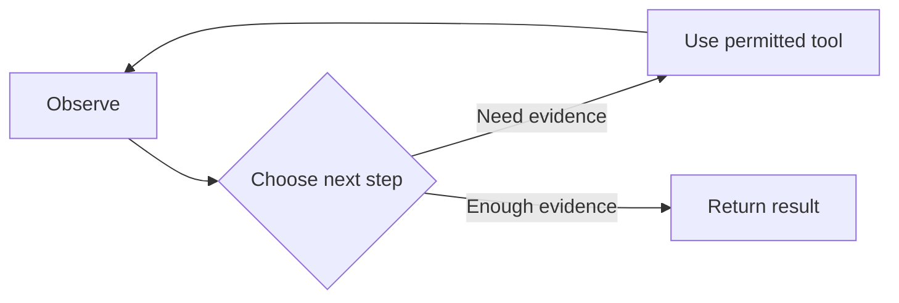

*General concept. A conceptual model/tool loop. The runtime executes tools, supplies their results and enforces stop conditions. This is not an AWS internal implementation diagram.*

Sources: [F01](https://www.anthropic.com/research/building-effective-agents) [F07](https://strandsagents.com/docs/user-guide/sdk/agents/agent-loop/)

## P02 — Tools and protocol exchange

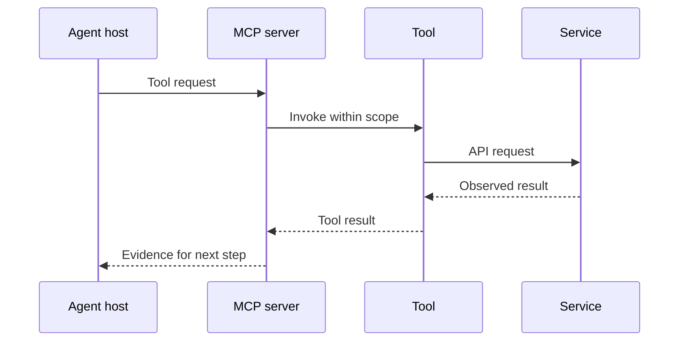

*General concept. Conceptual request/result layering. MCP does not grant the downstream permissions or define the host reasoning process.*

Sources: [F03](https://modelcontextprotocol.io/docs/2026-07-28/learn/architecture) [F05](https://www.anthropic.com/research/writing-tools-for-agents)

## P03 — Assembling useful context

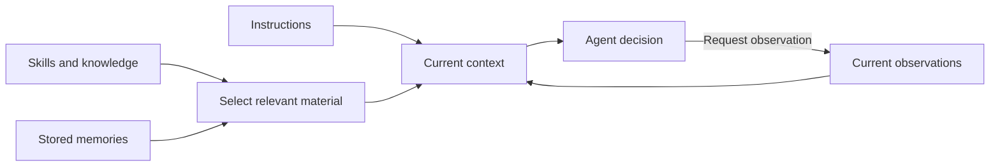

*General concept. Context is selected for a current decision. The runtime, a tool or an external event supplies each new observation; the decision requests it. Memory is stored information; saving it is not itself model retraining.*

Sources: [F04](https://www.anthropic.com/research/effective-context-engineering-for-ai-agents) [S004](https://docs.aws.amazon.com/devopsagent/latest/userguide/about-aws-devops-agent-agent-instructions.html) [S059](https://docs.aws.amazon.com/devopsagent/latest/userguide/about-aws-devops-agent-devops-agent-memories.html) [S060](https://docs.aws.amazon.com/devopsagent/latest/userguide/about-aws-devops-agent-devops-agent-skills.html)

## P04 — AWS operating model

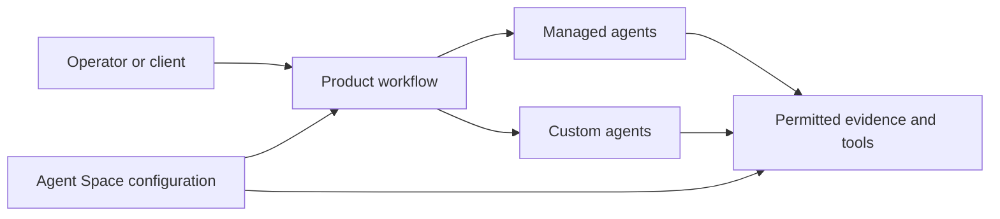

*Documented relationship. The Agent Space supplies scope and context. Boxes describe public concepts, not physical hosting or an internal scheduler.*

Sources: [S001](https://docs.aws.amazon.com/devopsagent/latest/userguide/about-aws-devops-agent.html) [S104](https://docs.aws.amazon.com/devopsagent/latest/userguide/about-aws-devops-agent-what-are-devops-agent-spaces.html) [S077](https://docs.aws.amazon.com/devopsagent/latest/userguide/working-with-devops-agent-managed-agents.html) [S056](https://docs.aws.amazon.com/devopsagent/latest/userguide/working-with-devops-agent-custom-agents-index.html)

## P05 — Access has separate boundaries

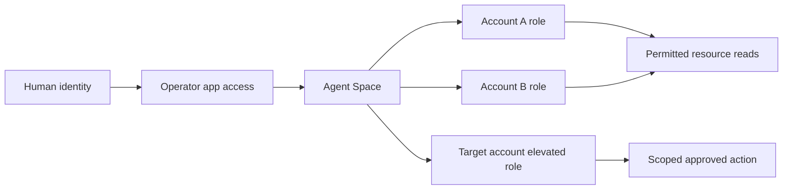

*Documented relationship. Each connected account supplies its own investigation role. Operator access and the elevated action path are separate. The elevated role is registered on the target account association. This is not role chaining through a primary investigation role.*

Sources: [S058](https://docs.aws.amazon.com/devopsagent/latest/userguide/aws-devops-agent-security-devops-agent-iam-permissions.html) [S074](https://docs.aws.amazon.com/devopsagent/latest/userguide/aws-devops-agent-security-limiting-agent-access-in-an-aws-account.html) [S108](https://docs.aws.amazon.com/devopsagent/latest/userguide/working-with-devops-agent-working-with-directed-actions.html)

## P06 — Incident triage

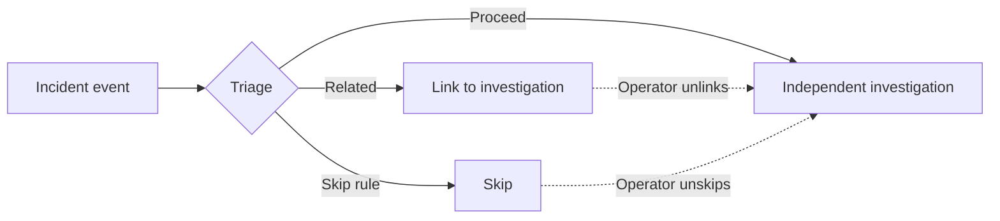

*Documented relationship. Linked, Skipped and Proceed are distinct triage outcomes. Operators can correct a link or skip; a skip is not a health verdict.*

Sources: [S010](https://docs.aws.amazon.com/devopsagent/latest/userguide/production-operations-autonomous-incident-response.html)

## P07 — Investigation evidence loop

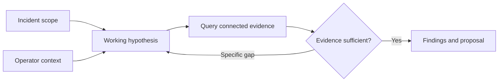

*Documented relationship. Conceptual evidence workflow. The actual investigation can use parallel work; the drawing is not an exhaustive API state machine.*

Sources: [S010](https://docs.aws.amazon.com/devopsagent/latest/userguide/production-operations-autonomous-incident-response.html)

## P08 — Directed action gates

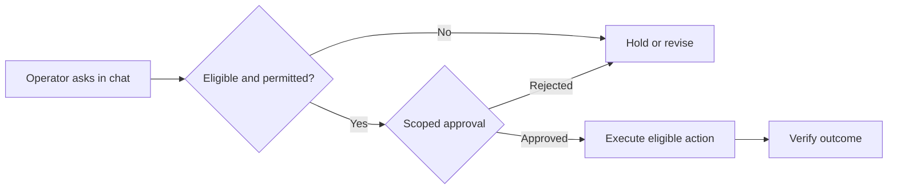

*Documented controls with customer verification. Eligibility includes feature opt-in, supported operation, guardrails and effective permissions. Only the operator-directed chat path produces these action approvals. Outcome verification is recommended customer practice.*

Sources: [S108](https://docs.aws.amazon.com/devopsagent/latest/userguide/working-with-devops-agent-working-with-directed-actions.html)

## P09 — Three uses of incident history

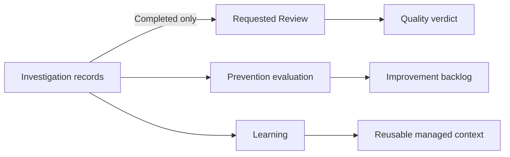

*Documented relationship. These are separate consumers of incident information. There is no asserted automatic Review-to-prevention-to-Learning chain, and Evaluation naming differs between the managed-agent and Skills guides. The diagram therefore uses the prevention workflow label.*

Sources: [S091](https://docs.aws.amazon.com/devopsagent/latest/userguide/working-with-devops-agent-reviewing-investigations.html) [S084](https://docs.aws.amazon.com/devopsagent/latest/userguide/production-operations-proactive-incident-prevention.html) [S059](https://docs.aws.amazon.com/devopsagent/latest/userguide/about-aws-devops-agent-devops-agent-memories.html) [S077](https://docs.aws.amazon.com/devopsagent/latest/userguide/working-with-devops-agent-managed-agents.html) [S060](https://docs.aws.amazon.com/devopsagent/latest/userguide/about-aws-devops-agent-devops-agent-skills.html)

## P10 — Two release evidence paths

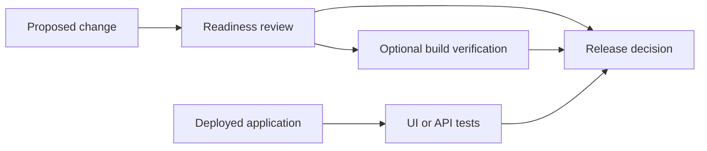

*Documented capabilities with customer decision. Readiness and deployed-application testing provide different evidence. Their combination at a team release gate is a proposed customer policy. Tests may modify application data.*

Sources: [S089](https://docs.aws.amazon.com/devopsagent/latest/userguide/release-management-release-readiness-code-review.html) [S090](https://docs.aws.amazon.com/devopsagent/latest/userguide/release-management-release-testing.html)

## P11 — Integration direction

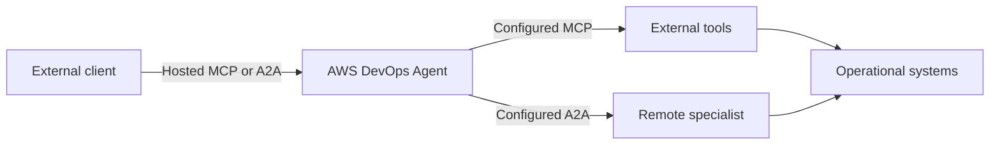

*Documented relationship. Inbound service access and outbound integrations are different configuration and authorization paths. The remote specialist is not an AWS continuation subagent.*

Sources: [S070](https://docs.aws.amazon.com/devopsagent/latest/userguide/connecting-to-devops-agent-remote-servers-integrating-with-the-devops-agent-a2a-server.html) [S038](https://docs.aws.amazon.com/devopsagent/latest/userguide/configuring-integrations-and-knowledge-connecting-mcp-servers.html) [S043](https://docs.aws.amazon.com/devopsagent/latest/userguide/configuring-integrations-and-knowledge-connecting-remote-a2a-agents.html) [S049](https://docs.aws.amazon.com/devopsagent/latest/userguide/connecting-to-devops-agent-remote-servers-connecting-to-the-devops-agent-mcp-server.html)

## P12 — Private paths are directional

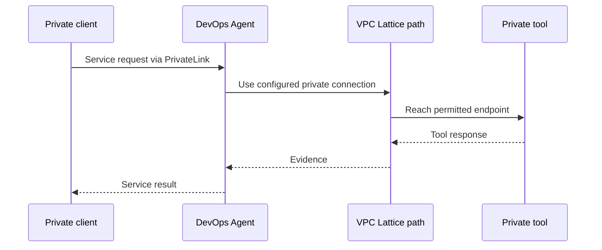

*Documented network relationship. PrivateLink serves private client ingress. The private connection and VPC Lattice path reach a private tool. These are separate paths with their own setup.*

Sources: [S103](https://docs.aws.amazon.com/devopsagent/latest/userguide/aws-devops-agent-security-vpc-endpoints-aws-privatelink.html) [S048](https://docs.aws.amazon.com/devopsagent/latest/userguide/configuring-integrations-and-knowledge-connecting-to-privately-hosted-tools.html)

## P13 — Orchestration ownership

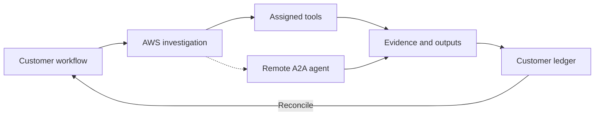

*Customer architecture using documented interfaces. This example shows an investigation. The customer workflow and ledger are proposed architecture. The optional remote A2A branch represents documented investigation delegation, not an asserted custom-agent tool path. Continuation inside a custom run does not supply this durable customer process.*

Sources: [S056](https://docs.aws.amazon.com/devopsagent/latest/userguide/working-with-devops-agent-custom-agents-index.html) [S043](https://docs.aws.amazon.com/devopsagent/latest/userguide/configuring-integrations-and-knowledge-connecting-remote-a2a-agents.html) [S070](https://docs.aws.amazon.com/devopsagent/latest/userguide/connecting-to-devops-agent-remote-servers-integrating-with-the-devops-agent-a2a-server.html)

## P14 — Incident recovery case

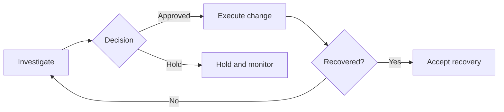

*Customer operating pattern. Customer operating pattern. The eligible action path uses documented directed-action controls; the manual path uses the established change process. Holding cannot itself close the incident.*

Sources: [S010](https://docs.aws.amazon.com/devopsagent/latest/userguide/production-operations-autonomous-incident-response.html) [S108](https://docs.aws.amazon.com/devopsagent/latest/userguide/working-with-devops-agent-working-with-directed-actions.html) [S091](https://docs.aws.amazon.com/devopsagent/latest/userguide/working-with-devops-agent-reviewing-investigations.html)

## P15 — Prevention implementation case

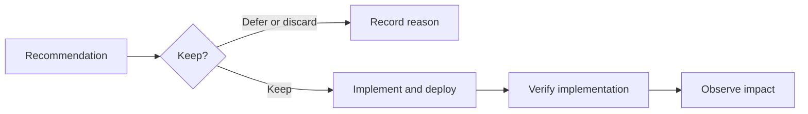

*Customer operating pattern. The service proposes improvements. Implementation ownership, deployment proof and recurrence observation belong to the illustrated customer process.*

Sources: [S084](https://docs.aws.amazon.com/devopsagent/latest/userguide/production-operations-proactive-incident-prevention.html) [S087](https://docs.aws.amazon.com/devopsagent/latest/APIReference/API_Recommendation.html)

## P16 — Release evidence case

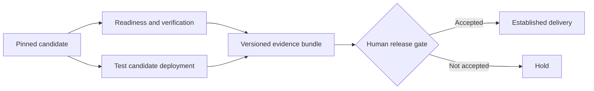

*Customer operating pattern. The sequencing and human gate are customer policy. Keep the commit and tested deployment identities attached to every result.*

Sources: [S089](https://docs.aws.amazon.com/devopsagent/latest/userguide/release-management-release-readiness-code-review.html) [S090](https://docs.aws.amazon.com/devopsagent/latest/userguide/release-management-release-testing.html) [S021](https://github.com/aws-actions/devops-agent-qa)

## P17 — Custom agent invocation

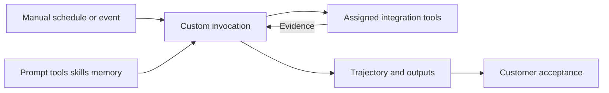

*Documented relationship. Assigned integration tools and attached stores define task scope; built-in artifact and recommendation tools are also available. Notifications need a destination and instructions; the customer acceptance step is a proposed operating practice.*

Sources: [S052](https://docs.aws.amazon.com/devopsagent/latest/userguide/custom-agents-creating-a-custom-agent.html) [S063](https://docs.aws.amazon.com/devopsagent/latest/userguide/custom-agents-executing-custom-agents.html) [S055](https://docs.aws.amazon.com/devopsagent/latest/userguide/custom-agents-custom-agent-outputs.html) [S059](https://docs.aws.amazon.com/devopsagent/latest/userguide/about-aws-devops-agent-devops-agent-memories.html)

## P18 — Completion evidence retrieval

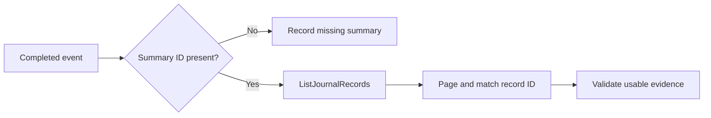

*Documented relationship. Use Agent Space ID, execution ID and the relevant summary record type. A task ID is not an execution ID. These are investigation/mitigation events; custom and prevention runs are excluded. EventBridge does not carry the summary body; absence of the ID is valid. Validation and missing-result handling are customer practice.*

Sources: [S069](https://docs.aws.amazon.com/devopsagent/latest/userguide/configuring-integrations-and-knowledge-integrating-devops-agent-into-event-driven-applications-using-amazon-eventbridge-index.html) [S075](https://docs.aws.amazon.com/devopsagent/latest/APIReference/API_ListJournalRecords.html)

## P19 — Established system extension

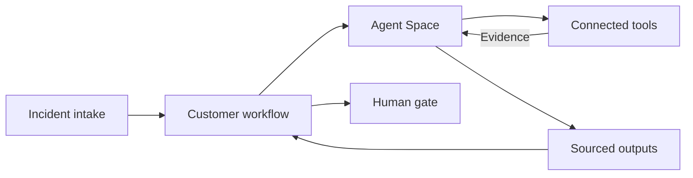

*Illustrative customer architecture. Illustrative existing environment: CloudWatch/Datadog supply telemetry, GitHub/ServiceNow supply change context, and internal MCP supplies ownership and deployment data. The customer workflow keeps a ledger. Provider scope, identity and network access must be configured; no automatic cross-provider synchronization is implied.*

Sources: [S029](https://docs.aws.amazon.com/devopsagent/latest/userguide/configuring-integrations-and-knowledge.html) [S038](https://docs.aws.amazon.com/devopsagent/latest/userguide/configuring-integrations-and-knowledge-connecting-mcp-servers.html) [S045](https://docs.aws.amazon.com/devopsagent/latest/userguide/connecting-to-ticketing-and-chat-connecting-slack.html)
