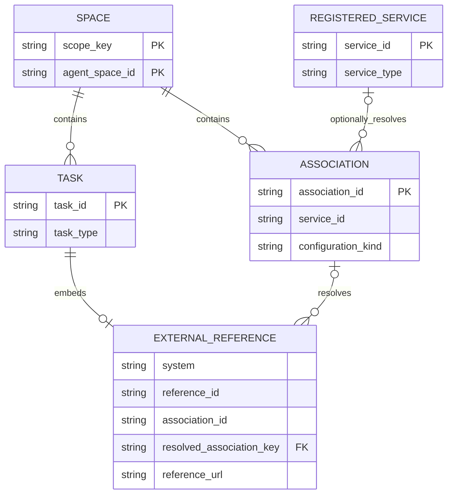
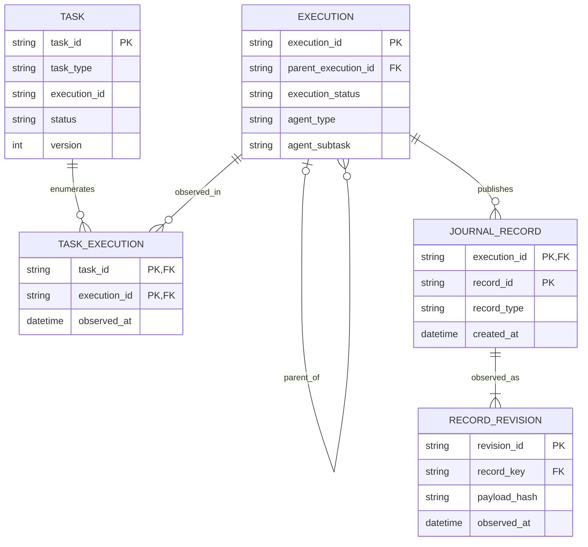
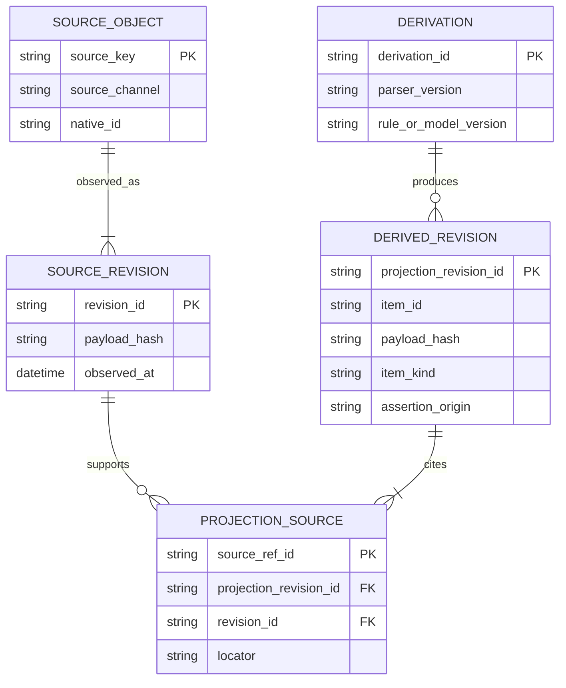
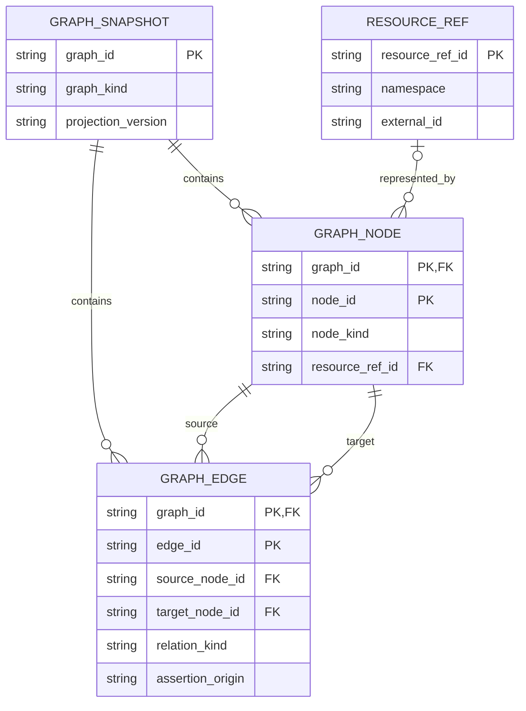
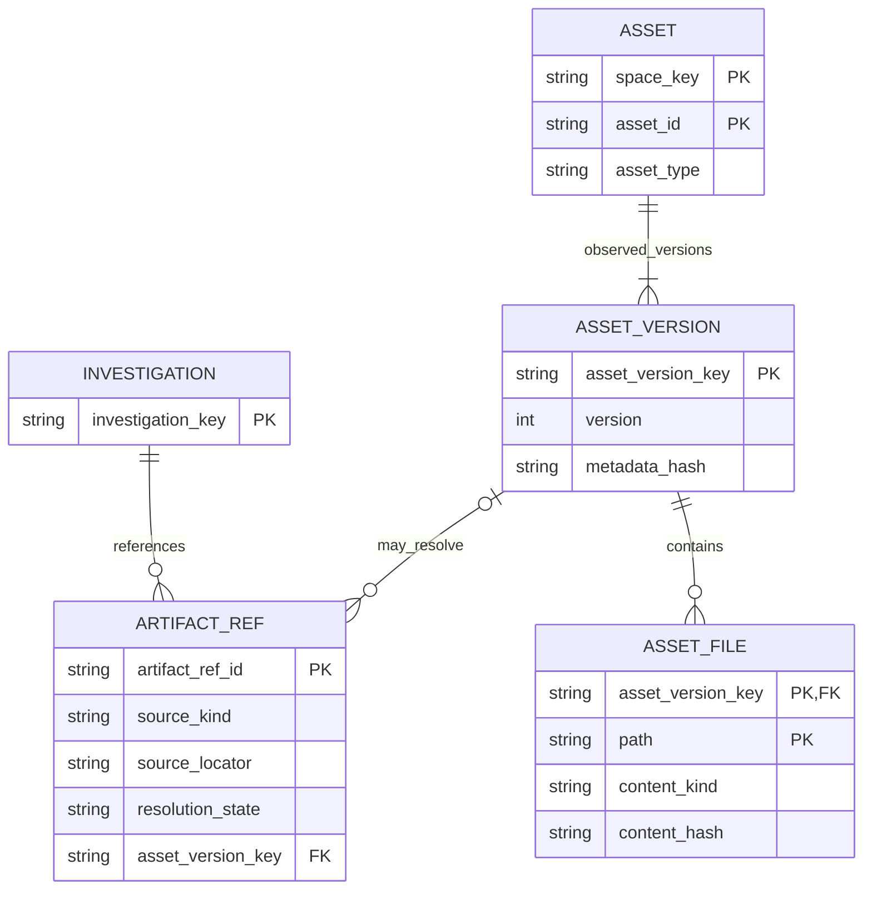
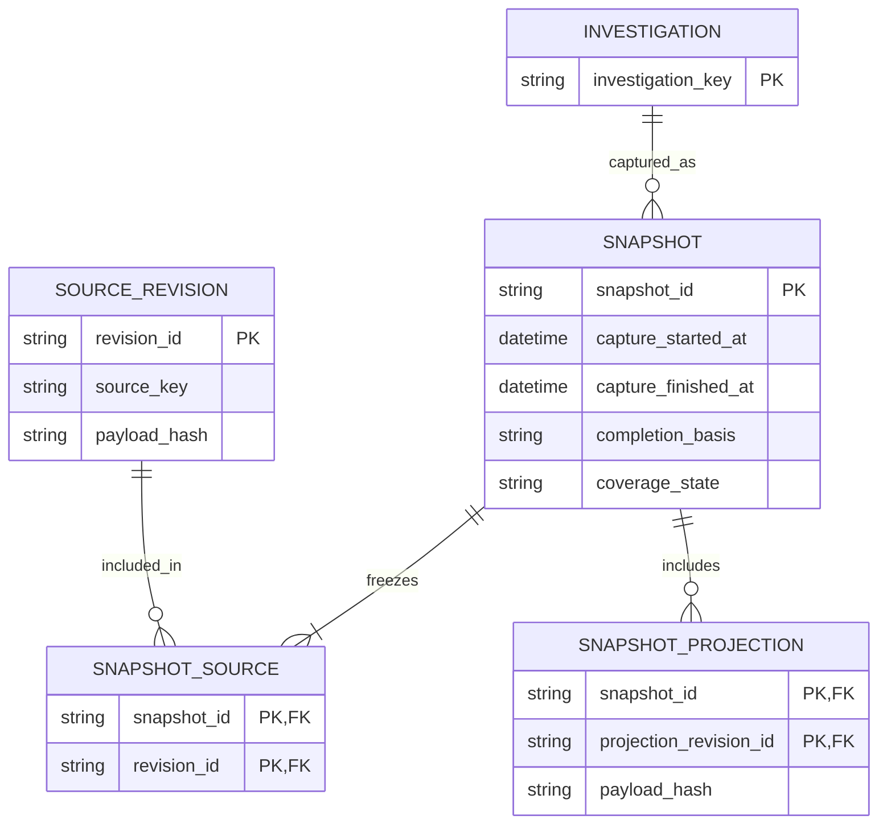

<!-- block: obsidian-devops-investigation-data-model-decision -->
# Investigation-centered data model

## 1. Architecture decision

**Represent an investigation as a business aggregate over a native backlog Task, its discovered Executions, their JournalRecords, and separately sourced lifecycle notifications and results.** Retain the original responses. Build timelines, result cards, evidence links, graphs and historical snapshots as versioned application projections.

The public AWS DevOps Agent model does **not** define an `Investigation` structure or a `GetInvestigation` operation. Its work-item discriminator is `Task.taskType = INVESTIGATION`. The current native API has 63 operations; the relevant read path is `GetBacklogTask → ListExecutions → ListJournalRecords`. AWS's separately named Amazon AI Operations APIs are outside this analysis. [Actions](https://docs.aws.amazon.com/devopsagent/latest/APIReference/API_Operations.html) · [Task](https://docs.aws.amazon.com/devopsagent/latest/APIReference/API_Task.html) · [ListExecutions](https://docs.aws.amazon.com/devopsagent/latest/APIReference/API_ListExecutions.html)

Three distinctions determine whether the redesigned UI will be trustworthy:

1. **Task status, execution status and result availability are independent.** Task `COMPLETED`, execution `STOPPED`, chat `responseCompleted` and an available summary do not mean the same thing.
2. **Published envelopes are strongly defined; much of their content is not.** `JournalRecord.content` is an arbitrary JSON document and `recordType` an open string. The native model does not publish typed hypothesis, evidence, root-cause, topology or causal-graph structures.
3. **Completion is a checkpoint, not an immutable archive.** The product guide allows an operator to send a message to a completed investigation and continue it with its prior context. A historical view therefore needs an explicit “as of” snapshot. [Execution](https://docs.aws.amazon.com/devopsagent/latest/APIReference/API_Execution.html) · [JournalRecord](https://docs.aws.amazon.com/devopsagent/latest/APIReference/API_JournalRecord.html) · [Chat with an investigation](https://docs.aws.amazon.com/devopsagent/latest/userguide/production-operations-autonomous-incident-response.html)

This design supports a useful first release using documented APIs, while exposing uncertainty where richer payload schemas require validation. It does not claim full parity with the AWS Operator Web App.

### Evidence convention

| Label | Meaning in this study |
| --- | --- |
| **Native** | Explicit field, structure, operation or constraint in the public AWS API/official SDK model |
| **Documented profile** | Meaning or payload convention described in an AWS user guide but carried inside an open string/JSON value |
| **Derived** | Proposed application entity or calculation, retaining its source identifiers and derivation method |
| **Unverified** | Product behavior or useful UI feature whose complete public wire contract was not established |

All ER diagrams are **proposed logical storage/view models**. Their cardinalities describe the design; adjacent notes explain which relationships AWS guarantees and which the application records. They are not reverse-engineered AWS database diagrams. Boxes show selected attributes; the identity table and accompanying text define full scope and joins. These are not complete physical DDL schemas.

Scope is schema/documentation review as of **5 November 2026**. The API model remains version `2026-01-01`; its pinned model revisions are dated 21 October 2026. No customer account, production investigation or live service response was queried. [[Investigation_API_Sources]] records the source pins, discrepancies and verification limits.

<!-- block: obsidian-devops-investigation-data-model-platform -->
## 2. API-wide entity map

The complete operation catalog is in [[Investigation_API_Catalog]]. These resource families provide the surrounding model without forcing every configuration object into an investigation record.

| Family | Returned/manipulated entities | Relation to an investigation |
| --- | --- | --- |
| Agent Spaces | `AgentSpace`, preferences, tags, encryption settings | Workspace and authorization scope for tasks, runs, journals and assets |
| Service access | `RegisteredService`, `Association`, provider-specific configuration | Connections the workspace may use; current configuration is not proof of what a past run consumed |
| Incident/backlog work | `Task`, external `ReferenceOutput`, task filters | Investigation identity, title, priority, lifecycle, linked-incident references |
| Runtime history | `Execution`, `JournalRecord`, `UserReference` | Execution hierarchy and persisted published activity/content |
| Conversation | `ChatExecution`, `PendingMessage`, message/content-block unions, `SendMessageEvents` | Interactive conversation and incremental response rendering |
| Action authorization | `ApprovalPattern`, `ApprovalAction`, update response | Scoped decisions and resumption of paused tool calls; not an execution-success record |
| Prevention | `Goal`, `Recommendation`, goal schedule | Related improvement work; a Recommendation is not automatically an incident mitigation |
| Assets | `Asset`, version metadata, files/content, type summaries | Skills, instructions, attachments, custom agents, memory, test profiles, feedback |
| Automation | `Trigger`, condition/filter/schedule values | Invokes configured actions; the action can refer to a custom-agent asset |
| Operator access | Enable/get/disable operator-app responses, identity-provider configuration | Web application access configuration, not the investigation domain record |
| Private access | Private connection name/ARN/status, private network configuration | Connectivity context for registered integrations or release environments |
| Intake/operations | Webhook descriptors, account usage, tag maps | Intake endpoint configuration and account-level usage; not full incident telemetry |

These names and operations come from the [API action/type indexes](https://docs.aws.amazon.com/devopsagent/latest/APIReference/API_Types.html) and the pinned SDK model. Some families return wrapper fields rather than a reusable named top-level entity. The catalog preserves those response fields.

### Diagram D01 — workspace, association and external reference

`SPACE` and `REGISTERED_SERVICE` below live inside an application connection scope: partition, account and Region. `EXTERNAL_REFERENCE` is a normalized copy of the optional value object embedded in a Task.



**Relationship qualifications.** `Task.reference`, when present, includes `system`, `referenceId`, `referenceUrl` and `associationId`; `title` is optional. Association references can be unresolved in a partial or historical collection. Preserve the reference even if the current association no longer exists. [ReferenceOutput](https://docs.aws.amazon.com/devopsagent/latest/APIReference/API_ReferenceOutput.html)

Do **not** make every `Association.serviceId` a mandatory foreign key to `RegisteredService`. AWS onboarding uses the literal service ID `aws` for built-in AWS configurations, including `aws` and `sourceAws` variants. It can also create multiple AWS account associations. Do not impose uniqueness on `(agentSpaceId, serviceId)`; identify the association by `associationId` and inspect its configuration discriminator. Registered provider-backed associations can resolve to a RegisteredService. [Association](https://docs.aws.amazon.com/devopsagent/latest/APIReference/API_Association.html) · [CLI onboarding](https://docs.aws.amazon.com/devopsagent/latest/userguide/getting-started-with-aws-devops-agent-cli-onboarding-guide.html)

A provider connection, a monitored resource and an evidence item are different identities. An association to an AWS account or repository does not establish that every resource in that account/repository was implicated in a particular investigation.

<!-- block: obsidian-devops-investigation-data-model-core -->
## 3. Investigation aggregate and keys

Define the application-level `Investigation` as:

```text
Investigation = Task where taskType is INVESTIGATION
              + observed task-to-execution memberships
              + execution hierarchy and journal records
              + lifecycle notifications and conversation observations
              + referenced results/assets
              + derived projections and historical snapshots
```

This is a composition rule, not an AWS response payload.

### Identity and scope

Use compound keys. Do not assume opaque IDs are globally unique across accounts, Regions, Agent Spaces or API channels.

| Application record | Recommended identity | Source of relationship |
| --- | --- | --- |
| ConnectionScope | `partition + accountId + region`, plus internal connection identity | Authenticated connection/endpoint context |
| AgentSpace | `scopeKey + agentSpaceId` | Returned space or request context |
| Task / Investigation | `spaceKey + taskId` | Native Task |
| Execution | `spaceKey + executionId` | Native Execution |
| TaskExecutionMembership | `spaceKey + taskId + executionId` | The `ListExecutions` request and returned list |
| JournalRecord | `spaceKey + executionId + recordId` | Native journal envelope |
| JournalRecordRevision | Record key + content/envelope hash | Application capture of observed versions |
| Event notification | Channel + account/Region + native event ID | EventBridge envelope; retain raw event |
| Stream response/block | Execution + local request/session + response ID/index/ID when present | `SendMessage` stream; preserve unresolved identifiers |
| AssetVersion | `spaceKey + assetId + version` | Asset reads/version listing |
| AssetFileVersion | AssetVersion key + exact file path | File reads; file `version` identifies its asset version |
| Derived item/revision | Stable logical item ID; separate immutable projectionRevisionId for each rendition | Application projection and retained payload/hash |
| InvestigationSnapshot | Investigation key + immutable snapshot ID | Application archival policy |

Keep Agent Space ARNs as aliases where APIs such as Goal and Recommendation return them. Use caller/endpoint context to scope bodies that omit account, Region, or Agent Space ID. A connected resource's account ID is not necessarily the service-owning account ID.

### Diagram D02 — native core with an explicit membership table

`SPACE` is omitted from the fields below for legibility; every key includes it.



**Why the junction exists.** `ListExecutions` requires a task ID, but its returned Execution does not contain `taskId`. Record the request/response association instead of losing that context. The design permits multiple observed memberships because the public shape does not establish global one-task ownership of an execution. It does not assert that the service routinely shares executions across tasks. [ListExecutions](https://docs.aws.amazon.com/devopsagent/latest/APIReference/API_ListExecutions.html)

`Task.executionId` is optional and describes an associated execution. It is a useful pointer, not a documented substitute for enumerating all executions, nor proof of “latest execution,” “root execution” or “only execution.” `Execution.parentExecutionId` supplies an explicit hierarchy edge; if the parent has not been fetched, create an unresolved reference rather than dropping the child. [Task](https://docs.aws.amazon.com/devopsagent/latest/APIReference/API_Task.html) · [Execution](https://docs.aws.amazon.com/devopsagent/latest/APIReference/API_Execution.html)

`RECORD_REVISION` is application-owned. The public JournalRecord shape provides a record ID and creation time, but no update-version or finalization marker. Store a new observed revision when a record with the same ID has different content. This preserves evidence without claiming that AWS mutates records or exposes a revision API.

### Native field groups and meaning

| Entity | Native field groups | UI/model treatment |
| --- | --- | --- |
| Task | Required IDs/type/title, priority/status, created/updated timestamps, version | Investigation list/header; preserve raw enum values and snapshot versions |
| Task context | Optional description, reference, metadata, supportMetadata | Raw context plus explicitly validated parser profiles; do not invent severity, root cause, incident time range or error fields |
| Task linking | Optional primaryTaskId, hasLinkedTasks, statusReason | Linked incident relationship; not execution parentage or fork ancestry |
| Execution | Required space/execution IDs, agentSubTask, executionStatus, created/updated timestamps | Execution row/tree node and observed activity; agentSubTask is open text |
| Execution context | Optional parentExecutionId, agentType, uid | Parent relation and display context; uid is session identity, not a full user profile |
| JournalRecord | Required space/execution/record IDs, recordType, createdAt, content | Durable published record envelope; content is any JSON value |
| Journal attribution | Optional userReference with userId/userType | Attribution when supplied; absence does not identify an internal agent by itself |

Exact requiredness and type constraints are in [[Investigation_API_Catalog]]. Fields such as `rootCause`, `confidence`, `progressPercent`, `endedAt`, `duration` and `artifactIds` are not native Task fields.

### Linked tasks and forks

A linked task has an optional `primaryTaskId`. To find linked tasks, the backlog filter accepts `primaryTaskId`. A boolean `hasLinkedTasks` is an indication, not the linked-task collection or count. Keep each source task and its external reference: grouping several alerts under one investigation must not erase the individual tickets. [TaskFilter](https://docs.aws.amazon.com/devopsagent/latest/APIReference/API_TaskFilter.html)

The product UI documents forking, but the reviewed native create/update task requests do not expose a fork-parent ID, branch point or fork operation. **Do not reuse primaryTaskId to invent a fork relationship.** If a future documented contract or a validated payload supplies fork lineage, add an explicitly sourced relation type. [Incident workflow](https://docs.aws.amazon.com/devopsagent/latest/userguide/production-operations-autonomous-incident-response.html) · [CreateBacklogTask](https://docs.aws.amazon.com/devopsagent/latest/APIReference/API_CreateBacklogTask.html) · [UpdateBacklogTask](https://docs.aws.amazon.com/devopsagent/latest/APIReference/API_UpdateBacklogTask.html)

<!-- block: obsidian-devops-investigation-data-model-status -->
## 4. Preserve separate state domains

| Domain | Published values or contract | Consequence |
| --- | --- | --- |
| Task.status | `PENDING_TRIAGE`, `LINKED`, `PENDING_START`, `IN_PROGRESS`, `PENDING_CUSTOMER_APPROVAL`, `COMPLETED`, `FAILED`, `TIMED_OUT`, `CANCELED`, `SKIPPED`, `WAITING` | Primary work-item state; show a distinct reason/linked destination where available |
| Execution.executionStatus | `FAILED`, `RUNNING`, `STOPPED`, `CANCELED`, `TIMED_OUT`, `WAITING` | Per-execution state; STOPPED alone does not prove success |
| Chat response | Created/in progress/completed/failed events, content-block events, heartbeat | State of one message response; never use as investigation completion |
| EventBridge investigation | Created, priority updated, in progress, completed, failed, timed out, cancelled, pending triage, linked, skipped event types | Lifecycle observations; no complete journal or chat history |
| EventBridge mitigation | In progress/completed/failed/timed out/cancelled event types | Separate phase milestone; `data.task_type` remains INVESTIGATION |
| Approval | `PENDING`, `APPROVED`, `REJECTED`, `REVOKED`, `REDEEMED` in the model | Authorization lifecycle; redeemed means credential mint at least once, not successful execution or mitigation |
| Application freshness/results | Proposed values such as fresh/stale, partial/complete-for-fetch, expected/retrieved/not-reported | Explicit local state with its own timestamps and reasons |

Sources: [Task](https://docs.aws.amazon.com/devopsagent/latest/APIReference/API_Task.html), [Execution](https://docs.aws.amazon.com/devopsagent/latest/APIReference/API_Execution.html), [SendMessage](https://docs.aws.amazon.com/devopsagent/latest/APIReference/API_SendMessage.html), [event detail reference](https://docs.aws.amazon.com/devopsagent/latest/userguide/integrating-devops-agent-into-event-driven-applications-using-amazon-eventbridge-devops-agent-events-detail-reference.html), [directed actions](https://docs.aws.amazon.com/devopsagent/latest/userguide/working-with-devops-agent-working-with-directed-actions.html), pinned SDK.

EventBridge's `CANCELLED` differs from native `CANCELED`. Preserve the original channel/value and normalize only for display or query. EventBridge does not enumerate every native waiting/approval state, and it is not a substitute for the task read.

The API enum describes possible values, not all legal transitions. `UpdateBacklogTask` exposes `taskStatus` and an idempotency token; it does not publish a transition matrix or a version precondition. Do not offer a generic “set status” control or derive a compare-and-swap operation from `Task.version`. [[Investigation_UI_Contract]] specifies mutation boundaries.

A completed investigation can later continue. In the proposed data model, **finalized** means “this application's retained snapshot at a stated time and source version,” not a new AWS state.

<!-- block: obsidian-devops-investigation-data-model-journal -->
## 5. Journal content, results and evidence

### The native envelope is the reliable base

A JournalRecord contains these mandatory fields:

```text
agentSpaceId, executionId, recordId, recordType, createdAt, content
```

`content` is a JSON document. There is no outer-envelope `sequenceNumber`, `updatedAt`, `parentId`, `toolUseId`, `schemaVersion`, evidence list or result discriminated union. Optional `userReference` provides attribution. [JournalRecord](https://docs.aws.amazon.com/devopsagent/latest/APIReference/API_JournalRecord.html)

**Preserve unknown record types.** Render a raw structured view with a short readable preview, execution, timestamp and record ID. Dispatch known types through registered parsers. An unsupported type should not break the investigation page or silently disappear.

### Documented summary profiles

AWS documents two exact record-type strings:

| Purpose | recordType | Selection |
| --- | --- | --- |
| Investigation summary | `investigation_summary_md` | Match the completion event's `summary_record_id` when present |
| Mitigation summary | `mitigation_summary_md` | Match the mitigation completion event's `summary_record_id` when present |

An execution can have several summary records of a type. Call `ListJournalRecords` with the correct space, execution and type; traverse the required pages and select the exact record ID. There is no public single-record Get operation. A completed event may omit the summary pointer; failed, timed-out and cancelled events do not include it. Both investigation and mitigation events use task type INVESTIGATION, so use `detail-type` to choose the summary type. [EventBridge integration and summary retrieval](https://docs.aws.amazon.com/devopsagent/latest/userguide/configuring-integrations-and-knowledge-integrating-devops-agent-into-event-driven-applications-using-amazon-eventbridge-index.html)

The `_md` convention identifies a summary intended for Markdown presentation. It does not change the outer `content` type from JSON to a string-only schema. Accept a string when actually returned; preserve unexpected forms and require a validated decoder for wrappers. Do not blindly assume `content.markdown` or `content.text` exists.

When no completion pointer was captured, show candidate summary records with their provenance. An application may choose the latest observed record as a display policy, but label that selection; a timestamp tie or incomplete page set does not establish an authoritative final summary.

### Proposed semantic entities

| Derived entity | Meaning | Source requirement |
| --- | --- | --- |
| Finding | A published observation or conclusion relevant to the incident | Exact journal/summary fragment or validated structured field |
| EvidenceItem | A measurement, log excerpt, query result, trace reference, change record or external document | Source record/path plus original system/time range when explicitly provided |
| Hypothesis | An asserted possible explanation with any published disposition | Validated payload or attributed extraction; no private reasoning reconstruction |
| RootCauseAssessment | The agent's or operator's stated causal assessment | Exact cited conclusion; distinguish an assertion from independent verification |
| MitigationProposal | Proposed steps, scope and prerequisites | Published proposal content; no assumption that it was approved or executed |
| ActionObservation | Observed request, approval, execution or outcome | Separate source for each stage; no success inference from permission grant |
| ReviewResult | A quality evaluation of an investigation | Explicit review result/source and scope; no invented universal review schema |
| ResultDocument | A versioned rendering of a summary or other document | Source record revision, parser version, selection reason and phase |
| ResourceReference | A referenced resource identifier or URL | Explicit payload reference; namespace/type provenance |
| ArtifactReference | A reference to a file, asset version, URI or inline result | Resolvable source locator; unknown or unavailable remains explicit |

This is an application vocabulary, not a list of AWS result types. Do not create empty “native” hypothesis/evidence fields that imply the service promised them. The product guide describes findings, tool activity, agent collaboration, root cause and mitigation presentation; it does not publish the nested JSON schema for all of them. [Incident workflow](https://docs.aws.amazon.com/devopsagent/latest/userguide/production-operations-autonomous-incident-response.html)

### Diagram D03 — every projection retains provenance

`SOURCE_REVISION` can represent a journal revision, event, task/execution observation, stream block or a referenced asset version. `DERIVED_REVISION` retains an immutable rendition of a timeline entry, finding, result document or graph assertion. Its logical item ID provides continuity across revisions.



A projection revision retains its payload/hash and derivation identity immutably. Snapshots reference projectionRevisionId, never only a mutable logical item ID or parser-version label. One source_ref_id identifies each citation, allowing several locators into the same source revision. Operator annotations are captured as application-origin source objects with author/time, so they can also satisfy provenance requirements.

A locator is a JSON Pointer, source text range or asset path tied to an exact source revision. Hashes establish which content was used, not whether a claim is true. Preserve unsupported content so new parsers can improve the view without refetching inaccessible historical material.

Every projection declares whether it is a direct field mapping, a deterministic parse, an operator annotation or an application inference. Application-generated confidence scores must never be displayed as AWS-provided confidence.

<!-- block: obsidian-devops-investigation-data-model-timeline -->
## 6. Timeline model

The operator needs several related timelines, not one indiscriminate timestamp sort:

- **Work lifecycle:** creation, triage, linking, execution status observations and phase milestones.
- **Published investigation activity:** journal records, findings, summaries and validated tool/subagent activity.
- **Conversation and decisions:** operator messages, streamed responses, approvals and resume attempts.
- **Incident evidence:** the time the affected system produced a log, metric or change, when supplied.
- **Collection history:** when the UI's backend fetched or received each observation.

### TimelineItem contract — application proposal

| Field | Purpose |
| --- | --- |
| `itemId`, `projectionRevisionId`, `investigationKey` | Stable logical identity, immutable rendition identity and scope |
| `executionKey?`, `parentItemId?` | Grouping from explicit relations; absence is allowed |
| `category`, `phase?`, `title`, `body` | Operator-facing classification and content |
| `occurredAt?`, `occurredAtBasis` | Event/evidence time and its meaning; can be unknown |
| `recordedAt?` | Native journal creation or source update time |
| `observedAt` | Backend receipt/fetch time |
| `sourceRefs[]`, `derivationId` | Provenance and parser/model revision |
| `assertionOrigin` | Native field, documented profile, deterministic parse, operator statement, application inference |
| `availability`, `completeness` | Pending, complete-for-source, unsupported, inaccessible or partial |
| `relatedResourceRefs[]`, `artifactRefs[]` | Optional validated links |
| `supersedesItemId?` | Corrected/replaced projection, preserving earlier state |

The fields are proposed API/view-model fields for your backend, not AWS request fields.

**Time semantics matter.** Journal `createdAt` is record creation time. Task/execution `updatedAt` is the last update, not necessarily a finish timestamp. EventBridge `time` represents the investigation/mitigation update time, not receipt by EventBridge. An evidence timestamp inside content may describe a much earlier system event. Preserve all clocks instead of rewriting them into one inferred incident time. [JournalRecord](https://docs.aws.amazon.com/devopsagent/latest/APIReference/API_JournalRecord.html) · [Event detail reference](https://docs.aws.amazon.com/devopsagent/latest/userguide/integrating-devops-agent-into-event-driven-applications-using-amazon-eventbridge-devops-agent-events-detail-reference.html)

For deterministic presentation, order records by source event time where its meaning is known, then by a stable local tie-break. State clearly that the tie-break is a UI rule: the journal API promises timestamp direction but no same-time total order. Execution hierarchy and stream sequence are independent ordering dimensions.

Do not compute a percentage complete from journal count or elapsed time. You can report elapsed wall time, visible execution states, observed record count and last successful synchronization. These are observations; the total amount of future agent work is not in the public model.

Detailed synchronization, partial-page behavior and metric definitions are in [[Investigation_UI_Contract]].


<!-- block: obsidian-devops-investigation-data-model-graphs -->
## 7. Graphs: distinguish the relation being shown

The native operation/type inventory contains no published `Graph`, `Node`, `Edge`, `Hypothesis` or `Finding` entity and no graph-retrieval operation. Some IAM/web-app documentation mentions topology capabilities; an IAM action name alone is not a complete public API request/response contract. [Actions](https://docs.aws.amazon.com/devopsagent/latest/APIReference/API_Operations.html) · [Data types](https://docs.aws.amazon.com/devopsagent/latest/APIReference/API_Types.html)

Nevertheless, several useful graphs can be built. They have different evidentiary strength:

| Graph | Available basis | Reliability and presentation rule |
| --- | --- | --- |
| Execution hierarchy | `executionId + parentExecutionId` | Direct field mapping; missing parents remain unresolved |
| Stream block hierarchy | `contentBlockStart.id + parentId` within a response/session | Direct mapping only when IDs are supplied; does not establish a durable tool-call or journal relationship |
| Task-link graph | `primaryTaskId` and linked-task query results | Direct linked-incident relation; not a fork or causality graph |
| Evidence/argument graph | Validated journal content or attributed extracted claims | Derived; every assertion needs source locators and an assertion origin |
| Resource topology | Explicit resource/dependency evidence or another independently integrated topology service | Derived/integrated; the current AgentSpace configuration does not supply a general topology API |
| Change-to-symptom causal graph | Published causal claim plus supporting observations | A claim with provenance; temporal adjacency alone does not establish causality |
| Knowledge/configuration graph | Asset profiles, skill/memory references, integration configuration | Contextual graph; current configuration does not prove historic consumption by an execution |

The UI should name the view: **Execution tree**, **Evidence map**, **Resource dependencies**, **Linked incidents**, or **Configuration context**. A single “Graph” tab that merges all edge meanings would obscure the distinction between observed relationships and inferred explanations.

### Diagram D04 — graph snapshot and typed edges

This application graph is independent of any particular graph database. Source provenance uses the D03 model.



Graph nodes and edges reference their immutable D03 projection revisions. Both edge endpoints join within the same graph snapshot: (graph_id, source_node_id) and (graph_id, target_node_id) reference (graph_id, node_id). Create clearly labeled placeholder nodes for unresolved endpoints; a placeholder represents a missing reference, not a fabricated resource.

Recommended node kinds are `execution`, `resource`, `observation`, `hypothesis`, `change`, `action` and `document`. Recommended relation kinds include `parent_execution`, `references`, `supports`, `contradicts`, `depends_on`, `precedes` and `asserted_cause_of`. These are application vocabularies, not AWS enums.

For each node/edge retain:

- Stable identity, graph kind and graph snapshot/projection version.
- Exact source references and parser/extractor version.
- Assertion origin: explicitly reported by the agent, operator-confirmed, independently observed, or inferred by the application.
- Any published confidence/disposition as a source value; absence stays absent.
- A display label and explanation separate from the raw evidence.
- Validity/observation times and unresolved/dangling-reference state.

Do not infer a causal edge from an execution parent edge, convert an unreferenced summary sentence into a confirmed root cause, or expose a guessed internal reasoning chain as the agent's actual reasoning. The application can show published reasoning artifacts and attributed extractions.

Charts have the same boundary: there is no universal native time-series schema in Task or JournalRecord. A metric chart needs validated points, units, aggregation, source query and time window from a supported payload or an additional telemetry integration. A prose mention of “CPU increased” cannot produce an exact numeric chart.

<!-- block: obsidian-devops-investigation-data-model-artifacts -->
## 8. Artifacts, assets and reproducibility

### Keep three artifact sources separate

1. **Native Asset API:** addressable assets with versions and files.
2. **Journal/stream result content:** inline summaries, references, tool results and other payloads.
3. **A2A artifacts:** protocol-level result artifacts returned through that separate interface.

An application `ArtifactReference` unifies discovery and presentation while preserving the source channel. It does not assert that an A2A artifact ID or a journal reference is a native `assetId`.

The Asset API exposes metadata and version separately from content. `GetAssetContent` returns a zip blob and its version. File retrieval returns path/content/version/timestamps, with content expressed as a text-or-bytes union. Use a specific `assetVersion` for reproducible historical reads; an unversioned read returns the latest. [Asset](https://docs.aws.amazon.com/devopsagent/latest/APIReference/API_Asset.html) · [GetAssetContent](https://docs.aws.amazon.com/devopsagent/latest/APIReference/API_GetAssetContent.html) · [GetAssetFile](https://docs.aws.amazon.com/devopsagent/latest/APIReference/API_GetAssetFile.html)

### Diagram D05 — investigation references and native asset history

`INVESTIGATION` and `ARTIFACT_REF` are application entities. The other entities normalize native Asset/version/file responses. A reference can remain inline or external, so its AssetVersion relation is optional.



**No general investigation-to-asset foreign key is published.** Asset bodies omit task/execution IDs, and `ListAssets` has no execution/task filter. Scope comes from the request. An attachment sent through `SendMessage.assetIds` is an explicit relationship; a generic asset in the same Agent Space is not automatically an output or input of that investigation. [ListAssets](https://docs.aws.amazon.com/devopsagent/latest/APIReference/API_ListAssets.html) · [SendMessage](https://docs.aws.amazon.com/devopsagent/latest/APIReference/API_SendMessage.html)

SendMessage.assetIds proves an attachment-ID relationship but does not specify the consumed version. A version retrieved nearby is an observed version unless the actual consumed version is independently established.

A useful `ArtifactReference` holds source channel, source record/block, native ID if present, URI/path, optional asset ID/version, content/media hints, retrieved hash, availability and retrieval authorization state. Preserve unknown media types. Missing, access denied, not yet published, unsupported and deleted are different states.

### Documented Asset profiles

The AWS managing-assets guide documents current types `skill`, `agents_md`, `attachment`, `custom_agent`, `memory_store`, `memory`, `test_profile` and `feedback`. The model itself uses an open asset-type string; query `ListAssetTypes` and tolerate future types. [Managing assets](https://docs.aws.amazon.com/devopsagent/latest/userguide/about-aws-devops-agent-managing-assets.html)

Relevant documented links inside metadata are:

| Profile | Documented relationship | Investigation UI use |
| --- | --- | --- |
| custom_agent | `skills[]` and `memory_stores[]` refer to existing same-space asset IDs | Explain configuration when explicitly tied to an execution |
| memory | `memory_store_id` refers to the containing store asset | Knowledge context, with version/time qualifications |
| feedback | Optional `execution_id`, immutable after create | Associate recorded feedback with an execution; no native server-side execution filter on ListAssets |

These are **documented metadata profiles**, not newly typed fields in the generic Asset response. Separately, the native Trigger resource carries a JSON action document. The documented custom-agent action profile uses `Trigger.action.actionType = "create:task"` and `Trigger.action.task.agent = "custom:<assetId>"`; Trigger is not an Asset type. [Trigger](https://docs.aws.amazon.com/devopsagent/latest/APIReference/API_Trigger.html) · [CLI example](https://docs.aws.amazon.com/devopsagent/latest/userguide/getting-started-with-aws-devops-agent-cli-onboarding-guide.html) Do not infer that a historical run used the current versions of all referenced skills or memories. Preserve configuration snapshots when the application can collect them, and label whether they are known inputs or merely contemporaneous workspace context.

### Export and retention

For a defensible investigation export, include source envelopes/revisions, selected summaries, graph/timeline projections with parser versions, referenced asset versions actually retrieved, provenance locators, timestamps, known gaps and a manifest of hashes. Retain external URIs as references; copying external content requires appropriate access and retention policy.

The reviewed native contract does not establish a uniform journal retention window, a complete archive endpoint or an immutable final investigation package. If future access to the original record matters, the redesigned application needs its own authorized retention policy.

<!-- block: obsidian-devops-investigation-data-model-context -->
## 9. Results that belong beside the investigation

### Recommendations and goals

A `Recommendation` explicitly includes a `taskId` and optional `goalId`/`goalVersion`. Its content has a required summary and optional spec, alongside status, priority, ranking and version fields. `Goal` has current content/status/schedule plus last-task pointers. These are useful cross-links to prevention work. [Recommendation](https://docs.aws.amazon.com/devopsagent/latest/APIReference/API_Recommendation.html) · [Goal](https://docs.aws.amazon.com/devopsagent/latest/APIReference/API_Goal.html)

Preserve their own identity and lifecycle. Recommendation priorities are HIGH/MEDIUM/LOW, while investigation task priorities have five values. A recommendation marked COMPLETED is not an investigation completion event. Do not classify every recommendation as the incident's root cause or immediate mitigation.

### Review and feedback

An investigation Review evaluates the published record and returns its assessment alongside the investigation; the product guide says it does not rerun or alter the investigation. It is analytically useful to retain both the reviewed source snapshot and the assessment. The reviewed native model does not define a universal `ReviewResult` structure or standalone Review CRUD family. Treat a rich review panel as a documented capability whose payload mapping still needs validation. [Reviewing investigations](https://docs.aws.amazon.com/devopsagent/latest/userguide/working-with-devops-agent-reviewing-investigations.html)

Feedback assets provide one documented execution association. Operator annotations written only in the redesigned UI are a separate application entity and must not be represented as feedback submitted to AWS until the relevant service call succeeds.

### Context snapshots

Configuration at read time may differ from configuration during the incident. Store `observedAt` and version/hash on Agent Space, association, asset and trigger context if retained for historical interpretation. Record explicit run-consumed inputs separately from current or contemporaneous configuration.

A relationship diagram can explain configured access without proving successful access. Tool permission failures, missing telemetry, inaccessible repositories and source-query failures must remain visible evidence gaps when published.

<!-- block: obsidian-devops-investigation-data-model-snapshots -->
## 10. Historical snapshots and result readiness

### Diagram D06 — immutable application snapshots

`SOURCE_REVISION` is the same concept as D03. A snapshot is a manifest of a captured set of sources and derived items; it is not a new AWS resource.



Capture task version, execution membership, all fetched journal revisions, completion events and exact summary pointers. Include per-execution pagination coverage, unresolved references, inaccessible content and parser versions. Because the API does not provide a transactionally consistent cross-endpoint snapshot, record **capture start/end** and any source changes observed during collection.

A reasonable application policy is to perform terminal reconciliation, retrieve referenced results, compare a follow-up task/execution observation, and create a snapshot with the known coverage. Repeated identical reads increase confidence in stability; they do not prove a service-guaranteed finalization barrier. The UI should say “Snapshot captured at …” or “Available results as of …”.

If the investigation continues, retain the prior snapshot and produce new observations and a later snapshot. Do not silently rewrite the report an operator already reviewed.

### Availability is a structured object

Represent availability per phase/result, not as one `isDone` boolean:

| Application condition | Operator-facing treatment |
| --- | --- |
| Task active; records arriving | Show live activity and synchronization freshness |
| Task completed; summary pointer present; record not fetched | “Completed — retrieving referenced summary” |
| Task completed; completion event omitted the summary pointer | “Completed — this event did not report a summary” |
| Several summary records; no authoritative pointer captured | Show candidates and selected-display policy |
| Some executions/pages inaccessible | Show known results with partial coverage and the affected sources |
| Unknown record types | Show raw records plus unsupported-renderer count |
| Captured snapshot | Show capture window, source versions, completeness and later updates if any |
| Continued investigation | Keep old snapshot accessible; current view returns to live mode |

The EventBridge pointer contract is explicit. Separately, A2A documentation warns that terminal task status may precede result-artifact availability. That warning is not a published maximum lag or a native-journal consistency guarantee. [EventBridge summary retrieval](https://docs.aws.amazon.com/devopsagent/latest/userguide/configuring-integrations-and-knowledge-integrating-devops-agent-into-event-driven-applications-using-amazon-eventbridge-index.html) · [A2A interface](https://docs.aws.amazon.com/devopsagent/latest/userguide/connecting-to-devops-agent-remote-servers-integrating-with-the-devops-agent-a2a-server.html)

<!-- block: obsidian-devops-investigation-data-model-feasibility -->
## 11. What the redesigned UI can promise

| Feature | Feasibility from reviewed contract | Additional work |
| --- | --- | --- |
| Investigation list/details | Native Task APIs | Scope, filters, pagination, stale/error presentation |
| Linked-incident view | Native primaryTaskId/reference fields | Preserve missing/historical associations |
| Execution tree | Native Execution parent relationship | Collect every task-scoped page, handle unresolved parents |
| Journal timeline/raw record inspector | Native journal envelope/content | Pagination, deterministic display, safe rendering |
| Live chat response | Native SendMessage EventStream | Session/block assembly, dropped-stream handling |
| Completion/mitigation milestones | Documented EventBridge events | Durable ingestion, dedupe, reconciliation |
| Exact summary retrieval | Documented record types + event pointer | Traverse pages, preserve unavailable/absent distinction |
| Versioned asset/file browser | Native Asset APIs | Only attach to investigations through explicit evidence |
| Rich tool/evidence timeline | Partly specified | Capture representative payloads and validate parser profiles |
| Hypothesis/causal graph | Application projection | Explicit assertions, source locators, provenance and uncertainty |
| Complete underlying telemetry charts | Not supplied as a universal investigation response | Validated query-result payloads or additional telemetry APIs |
| Immutable historical report | Application capability | Source retention, snapshot manifests and versioned projections |
| Complete operator-app feature parity | Not established | Resolve fork/resume/triage/readback/visibility contracts with AWS |

### Recommended storage boundary

Use a relational core for identities and joins, JSON storage for intact AWS payloads, and file/object storage for retained artifacts where necessary. Index derived entities for UI queries. The reviewed contract does not require a graph database: graph views can be materialized from node/edge tables with provenance.

Raw captures should survive a parser upgrade. A failed renderer must not corrupt source data; a new parser can rebuild projections against retained revisions. Historical results should retain the derivation version actually used, even if the current parser produces an improved view.

### Definition of a useful first release

Deliver an investigation list, separate lifecycle/freshness indicators, an execution tree, journal chronology, exact summary selection, linked tickets, explicit asset references and retained snapshots. Add a raw-record inspector with copy/export and an unknown-type fallback.

Promote richer evidence, tool-call, graph, review and approval-resumption experiences only after their payload profiles and recovery paths have been exercised against authorized representative investigations. The capture matrix and acceptance criteria are in [[Investigation_UI_Contract]].

<!-- block: obsidian-devops-investigation-data-model-conclusion -->
## 12. Design invariants

1. Investigation identity is the native backlog task identity scoped to account, Region and Agent Space.
2. Task-to-execution membership is retained from requests; the associated execution pointer is not the entire run set.
3. A lifecycle state is not a result-availability guarantee.
4. Every semantic result and graph assertion can be traced to a retained source revision or an explicit operator/application inference.
5. An unsupported content type remains visible and exportable.
6. A complete page traversal is coverage of that fetch, not a global immutable snapshot guarantee.
7. Current configuration is not automatically historical execution context.
8. Permission grant, resume acknowledgement, tool execution and verified mitigation outcome are separate facts.
9. Historical snapshots remain immutable in the application when the current investigation continues.
10. An AWS web-app feature or IAM action does not by itself establish a public SDK operation.

See [[Investigation_API_Catalog]] for exact fields, [[Investigation_UI_Contract]] for synchronization and view contracts, and [[Investigation_API_Sources]] for the evidence and validation record.
