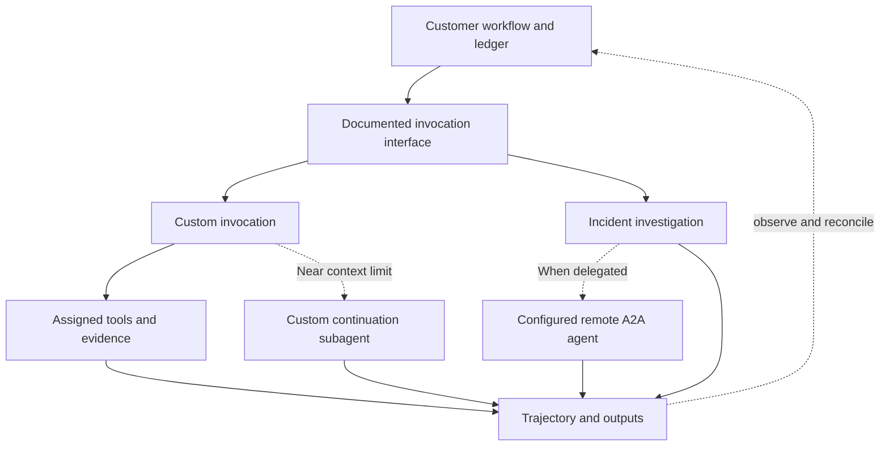
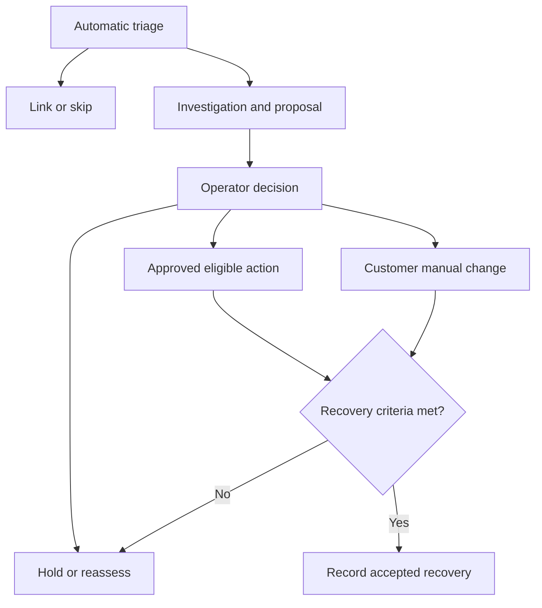
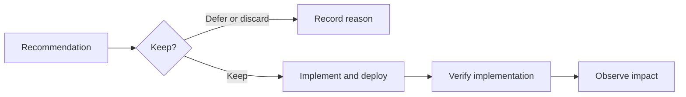
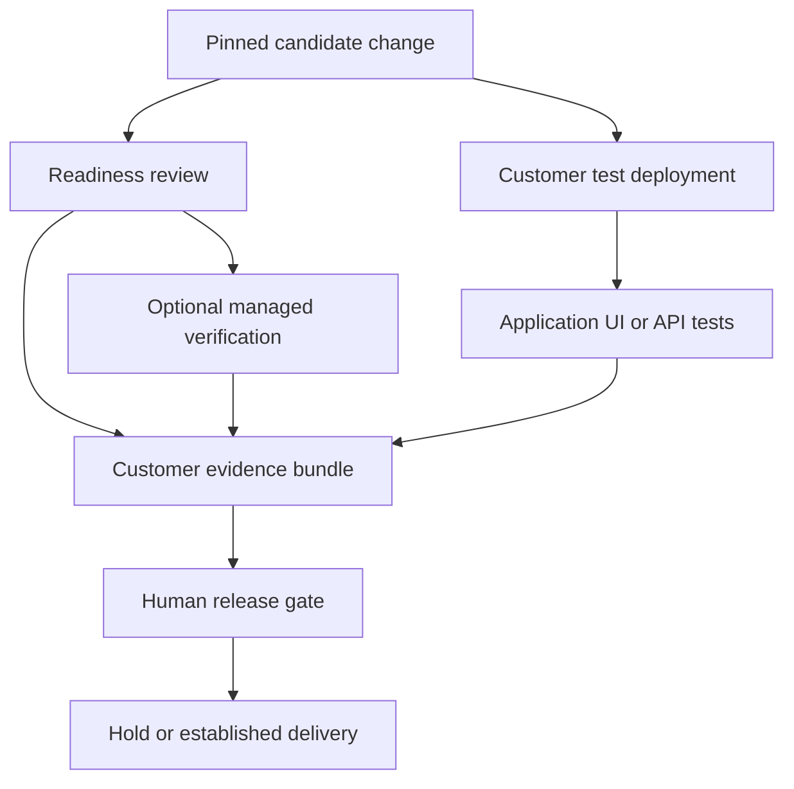
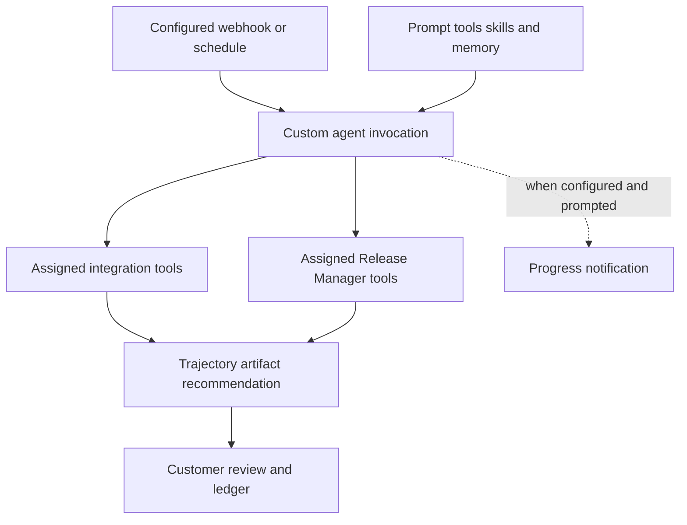
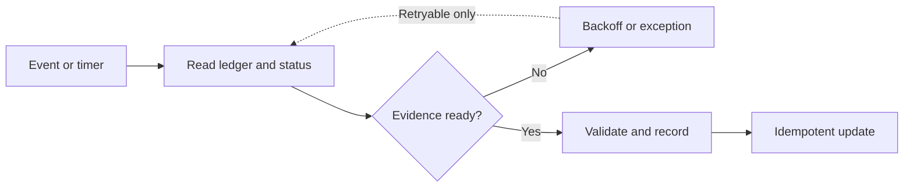

<!-- block: obsidian-devops-orchestration-and-use-cases-body -->
# Orchestration, operational cases and custom extensions

AWS DevOps Agent can perform a substantial investigation or custom analysis inside one execution. A complete operational process usually extends beyond that execution: accepting an incident, coordinating owners, recording decisions, changing a system, checking recovery and retaining evidence. Design those responsibilities explicitly before connecting more agents.

The organization, service names and operating procedures below are **invented examples**. They illustrate how a team could connect documented capabilities to an established environment. “Documented contract” identifies behavior described by AWS; it does not mean the illustrated system has been implemented. “Customer design” identifies orchestration, business rules and integration work the organization must supply.

## 1. Three layers of orchestration

### Service-managed execution

An Agent Space supplies the configured operational context. A custom agent receives its prompt, selected tools, skills and attached memory stores. Its invocation records tool activity and outputs. AWS also documents dynamic subagent delegation: near a context-window limit, a custom agent can create a continuation subagent with the same tools and skills, without additional configuration. This establishes continuation behavior; it does not establish a customer-authored dependency graph, independently scheduled child jobs or a distributed transaction. [S056](https://docs.aws.amazon.com/devopsagent/latest/userguide/working-with-devops-agent-custom-agents-index.html)

Describe visible behavior rather than assigning undocumented internal components to boxes. The investigation timeline, custom-agent trajectory and produced artifacts are useful observation surfaces. They do not expose a contractual implementation topology. A long analysis that succeeds still needs a separate judgment about whether its evidence answers the operational question.

### Customer-owned workflow

The customer owns the durable process that crosses systems or outlives an agent run. In these examples, an existing integration service maintains a work ledger, routes human decisions, records external identifiers and reconciles outcomes. Its responsibilities include deciding whether to start new work, holding a release, deduplicating notifications and checking that an accepted change actually reached production.

Those are proposed responsibilities, not hidden AWS DevOps Agent features. The ledger remains the process record even if a chat session closes, a notification fails or a controller restarts. It stores observed facts separately from business conclusions: “analysis completed” and “incident resolved” are different fields.

### External agent delegation

An external client can invoke the DevOps Agent A2A server. In the other direction, DevOps Agent can call a registered remote A2A provider. These directions have separate configuration and authorization. A remote agent is not the automatic continuation subagent described above. AWS documents remote-agent discovery, supported bindings and credentials; the organization defines the specialist's responsibility and validates its output. [S070](https://docs.aws.amazon.com/devopsagent/latest/userguide/connecting-to-devops-agent-remote-servers-integrating-with-the-devops-agent-a2a-server.html) [S043](https://docs.aws.amazon.com/devopsagent/latest/userguide/configuring-integrations-and-knowledge-connecting-remote-a2a-agents.html)



**Diagram meaning:** the service relationships follow the documented custom-agent and A2A capabilities. The surrounding ledger and reconciliation loop are customer design. The drawing is not an internal AWS architecture or a promise that every execution delegates. Sources: [S056](https://docs.aws.amazon.com/devopsagent/latest/userguide/working-with-devops-agent-custom-agents-index.html) [S043](https://docs.aws.amazon.com/devopsagent/latest/userguide/configuring-integrations-and-knowledge-connecting-remote-a2a-agents.html) [S070](https://docs.aws.amazon.com/devopsagent/latest/userguide/connecting-to-devops-agent-remote-servers-integrating-with-the-devops-agent-a2a-server.html).

## 2. The illustrative established environment

Assume a fictional payments organization already runs `checkout` on Amazon EKS. CloudWatch supplies AWS telemetry, Datadog supplies application observations, PagerDuty handles paging and ServiceNow holds the incident and change records. GitHub holds application and deployment definitions. Responders use an associated private Slack channel. An internal MCP server exposes selected ownership, deployment and policy information. An EventBridge consumer stores the documented investigation and mitigation events.

This is an assumed inventory, not a claim that registration automatically connects every workflow. EKS resource access needs its documented setup; the Slack conversation path needs a private channel, application membership, role and binding. Provider associations select the resources or capabilities available to the space. [S024](https://docs.aws.amazon.com/devopsagent/latest/userguide/configuring-integrations-and-knowledge-aws-eks-access-setup.html) [S045](https://docs.aws.amazon.com/devopsagent/latest/userguide/connecting-to-ticketing-and-chat-connecting-slack.html) [S029](https://docs.aws.amazon.com/devopsagent/latest/userguide/configuring-integrations-and-knowledge.html)

## 3. Case one: incident to verified recovery

**Documented contract.** Configured incidents can enter triage, which can link them to existing work, skip them or proceed with an independent investigation. Responders can inspect evidence, add context and correct findings. Directed changes require explicit operator direction and the applicable approval and capability controls; an autonomous investigation does not itself obtain approval and perform a mutating call. [S010](https://docs.aws.amazon.com/devopsagent/latest/userguide/production-operations-autonomous-incident-response.html) [S108](https://docs.aws.amazon.com/devopsagent/latest/userguide/working-with-devops-agent-working-with-directed-actions.html)

**Invented customer flow.** PagerDuty reports rising checkout failures. The integration service records its incident identifier and the linked ServiceNow record, then checks whether this delivery belongs to an existing work item. The team uses one agreed intake route. It does not deliberately start separate investigations from PagerDuty, Datadog and ServiceNow for the same incident and hope that downstream correlation repairs the duplication.

If triage links the incident, the operator follows the primary investigation and preserves the association in the ledger. A skipped result is recorded with its observed explanation; it is not treated as healthy service. For independent analysis, the agent correlates the failure window with CloudWatch, Datadog, EKS state and GitHub deployment evidence. The internal MCP source provides the owner and deployment record. An unavailable source becomes an explicit evidence gap.

The investigation suggests that a recent change altered connection-pool behavior. This remains a cause assessment until the responder checks timing and contrary evidence. The responder may ask for a mitigation in chat, approve an eligible scoped operation, or use the existing deployment process to roll back. The choice is recorded as an operator decision. A suggestion to revert a commit is not evidence that the revert happened.

The customer workflow then verifies error rate, latency and business transaction success over its chosen observation window. It records the actual deployment identifier and any remaining uncertainty. Only that customer acceptance step permits incident closure. Corrective feedback and a Review serve different purposes: feedback can inform future investigations; Review assesses the completed investigation's quality. [S010](https://docs.aws.amazon.com/devopsagent/latest/userguide/production-operations-autonomous-incident-response.html) [S091](https://docs.aws.amazon.com/devopsagent/latest/userguide/working-with-devops-agent-reviewing-investigations.html)



**Diagram meaning:** triage, investigation and approval are documented capabilities. The customer's closure criteria, manual change route and recovery verification are proposed operating practice. The hold branch authorizes no change or closure. Feedback and investigation Review are separate activities and need not wait for incident closure. Sources: [S010](https://docs.aws.amazon.com/devopsagent/latest/userguide/production-operations-autonomous-incident-response.html) [S108](https://docs.aws.amazon.com/devopsagent/latest/userguide/working-with-devops-agent-working-with-directed-actions.html) [S091](https://docs.aws.amazon.com/devopsagent/latest/userguide/working-with-devops-agent-reviewing-investigations.html).

## 4. Case two: recurrence prevention to implementation

**Documented contract.** Prevention evaluates incident history and produces recommendations. The current workflow supports weekly or on-demand evaluation, pausing scheduled evaluation and stopping an active run. Improvements-page actions and API status values must be interpreted within their own interfaces. A recommendation is not a deployed fix. [S084](https://docs.aws.amazon.com/devopsagent/latest/userguide/production-operations-proactive-incident-prevention.html) [S087](https://docs.aws.amazon.com/devopsagent/latest/APIReference/API_Recommendation.html)

**Invented customer flow.** Several checkout incidents reveal the same observability gap: dependency saturation appears only after customer-facing errors begin. The team reviews a recommendation to improve detection. It keeps the candidate, assigns an owner and creates a normal implementation item in ServiceNow or GitHub through its existing integration service.

The work item carries a measurable acceptance condition: the proposed signal must detect a representative saturation scenario in the test environment without generating unacceptable normal-load noise. Engineers change the instrumentation and alert definition, review the pull request, run tests and release through their established process. A kept recommendation does not bypass these steps.

A scheduled audit later compares the recommendation, ticket, merged commit, deployed version and observed signal. A merged commit alone is insufficient: the affected service may still run an older build. Conversely, a temporary reduction in incidents does not demonstrate that the recommended control exists. The reviewer records implementation only when the chosen evidence supports it, then monitors recurrence over a meaningful period.

The customer ledger owns the cross-system relationship and exceptions. A failed evaluation, inaccessible repository or absent deployment record remains unresolved work. Do not wait for a prevention-completed event from the documented DevOps Agent EventBridge integration: those event families exclude prevention and custom invocations. [S069](https://docs.aws.amazon.com/devopsagent/latest/userguide/configuring-integrations-and-knowledge-integrating-devops-agent-into-event-driven-applications-using-amazon-eventbridge-index.html)



**Diagram meaning:** evaluation and recommendation disposition use documented service concepts. Ticket linkage, delivery, acceptance evidence and recurrence monitoring are the proposed customer process. Sources: [S084](https://docs.aws.amazon.com/devopsagent/latest/userguide/production-operations-proactive-incident-prevention.html) [S087](https://docs.aws.amazon.com/devopsagent/latest/APIReference/API_Recommendation.html).

## 5. Case three: change to a human release gate

**Documented contract.** Release readiness reviews analyze proposed changes and can use optional managed build verification. Release testing operates against a deployed application through UI or API interactions and can modify application data. These are different execution environments and evidence types. Release management remains preview in the reviewed documentation. [S089](https://docs.aws.amazon.com/devopsagent/latest/userguide/release-management-release-readiness-code-review.html) [S090](https://docs.aws.amazon.com/devopsagent/latest/userguide/release-management-release-testing.html) [S013](https://aws.amazon.com/about-aws/whats-new/2026/06/aws-devops-agent-release-management/)

**Invented customer flow.** A GitHub pull request changes checkout retry behavior. The customer workflow pins the commit, relevant repositories and review configuration. It requests a readiness review and collects the report and any managed verification results. A different commit invalidates the earlier decision unless the team explicitly accepts the difference.

The pipeline then deploys that candidate to an appropriate test environment. A configured release-test profile supplies target and authentication details; the pipeline invokes the documented AWS-maintained release-testing action where appropriate. Test users and data are scoped to the environment. The controller records the tested deployment and profile revision alongside the findings and reproduction evidence. [S021](https://github.com/aws-actions/devops-agent-qa)

The release owner assesses readiness findings, verification coverage, application-test results and unresolved exceptions. A review recommendation informs this gate; it is not unconditional deployment authorization. Missing artifacts, incomplete tests and mismatched versions remain explicit conditions. A human release decision is stored before the existing pipeline proceeds to production.

This ordering is a customer policy. Some teams may run application tests earlier or repeat them after a staged deployment. Preserve the identity of the code and environment actually assessed rather than equating any green report with the proposed release.



**Diagram meaning:** the two analysis/testing capabilities are documented; their sequencing, evidence bundle and release gate are customer design. The production delivery decision is outside the agent's report. Sources: [S089](https://docs.aws.amazon.com/devopsagent/latest/userguide/release-management-release-readiness-code-review.html) [S090](https://docs.aws.amazon.com/devopsagent/latest/userguide/release-management-release-testing.html) [S021](https://github.com/aws-actions/devops-agent-qa).

## 6. Advanced custom agents within those systems

### A. Incident context assembler

**Documented building blocks:** assigned tools and memory, an active integration webhook trigger, event filtering, trajectory and artifact output. A predicate or projection must be written against the actual provider payload; a generic severity field cannot be assumed. [S052](https://docs.aws.amazon.com/devopsagent/latest/userguide/custom-agents-creating-a-custom-agent.html) [S063](https://docs.aws.amazon.com/devopsagent/latest/userguide/custom-agents-executing-custom-agents.html)

**Proposed specialization:** a custom agent enriches a checkout incident with the deployed commit, owner, recent approved ServiceNow change and relevant runbook. It reads CloudWatch and Datadog through assigned tools and the internal MCP server through its private connection. It produces a concise artifact containing observations, timestamps, source links and missing evidence, plus a progress notification in the configured Slack channel.

This agent does not replace incident triage or decide incident closure. The responder reviews its artifact and adds relevant context to the formal investigation. The customer ledger associates both executions with the incident. Separating enrichment from the investigation allows the team to improve the enrichment prompt without changing its incident acceptance rules.

### B. Recurrence implementation auditor

**Documented building blocks:** scheduled custom invocation, selected tools, attached memory stores and persisted outputs. Custom agents can read their attached stores and write to attached custom stores; managed stores remain read-only. [S056](https://docs.aws.amazon.com/devopsagent/latest/userguide/working-with-devops-agent-custom-agents-index.html) [S059](https://docs.aws.amazon.com/devopsagent/latest/userguide/about-aws-devops-agent-devops-agent-memories.html)

**Proposed specialization:** each week the auditor reads accepted improvement candidates, ServiceNow implementation records, GitHub changes and deployment evidence exposed by internal MCP. It classifies each candidate as evidence complete, evidence missing or contradictory. These are customer report categories, not AWS recommendation enums.

Its artifact separates completed engineering work from verified operational impact. It can retain reviewed correlation notes in a dedicated custom memory store. The memory is analytical context; the ticket system and durable ledger remain authoritative for commitments and approvals. The reviewer, or a separately authorized customer integration, updates business records after examining the evidence. No autonomous status mutation is implied.

### C. Release evidence coordinator

**Documented building blocks:** custom agents can receive Release Manager tools through Chat. AWS documents creating, listing, retrieving and canceling Release Manager tasks and analyzing readiness reports. This is a supported tool capability, not a reason to invent additional managed-agent roster entries. [S052](https://docs.aws.amazon.com/devopsagent/latest/userguide/custom-agents-creating-a-custom-agent.html)

**Proposed specialization:** a coordinator collects the candidate SHA, service dependencies and test-environment identity, requests the appropriate review task using its assigned tools, and summarizes the report for the release owner. The customer pipeline supplies application-test evidence. The customer controller may independently invoke a remote A2A specialist to assess an internal dependency policy and merge its advisory evidence. This proposed external step does not assert native custom-agent A2A tool support.

The customer controller persists the task references and resumes reconciliation if the coordinator times out. It does not ask the agent to hold an entire multi-day release process in context. A changed candidate starts a new assessment generation. Production deployment remains behind the human gate.



**Diagram meaning:** configuration, triggers, assigned tools and output capabilities are documented. The specializations and downstream ledger are invented customer designs. Tool branches are alternatives selected for each agent, not requirements for every custom agent. Sources: [S052](https://docs.aws.amazon.com/devopsagent/latest/userguide/custom-agents-creating-a-custom-agent.html) [S063](https://docs.aws.amazon.com/devopsagent/latest/userguide/custom-agents-executing-custom-agents.html) [S055](https://docs.aws.amazon.com/devopsagent/latest/userguide/custom-agents-custom-agent-outputs.html).

Artifacts can contain text, charts, tables and topology views. Recommendations and notifications are separate outputs; notifications require a configured destination and appropriate prompt instructions. A message arriving in Slack proves neither successful completion nor an accepted finding. Preserve the trajectory and output references for review. [S055](https://docs.aws.amazon.com/devopsagent/latest/userguide/custom-agents-custom-agent-outputs.html)

### Output acceptance is a customer contract

For these examples, require every assessment to identify the service, environment, incident window or candidate commit, queried sources, material observations, contrary evidence and unresolved gaps. Keep proposed actions separate from observed changes. Specify who accepts the result and what evidence would cause rejection. These requirements belong to the customer's operating policy; they are not a claim that AWS automatically validates such a schema.

A completed analysis may still be unusable for its intended decision. It might inspect yesterday's deployment, lack access to the decisive log source or produce a recommendation without enough evidence to select a target. The reviewer should preserve that distinction instead of promoting execution success into operational certainty. Qualitative uncertainty should remain explicit; do not invent a numerical confidence score that the interface did not supply.

If the integration service consumes structured content, validate it at the customer boundary. Check required fields, identifier consistency and allowed values before updating a ticket or gate. Narrative instructions inside an artifact are evidence to inspect, not commands for the controller to execute. An output link can enter the record immediately while the associated business decision remains pending.

## 7. A conceptual configuration and trigger contract

The following YAML is an **invented design specification, not deployable AWS API, CloudFormation or custom-agent import schema**. Capability names describe intent, not actual tool identifiers. Translate them into discovered, assigned tools and documented configuration surfaces. GitHub import supplies a Markdown system prompt; it does not deploy this entire specification. [S052](https://docs.aws.amazon.com/devopsagent/latest/userguide/custom-agents-creating-a-custom-agent.html)

```yaml
example_contract_version: 1
illustrative_only: true
deployable_aws_schema: false
agent:
  conceptual_name: checkout-incident-context
  agent_space_reference: payments-production
  goal: Produce a sourced incident context artifact for responders.
  capabilities_to_resolve:
    - read_cloudwatch_and_datadog_evidence
    - read_github_change_and_deployment_context
    - read_servicenow_change_records
    - read_internal_ownership_and_policy_context
  memory_intent:
    read: [reviewed-checkout-context]
    write: []
  outputs:
    artifact: observations_sources_gaps_and_time_window
    notification: material_finding_and_completion_summary
trigger:
  intended_surface: configured_integration_webhook
  source_reference: existing-pagerduty-association
  predicate_intent: checkout production incident creation
  jmespath_expression: null # Author from an observed raw payload.
  projection_intent: incident_identity_service_time_and_reference_links
customer_controller:
  correlation_key: provider_incident_id_and_assessment_generation
  completion_rule: inspect_status_and_required_artifact
  retry_rule: reconcile_existing_work_before_resubmitting
  approval_boundary: no_production_mutation_in_this_agent
```

`memory_intent.write: []` expresses design intention, not an AWS per-store read-only permission. Attaching a custom memory store allows the custom agent to write to it; attached managed stores remain read-only. An omitted webhook filter runs on every event from its source: the null filter above is an unfinished placeholder, not the stated checkout predicate. [S056](https://docs.aws.amazon.com/devopsagent/latest/userguide/working-with-devops-agent-custom-agents-index.html) [S063](https://docs.aws.amazon.com/devopsagent/latest/userguide/custom-agents-executing-custom-agents.html)

The execution guide documents truthy filter results, projections and a 10,000-character context limit. Test representative payloads, including missing fields. Keep identifiers and links in the projected context instead of copying large logs. A source integration or webhook disappearing prevents the trigger from running even if its configuration remains listed. These are runtime dependencies, not properties the YAML can enforce. [S063](https://docs.aws.amazon.com/devopsagent/latest/userguide/custom-agents-executing-custom-agents.html)

## 8. Durable execution and reconciliation

### Timing and identity

A synchronous response, a streamed conversation and a background investigation are different contracts. A2A chat returns a completed answer or streams it; investigation returns working-task information and supports polling or subscription. Use the explicit interface tenant. An interrupted client connection does not establish that the underlying operation stopped. [S070](https://docs.aws.amazon.com/devopsagent/latest/userguide/connecting-to-devops-agent-remote-servers-integrating-with-the-devops-agent-a2a-server.html)

The proposed ledger stores the following identities independently:

| Identity | Purpose in the customer workflow |
| --- | --- |
| External incident or change ID | Correlates PagerDuty, ServiceNow and repository work. |
| Agent Space and task ID | Identifies the service work item and its scope. |
| Execution ID | Identifies the particular run whose evidence is being inspected. |
| Output, summary or artifact ID | Identifies a result; availability is checked separately. |
| Candidate SHA and assessment generation | Prevents an older result from approving a newer change. |
| Customer operation key and attempt | Separates a logical action from repeated delivery or retries. |

These are proposed storage fields, not one composite AWS request schema. Preserve identifiers returned by each interface rather than guessing a mapping from their spelling.

For EventBridge summary retrieval, read `detail.metadata.agent_space_id` and `detail.metadata.execution_id` from the full event envelope and pass them as `agentSpaceId` and `executionId` to `ListJournalRecords`. Select the investigation or mitigation summary record type, paginate and match the returned record ID to `detail.data.summary_record_id`. Do not substitute `detail.metadata.task_id`. A completed event can omit the summary identifier entirely. [S069](https://docs.aws.amazon.com/devopsagent/latest/userguide/configuring-integrations-and-knowledge-integrating-devops-agent-into-event-driven-applications-using-amazon-eventbridge-index.html) [S075](https://docs.aws.amazon.com/devopsagent/latest/APIReference/API_ListJournalRecords.html)

### State, retries and duplicate effects

Store the original status alongside its interface. Custom History uses labels including Pending start, Running, Succeeded, Failed, Timed out and Canceled. EventBridge uses its own status vocabulary, while A2A failure can also represent an internal timeout or skip. A customer's state such as `awaiting_human_acceptance` is an additional business state, not an AWS enum. [S079](https://docs.aws.amazon.com/devopsagent/latest/userguide/custom-agents-managing-custom-agents.html) [S017](https://docs.aws.amazon.com/devopsagent/latest/userguide/integrating-devops-agent-into-event-driven-applications-using-amazon-eventbridge-devops-agent-events-detail-reference.html) [S070](https://docs.aws.amazon.com/devopsagent/latest/userguide/connecting-to-devops-agent-remote-servers-integrating-with-the-devops-agent-a2a-server.html)

Design for repeated observations and uncertain outcomes. The proposed controller records an intent before submission, saves returned identifiers and reconciles them after a restart. `CreateBacklogTask` exposes a `clientToken` for idempotency; reuse the appropriate token when retrying that same logical creation. This does not make every tool invocation or external ticket update idempotent. [S051](https://docs.aws.amazon.com/devopsagent/latest/APIReference/API_CreateBacklogTask.html)

For transient read failures, use bounded retry with backoff. For an uncertain write, inspect the target's state and recorded operation identifiers before resubmitting. Deduplicate customer notifications and ticket updates using the ledger and provider-supported controls. If evidence cannot distinguish “not executed” from “executed but response lost,” hold for reconciliation. Never convert that ambiguity into a blind replay of an approved production action.



**Diagram meaning:** this entire controller is proposed customer architecture. It reconciles observations with authoritative state; it makes no exactly-once processing claim. EventBridge supplies the documented investigation/mitigation observations, not a universal completion bus for custom agents or prevention. Source boundary: [S069](https://docs.aws.amazon.com/devopsagent/latest/userguide/configuring-integrations-and-knowledge-integrating-devops-agent-into-event-driven-applications-using-amazon-eventbridge-index.html).

For event consumers, preserve outcomes such as `LINKED`, `SKIPPED`, `COMPLETED`, `FAILED`, `TIMED_OUT` and `CANCELLED`; they convey different operational results. Do not normalize them all into a successful HTTP delivery. [S017](https://docs.aws.amazon.com/devopsagent/latest/userguide/integrating-devops-agent-into-event-driven-applications-using-amazon-eventbridge-devops-agent-events-detail-reference.html)

### A concrete recovery example

In the proposed design, suppose the consumer observes completion twice before the result is available. The first delivery records the observation and schedules reconciliation. The second updates the same logical work item rather than posting another ServiceNow comment. A later read either retrieves the matching result, records the documented absence of a summary or raises an exception at a customer-defined deadline. The deadline is a local operating rule, not an assumed AWS consistency guarantee.

Likewise, a new incident event arriving while a custom agent is occupied should not create an unbounded retry storm. The customer records pending demand, coalesces equivalent requests when appropriate and inspects the existing invocation before submitting more work. Do not assume the service deduplicates every external event or preserves every delivery during saturation. Rehearse that behavior against the actual configured trigger and available capacity.

### Authorization, cancellation and capacity

Keep client authentication, tool credentials and change approval separate. A2A requires version `1.0`; bearer tokens select their bound space, while SigV4 requests specify the space header. Internal MCP permissions must enforce the actual read scope. A prompt requesting read-only behavior is not a substitute for tool classification or authorization. [S070](https://docs.aws.amazon.com/devopsagent/latest/userguide/connecting-to-devops-agent-remote-servers-integrating-with-the-devops-agent-a2a-server.html) [S038](https://docs.aws.amazon.com/devopsagent/latest/userguide/configuring-integrations-and-knowledge-connecting-mcp-servers.html)

For directed actions, the customer interface must preserve the operation and approval identifiers. Recording the decision with `UpdateApprovalAction` and resuming the paused execution through the documented message context are distinct steps. Approval cannot grant missing IAM permissions or make a different target eligible. [S099](https://docs.aws.amazon.com/boto3/latest/reference/services/devops-agent/client/update_approval_action.html) [S092](https://docs.aws.amazon.com/devopsagent/latest/APIReference/API_SendMessageContext.html) [S108](https://docs.aws.amazon.com/devopsagent/latest/userguide/working-with-devops-agent-working-with-directed-actions.html)

Cancellation also requires reconciliation. Custom invocation cancellation preserves prior trajectory activity, and an in-flight tool call may still finish. Deleting the agent does not terminate an already running invocation. Record cancellation intent, observe the eventual outcome and inspect any relevant target state. [S063](https://docs.aws.amazon.com/devopsagent/latest/userguide/custom-agents-executing-custom-agents.html) [S079](https://docs.aws.amazon.com/devopsagent/latest/userguide/custom-agents-managing-custom-agents.html)

Remote A2A has a separate transport constraint: AWS documents a one-minute idle timeout, requiring periodic data during long operations. A live connection is not evidence of task progress, and a dropped connection is not proof of cancellation. [S043](https://docs.aws.amazon.com/devopsagent/latest/userguide/configuring-integrations-and-knowledge-connecting-remote-a2a-agents.html)

At the reviewed defaults, a space permits five concurrent custom invocations, with one per individual custom agent and a one-hour invocation limit. Investigation concurrency defaults to three; prevention to one; readiness reviews and release tests to four each. Queue or coalesce customer work accordingly, and verify current quotas before sizing. Automatic continuation should not be interpreted as permission to exceed the invocation limit. [S086](https://docs.aws.amazon.com/devopsagent/latest/userguide/quotas.html)

## 9. Keep the vault aligned with the system

Use this note as a conceptual hub. Link each implemented agent note to its prompt revision, assigned capabilities, trigger owner, example payloads, expected outputs and acceptance evidence. Link each operational case to its customer workflow record and interface contract. Keep credentials outside the vault.

The useful maintenance question is specific: which documented interface or customer decision changed, which examples now need revision, and which acceptance checks must be repeated? Preserve that answer next to the diagram instead of allowing a polished workflow drawing to become an unsupported promise.
