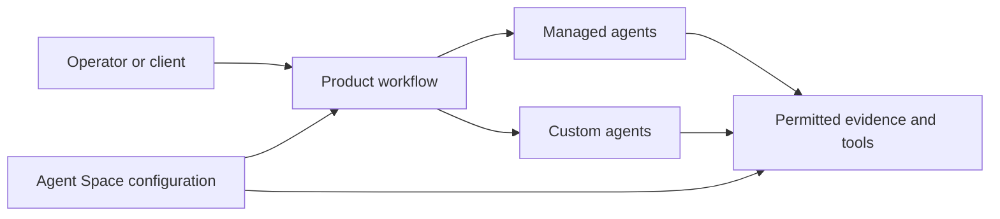
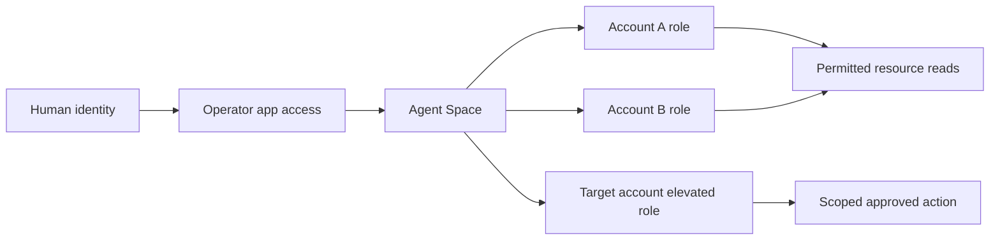

<!-- block: obsidian-devops-reference-agent-spaces-and-access-body -->
# Agent Spaces, access, administration and lifecycle

This reference supplements the primer and operational framework. It preserves source-specific setup and interface detail. Related: [[AWS_DevOps_Agent_Framework]] · [[Source_Index]].

## Service scope and operating model

AWS DevOps Agent is a managed service for production operations and release management across AWS, multicloud and on-premises environments. It correlates operational evidence with application relationships, code, deployments and supplied knowledge. This dossier records the documented capabilities checked on 31 October 2026.

Sources: [S001](https://docs.aws.amazon.com/devopsagent/latest/userguide/about-aws-devops-agent.html)

*Documented relationship. The Agent Space supplies scope and context. Boxes describe public concepts, not physical hosting or an internal scheduler.*

Sources: [S001](https://docs.aws.amazon.com/devopsagent/latest/userguide/about-aws-devops-agent.html) [S104](https://docs.aws.amazon.com/devopsagent/latest/userguide/about-aws-devops-agent-what-are-devops-agent-spaces.html) [S077](https://docs.aws.amazon.com/devopsagent/latest/userguide/working-with-devops-agent-managed-agents.html) [S056](https://docs.aws.amazon.com/devopsagent/latest/userguide/working-with-devops-agent-custom-agents-index.html)

Production operations became generally available on 31 March 2026. Incident investigation, mitigation guidance, prevention recommendations, operational chat and custom agents form the current operating model. Release management and sandbox capabilities retain separate preview labels and Region restrictions.

Sources: [S019](https://aws.amazon.com/about-aws/whats-new/2026/03/aws-devops-agent-generally-available/) [S001](https://docs.aws.amazon.com/devopsagent/latest/userguide/about-aws-devops-agent.html) [S097](https://docs.aws.amazon.com/devopsagent/latest/userguide/about-aws-devops-agent-supported-regions.html)

Administrators configure Agent Spaces, account access and integrations through AWS Management Console. Operators use the separate web app to direct work, inspect findings and manage knowledge. External clients can also invoke supported interfaces. The diagram is a concept map; its boxes do not describe undocumented internal AWS infrastructure.

Sources: [S001](https://docs.aws.amazon.com/devopsagent/latest/userguide/about-aws-devops-agent.html) [S106](https://docs.aws.amazon.com/devopsagent/latest/userguide/about-aws-devops-agent-what-is-a-devops-agent-web-app.html)

A useful presentation distinction is between autonomous evidence gathering, recommendations, and explicitly directed changes. The permission and approval requirements for executing a change must be assessed separately from the agent's ability to investigate it.

Sources: [S058](https://docs.aws.amazon.com/devopsagent/latest/userguide/aws-devops-agent-security-devops-agent-iam-permissions.html) [S074](https://docs.aws.amazon.com/devopsagent/latest/userguide/aws-devops-agent-security-limiting-agent-access-in-an-aws-account.html)

## Agent Space boundaries and account access

An Agent Space defines configured accounts, integrations, users and operational context. Investigation data, recommendations and chat history are isolated by space. Align spaces with application ownership, environment or information-access boundaries; a dedicated primary account can connect distinct workload accounts as secondary sources.

Sources: [S104](https://docs.aws.amazon.com/devopsagent/latest/userguide/about-aws-devops-agent-what-are-devops-agent-spaces.html)

*Documented relationship. Each connected account supplies its own investigation role. Operator access and the elevated action path are separate. The elevated role is registered on the target account association. This is not role chaining through a primary investigation role.*

Sources: [S058](https://docs.aws.amazon.com/devopsagent/latest/userguide/aws-devops-agent-security-devops-agent-iam-permissions.html) [S074](https://docs.aws.amazon.com/devopsagent/latest/userguide/aws-devops-agent-security-limiting-agent-access-in-an-aws-account.html) [S108](https://docs.aws.amazon.com/devopsagent/latest/userguide/working-with-devops-agent-working-with-directed-actions.html)

The primary account owns the Agent Space. Each associated AWS account supplies an investigation role, and the DevOps Agent service principal assumes secondary roles directly. The primary role is not a credential hop into secondary accounts. Trust conditions constrain the originating Agent Space; role permissions constrain accessible resources.

Sources: [S040](https://docs.aws.amazon.com/devopsagent/latest/userguide/configuring-integrations-and-knowledge-connecting-multiple-aws-accounts.html) [S058](https://docs.aws.amazon.com/devopsagent/latest/userguide/aws-devops-agent-security-devops-agent-iam-permissions.html)

One Agent Space can investigate associated-account resources across Regions. Its selected Region determines where its service data is stored, while inference routing follows separate rules. A topology view does not enforce an access boundary.

Sources: [S097](https://docs.aws.amazon.com/devopsagent/latest/userguide/about-aws-devops-agent-supported-regions.html) [S022](https://docs.aws.amazon.com/devopsagent/latest/userguide/aws-devops-agent-security.html) [S105](https://docs.aws.amazon.com/devopsagent/latest/userguide/about-aws-devops-agent-what-is-a-devops-agent-topology.html)

Public evidence gap: AWS publishes an Agent Space Constellation coordination policy, but this review found no complete public setup or availability workflow. It is not evidence of automatic sharing between ordinary Agent Spaces.

Sources: [S007](https://docs.aws.amazon.com/aws-managed-policy/latest/reference/AIDevOpsConstellationAccessPolicy.html) [S104](https://docs.aws.amazon.com/devopsagent/latest/userguide/about-aws-devops-agent-what-are-devops-agent-spaces.html)

## Creating and validating an Agent Space

Start with a named operational scope and a supported Region. The console separates permission to inspect AWS resources from permission to use the operator web app. Both roles can be generated automatically, supplied as existing roles, or created from policy templates.

Sources: [S054](https://docs.aws.amazon.com/devopsagent/latest/userguide/getting-started-with-aws-devops-agent-creating-an-agent-space.html)

**Onboarding checkpoints:** choose a coherent scope; establish account access; configure operator access; associate required providers; validate connectivity and context; rehearse a representative task. See [[Platform_Capabilities]].

- Create the Agent Space, set its purpose and optional response language, and configure the primary account role.
- Enable operator web-app access, then establish the intended user authentication path and assignments.
- Connect secondary accounts and the tools needed to explain incidents across the application.
- Inspect discovery and ask focused questions about known resources before adding automatic workflows.
- Run a known incident or isolated test, compare the evidence with expected behavior, and record missing access or context.

Sources: [S054](https://docs.aws.amazon.com/devopsagent/latest/userguide/getting-started-with-aws-devops-agent-creating-an-agent-space.html) [S095](https://docs.aws.amazon.com/devopsagent/latest/userguide/aws-devops-agent-security-setting-up-iam-identity-center-authentication.html) [S040](https://docs.aws.amazon.com/devopsagent/latest/userguide/configuring-integrations-and-knowledge-connecting-multiple-aws-accounts.html) [S053](https://docs.aws.amazon.com/devopsagent/latest/userguide/getting-started-with-aws-devops-agent-creating-a-test-environment.html)

The last two steps are recommended rollout practice, not additional service states. AWS provides EC2 CPU-capacity and Lambda error-rate exercises. Their simple setup places test resources in the primary account; the workload Region can differ.

Sources: [S053](https://docs.aws.amazon.com/devopsagent/latest/userguide/getting-started-with-aws-devops-agent-creating-a-test-environment.html)

Response language is an Agent Space setting. Display language is a web-app preference and does not change the agent's response language.

Sources: [S054](https://docs.aws.amazon.com/devopsagent/latest/userguide/getting-started-with-aws-devops-agent-creating-an-agent-space.html) [S106](https://docs.aws.amazon.com/devopsagent/latest/userguide/about-aws-devops-agent-what-is-a-devops-agent-web-app.html)

## IAM roles and effective permissions

Keep service administration, human operation and workload access separate. An aidevops API permission controls use of DevOps Agent; it does not by itself grant the agent permission to inspect or modify the underlying AWS workload.

Sources: [S058](https://docs.aws.amazon.com/devopsagent/latest/userguide/aws-devops-agent-security-devops-agent-iam-permissions.html)

| Permission domain | Purpose |
| --- | --- |
| Administrator or console viewer | AIDevOpsAgentFullAccess or AIDevOpsAgentReadOnlyAccess governs service configuration and visibility. |
| Operator app role | AIDevOpsOperatorAppAccessPolicy permits operational work in the space identified by the session tag. |
| Primary and secondary monitoring roles | AIDevOpsAgentAccessPolicy provides investigation and analysis access to account resources. |
| Elevated account role | Separately registered credentials support approved directed actions against the target account. |
| Service-linked role | AWSServiceRoleForAIDevOps supports usage metrics and managed private-network resources. |

Sources: [S058](https://docs.aws.amazon.com/devopsagent/latest/userguide/aws-devops-agent-security-devops-agent-iam-permissions.html) [S005](https://docs.aws.amazon.com/aws-managed-policy/latest/reference/AIDevOpsAgentAccessPolicy.html) [S008](https://docs.aws.amazon.com/aws-managed-policy/latest/reference/AIDevOpsOperatorAppAccessPolicy.html) [S027](https://docs.aws.amazon.com/aws-managed-policy/latest/reference/AWSServiceRoleForAIDevOpsPolicy.html)

### The standard investigation permission ceiling

A grant on a monitoring role must also pass the agent's session-policy guardrail. The default managed policy is narrower than that ceiling. Additional permitted reads, S3 object access, supported Athena queries or KMS decryption require explicit grants where absent. Narrowing access should retain the supporting network, compute, data and monitoring context needed to explain an incident.

Sources: [S074](https://docs.aws.amazon.com/devopsagent/latest/userguide/aws-devops-agent-security-limiting-agent-access-in-an-aws-account.html)

Read-oriented does not mean every API is a read. The current investigation policy includes CloudTrail query execution and Support case creation. The elevated directed-action path is distinct from the standard investigation guardrail.

Sources: [S005](https://docs.aws.amazon.com/aws-managed-policy/latest/reference/AIDevOpsAgentAccessPolicy.html) [S058](https://docs.aws.amazon.com/devopsagent/latest/userguide/aws-devops-agent-security-devops-agent-iam-permissions.html)

### Association authorization

Adding or updating a secondary account requires iam:PassRole in the primary calling identity. The documented check requires a primary-account role wildcard; AWS recommends restricting it with iam:PassedToService = aidevops.amazonaws.com. An individual role ARN does not satisfy the check. Some association actions also require permission on both the Agent Space ARN and its nested association ARN.

Sources: [S040](https://docs.aws.amazon.com/devopsagent/latest/userguide/configuring-integrations-and-knowledge-connecting-multiple-aws-accounts.html) [S058](https://docs.aws.amazon.com/devopsagent/latest/userguide/aws-devops-agent-security-devops-agent-iam-permissions.html) [S003](https://docs.aws.amazon.com/service-authorization/latest/reference/list_devops-agent.html)

Use the dedicated managed-policy reference for current policy JSON. Embedded examples in the user guide can lag the published policy, including nested-resource scoping in the operator policy.

Sources: [S008](https://docs.aws.amazon.com/aws-managed-policy/latest/reference/AIDevOpsOperatorAppAccessPolicy.html) [S058](https://docs.aws.amazon.com/devopsagent/latest/userguide/aws-devops-agent-security-devops-agent-iam-permissions.html)

## Operator identity and access lifecycle

Choose the web-app authentication path independently of the roles used by the agent to access workloads. The current documentation supports three paths, even though an older security overview still lists only two.

Sources: [S106](https://docs.aws.amazon.com/devopsagent/latest/userguide/about-aws-devops-agent-what-is-a-devops-agent-web-app.html) [S095](https://docs.aws.amazon.com/devopsagent/latest/userguide/aws-devops-agent-security-setting-up-iam-identity-center-authentication.html) [S094](https://docs.aws.amazon.com/devopsagent/latest/userguide/aws-devops-agent-security-setting-up-external-identity-provider-idp-authentication.html)

| Path | Access control | Typical use |
| --- | --- | --- |
| IAM console link | Existing AWS Console session and configured operator role | Initial setup and administrative access |
| IAM Identity Center | Application assignment to synchronized users and groups | Central workforce access |
| Direct OIDC identity provider | Assignment to an Okta or Microsoft Entra application | Corporate sign-in without Identity Center |

Sources: [S106](https://docs.aws.amazon.com/devopsagent/latest/userguide/about-aws-devops-agent-what-is-a-devops-agent-web-app.html) [S095](https://docs.aws.amazon.com/devopsagent/latest/userguide/aws-devops-agent-security-setting-up-iam-identity-center-authentication.html) [S094](https://docs.aws.amazon.com/devopsagent/latest/userguide/aws-devops-agent-security-setting-up-external-identity-provider-idp-authentication.html)

### Identity Center workflow

Connect the Identity Center instance and application role from the Agent Space Access tab, assign users or groups, and test the Agent Space URL with an authorized identity. The setup guide documents an eight-hour default session, configurable from one to twelve hours, with short-lived API credentials refreshed automatically. Revoking assignment blocks future access, but existing sessions can persist until expiry.

Sources: [S095](https://docs.aws.amazon.com/devopsagent/latest/userguide/aws-devops-agent-security-setting-up-iam-identity-center-authentication.html)

### Direct OIDC workflow

Register the IdP application, configure authorization-code and refresh behavior, supply issuer and client details, create or select the application role, and register the exact callback URL. Assignment is maintained in the IdP; DevOps Agent does not consume group claims from its tokens. Okta needs the Refresh Token grant enabled. Microsoft Entra requires Assignment required to be enabled on the enterprise application to restrict sign-in to assigned users and groups. Direct OIDC sessions are documented as lasting up to eight hours.

Sources: [S094](https://docs.aws.amazon.com/devopsagent/latest/userguide/aws-devops-agent-security-setting-up-external-identity-provider-idp-authentication.html)

Documentation discrepancy: the web-app and security pages state a ten-minute IAM admin-link session, while the Identity Center setup guide states thirty minutes. Present it as short-lived administrative access and verify the actual session behavior before relying on a duration.

Sources: [S106](https://docs.aws.amazon.com/devopsagent/latest/userguide/about-aws-devops-agent-what-is-a-devops-agent-web-app.html) [S095](https://docs.aws.amazon.com/devopsagent/latest/userguide/aws-devops-agent-security-setting-up-iam-identity-center-authentication.html) [S022](https://docs.aws.amazon.com/devopsagent/latest/userguide/aws-devops-agent-security.html)

## Topology discovery and investigation context

Topology connects resource inventory with relationships useful for investigation and prevention. CloudFormation supplies deployed stacks and resources. Resource Explorer supplies tagged resources outside CloudFormation and must be enabled. Configuration, tags, code/deployment links and observed application behavior help establish relationships.

Sources: [S105](https://docs.aws.amazon.com/devopsagent/latest/userguide/about-aws-devops-agent-what-is-a-devops-agent-topology.html)

| View | What it conveys |
| --- | --- |
| Learned Topology | A structured service and request-path view from Agent Space Understanding memory |
| Learned Pipeline | Deployment stages, actions and resource relationships when pipeline topology exists |
| System | Account and Region boundaries |
| Container | Deployment groupings such as CloudFormation stacks |
| Components | Components within containers and their relationships |
| All Resources | The full discovered resource graph |

Sources: [S105](https://docs.aws.amazon.com/devopsagent/latest/userguide/about-aws-devops-agent-what-is-a-devops-agent-topology.html)

Export the currently selected view as PNG, JSON or Mermaid. The discovery graph also feeds Agent Space Understanding memory. These representations provide context rather than a complete authorization inventory: permitted APIs and connected observability sources can expose resources absent from the graph.

Sources: [S105](https://docs.aws.amazon.com/devopsagent/latest/userguide/about-aws-devops-agent-what-is-a-devops-agent-topology.html)

### Interpreting scope correctly

Filtering a visualization does not reduce agent permissions. Define allowed services, resources and Regions in the relevant IAM roles and integration settings. Excessively narrow access can hide a supporting component that explains the incident; decide scope using the application and its dependencies.

Sources: [S074](https://docs.aws.amazon.com/devopsagent/latest/userguide/aws-devops-agent-security-limiting-agent-access-in-an-aws-account.html)

For a presentation about a real deployment, label a topology export with its Agent Space, selected view and capture date. This is recommended evidence handling: a diagram of discovered context should not be presented as a timeless or exhaustive inventory.

Sources: [S105](https://docs.aws.amazon.com/devopsagent/latest/userguide/about-aws-devops-agent-what-is-a-devops-agent-topology.html) [S014](https://docs.aws.amazon.com/ai/responsible-ai/aws-aidevops-agent/overview.html)

## Provider registration and scoped associations

For integrations that require registration, first establish the provider connection at the AWS account level. Then create an association that makes selected capabilities or resources available to an Agent Space. The reusable registration and the space-specific association are different resources.

Sources: [S029](https://docs.aws.amazon.com/devopsagent/latest/userguide/configuring-integrations-and-knowledge.html) [S023](https://docs.aws.amazon.com/cdk/api/v2/docs/aws-cdk-lib.aws_devopsagent-readme.html)

| Layer | Responsibility |
| --- | --- |
| Provider registration | Establish account-level provider connection and authentication |
| Agent Space association | Expose the selected provider resources or capabilities to a space |
| Workflow tool use | Use only the effective integration and resource scope |

The available selection controls depend on the provider. An association might select repositories, subscriptions, projects, channels or tools. Provider credentials authorize the external system; the association defines how a particular space uses the registration. Separate associations do not copy investigation history or knowledge between spaces.

Sources: [S104](https://docs.aws.amazon.com/devopsagent/latest/userguide/about-aws-devops-agent-what-are-devops-agent-spaces.html) [S030](https://docs.aws.amazon.com/devopsagent/latest/userguide/configuring-integrations-and-knowledge-connecting-azure-index.html) [S032](https://docs.aws.amazon.com/devopsagent/latest/userguide/connecting-azure-connecting-azure-resources.html) [S029](https://docs.aws.amazon.com/devopsagent/latest/userguide/configuring-integrations-and-knowledge.html)

Keep connection lifecycle separate from scope lifecycle. Removing a provider association from one space does not necessarily delete its account-level registration or revoke its credentials. A private connection can also remain referenced by a registered provider after its Agent Space association is removed.

Sources: [S098](https://docs.aws.amazon.com/devopsagent/latest/userguide/configuring-integrations-and-knowledge-troubleshooting-private-connections.html) [S023](https://docs.aws.amazon.com/cdk/api/v2/docs/aws-cdk-lib.aws_devopsagent-readme.html)

Recommended validation: query a known resource through the intended space, confirm the expected selection, and test credential or network failures at the appropriate layer. An existing registration alone is not evidence that a particular space has usable operational access.

Sources: [S048](https://docs.aws.amazon.com/devopsagent/latest/userguide/configuring-integrations-and-knowledge-connecting-to-privately-hosted-tools.html) [S040](https://docs.aws.amazon.com/devopsagent/latest/userguide/configuring-integrations-and-knowledge-connecting-multiple-aws-accounts.html)

## Kubernetes and Azure resource access

### Amazon EKS investigation access

The documented EKS path supports read-only kubectl investigation of public and private clusters: resources, pod logs, events and node health. For each cluster, enable an authentication mode containing the EKS API, create an IAM access entry using the role ARN displayed in the Agent Space setup, and attach the EKS access policy AmazonAIOpsAssistantPolicy. Choose cluster scope or the required namespaces, then verify a pod or event query.

Sources: [S024](https://docs.aws.amazon.com/devopsagent/latest/userguide/configuring-integrations-and-knowledge-aws-eks-access-setup.html)

AmazonAIOpsAssistantPolicy is an EKS access-policy name. It is distinct from the retired preview IAM managed policy AIOpsAssistantPolicy. The EKS guide does not authorize cluster-resource mutation through its investigation setup.

Sources: [S024](https://docs.aws.amazon.com/devopsagent/latest/userguide/configuring-integrations-and-knowledge-aws-eks-access-setup.html) [S082](https://docs.aws.amazon.com/devopsagent/latest/userguide/configuring-integrations-and-knowledge-migrating-from-public-preview-to-general-availability.html)

### Azure subscription access

Azure Resources and Azure DevOps are independent capabilities. Azure Resources discovers infrastructure through Azure Resource Graph and accesses operational metrics, logs and configuration. Azure DevOps contributes repository and pipeline context. Register the required capability at account level and associate its selected scope with the Agent Space.

Sources: [S030](https://docs.aws.amazon.com/devopsagent/latest/userguide/configuring-integrations-and-knowledge-connecting-azure-index.html) [S032](https://docs.aws.amazon.com/devopsagent/latest/userguide/connecting-azure-connecting-azure-resources.html)

Azure Resources registration supports admin consent to the AWS-managed Entra application or a customer application using outbound identity federation. For the latter, enable federation in AWS and configure Entra federated credentials. Grant the application Reader access to the intended subscription, then associate that subscription with the Agent Space. Each customer App Registration needs a distinct client ID.

Sources: [S030](https://docs.aws.amazon.com/devopsagent/latest/userguide/configuring-integrations-and-knowledge-connecting-azure-index.html) [S032](https://docs.aws.amazon.com/devopsagent/latest/userguide/connecting-azure-connecting-azure-resources.html)

### Azure Kubernetes Service access

AKS adds two permission layers: ARM-level Azure Kubernetes Service Cluster User access, then Kubernetes API read authorization. Use Azure Kubernetes Service RBAC Reader or the documented per-cluster Kubernetes role and binding. Scope these grants to the intended subscription, resource group or cluster.

Sources: [S032](https://docs.aws.amazon.com/devopsagent/latest/userguide/connecting-azure-connecting-azure-resources.html)

Azure workload authorization and corporate OIDC login to the DevOps Agent web app solve different problems. Connecting one does not configure the other.

Sources: [S032](https://docs.aws.amazon.com/devopsagent/latest/userguide/connecting-azure-connecting-azure-resources.html) [S094](https://docs.aws.amazon.com/devopsagent/latest/userguide/aws-devops-agent-security-setting-up-external-identity-provider-idp-authentication.html)

## Migration maintenance and retirement

### Migration from the original public preview

Existing preview spaces require a specific migration path; new spaces do not repeat it. Replace the old monitoring and operator policies, update operator trust for session tagging, and include the additional Identity Center trust and directory permissions where applicable.

Sources: [S082](https://docs.aws.amazon.com/devopsagent/latest/userguide/configuring-integrations-and-knowledge-migrating-from-public-preview-to-general-availability.html)

| Role | Documented migration |
| --- | --- |
| Monitoring in every connected account | Replace AIOpsAssistantPolicy with AIDevOpsAgentAccessPolicy. |
| Operator app | Replace preview inline permissions with AIDevOpsOperatorAppAccessPolicy and update trust. |
| Identity Center application | Reconnect if the scope remains awsaidevops:read_write; the GA scope is aidevops:read_write. |

Sources: [S082](https://docs.aws.amazon.com/devopsagent/latest/userguide/configuring-integrations-and-knowledge-migrating-from-public-preview-to-general-availability.html)

On-demand chat history from before 30 March 2026 became inaccessible after GA access-control changes. Investigation journals and findings from that period were not affected.

Sources: [S082](https://docs.aws.amazon.com/devopsagent/latest/userguide/configuring-integrations-and-knowledge-migrating-from-public-preview-to-general-availability.html)

### Maintain a reviewable configuration

Recommended operating practice is to retain an inventory of spaces, Regions, account roles, provider registrations, associations and private connections. Review that inventory when teams or environments change. Removing a secondary account association does not delete its IAM role, and removing a provider from a space does not necessarily remove its registration.

Sources: [S040](https://docs.aws.amazon.com/devopsagent/latest/userguide/configuring-integrations-and-knowledge-connecting-multiple-aws-accounts.html) [S098](https://docs.aws.amazon.com/devopsagent/latest/userguide/configuring-integrations-and-knowledge-troubleshooting-private-connections.html) [S023](https://docs.aws.amazon.com/cdk/api/v2/docs/aws-cdk-lib.aws_devopsagent-readme.html)

### Retire the service deliberately

- Preserve required findings and records before deleting the Agent Space.
- Delete each intended Agent Space in its own Region. Access to its data ends immediately; permanent deletion completes within thirty days, with no restoration window.
- After dependencies are removed, detach policies and delete unused account roles and customer-managed policies. Do not delete AWS-owned managed policies.
- Remove provider references before deleting private connections through DevOps Agent, then verify managed-network cleanup.
- Review remaining service-linked and IAM resources for shared use before removing them.

Sources: [S057](https://docs.aws.amazon.com/devopsagent/latest/userguide/deleting-an-agent-space.html) [S098](https://docs.aws.amazon.com/devopsagent/latest/userguide/configuring-integrations-and-knowledge-troubleshooting-private-connections.html) [S058](https://docs.aws.amazon.com/devopsagent/latest/userguide/aws-devops-agent-security-devops-agent-iam-permissions.html)

There is no automatic uninstall that removes every resource. Re-enablement can be affected by leftover customer-managed policies or a temporarily reserved former Agent Space name.

Sources: [S057](https://docs.aws.amazon.com/devopsagent/latest/userguide/deleting-an-agent-space.html)
