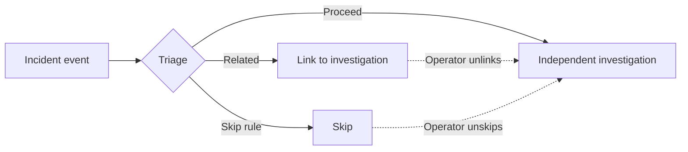
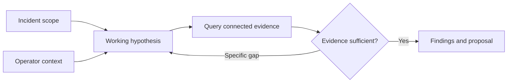
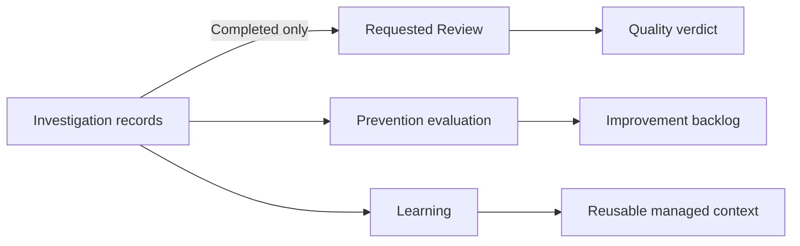
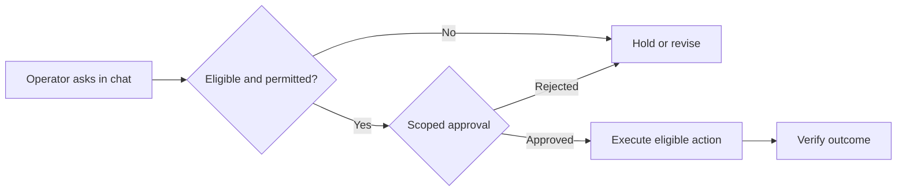

<!-- block: obsidian-devops-reference-incident-response-and-actions-body -->
# Incident response and directed actions

This reference supplements the primer and operational framework. It preserves source-specific setup and interface detail. Related: [[AWS_DevOps_Agent_Framework]] · [[Source_Index]].

## Incident intake and automatic triage

Investigations begin through configured alert or ticket integrations, webhooks, or an operator request. Chat can suggest opening a formal investigation when a question needs deeper analysis. Useful starting context identifies the symptom, affected service and incident time.

Sources: [S085](https://docs.aws.amazon.com/devopsagent/latest/userguide/working-with-devops-agent-production-operations-index.html) [S083](https://docs.aws.amazon.com/devopsagent/latest/userguide/working-with-devops-agent-on-demand-devops-tasks.html)

*Documented relationship. Linked, Skipped and Proceed are distinct triage outcomes. Operators can correct a link or skip; a skip is not a health verdict.*

Sources: [S010](https://docs.aws.amazon.com/devopsagent/latest/userguide/production-operations-autonomous-incident-response.html)

Triage correlates external incidents with active investigations, typically using a 20-minute look-back. Linked incidents steer the primary investigation; skip skills suppress unwanted work. Operators can unlink or unskip an incident to schedule independent analysis.

Sources: [S010](https://docs.aws.amazon.com/devopsagent/latest/userguide/production-operations-autonomous-incident-response.html)

### Other entry points

CreateBacklogTask provides API entry using taskType INVESTIGATION, a title and priority, with optional description, reference and idempotency token. Its priority values are CRITICAL, HIGH, MEDIUM, LOW and MINIMAL.

Sources: [S051](https://docs.aws.amazon.com/devopsagent/latest/APIReference/API_CreateBacklogTask.html)

CloudWatch Omni must be linked to an Agent Space. Users start investigations from its agent, command or alert action; an Omni alert firing alone never starts one automatically.

Sources: [S071](https://docs.aws.amazon.com/AmazonCloudWatch/latest/monitoring/omni-investigate-with-the-aws-devops-agent.html)

## Evidence findings and operator visibility

The investigation correlates affected resources, recent changes and dependency relationships. It compares competing explanations against supporting and contradictory evidence, including metrics, logs, traces, configuration and deployments. Inconclusive evidence can leave ambiguity; a finding should not be treated as a proven root cause merely because an execution finished.

Sources: [S068](https://aws.amazon.com/blogs/devops/how-aws-devops-agent-uses-multi-agent-reasoning-to-find-root-causes/) [S085](https://docs.aws.amazon.com/devopsagent/latest/userguide/working-with-devops-agent-production-operations-index.html)

*Documented relationship. Conceptual evidence workflow. The actual investigation can use parallel work; the drawing is not an exhaustive API state machine.*

Sources: [S010](https://docs.aws.amazon.com/devopsagent/latest/userguide/production-operations-autonomous-incident-response.html)

Summary presents the evolving impact, cause assessment, tasks and key evidence. Timeline provides the chronological tool record, including authentication outcomes and expandable parallel sub-agent activity.

Sources: [S010](https://docs.aws.amazon.com/devopsagent/latest/userguide/production-operations-autonomous-incident-response.html) [S107](https://docs.aws.amazon.com/devopsagent/latest/userguide/whats-new.html)

### Steering an investigation

Direct messages queue between reasoning steps. Messaging a completed investigation resumes it with prior context. Chat is available for queued, running, waiting and completed investigations, but not canceled, failed or timed-out ones.

Sources: [S010](https://docs.aws.amazon.com/devopsagent/latest/userguide/production-operations-autonomous-incident-response.html)

Recommended review: compare the incident time window, relevant dependencies and contradictory evidence before accepting the cause assessment. Preserve uncertainty when the available telemetry does not resolve competing explanations.

Sources: [S068](https://aws.amazon.com/blogs/devops/how-aws-devops-agent-uses-multi-agent-reasoning-to-find-root-causes/)

## Feedback review forks and human support

A fork inherits timeline history through the selected message and explores another direction without changing its parent. Feedback can record an incorrect RCA and the actual cause, creating reflection memory for future investigations.

Sources: [S010](https://docs.aws.amazon.com/devopsagent/latest/userguide/production-operations-autonomous-incident-response.html)

*Documented relationship. These are separate consumers of incident information. There is no asserted automatic Review-to-prevention-to-Learning chain, and Evaluation naming differs between the managed-agent and Skills guides. The diagram therefore uses the prevention workflow label.*

Sources: [S091](https://docs.aws.amazon.com/devopsagent/latest/userguide/working-with-devops-agent-reviewing-investigations.html) [S084](https://docs.aws.amazon.com/devopsagent/latest/userguide/production-operations-proactive-incident-prevention.html) [S059](https://docs.aws.amazon.com/devopsagent/latest/userguide/about-aws-devops-agent-devops-agent-memories.html) [S077](https://docs.aws.amazon.com/devopsagent/latest/userguide/working-with-devops-agent-managed-agents.html) [S060](https://docs.aws.amazon.com/devopsagent/latest/userguide/about-aws-devops-agent-devops-agent-skills.html)

A Review assesses a completed investigation. It returns helpful or not helpful overall and pass, fail or not applicable for scope alignment, evidence grounding, completeness, environment impact and accuracy against the linked incident. Grader instructions can tailor these criteria. This is an agent assessment, not independent human certification.

Sources: [S091](https://docs.aws.amazon.com/devopsagent/latest/userguide/working-with-devops-agent-reviewing-investigations.html)

### Escalation with context

Operators can create an AWS Support case from an investigation with its context attached. Technical-case and integrated-chat availability depend on Support-plan entitlements and permissions; review the shared summary and select an eligible severity.

Sources: [S064](https://aws.amazon.com/devops-agent/features/) [S010](https://docs.aws.amazon.com/devopsagent/latest/userguide/production-operations-autonomous-incident-response.html)

The latest feedback submission replaces earlier feedback. Sharing feedback with AWS for troubleshooting requires an explicit confirmation.

Sources: [S010](https://docs.aws.amazon.com/devopsagent/latest/userguide/production-operations-autonomous-incident-response.html)

## From mitigation proposal to approved change

Mitigation guidance describes a proposed repair, validation criteria and rollback. Alarm investigations can show proposals inline. Applying a production change is a separate authorization decision, even when the proposal appears within the investigation.

Sources: [S064](https://aws.amazon.com/devops-agent/features/) [S061](https://docs.aws.amazon.com/devopsagent/latest/userguide/document-history.html)

*Documented controls with customer verification. Eligibility includes feature opt-in, supported operation, guardrails and effective permissions. Only the operator-directed chat path produces these action approvals. Outcome verification is recommended customer practice.*

Sources: [S108](https://docs.aws.amazon.com/devopsagent/latest/userguide/working-with-devops-agent-working-with-directed-actions.html)

Directed actions are disabled by default. Mutating operations require explicit operator direction, enabled capability scope and approval in chat. An autonomous-investigation mutation attempt fails instead of presenting an approval request. The approval identifies the operation, parameters and target.

Sources: [S108](https://docs.aws.amazon.com/devopsagent/latest/userguide/working-with-devops-agent-working-with-directed-actions.html)

AWS accounts supply a separate agentElevatedRoleArn for permitted changes. Its policy is a ceiling; execution credentials are narrowed to approved operations and resources. Third-party tools instead use provider credentials and their tool classification.

Sources: [S096](https://docs.aws.amazon.com/devopsagent/latest/APIReference/API_SourceAwsConfiguration.html) [S108](https://docs.aws.amazon.com/devopsagent/latest/userguide/working-with-devops-agent-working-with-directed-actions.html)

Recommended operation: confirm expected impact and rollback readiness before approval, then inspect service health and roll back only when necessary. A mitigation proposal or completed report does not establish that production was changed.

Sources: [S064](https://aws.amazon.com/devops-agent/features/)

## Action eligibility and approval API

The account association separates investigation and elevated role ARNs. Elevated access is gated by elevatedActionsEnabled; source-role validation can initially be pending-confirmation before valid or invalid. Registering role ARNs requires the documented iam:PassRole permission in the caller's account.

Sources: [S096](https://docs.aws.amazon.com/devopsagent/latest/APIReference/API_SourceAwsConfiguration.html)

The elevated role must trust sts:AssumeRole, sts:SetSourceIdentity and sts:TagSession with Agent Space source conditions; validation can pass while missing actions later fail. AIDevOpsAgentActionsPolicy grants broad access; use a scoped policy for intended production operations.

Sources: [S108](https://docs.aws.amazon.com/devopsagent/latest/userguide/working-with-devops-agent-working-with-directed-actions.html) [S006](https://docs.aws.amazon.com/aws-managed-policy/latest/reference/AIDevOpsAgentActionsPolicy.html)

| Tool category | Execution rule |
| --- | --- |
| READ_ONLY | Read operations; no elevated approval. |
| MUTATIVE | Enabled directed actions and scoped operator approval. |
| DESTRUCTIVE | Never invoked by the agent. |

Sources: [S081](https://docs.aws.amazon.com/devopsagent/latest/APIReference/API_MCPToolDetail.html) [S108](https://docs.aws.amazon.com/devopsagent/latest/userguide/working-with-devops-agent-working-with-directed-actions.html)

Customer MCP associations use toolDetails to classify enabled tools. Names must match the tools list. Omitting classification defaults tools to READ_ONLY, so programmatic setup must classify mutating tools explicitly.

Sources: [S080](https://docs.aws.amazon.com/devopsagent/latest/APIReference/API_MCPServerConfiguration.html) [S038](https://docs.aws.amazon.com/devopsagent/latest/userguide/configuring-integrations-and-knowledge-connecting-mcp-servers.html)

Native integrations have AWS-defined classifications and separately enabled elevated tools.

Sources: [S108](https://docs.aws.amazon.com/devopsagent/latest/userguide/working-with-devops-agent-working-with-directed-actions.html)

### Client approval sequence

- SendMessage returns an approval request with toolUseId, interruptId and approvalId. Present its exact operation and scope to the operator.
- UpdateApprovalAction records APPROVED or REJECTED. Approved finalPattern identifies the tool and argumentPins; scope may narrow but never widen the original request.
- SendMessage resumes with userActionResponse APPROVAL_ACTION and the decision identifiers. Approval alone does not resume the conversation.

Sources: [S092](https://docs.aws.amazon.com/devopsagent/latest/APIReference/API_SendMessageContext.html) [S009](https://docs.aws.amazon.com/devopsagent/latest/APIReference/API_ApprovalAction.html) [S099](https://docs.aws.amazon.com/boto3/latest/reference/services/devops-agent/client/update_approval_action.html)

Approved requests must set the singleUse field. Single-use approval omits ttlSeconds; reusable approval requires a lifetime of at most four hours. Lifecycle states are PENDING, APPROVED, REJECTED, REVOKED and REDEEMED. Approval reuse remains constrained to its recorded scope.

Sources: [S099](https://docs.aws.amazon.com/boto3/latest/reference/services/devops-agent/client/update_approval_action.html)

AWS SDK guardrails reject delete-class operations and permissions-boundary changes, and do not support role-passing operations by default. Approval cannot override these restrictions. CloudTrail attributes resulting AWS actions to the approving operator.

Sources: [S108](https://docs.aws.amazon.com/devopsagent/latest/userguide/working-with-devops-agent-working-with-directed-actions.html)

UpdateAgentSpace replaces the entire preferences map when supplied; omitted keys reset to defaults. Omitting the map preserves current preferences.

Sources: [S100](https://docs.aws.amazon.com/devopsagent/latest/APIReference/API_UpdateAgentSpace.html)
