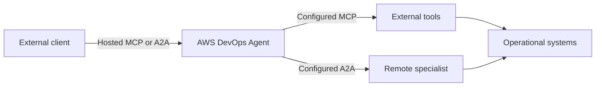
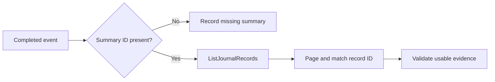

<!-- block: obsidian-devops-reference-integrations-and-events-body -->
# Integrations, protocols and event contracts

This reference supplements the primer and operational framework. It preserves source-specific setup and interface detail. Related: [[AWS_DevOps_Agent_Framework]] · [[Source_Index]].

## Telemetry and operational evidence sources

Configure event intake and telemetry access separately: an alert webhook starts work, while role access or MCP tools supply evidence. Provider registrations can be associated with selected Agent Spaces; a successful registration alone does not configure every alert route.

Sources: [S047](https://docs.aws.amazon.com/devopsagent/latest/userguide/configuring-integrations-and-knowledge-connecting-telemetry-sources-index.html) [S029](https://docs.aws.amazon.com/devopsagent/latest/userguide/configuring-integrations-and-knowledge.html)

| Source | Evidence path | Configuration or limitation |
| --- | --- | --- |
| CloudWatch | Configured AWS account roles | Telemetry and topology access need no separate provider registration. |
| Amazon S3 | Read objects and artifacts | Add s3:GetObject and s3:ListBucket, scoped to required buckets. |
| Dynatrace | AWS-hosted MCP and topology | SaaS only. OAuth registration, environment association and SRE Agents app setup. Problems trigger investigations; findings return to Dynatrace. |
| Datadog | Regional remote MCP endpoint | Use /v1/mcp and required toolsets. Bearer webhooks trigger investigations. OAuth refresh tokens require 90-day rotation. |
| Grafana | Metrics dashboards and alerts | Grafana 9+ and service-account token. ClickHouse tools unsupported; prevention does not use Grafana tools. |
| New Relic | Provider remote MCP | Full Platform User, API key, account ID and correct US/EU region. Bearer webhook triggers. |
| Splunk | Deployment remote MCP | REST and token authentication enabled; token audience mcp. Associate deployments and configure bearer webhook triggers. |

Sources: [S047](https://docs.aws.amazon.com/devopsagent/latest/userguide/configuring-integrations-and-knowledge-connecting-telemetry-sources-index.html) [S034](https://docs.aws.amazon.com/devopsagent/latest/userguide/connecting-telemetry-sources-connecting-dynatrace.html) [S033](https://docs.aws.amazon.com/devopsagent/latest/userguide/connecting-telemetry-sources-connecting-datadog.html) [S037](https://docs.aws.amazon.com/devopsagent/latest/userguide/connecting-telemetry-sources-connecting-grafana.html) [S041](https://docs.aws.amazon.com/devopsagent/latest/userguide/connecting-telemetry-sources-connecting-new-relic.html) [S046](https://docs.aws.amazon.com/devopsagent/latest/userguide/connecting-telemetry-sources-connecting-splunk.html)

Datadog's 27 October release note adds API/application-key and personal/service-token options; the retrieved setup page still emphasizes OAuth. Grafana write support also conflicts across AWS pages. Verify these two provider-specific options before promising them in a deployment design.

Sources: [S107](https://docs.aws.amazon.com/devopsagent/latest/userguide/whats-new.html) [S033](https://docs.aws.amazon.com/devopsagent/latest/userguide/connecting-telemetry-sources-connecting-datadog.html) [S037](https://docs.aws.amazon.com/devopsagent/latest/userguide/connecting-telemetry-sources-connecting-grafana.html) [S108](https://docs.aws.amazon.com/devopsagent/latest/userguide/working-with-devops-agent-working-with-directed-actions.html)

Other sources, including Prometheus, can use custom MCP and webhook connections. New Relic, Splunk and Grafana support credential updates that preserve associations.

Sources: [S047](https://docs.aws.amazon.com/devopsagent/latest/userguide/configuring-integrations-and-knowledge-connecting-telemetry-sources-index.html) [S041](https://docs.aws.amazon.com/devopsagent/latest/userguide/connecting-telemetry-sources-connecting-new-relic.html) [S046](https://docs.aws.amazon.com/devopsagent/latest/userguide/connecting-telemetry-sources-connecting-splunk.html) [S037](https://docs.aws.amazon.com/devopsagent/latest/userguide/connecting-telemetry-sources-connecting-grafana.html)

## Tickets collaboration and repository context

Ticket, collaboration and repository connections serve different purposes. Select the required direction explicitly: event intake, investigation updates, operator conversation, or code and deployment evidence.

Sources: [S029](https://docs.aws.amazon.com/devopsagent/latest/userguide/configuring-integrations-and-knowledge.html) [S002](https://docs.aws.amazon.com/devopsagent/latest/userguide/working-with-devops-agent-accessing-devops-agent-index.html)

| Provider | Connection and scope | Workflow and qualification |
| --- | --- | --- |
| ServiceNow | OAuth client and instance association | Business Rules route chosen incidents to spaces. Findings, causes, summaries and status updates return as ticket comments. |
| PagerDuty | Scoped OAuth 2.0; account and region | Enable Events Integration; V3 webhooks only. Incident/service and webhook subscription scopes required. Legacy OAuth unsupported. |
| Slack | Regional app and channel association | Public/private channels receive updates. Private channels alone support bidirectional chat, with channel IAM role, app membership and setup binding. |
| Microsoft Teams | Tenant consent then bot authorization | Notifications only. Associate channel link; install app in team and additionally in private/shared channels. No conversational replies. |
| GitHub | App or personal access token; repositories | App registration supports events. Token registration lacks webhooks and automatic reviews/testing. Read-only App cannot post comments or trigger workflows. |
| GitLab | Personal access token; selected projects | GitLab.com or Self-Managed, including private connectivity. Pipeline deployments inform investigations; token needs required repository, registry and API scopes. |
| Azure DevOps | Admin consent or federated app; projects | Grant application Basic access and Project Readers. Repository and pipeline history support incident correlation. Multiple organizations may connect. |

Sources: [S044](https://docs.aws.amazon.com/devopsagent/latest/userguide/connecting-to-ticketing-and-chat-connecting-servicenow.html) [S042](https://docs.aws.amazon.com/devopsagent/latest/userguide/connecting-to-ticketing-and-chat-connecting-pagerduty.html) [S045](https://docs.aws.amazon.com/devopsagent/latest/userguide/connecting-to-ticketing-and-chat-connecting-slack.html) [S039](https://docs.aws.amazon.com/devopsagent/latest/userguide/connecting-to-ticketing-and-chat-connecting-microsoft-teams.html) [S035](https://docs.aws.amazon.com/devopsagent/latest/userguide/connecting-to-cicd-pipelines-connecting-github.html) [S036](https://docs.aws.amazon.com/devopsagent/latest/userguide/connecting-to-cicd-pipelines-connecting-gitlab.html) [S031](https://docs.aws.amazon.com/devopsagent/latest/userguide/connecting-azure-connecting-azure-devops.html)

Slack conversations start with a top-level regional-app mention and continue in threads; mention the app in each reply. Teams cards link back to the investigation. Removing a channel association does not deregister the provider.

Sources: [S045](https://docs.aws.amazon.com/devopsagent/latest/userguide/connecting-to-ticketing-and-chat-connecting-slack.html) [S039](https://docs.aws.amazon.com/devopsagent/latest/userguide/connecting-to-ticketing-and-chat-connecting-microsoft-teams.html)

Credential lifecycle differs: PagerDuty requires re-registration; several telemetry providers support in-place rotation. Remove dependent associations before deleting a provider registration.

Sources: [S042](https://docs.aws.amazon.com/devopsagent/latest/userguide/connecting-to-ticketing-and-chat-connecting-pagerduty.html) [S041](https://docs.aws.amazon.com/devopsagent/latest/userguide/connecting-telemetry-sources-connecting-new-relic.html) [S046](https://docs.aws.amazon.com/devopsagent/latest/userguide/connecting-telemetry-sources-connecting-splunk.html)

## Webhook delivery and payload validation

Integration-specific webhooks are generated during connection setup. An Agent Space can also have one generic HMAC webhook and one generic API-key webhook. Both accept HTTP POST; authentication and payload processing are separate checks.

Sources: [S072](https://docs.aws.amazon.com/devopsagent/latest/userguide/configuring-integrations-and-knowledge-invoking-devops-agent-through-webhook.html)

| Payload element | Required interpretation |
| --- | --- |
| eventType and action | eventType is incident. action is created, updated, closed or resolved. |
| incidentId and priority | Use a consistent incident identity. Priority is CRITICAL, HIGH, MEDIUM, LOW or MINIMAL. |
| title and description | Put operational context here. The accepted data object is not included in investigation context. |
| timestamp and service | Optional. Timestamp uses ISO 8601 when supplied; service identifies the originating service. |

Sources: [S072](https://docs.aws.amazon.com/devopsagent/latest/userguide/configuring-integrations-and-knowledge-invoking-devops-agent-through-webhook.html)

HMAC uses SHA-256 over timestamp, a colon and the exact JSON body, with a base64 signature. Send x-amzn-event-signature and x-amzn-event-timestamp. API-key authentication uses Authorization: Bearer. HMAC adds payload integrity and timestamp-based replay protection.

Sources: [S072](https://docs.aws.amazon.com/devopsagent/latest/userguide/configuring-integrations-and-knowledge-invoking-devops-agent-through-webhook.html)

Secrets display once. Rotation retains the URL, invalidates the old secret and requires a sender update. Infrastructure-as-code creation does not return the secret; rotate afterward to obtain it.

Sources: [S072](https://docs.aws.amazon.com/devopsagent/latest/userguide/configuring-integrations-and-knowledge-invoking-devops-agent-through-webhook.html)

### Provider mappings and verification

Datadog ALERT_CYCLE_KEY deduplicates repeated notifications. Datadog P1–P5 values are not valid DevOps Agent priorities, and raw transition labels are not valid action values. Send raw JSON and inspect both delivery response and investigation creation: HTTP 200 alone is insufficient.

Sources: [S033](https://docs.aws.amazon.com/devopsagent/latest/userguide/connecting-telemetry-sources-connecting-datadog.html)

Grafana maps alert summary into description. Its AWS guide says Amazon Managed Grafana lacks direct webhook contact points and limits service-account tokens to 30 days. Recommended rehearsal: send a synthetic event, inspect triage, then repeat it to check deduplication.

Sources: [S037](https://docs.aws.amazon.com/devopsagent/latest/userguide/connecting-telemetry-sources-connecting-grafana.html) [S072](https://docs.aws.amazon.com/devopsagent/latest/userguide/configuring-integrations-and-knowledge-invoking-devops-agent-through-webhook.html)

## Client access and outbound tool calls

AWS DevOps Agent exposes web-app, API, webhook and agent-client access. Keep this invocation path separate from the provider tools that the agent itself calls to gather evidence or delegate work.

Sources: [S002](https://docs.aws.amazon.com/devopsagent/latest/userguide/working-with-devops-agent-accessing-devops-agent-index.html)

*Documented relationship. Inbound service access and outbound integrations are different configuration and authorization paths. The remote specialist is not an AWS continuation subagent.*

Sources: [S070](https://docs.aws.amazon.com/devopsagent/latest/userguide/connecting-to-devops-agent-remote-servers-integrating-with-the-devops-agent-a2a-server.html) [S038](https://docs.aws.amazon.com/devopsagent/latest/userguide/configuring-integrations-and-knowledge-connecting-mcp-servers.html) [S043](https://docs.aws.amazon.com/devopsagent/latest/userguide/configuring-integrations-and-knowledge-connecting-remote-a2a-agents.html) [S049](https://docs.aws.amazon.com/devopsagent/latest/userguide/connecting-to-devops-agent-remote-servers-connecting-to-the-devops-agent-mcp-server.html)

Remote MCP serves IDEs and compatible clients at connect.aidevops.{region}.api.aws/mcp. Claude Code supplies the aws-agents-for-devsecops plugin for a compatible client connection. The guide recommends at least a 120-second client timeout. Access tokens and SigV4 are supported.

Sources: [S049](https://docs.aws.amazon.com/devopsagent/latest/userguide/connecting-to-devops-agent-remote-servers-connecting-to-the-devops-agent-mcp-server.html) [S002](https://docs.aws.amazon.com/devopsagent/latest/userguide/working-with-devops-agent-accessing-devops-agent-index.html)

The A2A server exposes chat and asynchronous investigation interfaces. ACP is documented through an AWS sample client/server adapter over service APIs; it should not be presented as a third equivalent hosted endpoint.

Sources: [S070](https://docs.aws.amazon.com/devopsagent/latest/userguide/connecting-to-devops-agent-remote-servers-integrating-with-the-devops-agent-a2a-server.html) [S011](https://github.com/aws-samples/sample-aws-devops-agent-acp-mcp)

Outbound MCP servers and remote A2A agents are registered providers, then associated with a space. Their credentials, selected tools and connectivity govern what the agent can call; adding a data tool does not itself configure an incident trigger.

Sources: [S038](https://docs.aws.amazon.com/devopsagent/latest/userguide/configuring-integrations-and-knowledge-connecting-mcp-servers.html) [S043](https://docs.aws.amazon.com/devopsagent/latest/userguide/configuring-integrations-and-knowledge-connecting-remote-a2a-agents.html)

## Protocol contracts and authentication boundaries

### MCP providers called by the agent

External MCP requires Streamable HTTP. Authentication options include OAuth client credentials or 3LO, API key, up to three named secret headers, and SigV4. Allowlist tools per space. Role-less SigV4 registration validates at association using the primary account role; account-specific roles sign later calls. API-key, OAuth 3LO and SigV4 settings can be updated; OAuth client-credentials and multi-header secrets require re-registration.

Sources: [S038](https://docs.aws.amazon.com/devopsagent/latest/userguide/configuring-integrations-and-knowledge-connecting-mcp-servers.html)

### A2A clients invoking DevOps Agent

Send A2A-Version 1.0 and choose an explicit tenant. A bearer token selects its bound Agent Space; SigV4 requires X-Agent-Space-Id. The agent card advertises streaming but no push notifications. Chat supports message send and stream. Investigation uses message send followed by task polling or subscription; message streaming is not its progress interface.

Sources: [S070](https://docs.aws.amazon.com/devopsagent/latest/userguide/connecting-to-devops-agent-remote-servers-integrating-with-the-devops-agent-a2a-server.html)

| A2A tenant | Operations |
| --- | --- |
| chat | message:send and message:stream |
| investigation | message:send, GetTask, ListTasks, CancelTask and SubscribeToTask |

Sources: [S070](https://docs.aws.amazon.com/devopsagent/latest/userguide/connecting-to-devops-agent-remote-servers-integrating-with-the-devops-agent-a2a-server.html)

A2A task states are TASK_STATE_SUBMITTED, TASK_STATE_WORKING, TASK_STATE_COMPLETED, TASK_STATE_CANCELED and TASK_STATE_FAILED. FAILED also represents internal timeout or skip outcomes. Use GetTask for terminal tasks; terminal artifacts can indicate that a result is not yet available.

Sources: [S070](https://docs.aws.amazon.com/devopsagent/latest/userguide/connecting-to-devops-agent-remote-servers-integrating-with-the-devops-agent-a2a-server.html)

### Remote A2A agents called by DevOps Agent

Remote agents publish a discoverable card and support JSONRPC or HTTP+JSON. API key, bearer, OAuth client credentials and SigV4 are supported. Private connectivity is available for the first three; SigV4 requires a public endpoint. Send data at least once per minute to avoid idle timeout. AWS guidance expects read-only remote agents; credential changes require re-registration.

Sources: [S043](https://docs.aws.amazon.com/devopsagent/latest/userguide/configuring-integrations-and-knowledge-connecting-remote-a2a-agents.html)

## Lifecycle events and status vocabulary

AWS DevOps Agent automatically publishes investigation and mitigation lifecycle events to the default EventBridge bus with source aws.aidevops. User-defined rules route matching events to consumers. These event families exclude prevention evaluations and custom-agent invocations.

Sources: [S069](https://docs.aws.amazon.com/devopsagent/latest/userguide/configuring-integrations-and-knowledge-integrating-devops-agent-into-event-driven-applications-using-amazon-eventbridge-index.html)

| Investigation phase | data.status values | Event meaning |
| --- | --- | --- |
| Scheduling | PENDING_START; PENDING_TRIAGE | Created or awaiting triage. |
| Analysis | IN_PROGRESS | Active investigation. |
| Correlation or filtering | LINKED; SKIPPED | Related work was linked or skip criteria matched. |
| Successful completion | COMPLETED | Investigation completed; summary availability is separate. |
| Other terminal outcomes | FAILED; TIMED_OUT; CANCELLED | Execution error, duration limit or cancellation. |

Sources: [S017](https://docs.aws.amazon.com/devopsagent/latest/userguide/integrating-devops-agent-into-event-driven-applications-using-amazon-eventbridge-devops-agent-events-detail-reference.html)

Investigation detail-type names additionally distinguish Priority Updated and Pending Triage. Mitigation has In Progress, Completed, Failed, Timed Out and Cancelled event families. Use detail-type to distinguish investigation from mitigation because both schemas set data.task_type to INVESTIGATION.

Sources: [S017](https://docs.aws.amazon.com/devopsagent/latest/userguide/integrating-devops-agent-into-event-driven-applications-using-amazon-eventbridge-devops-agent-events-detail-reference.html)

### Interpret fields within their interface

These are EventBridge payload values. They are not interchangeable with A2A TASK_STATE values or the queued and waiting labels used in investigation chat guidance. This table records published vocabulary, not an exhaustive state-transition contract.

Sources: [S017](https://docs.aws.amazon.com/devopsagent/latest/userguide/integrating-devops-agent-into-event-driven-applications-using-amazon-eventbridge-devops-agent-events-detail-reference.html) [S070](https://docs.aws.amazon.com/devopsagent/latest/userguide/connecting-to-devops-agent-remote-servers-integrating-with-the-devops-agent-a2a-server.html) [S010](https://docs.aws.amazon.com/devopsagent/latest/userguide/production-operations-autonomous-incident-response.html)

Event time records the task's latest update, not EventBridge arrival. Empty detail fields are omitted. execution_id may be absent before an execution exists. A Skipped event does not include the skip reason, even though the operator interface displays it.

Sources: [S017](https://docs.aws.amazon.com/devopsagent/latest/userguide/integrating-devops-agent-into-event-driven-applications-using-amazon-eventbridge-devops-agent-events-detail-reference.html) [S069](https://docs.aws.amazon.com/devopsagent/latest/userguide/configuring-integrations-and-knowledge-integrating-devops-agent-into-event-driven-applications-using-amazon-eventbridge-index.html)

Recommended consumer design: retain the original event and its identifiers, tolerate missing optional fields, and treat successful analysis separately from any approved production change.

Sources: [S017](https://docs.aws.amazon.com/devopsagent/latest/userguide/integrating-devops-agent-into-event-driven-applications-using-amazon-eventbridge-devops-agent-events-detail-reference.html)

## Retrieving the summary behind a completion event

A Completed event is a lifecycle notification, not the summary document. summary_record_id is present only when the execution produced a summary. Handle its absence explicitly; Failed, Timed Out and Cancelled events never carry it.

Sources: [S069](https://docs.aws.amazon.com/devopsagent/latest/userguide/configuring-integrations-and-knowledge-integrating-devops-agent-into-event-driven-applications-using-amazon-eventbridge-index.html)

*Documented relationship. Use Agent Space ID, execution ID and the relevant summary record type. A task ID is not an execution ID. These are investigation/mitigation events; custom and prevention runs are excluded. EventBridge does not carry the summary body; absence of the ID is valid. Validation and missing-result handling are customer practice.*

Sources: [S069](https://docs.aws.amazon.com/devopsagent/latest/userguide/configuring-integrations-and-knowledge-integrating-devops-agent-into-event-driven-applications-using-amazon-eventbridge-index.html) [S075](https://docs.aws.amazon.com/devopsagent/latest/APIReference/API_ListJournalRecords.html)

- Map detail.metadata.agent_space_id to agentSpaceId and detail.metadata.execution_id to executionId. Do not substitute metadata.task_id.
- Choose recordType investigation_summary_md or mitigation_summary_md from detail-type, then call ListJournalRecords.
- Follow nextToken as needed. Select the returned recordId equal to detail.data.summary_record_id and read its content.

Sources: [S069](https://docs.aws.amazon.com/devopsagent/latest/userguide/configuring-integrations-and-knowledge-integrating-devops-agent-into-event-driven-applications-using-amazon-eventbridge-index.html) [S075](https://docs.aws.amazon.com/devopsagent/latest/APIReference/API_ListJournalRecords.html)

The consumer needs aidevops:ListJournalRecords. The API lists records for an execution; it does not offer a single-record lookup by summary ID. Recommended handling distinguishes no summary, insufficient permission and a missing matching record instead of treating all three as successful retrieval.

Sources: [S069](https://docs.aws.amazon.com/devopsagent/latest/userguide/configuring-integrations-and-knowledge-integrating-devops-agent-into-event-driven-applications-using-amazon-eventbridge-index.html) [S075](https://docs.aws.amazon.com/devopsagent/latest/APIReference/API_ListJournalRecords.html)
