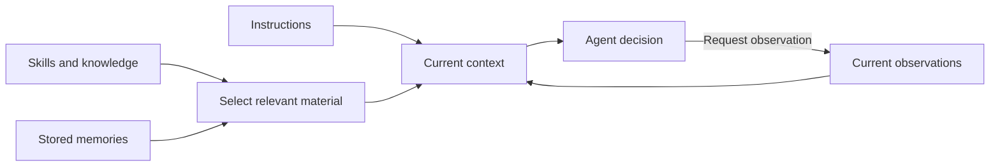
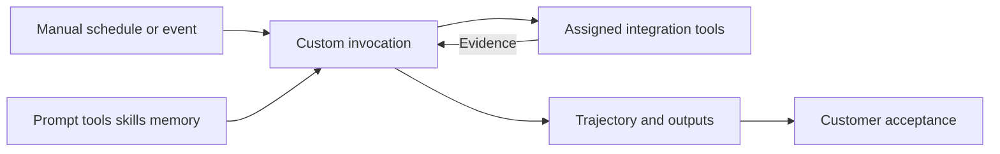

<!-- block: obsidian-devops-reference-knowledge-and-custom-agents-body -->
# Knowledge, managed agents and custom agents

This reference supplements the primer and operational framework. It preserves source-specific setup and interface detail. Related: [[AWS_DevOps_Agent_Framework]] · [[Source_Index]].

## Managed agents and standing instructions

Managed agents are provided and maintained by AWS DevOps Agent. Operators use them through the product workflows rather than creating, deleting, or directly running their definitions. The Agents page separates these platform agents from customer-defined custom agents.

Sources: [S077](https://docs.aws.amazon.com/devopsagent/latest/userguide/working-with-devops-agent-managed-agents.html)

| Managed agent | Responsibility |
| --- | --- |
| Chat | Responds to conversational operational requests. |
| Incident agents | Triage scopes alarms; RCA investigates causes; Mitigation proposes responses; UI prepares investigation outputs. |
| Evaluation | The managed-agent reference describes scoring and policy checks. Prevention evaluations analyze incident history. |
| Grader | Assesses the quality of a completed investigation through Review. |
| Release testing | Runs UI and API tests against deployed applications. |
| Learning | Produces and refreshes managed knowledge about the environment. |

Sources: [S077](https://docs.aws.amazon.com/devopsagent/latest/userguide/working-with-devops-agent-managed-agents.html) [S084](https://docs.aws.amazon.com/devopsagent/latest/userguide/production-operations-proactive-incident-prevention.html) [S091](https://docs.aws.amazon.com/devopsagent/latest/userguide/working-with-devops-agent-reviewing-investigations.html)

Managed pages show Agent definition and Knowledge tabs. Knowledge is read-only there. Learning also exposes its own History and Triggers; its schedules are platform-owned. Incident-agent activity appears within the investigation record.

Sources: [S077](https://docs.aws.amazon.com/devopsagent/latest/userguide/working-with-devops-agent-managed-agents.html)

### Apply instructions at the correct scope

AGENTS.md provides always-present instructions: shared global guidance plus guidance for the selected agent. Configure these on a managed agent’s Agent definition tab. Each new session receives the saved content; sessions already running retain their original version. Keep instructions focused on rules needed in every session, and place specialized procedures in skills. The Asset API documents a 25 KB limit for each instructions file.

Sources: [S004](https://docs.aws.amazon.com/devopsagent/latest/userguide/about-aws-devops-agent-agent-instructions.html) [S078](https://docs.aws.amazon.com/devopsagent/latest/userguide/about-aws-devops-agent-managing-assets.html)

Recommended practice: review global changes as changes affecting every managed workflow. Instruction text guides behavior; enforce resource access through IAM and configured tool scope.

Sources: [S004](https://docs.aws.amazon.com/devopsagent/latest/userguide/about-aws-devops-agent-agent-instructions.html) [S052](https://docs.aws.amazon.com/devopsagent/latest/userguide/custom-agents-creating-a-custom-agent.html)

## Skills and the knowledge model

Instructions are loaded at session start. Skills supply relevant procedures, while memories supply informational context. The distinction determines what is always present and what the agent selects for a task.

Sources: [S004](https://docs.aws.amazon.com/devopsagent/latest/userguide/about-aws-devops-agent-agent-instructions.html) [S060](https://docs.aws.amazon.com/devopsagent/latest/userguide/about-aws-devops-agent-devops-agent-skills.html) [S059](https://docs.aws.amazon.com/devopsagent/latest/userguide/about-aws-devops-agent-devops-agent-memories.html)

*General concept. Context is selected for a current decision. The runtime, a tool or an external event supplies each new observation; the decision requests it. Memory is stored information; saving it is not itself model retraining.*

Sources: [F04](https://www.anthropic.com/research/effective-context-engineering-for-ai-agents) [S004](https://docs.aws.amazon.com/devopsagent/latest/userguide/about-aws-devops-agent-agent-instructions.html) [S059](https://docs.aws.amazon.com/devopsagent/latest/userguide/about-aws-devops-agent-devops-agent-memories.html) [S060](https://docs.aws.amazon.com/devopsagent/latest/userguide/about-aws-devops-agent-devops-agent-skills.html)

A skill requires SKILL.md with a name and description that explain when it applies. Additional references and assets can support the procedure. Create a single-file skill in the web app, upload a ZIP, or import a GitHub directory through an associated account. Imported content is read-only in the app; Sync retrieves repository changes.

Sources: [S060](https://docs.aws.amazon.com/devopsagent/latest/userguide/about-aws-devops-agent-devops-agent-skills.html)

ZIPs and imported directories are limited to 6 MB; imported directories can contain up to 100 files. Target relevant agent types and use Active or Inactive to control future use. Deactivation preserves content and does not remove the skill from investigations already using it.

Sources: [S060](https://docs.aws.amazon.com/devopsagent/latest/userguide/about-aws-devops-agent-devops-agent-skills.html)

Existing runbooks migrate to skills. Learned environmental skills are separately moving to managed memories when refreshed; the console can display the older skill until its replacement memory is ready. This migration requires no customer action.

Sources: [S060](https://docs.aws.amazon.com/devopsagent/latest/userguide/about-aws-devops-agent-devops-agent-skills.html) [S073](https://docs.aws.amazon.com/devopsagent/latest/userguide/about-aws-devops-agent-learned-skills.html)

## Memory stores and continuous learning

Memories are versioned Markdown information grouped in stores. Store and file descriptions guide selective reading; names containing slashes organize folders. The following managed stores preserve different kinds of context.

Sources: [S059](https://docs.aws.amazon.com/devopsagent/latest/userguide/about-aws-devops-agent-devops-agent-memories.html)

| Managed store | Context |
| --- | --- |
| monitors | Recurring causes and investigation evidence by monitor. |
| directives | Standing preferences and environmental guidance. |
| reflections | Lessons from corrective investigation feedback. |
| understanding-agent-space | Architecture, resources, request paths, observability and code relationships. |
| understanding-dependencies | Service and package dependencies. |
| understanding-pipeline-topology | Pipeline stages, environments and deployment sequence. |
| tool-use-best-practices | Effective parameters, known failures and output handling. |

Sources: [S059](https://docs.aws.amazon.com/devopsagent/latest/userguide/about-aws-devops-agent-devops-agent-memories.html)

Monitor memory refreshes daily when investigations occurred within two weeks; entries without updates for two weeks expire. Environment understanding has scheduled refreshes no more than once every three days for active spaces, defined by a completed investigation within six days. Tool-use refresh requires ten new completed investigations and runs no more than once every three days. Initial discovery and relevant integration changes also inform learning.

Sources: [S059](https://docs.aws.amazon.com/devopsagent/latest/userguide/about-aws-devops-agent-devops-agent-memories.html)

Operators can inspect versions, toggle stores or items, and edit through Chat. Regenerate on Topology or a chat request can refresh understanding. Custom stores can be deleted; managed stores cannot. Chat requires a custom store to be emptied first, while console deletion also removes its contents.

Sources: [S059](https://docs.aws.amazon.com/devopsagent/latest/userguide/about-aws-devops-agent-devops-agent-memories.html)

Custom agents have no memory access until stores are attached. They read attached stores and can write to attached custom stores; managed stores stay read-only to them.

Sources: [S056](https://docs.aws.amazon.com/devopsagent/latest/userguide/working-with-devops-agent-custom-agents-index.html) [S052](https://docs.aws.amazon.com/devopsagent/latest/userguide/custom-agents-creating-a-custom-agent.html)

## Create and scope a custom agent

Custom agents automate an operational task defined by your team. Create one from a form, a guided Chat conversation, or a GitHub Markdown prompt. An Agent Space with a connected integration is required. The resulting configuration selects both the task and the context available for doing it.

Sources: [S056](https://docs.aws.amazon.com/devopsagent/latest/userguide/working-with-devops-agent-custom-agents-index.html) [S052](https://docs.aws.amazon.com/devopsagent/latest/userguide/custom-agents-creating-a-custom-agent.html)

| Configuration | Design decision |
| --- | --- |
| System prompt | State the goal, procedure, constraints, success criteria and expected output. |
| Tools | Select only the MCP tools required. In the web app, configure tools through Chat. |
| Skills | Attach existing skills that provide useful procedures or capabilities. |
| Memory stores | Attach focused context; a new agent otherwise has no memory access. |

Sources: [S052](https://docs.aws.amazon.com/devopsagent/latest/userguide/custom-agents-creating-a-custom-agent.html)

Guided Chat clarifies intent, checks for a similar agent, proposes tools and knowledge, drafts the prompt and confirms the configuration. Form-based creation supports the prompt, skills and memory stores; tools can be assigned afterward. Release Manager tools can also be assigned for release task creation, inspection and cancellation.

Sources: [S052](https://docs.aws.amazon.com/devopsagent/latest/userguide/custom-agents-creating-a-custom-agent.html)

### Use repository managed prompts

GitHub import takes a single Markdown file as the system prompt, while the name and skills come from the form. A matching GitHub connection is required, including for enterprise hosts. The file limit is 1 MB. Edit the source and choose Sync; imported prompt content is read-only in the app.

Sources: [S052](https://docs.aws.amazon.com/devopsagent/latest/userguide/custom-agents-creating-a-custom-agent.html)

Recommended practice: first run the agent against a bounded task and inspect its tool calls and output. Give recurring workflows an explicit owner and a prompt that states when they should report findings, create recommendations or send notifications.

Sources: [S079](https://docs.aws.amazon.com/devopsagent/latest/userguide/custom-agents-managing-custom-agents.html) [S055](https://docs.aws.amazon.com/devopsagent/latest/userguide/custom-agents-custom-agent-outputs.html)

## Invoke custom agents and configure triggers

Run a custom agent with Run Now, Run with prompt, or Chat. A run-specific prompt supplements its configured system prompt. Recurring schedules and integration webhook events provide automatic invocation paths.

Sources: [S063](https://docs.aws.amazon.com/devopsagent/latest/userguide/custom-agents-executing-custom-agents.html)

*Documented relationship. Assigned integration tools and attached stores define task scope; built-in artifact and recommendation tools are also available. Notifications need a destination and instructions; the customer acceptance step is a proposed operating practice.*

Sources: [S052](https://docs.aws.amazon.com/devopsagent/latest/userguide/custom-agents-creating-a-custom-agent.html) [S063](https://docs.aws.amazon.com/devopsagent/latest/userguide/custom-agents-executing-custom-agents.html) [S055](https://docs.aws.amazon.com/devopsagent/latest/userguide/custom-agents-custom-agent-outputs.html) [S059](https://docs.aws.amazon.com/devopsagent/latest/userguide/about-aws-devops-agent-devops-agent-memories.html)

Schedules use EventBridge-compatible rate or cron expressions. An event trigger requires an active integration webhook. Its optional JMESPath expression can filter the event and project the context: false, null or empty results do not run; true passes the original payload; another truthy result passes the projection. Without a filter, every event from the source invokes the agent.

Sources: [S063](https://docs.aws.amazon.com/devopsagent/latest/userguide/custom-agents-executing-custom-agents.html)

Filter expressions allow 4,096 characters; event context is truncated at 10,000. Pause a trigger to suspend future invocations. Missing event sources can indicate absent webhooks or missing ListAssociations and ListWebhooks permissions. CloudFormation currently documents time-based triggers only.

Sources: [S063](https://docs.aws.amazon.com/devopsagent/latest/userguide/custom-agents-executing-custom-agents.html) [S026](https://docs.aws.amazon.com/AWSCloudFormation/latest/TemplateReference/aws-resource-devopsagent-trigger.html)

A custom agent has one concurrent invocation. Complex work can delegate to subagents with the same tools and skills; no additional delegation configuration is required.

Sources: [S056](https://docs.aws.amazon.com/devopsagent/latest/userguide/working-with-devops-agent-custom-agents-index.html) [S086](https://docs.aws.amazon.com/devopsagent/latest/userguide/quotas.html)

## Custom agent outputs and lifecycle

Each invocation records text, tool calls, parameters and results in a trajectory. Persistent artifacts can combine Markdown, charts, sortable tables and topology diagrams. Recommendations appear on Improvements alongside prevention recommendations. Both output capabilities are built in and require no additional skill assignment.

Sources: [S079](https://docs.aws.amazon.com/devopsagent/latest/userguide/custom-agents-managing-custom-agents.html) [S055](https://docs.aws.amazon.com/devopsagent/latest/userguide/custom-agents-custom-agent-outputs.html)

Prompt instructions determine when to send progress notifications, and an associated notification channel provides the destination. A channel alone does not request notifications. Subagents can send updates too. Generated artifacts and recommendations link from the trajectory.

Sources: [S055](https://docs.aws.amazon.com/devopsagent/latest/userguide/custom-agents-custom-agent-outputs.html)

| Invocation status | Meaning |
| --- | --- |
| Pending start | Queued for execution. |
| Running | Actively executing. |
| Succeeded | Completed successfully. |
| Failed | Stopped following an error. |
| Timed out | Exceeded the one-hour invocation limit. |
| Canceled | Stopped following a cancellation request. |

Sources: [S079](https://docs.aws.amazon.com/devopsagent/latest/userguide/custom-agents-managing-custom-agents.html)

### Manage changes and cancellation

Edit the prompt, name, skills and memory through the form or Chat; use Chat for UI tool changes. Inspect History to identify trigger sources and timing, then open the trajectory to diagnose failures. Cancellation preserves recorded work, but tool calls already in progress may finish.

Sources: [S079](https://docs.aws.amazon.com/devopsagent/latest/userguide/custom-agents-managing-custom-agents.html) [S063](https://docs.aws.amazon.com/devopsagent/latest/userguide/custom-agents-executing-custom-agents.html)

Deleting an agent prevents future invocations and removes its triggers. Existing invocations continue until they finish, time out or are canceled separately. Deletion is permanent.

Sources: [S079](https://docs.aws.amazon.com/devopsagent/latest/userguide/custom-agents-managing-custom-agents.html)
