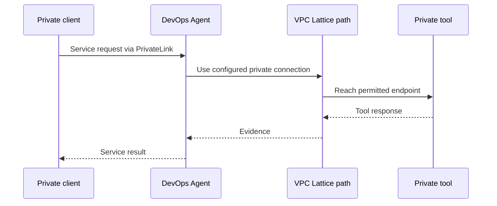

<!-- block: obsidian-devops-reference-network-security-and-regions-body -->
# Networking, security and regional availability

This reference supplements the primer and operational framework. It preserves source-specific setup and interface detail. Related: [[AWS_DevOps_Agent_Framework]] · [[Source_Index]].

## Capability status and service boundaries

| Capability | Status on 31 October 2026 | Availability |
| --- | --- | --- |
| Production investigations and prevention | Generally available | All 15 supported Agent Space Regions |
| On demand tasks and custom agents | Documented current capabilities | All supported Agent Space Regions |
| Release readiness and release testing | Preview | us-east-1 |
| Investigation Sandbox | Preview | us-east-1, us-west-2, ap-northeast-1, eu-west-1 |

Sources: [S019](https://aws.amazon.com/about-aws/whats-new/2026/03/aws-devops-agent-generally-available/) [S097](https://docs.aws.amazon.com/devopsagent/latest/userguide/about-aws-devops-agent-supported-regions.html)

An Agent Space can investigate permitted workloads across Regions. Its creation Region controls storage location, but inference routing follows separate rules. Feature availability must be checked at the Agent Space location; an application's own Region is a different dimension.

Sources: [S097](https://docs.aws.amazon.com/devopsagent/latest/userguide/about-aws-devops-agent-supported-regions.html) [S022](https://docs.aws.amazon.com/devopsagent/latest/userguide/aws-devops-agent-security.html)

### Relationship to surrounding tools

AWS DevOps Agent consumes existing telemetry, code, deployment, and incident systems. The FAQ distinguishes it from CloudWatch investigations by its broader connected-tool, multicloud, prevention, and on-demand scope. AWS Security Agent addresses security-specific workflows such as threat modeling and penetration testing. Those services should be presented as separate capabilities rather than interchangeable product names.

Sources: [S018](https://aws.amazon.com/devops-agent/faqs/)

### How to read the diagrams

Diagrams use short labels and captions to identify documented relationships, optional paths and customer decisions. Solid arrows show the named call or flow; dashed arrows show contextual, optional or corrective paths. Meaning does not depend on color. They describe public behavior, not undisclosed physical hosting.

The guide's latest recorded changes include an operator access policy update on 29 October 2026. Earlier launch articles and older downloaded guide PDFs omit later features. Use the current feature pages and references when implementing.

Sources: [S107](https://docs.aws.amazon.com/devopsagent/latest/userguide/whats-new.html) [S061](https://docs.aws.amazon.com/devopsagent/latest/userguide/document-history.html)

## Private tool connectivity

Private connections let DevOps Agent reach private tools through Amazon VPC Lattice. Service-managed mode places resource-gateway ENIs in the selected VPC subnets in the connection's account. The target must be routable from that gateway and serve HTTPS.

Sources: [S048](https://docs.aws.amazon.com/devopsagent/latest/userguide/configuring-integrations-and-knowledge-connecting-to-privately-hosted-tools.html)

*Documented network relationship. PrivateLink serves private client ingress. The private connection and VPC Lattice path reach a private tool. These are separate paths with their own setup.*

Sources: [S103](https://docs.aws.amazon.com/devopsagent/latest/userguide/aws-devops-agent-security-vpc-endpoints-aws-privatelink.html) [S048](https://docs.aws.amazon.com/devopsagent/latest/userguide/configuring-integrations-and-knowledge-connecting-to-privately-hosted-tools.html)

Self-managed mode uses an existing resource configuration. For a shared VPC, the network account owns the gateway and configuration, shares the configuration through AWS RAM, and the workload account creates the self-managed connection. The documented arrangement uses the same Region as the Agent Space.

Sources: [S048](https://docs.aws.amazon.com/devopsagent/latest/userguide/configuring-integrations-and-knowledge-connecting-to-privately-hosted-tools.html)

The host address identifies the network target. The provider endpoint URL supplies its scheme, hostname, port and request path. Those values can differ, but routing and TLS must still reach and validate the intended service.

Sources: [S098](https://docs.aws.amazon.com/devopsagent/latest/userguide/configuring-integrations-and-knowledge-troubleshooting-private-connections.html)

A private route does not replace provider authentication. Treat an Active connection as confirmation of the network setup, then verify an authorized tool request. The target still needs a listening endpoint, correct certificates and rules permitting traffic from the gateway path.

Sources: [S098](https://docs.aws.amazon.com/devopsagent/latest/userguide/configuring-integrations-and-knowledge-troubleshooting-private-connections.html)

## Private service ingress and connection validation

AWS PrivateLink serves the reverse direction from a private tool connection: a client inside your VPC calls DevOps Agent. Interface endpoints provide private entry points for control APIs, runtime operations and webhook traffic. They are separate from VPC Lattice gateways used when the agent calls your tools.

Sources: [S103](https://docs.aws.amazon.com/devopsagent/latest/userguide/aws-devops-agent-security-vpc-endpoints-aws-privatelink.html) [S048](https://docs.aws.amazon.com/devopsagent/latest/userguide/configuring-integrations-and-knowledge-connecting-to-privately-hosted-tools.html)

| Traffic | Endpoint service suffix |
| --- | --- |
| Control-plane API calls | aidevops |
| Runtime operations | aidevops-dataplane |
| Webhook events | event-ai |

Sources: [S103](https://docs.aws.amazon.com/devopsagent/latest/userguide/aws-devops-agent-security-vpc-endpoints-aws-privatelink.html)

Endpoint service names follow com.amazonaws.<region>.<suffix>. Configure private DNS where appropriate and use an endpoint policy to constrain principals, actions and resources. Network privacy and IAM authorization remain separate controls.

Sources: [S103](https://docs.aws.amazon.com/devopsagent/latest/userguide/aws-devops-agent-security-vpc-endpoints-aws-privatelink.html)

### Validate the complete private tool path

- For creation failure, read failureMessage before changing configuration.
- Use in-VPC DNS for names available only in private zones, or a suitable private IP host address.
- Include the endpoint port in the connection's port ranges; the default permits only port 443.
- Verify gateway egress, target ingress, routes, endpoint availability and the full TLS certificate chain.
- For OAuth, validate both the target and token-exchange paths. Separate per-endpoint connection fields can route them independently.
- After a connection becomes Active, run an integration query; Active alone does not prove the provider is responding.

Sources: [S098](https://docs.aws.amazon.com/devopsagent/latest/userguide/configuring-integrations-and-knowledge-troubleshooting-private-connections.html)

Before deleting a private connection, remove or update provider registrations that reference it. Delete the connection through DevOps Agent so managed resources can be cleaned up, and preserve the AWSAIDevOpsManaged tags required for that cleanup.

Sources: [S098](https://docs.aws.amazon.com/devopsagent/latest/userguide/configuring-integrations-and-knowledge-troubleshooting-private-connections.html)

## Regional availability and processing geography

The current supported-Regions page lists fifteen Agent Space Regions. Older CLI and Terraform introductions still list six; use the dedicated availability page for planning.

Sources: [S097](https://docs.aws.amazon.com/devopsagent/latest/userguide/about-aws-devops-agent-supported-regions.html) [S015](https://docs.aws.amazon.com/devopsagent/latest/userguide/getting-started-with-aws-devops-agent-cli-onboarding-guide.html) [S067](https://docs.aws.amazon.com/devopsagent/latest/userguide/getting-started-with-aws-devops-agent-getting-started-with-aws-devops-agent-using-terraform.html)

- Americas: us-east-1, us-east-2, us-west-2, ca-central-1 and sa-east-1.
- Asia Pacific: ap-south-1, ap-southeast-1, ap-southeast-2, ap-northeast-1 and ap-northeast-2.
- Europe: eu-central-1, eu-west-1, eu-west-2, eu-west-3 and eu-north-1.

Sources: [S097](https://docs.aws.amazon.com/devopsagent/latest/userguide/about-aws-devops-agent-supported-regions.html)

| Capability | Documented availability |
| --- | --- |
| Production operations and on-demand tasks | All fifteen supported Regions |
| Custom agents | All fifteen supported Regions |
| Release management preview | us-east-1 |
| Sandbox preview | us-east-1, us-west-2, ap-northeast-1 and eu-west-1 |

Sources: [S097](https://docs.aws.amazon.com/devopsagent/latest/userguide/about-aws-devops-agent-supported-regions.html)

### Stored data and inference are separate

The Agent Space and its stored operational data remain in its creation Region. Resources in associated accounts can be investigated across Regions, so a workload Region does not require its own Agent Space.

Sources: [S097](https://docs.aws.amazon.com/devopsagent/latest/userguide/about-aws-devops-agent-supported-regions.html)

Bedrock inference may cross Regions. EU-origin requests remain within EU Regions; London can route to London or the EU. The security guide documents geography-based routing for the United States, Australia and Japan, with US routing for other unspecified origins. Seoul, Singapore, Mumbai and São Paulo explicitly use global routing.

Sources: [S022](https://docs.aws.amazon.com/devopsagent/latest/userguide/aws-devops-agent-security.html)

Customer SCP or Control Tower restrictions on customer-content Regions do not constrain this service's inference routing. A residency assessment must therefore examine both the storage location and the documented inference destinations. Do not treat selecting a Region as a guarantee that all processing stays there.

Sources: [S022](https://docs.aws.amazon.com/devopsagent/latest/userguide/aws-devops-agent-security.html)

## Encryption audit and evidence quality

DevOps Agent encrypts customer data at rest by default using AWS-owned keys. A customer-managed KMS key can instead be specified at creation for Agent Space content or registered Service credentials. Use the dedicated encryption guide for these choices; the general security page uses less precise key terminology.

Sources: [S062](https://docs.aws.amazon.com/devopsagent/latest/userguide/aws-devops-agent-security-encryption-at-rest-for-devops-agent.html) [S022](https://docs.aws.amazon.com/devopsagent/latest/userguide/aws-devops-agent-security.html)

| Key consideration | Operational implication |
| --- | --- |
| Supported customer key | Symmetric, SYMMETRIC_DEFAULT and ENCRYPT_DECRYPT; asymmetric and multi-Region keys are unsupported. |
| Policy access | Both the caller and service principal need the documented permissions for synchronous and background work. |
| Key lifecycle | Lost permissions or a disabled key prevents access; deletion can make encrypted data unrecoverable. |

Sources: [S062](https://docs.aws.amazon.com/devopsagent/latest/userguide/aws-devops-agent-security-encryption-at-rest-for-devops-agent.html)

KMS encryption context ties use to resource ARNs, and CloudTrail can audit customer-key requests. Customer-managed keys incur KMS charges. Maintain key availability for as long as encrypted service content must remain usable.

Sources: [S062](https://docs.aws.amazon.com/devopsagent/latest/userguide/aws-devops-agent-security-encryption-at-rest-for-devops-agent.html)

### Audit and data handling

The service encrypts data in transit, records API activity in CloudTrail and maintains journals the agent cannot modify. It does not automatically remove PII from summaries. AWS states that agent, chat and integration data is not used for model training or product improvement, while separately describing Release Manager operational-signal collection.

Sources: [S022](https://docs.aws.amazon.com/devopsagent/latest/userguide/aws-devops-agent-security.html)

### Evaluate findings as evidence

The AWS AI Service Card says DevOps Agent does not provide output confidence scores. Evaluate root-cause claims against cited evidence and known incident outcomes. Recommendation quality includes technical correctness, safety, specificity and evidence. Missing telemetry, limited permissions or absent code/deployment context can weaken conclusions.

Sources: [S014](https://docs.aws.amazon.com/ai/responsible-ai/aws-aidevops-agent/overview.html)

For compliance claims, check the current AWS services-in-scope matrices and available AWS Artifact reports. The product's security controls do not establish that a particular workload satisfies its own compliance obligations.

Sources: [S028](https://docs.aws.amazon.com/devopsagent/latest/userguide/aws-devops-agent-security-compliance-validation.html)
