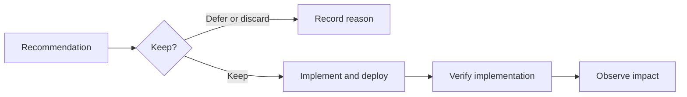

<!-- block: obsidian-devops-reference-prevention-and-operations-body -->
# Prevention, assets, cost and operational capacity

This reference supplements the primer and operational framework. It preserves source-specific setup and interface detail. Related: [[AWS_DevOps_Agent_Framework]] · [[Source_Index]].

## Evaluate incidents and prevent recurrence

Proactive prevention analyzes recent investigations together to find improvements that reduce recurrence and time to detection. Evaluations run weekly by default. Operators can pause the schedule, choose Run Now or stop an active evaluation on Improvements.

Sources: [S084](https://docs.aws.amazon.com/devopsagent/latest/userguide/production-operations-proactive-incident-prevention.html)

*Customer operating pattern. The service proposes improvements. Implementation ownership, deployment proof and recurrence observation belong to the illustrated customer process.*

Sources: [S084](https://docs.aws.amazon.com/devopsagent/latest/userguide/production-operations-proactive-incident-prevention.html) [S087](https://docs.aws.amazon.com/devopsagent/latest/APIReference/API_Recommendation.html)

The current UI categories are Observability, Infrastructure, Governance and Code optimization. AWS’s feature page uses broader benefit language, including deployment pipeline enhancement and application resilience; the diagram follows the documented UI labels.

Sources: [S084](https://docs.aws.amazon.com/devopsagent/latest/userguide/production-operations-proactive-incident-prevention.html) [S064](https://aws.amazon.com/devops-agent/features/)

Review the incidents supporting a recommendation, expected impact and next steps. Keep retains it for tracking; Discard can include feedback; Implemented records completion. New incidents can update an existing recommendation. Unkept and unimplemented items may be removed after approximately six weeks without further relevant incidents.

Sources: [S084](https://docs.aws.amazon.com/devopsagent/latest/userguide/production-operations-proactive-incident-prevention.html)

The implementation path is a team workflow: assign ownership, make and validate the change, then record completion. A recommendation or agent-ready specification does not itself establish that a production change has been deployed.

Sources: [S084](https://docs.aws.amazon.com/devopsagent/latest/userguide/production-operations-proactive-incident-prevention.html) [S064](https://aws.amazon.com/devops-agent/features/)

## Rank recommendations and prepare implementation

Each evaluation ranks active proposed or kept recommendations. AI assessment considers relevance and impact; deterministic scoring supports ordering larger backlogs using frequency, severity and recency. Category preferences and operational priorities supplied through Chat influence later evaluations. Discarded and implemented items are not ranked.

Sources: [S084](https://docs.aws.amazon.com/devopsagent/latest/userguide/production-operations-proactive-incident-prevention.html)

Recommendations can include an agent-ready specification with the problem, proposed approach, target repositories, file-level changes, test requirements and implementation plan. This gives a developer or coding agent the context for carrying out the improvement.

Sources: [S084](https://docs.aws.amazon.com/devopsagent/latest/userguide/production-operations-proactive-incident-prevention.html)

| API concept | Documented representation |
| --- | --- |
| Priority | HIGH, MEDIUM or LOW. |
| Rank | rankPosition uses 1 for highest; rankedAt records its calculation time. |
| Status | PROPOSED, ACCEPTED, REJECTED, CLOSED, COMPLETED or UPDATE_IN_PROGRESS. |

Sources: [S087](https://docs.aws.amazon.com/devopsagent/latest/APIReference/API_Recommendation.html)

A recommendation also carries its producing task, content, timestamps and version, with optional goal linkage and additional context. UpdateRecommendation accepts status and additionalContext, with an optional idempotency token. ListRecommendations filters by goal, task, priority and status and supports pagination.

Sources: [S087](https://docs.aws.amazon.com/devopsagent/latest/APIReference/API_Recommendation.html) [S101](https://docs.aws.amazon.com/devopsagent/latest/APIReference/API_UpdateRecommendation.html) [S076](https://docs.aws.amazon.com/devopsagent/latest/APIReference/API_ListRecommendations.html)

The API vocabulary is broader than the web app’s Keep, Discard and Implemented actions. This dossier does not assume an undocumented one-to-one status mapping or a complete state-transition contract.

Sources: [S084](https://docs.aws.amazon.com/devopsagent/latest/userguide/production-operations-proactive-incident-prevention.html) [S087](https://docs.aws.amazon.com/devopsagent/latest/APIReference/API_Recommendation.html)

### Close the improvement process

Recommended practice: assign each kept item to an owning team, preserve its supporting incident links, agree on validation evidence and record implementation after the change is verified. Review later recurrence and detection time to assess whether the change achieved its purpose.

Sources: [S084](https://docs.aws.amazon.com/devopsagent/latest/userguide/production-operations-proactive-incident-prevention.html)

## Sandbox computation during investigations

Sandbox is an opt-in preview for investigations. It supplies a separate ephemeral Linux Lambda MicroVM for each investigation, discarded when that investigation ends. Chat and custom agents do not use it during the documented preview. Available Regions are us-east-1, us-west-2, ap-northeast-1 and eu-west-1.

Sources: [S093](https://docs.aws.amazon.com/devopsagent/latest/userguide/configuring-integrations-and-knowledge-sandbox.html)

Configure Sandbox on the Agent Space Capabilities tab. Choose preinstalled pip and npm packages and an outbound allowlist of hosts, HTTP methods and paths. An empty allowlist still permits AWS service endpoints. AWS CLI and SDK requests use the connected accounts’ permissions through a read-only proxy. Removing configuration prevents new investigation sandboxes.

Sources: [S093](https://docs.aws.amazon.com/devopsagent/latest/userguide/configuring-integrations-and-knowledge-sandbox.html)

| Preview configuration limit | Value |
| --- | --- |
| pip packages | 50 |
| npm packages | 50 |
| Networking allowlist entries | 100 |
| Path patterns per entry | 50 |
| HTTP methods per entry | At least 1 |

Sources: [S093](https://docs.aws.amazon.com/devopsagent/latest/userguide/configuring-integrations-and-knowledge-sandbox.html)

Sandbox can execute code bundled with skills and search skill files through command-line tools. This capability is distinct from directed changes and release verification environments. Prefer narrow network rules and preinstalled dependencies.

Sources: [S093](https://docs.aws.amazon.com/devopsagent/latest/userguide/configuring-integrations-and-knowledge-sandbox.html)

Documentation caveat: the Skills page retains an older ZIP-script rejection statement alongside its Sandbox exception. Treat executable skills as Sandbox-specific and verify the upload path when implementing them.

Sources: [S060](https://docs.aws.amazon.com/devopsagent/latest/userguide/about-aws-devops-agent-devops-agent-skills.html) [S093](https://docs.aws.amazon.com/devopsagent/latest/userguide/configuring-integrations-and-knowledge-sandbox.html)

## Manage assets and deploy configuration as code

Assets are versioned content and configuration within an Agent Space. The API supports eight customer-created types; ListAssetTypes supplies runtime discovery.

Sources: [S078](https://docs.aws.amazon.com/devopsagent/latest/userguide/about-aws-devops-agent-managing-assets.html)

| Asset type | Purpose |
| --- | --- |
| skill | Procedures and references. |
| agents_md | Standing instructions. |
| attachment | Reference files such as PDFs or diagrams. |
| custom_agent | Prompt, tools and knowledge configuration. |
| memory_store | Collection of related memories. |
| memory | Informational file within a store. |
| test_profile | Reusable release-testing configuration. |
| feedback | Feedback about an agent execution. |

Sources: [S078](https://docs.aws.amazon.com/devopsagent/latest/userguide/about-aws-devops-agent-managing-assets.html)

Use aws devops-agent or an AWS SDK to create, inspect, update and delete assets, manage files, inspect versions or export content. CreateAsset accepts one content form: file, ZIP or sourceUrl. Most permissions use the aidevops namespace and the Agent Space resource. Metadata updates preserve omitted keys.

Sources: [S078](https://docs.aws.amazon.com/devopsagent/latest/userguide/about-aws-devops-agent-managing-assets.html) [S050](https://docs.aws.amazon.com/devopsagent/latest/APIReference/API_CreateAsset.html)

CloudFormation exposes AgentSpace, Asset, Association, PrivateConnection, Service and Trigger resources. Asset references requiring a bare ID must use GetAtt AssetId: Ref returns the Agent Space and asset IDs joined by a vertical bar. Manage the complete asset in its stack; file edits, history, export and repository import or sync remain API workflows.

Sources: [S016](https://docs.aws.amazon.com/AWSCloudFormation/latest/TemplateReference/AWS_DevOpsAgent.html) [S025](https://docs.aws.amazon.com/AWSCloudFormation/latest/TemplateReference/aws-resource-devopsagent-asset.html) [S078](https://docs.aws.amazon.com/devopsagent/latest/userguide/about-aws-devops-agent-managing-assets.html)

Create skills and memory stores before the custom agent that references their IDs, then create its schedule trigger. CloudFormation Trigger documents TIME_BASED only. CDK assets and triggers require aws-cdk-lib 2.268.0 or later; Terraform AWSCC requires 1.98.0 or later. IaC does not output webhook secrets; rotate the webhook in the console to retrieve credentials.

Sources: [S066](https://docs.aws.amazon.com/devopsagent/latest/userguide/getting-started-with-aws-devops-agent-getting-started-with-aws-devops-agent-using-aws-cloudformation.html) [S026](https://docs.aws.amazon.com/AWSCloudFormation/latest/TemplateReference/aws-resource-devopsagent-trigger.html) [S107](https://docs.aws.amazon.com/devopsagent/latest/userguide/whats-new.html) [S067](https://docs.aws.amazon.com/devopsagent/latest/userguide/getting-started-with-aws-devops-agent-getting-started-with-aws-devops-agent-using-terraform.html)

Additional content limits include 200 user-created skills per space, 25 KB per AGENTS.md and 10 GB of attachments per space. Treat asset type and parent space as immutable; metadata and content can be updated.

Sources: [S078](https://docs.aws.amazon.com/devopsagent/latest/userguide/about-aws-devops-agent-managing-assets.html) [S025](https://docs.aws.amazon.com/AWSCloudFormation/latest/TemplateReference/aws-resource-devopsagent-asset.html)

## Price usage and observe the service

Charges use cumulative active agent time, billed per second. Idle or waiting time has no agent charge. Connected-service fees remain separate.

Sources: [S020](https://aws.amazon.com/devops-agent/pricing/)

| Priced activity | USD per agent second |
| --- | --- |
| Incident investigations | 0.0083 |
| Reliability evaluations | 0.0083 |
| On-demand chat and custom SRE agents | 0.0083 |

Sources: [S020](https://aws.amazon.com/devops-agent/pricing/)

Calculated equivalent: 100 cumulative agent-hours cost USD 2,988 before trials, credits and connected-service charges. Release management has no additional charge during preview.

Sources: [S020](https://aws.amazon.com/devops-agent/pricing/)

New customers receive a two-month trial from their first operational task after GA. Each month includes up to ten Agent Spaces, twenty investigation hours, fifteen evaluation hours and twenty on-demand chat hours; overage is charged. Support credits use prior-month support charges: Unified Operations 100%, Enterprise 75%, Business Support+ 30%. Credits arrive by the tenth and expire at month-end. Resold Support receives equivalent credits.

Sources: [S020](https://aws.amazon.com/devops-agent/pricing/)

### Measure activity and diagnose delivery

CloudWatch publishes AWS/AIDevOps metrics by AgentSpaceUUID. ConsumedInvestigationTime, ConsumedEvaluationTime and ConsumedOnDemandTime measure seconds; the last covers on-demand chat and custom runs. ConsumedChatRequests counts investigation chat only. Usage metrics publish every five minutes; TopologyCompletionCount is event-driven. Usage alarms provide notifications.

Sources: [S102](https://docs.aws.amazon.com/devopsagent/latest/userguide/configuring-integrations-and-knowledge-vended-logs-and-metrics.html) [S107](https://docs.aws.amazon.com/devopsagent/latest/userguide/whats-new.html)

Configure APPLICATION_LOGS delivery to CloudWatch Logs, S3 or Data Firehose for webhook, provider, topology and association events. Delivery needs service, Logs API and destination permissions. Destination charges can apply. Remove orphaned delivery resources after deleting a space. Spaces created before 13 March 2026 need manual service-linked-role creation for metrics.

Sources: [S102](https://docs.aws.amazon.com/devopsagent/latest/userguide/configuring-integrations-and-knowledge-vended-logs-and-metrics.html)

## Platform quotas and operating capacity

These are the documented defaults as of 31 October 2026. Quotas are Region-specific unless stated otherwise. Approved increases may change adjustable values for an account.

Sources: [S086](https://docs.aws.amazon.com/devopsagent/latest/userguide/quotas.html)

| Quota | Default | Adjustable |
| --- | --- | --- |
| Agent Spaces per account per Region | 100 | Yes |
| Concurrent investigations per space | 3 | Yes |
| Concurrent evaluations per space | 1 | No |
| Concurrent on-demand chats per space | 10 | Yes |
| Concurrent release readiness reviews per space | 4 | Yes |
| Concurrent automated release tests per space | 4 | Yes |
| Allowlisted MCP tools across a space | 500 | No |
| Custom agents per space | 200 | No |

Sources: [S086](https://docs.aws.amazon.com/devopsagent/latest/userguide/quotas.html)

Request eligible increases through Service Quotas in the console or the request-service-quota-increase CLI operation. Increases are not immediate and can take hours to days.

Sources: [S086](https://docs.aws.amazon.com/devopsagent/latest/userguide/quotas.html)

### Separate workload capacity from billing

GetAccountUsage reports monthly investigation, evaluation, on-demand and system-learning usage and limits, plus the period timestamps. These returned fields do not independently define pricing categories; use the pricing page for chargeable activity.

Sources: [S065](https://docs.aws.amazon.com/devopsagent/latest/APIReference/API_GetAccountUsage.html) [S020](https://aws.amazon.com/devops-agent/pricing/)

Recommended practice: estimate overlapping incidents and scheduled work before choosing a rollout size. Stagger nonurgent custom tasks, observe actual active time by Agent Space and request necessary adjustable capacity before expanding coverage. Treat usage notifications as monitoring rather than a deployment or spending control.

Sources: [S086](https://docs.aws.amazon.com/devopsagent/latest/userguide/quotas.html) [S102](https://docs.aws.amazon.com/devopsagent/latest/userguide/configuring-integrations-and-knowledge-vended-logs-and-metrics.html)

## Custom agent quotas and adoption practice

The remaining defaults constrain custom execution and stored knowledge. These quotas are not adjustable in the published table.

Sources: [S086](https://docs.aws.amazon.com/devopsagent/latest/userguide/quotas.html)

| Quota | Default | Adjustable |
| --- | --- | --- |
| Concurrent custom invocations per space | 5 | No |
| Concurrent invocations per custom agent | 1 | No |
| Custom system prompt length | 50,000 characters | No |
| Skills assigned per custom agent | 200 | No |
| Custom invocation timeout | 1 hour | No |
| Memory stores per space | 50 | No |
| Memories per store | 200 | No |
| Individual memory content size | 100 KB | No |

Sources: [S086](https://docs.aws.amazon.com/devopsagent/latest/userguide/quotas.html)

### Recommended adoption sequence

- Begin with one owned operational task. Define the expected result and the evidence needed to judge it.
- Assign focused tools, procedures and memory, run on demand, then inspect the trajectory before enabling a schedule or event trigger.
- Keep instructions and descriptions precise. Review memory and skill content when the environment changes rather than accumulating duplicate guidance.
- Review the improvement backlog regularly. Assign owners, validate changes and record outcomes so prevention work remains connected to engineering delivery.

Sources: [S052](https://docs.aws.amazon.com/devopsagent/latest/userguide/custom-agents-creating-a-custom-agent.html) [S079](https://docs.aws.amazon.com/devopsagent/latest/userguide/custom-agents-managing-custom-agents.html) [S084](https://docs.aws.amazon.com/devopsagent/latest/userguide/production-operations-proactive-incident-prevention.html) [S059](https://docs.aws.amazon.com/devopsagent/latest/userguide/about-aws-devops-agent-devops-agent-memories.html)

Recommended review measures are useful findings, recurrence after implemented recommendations, quality-review results, operator effort and cumulative agent cost. Establish a baseline and record limitations in the pilot; these measures are an evaluation plan, not a promised service result.

Sources: [S091](https://docs.aws.amazon.com/devopsagent/latest/userguide/working-with-devops-agent-reviewing-investigations.html) [S020](https://aws.amazon.com/devops-agent/pricing/) [S084](https://docs.aws.amazon.com/devopsagent/latest/userguide/production-operations-proactive-incident-prevention.html)
