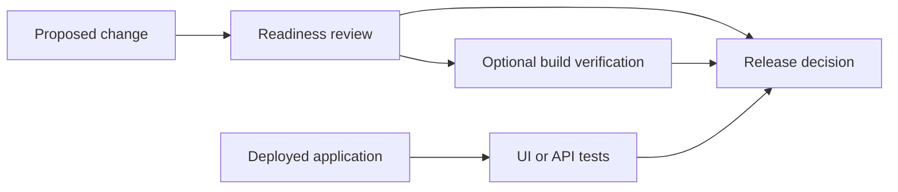

<!-- block: obsidian-devops-reference-release-management-body -->
# Release readiness and application testing

This reference supplements the primer and operational framework. It preserves source-specific setup and interface detail. Related: [[AWS_DevOps_Agent_Framework]] · [[Source_Index]].

## Release readiness workflow

Release management preview adds production-risk review during code generation, pull requests or merge requests, and explicit requests. It combines internal standards, dependency context, and access-control analysis with optional functional verification. Initial repository indexing can take approximately one to two hours, so assess readiness of the context before treating a first review as comprehensive. The documented access-control verification evaluates CloudFormation changes, including IAM policies, resource policies, and network configuration.

Sources: [S088](https://docs.aws.amazon.com/devopsagent/latest/userguide/working-with-devops-agent-release-management-index.html) [S013](https://aws.amazon.com/about-aws/whats-new/2026/06/aws-devops-agent-release-management/) [S089](https://docs.aws.amazon.com/devopsagent/latest/userguide/release-management-release-readiness-code-review.html)

*Documented capabilities with customer decision. Readiness and deployed-application testing provide different evidence. Their combination at a team release gate is a proposed customer policy. Tests may modify application data.*

Sources: [S089](https://docs.aws.amazon.com/devopsagent/latest/userguide/release-management-release-readiness-code-review.html) [S090](https://docs.aws.amazon.com/devopsagent/latest/userguide/release-management-release-testing.html)

The coding workflow can use Claude Code or the documented AWS Transform custom skill. The review report returns findings for developers to address and can inform a repository gate. Use a configured required check or approval rule when the delivery policy requires blocking behavior.

Sources: [S012](https://aws.amazon.com/blogs/aws/aws-devops-agent-adds-release-management-capabilities-to-assess-code-changes-before-production-preview/) [S035](https://docs.aws.amazon.com/devopsagent/latest/userguide/connecting-to-cicd-pipelines-connecting-github.html) [S036](https://docs.aws.amazon.com/devopsagent/latest/userguide/connecting-to-cicd-pipelines-connecting-gitlab.html)

## Release reports and trigger controls

| Recommended action | Meaning for the release decision |
| --- | --- |
| BLOCK | A sufficiently confirmed critical risk requires resolution. |
| Deploy with Caution | Review actionable risks before proceeding. |
| Standard Deployment | The review identified no actionable release risk. |
| Request Permissions | Required access was unavailable; grant suitable scope and rerun. |
| Insufficient Data | Critical questions remain unanswered from available context. |

Sources: [S089](https://docs.aws.amazon.com/devopsagent/latest/userguide/release-management-release-readiness-code-review.html) [S107](https://docs.aws.amazon.com/devopsagent/latest/userguide/whats-new.html)

Reports include change scope, affected code, findings, recommendations, and an execution journal. Verification results appear on a Tests tab when present. A clean assessment is evidence for a release decision, not a guarantee that every regression has been excluded.

Sources: [S089](https://docs.aws.amazon.com/devopsagent/latest/userguide/release-management-release-readiness-code-review.html)

### Repository setup

Connect the repository and configure automatic change review and verification testing independently. GitHub documentation states both start enabled for newly connected repositories. GitHub App registration supports webhook-driven workflows; a personal access token connection does not provide the same automatic review trigger path. Choose provider permissions according to the features required.

Sources: [S035](https://docs.aws.amazon.com/devopsagent/latest/userguide/connecting-to-cicd-pipelines-connecting-github.html)

Trigger filters match target branches and optionally event types. Conditions within a group are ANDed; groups are ORed. The current guide allows five groups with twenty branch patterns each. Automated PR/MR review is limited to private repositories, while explicit reviews remain possible for public repositories.

Sources: [S036](https://docs.aws.amazon.com/devopsagent/latest/userguide/connecting-to-cicd-pipelines-connecting-gitlab.html) [S089](https://docs.aws.amazon.com/devopsagent/latest/userguide/release-management-release-readiness-code-review.html)

### Private build dependencies

For private build services, create a Release Management environment containing a private connection and runtime role, then select it for each repository or project needing verification access. The runtime role supports ENI management through AIDevOpsReleaseManagementVPCPolicy. Each repository uses one environment; separate environments can serve different VPCs. Verify network reachability before relying on a blocking workflow.

Sources: [S089](https://docs.aws.amazon.com/devopsagent/latest/userguide/release-management-release-readiness-code-review.html) [S035](https://docs.aws.amazon.com/devopsagent/latest/userguide/connecting-to-cicd-pipelines-connecting-github.html) [S036](https://docs.aws.amazon.com/devopsagent/latest/userguide/connecting-to-cicd-pipelines-connecting-gitlab.html)

## Release testing workflow

Release testing explores a running web application or REST API. The task may originate in the web app, chat, a coding agent, or a pipeline. It generates a plan from the change or stated test intent and returns failures with reproduction information. The target receives real requests, including operations that can create, change, or delete data.

Sources: [S090](https://docs.aws.amazon.com/devopsagent/latest/userguide/release-management-release-testing.html) [S013](https://aws.amazon.com/about-aws/whats-new/2026/06/aws-devops-agent-release-management/)

Diagram: [[Diagram_Atlas#P10 — Two release evidence paths]].

Choose a staging deployment, limited test identity, and data that can tolerate exploratory actions. This operating recommendation addresses the documented possibility of payments, notifications, or destructive application side effects. Review failures and rerun after the application changes; a test report does not itself deploy a correction.

Sources: [S090](https://docs.aws.amazon.com/devopsagent/latest/userguide/release-management-release-testing.html)

## Test profiles authentication and delivery integration

| Configuration | Documented use |
| --- | --- |
| Test profile | Reusable target URL and UI or API test configuration. |
| Username and password | Encrypted credentials used for target sign-in. |
| TOTP | Authenticator secret or setup URI; supported for UI and API profiles. |
| Email two factor authentication | UI profiles only; forwarding rule delivers verification emails. |
| Private application environment | Private connection and runtime role provide reachability to the chosen VPC target. |

Sources: [S090](https://docs.aws.amazon.com/devopsagent/latest/userguide/release-management-release-testing.html)

### GitHub Actions workflow

The AWS-maintained action is aws-actions/devops-agent-qa@v1. After deployment, it signs a webhook and initiates testing. Results return as a Check Run, with detailed execution information in the operator app. Store the webhook URL and secret in repository secrets. The repository supports either a saved test profile or a guest-only target-url plus agent-type pair, not both; an optional OpenAPI file can refine API testing.

Sources: [S021](https://github.com/aws-actions/devops-agent-qa)

For authenticated or reusable team tests, prefer the profile route. The profileless action is guest-only and has payload-size constraints. Pin and review the action version used by your delivery system as normal dependency-management practice. The user-guide prose contains an inconsistent action name, so the source-conflict register points to the AWS repository as the implementation reference.

Sources: [S021](https://github.com/aws-actions/devops-agent-qa) [S090](https://docs.aws.amazon.com/devopsagent/latest/userguide/release-management-release-testing.html)

### Network scope and outcome

A private test profile selects a Release Management environment containing a private connection. The runtime role uses AIDevOpsReleaseManagementVPCPolicy. Restrict the connected security group to intended targets: exploratory testing may follow linked endpoints beyond the starting URL. Results identify In Progress, Completed, or Failed runs and preserve test details for review.

Sources: [S090](https://docs.aws.amazon.com/devopsagent/latest/userguide/release-management-release-testing.html)

## Execution environments and mutation boundaries

| Environment or action path | Purpose | Boundary |
| --- | --- | --- |
| Standard investigation tools | Read operational evidence | Configured accounts, providers, IAM and session guardrails |
| Investigation Sandbox preview | Run analysis code for an investigation | Ephemeral environment, read-only AWS API proxy, configured network allowlist |
| Managed release verification | Build and test proposed code | AWS-managed environment with restricted egress or configured VPC access |
| Deployed application release testing | Exercise UI and REST behavior | Real HTTP requests may modify application data |
| Directed action in chat | Perform an explicitly requested change | Opt-in, supported action, permissions and scoped operator approval |

Sources: [S074](https://docs.aws.amazon.com/devopsagent/latest/userguide/aws-devops-agent-security-limiting-agent-access-in-an-aws-account.html) [S093](https://docs.aws.amazon.com/devopsagent/latest/userguide/configuring-integrations-and-knowledge-sandbox.html) [S012](https://aws.amazon.com/blogs/aws/aws-devops-agent-adds-release-management-capabilities-to-assess-code-changes-before-production-preview/) [S089](https://docs.aws.amazon.com/devopsagent/latest/userguide/release-management-release-readiness-code-review.html) [S090](https://docs.aws.amazon.com/devopsagent/latest/userguide/release-management-release-testing.html) [S108](https://docs.aws.amazon.com/devopsagent/latest/userguide/working-with-devops-agent-working-with-directed-actions.html)

These paths have different purposes and security controls. For example, enabling investigation Sandbox does not authorize AWS resource mutation. A release review's AWS mutation guardrail does not make writes to the separate release-testing target impossible. Approval of a directed action applies to the approved operation and resources, not every future tool call.

Sources: [S093](https://docs.aws.amazon.com/devopsagent/latest/userguide/configuring-integrations-and-knowledge-sandbox.html) [S089](https://docs.aws.amazon.com/devopsagent/latest/userguide/release-management-release-readiness-code-review.html) [S090](https://docs.aws.amazon.com/devopsagent/latest/userguide/release-management-release-testing.html) [S108](https://docs.aws.amazon.com/devopsagent/latest/userguide/working-with-devops-agent-working-with-directed-actions.html)

Readiness reviews document four guardrails: credential-pattern blocking, blocking shell commands that combine sensitive-file access with network operations, mutative AWS API blocking, and sequential phase enforcement. AWS states that coverage can evolve and is not universal; these controls are not a guarantee against every unsafe behavior.

Sources: [S089](https://docs.aws.amazon.com/devopsagent/latest/userguide/release-management-release-readiness-code-review.html)

### Recommended presentation example

Use a single application change to connect the workflows. First, review a checkout-service change for dependency and permission risks. Next, run verification and staging application tests. After a controlled deployment, investigate a synthetic alarm using the resulting telemetry. Request any directed mitigation separately through chat, then use the incident evidence for a prevention recommendation. This is an illustrative walkthrough, not a claimed automatic orchestration across all features.
