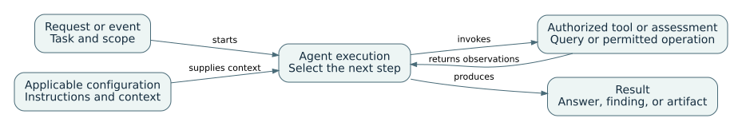
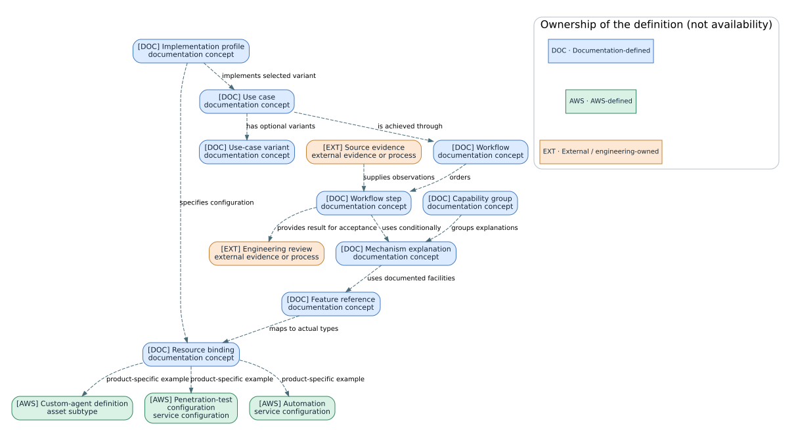
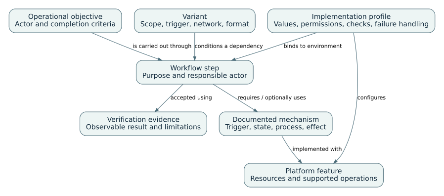
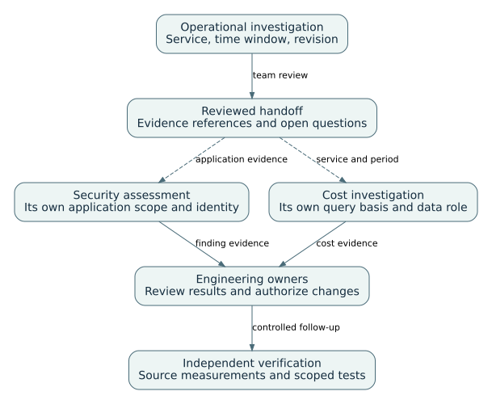

# Architecture of AWS operational agents

Concept ownership, product resources, execution, and evidence

AWS DevOps Agent, AWS Security Agent, and AWS FinOps Agent expose different configuration resources, execution records, and retained state. This guide defines the concepts used by the documentation and maps them to the product-specific models. It does not define a common AWS resource schema or cross-service runtime. [AS30] [AS31] [AS32]

Start with entity ownership and resource identity. The following chapters compare integrations, retained context, authorization, execution lifecycle, and evidence handoffs. The operational-review example combines reviewed outputs while retaining each service's configuration and permissions.

**Reading conventions.** Product statements link to official AWS documentation. Configuration recommendations and verification procedures are team guidance; the proposed tests and synthetic examples have not been executed against AWS. Lifecycle tables describe service behavior and operator actions, not an API status enumeration unless explicitly cited. DOC (blue), AWS (green), and EXT (orange) identify concept ownership. Source-review dates and qualifications are recorded in the source registers.

## 01. Concept ownership and product resource models

Use the entity model to distinguish responsibilities, then compare the product capability dimensions. The model is not a product feature inventory.

### A-00 — Agents, tools, context, and executions

In these guides, an agent is a software system that carries out a bounded task by using a model to interpret the request and by invoking the tools or assessment functions the service makes available. The useful unit of observation is the execution: the particular investigation, assessment run, conversation, or task that receives inputs and produces results. The configured agent or application space is longer-lived and can supply permissions, instructions, sources, and retained information to many executions. The three AWS services implement that distinction with different named resources. [AS30] [AS31] [AS32]

A tool is an interface to another system, such as an authorized telemetry query or an issue-creation operation. Tool output supplies observations. Instructions express how the agent should perform its work. Memory or reference material supplies context. These are different responsibilities: a statement in a document cannot make an unauthorized API call succeed, and a granted API permission does not guarantee that a run will choose the correct query.



The diagram is a reading model, not a shared AWS implementation. A request or event establishes the task; applicable configuration and context shape the execution; tools or assessment components produce observations; the service uses those observations to continue the work or produce an output. Where an effect requires approval, the approval boundary belongs to that operation. A retained lesson may influence a later run without altering the underlying model’s weights.

This kind of agent is also different from a telemetry collection agent installed on a machine. The latter collects or forwards measurements. An operational reasoning service consumes evidence exposed through its configured access paths. Calling both an agent does not mean that DevOps Agent installs a universal host collector or that Security Agent continuously observes every request to an application.

The rest of the comparison keeps four questions separate: what reusable capability exists; which operation configures or invokes it; what documented mechanism carries it out; and which engineering use case combines those pieces. The product guides provide the procedures. The catalog provides concrete applications and their prerequisites.

### A-10 — Concept ownership and the approved entity model

The approved conceptual model separates an operational objective from the product objects used to implement it. A use case identifies who needs a result and how completion is judged. Its workflow orders the work. A mechanism explanation describes how a documented process operates, and a feature reference leads to the concrete configuration and execution facilities used by that process. An implementation profile supplies a reviewed configuration recipe. These are this collection's concepts, not universal AWS resource types.



Blue identifies concepts defined by this documentation. Green identifies AWS-defined resources or documented concepts. Orange identifies an external system, original source evidence or an engineering-owned artifact or decision. Color concerns the authority that defines the concept, not who wrote its content. A customer-authored DevOps skill is green because AWS defines the skill facility; an owner-reviewed SOP document is orange. Our implementation profile is blue, even when it configures an AWS release test profile that is green. [AS50]

Green does not mean independently creatable. A service resource, an asset subtype, a configuration member, an execution record and a derived view all have different administrative behavior. For that reason every entity in the specialized models has a kind, scope and identity description as well as a name. The model does not create new CRUD operations for retained login navigation, a topology view or a conversation summary. The relevant services document those concepts without establishing one common object interface. [AS51] [AS52]

The product diagrams refine the model rather than flattening the products into it. DevOps associates providers with operational spaces and offers managed and custom execution paths. Security separates shared configuration from application assessments and gives different assessment types different lifecycles. FinOps uses an instance-local context and task model whose IAM vocabulary includes service-specific AgentSpace names. Similar labels do not establish interchangeable resources. [AS50] [AS51] [AS53]

Relationships are qualified in three classes. A solid relationship is explicitly documented. A dashed logical relationship is an explanatory association inferred from the described behavior, such as recording a task's optional automation origin without asserting a particular API field. A dashed editorial relationship is introduced by this collection, such as linking a use-case step to a mechanism. Exact multiplicity remains `?` when the reviewed source does not establish it. `0..*` describes a repeatable logical relationship, not an unlimited service quota.

The [resource-model reference](../catalog/resource-models.html) is the generated dictionary and relationship register. It links back to the maintained guide explanations and forward to feature dependencies. It is not a new parallel use-case catalog or a database migration for any AWS service.

### A-12 — Capabilities, product features, and mechanisms

The model relates operational objectives to documented implementation facilities. It is not the table of contents of every product guide. Organizing a book into one chapter per entity would put a network route, a prompt, a review result, and a use case at the same explanatory level.

A capability dimension groups a kind of customer control: workspace organization, definition, context, invocation, integrations, connectivity, execution, managed workflows, outputs, or administration. Within a dimension, a feature names a concrete service facility. A mechanism explains how that facility operates. The approved use cases remain separate descriptions of operational objectives. [AS01] [AS02] [AS03]

| Product facility | Mechanism to explain | Application in the existing catalog |
|---|---|---|
| DevOps memory stores | Description-led store/entry selection and retained-version lifecycle | Historical context during incident investigation |
| DevOps event trigger | Webhook event matching, JMESPath condition/projection, then invocation | Event-driven execution where the chosen implementation permits it |
| Security Login Optimization | Retain successful navigation and reuse it for subsequent authentication | Authenticated application assessment |
| Security requirement pack | Select applicable criteria during an eligible review | Design or source review against organizational requirements |
| FinOps automation | Match a schedule or supported anomaly event and create a task | Periodic reporting or anomaly investigation |
| FinOps conversation context | Summarize older messages near the context limit | Continued analysis within a conversation |

An implementation profile in the approved model means an authored grouping of configuration choices. In the reading edition it appears as configuration instructions for the relevant use case. It is not an AWS agent type or service resource. The native DevOps release-testing `test_profile` is a different, explicitly documented resource. The model and the catalog are retained unchanged; product explanations identify what AWS exposes and what the team supplies. [AS01]

The concrete retrieval, event-processing, authentication-reuse, and compaction behaviors are documented separately by their products; the table is an editorial comparison, not a shared implementation. [AS501] [AS502] [AS503]

### A-11 — Product specialization and use-case traceability

Stage 2 specializes the approved model in three directions: configuration scope, execution lifecycle and knowledge ownership. The purpose is not to make the products look the same, but to let the reader locate the corresponding responsibility while preserving its actual implementation. Start with a use case, follow its conditional mechanism dependencies, then inspect the product-specific resource bindings before configuring anything. [AS50] [AS51] [AS52]

| Conceptual responsibility | DevOps specialization | Security specialization | FinOps specialization |
|---|---|---|---|
| Scope | Agent Space with source associations and knowledge | Application Agent Space with some shared tenant configuration | Independent instance; service-specific AgentSpace name in IAM |
| Reusable definition | Custom-agent definition, skill or test profile | Assessment-specific configuration; design review is the exception | Automation and instance configuration |
| Execution | Investigation, custom invocation or Learning execution | Assessment run, one-off design review or revalidation job | Conversation work or separately recorded task |
| Retained context | Stores, memory entries and versions; instructions and skills | Application sources, requirements and retained login procedure | Context files, persistent memory and conversation summaries |
| Evidence result | Investigation output, invocation trajectory or recommendation | Source or application findings and linked revalidation results | Analysis and report artifact; upstream evidence stays distinct |
| External effect | Eligible approved directed operation or active application test | Application requests, code proposal or finding publication | Supported Jira or Slack publication |

This is a responsibility crosswalk. It does not declare that the objects in a row share an API, permission model or deletion behavior. The exact definitions and exceptions appear in D-13, S-10 and F-09. In particular, the FinOps IAM name is documented as `finops-agent:CreateAgentSpace`; it must not be silently replaced with the DevOps service namespace in scripts or policies. [AS53]

The thirty approved use cases remain the authoritative outcome list. Their source records, identifiers, variants, mechanisms and implementation profiles are preserved in this revision. Each feature reference now has an explicit binding to the product objects it uses. That extra relationship answers a question the earlier catalog could not answer precisely: which actual configuration or execution record must an engineer inspect for this step?

For an incident investigation, follow the signal and investigation, then any selected source and memory. For application repair verification, follow the original finding, reviewed change, deployed target and revalidation job. For cost reporting, follow the query basis, retained mapping, optional automation, task and artifact. A failed relationship changes the interpretation of the outcome: missing current telemetry cannot be repaired by recalling an earlier diagnosis; an unreachable authenticated route cannot establish a repaired vulnerability; a correct total with a stale owner mapping is still an incorrect allocation. These are engineering acceptance rules applied to documented operations, not extra native agent capabilities. [AS50] [AS51] [AS52]

The shared operational-review case, [UC-G01](../catalog/index.html#UC-G01), combines reviewed results rather than native runtime state. The receiving engineer gets source identifiers, observation period, result and unresolved questions. Credentials and approval authority stay with their original product boundary. The same separation applies to knowledge: no relationship in this model asserts a shared cross-product memory service or automatic transfer of learned context.

The reverse index supports configuration review. From a feature, the reader can inspect its resource bindings and the use cases that may depend on it. Conditional profiles remain conditional; the index is not a live impact detector or a proof that every linked case is deployed. The model review checks these relationships and preserves uncertain multiplicities, while live access and execution would require a separate authorized test.

### A-09 — Operational objectives and implementation dependencies

A use case describes an operational objective with a recognizable completion condition. Its workflow identifies the sequence of work and the decisions needed to reach that condition. Mechanisms describe how the service carries out individual parts of that work, while platform features identify concrete objects and configuration surfaces. These are different reading levels, not competing names for the same catalog entry. The classification below is an editorial model; the services retain their own resource hierarchies and execution lifecycles. [AS30] [AS31] [AS32]



The catalog starts with the outcome rather than with the trigger or output format. For example, a service-health snapshot and a recurring health report share a health-reporting objective but use different execution profiles. A private authenticated penetration test is a configuration of the application-assessment case. In contrast, mitigation planning and execution remain separate because approving a proposal and changing a resource require different evidence and authority.

Each workflow step names the responsible actor, required mechanism, configuration features, effect, acceptance evidence, and behavior when the step cannot proceed. A required dependency blocks that selected implementation when it is missing. An optional dependency can be omitted with the stated limitation. A conditional dependency applies only when the named variant is selected. These declarations belong to the authored workflow; they are not claims that every AWS invocation uses the same sequence.

Consider service-health reporting. Current telemetry is required to assert current health. Retained service context can help interpret names and relationships, but missing history may still permit a qualified current-state report. A schedule is needed only for recurring execution; it does not define the measurement window. External publication adds a destination-specific effect rather than becoming another report use case. The configuration procedure is in D-07, and the source/knowledge paths are described in D-03, D-M01 and D-M07.

Knowledge production and knowledge use also have different lifecycles. A learning or feedback path produces retained context. A later execution selects relevant available context and compares it with current evidence. The maintained explanation is in A-02 and the product knowledge chapters; a retained entry's existence, an observed read and a correct result remain separate observations. None establishes customer-controlled model training. [AS04] [AS05] [AS06] [AS07]

Configuration recipes collect choices that are reused across cases: actual resource identifiers, selected tools, context references, schedule semantics, destinations and proposed acceptance tests. A recipe is not a universal agent deployment schema. In particular, automated Jira publication and interactive Jira publication have different FinOps approval behavior, and active application testing has effects that cannot be characterized only by infrastructure permissions. These controls remain attached to the selected execution path after consolidation. [AS10] [AS11] [AS12]

The linked catalog supports three reading directions. Start with an outcome to see its workflow and required configuration. Start with a mechanism to find all steps and profiles that use it. Start with a feature to inspect the outcomes potentially affected when it is disabled or changed. Reverse dependency links describe documentation relationships, not a live diagnosis of an account. [AS30] [AS31] [AS32]

The shared operational-review case combines reviewed reliability or cost-management results into decisions, owners and follow-up. Each service uses its own sources and authority. The review carries evidence identity and unresolved questions, not credentials, shared memory or inherited approval. A-06 describes that team handoff.

### A-01 — Resource identity across service boundaries

A useful cross-service record preserves the original identity instead of replacing every object with a generic agent ID. The configured workspace identifies the operating scope, the definition identifies reusable settings, and the execution identifies a particular result. An external source revision or observation period identifies what that result describes. These responsibilities are separate even when a user interface displays them together. [AS50] [AS51] [AS52]

For example, an incident handoff should distinguish the operational space from its investigation. A security handoff should retain the assessment and original finding, not just the application name. A cost report should retain its query basis and task or conversation context rather than claiming that the agent instance itself identifies the analysis. The following fields are an authored evidence convention, not an AWS API request schema.

| Identity component | Purpose | Interpretation |
|---|---|---|
| Product and scope | Identify the service, account/Region and relevant space or instance | Similar resource labels in different namespaces remain different objects |
| Configuration reference | Identify the selected definition or settings where applicable | A configuration can outlive and create several executions |
| Execution reference | Identify the investigation, run, review, job or task | Status describes this piece of work, not every subsequent action |
| Source identity | Preserve resource IDs, query basis, revision and observation window | The source system remains the authority for original observations |
| Result and review | Connect the output to the accepted interpretation and residual uncertainty | A completed execution does not establish outcome correctness |

Use native identifiers where documented and meaningful context otherwise. Do not invent an ARN or parent field for a derived view, a retained procedure or a normalized relationship. In particular, the FinOps instance has its own AgentSpace IAM naming within the finops-agent service; that naming does not make a DevOps policy or API interchangeable with it. [AS53]

A-11 provides the product responsibility crosswalk, while the resource register supplies the detailed entity and relationship dictionary. This section concerns how identities survive an engineering handoff, not a second definition of the product hierarchies. [AS50] [AS51]

### A-02 — Knowledge construction and retrieval models

Knowledge has a producer, an owner, and a retrieval path. A DevOps monitor entry is synthesized from investigations; a Security login skill comes from successful navigation; a FinOps reference file is uploaded by an operator. Comparing these paths is more informative than asking whether all three products have memory.

| Retained material | Producer | Consumer and lifecycle | Do not infer |
|---|---|---|---|
| DevOps monitor history | Managed learning over investigations | Selective memory retrieval; bounded refresh/retention | A permanent incident archive or trained model weights |
| DevOps correction | Operator feedback; reflection knowledge | Later relevant investigation context | That feedback instantly changed every derived record |
| Security login skill | Successful authentication navigation | Reuse on later logins; toggle controls reuse | General-purpose vulnerability or incident memory |
| FinOps reference file | Operator upload | Readable contextual source; soft-delete/restore | Conversational edits rewriting the file |
| FinOps memory | Conversation/task-derived context | Instance-persistent preferences/corrections | Verbatim retention of all old conversation messages |

These mechanisms are documented separately in the canonical guides: D-M01, D-M02, D-M07, S-M02, F-M02 and F-M03. Their lifecycle cannot be replaced by a single generic “learning enabled” checkbox. [AS04] [AS05] [AS06] [AS07]

**Engineering verification:** separate five questions: was relevant input available, was retained content produced, was it accessible to this execution, was its use observable, and was the resulting conclusion correct? The final answer alone cannot resolve all five.

Security Agent also documents Findings Personalization. It reuses eligible edits from the most recent completed penetration-test run to adjust similar later findings, provided the feature was enabled when the test started. This is a different producer, retained preference and effect from Login Optimization. The latter reuses authentication navigation; personalization changes finding attributes. Disabling personalization preserves the learned preferences while displaying raw findings. Neither behavior proves that an application defect was repaired. The detailed mechanism is [Finding-edit personalization](../guides/security.html#MX-S-PERSONALIZE). [AS401]

## 02. Integration and authorization boundaries

An integration connects a source, trigger, target, or destination. The permitted direction and effect determine the relevant network and authorization controls.

### A-08 — Integration direction and evidence ownership

Start an integration design by drawing the direction of every exchange. An event producer can initiate work, a data source can answer a query, an execution target can receive active requests, and a publication destination can receive findings. One system may occupy several roles, but those roles still require distinct permissions and failure handling. [AS30] [AS31] [AS32]

| Integration role | DevOps Agent | Security Agent | FinOps Agent |
|---|---|---|---|
| Evidence source | AWS resources, observability, code and delivery systems, selected MCP tools | Selected repositories, S3 resources, design and Confluence documents | Authorized cost, anomaly, optimization, and change data |
| Work initiation | Operator request, supported incident integration/webhook, custom schedule | Operator assessment, supported repository or pipeline path, configured schedule | Conversation/task request, schedule, supported anomaly event |
| Active target | Approved resource/tool action; release-test application | Explicitly authorized application and authentication scope | Supported service queries; separately authorized collaboration actions |
| Result destination | Investigation record and configured communication path | Finding, remediation proposal, revalidation history, connected Jira project | Response, artifact, connected Jira project or Slack channel |



The handoff in the diagram is team-composed. For example, an operational investigation can produce a service identifier and a deployment revision. An application owner can use those identifiers to scope a security assessment, while a cost engineer can use the service and time window to define a cost inquiry. The receiving service uses its own configuration and permissions. The handoff should carry references and decisions, not borrowed credentials or an assertion that an earlier approval applies everywhere.

Ownership remains with the original systems. A source repository owns the reviewed revision, an assessment owns its finding, and a destination owns the published ticket or message. Removing a connection can stop future access or publication without deleting those external records. This is why a cross-platform workflow needs an explicit record of source identity, execution identity, and publication destination rather than one ambiguous status called complete.

### A-03 — Network, identity, and tool-access boundaries

Reachability, identity, and authorization are different boundaries. A route makes an endpoint reachable, credentials identify a caller, and permissions constrain the operation. The execution must satisfy each applicable boundary; a successful check at one layer does not establish the others.

A private connection supplies a route. Authentication establishes an identity. Authorization determines allowed operations. Prompt instructions describe desired behavior. A successful connection test demonstrates only the layers it actually exercised.

For DevOps MCP, provider registration and Agent Space tool selection are distinct from private routing and tool-effect classification. Security testing separately resolves credentials and applies them to the application; retrieval may succeed while login fails. FinOps registers an account integration and then binds a destination to an agent. [AS08] [AS06] [AS09]

**Engineering test matrix:**

| Test | Evidence needed | Failure interpretation |
|---|---|---|
| Intended read | Correct identity, resource, time window and result | Inspect source access before evaluating the answer |
| Unselected operation | Operation unavailable or rejected | Do not accept a verbal promise as enforcement evidence |
| Authentication | Actual application role reached | A fetched secret is insufficient |
| External publication | Correct destination and action record | Connected integration is insufficient |
| Configuration update | Saved identifiers and current values | A success message may omit replacement/default consequences |

Use a non-production target and non-sensitive fixture. These are proposed tests, not recorded service outcomes.

### A-04 — Authorization of state-changing operations

The effect of an operation determines which controls matter. Reading a metric, posting an issue, changing a resource, and sending an active application test request have different consequences. The comparison should follow those effects rather than assign a single read-only or autonomous label to an entire service.

| Effect | Product control to inspect | Important exception |
|---|---|---|
| AWS-resource mutation through DevOps | Directed-action opt-in, target role and operation-specific approval | Programmatically unclassified external tools can default to read-only classification |
| Active application testing | Target/network/credential configuration and assessment authorization | Application writes can occur without infrastructure-write access |
| Source remediation | Repository connection and supported proposed-change path | Proposed patch does not mean deployed repair |
| Jira publishing through FinOps | Invocation-specific approval | Automations pre-authorize actions that would prompt interactively |
| Slack publishing through FinOps | Destination configuration | Posting has no per-message approval prompt in reviewed guidance |

The common rule is to examine the actual effect, not to label every agent “read-only” or “human-approved.” AWS documents different controls for different paths. [AS10] [AS11] [AS12]

**Engineering design:** carry a requested effect and intended target in a work item, but never carry credentials or substitute a ticket approval for the receiving service's native authorization.

## 03. Execution lifecycles and evidence handoffs

A definition, execution, retained artifact, and external record have separate lifecycles. Team handoffs preserve their identities rather than collapsing them into one status.

### A-05 — Configuration, execution, and artifact lifecycles

The lifecycle of a saved definition differs from the lifecycle of the executions it creates. Disabling a schedule affects future work, while cancellation concerns an existing execution. Artifacts and external messages may remain after either operation. This distinction is central to a maintainable operating procedure.

Pause an automation to stop future starts; cancel a current run using its supported operation; remove or deactivate context using its own controls; delete an artifact only when the artifact itself is the intended target. These are different transitions. In-flight calls or retained execution history may remain after a stop action. [AS13] [AS07]

Security revalidation deliberately creates a new job linked to the original finding rather than silently rewriting the original assessment. DevOps memories keep immutable versions. FinOps task records and uploaded files have different retention/deletion semantics. [AS14] [AS04] [AS07]

**Engineering design:** retain version identifiers and source revisions in accepted work records. Keep maintained configuration source in Git. Do not create dated snapshot directories or compressed manual distributions as a substitute for version control. The product's own runtime retention is independent of this repository's history policy.

### A-06 — Cross-team evidence handoffs

The documented services retain different execution objects: a custom-agent invocation, an assessment run and finding, or a task and artifact. A receiving specialist therefore needs the original identifiers and source scope to interpret the handoff correctly. The resource and lifecycle guidance supports that distinction. [AS30] [AS31] [AS32]

The handoff format below is a proposed team record, not an AWS API or a built-in cross-product orchestration protocol. Its fields preserve evidence identity, ownership, and unresolved questions; they do not transfer credentials, retained memory, or approval authority.

A team handoff transfers evidence and a decision to another owner. It does not need to transfer an agent’s credentials, memory, or approval authority. A useful handoff therefore identifies the source objects and unresolved questions so the next specialist can reconstruct the relevant context.

The following is an original team interface, not an AWS schema:

```yaml
schema: engineering-handoff-v1
origin:
  platform: aws-devops-agent
  configuration_id: example-space
  execution_id: example-investigation
  observed_window_utc: "2026-10-22T10:00Z/2026-10-22T10:15Z"
subject:
  service: checkout-staging
  revision: demo-r2
request:
  owner: service-team
  question: Verify the inventory dependency latency explanation
  allowed_effect: review-only
  excluded_effects: [production-deployment, external-publication]
evidence:
  - reference: authorized-internal-record
    observation: inventory p95 increased while database latency remained low
    classification: synthetic-training-fixture
completion:
  required: current evidence supports or rejects the proposed explanation
  unresolved: [upstream-log-access]
```

The receiving engineer resolves the internal evidence link, validates the resource/revision, obtains their own access and decides which product operation is appropriate. There is no implied cross-agent shared session, credential forwarding or automatic trust in the originating conclusion.

**Failure branch:** a task naming “the latest deployment” without an immutable revision cannot establish which change was assessed. Return the work item for clarification rather than letting each product silently choose a different latest revision.

## 04. Cross-platform worked example

The worked example assigns different questions to the three services while retaining the source identity and verification responsibility for each.

### A-U01 — Cross-platform operational review: worked example

**Synthetic tabletop.** A staging release produces elevated request retries, an authorization finding and increased transfer volume. Those observations are distinct; one is not proof of the others.

| Specialist question | Product evidence | Acceptance boundary |
|---|---|---|
| Where did the latency increase originate? | DevOps current telemetry, historical context and investigation output | Explain the supported dependency direction; identify missing upstream evidence |
| Does the repaired account boundary hold? | Security finding, deployed revision, actual role and revalidation job | Verify the selected authorization path, not overall application security |
| Which cost components increased? | FinOps matched queries, quantity/rate decomposition, change evidence | Reconcile the delta; distinguish numerical contribution from causal attribution |

**Four-minute exercise:** spend one minute identifying each product's required input, two minutes checking revision/window/identity consistency across the prepared records, and one minute assigning unresolved questions to owners. A purported single root cause is rejected unless evidence actually connects the observations. No live agents or shared runtime are assumed.

## 05. Documentation coverage

These diagrams and comparisons are logical explanations of documented behavior, not assertions about undisclosed runtime architecture.

### A-07 — Architecture assumptions and references

This comparison covers resource scoping, retained context, access layers, effects, lifecycle and handoffs. It does not propose a universal agent framework or reproduce complete IAM policies. The three platform guides carry the detailed procedures and explicit per-product coverage tables.

The public sources do not justify specifying a shared vector database, embedding strategy, memory-ranking algorithm, foundation-model training pipeline or cross-product identity fabric. Where an implementation detail is not documented, the guide says so rather than completing an attractive architecture diagram with invented components.

#### Official sources and reviewed scope

- [AS01] DevOps topology versus investigation access scope.
- [AS02] Security account and application resource hierarchy.
- [AS03] FinOps creation and instance connections.
- [AS04] DevOps stored knowledge, retrieval and versioning; newer indexed memory guidance.
- [AS05] Dated DevOps correction-memory change.
- [AS06] Security credential resolution and learned login; newer indexed guidance.
- [AS07] FinOps persistent/runtime state and deletion semantics.
- [AS08] DevOps MCP registration, selection and authentication.
- [AS09] FinOps integration registration and binding.
- [AS10] DevOps directed-action controls and classification.
- [AS11] Security active-target configuration and run boundaries; newer indexed guidance.
- [AS12] FinOps action-specific approval.
- [AS13] Custom-agent trigger versus invocation cancellation.
- [AS14] Security revalidation lineage.

[AS01]: https://docs.aws.amazon.com/devopsagent/latest/userguide/about-aws-devops-agent-what-is-a-devops-agent-topology.html
[AS02]: https://docs.aws.amazon.com/securityagent/latest/userguide/understand-lifecycle.html
[AS03]: https://docs.aws.amazon.com/finops-agent/latest/userguide/creating-an-agent.html
[AS04]: https://docs.aws.amazon.com/devopsagent/latest/userguide/about-aws-devops-agent-devops-agent-memories.html
[AS05]: https://docs.aws.amazon.com/devopsagent/latest/userguide/whats-new.html
[AS06]: https://docs.aws.amazon.com/securityagent/latest/userguide/provide-testing-credentials.html
[AS07]: https://docs.aws.amazon.com/finops-agent/latest/userguide/data-protection.html
[AS08]: https://docs.aws.amazon.com/devopsagent/latest/userguide/configuring-integrations-and-knowledge-connecting-mcp-servers.html
[AS09]: https://docs.aws.amazon.com/finops-agent/latest/userguide/jira-integration.html
[AS10]: https://docs.aws.amazon.com/devopsagent/latest/userguide/working-with-devops-agent-working-with-directed-actions.html
[AS11]: https://docs.aws.amazon.com/securityagent/latest/userguide/perform-penetration-test.html
[AS12]: https://docs.aws.amazon.com/finops-agent/latest/userguide/agent-guardrail-control.html
[AS13]: https://docs.aws.amazon.com/devopsagent/latest/userguide/custom-agents-executing-custom-agents.html
[AS14]: https://docs.aws.amazon.com/securityagent/latest/userguide/revalidate-findings.html
[AS30]: https://docs.aws.amazon.com/devopsagent/latest/userguide/working-with-devops-agent-custom-agents-index.html
[AS31]: https://docs.aws.amazon.com/securityagent/latest/userguide/understand-lifecycle.html
[AS32]: https://docs.aws.amazon.com/finops-agent/latest/userguide/data-protection.html
[AS401]: https://docs.aws.amazon.com/securityagent/latest/userguide/review-penetration-findings.html
[AS50]: https://docs.aws.amazon.com/devopsagent/latest/userguide/working-with-devops-agent-custom-agents-index.html
[AS501]: https://docs.aws.amazon.com/devopsagent/latest/userguide/custom-agents-executing-custom-agents.html
[AS502]: https://docs.aws.amazon.com/securityagent/latest/userguide/provide-testing-credentials.html
[AS503]: https://docs.aws.amazon.com/finops-agent/latest/userguide/context-files-and-memory.html
[AS51]: https://docs.aws.amazon.com/securityagent/latest/userguide/understand-lifecycle.html
[AS52]: https://docs.aws.amazon.com/finops-agent/latest/userguide/data-protection.html
[AS53]: https://docs.aws.amazon.com/finops-agent/latest/userguide/setting-up.html
