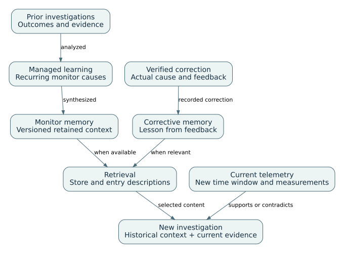

# AWS DevOps Agent

Architecture, integrations, knowledge, and operational workflows

An incident rarely arrives with all of its evidence in one place. The alarm identifies a symptom; logs describe individual failures; a deployment system records changes; and a runbook explains the service’s expected behavior. AWS DevOps Agent works across the sources made available to an Agent Space to investigate that operational question. The service also supports operational inquiries, prevention analysis, and custom-agent work. Release-assurance features have separate availability and effects. [DS18] [DS08]

This guide begins with the objects an operator configures, then follows the evidence into an execution and into retained knowledge. After the integration and knowledge chapters, it explains incident handling, custom reports, and controlled actions. The worked example shows why an earlier root cause is useful context but cannot replace present measurements. The grouped use-case catalog applies these mechanisms to daily work; it is not a second list of platform capabilities.

Product behavior is linked to official AWS documentation. Diagrams are logical explanations of documented resources and flows, not disclosures of AWS’s internal implementation. Procedures marked as engineering guidance and synthetic examples describe proposed team practice. No live AWS execution is claimed.


## 01. Resource model and scope

Begin with the product-specific entities, their scope and their relationships. Configuration, executions, knowledge and external evidence are distinct objects with different lifecycles.


### D-01 — Agent Space, configuration and execution

AWS DevOps Agent uses an Agent Space to scope operational work. The space brings together the AWS account access, selected external services and retained context needed to investigate an application. It is not an individual investigation and it is not the running application being observed. A new investigation creates a record of work within that configured environment; it does not create another Agent Space. [DS50] [DS56]

The resource model has three layers. Provider registration establishes an integration and its authentication. Association then selects how that registered service is used by an Agent Space. Executions use the available operations and applicable context to collect evidence or produce a result. A connection error belongs to the first two layers; an unsupported diagnosis belongs to the execution and evidence layer. These faults require different corrective actions. [DS51] [DS62]


Green boxes are AWS-defined objects or documented concepts. The label beneath each name distinguishes an independently addressable resource from a configuration member or derived view. Orange boxes identify external source systems. The blue concepts used by this collection, such as a use case or implementation profile, organize the explanation but are not resources created in the service. The complete ownership convention is described in the shared guide A-10.

Managed and custom agents have different administrative models. Managed roles belong to the platform; the incident roles operate as part of an investigation. Learning has its own history and platform-owned triggers. A custom agent is instead a saved definition whose prompt, selected tools, skills and memory access the team configures. Running that definition creates an invocation with a separate status and trajectory. [DS63] [DS53] [DS54]

These distinctions connect the service to the approved outcomes. Incident triage and investigation use the built-in operational path. A native health inquiry can use Chat. A repeatable report with a prescribed structure may use a custom definition and optional trigger. A mitigation proposal is an output; carrying out a directed action introduces additional authorization. Release-readiness review and deployed-application testing are separate preview paths with different subjects and effects. [DS56] [DS57] [DS60] [DS61]

The following section explains identities and relationships. Subsequent chapters follow the same model through integration setup, knowledge production, execution and the approved use cases. The [resource index](../catalog/resource-models.html#model-devops) provides the entity dictionary and individually qualified relationship multiplicities; it is not an inventory of resources in your account.


### D-13 — Configuration identities and knowledge relationships

A resource name is useful to a person, but it does not necessarily identify a valid relationship in an API. An Agent Space has an `agentSpaceId`. A service association records the space, `serviceId` and `associationId`, together with provider-specific configuration. Registering a provider and associating it are therefore different operations. The association API also documents replacement of an existing association of the same service; adding an association is not an unrestricted append operation. [DS51]

The asset model provides another identity layer. A custom-agent definition, skill, instruction file, memory store or memory entry can be represented through its documented asset type. References between these assets use the expected identifiers. In particular, the `skills` and `memory_stores` arrays of a custom-agent definition refer to existing asset IDs in the same Agent Space, not display names. A memory entry identifies its parent store. These are concrete relationships that can be inspected and configured, rather than abstract claims that an agent has access to all organizational knowledge. [DS52]


Knowledge has both a production path and a use path. Managed learning synthesizes environment or investigation information into retained context. A later execution selects relevant available stores and entries rather than receiving every file indiscriminately. Versions describe changes to an entry; active state and custom-agent attachment describe availability. None of those observations alone proves that a particular investigation used the information correctly. D-M08 describes consolidation, D-M01 retrieval, and D-M07 access and lifecycle in detail. [DS55] [DS63]

A custom definition begins without attached stores. An attached managed store is read-only to that custom agent, while attached custom stores support the documented write behavior. Managed-agent knowledge access and custom-agent attachment should consequently not be represented by one universal permission rule. Standing instructions and applicable skills are other kinds of context: they are not memory entries and do not grant source-system permissions. [DS53] [DS55]

| Object or relationship | What changes | What remains a separate concern |
|---|---|---|
| Provider association | Selected provider-specific configuration | Authentication, target routing and actual tool result |
| Custom-agent definition | Prompt and references to available tools, skills and stores | Each invocation and its output |
| Memory entry version | Retained content | Activation, attachment and observed retrieval |
| Learning execution | A particular knowledge-production run | Correctness and freshness of the resulting representation |
| Custom trigger | Future start conditions | Existing invocation cancellation and observation window |
| Directed-action approval | Authorization for the requested operation and target | Permission ceiling, actual resource state and service recovery |

The table summarizes different lifecycles; it is not an instruction to apply the same update or delete operation to every object. Custom-agent execution and cancellation are documented under D-07. Directed actions have a separate control sequence under D-M06. Topology is a derived representation of discovered and inferred relationships; its visible boundary is not the full IAM access boundary. [DS54] [DS57] [DS58]

In the diagrams, `0..*` means an optional repeated logical association, not an unlimited service quota. `?` means that the reviewed documentation does not establish exact multiplicity. Dashed edges mark logical or editorial associations rather than asserted service foreign keys. Each qualification and its supporting source is retained in the [relationship register](../catalog/resource-models.html#model-devops).


## 02. Data sources and integration configuration

An investigation can use only the evidence exposed through its configured access paths. Start with the supported connection families, then distinguish operator roles, provider authorization, selected tools, and private routing.


### D-12 — Supported integrations and connection directions

An integration answers two separate questions: which system can supply evidence, and which system can receive an action or update? Those directions matter. A telemetry connection may permit reading metrics without posting findings back. A webhook may start an investigation without granting any permission to query the originating monitoring system. The following inventory separates these paths rather than treating every connected brand as an equivalent connector. [DS30] [DS31]

| Connection family | Documented systems | Information or effect | Setup boundary |
|---|---|---|---|
| AWS resource and telemetry access | Primary and secondary AWS accounts; CloudWatch | Authorized resource inspection and telemetry queries | Account roles and selected account associations |
| Object-based evidence | Amazon S3 | Read logs, configuration, and other objects | Scope ListBucket and GetObject to required buckets and objects |
| Kubernetes inspection | Amazon EKS | Cluster, pod-log, and event inspection | EKS access setup and network reachability are additional prerequisites |
| Two-way observability | Dynatrace | Telemetry/topology reads; configured problem initiation; investigation updates | Provider setup and the Dynatrace workflow determine the actual paths |
| One-way telemetry access | Datadog, Grafana, New Relic, Splunk | Telemetry reads through the documented provider path | Source authorization; event initiation is separately configured through webhooks |
| Code and delivery context | GitHub, GitLab | Repository and pipeline evidence for operational investigations | Connect the relevant sources and deployment mapping |
| Azure infrastructure | Azure Resources | Subscription-scoped discovery and investigation | Register the tenant connection, then associate subscriptions |
| Azure delivery context | Azure DevOps | Selected project and pipeline-history context | Separate registration and project association; pipeline history does not imply access to externally hosted code |
| Incident coordination | ServiceNow, PagerDuty, Slack | Provider-specific incident initiation and communication | Configure each provider’s documented route and permitted destination |
| Additional tools | Compatible remote or private MCP servers | The tools explicitly selected for the Agent Space | MCP authentication, tool selection, effect classification, and networking |
| External initiation | Authenticated webhooks | Incoming incident information | Caller authentication and request format; not a telemetry-read grant |
| Lifecycle delivery | Amazon EventBridge | Investigation and mitigation lifecycle events sent to configured targets | Event routing and destination permissions; not an arbitrary custom-agent trigger claim |

The named built-in providers above come from the integration overview and provider guidance. A Prometheus or proprietary source can be exposed through the bring-your-own MCP/webhook route; that is not the same claim as a maintained native connector. The three-way distinction between built-in two-way telemetry, built-in one-way telemetry, and bring-your-own sources is documented by AWS. [DS30] [DS31]


Registration establishes an account-level provider connection. Association makes selected resources or tools available in a particular Agent Space. Authentication is then exercised when the agent invokes the tool. An engineer can therefore diagnose a missing result in sequence: confirm registration, confirm association and tool selection, confirm the route, then inspect the actual call and returned identity. The MCP-specific choices are described in D-03; private routing is described in D-04.

Azure adds another scope decision. Azure Resources and Azure DevOps are independently registered capabilities. The former associates subscriptions; the latter associates projects. The documented registration options include administrator consent and a customer-managed Entra application with federation. Connecting a pipeline whose code lives elsewhere does not automatically provide that repository’s contents. [DS32]

For a first operational deployment, choose the smallest useful evidence chain: the affected AWS service, one telemetry source, and the repository or pipeline that deploys it. Add incident coordination after confirming a read with known service and revision identifiers. This staged verification is an engineering recommendation, not an additional service requirement.


### D-02 — Resource roles and operator roles

Resource access lets an execution inspect infrastructure; operator access lets a person use the space. These paths are configured together during setup but fail independently. Establishing the distinction first makes a missing data result easier to diagnose than treating every failure as an agent problem.

**Administrator procedure.** In the AWS console, create an Agent Space, give it a name, and configure primary-account resource access. Select an automatically created role, an existing role, or the policy-template route for customized permissions. Configure the Web App role separately, then create the space. The expected confirmation is an **Operator access** button that opens an authenticated web application. Creating a space successfully is not confirmation that a particular telemetry API is readable. [DS02]

| Decision | Resource-access path | Operator-access path |
|---|---|---|
| Purpose | Allow the service to inspect authorized AWS resources | Allow personnel to interact with the space |
| Review | Target accounts, actions, resource scope and trust | Which users can enter and what operations they can perform |
| Proposed test | Read one known non-sensitive resource and inspect its identity | Sign in as the intended operator, not only the setup administrator |
| Failure interpretation | Missing data can be an API or role problem | An unavailable app can be an identity/access problem |

**Engineering procedure:** record the space ID, Region, role ARNs and one tested resource. Keep policy source in Git. Do not publish account secrets or copy broad policy examples without adapting their resource scope. For secondary-account trust and exact IAM statements, use the linked current AWS procedure; this guide does not invent a universal trust policy. [DS19]


### D-03 — MCP provider registration and tool selection

MCP connects the agent to a tool interface exposed by another system. The provider supplies the tool behavior; the Agent Space selects which tools the agent may call. Authentication establishes the calling identity, while the selected tool set constrains the available operations.

**Inbound versus outbound:** this section concerns DevOps Agent calling an external MCP server. A client calling DevOps Agent's own remote endpoint is the opposite integration direction; see D-09.

In **Capability Providers → MCP Server → Register**, enter a name and HTTPS endpoint, choose authentication, and supply the relevant fields. The documented transport is Streamable HTTP. After registration, associate the provider under the Agent Space's **Capabilities → MCP Servers** and select the required tools. [DS03]

| Authentication choice | Configuration to prepare |
|---|---|
| OAuth client credentials | Client ID/secret, token exchange URL, parameters and scopes |
| OAuth three-legged flow | Client details, exchange and authorization URLs, scopes |
| API key | Secret value and the actual HTTP header name |
| Multiple secret headers | Explicit secret/header pairs; registration-only credential updates |
| SigV4 | Signing Region, AWS service name, and dedicated role or documented role-less option |

In the role-less SigV4 option, validation is deferred until association and uses the primary account role. Registration alone is therefore not a successful connectivity test. Removal of a provider registration requires removing its associations first. Authentication update support differs by method. [DS03]

**Engineering verification:** register a staging provider exposing only a non-mutating `service_status` tool. Ask for a known service identifier, inspect the returned tool arguments/result, and compare the result with the source. Then request a deliberately unselected tool; the test is whether it is unavailable, not whether the model verbally promises restraint. Tool-effect classification is a separate decision under D-M06.


### D-04 — Private network connections

A private integration requires a working route as well as valid credentials. The endpoint address identifies the service, whereas the private connection provides the network path to it. Authentication changes cannot repair a missing route or a blocked port.

AWS uses VPC Lattice and a service-managed resource gateway whose ENIs are placed in selected subnets. Traffic reaches the target from those ENIs, not from the public integration IP list. The private connection and the provider's endpoint URL are separate configuration objects. [DS05]

**Configuration procedure:** select a VPC, suitable subnets and security groups; specify a routable host and required port ranges; create the connection; associate it with the provider. For OAuth, account for both the MCP endpoint and token endpoint. On failure, inspect `failureMessage`, DNS, routing, port ranges and target-side rules before modifying credentials. The newer guidance states that omitted port ranges allow only 443. [DS05] [DS19]

**Illustrative configuration review:** an endpoint `https://metrics.example.internal:8443/mcp` needs a route and port range covering 8443. A successful HTTPS check on port 443 is not evidence that this endpoint works. A firewall rule should identify the selected gateway network path. It should not be copied from an unrelated public-service allowlist. This example is a review checklist, not a deployable AWS resource definition.


## 03. Knowledge and execution context

Current observations and retained information play different roles in a diagnosis. Discovery builds an environment model; learning produces memories; instructions and skills supply guidance. The following sections explain their producers and retrieval paths.


### D-05 — Resource discovery and topology construction

Topology is assembled from discovered resources and evidence of their relationships. It helps the agent connect a service to its deployment, repository, and dependencies. It is a representation of the environment, not the environment itself: an inferred edge can be wrong and an undiscovered resource can still be readable through an authorized tool.

Discovery collects CloudFormation resources and, for tagged resources outside CloudFormation deployments, uses enabled Resource Explorer. Relationship evidence can include configuration, tags, deployment mapping and observability. Learned topology/pipeline views summarize that evidence; raw-resource views expose different levels of granularity. A missing graph node does not prove the agent cannot investigate the resource. [DS04]

The managed Learning agent maintains environment knowledge. Its page provides knowledge, run history and scheduled-trigger inspection. Its schedules belong to the platform, unlike custom-agent triggers. Newer documentation moves learned topology, dependency, pipeline and tool-use knowledge into memory; older pages still call these learned skills. [DS06] [DS19]

**Engineering verification:** choose one service, identify its actual deployed resources and repository revision, and compare them with the graph. Record missing or incorrectly inferred edges separately. Inspect a learning run and the output's version after refresh; clicking a refresh control is not the completion evidence. Do not enable additional account writes to repair a read/discovery gap.


### D-M08 — Environment-knowledge consolidation and refresh

Knowledge consolidation is the step between collecting source material and retaining a useful explanation. In DevOps Agent, managed learning produces several kinds of environment knowledge: the application and resource model, code dependencies, pipeline relationships, and effective tool-use patterns. Those stores support different questions. A service map helps locate evidence, whereas a tool-use lesson helps construct an appropriate query. [DS06] [DS07] [DS19]

| Managed store | Retained subject | Operational use |
|---|---|---|
| `understanding-agent-space` | Logical services, components, request paths, source-to-resource relationships, and observability context | Orient an investigation or review a dependency description |
| `understanding-dependencies` | Service and package dependencies | Examine upstream/downstream relationships and change scope |
| `understanding-pipeline-topology` | Pipeline steps, environments, and promotions | Interpret a deployment or release context |
| `tool-use-best-practices` | Query patterns, recurring tool errors, and output-management guidance | Avoid previously observed invocation problems |

These are informational memories, not extra permissions or a replacement for the original systems. The memory guidance describes a browsable file structure: names can represent paths, and an index leads to relevant files. This arrangement supports progressive disclosure instead of placing the entire environment model into every task. [DS07]


Refresh is not one universal timer. The environment understanding begins after discovery and can be regenerated when connected repositories, pipelines, or observability integrations change. The guidance separately describes scheduled refresh for active spaces, with account changes appearing on a scheduled refresh rather than immediately. Tool-use guidance is refreshed after enough new completed investigations and is rate-limited; monitor history follows its own daily rule. Consult the current thresholds in the memory guidance before assigning freshness expectations to an operational report. [DS07]

To inspect the result, follow the learning execution and examine the resulting memory version. The summary report is a versioned, read-only representation of the environment understanding; the topology visualizes its resource relationships. A successful connection or submitted regeneration request is not yet evidence that those views have incorporated the change. [DS04] [DS06] [DS07]

For example, after adding an inventory service, identify its deployed resources, repository, and critical request path. Compare them with the updated understanding and note any inferred or missing relationships. If a query repeatedly fails because it uses an obsolete namespace, inspect the relevant tool guidance as well as the source configuration. Correct the representation that is wrong rather than adding unrelated permissions.

A custom store serves a different authoring need. It can hold reviewed facts, service conventions, and reporting context supplied by the team. Give it a subject-specific description and keep each entry focused on information that remains useful across tasks. Raw tool output for one investigation belongs in that execution record; copying it into memory is not a documented same-run cache or a substitute for the original logs. Attach the store explicitly to a custom agent that needs it, then verify retrieval against a known fact. [DS07] [DS10]


### D-M01 — Incident-memory construction and retrieval

Incident memory has a producer and a consumer. The producer synthesizes information from earlier work; the consumer is a later execution deciding which retained information is relevant. The managed monitors store records recurring-cause history for an alarm or metric, with evidence associated with earlier investigations. AWS describes a daily learning pass when the Agent Space has had investigations during the previous two weeks. Its retention and eviction behavior makes this a working operational memory, not an incident archive. [DS07]



At the beginning of a session, the agent receives store names and descriptions, rather than every stored file. It can select a relevant store, list its entries, evaluate their descriptions, and read the content it needs. A description is therefore part of the retrieval interface: an entry about inventory timeouts hidden behind an uninformative description may be available without being selected. The reviewed guidance describes progressive disclosure; it does not document a universal vector index, ranking algorithm, or customer-controlled model-training pipeline. [DS07]

Corrections provide a different input. Investigation feedback supplies the actual cause when a conclusion was wrong; the change guidance identifies reflections for that corrective context. The distinction is important operationally. Repeated appearances in history can establish a recurring theme, while a verified correction can explain why an earlier conclusion should not be repeated. Neither removes the need to read current telemetry. The feedback operation is described in D-M02. [DS08] [DS19]

To inspect the mechanism, open Knowledge, select Memories, and examine the relevant store and entry. Record its description, active state, version, and modification time. The monitor store is documented as enabled by default; individual availability still depends on activation, and custom-agent access additionally depends on attachment. The latter is configured in the custom-agent definition and is described in D-M07. [DS07] [DS10] [DS19]

For a recurring alarm, a useful response compares the previous cause with evidence from the new incident. In the worked example D-U01, healthy database metrics weaken the old database hypothesis while new upstream latency provides a different lead. A historical match should change where the investigation looks, not predetermine its conclusion.

There are also two meanings of recovery. Retrieving knowledge means making a relevant stored entry available to a current task. Restoring knowledge means recovering content after a change or loss. Versions allow inspection of earlier content and supported editing can create a corrected version; activation can make retained content available again. These controls are not evidence of an undocumented backup, undelete, or disaster-recovery service. Keep authoritative SOPs and configuration source in Git and keep incident evidence in its system of record. [DS07]


### D-M02 — Investigation feedback and corrective memory

A correction becomes useful only when it identifies what the original investigation got wrong and supplies the verified alternative. That is a different input from simply collecting another similar incident. The feedback path records that distinction so later work can treat a prior conclusion as corrected context.

Corrective feedback is not the same producer as monitor-history synthesis. In a completed investigation, **Add feedback** records the verdict and, when wrong, the actual cause; Chat is another entry point. The most recent feedback submission replaces earlier feedback for that investigation. Sharing it with AWS requires separate confirmation. The dated change log describes a `reflections` store for lessons from corrections. [DS08] [DS19]


### D-M07 — Memory-store access, versions, and retention

A stored entry must be available to the particular execution before retrieval is possible. Availability depends on activation and, for custom agents, explicit store attachment. Versions then describe how the retained content has changed; they do not change which agent is allowed to access it.

A new custom agent has no store attachments. Its definition selects accessible stores; it can write to attached custom stores, while managed stores are read-only to it. This is narrower than the managed Chat agent's documented memory editing behavior. [DS10]

| Object/action | Documented consequence | Practical inspection |
|---|---|---|
| Deactivate a store or entry | Stop active access without deleting content | Check the active state and rerun a harmless read test |
| Edit memory | New immutable version | Compare content and timestamp |
| Remove custom-agent attachment | Remove that agent's access to the store | Inspect the saved definition |
| Delete a custom store through Chat | Contents must be removed first | Confirm store and entries separately |
| Delete a custom store in console | Deletes its contents; not reversible | Review the selected store before confirmation |
| Delete a managed store | Not supported | Use supported activation/content controls instead |

The last two deletion behaviors and the description-selection model are documented in the newer indexed memory guidance. See the evidence notes for the older/newer-page discrepancy. [DS07]


### D-M03 — Global and agent-specific instructions

Some guidance belongs in every new session, such as the format of an incident finding or the conventions used to name services. Standing instructions provide that context at startup. They are appropriate for persistent behavioral guidance rather than a procedure relevant only to one symptom.

Global and agent-specific `AGENTS.md` text is supplied at startup; it is not selected by relevance. Changes apply to sessions started after saving. A running session retains its startup content. [DS09]

**Procedure:** open **Agents → Managed agents**, select the relevant agent, and edit the global or agent-specific instructions on **Agent definition**. Confirm the global change when prompted. Start a new session for verification. Older cached instructions pages show **Knowledge → Instructions**; the newer indexed guide and managed-agent page agree on the Agents route. [DS09] [DS06]

**Original example, not an AWS default:**

```markdown
## Incident reporting instructions
Identify the resource and UTC time range for every material observation.
Separate current observations from historical context.
When required data is unavailable, name the failed read and continue only
with conclusions supported by the remaining evidence.
```

Save this only where applicable. Check an old and a new session to test propagation. An instruction changes prompt context; it does not modify IAM authorization. Keep the authoritative text in Git, rather than retaining manual document snapshots.


### D-M04 — Runbook skills and applicability rules

A runbook describes a procedure for a recognizable situation. A skill packages that procedure with an applicability description so an agent can select it when the task matches. Consolidating SOPs therefore starts with resolving contradictory or stale procedures, not merely concatenating documents into a larger prompt.

A skill requires `SKILL.md`; its name, description and agent-type targeting determine applicability. Additional references or data can accompany it. Without Sandbox, the supported material is non-executable; Sandbox adds a code-execution surface for applicable investigations. [DS11]

**Procedure:** add a skill from **Knowledge → Skills**, write a description naming the relevant symptoms and services, choose agent scope, and supply the procedure. Test a matching request and a nonmatching request. Inspect available run evidence for selection and tool use; document an unavailable signal as unverified rather than asserting selection.

**Original example:**

```markdown
---
name: checkout-upstream-timeout
description: Investigate checkout timeouts involving the inventory dependency.
---
```

Add a procedure that compares upstream response time, connection errors and deployment timestamps using the actually connected tools. Record failed reads and distinguish observations from hypotheses. The example frontmatter illustrates applicability; it is not a complete environment-specific runbook. A procedure cannot confer missing tool permissions.


## 04. Incident response and operational work

With access and context configured, a signal can be routed into an investigation or a defined operational task. This chapter follows execution, observation, and the additional controls required for computation or state-changing actions.


### D-06 — Incident triage, investigation, and prevention


The first operational decision is whether a signal needs new work. Correlation can attach it to an existing investigation, and configured criteria can exclude it. Only after that routing decision should the operator interpret the investigation itself. A correction to routing is consequently different from feedback on a root-cause conclusion.

An external signal is triaged before an independent investigation is necessarily started. **Linked** adds the signal to existing work; **Skipped** applies configured skip criteria; **Proceed** schedules new work. The web app shows the decision and reason. Unlinking or unskipping reschedules independent investigation; correlation or skip skills can be corrected for future events. [DS08]

For a manual investigation, supply the problem, optional starting evidence, incident time, name and priority. Inspect investigation output and tool evidence, then submit feedback after completion. A route decision, a diagnosis, and a feedback verdict are different records. [DS08]

**Engineering procedure:** for an unexpected absence of investigation, first inspect the triage record. A linked event is not lost; follow its primary investigation. A skipped event calls for reviewing the matching skill. For incorrect diagnosis, add the verified correction rather than changing a routing rule unless routing itself was wrong.

Prevention evaluations analyze multiple investigations into recommendations. The **Improvements** page exposes the latest evaluation summary, manual evaluation and schedule controls; the documented default is weekly. This differs from daily monitor-memory refresh. [DS15]


### D-07 — Custom-agent configuration and invocation


A custom agent is a saved definition of specialist work. Its system prompt states the task, its selected tools provide the evidence or actions it can use, and its skills and store attachments supply procedures and context. An invocation executes that definition once; a trigger arranges future invocations.

Define a name, system prompt, selected skills and memory stores. Use Chat for tool assignment and inspect the saved definition before executing. The available tool set is the selected subset of the space's integrations. [DS12]

**Execution procedure:** choose the agent, select **Run Now** or **Run with prompt**, then open the invocation in **History**. Inspect tool arguments and results, not only the final text. To schedule it, open **Triggers**, create a rate or cron expression, and check the displayed next run. `cron(0 9 ? * MON-FRI *)` is 09:00 UTC on weekdays, not automatically Zurich civil time. Pause the trigger to stop future starts. Cancel an existing run separately; an in-flight tool call may finish after cancellation. [DS13]

**Original system-prompt outline:** “Read the selected staging service's alarm and deployment tools for the previous 24 complete hours. Return resource IDs, the UTC window, failed reads and links to material results. Do not publish to external destinations.” This becomes usable only after real tool names and access have been selected. A schedule without those dependencies is not a reporting capability.

The CronSchedule API reference specifies a flexible scheduling window of up to 30 minutes for trigger-created custom-agent schedules. A cron expression anchors that window; it is not a guarantee of exact-minute start or completion. Keep telemetry resolution, report lookback window, trigger window, and execution duration separate. For a time-critical incident bulletin, use an explicit on-demand request or a separately engineered trigger path whose latency you test. [DS33]


### D-M05 — Sandbox computation and network policy

Some investigations need computation on retrieved material rather than another prose response. Sandbox supplies an investigation-local environment for that purpose. Its package and network configuration governs what code can use, while the underlying source permissions remain separate.

Sandbox provisions a fresh Linux environment per investigation. It can execute code, access configured packages and use account profiles within existing permissions. Its default outbound policy permits AWS service endpoints; other destinations require allowlisting. The reviewed preview does not extend this environment to all chat or custom-agent paths. [DS14]

**Procedure:** in the console, select the space, open **Capabilities → Sandbox → Configure**, select packages and add required host/method/path rules, then save. An empty allowlist is not total network isolation. Remove the Sandbox configuration to stop future use; do not assume that changing configuration rewinds already executed code. [DS14]

**Proposed check:** process a harmless supplied dataset, inspect code and numerical results, and test that an unlisted non-AWS endpoint is unavailable. Do not use production mutation as a connectivity test. Network filtering, AWS permissions and directed-action approvals are distinct controls.


### D-M06 — Directed actions and approval scope

An investigation can recommend a change before anyone authorizes it. Directed actions add an execution path for eligible changes, with enablement, access, tool classification, and approval as separate gates. The operator should be able to identify the exact operation and resource before the change is attempted.

Directed actions require space opt-in, eligible target-account elevated access or integration configuration, and specific operator approval. The approval binds the operation and resource; AWS calls are attributed through CloudTrail. A saved role is a permission ceiling, not a standing approval. [DS16]

**Procedure:** enable the space setting; register the target account's `agentElevatedRoleArn`; review tool categories for connected services; ask for the particular change; review or adjust parameters; approve or reject; then compare resulting state with the approved operation. Programmatically registered tools without `toolDetails` default to read-only. Incorrect classification can bypass the expected approval prompt. [DS16]

When using `UpdateAgentSpace`, supplying `preferences` replaces that complete map; omitted preferences revert to defaults. Read current settings first and verify them afterward. A denied mutation should lead to inspection of enablement, role trust, permission policy, tool category and approval scope—not unconditional elevation. [DS16]


### D-08 — Configuration APIs and update semantics

Programmatic configuration makes agent settings maintainable alongside other infrastructure definitions. It also requires attention to the resource being updated: changing asset metadata and replacing a preference map have different semantics. Reading the current state is therefore part of preparing a safe update.

Asset management uses the `devops-agent` CLI/SDK client but `aidevops:` IAM actions. `ListAssetTypes` discovers supported types; other asset operations generally authorize against the Agent Space ARN. Metadata keys use snake_case, while top-level request keys use camelCase. Metadata updates use PATCH semantics; asset type cannot be changed. Custom-agent skill/store references require asset IDs, not names. [DS17]

**Read-only inspection pattern:**

```bash
aws devops-agent list-asset-types --region "$AWS_REGION"
aws devops-agent list-assets --agent-space-id "$AGENT_SPACE_ID" --region "$AWS_REGION"
```

Set both variables to your approved environment; these commands were not executed here. Inspect returned metadata before changing it. Asset PATCH behavior must not be generalized to the replacement behavior of the directed-action preference map. For content upload/file operations and deployment templates, follow the type-specific official examples rather than constructing an undocumented payload. [DS17]


### D-09 — Remote access and release-assurance workflows

There are several directions of access around the service. An external client can call the agent, the agent can call an external tool, and an incident system can deliver a webhook. Release assurance adds another distinction between reviewing a proposed change and actively exercising a deployed application.

| Path | Caller → recipient | What it connects |
|---|---|---|
| External-tool MCP | DevOps Agent → your tool server | Tool/data access; D-03 |
| Remote service endpoint | Authorized client → DevOps Agent | MCP or agent-protocol access to service capabilities |
| Webhook | Incident system → Agent Space | Incident initiation |
| Asset/service APIs | Administrator or automation → AWS API | Configuration and supported service operations |

Each path has its own authentication and permissions. Connecting a tool server does not grant a client access to the agent. The access guide links the remote endpoint, webhook and API procedures. Their complete protocol setup is linked, not reproduced in this edition. [DS20]

Release testing interacts with a deployed application and can create, modify or delete application data. A test profile supplies reusable context; the execution produces evidence about that run. Treat it separately from code/readiness analysis. Use a disposable target and disabled external side effects before trying the preview. [DS21]


## 05. Applying the model to operational outcomes

Trace the approved use cases through their concrete configuration and execution objects, then examine the prepared evidence. The examples remain synthetic, not live AWS results.


### D-14 — Incident and reporting use cases in the resource model

The approved incident-investigation case begins with an operational objective: explain the current incident using current evidence. Its first objects are the incident signal, any triage decision and the resulting investigation. A signal may join existing work or be skipped; an investigation can also begin manually. The signal and investigation must therefore remain separate records. A correction to routing changes their relationship, while steering changes the investigation analysis. [DS56]


For [UC-D02, investigate a service incident](../catalog/index.html#UC-D02), evidence retrieval traverses the space's selected source operations. Historical context is optional: the investigation may examine a relevant memory entry, but its conclusion still depends on observations from the current interval. After completion, verified corrective feedback can record what the original conclusion got wrong. The feedback operation and later retained corrective context are connected, but the public material does not establish a universal one-feedback-to-one-memory cardinality. [DS55] [DS56]

[UC-D06, service health and trends](../catalog/index.html#UC-D06), uses the same source-access layer for a different result. A native snapshot may be answered in Chat. The configured reporting profile instead uses a custom definition, selected telemetry tools and any required service mappings. Its invocation records the actual reads and failures. A trigger adds recurring starts without redefining the observation period or turning the result into continuous monitoring. [DS53] [DS54] [DS61]

| Approved outcome | Objects to configure or inspect | Record used to evaluate completion |
|---|---|---|
| Investigate an incident | Space, source association, signal, investigation, applicable memory | Current observations, hypotheses and conclusion |
| Report service health | Chat or custom definition, selected tools, optional store and trigger | Observation window, source measurements, failed reads and report |
| Document topology | Discovery inputs, learning execution, derived topology and knowledge version | Owner-reviewed relationships and unresolved edges |
| Consolidate SOPs | Reviewed procedure, skill asset, applicability and selected tools | Matching and nonmatching procedure tests |
| Execute approved mitigation | Opt-in, role binding, classified tool and exact approval | Action attribution, resulting state and recovery measurements |

The table is a map of the existing cases, not additional native functionality. In particular, the engineering team owns SOP reconciliation and architecture-document acceptance. The service supplies the documented skills, discovery and execution facilities those processes use. A report does not automatically publish itself to an external destination, and a mitigation recommendation does not authorize a change. [DS52] [DS57] [DS58]

To troubleshoot a case, locate the first missing relationship. A registered provider with no usable association is different from an invocation that queried the wrong interval. A stored memory with no attachment is different from a retrieved entry that conflicts with current data. The detailed case dependencies identify whether to stop, continue with a qualification or transfer work to an engineer. Those failure decisions are authored operating guidance; they are not an additional AWS workflow engine.


### D-U01 — Recurring-alarm investigation: worked example

**Synthetic exercise, not an AWS execution.** The same checkout latency alarm fired in two incidents. In the first, connection exhaustion was verified. The new fixture contains the evidence below; values are invented and are not performance claims.

| Observation | Earlier incident | New incident |
|---|---:|---:|
| Database connections / configured limit | 100 / 100 | 34 / 100 |
| Database query p95 | 900 ms | 18 ms |
| Inventory upstream p95 | 40 ms | 2,900 ms |
| Checkout p95 | 3,200 ms | 3,100 ms |
| Known change | Database pool configuration | Inventory deployment at 10:02 UTC |

**Walkthrough:** inspect the old monitor entry; start a separately identified investigation with the new UTC window and evidence; ask for competing explanations; locate observable memory/tool access; compare the result to the table. The prior database hypothesis is weakened by current connection and query figures. The inventory path is the stronger lead, but a nearby deployment alone does not establish its internal cause.

**Expected output:** a current-evidence explanation identifying upstream latency as the supported direction, the old cause as historical context, and missing upstream logs as an unresolved dependency. No deployment action is justified solely by this fixture. A wrong repeated database diagnosis should receive corrective feedback with the contrary evidence.

**Failure branch:** when no retrieval evidence is exposed, record memory use as unverified. When current telemetry is inaccessible, report insufficient evidence; do not substitute the old memory for current measurements. This exercise tests the distinction between retention, retrieval and diagnosis, not whether a memorized sentence appears.


## 06. Troubleshooting and operating limits

Failures can occur before analysis begins: identity, routing, tool selection, and quotas all matter. Diagnose the first failed prerequisite before changing the investigation hypothesis.


### D-10 — Execution limits and diagnostic procedures

Selected defaults in the reviewed quota guide: three concurrent investigations per space; five concurrent custom invocations per space but one per custom agent; one-hour custom invocation timeout; 500 allowlisted MCP tools; 50 memory stores, 200 entries per store and 100 KB per entry. Some concurrency quotas are adjustable; the custom-agent and memory limits shown are not. Confirm the effective quota before rollout. [DS22]

| Symptom | Inspect first | Corrective decision / expected evidence |
|---|---|---|
| Web app unavailable | Operator identity and role | Repair entry permissions; opening as administrator is not the end-user test |
| Missing topology resource | CloudFormation/Resource Explorer and readable metadata | Distinguish discovery absence from denied direct access |
| Provider registers but no tool works | Space association, selected tools, auth mode | For role-less SigV4, verify primary-account validation and invoke permission |
| Private endpoint times out | Connection failureMessage, DNS, port ranges, gateway ENIs | Correct the network path before rotating a valid secret |
| Memory is ignored | Store/entry activation, descriptions, agent attachments | Compare availability and observed retrieval separately |
| Instruction change has no effect | Session start time and instruction scope | Retest in a newly started session |
| Custom run cannot start | Existing invocation and per-agent concurrency | Cancel or inspect current work; do not duplicate definitions |
| Mutation is rejected | Opt-in, role, category, approval | Repair the failing layer; preserve the narrow target scope |

This diagnostic ordering is an engineering synthesis of D-02 through D-M06, not an additional AWS troubleshooting API.


## 07. Documentation coverage

The references identify the documented behaviors used in this guide and the procedures that remain linked rather than reproduced.


### D-11 — Documentation coverage and references

The preceding chapters explain the resource model, integration setup, retained knowledge, and execution paths needed for day-to-day operation. The coverage table distinguishes procedures described here from subjects that remain linked reference material. In particular, a source link for a remote protocol or preview release feature is not a claim that its entire configuration has been reproduced or exercised.

The reference register identifies the official pages supporting product-specific statements. New integration and scheduling material and selected knowledge mechanisms were rechecked on 22 October 2026. Other retained explanations keep their existing sources and review boundaries. Authored diagrams show logical relationships; the worked incident and proposed acceptance checks are not records of live AWS execution.

| AWS subject | Treatment here | Deliberate boundary |
|---|---|---|
| Workspace, roles, topology | Configuration and diagnostic model | Exact organization IAM policy remains in official reference |
| MCP/private connectivity | Authentication decisions and operational sequence | No customer network topology assumed |
| Knowledge and learning | Producer, retrieval, feedback, activation, attachment, lifecycle | No claims about hidden ranking or model training |
| Managed/custom execution | Routing, manual runs, schedules, cancellation, observation | Not every external incident provider reproduced |
| Assets and directed actions | Distinct update semantics and authorization | Full SDK schemas and denial lists linked |
| Sandbox/release preview | Configuration and effect boundaries | Full release-profile authoring is deferred |
| Quotas | Selected day-to-day constraints | Complete current quota/Region tables remain authoritative |

**Source-version decisions:** older cached pages and newer indexed AWS content differed for instruction navigation, custom-store attachment and learned-knowledge storage. This edition uses the newer indexed managed-agent, memory, asset and dated-change guidance for those points. The Region table was not reproduced as a complete regional inventory. A retrieval date is not a claim that AWS published the page on that date.

#### Official sources and reviewed sections

- [DS01] Service/feature eligibility; Supported Regions and Feature availability.
- [DS02] Space creation; primary account and Web App roles; verification.
- [DS03] MCP requirements; registration, association, authentication, rotation and role-less validation. Newer indexed content used.
- [DS04] Topology views, discovery and scope beyond the graph.
- [DS05] Private gateway operation, firewall rules and connection verification.
- [DS06] Managed agents; Learning history and platform-owned triggers. Indexed content used.
- [DS07] Memory production, retrieval, versions, activation, custom-store deletion. Older HTML reconciled with newer indexed content.
- [DS08] Investigation initiation, triage decisions/corrections and feedback.
- [DS09] Instruction scoping and new-session behavior; newer indexed navigation used.
- [DS10] Custom-agent tool/store scope and invocation model. Newer indexed content used.
- [DS11] Skill applicability, format and authoring.
- [DS12] Custom-agent creation and store selection. Indexed content used.
- [DS13] Manual execution, schedules, cancellation and trajectories.
- [DS14] Sandbox execution, network defaults, configuration and preview limits.
- [DS15] Prevention evaluations and controls.
- [DS16] Directed-action enablement, preferences replacement, categories, approval and audit.
- [DS17] Asset operation/permission map, IDs and PATCH metadata. Newer indexed content used.
- [DS18] Built-in versus custom capabilities.
- [DS19] Dated changes: monitor default, memory migration, reflections, private ports.
- [DS20] Access methods and direction; client-specific setup not reproduced.
- [DS21] Release testing operation and application-write warning.
- [DS22] Selected quota defaults and adjustability; newer indexed table used.


[DS01]: https://docs.aws.amazon.com/devopsagent/latest/userguide/about-aws-devops-agent-supported-regions.html

[DS02]: https://docs.aws.amazon.com/devopsagent/latest/userguide/getting-started-with-aws-devops-agent-creating-an-agent-space.html

[DS03]: https://docs.aws.amazon.com/devopsagent/latest/userguide/configuring-integrations-and-knowledge-connecting-mcp-servers.html

[DS04]: https://docs.aws.amazon.com/devopsagent/latest/userguide/about-aws-devops-agent-what-is-a-devops-agent-topology.html

[DS05]: https://docs.aws.amazon.com/devopsagent/latest/userguide/configuring-integrations-and-knowledge-connecting-to-privately-hosted-tools.html

[DS06]: https://docs.aws.amazon.com/devopsagent/latest/userguide/working-with-devops-agent-managed-agents.html

[DS07]: https://docs.aws.amazon.com/devopsagent/latest/userguide/about-aws-devops-agent-devops-agent-memories.html

[DS08]: https://docs.aws.amazon.com/devopsagent/latest/userguide/production-operations-autonomous-incident-response.html

[DS09]: https://docs.aws.amazon.com/devopsagent/latest/userguide/about-aws-devops-agent-agent-instructions.html

[DS10]: https://docs.aws.amazon.com/devopsagent/latest/userguide/working-with-devops-agent-custom-agents-index.html

[DS11]: https://docs.aws.amazon.com/devopsagent/latest/userguide/about-aws-devops-agent-devops-agent-skills.html

[DS12]: https://docs.aws.amazon.com/devopsagent/latest/userguide/custom-agents-creating-a-custom-agent.html

[DS13]: https://docs.aws.amazon.com/devopsagent/latest/userguide/custom-agents-executing-custom-agents.html

[DS14]: https://docs.aws.amazon.com/devopsagent/latest/userguide/configuring-integrations-and-knowledge-sandbox.html

[DS15]: https://docs.aws.amazon.com/devopsagent/latest/userguide/production-operations-proactive-incident-prevention.html

[DS16]: https://docs.aws.amazon.com/devopsagent/latest/userguide/working-with-devops-agent-working-with-directed-actions.html

[DS17]: https://docs.aws.amazon.com/devopsagent/latest/userguide/about-aws-devops-agent-managing-assets.html

[DS18]: https://docs.aws.amazon.com/devopsagent/latest/userguide/working-with-devops-agent-custom-agents-index.html

[DS19]: https://docs.aws.amazon.com/devopsagent/latest/userguide/whats-new.html

[DS20]: https://docs.aws.amazon.com/devopsagent/latest/userguide/working-with-devops-agent-accessing-devops-agent-index.html

[DS21]: https://docs.aws.amazon.com/devopsagent/latest/userguide/release-management-release-testing.html

[DS22]: https://docs.aws.amazon.com/devopsagent/latest/userguide/quotas.html

[DS30]: https://docs.aws.amazon.com/devopsagent/latest/userguide/configuring-integrations-and-knowledge.html

[DS31]: https://docs.aws.amazon.com/devopsagent/latest/userguide/configuring-integrations-and-knowledge-connecting-telemetry-sources-index.html

[DS32]: https://docs.aws.amazon.com/devopsagent/latest/userguide/configuring-integrations-and-knowledge-connecting-azure-index.html

[DS33]: https://docs.aws.amazon.com/devopsagent/latest/APIReference/API_CronSchedule.html

[DS50]: https://docs.aws.amazon.com/devopsagent/latest/userguide/about-aws-devops-agent-what-are-devops-agent-spaces.html

[DS51]: https://docs.aws.amazon.com/devopsagent/latest/APIReference/API_AssociateService.html

[DS52]: https://docs.aws.amazon.com/devopsagent/latest/userguide/about-aws-devops-agent-managing-assets.html

[DS53]: https://docs.aws.amazon.com/devopsagent/latest/userguide/working-with-devops-agent-custom-agents-index.html

[DS54]: https://docs.aws.amazon.com/devopsagent/latest/userguide/custom-agents-executing-custom-agents.html

[DS55]: https://docs.aws.amazon.com/devopsagent/latest/userguide/about-aws-devops-agent-devops-agent-memories.html

[DS56]: https://docs.aws.amazon.com/devopsagent/latest/userguide/production-operations-autonomous-incident-response.html

[DS57]: https://docs.aws.amazon.com/devopsagent/latest/userguide/working-with-devops-agent-working-with-directed-actions.html

[DS58]: https://docs.aws.amazon.com/devopsagent/latest/userguide/about-aws-devops-agent-what-is-a-devops-agent-topology.html

[DS59]: https://docs.aws.amazon.com/devopsagent/latest/userguide/production-operations-proactive-incident-prevention.html

[DS60]: https://docs.aws.amazon.com/devopsagent/latest/userguide/release-management-release-testing.html

[DS61]: https://docs.aws.amazon.com/devopsagent/latest/userguide/about-aws-devops-agent.html

[DS62]: https://docs.aws.amazon.com/devopsagent/latest/userguide/configuring-integrations-and-knowledge-connecting-mcp-servers.html

[DS63]: https://docs.aws.amazon.com/devopsagent/latest/userguide/working-with-devops-agent-managed-agents.html
