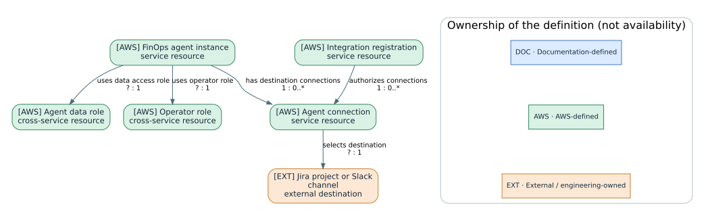
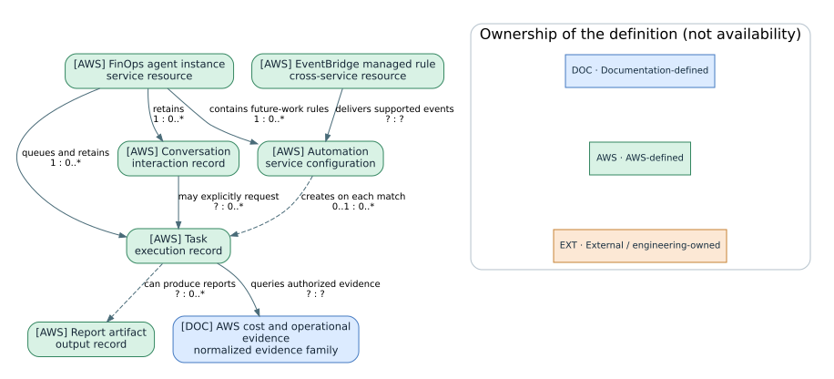
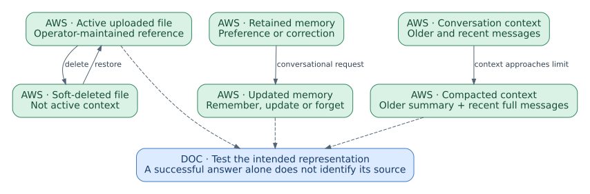
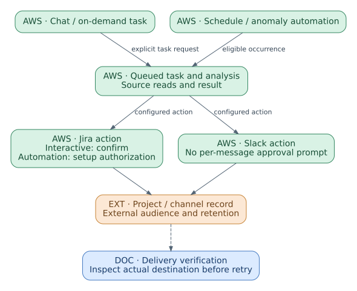
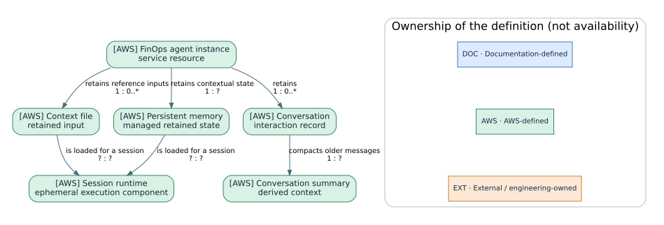

# AWS FinOps Agent

Cost-data access, retained context, tasks, and report artifacts

AWS FinOps Agent is documented as a preview service for cost queries, anomaly investigation, reporting, and interpretation of recommendations from AWS optimization services. Analysis depends on the accounts, dates, cost metric, filters, and grouping supplied to authorized source services. The instance retains context, conversations, tasks, and report artifacts. [FS01]

The guide separates source permissions from operator access and publication connections. It then explains uploaded files, persistent memory, conversation summarization, task execution, and data lifecycle. The cost example reconciles the numerical change before assessing operational evidence. The reviewed preview stores agent data in us-east-1; inference can use other US Regions. [FS08] [FS09]

**Reading conventions.** Product statements link to official AWS documentation. Configuration recommendations and verification procedures are team guidance; the proposed tests and synthetic examples have not been executed against AWS. Lifecycle tables describe service behavior and operator actions, not an API status enumeration unless explicitly cited. DOC (blue), AWS (green), and EXT (orange) identify concept ownership. Source-review dates and qualifications are recorded in the source registers.

## 01. Resource model and scope

Begin with the product-specific entities, their scope and their relationships. Configuration, executions, knowledge and external evidence are distinct objects with different lifecycles.

### F-01 — Agent instance, access roles and retained state

AWS FinOps Agent presents an independent agent instance in its console and web application. The IAM documentation uses service-specific AgentSpace action names, including `finops-agent:CreateAgentSpace`, and an `agentspace` resource path in the ARN. This is a naming correspondence within FinOps Agent, not proof that the instance is the same resource type as a DevOps Agent Space. The service namespace and its documented operations remain part of the identity. [FS50] [FS51]

The instance groups its permissions, retained context, task queue and connections. Two roles have separate responsibilities: the agent data role accesses source services, and the operator role supports web-application operations. End users also need their own entry permissions. A user successfully opening the application does not establish that the data role can perform a particular source query. [FS50] [FS51]



Collaboration configuration has two levels. An integration registers Jira or Slack authorization at account level. An agent connection selects the destination for a particular instance. The destination remains an external Jira project or Slack channel, and a published issue or message is not stored solely inside the FinOps task record. Source access, destination membership and publication behavior therefore need separate review. [FS55] [FS56]

Work starts either as a conversation or as a task. A direct conversation can answer a question without creating a task. An automation is a rule for creating future tasks on a schedule or supported event; it is not a task that is already running. Reports can be produced through conversations or task work, so the model does not require every artifact to have a universal task-parent field. [FS52] [FS58]

Retained files and memory supply context to the execution runtime. They survive differently from session state, and conversation compaction has a different purpose again. The context chapter follows these distinct representations rather than treating them as one mutable knowledge store. [FS53] [FS54]

Green boxes identify AWS-defined concepts and cross-service dependencies such as IAM roles. Blue identifies our normalized groupings, including the evidence family used to discuss cost queries, anomalies and recommendations together. Those upstream results have different source identities; they are not one native FinOps Evidence resource. The [resource index](../catalog/resource-models.html#model-finops) makes this distinction explicit before the guide applies the model to reporting and anomaly investigation.

### F-09 — Conversations, automations, tasks and artifacts

A conversation represents interaction with the agent. A task represents separately recorded execution. An automation represents instructions for future task creation. These objects may be connected, but their lifecycles are not interchangeable. A request can be answered directly; an explicit task can enter the queue; and a recurring automation can create another task at each applicable start. [FS52]



The event-driven path adds a cross-service dependency. The documented preview uses Cost Anomaly Detection events and service-managed EventBridge rules. The automation matches the supported event and creates work. The public guide does not establish that every automation owns exactly one rule, so that multiplicity is left unspecified in the ER diagram. IAM conditions restrict management to the permitted managed rules rather than general administration of the event bus. [FS51] [FS52]

Results have identities outside this orchestration path. A source query is defined by dates, metric, scope and dimensions; a forecast, anomaly and recommendation are different upstream results. A report artifact contains an interpretation of those results. A Jira issue or Slack post is an external publication. The team should retain these references when it needs to reconstruct a decision, without assuming a universal service-side lineage graph that the public guide does not document. [FS57] [FS58]

| Object | Relevant change or stop operation | What the operation does not imply |
|---|---|---|
| Conversation | Continue or cancel applicable current work | Every answer becomes a task or artifact |
| Task | Inspect execution; cancel where supported | Its retained history or external publication is deleted |
| Automation | Update, disable or delete future work | Already-created tasks are cancelled |
| Agent connection | Change or remove the destination binding | Previously published messages are withdrawn |
| Context file | Soft delete or restore the uploaded input | A matching remembered fact is also changed |
| Report artifact | Inspect, revise, download or delete | Every downloaded or externally published copy disappears |

The object-specific data lifecycle is documented under F-M07. This table explains why an operator must identify the intended object before selecting an action. For example, replacing a weekly report requires checking for the previous automation as well as testing the new report; merely using a new task name can leave two schedules active. [FS52] [FS54]

Publication also depends on invocation mode. Jira actions requested interactively or through on-demand tasks require the documented approval, whereas scheduled or event-created actions use setup-time authorization. Slack does not present the same per-message approval prompt. A generic Result → Destination arrow is therefore incomplete unless the product, operation and invocation path are retained in the implementation profile. [FS57]

The model establishes relationships the reader can reason about; it does not provision them. The [feature/resource crosswalk](../catalog/resource-models.html#model-finops) links each approved feature reference to the actual instance, connection, task or context object and its supporting documentation.

## 02. Cost-data sources and collaboration connections

A cost conclusion depends on its source data and query basis. Collaboration destinations add a separate publication path with its own authorization and lifecycle.

### F-08 — Supported data sources and publication destinations

The data connections answer different financial and operational questions. Cost Explorer supplies cost and usage results. Anomaly Detection supplies a detected deviation. Optimization services supply candidate changes and savings estimates. CloudTrail supplies recorded API activity that may help explain a change. The agent combines these inputs; a permission to query one does not imply access to the others. [FS01] [FS03]

| System | Role in the workflow | Configuration dependency | Interpretation |
|---|---|---|---|
| AWS Cost Explorer | Cost and usage queries, forecasts, coverage and commitment analysis | Available cost data and the required role actions | Preserve the metric, dates, account scope, and grouping |
| AWS Cost Anomaly Detection | Anomaly monitor and event source | Relevant monitors and configured event automation | A deviation is a reason to investigate, not its explanation |
| AWS Cost Optimization Hub | Consolidated optimization recommendations | Service setup and authorized recommendation reads | Savings estimates belong to the source recommendation |
| AWS Compute Optimizer | Resource and rightsizing recommendations | Eligible resources and permitted reads | Review utilization assumptions and workload constraints |
| AWS CloudTrail | API-activity evidence | Permitted LookupEvents and relevant available records | A nearby change is evidence to evaluate, not proof of causality |
| Amazon EventBridge | Managed anomaly-to-task routing | Required managed-rule actions in the agent role | Creates work through the supported event path |
| Jira Cloud | Read connected issues; create issues and add comments | Account registration and agent-level project connection | No general issue-field, transition, deletion, or workflow-management capability |
| Slack | Post results to connected channels | Workspace registration, channel connection, and app membership | One-way publication in the documented preview |

This is the supported service-and-destination model described in the reviewed guides, not a claim of arbitrary external-tool connectivity. In particular, the existence of MCP integration in DevOps Agent should not be copied into this platform’s architecture. Exact AWS action requirements remain in the IAM setup guide. [FS03] [FS12] [FS13]


Jira and Slack each use an account-level registration plus a connection owned by the individual agent. The registration stores provider authorization; the connection selects a project or channel. That distinction makes it possible for two agents to use the same registered provider while having different destinations. It does not give either agent access to the other’s files, memory, or tasks. [FS12] [FS13] [FS08]

Test the paths separately. First reproduce a small cost query with known dates and dimensions. Then inspect a recommendation from its upstream source. Finally publish a non-sensitive test result to the intended destination and inspect where it arrived. A failed Slack post is not repaired by widening cost-data access. A missing CloudTrail event does not invalidate arithmetic that was reproduced independently, but it does limit the causal explanation.

### F-02 — Administrator, service, and operator permissions

FinOps setup separates the person who administers the service, the identity used for data access, and the people who use the web application. A successful setup performed by an administrator does not prove that a regular operator can enter the agent or that the agent can read every required cost source.

AWS distinguishes administrator setup permissions, the agent's data policy, the operator role policy, and the web-app user's own access policy. They are not four names for the same permission set. [FS03]

| Responsibility | Attached to / used by | What to verify |
|---|---|---|
| Setup administration | Setup identity | May create/configure the service and permitted roles/integrations |
| Agent data access | Role assumed by the service | Actual source-service actions, account scope and required EventBridge permissions |
| Operator session | Operator role | Supported conversation, task, document and operator operations |
| Web-app entry | End-user identity | May access the configured agent through the supported route |

The setup path uses roles trusted by `finops-agent.amazonaws.com`. Automatically created roles include service-specific scoping. For existing roles, use the official trust and permission examples and adapt them to the intended account and instance. A role name cannot establish what actions its policy permits. [FS02] [FS03]

**Creation procedure:** complete the wizard's name, agent access, operator access, optional third-party integrations, and review steps. Open the agent from the console, inspect its connections, and test an authorized cost query. Then test the intended non-administrator user. Success for the setup identity does not prove team access. [FS02]

**Dependency review:** enable the cost/recommendation services required for the selected task and inspect whether the role permits the relevant APIs. For example, missing `cloudtrail:LookupEvents` removes an operational-change input without necessarily disabling Cost Explorer questions. Removing write access to customer infrastructure does not mean that Jira/Slack publishing is disabled; those effects follow separate integration rules. [FS03] [FS06]

### F-M01 — Cost queries and recommendation provenance

Historical amounts, forecasts, anomalies, and recommendations are different source results. Define the query parameters before comparing them. [FS01] [FS03]

| Evidence | Establishes | Does not establish by itself |
|---|---|---|
| Matching cost query | Spend for the specified dates, metric, scope and dimensions | Why a workload consumed that usage |
| Anomaly record | A detected deviation under the monitor's model | Root cause of the deviation |
| Recommendation source | An upstream optimization candidate and its assumptions | Realized saving or authorization to apply it |
| Operational event | A recorded change at a time | That the change caused the entire cost movement |

To verify the result, reproduce the numerical result first, then evaluate the explanation. Fix the time window, cost metric, granularity, filters, currency and relevant allocation assumptions. Require the response to identify unavailable sources instead of filling their absence with a causal story. These comparison rules are engineering guidance, not a new query mode. [FS06]

**Read-only query example:**

```bash
aws ce get-cost-and-usage \
  --time-period Start=2026-09-01,End=2026-09-15 \
  --granularity DAILY --metrics UnblendedCost \
  --group-by Type=DIMENSION,Key=SERVICE
```

The end date is exclusive. This example deliberately has no account, Region or tag filters; add the same approved filters used in the agent question before comparing results. Cost Explorer availability, permissions and API charges still apply. The command was not executed here and must not be compared to a differently scoped agent total. [FS14]

<!-- mechanism-review:start F-M01 -->

#### MX-F-QUERY — Source-backed cost analysis

The agent queries the service that owns the requested evidence. Historical cost, forecasts, commitment coverage, anomaly records, optimization recommendations and change events are different inputs. Combining them in one conversation does not turn projected savings into observed spend. [FS401] [FS407]

The analytical result must preserve the query basis. First reconcile amounts, then examine operational evidence for an explanation. A nearby change event is a lead; numerical contribution and causal attribution remain different claims. [FS401] [FS407]

**Inputs.** Question, dates, cost metric, scope, dimensions, currency and permissions to the relevant source service.

**Configuration**

1. **Source — Permitted source evidence.** Enable required upstream services and inspect the agent data role.
2. **Query — Explicit analytical basis.** State complete periods, metric, filters and grouping.
3. **Interpretation — Provenance of the returned value.** Identify which source supplied a forecast, anomaly or recommendation.

[FS401] [FS407]

**Lifecycle and operator actions**

| Initial condition | Operation or event | Result |
|---|---|---|
| Question submitted | Query upstream service | Source result or access failure returned. |
| Scope changed | Run a new query | New result is not comparable unless the basis is reconciled. |
| Recommendation retrieved | Contextualize for owner review | No infrastructure change is authorized by retrieval. |

**Constraints.** The service summarizes recommendations from optimization services; it does not independently calculate its own underlying optimization analysis.

**Inspection points.** Returned figures, query basis and source/tool evidence.

**Implementation limits.** The source guides do not specify the query-planning algorithm. Queries with different dates, metrics or filters are not directly comparable.

**Verification procedure (proposed)**

1. Use the supplied synthetic cost fixture or a read-only query in an authorized account.
2. Reconcile components to the total under identical periods and metric.
3. Change metric or period deliberately; identify why the totals are not comparable.

**Source mapping**

| Reference | Documentation section | Supported behavior |
|---|---|---|
| [FS401] | Related services | Cost Explorer, anomaly detection, optimization services and CloudTrail supply distinct evidence. |
| [FS407] | Generative AI accuracy considerations | Recommendations are upstream analysis; anomaly causality remains investigative. |

<!-- mechanism-review:end F-M01 -->

### F-05 — Jira projects and Slack channel connections

Publication starts with a registered provider and an agent-specific destination. The registration establishes authorization to a Jira site or Slack workspace. The connection selects the project or channel used by one agent, so its state and audience must be checked separately from registration.

| Layer | Jira | Slack |
|---|---|---|
| Account registration | Supported Jira Cloud authorization flow | Workspace authorization |
| Agent connection | Selected Jira space/project key | Channel ID; application already added to that channel |
| Supported effects | Create issues; supported reads/comments | One-way posting and supported artifact sharing |
| Do not assume | On-premises support or arbitrary issue/workflow editing | Reading channel conversations, responding to mentions, editing/deleting posts |

Register the integration, complete authorization, then add the agent-specific connection and confirm its status. Inspect Pending/Active/Error/Inactive states rather than relying on the connection's name. An invalid Jira destination in unattended execution can fail instead of producing a clarifying conversation. A Slack membership error requires adding the app to the intended channel, not granting unrelated AWS permissions. [FS12] [FS13]

**Engineering procedure:** use designated test destinations, post a non-sensitive test result and record its actual location. Confirm that only the intended users can see it. API retries described in the integration guide address transient failures; they do not turn a permission or invalid-destination error into a successful publication.

## 03. Organizational knowledge and session context

Uploaded mappings, retained preferences, and summarized conversations are different representations of organizational context. The operator must know which representation to correct.

### F-M02 — Context-file preparation and management

Reference files let the agent interpret account identifiers and costs in the organization’s terms. Their value depends on curation: a small current ownership mapping is more useful than a collection of contradictory copies. The operator maintains these files and decides which versions are active.

The Context files workspace accepts text, CSV, JSON, Markdown, HTML and YAML. The documented file limit is 10 MB; total context storage is 100 MB per agent by default. The agent can read these files but cannot modify or delete them through conversation. Users who can access the agent can see its context files. [FS04] [FS10]

**Procedure:** prepare a minimal, non-sensitive authoritative mapping, upload it through Context files, inspect its active state, and ask a question whose answer depends on one known entry. Delete/restore through the workspace when changing availability. Deletion is reversible soft deletion, not proof of physical erasure. [FS04]

**Original example:**

```yaml
schema: team-routing-v1
updated: 2026-10-22
accounts:
  staging-account-alias:
    owner: platform-team
    cost_basis: UnblendedCost
    publication: internal-test-channel-only
```

Use the identifiers actually available in your authorized queries; this alias is illustrative. Keep the source file under review in Git and upload a reviewed revision. A stale ownership mapping can produce the wrong destination even when the cost arithmetic is correct. A file statement about publication is prompt context, not a replacement for destination access controls.

<!-- mechanism-review:start F-M02 -->

#### MX-F-FILES — Uploaded reference-file use

Uploaded context is maintained outside the conversation. The agent can read the file but cannot rewrite or delete it by conversational instruction. A request to forget a preference therefore does not modify a conflicting account-owner mapping in an uploaded file. [FS402] [FS403]

Soft deletion removes a file from active context and Restore makes it active again. This is a documented reversible lifecycle for files, not a claim that every other retained object supports restoration. [FS402] [FS403]

**Inputs.** Approved non-sensitive organization mapping or report convention in a supported active file.



**Configuration**

1. **Upload — Instance-visible reference.** Context files workspace: upload TXT, CSV, JSON, Markdown, HTML or YAML within documented size limits.
2. **Maintain — Team-managed content.** Update the governed source and intentionally replace the active uploaded representation.
3. **Deactivate/restore — File availability.** Delete soft-deletes; Restore reactivates.

[FS402] [FS403]

**Lifecycle and operator actions**

| Initial condition | Operation or event | Result |
|---|---|---|
| Active file | Delete | Soft-deleted; removed from active context. |
| Soft-deleted file | Restore | Available again. |
| Similar fact retained in memory | Edit file | Memory is a separate representation and may need separate correction. |

**Constraints.** Files are visible to users with access to the agent. Do not upload credentials or sensitive personal information.

**Inspection points.** File state and correct application of a known identifier mapping.

**Implementation limits.** File-versus-memory precedence and exact internal retrieval ranking are not specified.

**Verification procedure (proposed)**

1. Upload a harmless mapping for a fictitious account label.
2. Ask a question requiring that mapping and inspect attribution.
3. Soft-delete it and test again; restoring the file is distinct from remembering a new preference.

**Source mapping**

| Reference | Documentation section | Supported behavior |
|---|---|---|
| [FS402] | Supported file types; Manage context files | Files are agent-read-only, size-limited and support soft deletion/restoration. |
| [FS403] | Managing your data | File removal and other object lifecycles differ. |

<!-- mechanism-review:end F-M02 -->

### F-M03 — Persistent preferences and corrections

Persistent memory allows a later session to use preferences and corrections supplied earlier. For example, a team may specify the owner of a set of accounts, a preferred reporting breakdown, or a recommendation category that needs special treatment. The service can retain that context and apply it to later questions or tasks. This is a different path from uploading an account-mapping file, and it is different again from summarizing old messages within one long conversation. [FS04]

The persistence boundary is the agent instance. The data-protection guide describes context and memory files in encrypted AWS-managed storage, loaded at session start into an isolated ephemeral runtime. Conversation and task records are retained alongside their own execution records. The guide does not establish a shared memory across instances or an automatic precedence rule that resolves conflicting statements in a file and a remembered preference. [FS08]

Operators manage conversational memory by asking the agent to remember, update, or forget a specific fact. Uploads remain operator-maintained files: a request to forget a preference is not an edit to a CSV containing the same information. When ownership changes, identify which representation is authoritative, update the file where appropriate, and correct the retained preference separately. Earlier reports remain historical artifacts rather than being silently rewritten. [FS04] [FS08]

A useful acceptance exercise uses a harmless preference, such as placing the comparison table before commentary. Set it, start a new conversation, and check whether it is applied. Correct or forget it and repeat. Test file retrieval with a different known fact. These observations distinguish successful application of retained context from an assumption about hidden model state. The procedure is a proposed test, not a result observed in an AWS account.

Recovery is object-specific. A soft-deleted context file can be restored through its workspace; memory can be corrected conversationally; earlier conversations and task records have the documented preview retention restrictions. None of these controls proves a general backup-and-restore capability for an entire instance. F-M07 describes the supported lifecycle actions. [FS08]

<!-- mechanism-review:start F-M03 -->

#### MX-F-MEMORY — Cross-session preference retention

Conversational memory retains preferences and corrections for later work in the same instance. It is not the current conversation transcript and is not an uploaded file. An explicit remember, update or forget instruction targets this retained representation. [FS402] [FS403]

Test it across sessions rather than immediately repeating the fact in the same conversation. Also inspect whether an active reference file supplies the same information; otherwise successful file use can be mistaken for memory recall. [FS402] [FS403]

**Inputs.** Conversation preferences, corrections, task outcomes, and explicit requests to remember, update or forget information within the instance.

**Configuration**

1. **Write/update — Persistent conversational context.** Ask the agent to remember or update one non-sensitive preference.
2. **Remove — Memory update, not history deletion.** Ask it to forget the specific retained fact.
3. **Verify — Cross-session behavior.** Use a later session without restating the test fact.

[FS402] [FS403]

**Lifecycle and operator actions**

| Initial condition | Operation or event | Result |
|---|---|---|
| Preference supplied | Remember/update | Retained context can influence later work. |
| Preference retained | Forget | Memory is updated in place. |
| Session ends | Start later session | Persistent instance data is separate from ephemeral runtime. |

**Constraints.** Each instance isolates its retained content; no shared organization-wide memory is inferred.

**Inspection points.** Observed later use of a controlled fact, qualified when no direct memory-inspection evidence is exposed.

**Implementation limits.** Internal schema, selection precedence and complete deletion of historical conversation occurrences are not established by a forget request.

**Verification procedure (proposed)**

1. Use a fictitious reporting preference absent from uploaded files.
2. Test a later session, then change the preference and test again.
3. Forget it; do not claim that earlier reports or conversation history were erased.

**Source mapping**

| Reference | Documentation section | Supported behavior |
|---|---|---|
| [FS402] | Agent memory across sessions | Remember, update and forget govern retained preferences/corrections. |
| [FS403] | Data isolation; Managing your data | Instance isolation and memory updates differ from conversation retention. |

<!-- mechanism-review:end F-M03 -->

### F-M04 — Conversation summarization and context limits

A long conversation has a different lifecycle from persistent memory. As earlier messages are summarized, the session preserves a condensed working context rather than every word of the exchange. Important comparison assumptions should therefore remain explicit in the current task and its authoritative reference material.

As a conversation approaches its context limit, older messages are summarized while recent messages remain in full. This is within-conversation context management, distinct from persistent memory and uploaded files. The documentation does not promise verbatim retention or expose a general customer setting for the summarization algorithm. [FS04]

**Engineering procedure:** put critical constraints in a concise current task specification and reference the authoritative file or source record. When resuming a long conversation, ask the agent to restate the comparison basis and unresolved questions, then correct any discrepancy before requesting another calculation. This tests retained context; it does not prove that every earlier message remains available.

<!-- mechanism-review:start F-M04 -->

#### MX-F-COMPACT — Conversation compaction

Compaction changes the context supplied to continued conversation. Older material is summarized while recent messages remain in full. It preserves a working representation of key decisions, not a verbatim copy of every earlier turn. [FS402]

Keep a material cost question explicit after a long exchange: period, metric, filters and unresolved assumptions. Restating those choices is an engineering safeguard, not a control that changes the undocumented compaction algorithm. [FS402]

**Inputs.** Growing conversation approaching the model context window.

**Configuration**

1. **Enablement — Service-managed context handling.** Automatic; no administrator threshold or manual compaction switch is established by the cited guide.
2. **Operational practice — Team verification procedure.** Restate critical query constraints and reference authoritative outputs.

[FS402]

**Lifecycle and operator actions**

| Initial condition | Operation or event | Result |
|---|---|---|
| Context grows | Approaches context limit | Older portions summarized. |
| Compacted context | Conversation continues | Recent messages and summary guide subsequent work. |
| Detail missing | Reconstruct from authoritative record | Do not infer verbatim recall from a fluent answer. |

**Constraints.** Compaction is not durable preference management or deletion of stored conversation history.

**Inspection points.** Continued conversation and the constraints it actually applies; a direct compaction event may not be exposed.

**Implementation limits.** Thresholds, summary-selection rules and lossless retention are not documented.

**Verification procedure (proposed)**

1. Use a non-sensitive long conversation with a recorded query contract.
2. Check whether later analysis retains the period and metric.
3. Where detail is missing, restore it explicitly and label compaction itself unobserved if no service signal exists.

**Source mapping**

| Reference | Documentation section | Supported behavior |
|---|---|---|
| [FS402] | Long conversation handling | Automatic summarization replaces older context while recent messages remain in full. |

<!-- mechanism-review:end F-M04 -->

## 04. Tasks, reporting, and data lifecycle

Requests and automations create executions; executions produce results and artifacts. This chapter follows that sequence through publication and the supported retention controls.

### F-03 — Tasks, schedules, and execution history

Tasks provide execution records for requested work. Automations are definitions that create tasks later, either on a schedule or from a supported event. Their separate lifecycles explain why stopping future task creation does not remove a result that already exists.

A task is an execution record. An automation is a rule for creating future tasks. On-demand, scheduled and event-triggered work shares the queue. Asking a conversational question is not necessarily a request to create a durable task; task creation should be explicit. [FS05]

**On-demand procedure:** use the Tasks workspace or explicitly request a task, give its input scope and desired output, and inspect the resulting task. Check pending/running/completed or failure information and resulting artifacts. Do not treat a conversational acknowledgement as evidence that execution has finished. [FS05]

**Scheduled procedure:** define the required schedule and reporting window separately. Inspect the saved automation's trigger and next applicable execution information. For a daily report, a schedule time does not define whether the report covers the previous calendar day, rolling 24 hours or incomplete current day; specify the window. Removing the automation prevents future tasks but does not remove previously created tasks or published messages. [FS05] [FS08]

<!-- mechanism-review:start F-03 -->

#### MX-F-TASK — Queued task execution and observation

An ordinary question can be answered in the conversation. A task is created when explicitly requested or through an automation. The task has its own queue position, execution and output, so a chat acknowledgement is not completion evidence. [FS404] [FS403]

All documented task types share a queue. Inspect whether work was never created, remains queued, failed during analysis or completed but failed to publish. Those failures require different actions. [FS404] [FS403]

**Inputs.** Explicit task request or automation invocation, prompt and permitted data/context.

**Configuration**

1. **Create — Separate execution record.** Ask explicitly to create a task, or Tasks → Create tasks.
2. **Observe — Work status and evidence.** Inspect Tasks/history and actual tool results.
3. **Stop — Execution versus definition.** Use supported cancellation for current work; control recurring automation separately.

[FS404] [FS403]

**Lifecycle and operator actions**

| Initial condition | Operation or event | Result |
|---|---|---|
| Task requested | Create record | Work enters the shared queue. |
| Queued work | Execute | Tool results and output accumulate. |
| Task cancelled | Inspect retained record | Cancellation does not delete task history. |

**Constraints.** Cancelling work is not rollback of prior external publication.

**Inspection points.** Task identity, execution status, source calls, outputs and separate delivery outcome.

**Implementation limits.** Queue order, fairness, exactly-once processing and guaranteed cancellation of every in-flight action are not specified.

**Verification procedure (proposed)**

1. Create a report task using non-sensitive inputs with an explicit date range.
2. Trace its identity from request to resulting output.
3. Cancel controlled work and distinguish preserved history from a deleted task.

**Source mapping**

| Reference | Documentation section | Supported behavior |
|---|---|---|
| [FS404] | On-demand tasks | Tasks are explicit and run through a shared queue rather than blocking the conversation. |
| [FS403] | Managing your data | Cancellation and record removal are different lifecycle operations. |

#### MX-F-SCHEDULE — Scheduled task creation

A recurring request creates an automation. Each eligible occurrence creates separate work; the automation is not the historical report. Keep the schedule and reporting basis distinct so a delayed task still queries the intended complete period. [FS404] [FS403]

Disabling an automation controls future starts. Existing tasks and distributed artifacts retain their own lifecycle. When replacing recurring work, inspect old automations to avoid running both definitions unintentionally. [FS404] [FS403]

**Inputs.** Recurring prompt, explicit schedule and timezone, observation-window rule and optional destination.

**Configuration**

1. **Create — Saved automation.** Describe the recurring work and schedule in conversation.
2. **Inspect — Configuration confirmation.** Open Automations and confirm the actual saved schedule and prompt.
3. **Disable/delete — Not cancellation/deletion of prior tasks.** Stop future occurrences through the automation control.

[FS404] [FS403]

**Lifecycle and operator actions**

| Initial condition | Operation or event | Result |
|---|---|---|
| Automation active | Scheduled occurrence | A new task is created. |
| Automation active | Disable | Future starts stop. |
| Automation deleted | Inspect existing tasks/artifacts | Historical work remains independently retained. |

**Constraints.** Unattended publication has destination-specific authorization; recurrence is not a universal approval bypass for unrelated actions.

**Inspection points.** Automation configuration and individual task histories with their queried periods.

**Implementation limits.** Exact missed-run and timezone-resolution behavior must be inspected; the guide does not establish a universal timing SLA.

**Verification procedure (proposed)**

1. Create a non-sensitive recurring report only after an on-demand trial.
2. Inspect saved timing and the first task observation window.
3. Disable the automation and confirm future creation stops without assuming prior artifacts disappear.

**Source mapping**

| Reference | Documentation section | Supported behavior |
|---|---|---|
| [FS404] | Scheduled tasks | Schedules create automations and new tasks; disabling/deleting stops recurring work. |
| [FS403] | Managing your data | Automations and task records have distinct lifecycles. |

<!-- mechanism-review:end F-03 -->

### F-M05 — Anomaly events and task creation

An anomaly event is the beginning of an investigation path, not its conclusion. The monitor produces the event, a managed rule and matching automation create work, and the task queue records execution. Publication follows only after a result exists and the destination path succeeds.

The documented event path is Cost Anomaly Detection → managed EventBridge rule → matching automation → task queue → analysis/result. During the reviewed preview, the event type is `COST_ANOMALY`; this does not establish an arbitrary customer-event orchestration platform. [FS05] [FS07]

**Enablement procedure:**

1. Configure a relevant Cost Anomaly Detection monitor and ensure the agent role can manage the service's EventBridge rules.
2. Connect any intended reporting destination using F-05. Set the destination before enabling automatic publication.
3. Request an automation naming the monitor/conditions and the intended investigation and output. Treat threshold values in example prompts as proposed configuration, not service defaults.
4. Open Automations and inspect the stored trigger type, status and last-triggered information. Inspect the created task separately after a matching event.
5. For a test, trace event identity, automation, task, result and external message. Then disable or remove the automation and verify that new matching work stops; existing tasks need separate handling.

AWS's IAM examples constrain rule management using service ownership and account conditions. Do not replace those conditions with broad EventBridge administration merely because task creation failed. [FS03] [FS07]

**Failure branch:** a registered automation with no task can mean there was no matching event, the monitor/condition is wrong, or rule permissions failed. A completed task with no message is a different destination/publication problem. Preserve these distinctions during diagnosis.

<!-- mechanism-review:start F-M05 -->

#### MX-F-EVENT — Anomaly-event matching and task creation

The event path begins in Cost Anomaly Detection. The service creates a managed rule, matches the configured condition and creates a task using the saved prompt. Analysis and delivery occur after task creation; they are not evidence that matching itself was correct. [FS405] [FS404]

Trace the chain one object at a time. A monitor event with no task points toward rule or condition configuration. A completed analysis with no message points toward destination publication. Changing the analytical prompt does not repair an absent event subscription. [FS405] [FS404]

**Inputs.** Cost Anomaly Detection monitor, required managed EventBridge permissions, condition, response prompt and optional destination.



**Configuration**

1. **Prerequisites — Event source and managed-rule authority.** Configure a monitor and the agent-role EventBridge permissions.
2. **Automation — COST_ANOMALY trigger and prompt.** Describe monitor/scope, threshold and desired response in Chat.
3. **Verification — End-to-end observation.** Inspect automation status, last-triggered information, created task and destination result.

[FS405] [FS404]

**Lifecycle and operator actions**

| Initial condition | Operation or event | Result |
|---|---|---|
| Matching event arrives | Automation matches | Task created in the queue. |
| Task completes | Optional publication | Delivery has its own outcome. |
| Automation disabled/deleted | Future event arrives | No future task from that automation; old records remain. |

**Constraints.** The documented preview event source is Cost Anomaly Detection, not arbitrary events. External publication requires its configured destination.

**Inspection points.** Monitor/event identity, automation, task, source analysis and any actual message.

**Implementation limits.** Event deduplication keys, ordering and universal delivery/retry guarantees are not established.

**Verification procedure (proposed)**

1. Use a controlled event fixture for tabletop tracing; do not manufacture production spend.
2. Verify all chain identities against available service records during an authorized test.
3. A missing message must be localized to absent task, failed analysis or failed delivery rather than reported as one undifferentiated error.

**Source mapping**

| Reference | Documentation section | Supported behavior |
|---|---|---|
| [FS405] | Prerequisites; Verify and manage the automation | Monitor, managed-rule permissions and saved condition create a traceable automation/task path. |
| [FS404] | Event-based tasks | The supported preview trigger is a cost-anomaly event. |

<!-- mechanism-review:end F-M05 -->

### F-04 — Report generation and artifact management

A report is a presentation of an analysis, not another source of cost truth. Its usefulness depends on preserving the comparison basis and making the relevant calculations traceable. The artifact and the task that produced it should therefore remain linked when the report is revised or shared.

The service supports report artifacts including HTML, PDF and presentation formats documented by the service. A request can specify the audience, comparison basis, grouping and output format, and subsequent requests can revise the artifact. Source retrieval, calculations and artifact generation are different stages; formatted output is not independent proof that the totals are correct. [FS11]

**Procedure:** ask for one defined report, inspect the source breakdown and period, open/download the artifact, and verify at least one material total using the same source query. Request a revision that names the desired change rather than silently changing the comparison basis. When publishing, check that the file corresponds to the reviewed task and audience. [FS11] [FS06]

The artifact store has a separate default quota from context-file storage. Deleting an artifact does not necessarily delete external copies previously posted to a collaboration system. [FS10] [FS08]

<!-- mechanism-review:start F-04 -->

#### MX-F-ARTIFACT — Report generation and revision

Report generation retrieves source data, builds the requested presentation and returns an artifact. A visual quality pass concerns presentation defects; it is not an independent reconciliation of the underlying financial interpretation. [FS406] [FS403]

A follow-up can revise the artifact. Keep the analytical basis explicit when revising it: changing a title or chart layout should not silently change period, cost metric or grouping. [FS406] [FS403]

**Inputs.** Cost-report request, authorized source access, query parameters, output format and optional report template.

**Configuration**

1. **Request — Artifact instruction.** Specify report audience, source period, metric, required sections and supported format; default is HTML.
2. **Inspect — Output review.** Open/download from Artifacts and compare figures to source results.
3. **Revise — Revision intent.** Reference the existing report in a follow-up and state whether the query basis may change.

[FS406] [FS403]

**Lifecycle and operator actions**

| Initial condition | Operation or event | Result |
|---|---|---|
| Analysis available | Generate report | Artifact delivered. |
| Artifact exists | Request revision | Updated presentation can be produced. |
| Service artifact removed | External copies remain | Downloaded or published copies require separate handling. |

**Constraints.** Formatting and completion status do not establish numerical accuracy; distribution is a separate effect.

**Inspection points.** Report artifact and its source conversation or task. Record the query parameters and output identity used for reconciliation.

**Implementation limits.** An immutable artifact-version API and universal external-copy deletion are not established by the report guide.

**Verification procedure (proposed)**

1. Generate a report from the small supplied synthetic cost fixture.
2. Reconcile displayed components and totals to the fixture.
3. Revise layout only and verify that period, metric and numbers did not change.

**Source mapping**

| Reference | Documentation section | Supported behavior |
|---|---|---|
| [FS406] | Generating cost reports | Reports are artifacts, default to HTML and can be revised through follow-up. |
| [FS403] | Managing your data | Artifacts and other retained objects have distinct controls. |

<!-- mechanism-review:end F-04 -->

### F-M06 — Publication permissions and approvals

Publication authorization depends on both the destination and the way work was initiated. An unattended automation can carry authorization established during setup, while an interactive Jira action requests approval. Slack posting follows a different documented behavior, so a single blanket approval statement would be misleading.

| Effect | Chat / on-demand task | Scheduled / event task |
|---|---|---|
| Jira issue or comment | Approval requested | Pre-authorized through automation setup |
| Slack post | No approval prompt | No approval prompt |

These are documented differences, not one universal human-approval rule. Automation setup is therefore an authorization decision as well as a scheduling decision. Connected destinations and supplied context must be appropriate for unattended publication. [FS06] [FS05]

**Proposed verification:** in test destinations, record the requested action, invocation type, observed prompt or lack of prompt, and the resulting artifact. A successful Slack post does not demonstrate Jira approval behavior. Removing a future schedule does not retract a previously published message.

<!-- mechanism-review:start F-M06 -->

#### MX-F-JIRA — Invocation-dependent Jira approval

Jira approval depends on how the action starts. Chat and on-demand tasks present issue/comment details for confirmation; a scheduled or event automation uses authorization established during setup. The same destination does not imply the same per-run approval behavior. [FS407] [FS408]

After approval or preauthorization, inspect the actual external record. A successful analysis is not a successful issue creation, and a retry after an uncertain response can create duplicates unless the operator checks the existing project records. [FS407] [FS408]

**Inputs.** Account Jira registration, per-instance project connection, supported action, payload and invocation mode.

**Configuration**

1. **Connect — Project scope.** Authorize the Jira Cloud integration, then bind the approved project to this instance.
2. **Interactive action — Per-action decision.** Review project, issue/comment body and target shown for approval.
3. **Automation action — Setup-time authorization.** Review action and audience before enabling recurrence/event handling.

[FS407] [FS408]

**Lifecycle and operator actions**

| Initial condition | Operation or event | Result |
|---|---|---|
| Interactive request | Confirm/revise action | Supported publication can execute. |
| Automation configured | Matching invocation | Publication executes without a per-run approval prompt. |
| Publication uncertain | Inspect destination before retry | Avoid assuming an unobserved response means no issue exists. |

**Constraints.** Supported actions do not include arbitrary issue-field changes, deletion or Jira workflow management.

**Inspection points.** Actual issue/comment, intended project and task action history.

**Implementation limits.** Exactly-once external publication and automatic duplicate suppression are not documented.

**Verification procedure (proposed)**

1. Use a restricted Jira Cloud test project and non-sensitive payload.
2. Compare interactive approval with a separately reviewed automation test.
3. Deny project access and verify a publication failure does not erase or falsely complete the analysis record.

**Source mapping**

| Reference | Documentation section | Supported behavior |
|---|---|---|
| [FS407] | Jira issue creation and comment addition | Approval differs between interactive/on-demand and automated invocation. |
| [FS408] | Integration model; Capabilities | Project connections and supported actions limit the effect. |

#### MX-F-SLACK — Direct Slack publication

Slack publication is one-way in the documented preview. Registration authorizes the workspace; the instance connection selects a channel; channel membership permits delivery. Posting does not establish channel reading, command handling or thread interaction. [FS409] [FS407]

There is no per-message approval prompt, including interactive requests. Review the intended channel and content before invocation, then inspect actual delivery. Disconnecting the channel is not a mechanism for deleting previously posted messages. [FS409] [FS407]

**Inputs.** Account workspace registration, instance channel connection, app membership and reviewed message/artifact.

**Configuration**

1. **Register — Account-level registration.** Authorize the workspace integration.
2. **Connect — Instance-specific destination.** Add the app to the channel; instance → Add connection → Slack; select integration and channel ID.
3. **Publish — External effect.** Use the reviewed destination and verify the resulting post.

[FS409] [FS407]

**Lifecycle and operator actions**

| Initial condition | Operation or event | Result |
|---|---|---|
| Connection active | Post requested | Message may be sent without an approval prompt. |
| App absent from channel | Post attempted | Delivery fails despite registration. |
| Connection removed | Future request | Future access changes; existing posts remain externally managed. |

**Constraints.** Review audience before sending. The integration does not provide general edit/delete, channel administration or conversation reading.

**Inspection points.** Actual channel post and recorded action/delivery result.

**Implementation limits.** Deduplicated retries, universal rollback and guaranteed post deletion are not provided by the documented interface.

**Verification procedure (proposed)**

1. Use a restricted test channel containing the installed app.
2. Verify destination and content without expecting a confirmation prompt.
3. Remove app membership for an authorized negative test and distinguish delivery failure from task failure.

**Source mapping**

| Reference | Documentation section | Supported behavior |
|---|---|---|
| [FS409] | Integration and connection model; Capabilities | Connections are per-instance/channel and one-way; membership is required. |
| [FS407] | Slack messages | Posting does not prompt for approval even in interactive invocation. |

<!-- mechanism-review:end F-M06 -->

### F-M07 — Retention, cancellation, and deletion

Stopping work, withdrawing active context, and removing retained data are different intentions. The service offers object-specific controls for those intentions. Choosing the correct operation requires knowing whether the object is an execution, a future trigger, a reference file, or a published artifact.

Persistent agent data and the ephemeral session runtime are separate. The preview uses AWS-managed encrypted storage. Agent instances do not share retained files or memory. [FS08]

| Object | Supported control and consequence |
|---|---|
| Context file | Soft delete; restore later through workspace |
| Memory | Ask to update or forget the specific information |
| Conversation | Individual deletion not supported in reviewed preview; retained until agent deletion |
| Task | Cancel execution where supported; record remains until agent deletion |
| Automation | Disable/delete future task creation; existing tasks remain separate |
| Artifact | Delete through its supported workspace; external copies are separate |
| Whole agent | Delete instance and associated retained service data; disconnect third-party integrations first |

Use the operation matching the intended outcome. In particular, cancel, forget, soft delete, disable and delete are not synonyms. Whole-agent deletion is unsuitable as an ordinary demonstration when meaningful data exists. [FS08] [FS02]

For data-location decisions, document both persistent storage (`us-east-1` in the reviewed preview) and cross-Region US inference. Do not describe the chosen console Region as the complete processing boundary. [FS09]

## 05. Applying the model to operational outcomes

Trace the approved use cases through their concrete configuration and execution objects, then examine the prepared evidence. The examples remain synthetic, not live AWS results.

### F-10 — Context and evidence in reporting and anomaly use cases

The approved reporting and anomaly cases reuse data access and context, but they start with different questions. A periodic report asks for a stable comparison over a defined period. An anomaly investigation asks what contributed to a detected deviation and what evidence supports an operational explanation. Both depend on source identity and query basis before retained preferences or formatting become useful. [FS52] [FS57] [FS58]



For [UC-F04, prepare a periodic cost report](../catalog/index.html#UC-F04), the operator maintains authoritative ownership or allocation mappings in context files. The agent can read those files but does not rewrite them through conversation. Persistent memory can retain reporting preferences and corrections for subsequent work. Older messages within a long conversation may instead be summarized to fit the context window. These are separate mechanisms and should be tested with different known facts. [FS53]

The runtime loads retained context for a session, but ending that runtime is not deletion of the stored files, memory, conversations or artifacts. The configuration belongs to the instance, and the guide does not establish shared knowledge across instances. When a team changes ownership, it should update the authoritative mapping and the uploaded file deliberately rather than assuming a conversational correction changed every representation. [FS54]

For [UC-F05, investigate a cost anomaly](../catalog/index.html#UC-F05), the event-created variant adds an automation and managed-event dependency to the same analytical objective. Trace the source event to the matching automation, then to the queued task and its result. A task that never started indicates a different problem from a finished task whose Slack delivery failed. Review the condition and publication destination before enabling unattended operation. [FS52] [FS55] [FS56]

| Approved case | Product objects used | Evidence that belongs to the outcome |
|---|---|---|
| Historical cost analysis | Instance, source-access role and conversation or task | Reproducible query basis and reconciled figures |
| Periodic cost report | Context file, optional memory, automation, task and artifact | Reviewed period, comparisons, missing inputs and actual output |
| Anomaly investigation | Source anomaly, optional event rule, automation and task | Contributors, change evidence and unresolved causes |
| Recommendation prioritization | Upstream recommendation and workload context | Assumptions, conflicts, accepted or deferred decision |
| Post-change measurement | Before/after source data and engineering change record | Observed difference and explicit attribution limits |

The last column is an engineering acceptance model, not a list of automatically populated AWS fields. In particular, a cost decrease is not itself proof that a change caused the saving. A source recommendation is a candidate, not a purchase or infrastructure-change authorization. [FS57]

The shared operational-review case can consume these outputs alongside service-health reports. That handoff is a team process between independently scoped services. It preserves source and execution identities; it does not transfer credentials, merge memory or create a cross-product orchestration engine.

### F-U01 — Cost-variance analysis: worked example

**Synthetic fixture; USD; two complete 14-day windows; identical account, service and cost basis.** Rates and quantities are teaching values, not AWS prices. This fixture now includes quantities and rates, so it can support arithmetic attribution rather than just two totals.

| Component | Baseline quantity | Comparison quantity | Unit rate | Baseline cost | Comparison cost |
|---|---:|---:|---:|---:|---:|
| Storage quantity | 10,000 | 12,000 | 0.10 | 1,000 | 1,200 |
| Request quantity | 2,000,000 | 3,000,000 | 0.0001 | 200 | 300 |
| Transfer quantity | 2,000 | 4,740 | 0.10 | 200 | 474 |
| Total | — | — | — | 1,400 | 1,974 |

The delta is 574, or 41%. Component contributions are 200 storage, 100 requests and 274 transfer. The transfer component explains about 47.7% of the monetary delta, not 47.7% of all spending. Rates are unchanged in this fixture. These calculations can be reproduced without an agent.

**Prepared operational evidence:** a deployment at 10:02 UTC enabled a second export destination; a job log after that deployment records 2,740 additional transfer units. This is invented corroborating evidence. It supports the transfer-volume explanation in this fixture but cannot explain the additional storage and request quantities without more evidence.

**Walkthrough:** fix the query contract, reconcile all line items, compute each delta, inspect the prepared change/job evidence, and report a partial explanation. The expected answer identifies transfer as the largest contributor, marks the export change as supported by the supplied log, and leaves storage/request causes unresolved. Do not add potential recommendation savings to the historical delta.

**Failure branches:** a different cost metric or date window invalidates the comparison; missing job evidence leaves only a temporal association; lack of recommendation-service data prevents evaluating a candidate saving. A proposed lifecycle or capacity change requires a separate engineering decision and measurement plan.

The repository's deterministic fixture test verifies the arithmetic. It is not a test of the AWS service, recommendation quality or causal inference.

## 06. Troubleshooting and operating limits

A numerical disagreement, a missing task, and a failed publication are different faults. Troubleshooting follows the corresponding data, execution, and destination paths.

### F-06 — Data, task, and integration failures

Selected documented defaults are one agent per account/Region, 100 MB artifact storage, 10 MB per context upload and 100 MB total context storage. The per-file limit is fixed; relevant account/storage quotas may be adjustable. The reviewed integration limits include one account-level registration of each supported collaboration type and two connections of each type per agent. Check actual quotas before designing multiple destinations or isolated instances. [FS10]

| Symptom | Inspect | Result to establish |
|---|---|---|
| User cannot open agent | User policy and operator role, not only setup permissions | Intended user can enter and perform the supported operation |
| Total differs from console | Dates, exclusive end, metric, filters, currency, grouping | Same query reproduces the amount |
| No change evidence | Agent role and CloudTrail availability | Determine source absence before proposing a cause |
| Uploaded mapping ignored | File active state, identifiers and task scope | Known mapping can be retrieved separately from memory |
| Task never starts | Automation match and shared queue | Distinguish no task creation from queued execution |
| Jira action not visible | Destination binding, approval path and task result | Correct project and resulting issue/comment |
| Slack post denied | App membership, channel ID and connection state | App is in the configured channel and connection active |
| File cannot upload | Type, per-file size and total quota | Input is supported and storage available |
| Deleted automation still has records | Object lifecycle | No new tasks; old task records expected |

The table is engineering troubleshooting guidance based on the cited configuration and integration pages. It is not a claim of a native unified diagnostic workflow.

## 07. Documentation coverage

The references document the source, context, task, and publication behaviors discussed here; unexecuted examples remain explicitly labeled.

### F-07 — Documentation coverage and references

The guide follows a cost question from source access through context, task execution, and publication. The coverage table separates that explanation from complete IAM policies, service quotas, and provider-specific setup that remain in the official reference. A forecast, recommendation estimate, and observed cost are treated as distinct results throughout.

The reference register identifies the documented behavior behind these distinctions. The integration inventory and selected context and data-lifecycle guidance were rechecked on 22 October 2026. Earlier source qualifications remain applicable, and the worked arithmetic is synthetic. No account query, publication action, or measured savings outcome was executed for this guide.

| Official topic | Treatment | Boundary |
|---|---|---|
| Setup, roles, instance creation | Role/policy map and ordered setup | Exact account-specific IAM statements remain official examples |
| Cost and recommendation sources | Provenance, read-only query and reconciliation | No complete enumeration of every supported cost dimension |
| Files, memory, compaction | Separate mechanisms and lifecycle | No invented internal precedence or summary algorithm |
| Tasks and events | Configuration, rule/queue sequence and failure split | Preview event types only as documented |
| Reporting and integrations | Artifacts, destination binding and effect-specific approval | No live external publication performed |
| Data protection and quotas | Object matrix, location distinction, selected constraints | Complete current quota and policy tables linked |

#### Official sources and reviewed sections

- [FS01] Product functions and recommendation provenance.
- [FS02] Five creation steps, roles, team access, verification and deletion prerequisites.
- [FS03] Four policy responsibilities, trust, source actions and managed EventBridge permissions.
- [FS04] File formats/limits, upload/soft deletion, memory and compaction.
- [FS05] Task queue, manual/scheduled/event work and execution observation.
- [FS06] Supported effects, approval rules and analytical boundaries.
- [FS07] Cost Anomaly Detection, rule/automation setup and destination checks.
- [FS08] Persistent/runtime isolation and object-specific lifecycle.
- [FS09] Preview storage and US cross-Region inference.
- [FS10] Default quotas and adjustability.
- [FS11] Report formats, artifacts and revision.
- [FS12] Jira registration/connections, operations, states and failures.
- [FS13] Slack registration/connections, one-way behavior and membership failures.
- [FS14] Cost Explorer GetCostAndUsage request semantics; read-only example.

[FS01]: https://docs.aws.amazon.com/finops-agent/latest/userguide/what-is.html

[FS02]: https://docs.aws.amazon.com/finops-agent/latest/userguide/creating-an-agent.html

[FS03]: https://docs.aws.amazon.com/finops-agent/latest/userguide/setting-up.html

[FS04]: https://docs.aws.amazon.com/finops-agent/latest/userguide/context-files-and-memory.html

[FS05]: https://docs.aws.amazon.com/finops-agent/latest/userguide/task-management.html

[FS06]: https://docs.aws.amazon.com/finops-agent/latest/userguide/agent-guardrail-control.html

[FS07]: https://docs.aws.amazon.com/finops-agent/latest/userguide/automated-anomaly-response.html

[FS08]: https://docs.aws.amazon.com/finops-agent/latest/userguide/data-protection.html

[FS09]: https://docs.aws.amazon.com/finops-agent/latest/userguide/cross-region-inference.html

[FS10]: https://docs.aws.amazon.com/finops-agent/latest/userguide/quotas.html

[FS11]: https://docs.aws.amazon.com/finops-agent/latest/userguide/custom-cost-reporting.html

[FS12]: https://docs.aws.amazon.com/finops-agent/latest/userguide/jira-integration.html

[FS13]: https://docs.aws.amazon.com/finops-agent/latest/userguide/slack-integration.html

[FS14]: https://docs.aws.amazon.com/aws-cost-management/latest/APIReference/API_GetCostAndUsage.html

[FS50]: https://docs.aws.amazon.com/finops-agent/latest/userguide/creating-an-agent.html

[FS51]: https://docs.aws.amazon.com/finops-agent/latest/userguide/setting-up.html

[FS52]: https://docs.aws.amazon.com/finops-agent/latest/userguide/task-management.html

[FS53]: https://docs.aws.amazon.com/finops-agent/latest/userguide/context-files-and-memory.html

[FS54]: https://docs.aws.amazon.com/finops-agent/latest/userguide/data-protection.html

[FS55]: https://docs.aws.amazon.com/finops-agent/latest/userguide/jira-integration.html

[FS56]: https://docs.aws.amazon.com/finops-agent/latest/userguide/slack-integration.html

[FS57]: https://docs.aws.amazon.com/finops-agent/latest/userguide/agent-guardrail-control.html

[FS58]: https://docs.aws.amazon.com/finops-agent/latest/userguide/custom-cost-reporting.html
[FS401]: https://docs.aws.amazon.com/finops-agent/latest/userguide/what-is.html
[FS402]: https://docs.aws.amazon.com/finops-agent/latest/userguide/context-files-and-memory.html
[FS403]: https://docs.aws.amazon.com/finops-agent/latest/userguide/data-protection.html
[FS404]: https://docs.aws.amazon.com/finops-agent/latest/userguide/task-management.html
[FS405]: https://docs.aws.amazon.com/finops-agent/latest/userguide/automated-anomaly-response.html
[FS406]: https://docs.aws.amazon.com/finops-agent/latest/userguide/custom-cost-reporting.html
[FS407]: https://docs.aws.amazon.com/finops-agent/latest/userguide/agent-guardrail-control.html
[FS408]: https://docs.aws.amazon.com/finops-agent/latest/userguide/jira-integration.html
[FS409]: https://docs.aws.amazon.com/finops-agent/latest/userguide/slack-integration.html
