# AWS Security Agent

Application scope, assessment capabilities, and execution mechanisms

AWS Security Agent exposes application-scoped assessments and the configuration needed to supply source context, criteria, target access, and credentials. Penetration testing, code review, design review, and threat modeling have different configuration and execution lifecycles. They are managed product functions, not interchangeable customer-defined agents. [SS501] [SS502]

The guide separates workspace organization, assessment definition, context, invocation, provider integration, network access, execution controls, managed assessment workflows, outputs, and administration. The approved resource model introduces the objects; the use-case catalog explains their application to operational objectives.

**Reading conventions.** These capability dimensions are editorial. The DevOps custom-agent, skill, memory-store, and trigger types are not assumed to exist here. Official sources identify Security Agent's own facilities. DOC/AWS/EXT colors retain the approved ownership convention. Worked examples and verification instructions are team guidance, not executed assessments.

Start with the agent overview and workflow walkthroughs. Use the subsequent capability chapters for detailed setup, lifecycle behavior and troubleshooting. The use-case catalog remains separate and unchanged.

## 01. The agent and its operating context

Start with one execution, then add coordinated responsibilities and the surrounding access scope. The same diagram is reused in the workflow walkthroughs.

### S-90 — What AWS Security Agent executes

AWS Security Agent performs application-security assessments using the sources, criteria, target access and assessment settings configured for the selected work. The public operating model exposes code review, design review, threat modeling and penetration testing, together with finding and remediation operations. It does not expose the DevOps managed-agent roster or an equivalent customer-defined prompt/tool/skill composition. [SS701] [SS702]

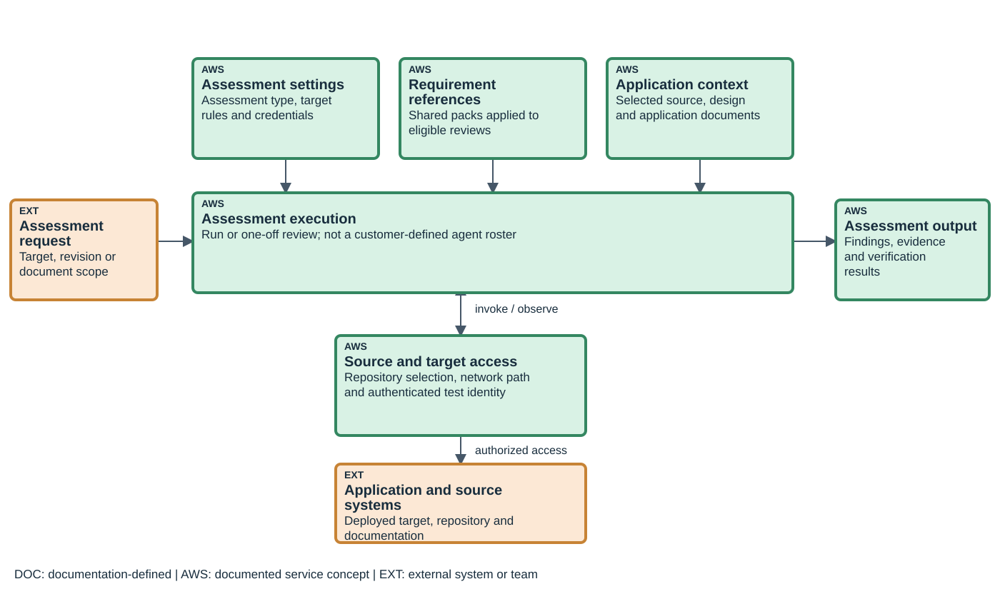

Begin with the question and its evidence. Reviewing a proposed design uses supplied documents and applicable requirements. A source review identifies a code revision. A dynamic assessment needs a deployed target and permitted identity. These inputs cannot be substituted merely because every operation returns findings. Assessment settings, criteria, application context, access and results therefore occupy distinct positions in the diagram. [SS701]

The figure is an explanatory view, not a claim that each box is a separately creatable resource. The approved resource model defines the actual application and shared configuration objects.

### S-91 — How assessment, remediation and verification are coordinated

The useful coordination model is the lineage of work: an assessment produces a finding; a remediation operation can propose a code change; the application team reviews and deploys it; a subsequent verification evaluates the deployed result. The proposal, deployment and verification record remain different objects. [SS701] [SS703]

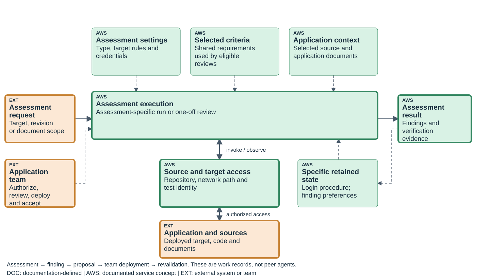

These arrows explain responsibilities and evidence handoff. They do not invent named internal peer agents or promise an automatic end-to-end repair loop. Revalidation repeats validation for selected existing findings and retains its relationship to the earlier finding. It is not a new broad discovery run. The original evidence remains necessary to interpret the later result. [SS703]

One-off design reviews and reusable code-review, threat-model or penetration-test configurations also have different execution lifecycles. The detailed procedure must use the lifecycle of the actual assessment rather than a generic instruction to rerun every review. [SS702]

### S-92 — Application Agent Spaces and shared assessment criteria

An Agent Space represents an application or project. It selects application sources, user assignments, assessment configuration and result records. Some facilities, including shared requirement packs and provider registration, have broader scope and are referenced by application work. The diagram's selected-criteria box does not imply that the application owns the shared pack. [SS702]

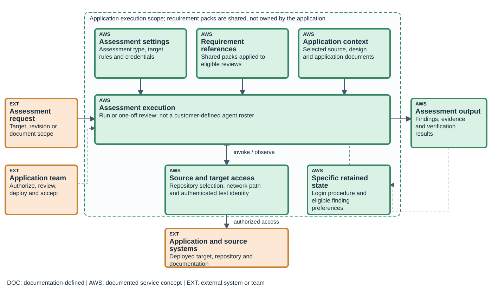

Repository authorization, selecting the repository for an application, deciding how it is used, reaching a test endpoint and resolving a test credential are separate configuration decisions. A source registration is not permission to test every deployed application, and retrieving a secret is not proof of successful login as the expected role. The detailed access and authentication chapters explain those paths. [SS701] [SS702]

## 02. Essential operational workflows

Follow the existing use cases through inputs, context, authorized operations, outputs and the decisions that require an engineer. Teaching priority is an editorial choice, not an AWS ranking.

### S-93 — Assessment and finding-resolution workflows

The teaching sequence follows a complete assessment-and-resolution cycle before introducing less frequent configuration details. This is an editorial priority for development and security teams, not an AWS ranking. All approved cases retain their definitions.

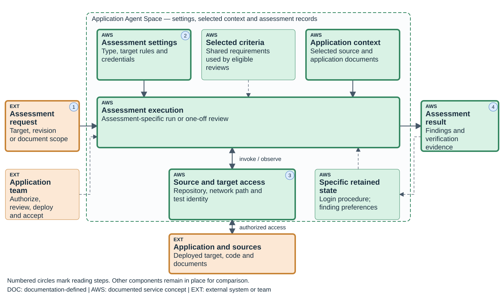

Start with [assessing a running application](../catalog/UC-S01.html) or [reviewing source code](../catalog/UC-S02.html). The input contract specifies the target or revision, scope, criteria and authorized effects. Public/private connectivity and authentication are variants of the assessment, not new agent types. Interpret findings within the surface that was actually reachable. [SS701]

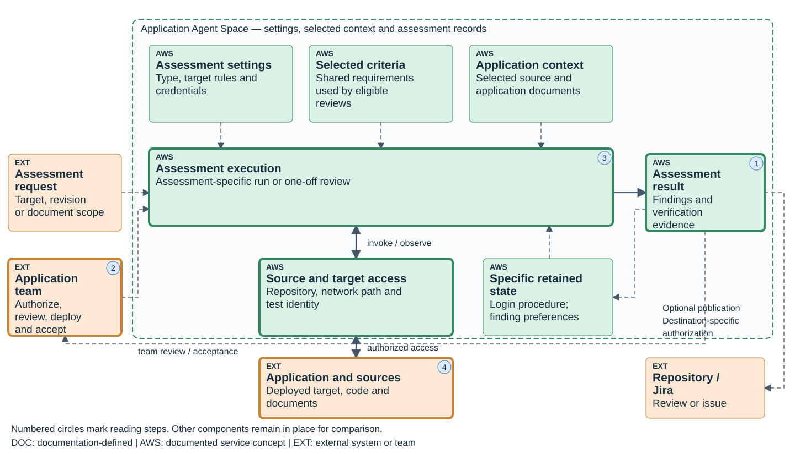

Then [triage findings](../catalog/UC-S05.html), [prepare a remediation proposal](../catalog/UC-S06.html), and [revalidate after repair](../catalog/UC-S07.html). Record the finding identity, proposed revision, deployed revision and test identity. A finding disposition or merged pull request alone does not establish that the target was repaired. [SS701] [SS703]

Earlier feedback is addressed through [design review](../catalog/UC-S03.html), [threat modeling](../catalog/UC-S04.html), and [security-requirement consolidation](../catalog/UC-S08.html). These use different subjects and lifecycles. Requirement maintenance supplies criteria; application context supplies evidence; retained login procedures and eligible finding personalization supply narrowly scoped reuse rather than universal cross-run memory. S-M03, S-M02 and S-13 explain the respective mechanisms. [SS702]


The capability chapters below retain the detailed configuration procedures and product-specific constraints. The supplied S-U01 exercise traces a finding through a proposed and deployed repair without asserting that a live assessment was performed.

## 03. Workspace and resource organization

Shared settings, application Agent Spaces, and assessment records have distinct scopes.

### S-01 — Shared configuration, Agent Spaces and assessments

AWS Security Agent organizes work around an application Agent Space. The space groups application sources, assessment settings and user assignments. Some configuration is shared above that boundary, including registered integrations and security requirements. The guide calls this tenant or organizational scope; this model does not turn that phrase into an AWS Organizations resource or infer automatic cross-account policy propagation. [SS50]

A source is connected in stages. The administrator authorizes an integration; the application space selects repositories or documentation; capability settings determine how those sources are used. One repository can supply several spaces without making their assessment settings identical. Source access, permission to submit a fix and permission to publish a finding are separate relationships. [SS50] [SS51]

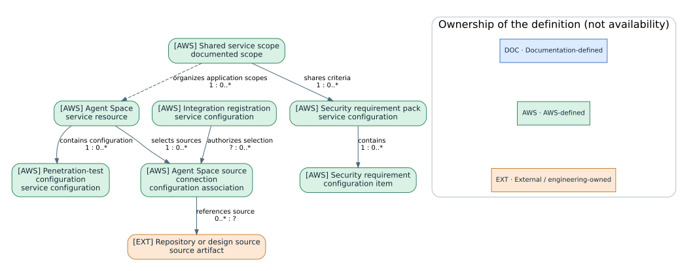

The assessment type determines the execution model. Penetration testing and threat modeling use reusable configurations with separate runs. Full-code scans also have reusable configuration, while repository-event review has provider-specific settings. Design review is a one-off assessment; cloning creates a new review. A generic Configuration → Run arrow is therefore an explanatory starting point, not a universal schema for every Security Agent function. [SS50]

Application context, criteria and access play different roles. Code and documents explain the system. Requirements define what eligible design and code reviews should evaluate. Target rules and credentials define the reachable identity and boundary for a running-application assessment. A retained successful login procedure helps reuse authentication navigation; it is not evidence of a general incident-memory service. [SS52] [SS53] [SS56]

Green nodes below and in the resource index denote AWS-defined concepts; their subtitles distinguish reusable configuration, a run, a result and managed state. Orange denotes the actual repository, test application or external issue. Blue denotes our normalized associations and review structure, not service resources. This distinction becomes important when tracing one original finding through several revalidation jobs.

The next section explains the assessment-specific relationships. Later chapters configure sources and targets, examine authentication and criteria, and follow the existing assessment, remediation and verification use cases. The [product resource index](../catalog/resource-models.html#model-security) records entity identities and the evidence supporting each relationship.

### S-10 — Assessment configurations, runs and result identities

A saved configuration answers what should be assessed. A run answers what happened during a particular execution. Keeping those identities separate prevents a later configuration change from being mistaken for a change to an earlier result. It also allows the same application to be assessed repeatedly while retaining the conditions of each run. This configuration-and-run relationship is documented for penetration tests, full-code scans and threat models, but not for one-off design reviews. [SS50] [SS57]

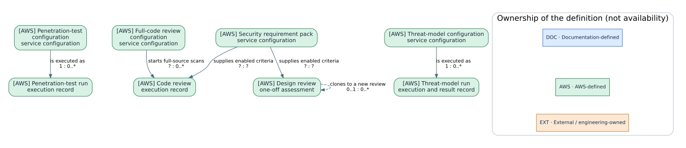

For penetration testing, target rules and credential definitions belong to the saved assessment configuration. The execution then reaches the actual deployed application using the available identity. The repository revision used for source context and the revision deployed at the target may differ. A successful credential read is not confirmation that the target login succeeded, and a successful login is not proof that every protected route was exercised. The configuration and the observed conditions of the run must both be retained. [SS52] [SS56]

For code review, separate a full-scan configuration from connected-repository settings for change-triggered analysis. Both can produce source findings, but the event, selected revision and review mode determine what was analyzed. A source-code finding should not be treated as a penetration-test finding merely because both concern authorization. The selected-finding revalidation procedure described later applies to existing penetration-test findings, not to an invented universal finding subtype. [SS50] [SS54]

Requirements also have their own identity. Each requirement belongs to a pack, and enabled criteria inform future eligible reviews. A requirement is a reusable criterion, not the compliance result for every application. Updating a shared requirement does not retroactively rewrite earlier review findings. The criteria-generation workflow has its own replacement behavior, detailed in S-M04. [SS53]

| Subject | Maintained object | Execution or result | Correct interpretation of reuse |
|---|---|---|---|
| Running application | Penetration-test configuration | Independent run and findings | Repeat the configuration; record current target and identity each time |
| Full source | Code-review configuration | Source review and code findings | Repeat against an identified source revision |
| Repository change | Connected-repository review settings | Revision-specific review | Verify supported event and current revision |
| Proposed design | Individual design review | Findings from that assessment | Clone into a new review; do not claim rerun of the same object |
| System threats | Threat-model configuration | Run-specific overview and threats | Re-run with reviewed scope and sources |
| Organization criterion | Requirement pack and requirement | Result within an eligible review | Apply to later assessments, not retroactive result mutation |

These differences determine both operation and failure diagnosis. A draft configuration is not a completed assessment. A code-review comment is not a deployed repair. A threat-model output built around the wrong boundary needs corrected input, not merely a new label on its threats. The supported operations are detailed in S-04 and S-06; the table is their resource-model interpretation. [SS50] [SS57]

Some relationships deliberately remain unspecified. The public guidance documents retained login reuse but does not establish an independently editable skill resource for it. The diagrams use `?` where counts or parent fields are not documented, rather than inventing a universal resource schema. See the [qualified relationship register](../catalog/resource-models.html#model-security) before translating any diagram into implementation assumptions.

## 04. Assessment definition and customization

Assessment-specific settings select targets, sources, criteria, and effects; they are not custom-agent definitions.

### S-12 — Assessment definitions and customization

The configurable unit is the selected assessment. A penetration-test definition specifies targets, credentials, and test parameters. Full-code review selects source material and review modes. Threat modeling selects source and scope documents. Design review creates a one-off assessment of the submitted documents. These are the product's exposed configuration choices; this guide does not substitute the DevOps custom-agent prompt/tool/store schema for them. [SS501]

| Configuration | Main customer choices |
|---|---|
| Penetration test | Application targets, network access, credentials, scope exclusions, and relevant context |
| Full-code review | Repository or supported source input, revision, and vulnerability/requirement review modes |
| Repository-event review | Supported event integration, review settings, and comment/remediation permission |
| Design review | Design documents and applicable organizational requirements |
| Threat model | Source code and/or scope documents describing the system to analyze |

A saved configuration is not a run. Changes to it govern subsequent work, while an earlier run retains its own findings. Design reviews use cloning rather than rerunning one reusable configuration. S-10 describes these resource relationships; S-04 covers execution. [SS501]

## 05. Application knowledge and assessment criteria

Application context, requirements, retained login procedures, and finding preferences have distinct producers and consumers.

### S-M07 — Application-context construction and reuse

An assessment starts with the application material selected for that task. Source code supplies implementation evidence; API and design documents describe interfaces and intended relationships; scope documents delimit what a threat model should analyze. The Agent Space makes connected material available, but the assessment configuration still determines what is relevant to a particular run. An engineering record should identify the source revision and document version used rather than simply say that the agent knows the application. [SS03] [SS16] [SS31]

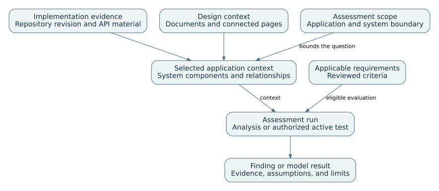

The context is consolidated into an assessment of the selected system. In a threat-model workflow, this can include a system overview, data flows, trust boundaries, and candidate threats. In a penetration test, source and documentation context supports exploration of the authorized deployed target. Review the inferred model before evaluating its conclusions: a missing identity boundary or a document for the wrong release changes the question being answered. [SS16] [SS34]

Three different forms of reuse must remain distinct. A saved assessment configuration retains reusable setup. A requirement pack supplies criteria to later eligible reviews. Login Optimization retains a successful authentication procedure. None of these establishes the DevOps Agent monitor-memory mechanism for Security Agent. The reviewed guidance does not describe a universal customer-editable vulnerability-memory store or an automatic model-training process across all assessments. [SS03] [SS09] [SS14]

For an application change, reconnect or select the current sources, update the scope where necessary, and create the next run. For a wrong requirement, edit the governing criteria; for a changed login, test the current credential flow. Historical findings remain evidence of earlier executions, not a substitute for the new source and target state. A revalidation job retrieves selected existing finding evidence and tests that finding again; it is narrower than reconstructing or rescanning the whole application. [SS13]

A practical verification starts with a small known boundary: two application roles, one protected resource, and the repository revision deployed to staging. Inspect whether the inferred system and the resulting finding refer to those same roles and revision. When the evidence does not expose which document or procedure was used, record that limitation rather than infer it from plausible output.

### S-M03 — Requirement applicability and evaluation

Security criteria are useful only when their applicability is explicit. A rule about authorization of account-owned invoices should not be evaluated as though it governed every public handler. Requirement packs provide the criteria, while an eligible assessment supplies the evidence against which they are evaluated.

A requirement contains a name/description, applicability, compliance criteria and optional remediation guidance. Applicability can distinguish a violation from a case to which the requirement does not apply. Packs group requirements; managed and custom packs differ in editability. Enabled packs inform subsequent eligible reviews, not retroactive rewrites of completed results. [SS14]

**Procedure:** open **Security requirements**, select or create the pack, review applicability and criteria, enable it, and configure the design/code review to evaluate requirements. A vulnerability-only review is not the same evaluation mode. Inspect findings against the selected requirement, not merely the total count. [SS14] [SS05]

**Original example:** require an authorization check before returning an account-owned invoice. Applicability: handlers returning account-owned invoices. Compliance: the authenticated principal must be authorized for the invoice's owning account. A public static-document handler is inapplicable, not automatically compliant with an invoice rule. Test all three cases: compliant, violating and inapplicable.

### S-M04 — Requirement generation and replacement

Generating criteria from policy documents is an administrative authoring operation. The generated pack needs review because policy language can be ambiguous and because replacement changes what later assessments evaluate. It is separate from evaluating a codebase against an already approved pack.

Generating requirements from uploaded documents is a separate administrative mechanism. Supported input includes DOC, DOCX, Markdown, PDF and text. Select a custom pack, upload policy material, generate, inspect and edit the result, then enable it. [SS15]

Uploading new documents regenerates the pack and replaces existing requirements, including manually added ones. It is not an append operation. Do not start a competing upload while generation is running. Keep the governing policy and reviewed requirement source in Git; inspect the replacement before enabling it. A framework pack is not a compliance certificate. [SS15] [SS14]

### S-M02 — Login-workflow retention and reuse

Repeated authentication can reuse a procedure learned from an earlier successful login. This retained procedure concerns navigation through the login flow, not a standing proof that every later run reached the same application role. The role and protected routes remain part of assessment evidence.

The first successful authentication navigation can produce a skill describing the login workflow. Later sessions within the run and subsequent runs reuse it. This is learned procedural navigation, not a general incident-memory store or customer-controlled model retraining. [SS09]

**Enablement:** add at least one credential, open **Additional configuration → Login optimization**, and inspect the default-enabled toggle. Disabling reuse preserves the skill; re-enabling permits reuse again. The documentation describes adaptation to changed login flows, but does not disclose a general selection algorithm or promise a particular speed improvement. [SS09]

**Proposed test:** use a staging login flow that the team controls. Retain first-login and later-login evidence, then make an authorized change to the test flow. Verify the actual authenticated role on every run. Without observable reuse evidence, distinguish a successful login from a proven reuse of the learned procedure.

### S-13 — Finding-edit personalization

Findings Personalization retains eligible operator edits and applies them to similar findings on later penetration-test runs. Its input is finding-review activity, not a code change. The learned preference can alter a finding's displayed attributes without changing the application under test. [SS505]

AWS describes learning from the most recent completed run when personalization was enabled at test start. For status edits, marking a finding `FALSE_POSITIVE` is the documented learnable signal. Other status transitions must not be treated as equivalent feedback. Inspect original values and the Personalization changes explanation when reviewing an affected finding. [SS505]

This is separate from Login Optimization: one reuses finding preferences; the other reuses successful authentication navigation. Disabling reuse or personalization does not itself repair the application or prove a finding no longer reproduces. Revalidation is the separate execution described in S-M05. [SS504] [SS505] [SS506]

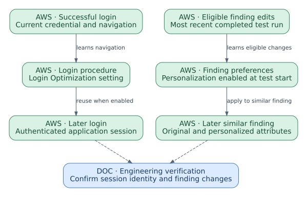

## 06. Assessment invocation

Manual assessment requests, supported repository events, and pipeline callers initiate the appropriate function.

### S-14 — Assessment invocation and repository events

An assessment starts through the interface supported for that function. Reusable penetration-test, full-code-review, and threat-model configurations can be run on demand. A design review is submitted as an individual assessment; cloning creates a new assessment with reusable inputs rather than rerunning the same object. [SS501]

Connected repositories can invoke configured review behavior on supported change events. Repository authorization, selection by the Agent Space, and enabling review/comments are separate setup steps. The source revision and event identify the reviewed change. [SS501]

A CI/CD caller invokes the configured assessment through the documented integration. The service executes the assessment; the pipeline does not become its testing engine. Keep the assessment identifier and inspect the returned execution status before interpreting findings. Defining a release-blocking policy from those findings is a team decision, not an automatic consequence of connecting a repository. [SS502]

The reviewed resource lifecycle does not establish one generic trigger object shared by all assessment types. Use the function-specific invocation procedure and keep scheduled or repository-triggered behavior distinct from the saved assessment definition.

## 07. External system integrations

Source-provider authorization, application-source selection, and publication permissions are separate settings.

### S-09 — Supported source and collaboration integrations

Security assessment needs both application evidence and a reachable test surface. A repository explains code; a design page explains intent; a deployed endpoint exposes actual behavior. Connecting one of those sources does not substitute for the others. The account-level integration is registered once, while each Agent Space selects the repositories, pages, buckets, or projects appropriate to its application. [SS30]

| Source or destination | Documented support | Selection in the application space | Effect boundary |
|---|---|---|---|
| GitHub | Cloud-hosted GitHub and cloud-hosted GitHub Enterprise | Connected repositories | Read analysis; repository write features are separate opt-ins |
| GitHub Enterprise Server | Self-hosted server | Selected repositories and configured reachability | Private connectivity may be necessary |
| GitLab | Cloud-hosted GitLab | Selected repositories | Provider-specific review comments and remediation configuration |
| GitLab Self-Managed | Self-hosted instance | Selected repositories and reachable endpoint | Authentication and private routing require their own setup |
| Bitbucket | Bitbucket Cloud | Selected repositories | Do not extend Cloud support to self-hosted editions |
| Azure DevOps | Git repositories; TFVC unsupported | Authorized organization and selected repositories | Entra service principal and Azure DevOps permissions; review comments and remediation configured separately [SS490] |
| Confluence | Confluence Cloud | Selected pages | Read-only documentation context, not a source-code repository |
| Amazon S3 | Connected same-account buckets or prefixes | Resources selected for an assessment | Code-review sources use supported source archives; supporting documents have their own formats |
| Jira | Jira Cloud | Selected projects | Finding issue creation and comments are independently allowed per project |

Connecting a repository grants read context to the eligible assessment functions that share the space. Code-review comments and code-remediation changes are enabled separately per repository. The integration overview excludes these write actions for public repositories; do not interpret read access as permission to publish a patch or comment. [SS30]

For Azure DevOps, registration authorizes the Microsoft Entra application. Add its service principal to the Azure DevOps organization and grant repository and service-hook permissions before selecting repositories in an Agent Space. Public-repository remediation is not supported. The provider guide describes project limits and required permissions; registration alone does not complete access setup. [SS490]

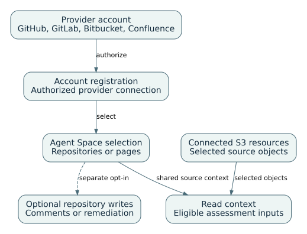

To configure a source, first authorize its supported provider account from Integrations. Open the application Agent Space, select resources from that registration, and save the selection. Then configure the assessment that consumes those resources. For Confluence, selecting a page supplies read context; there are no per-page assessment toggles. For S3, connect the bucket or prefix once and select the needed resources when authoring an assessment. The S3 guide specifies same-account buckets and separate requirements for code-review sources. [SS31] [SS33]

Jira follows a related but action-oriented sequence. Install and authorize the documented Forge application, register the Jira Cloud site, then choose projects for the Agent Space. Allow issue creation, comments, or both according to the workflow. Existing Jira issues are external records: removing the connection does not remove the issues already created. [SS32]

Private source-control access, penetration-test network access, and credential retrieval are separate paths. A reachable repository does not prove that the test runner can reach a private application. Similarly, a readable secret does not establish that its contents successfully log in to that application. The next chapter follows these distinctions through authentication and context construction.

Publishing a finding to Jira is a destination operation. The site registration supplies authorization, the Agent Space selects a project and allowed create/comment actions, and publication creates an external record. Removing an integration does not remove the already-created issue. This configuration is different from attaching a source repository for analysis. [SS415] [SS416] [SS417]

## 08. Network connectivity

Private source access and private application access are independent network paths.

### S-15 — Private source access and application connectivity

Source connectivity and target connectivity are separate paths. Reaching a private repository supplies source context. Reaching a private application permits the test runner to send requests to that application. Neither connection supplies application-login credentials. [SS30] [SS07]

For a private assessment target, configure the documented VPC access and the necessary subnets, routing, DNS resolution, security groups, and application allowlisting. For a self-hosted source provider, configure that provider's reachability and authentication independently. A successful source read therefore says nothing about whether the target is reachable. [SS07] [SS06]

The target list also has scope semantics. A supporting login or content endpoint may need access without becoming a test target. The Target, Accessible, and Out-of-scope rules in S-03 describe that distinction. Network troubleshooting should preserve the authorized test surface rather than remove exclusions to obtain a successful connection. [SS08]

## 09. Execution and assessment controls

Target rules, credential resolution, and run state determine the scope and conditions of a dynamic assessment.

### S-03 — Test targets, dependencies, and exclusions

A dynamic assessment is defined by what it may reach and what it may test. Some endpoints are application targets, while others are dependencies needed only for authentication or supporting content. Explicit exclusions keep that supporting access from expanding the test into an unintended environment.

Domain verification demonstrates control through a supported verification method, including DNS, HTTP or a private-VPC route. It is a technical prerequisite, not authorization for every downstream system the application can contact. Private testing additionally needs a supported VPC configuration, subnets, routing and security groups. [SS07]

The current penetration-test wizard separates three network rule classes. [SS08]

| Class | Intended behavior | Example in an authorized staging environment |
|---|---|---|
| Target | May be accessed and tested | `https://staging.example.test:8443` |
| Accessible | May be accessed to support the assessment, not attacked as a target | Approved login-provider or static-content endpoint |
| Out of scope | Must not be accessed; exclusions take precedence | A payment or production callback path |

These example names are illustrative, not running targets. Specify the complete scheme and nonstandard port when applicable. The current wizard supports explicit nonstandard ports; an older troubleshooting page states only 80/443. This guide follows the task-specific wizard and records the conflict rather than repeating the older restriction. [SS08] [SS06]

**Configuration procedure:** prepare the verified target and explicit exclusions; choose public or private connectivity; add representative test credentials; complete the network rules after authentication discovery; inspect suggested extra domains before accepting them. Keep essential login dependencies reachable without turning them into attack targets. Only execute against systems and effects that their owners have authorized. [SS07] [SS08]

**Expected confirmation:** the saved configuration identifies the target, network path, credential roles and exclusions. Draft configuration and successful authentication preflight are different states. Neither proves that a complete assessment has run.

### S-M01 — Credential retrieval and application login

Authentication has two stages. The service must obtain a valid test credential, then apply it through the application’s login flow. The second stage may involve navigation and MFA even when the first stage is a straightforward secret read. The evidence should identify which stage succeeded.

The service first obtains a credential and then follows login instructions to apply it to the application. A successful secret retrieval is not a successful application login. Current configuration requires a credential name, access URL, method and login prompt; **Save & Test** or **Test All** exercises authentication and exposes success/failure information. [SS09] [SS08]

| Strategy | Required dependency | Typical failure to distinguish |
|---|---|---|
| Direct test credential | Correct application identity and instructions | Wrong login URL, role or form flow |
| Secrets Manager | Same-account secret; service role with `secretsmanager:GetSecretValue` and `secretsmanager:DescribeSecret` | Access denied versus unusable secret format |
| IAM role | Registered role with correct service trust and limited permissions | Role assumption versus how the temporary credential is used by the target |
| Lambda | Same-account function, invoke permission, synchronous completion within 30 seconds | Invocation/timeout versus invalid returned credential |

The Lambda input includes `pentest_arn` and `actor_identifier`. Login instructions explain the returned credential's application use. The following original function illustrates the response boundary only; it is not a deployable credential provider and deliberately contains no real secret. [SS09]

```python
def handler(event, context):
    required = ("pentest_arn", "actor_identifier")
    if not all(event.get(k) for k in required):
        raise ValueError("Missing assessment identity")
    # Retrieve or mint a scoped TEST credential using your approved backend.
    # Return its actual fields in the format explained by the login prompt.
    raise NotImplementedError("Connect an authorized test-credential backend")
```

Use the official trust/policy examples for the selected strategy, restricted to the actual account, space and resource. This snippet is a contract example, not proof that a particular output schema is universal. [SS09]

The newer authentication guide includes TOTP and email MFA. Email MFA uses a generated forwarding address associated with the test credential; it is not general permission to forward a real user's inbox. SMS, push and hardware-key flows are not supported in the reviewed guidance. Older cached text says email MFA is unsupported; the newer indexed page is used here. [SS09]

**Proposed verification:** inspect both credential-test status and the authenticated application's identity/role. Test an intended protected route and an excluded route using approved test data. When access fails, capture which stage failed: source access, credential generation, login navigation, MFA, or authorization inside the application.

### S-04 — Assessment configuration and run lifecycle

A saved configuration describes how an assessment should run; a run describes what happened under those settings at a particular time. Reuse saves setup effort but does not freeze the target application, source revision, or credentials. Those inputs still need to be identified for each execution.

A penetration-test configuration can be saved as a draft and completed through wizard steps for details, VPC, credentials, network and additional settings. It is reusable. A run is a separate execution against the then-current configuration and target. **Create** and **Create and execute** are not equivalent actions. [SS08]

Select sources and branch context deliberately: a latest repository branch is not necessarily the deployed revision. For private testing, configure approved network access and optional CloudWatch logging. For repeated tests, inspect the supported scheduling setup and associated Scheduler role rather than assuming that an external cron trigger is the only path. Complete schedule administration is linked to AWS rather than reproduced here. [SS07] [SS08]

Task-hours aggregate work across concurrent tasks; they are not wall-clock duration. The run's configured spending/work limit, account quota and any schedule are different controls. A run reaching its task-hour limit can complete without establishing exhaustive application coverage. Consult pricing before execution; cancelling does not erase work already performed. [SS08] [SS10] [SS11]

**Engineering run record:** capture the configuration ID, target revision, authenticated roles, exclusions, run ID, configured limit, start/end times and incomplete areas. Inspect findings and execution/log evidence while the run operates. Stop on unexpected effects; preserve an incomplete outcome rather than relabeling it a pass. These recordkeeping recommendations do not add product-level guarantees.

## 10. Managed assessment and remediation workflows

Code/design review, threat modeling, finding handling, repair proposals, and revalidation produce different records.

### S-06 — Code review, design review, and threat modeling

Code, design, and threat-model reviews examine different representations of an application. Their inputs and resource lifecycles therefore differ. Source analysis should identify the exact revision; design review should identify the document being reviewed; threat modeling should establish the intended system boundary before assessing individual threats.

| Assessment | Configuration and execution | Reviewable result |
|---|---|---|
| Code review | Connect sources, select vulnerability/requirement modes, start full review or configure supported repository events | Locations, evidence, suggested fixes; preflight failures remain separate |
| Design review | Submit a design for a one-off assessment; clone to create a new review | Design findings against relevant requirements |
| Threat model | Create a reusable definition with scope documents and source context, then start a run | System overview, boundaries, data flows and threats |

Code review preflight checks source and execution prerequisites before analysis. Ready-for-review repository events differ from draft changes; inspect the actual provider and configured trigger. Threat-model scope documents define what to analyze, while source documents/code provide system context. Do not treat them as interchangeable fields. [SS03] [SS05] [SS16] [SS17]

**Threat-model procedure:** in the web app, create the model, provide title, scope documents, sources and service role, optionally configure logs, save, then start a run. Review the inferred system model before relying on individual threats. Inspect severity, evidence and dispositions. A model generated from the wrong system boundary is not repaired merely by dismissing inconvenient threats. [SS16]

The full pipeline integration, complete design-review walkthrough and provider-specific remediation matrix are linked coverage, not reproduced procedures in this edition. This is an explicit limit of the guide, not a claim that those functions are absent.

### S-05 — Finding review and code remediation

A finding begins an engineering decision rather than ending it. Its evidence identifies the affected behavior or code, a proposed repair changes a revision, and deployment makes that revision available to a later test. Linking these objects prevents an unmerged patch from being recorded as a resolved application defect.

A finding identifies the issue and its supporting evidence in a particular assessment context. The review surface can expose description, code locations, evidence and a suggested fix. Configured remediation can produce a patch or pull request, with provider-specific behavior. For example, the reviewed GitHub path distinguishes private-repository pull requests from a downloadable diff for public repositories. [SS05] [SS12]

**Procedure:** select a material finding, verify the affected source and target revision, inspect reproduction or code evidence, request remediation only when the repository path is configured, then review and test the proposed change through the normal engineering process. A generated patch is neither deployment nor revalidation. [SS12]

**Engineering verification:** before closure, identify the exact deployed revision and re-run relevant regression tests. Retain rejected changes and failed builds as unfinished work. Use the finding ID as the link between assessment, change, deployment and revalidation—not similarity of issue titles.

Finding edits can also supply input to the personalization mechanism described in S-13. Review the original and current values before interpreting a changed severity or status. A preferred classification and successful revalidation of a deployed repair are different observations. [SS505]

### S-M05 — Finding revalidation and evidence lineage

Revalidation answers a narrower question than a new assessment: can the selected existing finding still be reproduced under the current test configuration? It preserves the original finding and creates a new execution record, allowing the team to inspect what changed between observations.

After a repair reaches the original test environment, open the completed penetration-test run, choose **Multiselect findings for revalidation**, select findings, and choose **Revalidate findings**. The service starts a separate job using current authentication/configuration and repeats the selected validation steps. It does not conduct broad new discovery. [SS13]

The original finding is preserved and linked to the new job. A non-reproduction result is scoped to that finding and execution conditions. An authentication or environment failure can undermine its interpretation; inspect reachability before treating a result as evidence of repair. [SS13]

## 11. Interaction surfaces and outputs

Console administration, assessment workspaces, source comments, findings, and external issues are distinct surfaces.

### S-16 — Interfaces, findings, and assessment outputs

The Management Console provides administrative configuration and access management. The operator web application is the working interface for assessments and findings. Repository comments and Jira issues are outputs in external systems, with their own permissions and lifecycle. [SS502] [SS30]

| Function | Reviewable output |
|---|---|
| Penetration testing | Run-specific findings and supporting validation evidence |
| Code review | Source findings associated with the analyzed revision; supported repository comments |
| Design review | Findings against the submitted design and applicable requirements |
| Threat modeling | System overview, trust boundaries, threats, and supporting evidence |
| Code remediation | A proposed source change through the supported provider path |
| Revalidation | A separate job linked to selected existing findings |

A generated remediation proposal is not a deployed revision. A repository comment is not a penetration-test execution. A linked Jira issue tracks work in another system. Preserve the originating assessment and finding identifiers across those surfaces. S-05 and S-11 provide the detailed result lifecycle. [SS501] [SS502]

## 12. Administration, security, and limits

User access, encryption identities, and execution limits require product-specific configuration.

### S-02 — User access and repository connections

An administrator prepares the application workspace; an operator performs assessments within it. Source-provider registration authorizes a provider account, while repository connection selects application material. Treat these as distinct setup milestones so an inaccessible repository is not confused with a user-access failure.

The console is the administrative surface. The web app is the assessment workspace. IAM-based operators can enter through the console route; IAM Identity Center supports assigned users without requiring ordinary console access. Configure the intended operator identity, not just the administrator who creates the Agent Space. [SS04] [SS05]

**Configuration procedure:** create or select an Agent Space, establish the supported identity mode, register the source integration, connect the application's repositories, and enable the relevant feature. For a GitHub integration, verify whether the installation belongs to a personal account or organization and whether organization approval is required. A successful account registration does not mean a repository was connected. [SS03] [SS05] [SS06]

For code review, independently review the settings for vulnerability analysis, requirement evaluation, comments, and automatic remediation. Enabling one does not establish that all others are active. S3 can be a code source through its own supported configuration path; provider-specific integration instructions remain authoritative. [SS05]

**Engineering verification:** open the web app as the intended user, inspect the connected source and selected branch, and compare the source revision with the deployed test application. Record a known read and an expected denial. Do not place credentials in a repository or presentation to simplify the example.

### S-M06 — Encryption keys, identities, and access

Encryption controls concern both key material and the identity requesting access. A valid key selected in a console is not sufficient when the relevant runtime or asynchronous identity lacks the required permission. The documented hierarchy explains which object each key protects and which policy path to inspect.

The documented hierarchy uses a customer KMS key to protect a resource-specific branch key held in a service-managed DynamoDB store. The keyring derives wrapping keys used to protect data-encryption keys. Branch-key rotation and rotation of the KMS key are separate processes; old key versions remain necessary to decrypt older data. [SS18]

Resource-specific encryption context and identity determine authorization. The relevant actors are not interchangeable:

| Actor/path | Permission responsibility |
|---|---|
| Administrator using console | Caller permissions for configuration and forwarded operations |
| Web-app access role | Supported web-app data access |
| Assessment service role | Customer resources such as S3, secrets and logs |
| Service principal / asynchronous workflow | Service-managed background access as documented |

**Configuration procedure:** select a supported enabled symmetric key, apply the current role/service-principal policy statements with the documented resource and encryption-context conditions, and choose the key when creating the supported resource. An application default can be overridden by an explicit resource key; changing the default does not re-encrypt existing resources. Review the current example policies rather than granting all KMS actions to all four identities. [SS18]

**Failure diagnosis:** identify the calling identity and denied KMS action from authorized audit evidence; inspect the matching key policy, grants/role policy and encryption context. Re-enabling a deliberately disabled test key can restore access; deletion can make retained data permanently unavailable. Do not disable a production key merely to demonstrate this mechanism. [SS18]

### S-07 — Assessment failures and operating limits

The reviewed quota page distinguishes assessment capacity from spending controls. Examples include five concurrent penetration tests and five concurrent code-review runs as adjustable quotas, plus 20 requirement packs, 30 requirements per pack and 150 enabled requirements per account/Region as fixed limits. Confirm actual quotas and pricing before large-scale execution; a concurrency limit is not a financial budget. [SS10] [SS11]

| Symptom | Likely boundary | Next inspection |
|---|---|---|
| Repository missing | Registration or connection | Account type, installation approval, connected repo and feature setting |
| Credential source denied | Service-role resource access | Correct ARN/account, required read/invoke actions and trust |
| Secret resolves; login fails | Application flow | Access URL, instructions, MFA, identity and credential-test result |
| Private endpoint unreachable | Network | DNS, route/NAT requirements, egress, target rules and VPC configuration |
| Additional domain blocked | Target/access/exclusion rules | Login-derived domains; approve only necessary accessible endpoints |
| No requirement findings | Configuration/applicability | Enabled pack, selected evaluation mode, inapplicable versus compliant |
| New document removed a manual rule | Pack regeneration | Compare generated replacement with the governing Git source |
| Finding not reproduced | Target and authentication | Deployed revision, role reached and revalidation job evidence |
| Encrypted object inaccessible | KMS identity/context | Relevant role/principal, key state, action and context conditions |

This ordering is engineering guidance derived from the cited procedures. It does not claim that every error message has one unique cause. [SS06] [SS09] [SS18]

## 13. Worked example and reference material

Follow the approved finding workflow and inspect the prepared evidence without changing the use-case catalog.

### S-11 — Finding lineage from assessment to repair verification

The approved running-application assessment case ends with reviewed findings and known coverage, not with an automatically repaired application. An accepted finding may lead to a code proposal; that proposal must pass the engineering delivery process before its effect can be tested. The resource model keeps the original finding, remediation attempt, external change and later verification separate so the result can be traced through that sequence. [SS54] [SS55]

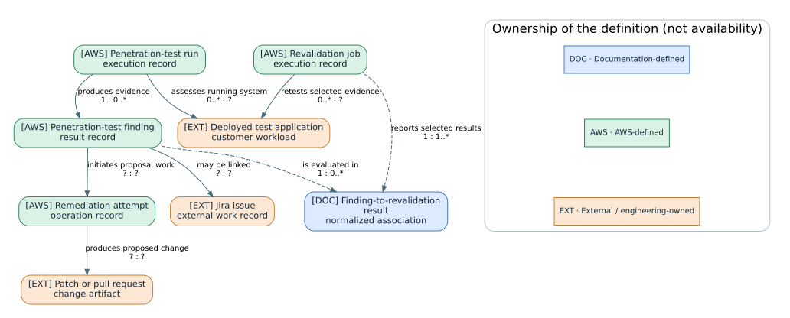

In [UC-S01, assess a running application](../catalog/index.html#UC-S01), public or private reachability and authentication are configuration dimensions. They do not create four separate assessment objectives. The configuration selects the authorized surface, while the run records what was reached. Login Optimization can reuse a successful navigation procedure; the operator must still inspect the current role and reachability when interpreting coverage. [SS52] [SS56]

In [UC-S06, prepare a code-remediation proposal](../catalog/index.html#UC-S06), source and remediation settings determine where eligible proposal work can occur. The remediation attempt and its output are not the same object: an attempt may fail, and a produced patch or pull request remains an external engineering artifact. Its review, test and deployment records belong to the delivery process. The guide does not infer deployment authority from permission to create a proposal. [SS55]

In [UC-S07, revalidate a finding](../catalog/index.html#UC-S07), the operator selects one or more existing findings after deploying the repair to the original authorized environment. A separate job repeats the selected validation steps using current configuration and authentication. The original finding remains linked to the revalidation history. This is scoped retesting, not new broad vulnerability discovery. [SS54]

The blue Finding-to-revalidation result node is introduced by this documentation. It records the relationship between an original finding and a particular revalidation job, including the observed disposition and any incomplete evidence. It is useful because one finding can be retested repeatedly and one job can select several findings. The model does not claim that AWS exposes a separate API resource with that name. A pending or failed job may not yet have a conclusive result.

| Transition | Identity to preserve | Acceptance question |
|---|---|---|
| Configuration to assessment | Test configuration, run, target revision and role | Was the intended surface actually assessed? |
| Finding to proposal | Original finding and proposed source revision | Does the change address the evidenced issue without unrelated changes? |
| Proposal to deployment | Reviewed change and deployed revision | Did the accepted repair reach the test environment? |
| Finding to revalidation job | Original finding and new job | Were the selected validation steps reached under the intended identity? |
| Result to work tracking | Finding link and external issue key | Does the ticket describe the observed result rather than only completion status? |

These acceptance questions are authored engineering procedure. AWS documents the assessment, proposal and revalidation operations; the team decides whether the evidence is sufficient to accept the outcome. A linked Jira issue is another external record with its own audience and lifecycle. Removing the integration does not erase the previously published finding details. [SS54] [SS58]

### S-U01 — Authorization-finding remediation: worked example

**Synthetic, authorized-staging exercise.** Two test users belong to different customer accounts. The illustrative finding is that user A can receive a test invoice owned by account B. No live endpoint, credential or exploit execution is supplied.

| Evidence record | Before repair | Candidate repair | After deployment |
|---|---|---|---|
| Application revision | `demo-r1` | `demo-r2` under review | `demo-r2` deployed |
| Same-account test | Expected invoice returned | Regression test passes | Expected invoice returned |
| Cross-account test | Test invoice returned unexpectedly | Ownership check added; unit test passes | Access denied in prepared result |
| Identity evidence | User A / account A | Test principal controlled | User A / account A confirmed |

**Walkthrough:** inspect the original finding and target revision; review the proposed ownership check; verify that the prepared deployment record names `demo-r2`; select the finding for revalidation; inspect the new job and its linkage. The observation that a patch exists is not used as evidence of deployment. The prepared post-deployment denial supports only this tested path and identity.

**Failure branch:** if revalidation instead logs in as a privileged administrator, its result is not the intended test of user A. Correct the credential role and rerun the authorized verification. If no application path was reached, do not interpret the absence of reproduction as proof of repair.

**Expected deliverable:** a finding disposition linking original evidence, reviewed change, deployed revision, actual authenticated identity and targeted result, with untested routes stated explicitly. The fixture teaches evidence lineage; it is not an assessment result or a security guarantee.

### S-08 — Documentation coverage and references

The assessment chapters connect application sources, target access, criteria, executions, and finding verification. The following coverage table identifies which procedures are explained and which require the provider-specific official guide. Availability belongs to an individual assessment or integration feature, not to the collection as a whole.

The source register supports product behavior rather than the synthetic application example or the team decisions proposed around it. Integration inventories and selected authentication and context mechanisms were rechecked on 22 October 2026; this is not a new exhaustive audit of every historical statement. The diagrams are logical models and do not assert undisclosed runtime internals.

| Official subject | Treatment | Remaining boundary |
|---|---|---|
| Resource lifecycle and identities | Model plus setup sequence | Complete SSO and organization-policy deployment linked |
| Penetration testing | Configuration, target classes, credentials, run interpretation | Full GenAI risk-exception authoring not reproduced |
| Authentication | Strategy matrix, preflight, learned login reuse | No actual secrets or running credential backend |
| Requirements | Evaluation separated from destructive regeneration | Full managed-pack inventory linked |
| Code and threat models | Usable configuration sequence and result model | Complete CI/CD and provider compatibility matrix deferred |
| Findings and KMS | Lineage, remediation boundaries, key hierarchy and actors | Full policy documents remain official reference |
| Limits/troubleshooting | Selected operational constraints and diagnostic paths | Not an exhaustive error catalog |

**Version conflicts:** current indexed authentication/wizard pages include email MFA and nonstandard ports. Older cached authentication/troubleshooting pages contradict those points. The newer task-specific pages are used; the older troubleshooting source supports only the remaining diagnostics. Review date means retrieval, not a page publication date.

#### Official sources and reviewed sections

- [SS01] Service scope and feature distinctions.
- [SS02] Documentation history; feature announcements and availability.
- [SS03] Account versus space resources; configuration/run lifecycle by assessment type.
- [SS04] Administrative and assessment surfaces, application context.
- [SS05] Code-review setup, modes, preflight, full scans and findings.
- [SS06] Source registration and network troubleshooting; stale port restriction excluded.
- [SS07] Target verification, VPC/role/logging setup and optional scheduling; newer indexed content.
- [SS08] Current penetration-test wizard, network classes, credentials and task-hours; newer indexed content.
- [SS09] Credential methods, preflight, login reuse and MFA; newer indexed content resolves older cached text.
- [SS10] Quotas and adjustability; current indexed table.
- [SS11] Pricing versus capacity and cancellation implications.
- [SS12] Remediation provider behavior and proposed patches.
- [SS13] Revalidation initiation, results and lineage.
- [SS14] Requirement fields, applicability, activation and review behavior.
- [SS15] Requirement generation and replacement consequences.
- [SS16] Threat-model scope/source distinction, setup, preflight and result review.
- [SS17] Repository-triggered review and comments.
- [SS18] Hierarchical keyring, identities, encryption context and key lifecycle.

[SS01]: https://docs.aws.amazon.com/securityagent/latest/userguide/what-is.html
[SS02]: https://docs.aws.amazon.com/securityagent/latest/userguide/doc-history.html
[SS03]: https://docs.aws.amazon.com/securityagent/latest/userguide/understand-lifecycle.html
[SS04]: https://docs.aws.amazon.com/securityagent/latest/userguide/how-it-works.html
[SS05]: https://docs.aws.amazon.com/securityagent/latest/userguide/quickstart-code-review.html
[SS06]: https://docs.aws.amazon.com/securityagent/latest/userguide/troubleshooting.html
[SS07]: https://docs.aws.amazon.com/securityagent/latest/userguide/enable-penetration-test.html
[SS08]: https://docs.aws.amazon.com/securityagent/latest/userguide/perform-penetration-test.html
[SS09]: https://docs.aws.amazon.com/securityagent/latest/userguide/provide-testing-credentials.html
[SS10]: https://docs.aws.amazon.com/securityagent/latest/userguide/quotas.html
[SS11]: https://docs.aws.amazon.com/securityagent/latest/userguide/pricing.html
[SS12]: https://docs.aws.amazon.com/securityagent/latest/userguide/remediate-finding.html
[SS13]: https://docs.aws.amazon.com/securityagent/latest/userguide/revalidate-findings.html
[SS14]: https://docs.aws.amazon.com/securityagent/latest/userguide/security-requirements.html
[SS15]: https://docs.aws.amazon.com/securityagent/latest/userguide/import-security-requirements.html
[SS16]: https://docs.aws.amazon.com/securityagent/latest/userguide/quickstart-threat-model.html
[SS17]: https://docs.aws.amazon.com/securityagent/latest/userguide/review-code-findings-github.html
[SS18]: https://docs.aws.amazon.com/securityagent/latest/userguide/customer-managed-keys.html
[SS30]: https://docs.aws.amazon.com/securityagent/latest/userguide/about-integrations.html
[SS31]: https://docs.aws.amazon.com/securityagent/latest/userguide/enable-s3-bucket.html
[SS32]: https://docs.aws.amazon.com/securityagent/latest/userguide/connect-jira.html
[SS33]: https://docs.aws.amazon.com/securityagent/latest/userguide/connect-confluence.html
[SS34]: https://docs.aws.amazon.com/securityagent/latest/userguide/how-it-works.html
[SS401]: https://docs.aws.amazon.com/securityagent/latest/userguide/about-integrations.html
[SS402]: https://docs.aws.amazon.com/securityagent/latest/userguide/perform-penetration-test.html
[SS403]: https://docs.aws.amazon.com/securityagent/latest/userguide/provide-testing-credentials.html
[SS404]: https://docs.aws.amazon.com/securityagent/latest/userguide/understand-lifecycle.html
[SS405]: https://docs.aws.amazon.com/securityagent/latest/userguide/review-penetration-findings.html
[SS406]: https://docs.aws.amazon.com/securityagent/latest/userguide/remediate-finding.html
[SS407]: https://docs.aws.amazon.com/securityagent/latest/userguide/revalidate-findings.html
[SS408]: https://docs.aws.amazon.com/securityagent/latest/userguide/security-requirements.html
[SS409]: https://docs.aws.amazon.com/securityagent/latest/userguide/import-security-requirements.html
[SS410]: https://docs.aws.amazon.com/securityagent/latest/userguide/quickstart-code-review.html
[SS411]: https://docs.aws.amazon.com/securityagent/latest/userguide/review-code-findings-github.html
[SS412]: https://docs.aws.amazon.com/securityagent/latest/userguide/review-design-findings.html
[SS413]: https://docs.aws.amazon.com/securityagent/latest/userguide/quickstart-threat-model.html
[SS414]: https://docs.aws.amazon.com/securityagent/latest/userguide/cicd-pentest.html
[SS415]: https://docs.aws.amazon.com/securityagent/latest/userguide/connect-jira.html
[SS416]: https://docs.aws.amazon.com/securityagent/latest/userguide/export-findings-to-issue-tracker.html
[SS417]: https://docs.aws.amazon.com/securityagent/latest/userguide/remove-jira.html
[SS418]: https://docs.aws.amazon.com/securityagent/latest/userguide/quickstart.html
[SS490]: https://docs.aws.amazon.com/securityagent/latest/userguide/connect-azure-devops.html
[SS50]: https://docs.aws.amazon.com/securityagent/latest/userguide/understand-lifecycle.html
[SS501]: https://docs.aws.amazon.com/securityagent/latest/userguide/understand-lifecycle.html
[SS502]: https://docs.aws.amazon.com/securityagent/latest/userguide/how-it-works.html
[SS503]: https://docs.aws.amazon.com/securityagent/latest/userguide/security-requirements.html
[SS504]: https://docs.aws.amazon.com/securityagent/latest/userguide/provide-testing-credentials.html
[SS505]: https://docs.aws.amazon.com/securityagent/latest/userguide/review-penetration-findings.html
[SS506]: https://docs.aws.amazon.com/securityagent/latest/userguide/revalidate-findings.html
[SS507]: https://docs.aws.amazon.com/securityagent/latest/userguide/data-protection.html
[SS508]: https://docs.aws.amazon.com/securityagent/latest/userguide/customer-managed-keys.html
[SS51]: https://docs.aws.amazon.com/securityagent/latest/userguide/about-integrations.html
[SS52]: https://docs.aws.amazon.com/securityagent/latest/userguide/provide-testing-credentials.html
[SS53]: https://docs.aws.amazon.com/securityagent/latest/userguide/security-requirements.html
[SS54]: https://docs.aws.amazon.com/securityagent/latest/userguide/revalidate-findings.html
[SS55]: https://docs.aws.amazon.com/securityagent/latest/userguide/remediate-finding.html
[SS56]: https://docs.aws.amazon.com/securityagent/latest/userguide/perform-penetration-test.html
[SS57]: https://docs.aws.amazon.com/securityagent/latest/userguide/quickstart-threat-model.html
[SS58]: https://docs.aws.amazon.com/securityagent/latest/userguide/connect-jira.html
[SS701]: https://docs.aws.amazon.com/securityagent/latest/userguide/how-it-works.html
[SS702]: https://docs.aws.amazon.com/securityagent/latest/userguide/understand-lifecycle.html
[SS703]: https://docs.aws.amazon.com/securityagent/latest/userguide/revalidate-findings.html
