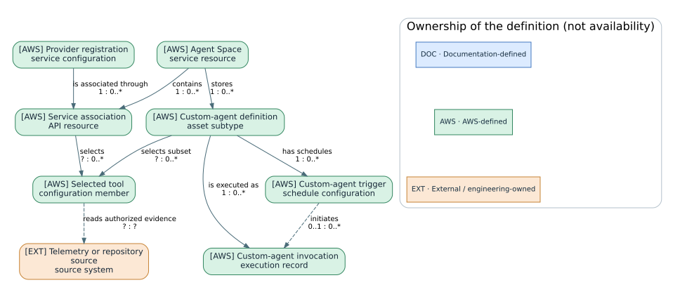
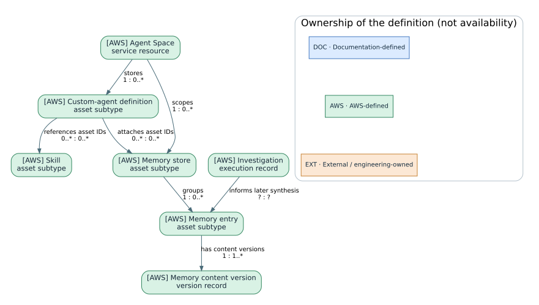
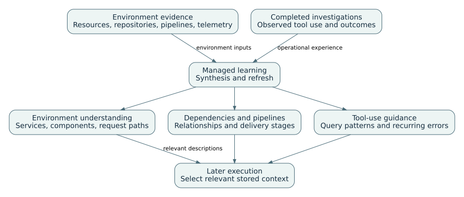
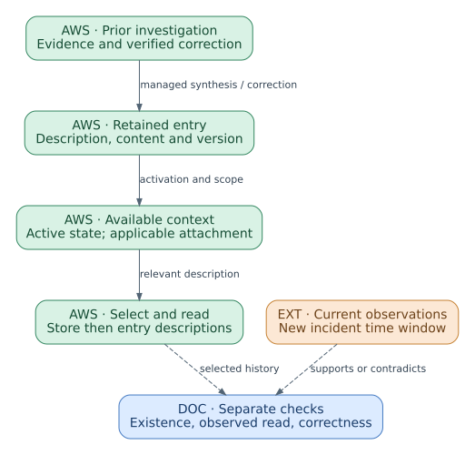
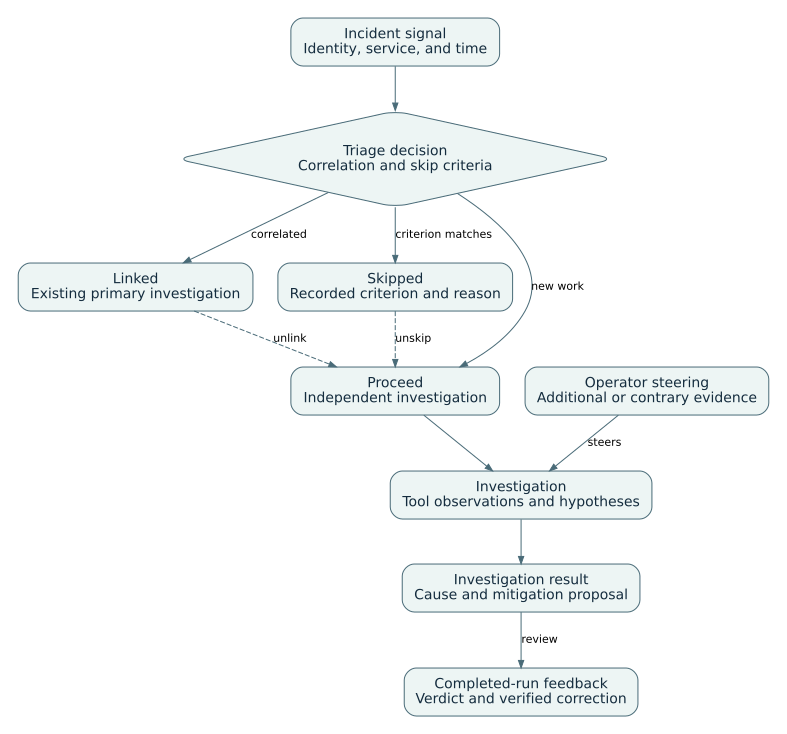
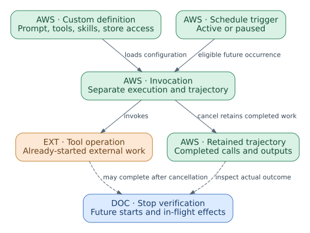
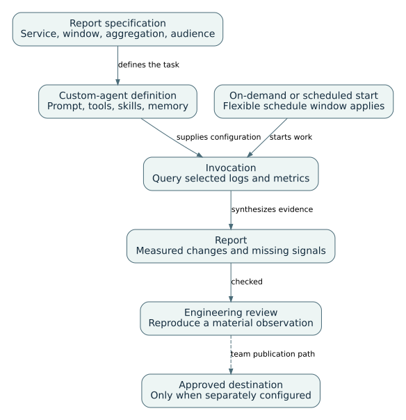
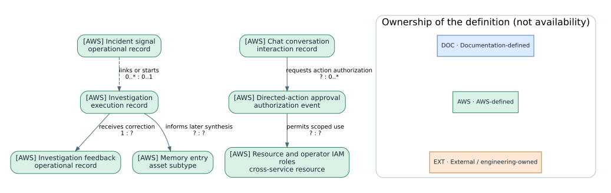

# AWS DevOps Agent: presentation notes

Presentation: 65 minutes, including 8 minutes of prepared-result exercises. Questions and breaks are additional.

## 01. Agent Space, provider associations and custom invocations

00:00–02:00 · Product-specific resource model

An Agent Space associates account roles and providers. A custom-agent definition selects tools and context; each invocation records a separate execution. Provider registration and space association are distinct configuration operations.

Detailed reference: [Agent Space, configuration and execution](../guides/devops.html#D-01)

## 02. Agent Space, asset, and invocation identities

02:00–05:00 · Product-specific resource model

Identify the actual product object before configuring, invoking, correcting or removing it. The resource kind determines which operation is meaningful.

Object | Identity or membership | Relationship to inspect

Agent Space | agentSpaceId and service scope | Account roles and selected associations

Service association | associationId and serviceId | Registered provider plus space-specific configuration

Custom definition | custom_agent assetId | Existing skill and memory-store asset IDs

Memory | Parent store and content version | Activation, attachment and observed retrieval

Invocation or investigation | Execution record and actual interval | Tool evidence, conclusion and any separate approval

Detailed reference: [Configuration identities and knowledge relationships](../guides/devops.html#D-13)

## 03. Memory stores, entries and definition references

05:00–08:00 · Product-specific resource model

A custom definition references existing skill and memory-store assets. A store contains entries; updates create entry versions. Activation and attachment control availability, while retrieval occurs during execution.

Detailed reference: [Configuration identities and knowledge relationships](../guides/devops.html#D-13)

## 04. Provider registration and Agent Space association

08:00–10:00 · Integrations and access

Provider authentication is registered at account level. Association and tool selection make an explicit subset available to the Agent Space. The invocation still needs a working authenticated route.

Detailed reference: [Supported integrations and connection directions](../guides/devops.html#D-12)

Detailed reference: [MCP provider registration and tool selection](../guides/devops.html#D-03)

## 05. Telemetry, source control, and incident connections

10:00–12:00 · Integrations and access

Choose the evidence source, incident-initiation path, and result destination independently. Registration and Agent Space association are separate setup steps.

Connection family | Documented systems | Purpose and boundary

AWS evidence | CloudWatch, S3, EKS; selected AWS accounts | Read authorized telemetry, objects, and cluster evidence; EKS has additional access setup.

Telemetry providers | Dynatrace; Datadog, Grafana, New Relic, Splunk | Dynatrace has a documented two-way path; other named providers expose reads and separately configured event initiation.

Code and delivery | GitHub, GitLab; Azure Resources and Azure DevOps | Repository, pipeline, or infrastructure context according to the configured provider and resource scope.

Incident coordination | ServiceNow, PagerDuty, Slack | Provider-specific initiation and communication; not a universal write capability.

Additional interfaces | MCP, webhooks, EventBridge | Selected tools, incoming incident signals, and outgoing lifecycle events are different directions.

Detailed reference: [Supported integrations and connection directions](../guides/devops.html#D-12)

## 06. Access roles, tool providers and private connectivity

12:00–15:00 · Integrations and access

Reachability, authentication, tool selection and authorization must each be tested.

Configuration area | Decision | Confirmation | Typical failure

Resource access | Allowed accounts, actions and resources | Known resource can be read under expected identity | Missing source data

Operator access | Who can enter and operate the space | Intended operator signs in | Administrator-only access works

MCP provider | Endpoint, authentication and registration | Provider validates or associates successfully | Wrong token endpoint or SigV4 fields

Tool association | Selected tools for the space or custom agent | Expected tool visible; excluded tool absent | Provider registered but tool unavailable

Private connection | VPC, subnets, security groups and ports | Target host and port reachable | Route or port failure mistaken for credential failure

Detailed reference: [Resource roles and operator roles](../guides/devops.html#D-02)

Detailed reference: [MCP provider registration and tool selection](../guides/devops.html#D-03)

Detailed reference: [Private network connections](../guides/devops.html#D-04)

## 07. Environment-knowledge consolidation

15:00–17:00 · Knowledge and behavior

Discovery, connected evidence, and completed investigations feed distinct retained knowledge. A later execution selects the relevant context; it still reads current source evidence.

Detailed reference: [Environment-knowledge consolidation and refresh](../guides/devops.html#D-M08)

Detailed reference: [Resource discovery and topology construction](../guides/devops.html#D-05)

## 08. Memory production, availability and selective retrieval

17:00–19:00 · Knowledge and behavior

Separate retained content, access to the entry, observable retrieval and the correctness of the new conclusion.

Detailed reference: [Incident-memory construction and retrieval](../guides/devops.html#D-M01)

Detailed reference: [Investigation feedback and corrective memory](../guides/devops.html#D-M02)

Detailed reference: [Memory-store access, versions, and retention](../guides/devops.html#D-M07)

## 09. Memory, instructions and skills

19:00–22:00 · Knowledge and behavior

Availability, selection and diagnostic influence are separate questions for retained context.

Mechanism | When loaded | Typical content | Lifecycle control

Managed memory | Selected by description during relevant work | Recurring causes and environment understanding | Version, active state and managed refresh

Custom memory | Selected after store attachment | Team or service context | Create, edit, deactivate, detach or delete

Corrective reflection | Future investigation of the alarm | Verified correction to an earlier diagnosis | Latest feedback and visible memory

Agent instructions | Every new applicable session | Standing policies and output rules | Edit and start a new session

Skill | When description and agent scope match | Specialized procedure and references | Edit description, content and targeting

Detailed reference: [Incident-memory construction and retrieval](../guides/devops.html#D-M01)

Detailed reference: [Investigation feedback and corrective memory](../guides/devops.html#D-M02)

Detailed reference: [Global and agent-specific instructions](../guides/devops.html#D-M03)

Detailed reference: [Runbook skills and applicability rules](../guides/devops.html#D-M04)

Detailed reference: [Memory-store access, versions, and retention](../guides/devops.html#D-M07)

## 10. Incident triage and investigation workflow

22:00–24:00 · Incident response and operational execution

A signal can be linked, skipped, or investigated independently. Steering affects the current analysis; completed-investigation feedback supplies a separate corrective input.

Detailed reference: [Incident triage, investigation, and prevention](../guides/devops.html#D-06)

## 11. Incident triage and investigation lifecycle

24:00–27:00 · Incident response and operational execution

Routing correction, diagnosis correction and mitigation approval are distinct operations.

Incoming signal | Alert, ticket, webhook or manual request with incident context.

Triage decision | Linked, skipped or proceed; inspect the reason before diagnosing absence.

Investigation | Evidence collection, hypotheses, root-cause versions and steering.

Closure and feedback | Mitigation decision, recovery evidence and correction of routing or diagnosis.

Detailed reference: [Incident triage, investigation, and prevention](../guides/devops.html#D-06)

## 12. Incident pattern analysis and prevention recommendations

27:00–30:00 · Incident response and operational execution

Incident pattern identification produces context and recommendations, not an automatically implemented fix.

Stage | Input | Output | Operator decision

Monitor memory refresh | Recent completed investigations | Monitor-specific recurring-cause context | Inspect version and relevance

Prevention evaluation | Multiple incident investigations | Observability, infrastructure, governance or code recommendations | Run, stop or wait for scheduled evaluation

Recommendation review | Incident evidence and expected impact | Keep, discard or implemented state | Assign owner and acceptance criteria

Corrective feedback | Verified diagnosis correction | Reflection for future investigations | Separate local learning from AWS sharing

Detailed reference: [Incident-memory construction and retrieval](../guides/devops.html#D-M01)

Detailed reference: [Investigation feedback and corrective memory](../guides/devops.html#D-M02)

Detailed reference: [Incident triage, investigation, and prevention](../guides/devops.html#D-06)

## 13. Stopping future triggers and current invocations

30:00–33:00 · Incident response and operational execution

Pause the trigger to stop future starts. Cancel the invocation separately; an in-flight tool call can still complete and previously completed evidence remains.

Detailed reference: [Custom-agent configuration and invocation](../guides/devops.html#D-07)

## 14. Configured operational-report workflow

33:00–35:00 · Incident response and operational execution

The team defines the report period and selected evidence. An invocation queries sources, produces a report, and exposes results for review. Schedule timing and the reporting window are separate configuration decisions.

Detailed reference: [Custom-agent configuration and invocation](../guides/devops.html#D-07)

## 15. Sandbox and directed actions

35:00–38:00 · Incident response and operational execution

Execution authority depends on the specific effect; there is no universal read-only agent mode.

Execution surface | Purpose | Primary controls | Evidence

Sandbox | Investigation-local computation and data processing | Packages, network rules and existing AWS permissions | Code, outputs and failed network calls

Directed AWS action | Eligible resource mutation | Space opt-in, elevated role and specific approval | Approval, CloudTrail and resulting resource state

External MCP mutation | Tool-defined effect | Tool classification, selected tool and approval behavior | Tool arguments and external result

Recommendation only | Describe a possible change | No execution authorization | Proposal, risk, rollback and verification plan

Detailed reference: [Sandbox computation and network policy](../guides/devops.html#D-M05)

Detailed reference: [Directed actions and approval scope](../guides/devops.html#D-M06)

## 16. Release readiness review and release testing

38:00–40:00 · Incident response and operational execution

Readiness review, managed verification and active application testing are separate preview operations.

Preview path | Subject | Primary output | Important boundary

Release readiness review | Code change and dependency context | Risk findings and recommended actions | Feature and repository eligibility are specific

Managed verification | Build or test evidence for the change | Verification task and results | Not equivalent to production recovery evidence

Active release testing | Running web application or API | Observed application behavior | Requests can create, modify or delete application data

Custom-agent release tools | Release Manager tasks and reports | Created or analyzed release task | Use selected tools and inspect task state

Detailed reference: [Remote access and release-assurance workflows](../guides/devops.html#D-09)

Detailed reference: [Execution limits and diagnostic procedures](../guides/devops.html#D-10)

## 17. Incident response outcomes

40:00–43:00 · Operational objectives and implementation

Follow the operational objective through its workflow, configured mechanisms and independent completion evidence. The catalog links each dependency to its detailed guide.

Operational outcome | Completion evidence | Implementation boundary

Triage incident signals | Decision and reason are visible. | Built-in function

Investigate a service incident | Affected service and UTC interval are explicit. | Built-in function

Prepare a mitigation plan | Target and proposed effect are explicit. | Built-in function

Execute an approved mitigation and verify recovery | Exact operation and target were approved. | Controlled action

Prepare an incident-status bulletin | Incident and measurement window are identified. | Configured custom agent

Detailed reference: [Incident triage, investigation, and prevention](../guides/devops.html#D-06)

Detailed reference: [Directed actions and approval scope](../guides/devops.html#D-M06)

## 18. Reporting and reliability outcomes

43:00–46:00 · Operational objectives and implementation

Follow the operational objective through its workflow, configured mechanisms and independent completion evidence. The catalog links each dependency to its detailed guide.

Operational outcome | Completion evidence | Implementation boundary

Assess and report service health and trends | Service dimensions and observation periods are explicit. | Native inquiry or configured reporting

Review deployment and change activity | Deployment states and immutable revisions are traceable. | Configured custom agent

Identify recurring incident patterns | Supporting investigation identities are retained. | Built-in function

Prioritize incident-prevention work | Accepted proposals retain source incidents. | Built-in function

Detailed reference: [Custom-agent configuration and invocation](../guides/devops.html#D-07)

Detailed reference: [Incident triage, investigation, and prevention](../guides/devops.html#D-06)

## 19. Operational knowledge and release assurance

46:00–49:00 · Operational objectives and implementation

Follow the operational objective through its workflow, configured mechanisms and independent completion evidence. The catalog links each dependency to its detailed guide.

Operational outcome | Completion evidence | Implementation boundary

Consolidate and maintain operational procedures | Conflicting or stale instructions are resolved. | Composed workflow

Document service topology and dependencies | Observed and inferred relationships are distinguished. | Built-in function with composed documentation

Audit resource configurations against approved standards | Each finding identifies resource, rule and observed value. | Configured custom agent

Assess release readiness | The candidate revision is unambiguous. | Preview function

Test a deployed application release | Target revision, identities and permitted effects are explicit. | Preview function

Detailed reference: [Runbook skills and applicability rules](../guides/devops.html#D-M04)

Detailed reference: [Environment-knowledge consolidation and refresh](../guides/devops.html#D-M08)

Detailed reference: [Remote access and release-assurance workflows](../guides/devops.html#D-09)

## 20. Service-health reporting: workflow dependencies

49:00–52:00 · Operational objectives and implementation

One reporting objective has native and configured implementations. Required evidence, optional context and conditional execution remain explicit.

Workflow step | Mechanism and configuration | Completion or failure decision

Read current observations | Authorized evidence sources and explicit scope | Missing current data prevents a health conclusion.

Choose the execution profile | Built-in operational query OR configured custom agent | A native inquiry does not require a custom definition.

Use relevant context | Optional available memory or reviewed reporting procedure | Retained history never substitutes for current observations.

Repeat or publish | Conditional schedule and optional destination | Timing and publication controls remain separate from the report objective.

Detailed reference: [MCP provider registration and tool selection](../guides/devops.html#D-03)

Detailed reference: [Custom-agent configuration and invocation](../guides/devops.html#D-07)

Detailed reference: [Incident-memory construction and retrieval](../guides/devops.html#D-M01)

Detailed reference: [Memory-store access, versions, and retention](../guides/devops.html#D-M07)

## 21. Incident records and action-specific authorization

52:00–55:00 · Operational objectives and implementation

A signal can be linked, skipped, or investigated. Steering changes the active analysis; completed-investigation feedback provides a corrective input. Resource mutation requires its separate approval path.

Detailed reference: [Incident and reporting use cases in the resource model](../guides/devops.html#D-14)

## 22. Worked example: recurring alarm with different current evidence

55:00–63:00 · Worked example

Prepared evidence demonstrates how historical context can be useful without becoming the current diagnosis.

0–2 min | Inspect prior context | Earlier database pool saturation and its verified evidence

2–4 min | Compare current database signals | 34/100 connections and query p95 of 18 ms

4–6 min | Evaluate current dependency signals | Inventory p95 of 2,900 ms and checkout p95 of 3,100 ms

6–8 min | Record the conclusion | Historical memory is relevant; upstream latency is the current lead; cause remains bounded

Detailed reference: [Recurring-alarm investigation: worked example](../guides/devops.html#D-U01)

Detailed reference: [Incident-memory construction and retrieval](../guides/devops.html#D-M01)

Detailed reference: [Investigation feedback and corrective memory](../guides/devops.html#D-M02)

## 23. Troubleshooting matrix and operating limits

63:00–65:00 · Troubleshooting and references

Diagnose the failed layer and retest the smallest relevant operation.

Symptom | First object to inspect | Second check | Do not do first

No investigation | Triage decision and incident link | Concurrency and trigger status | Broaden all permissions

Missing data | Resource role and source connection | Time window and resource identity | Assume the source has no data

Memory not used | Store/entry active state and description | Agent attachment and new session | Claim retrieval from answer wording

Tool unavailable | Provider association and selected tools | Authentication and private route | Rotate a valid secret without network evidence

Mutation denied | Directed-action enablement and classification | Role trust, exact operation and approval | Treat a chat request as authorization

Detailed reference: [Execution limits and diagnostic procedures](../guides/devops.html#D-10)

Detailed reference: [Documentation coverage and references](../guides/devops.html#D-11)
