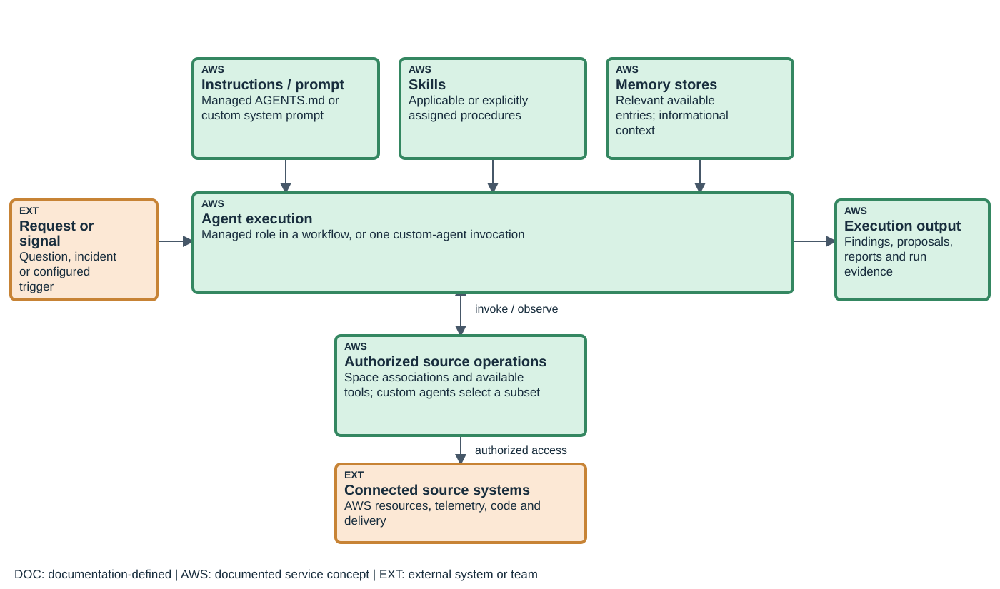
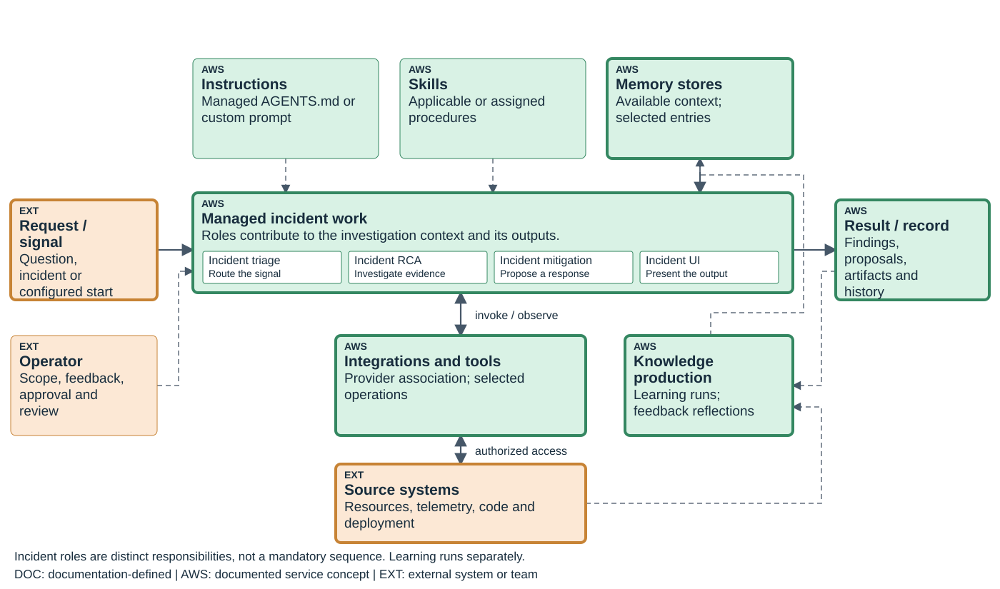
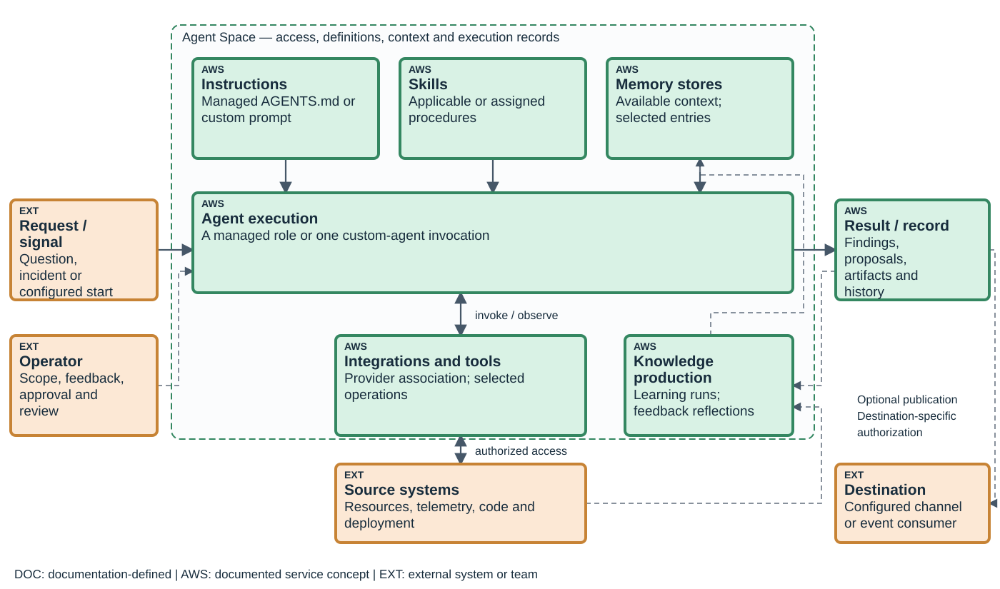
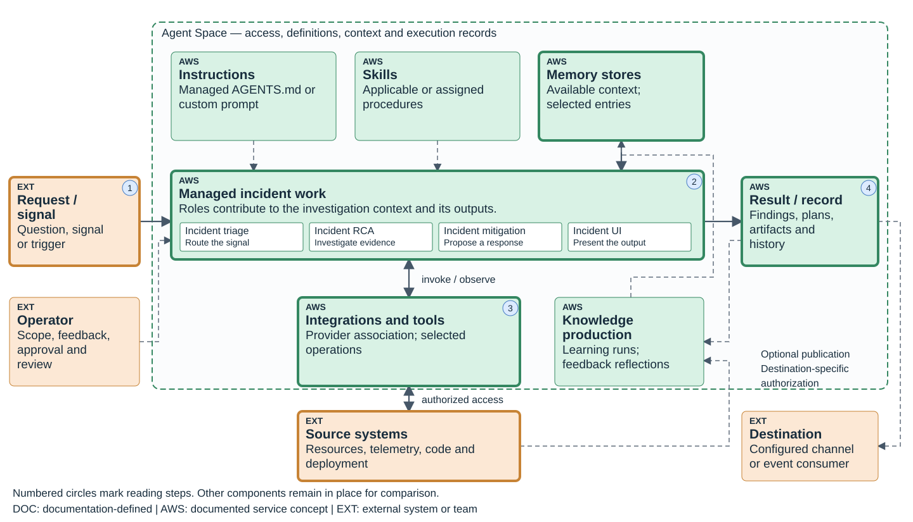
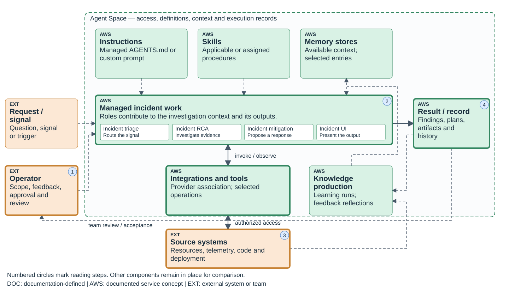
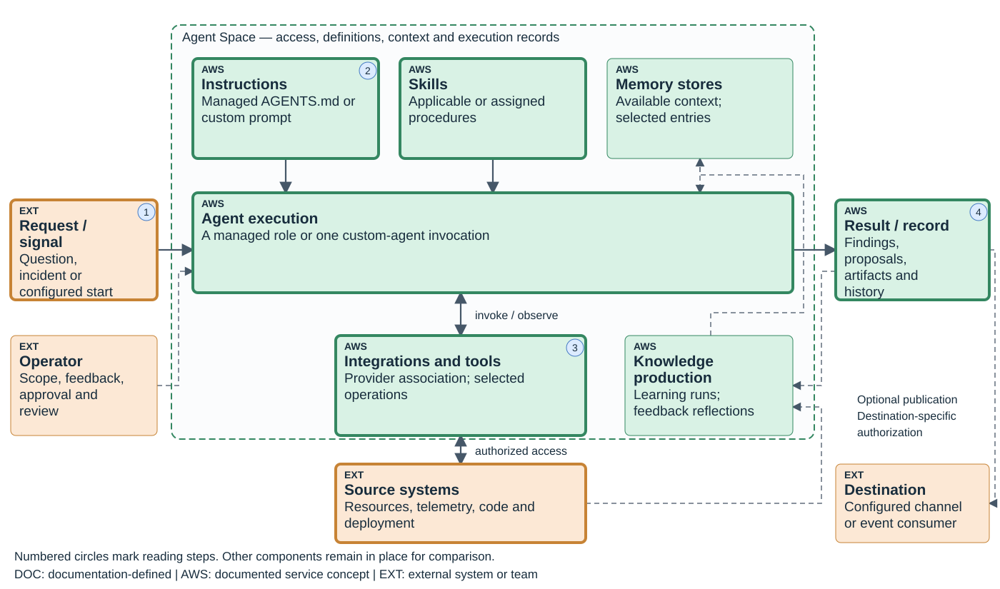
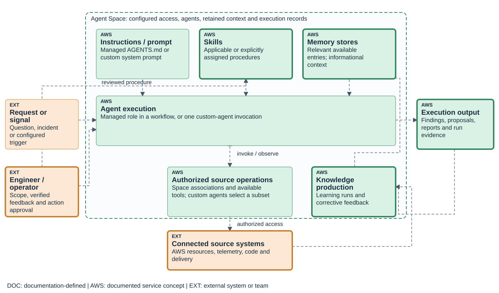
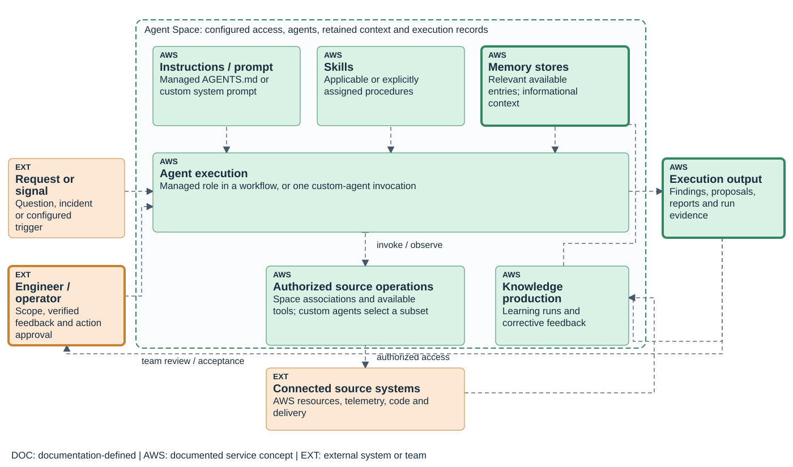

# AWS DevOps Agent: presentation notes

Presentation: 58 minutes, including 8 minutes of prepared-result exercises. Questions and breaks are additional.

## 01. What an agent is in AWS DevOps Agent

00:00–03:00 · Agent composition and shared operating scope

Begin with a scoped request, not an asset identifier. Trace it into an execution, then down through an authorized source operation and back to an output. The three upper boxes supply different kinds of context. AWS manages some agent roles; a custom definition gives the customer explicit prompt, tool, skill and store choices. Do not imply that every connected tool is assigned to every custom agent.

Detailed reference: [An agent, its configuration, and one execution](../guides/devops.html#D-90)

Detailed reference: [AWS-managed agents](../guides/devops.html#D-15)

Detailed reference: [Custom-agent definitions and configuration](../guides/devops.html#D-16)

## 02. Instructions, skills, knowledge and integrations have different roles

03:00–06:00 · Agent composition and shared operating scope

Use one operational example: the prompt asks about checkout timeouts, the skill suggests comparing upstream latency, memory contains an earlier cause, and an authorized telemetry operation returns current observations. Each element contributes something different. The current result can contradict the old memory.

Element | Contribution to the execution | Not equivalent to

Instructions / system prompt | Standing behavioral guidance or custom definition | A permission grant

Skill | Applicable or assigned procedure and supporting files | An incident result

Memory | Selected retained facts and lessons | Current telemetry or model retraining

Tool | Callable source operation with arguments and results | The external provider itself

Integration / connection | Authentication, association and a reachable source | Automatic tool assignment to all agents

Detailed reference: [An agent, its configuration, and one execution](../guides/devops.html#D-90)

Detailed reference: [Standing instructions and session initialization](../guides/devops.html#D-M03)

Detailed reference: [Skills, applicability, and supporting files](../guides/devops.html#D-M04)

Detailed reference: [Memory construction and progressive retrieval](../guides/devops.html#D-M01)

Detailed reference: [MCP provider registration and tool selection](../guides/devops.html#D-03)

## 03. How managed roles contribute to one investigation

06:00–09:00 · Agent composition and shared operating scope

Read this as a responsibility map, not a published RPC call graph. AWS documents incident roles running within investigations, while Learning has its own history and scheduled work. A mitigation proposal does not directly authorize execution. Grader Reviews, customer feedback, learning refresh and prevention evaluation are different activities; avoid turning them into one universal linear pipeline.

Detailed reference: [How managed agents contribute to coordinated work](../guides/devops.html#D-91)

Detailed reference: [AWS-managed agents](../guides/devops.html#D-15)

Detailed reference: [Incident triage, investigation, and prevention](../guides/devops.html#D-06)

## 04. What an Agent Space contains and controls

09:00–12:00 · Agent composition and shared operating scope

The components have not moved; the enclosing scope is now visible. Agent Space is not the agent, a single run, the observed application or a customer VPC. Establish access for the space, then select resources for the particular custom agent. Private routing changes reachability, not the instructions or authority of a tool.

Detailed reference: [Agent Space, connections, and access scope](../guides/devops.html#D-92)

Detailed reference: [Agent Spaces and AWS account scope](../guides/devops.html#D-01)

Detailed reference: [Assets, identities, and configuration references](../guides/devops.html#D-13)

Detailed reference: [Supported integrations and connection directions](../guides/devops.html#D-12)

## 05. Teaching order for operational workflows

12:00–14:00 · Agent composition and shared operating scope

This order is an instructional choice for DevOps and SRE teams, not an AWS product ranking. The approved use-case groups and definitions remain unchanged. The remaining slides reuse the same architecture, emphasizing the active path and stating the evidence that ends each workflow.

Priority for this audience | Workflow group | Why it follows here

1 | Incident triage, investigation and mitigation | Immediate diagnosis and the boundary before a change

2 | Health reporting and change summaries | Routine reuse of the evidence-access path

3 | Incident patterns and prevention | Use prior results without substituting them for current evidence

4 | SOPs and topology documentation | Maintain procedures and environment context

5 | Configuration and release assurance | Apply criteria to an explicit resource or revision

6 | Operational review | Combine verified outputs into owned decisions

Detailed reference: [Incident response and the order of operational workflows](../guides/devops.html#D-93)

## 06. Incident triage and investigation

14:00–17:00 · Incident response: evidence, decisions and controlled effects

Follow the input into triage. A linked event adds context to an existing investigation, so there need not be a new investigation record. A skipped event has a recorded criterion, not a healthy-service verdict. For independent work, inspect telemetry, code and deployment observations. Steering adds current evidence; feedback after completion corrects the recorded diagnosis.

Detailed reference: [Incident response and the order of operational workflows](../guides/devops.html#D-93)

Detailed reference: [Incident triage, investigation, and prevention](../guides/devops.html#D-06)

## 07. Mitigation planning and approved execution

17:00–20:00 · Incident response: evidence, decisions and controlled effects

The operator box becomes relevant at the effect boundary. Preserve the distinction between proposing a change and carrying it out. An approved operation still depends on the selected account role and actual parameters. After execution, compare resource state and service measurements; a successful tool call alone does not show that the incident ended.

Detailed reference: [Incident response and the order of operational workflows](../guides/devops.html#D-93)

Detailed reference: [Directed actions and approval scope](../guides/devops.html#D-M06)

## 08. Incident communication and the investigation record

20:00–22:00 · Incident response: evidence, decisions and controlled effects

The same investigation can supply an incident bulletin. Distinguish an update from a new diagnostic run. The output role and configured collaboration path influence delivery. A request for minute-resolution data does not establish a minute-by-minute custom-agent schedule or delivery guarantee.

Detailed reference: [Incident response and the order of operational workflows](../guides/devops.html#D-93)

Detailed reference: [Artifacts, notifications, and outbound lifecycle events](../guides/devops.html#D-23)

Detailed reference: [Incident triage, investigation, and prevention](../guides/devops.html#D-06)

## 09. How prior incidents inform later investigations

22:00–25:00 · Incident response: evidence, decisions and controlled effects

Trace production and reuse as separate lifecycles. A stored monitor entry establishes retained content. A later observable read establishes retrieval. Neither alone establishes diagnostic correctness. The Learning schedule is not the prevention evaluation schedule, and a correction submitted now is not proof of immediate recall.

Detailed reference: [Incident response and the order of operational workflows](../guides/devops.html#D-93)

Detailed reference: [Memory construction and progressive retrieval](../guides/devops.html#D-M01)

Detailed reference: [Corrective feedback and reflection memory](../guides/devops.html#D-M02)

Detailed reference: [Managed knowledge production and refresh](../guides/devops.html#D-M08)

## 10. Exercise: a recurring alarm with a different current cause

25:00–33:00 · Incident response: evidence, decisions and controlled effects

Use the repository synthetic fixture. Ask which diagram input establishes the old cause, which operation would retrieve current measurements, and what output is justified. Participants should reject repetition of the database cause when current evidence contradicts it. This is a prepared-result exercise, not an AWS response-time measurement.

0–2 min | Inspect the earlier incident | Database connections 100/100; inventory p95 40 ms

2–4 min | Compare current observations | Database connections 34/100; inventory p95 2,900 ms

4–6 min | Follow the evidence path | Prior cause is context; current dependency latency is the stronger lead

6–8 min | State the conclusion and remaining work | Upstream logs are missing; no live run or automatic rollback is claimed

Detailed reference: [Recurring-alarm investigation: worked example](../guides/devops.html#D-U01)

Detailed reference: [Incident response and the order of operational workflows](../guides/devops.html#D-93)

## 11. Service-health reporting from logs and metrics

33:00–36:00 · Routine reporting and reliability improvement

The architecture is unchanged. The request is now a report contract, skills contain the reporting procedure, and selected tools retrieve observations. Memory can help interpret service names but cannot replace failed current reads. A trigger creates another invocation; it does not create continuous monitoring.

Detailed reference: [Incident response and the order of operational workflows](../guides/devops.html#D-93)

Detailed reference: [Custom-agent definitions and configuration](../guides/devops.html#D-16)

Detailed reference: [Invocation state, trajectory, and continuation](../guides/devops.html#D-19)

## 12. Health-report contents and verification

36:00–38:00 · Routine reporting and reliability improvement

This is an authored report design, not a new AWS feature. Explain the actual artifact the team needs. A short summary and a detailed report can share the query basis while exposing different detail. Neither is useful without the period, failed-read treatment and source evidence.

Report section | Evidence required | Review question

Scope | Service identities and exact observation interval | Which systems and time period were actually examined?

Measurements | Query, aggregation and material source values | Do displayed values match the source result?

Comparison | Comparable periods and population | Was a change caused by workload mix or a changed calculation?

Exceptions | Failed reads, missing signals and uncertainty | Is missing data incorrectly presented as normal operation?

Actions | Owner, evidence and next check | Which decision is supported, and which is still a hypothesis?

Detailed reference: [Incident response and the order of operational workflows](../guides/devops.html#D-93)

Detailed reference: [On-demand invocation and scheduled triggers](../guides/devops.html#D-07)

## 13. Incident patterns and prevention priorities

38:00–41:00 · Routine reporting and reliability improvement

Reuse the knowledge-production path but change the question: across incidents, what recurs and which change is justified? Explain the difference between identifying a recurring cause and deciding which intervention to fund or implement. Keep source investigation identities with each conclusion.

Detailed reference: [Incident response and the order of operational workflows](../guides/devops.html#D-93)

Detailed reference: [Incident triage, investigation, and prevention](../guides/devops.html#D-06)

Detailed reference: [Memory construction and progressive retrieval](../guides/devops.html#D-M01)

## 14. SOP consolidation and skill maintenance

41:00–44:00 · Operational knowledge, change assurance and reviews

Here the engineer produces procedural content. A skill is not a finding and is not created merely by concatenating incident summaries. Show how a revised SOP reaches the procedural box, how relevance or explicit assignment makes it available, and why the tool-access path remains separate.

Detailed reference: [Incident response and the order of operational workflows](../guides/devops.html#D-93)

Detailed reference: [Skills, applicability, and supporting files](../guides/devops.html#D-M04)

Detailed reference: [Attachments and repository-backed authoring](../guides/devops.html#D-17)

## 15. Topology and dependency documentation

44:00–47:00 · Operational knowledge, change assurance and reviews

Use the same diagram but follow source evidence to environment knowledge rather than to an incident diagnosis. Distinguish the observed deployment, its inferred topology, retained understanding and the accepted engineering document. A graph boundary is not an IAM boundary.

Detailed reference: [Incident response and the order of operational workflows](../guides/devops.html#D-93)

Detailed reference: [Topology, environment summaries, and export](../guides/devops.html#D-05)

Detailed reference: [Managed knowledge production and refresh](../guides/devops.html#D-M08)

## 16. Deployment review and configuration auditing

47:00–50:00 · Operational knowledge, change assurance and reviews

The deployment-review and configuration-audit objectives remain separate approved cases. They share selected source operations and a controlled comparison procedure. Explain their different acceptance evidence: a deployment report identifies revision and state; an audit finding identifies the resource, rule and observed value.

Detailed reference: [Incident response and the order of operational workflows](../guides/devops.html#D-93)

Detailed reference: [Custom-agent definitions and configuration](../guides/devops.html#D-16)

Detailed reference: [Supported integrations and connection directions](../guides/devops.html#D-12)

## 17. Release readiness and active release testing

50:00–53:00 · Operational knowledge, change assurance and reviews

Keep the same access and execution model while distinguishing the two subjects. Reviewing code is not equivalent to testing a deployed application. A test profile is native release-test configuration; the catalog configuration recipes are authored guidance, not that resource.

Detailed reference: [Incident response and the order of operational workflows](../guides/devops.html#D-93)

Detailed reference: [Release-readiness review and release testing](../guides/devops.html#D-22)

## 18. Operational reviews: from reports to owned decisions

53:00–55:00 · Operational knowledge, change assurance and reviews

This is the shared review use case applied to reliability work. The team consumes outputs from independently scoped executions. Agent output supplies evidence and proposals; the meeting determines priorities and owners. A later Security or FinOps task receives explicit evidence and its own authorization.

Detailed reference: [Incident response and the order of operational workflows](../guides/devops.html#D-93)

Detailed reference: [Incident and reporting use cases in the resource model](../guides/devops.html#D-14)

## 19. Configuration checks before using a workflow

55:00–58:00 · Operational knowledge, change assurance and reviews

Finish with prerequisites the learner can now explain, rather than opening with identifiers. Refer to the capability chapters for full procedures, provider differences, quotas and APIs. Every use case should be traceable from its input through configured source access to its own completion criteria.

Check | Object to inspect | Failure interpretation

Operator access | User identity and space role | Can the intended operator enter and act?

Evidence access | Account role, provider association and selected tool | Connection existence does not prove a successful read

Context availability | Instruction scope, skill assignment and memory attachment | Available content may still not be selected

Execution control | Trigger, current invocation and applicable approval | Pausing future starts is not cancelling or undoing work

Completion evidence | Observed sources, output and actual effect | Generated text is not independent verification

Detailed reference: [Resource roles and operator roles](../guides/devops.html#D-02)

Detailed reference: [MCP provider registration and tool selection](../guides/devops.html#D-03)

Detailed reference: [Private endpoints, routing, and DNS](../guides/devops.html#D-04)

Detailed reference: [Memory-store access, versions, and retention](../guides/devops.html#D-M07)

Detailed reference: [Invocation state, trajectory, and continuation](../guides/devops.html#D-19)
