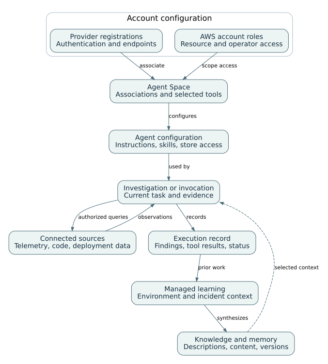

# AWS DevOps Agent: presentation notes

Presentation: 58 minutes, including 8 minutes of prepared-result exercises. Questions and breaks are additional.

## 01. DevOps Agent resource and execution architecture

00:00–02:00 · Service architecture

Account-level providers and roles are associated with an Agent Space. An execution uses the selected tools and context; learning creates knowledge for later executions.

Detailed reference: [The agent, Agent Space, and investigation](../guides/devops.html#D-01)

## 02. Product functions and agent space resource model

02:00–05:00 · Service architecture

Configuration objects, executions and effects must be reviewed as separate records.

Layer | Primary objects | Operational purpose | Evidence to inspect

Account and Region | Provider registrations; AWS account roles | Make selected sources and tools available | Registered provider, role ARN, Region

Agent Space | Associations; selected tools; operator access | Define the operational boundary | Space ID, integrations, operator role

Knowledge and behavior | Topology; memory; instructions; skills | Provide environment context and procedures | Version, active state, attachment

Execution | Investigation; custom-agent invocation; evaluation | Perform a bounded task | Trajectory, tool results, status

Effect | Recommendation; approval; directed action | Separate advice from state change | Approval identity and resulting state

Detailed reference: [The agent, Agent Space, and investigation](../guides/devops.html#D-01)

## 03. Provider registration and Agent Space association

05:00–07:00 · Integrations and access

Provider authentication is registered at account level. Association and tool selection make an explicit subset available to the Agent Space. The invocation still needs a working authenticated route.

Detailed reference: [Supported integrations and connection directions](../guides/devops.html#D-12)

Detailed reference: [MCP provider registration and tool selection](../guides/devops.html#D-03)

## 04. Telemetry, source control, and incident connections

07:00–09:00 · Integrations and access

Choose the evidence source, incident-initiation path, and result destination independently. Registration and Agent Space association are separate setup steps.

Connection family | Documented systems | Purpose and boundary

AWS evidence | CloudWatch, S3, EKS; selected AWS accounts | Read authorized telemetry, objects, and cluster evidence; EKS has additional access setup.

Telemetry providers | Dynatrace; Datadog, Grafana, New Relic, Splunk | Dynatrace has a documented two-way path; other named providers expose reads and separately configured event initiation.

Code and delivery | GitHub, GitLab; Azure Resources and Azure DevOps | Repository, pipeline, or infrastructure context according to the configured provider and resource scope.

Incident coordination | ServiceNow, PagerDuty, Slack | Provider-specific initiation and communication; not a universal write capability.

Additional interfaces | MCP, webhooks, EventBridge | Selected tools, incoming incident signals, and outgoing lifecycle events are different directions.

Detailed reference: [Supported integrations and connection directions](../guides/devops.html#D-12)

## 05. Access roles, tool providers and private connectivity

09:00–12:00 · Integrations and access

Reachability, authentication, tool selection and authorization must each be tested.

Configuration area | Decision | Confirmation | Typical failure

Resource access | Allowed accounts, actions and resources | Known resource can be read under expected identity | Missing source data

Operator access | Who can enter and operate the space | Intended operator signs in | Administrator-only access works

MCP provider | Endpoint, authentication and registration | Provider validates or associates successfully | Wrong token endpoint or SigV4 fields

Tool association | Selected tools for the space or custom agent | Expected tool visible; excluded tool absent | Provider registered but tool unavailable

Private connection | VPC, subnets, security groups and ports | Target host and port reachable | Route or port failure mistaken for credential failure

Detailed reference: [Resource roles and operator roles](../guides/devops.html#D-02)

Detailed reference: [MCP provider registration and tool selection](../guides/devops.html#D-03)

Detailed reference: [Private network connections](../guides/devops.html#D-04)

## 06. Environment-knowledge consolidation

12:00–14:00 · Knowledge and behavior

Discovery, connected evidence, and completed investigations feed distinct retained knowledge. A later execution selects the relevant context; it still reads current source evidence.

Detailed reference: [Environment-knowledge consolidation and refresh](../guides/devops.html#D-M08)

Detailed reference: [Resource discovery and topology construction](../guides/devops.html#D-05)

## 07. Incident knowledge production and selective retrieval

14:00–16:00 · Knowledge and behavior

Prior investigations and corrective feedback are separate producers. Available store descriptions lead to relevant entry selection. Current telemetry is needed to evaluate historical context in the next investigation.

Detailed reference: [Incident-memory construction and retrieval](../guides/devops.html#D-M01)

Detailed reference: [Investigation feedback and corrective memory](../guides/devops.html#D-M02)

Detailed reference: [Memory-store access, versions, and retention](../guides/devops.html#D-M07)

## 08. Memory, instructions and skills

16:00–19:00 · Knowledge and behavior

Availability, selection and diagnostic influence are separate questions for retained context.

Mechanism | When loaded | Typical content | Lifecycle control

Managed memory | Selected by description during relevant work | Recurring causes and environment understanding | Version, active state and managed refresh

Custom memory | Selected after store attachment | Team or service context | Create, edit, deactivate, detach or delete

Corrective reflection | Future investigation of the alarm | Verified correction to an earlier diagnosis | Latest feedback and visible memory

Agent instructions | Every new applicable session | Standing policies and output rules | Edit and start a new session

Skill | When description and agent scope match | Specialized procedure and references | Edit description, content and targeting

Detailed reference: [Incident-memory construction and retrieval](../guides/devops.html#D-M01)

Detailed reference: [Investigation feedback and corrective memory](../guides/devops.html#D-M02)

Detailed reference: [Global and agent-specific instructions](../guides/devops.html#D-M03)

Detailed reference: [Runbook skills and applicability rules](../guides/devops.html#D-M04)

Detailed reference: [Memory-store access, versions, and retention](../guides/devops.html#D-M07)

## 09. Incident triage and investigation workflow

19:00–21:00 · Incident response and operational execution

A signal can be linked, skipped, or investigated independently. Steering affects the current analysis; completed-investigation feedback supplies a separate corrective input.

Detailed reference: [Incident triage, investigation, and prevention](../guides/devops.html#D-06)

## 10. Incident triage and investigation lifecycle

21:00–24:00 · Incident response and operational execution

Routing correction, diagnosis correction and mitigation approval are distinct operations.

Incoming signal | Alert, ticket, webhook or manual request with incident context.

Triage decision | Linked, skipped or proceed; inspect the reason before diagnosing absence.

Investigation | Evidence collection, hypotheses, root-cause versions and steering.

Closure and feedback | Mitigation decision, recovery evidence and correction of routing or diagnosis.

Detailed reference: [Incident triage, investigation, and prevention](../guides/devops.html#D-06)

## 11. Incident pattern analysis and prevention recommendations

24:00–27:00 · Incident response and operational execution

Incident pattern identification produces context and recommendations, not an automatically implemented fix.

Stage | Input | Output | Operator decision

Monitor memory refresh | Recent completed investigations | Monitor-specific recurring-cause context | Inspect version and relevance

Prevention evaluation | Multiple incident investigations | Observability, infrastructure, governance or code recommendations | Run, stop or wait for scheduled evaluation

Recommendation review | Incident evidence and expected impact | Keep, discard or implemented state | Assign owner and acceptance criteria

Corrective feedback | Verified diagnosis correction | Reflection for future investigations | Separate local learning from AWS sharing

Detailed reference: [Incident-memory construction and retrieval](../guides/devops.html#D-M01)

Detailed reference: [Investigation feedback and corrective memory](../guides/devops.html#D-M02)

Detailed reference: [Incident triage, investigation, and prevention](../guides/devops.html#D-06)

## 12. Custom agents, schedules and invocation records

27:00–30:00 · Incident response and operational execution

A schedule creates future work; it does not define the data window or cancel an existing run.

Object | Configuration | Run-time behavior | Stop or change control

Custom agent | System prompt, selected tools, skills and stores | Loads only assigned resources | Edit or disable definition

Schedule trigger | Rate or cron expression | Creates future invocations | Pause or delete trigger

Invocation | Run Now, prompt or trigger | Produces status, trajectory and outputs | Cancel current invocation

Artifact or recommendation | Generated by assigned skills/tools | Separate output object | Review and manage independently

Asset API | IDs, metadata, files and versions | Programmatic configuration management | Respect PATCH/replacement semantics

Detailed reference: [Custom-agent configuration and invocation](../guides/devops.html#D-07)

Detailed reference: [Configuration APIs and update semantics](../guides/devops.html#D-08)

## 13. Configured operational-report workflow

30:00–32:00 · Incident response and operational execution

The team defines the report period and selected evidence. An invocation queries sources, produces a report, and exposes results for review. Schedule timing and the reporting window are separate configuration decisions.

Detailed reference: [Custom-agent configuration and invocation](../guides/devops.html#D-07)

## 14. Sandbox and directed actions

32:00–35:00 · Incident response and operational execution

Execution authority depends on the specific effect; there is no universal read-only agent mode.

Execution surface | Purpose | Primary controls | Evidence

Sandbox | Investigation-local computation and data processing | Packages, network rules and existing AWS permissions | Code, outputs and failed network calls

Directed AWS action | Eligible resource mutation | Space opt-in, elevated role and specific approval | Approval, CloudTrail and resulting resource state

External MCP mutation | Tool-defined effect | Tool classification, selected tool and approval behavior | Tool arguments and external result

Recommendation only | Describe a possible change | No execution authorization | Proposal, risk, rollback and verification plan

Detailed reference: [Sandbox computation and network policy](../guides/devops.html#D-M05)

Detailed reference: [Directed actions and approval scope](../guides/devops.html#D-M06)

## 15. Release readiness review and release testing

35:00–37:00 · Incident response and operational execution

Readiness review, managed verification and active application testing are separate preview operations.

Preview path | Subject | Primary output | Important boundary

Release readiness review | Code change and dependency context | Risk findings and recommended actions | Feature and repository eligibility are specific

Managed verification | Build or test evidence for the change | Verification task and results | Not equivalent to production recovery evidence

Active release testing | Running web application or API | Observed application behavior | Requests can create, modify or delete application data

Custom-agent release tools | Release Manager tasks and reports | Created or analyzed release task | Use selected tools and inspect task state

Detailed reference: [Remote access and release-assurance workflows](../guides/devops.html#D-09)

Detailed reference: [Execution limits and diagnostic procedures](../guides/devops.html#D-10)

## 16. Use case taxonomy and delivery modes

37:00–39:00 · Operational use cases

The catalog distinguishes native functions from configured and team-composed workflows.

Delivery mode | Meaning | Representative use cases | Required configuration

Built-in function | AWS-managed incident, query or prevention behavior | Triage, investigation, on-demand health, pattern analysis | Agent Space, sources and operator access

Configured custom agent | Operator-defined prompt, tools, skills, memory and schedule | Health reports, operational reviews, audits, trend reports | Custom-agent definition and trigger

Configured knowledge | Reusable context or procedure | SOP consolidation, report standards, topology notes | Memory, skill or instructions

Controlled action | Explicitly authorized state change | Approved mitigation | Directed actions, role, classification and approval

Preview function | Feature-specific pre-production path | Release readiness and release testing | Eligibility, Region and test target

Detailed reference: [The agent, Agent Space, and investigation](../guides/devops.html#D-01)

Detailed reference: [Incident triage, investigation, and prevention](../guides/devops.html#D-06)

Detailed reference: [Custom-agent configuration and invocation](../guides/devops.html#D-07)

## 17. Incident operations use cases

39:00–42:00 · Operational use cases

Triage, diagnosis, recommendation and execution are different stages with different records.

Use case | Initiation | Primary inputs | Reviewable output

Incident signal triage | Alert, ticket or webhook | Signal identity, correlation and skip criteria | Linked, skipped or proceed decision with reason

Root-cause investigation | Automatic or manual investigation | Metrics, logs, traces, changes and topology | Evidence, hypotheses, root-cause versions

Investigation steering | Operator follow-up in context | Contrary evidence or missing source | Revised analysis and new root-cause version

Mitigation planning | Completed or active investigation | Proposed effect, target, risk and rollback | Reviewable mitigation proposal

Approved mitigation | Explicit operator approval | Exact operation and resource | Attributed action and independently checked state

Detailed reference: [Incident triage, investigation, and prevention](../guides/devops.html#D-06)

Detailed reference: [Directed actions and approval scope](../guides/devops.html#D-M06)

Detailed reference: [Execution limits and diagnostic procedures](../guides/devops.html#D-10)

## 18. Operational reporting and review use cases

42:00–45:00 · Operational use cases

Recurring reports are custom-agent workflows; the report contract and data window must be explicit. Scheduled custom work has a flexible start window of up to 30 minutes; telemetry resolution and report delivery are different.

Use case | Cadence | Source scope | Expected output

On-demand service health | Ad hoc | Selected service metrics, alarms and deployments | Timestamped health answer with missing signals

Incident status bulletin | On demand; flexible schedule | Current logs, metrics and active investigation | Changed observations, open hypotheses and next check

Daily or weekly health report | Scheduled | Named services and complete reporting window | Trend summary, incidents, deployments and data gaps

Deployment activity report | Scheduled or ad hoc | CI/CD history and service ownership | Revision list, failed changes and affected services

Operational review pack | Weekly or monthly | Health, incidents, prevention and changes | Review agenda, decisions and owned follow-up

Detailed reference: [Custom-agent configuration and invocation](../guides/devops.html#D-07)

Detailed reference: [MCP provider registration and tool selection](../guides/devops.html#D-03)

Detailed reference: [Resource discovery and topology construction](../guides/devops.html#D-05)

## 19. Knowledge and documentation use cases

45:00–48:00 · Operational use cases

Memory, instructions, skills and topology serve different documentation purposes and lifecycles.

Use case | Primary mechanism | Maintained object | Boundary

Incident pattern identification | Managed learning and prevention evaluation | Monitor memory and recommendation | Historical pattern is not the current cause

SOP consolidation | Skill and supporting resources | Reviewed SKILL.md bundle | Team workflow; procedure does not grant tools

Standing operational policy | Agent instructions | Global or agent-specific AGENTS.md | Prompt context, not IAM enforcement

Topology documentation | Discovery and learned understanding | Topology and environment summary | Graph is not an access-control boundary

Service-specific context | Custom memory store | Descriptions, entries and versions | Attachment and active state control access

Detailed reference: [Resource discovery and topology construction](../guides/devops.html#D-05)

Detailed reference: [Incident-memory construction and retrieval](../guides/devops.html#D-M01)

Detailed reference: [Investigation feedback and corrective memory](../guides/devops.html#D-M02)

Detailed reference: [Global and agent-specific instructions](../guides/devops.html#D-M03)

Detailed reference: [Runbook skills and applicability rules](../guides/devops.html#D-M04)

Detailed reference: [Memory-store access, versions, and retention](../guides/devops.html#D-M07)

## 20. Worked example: recurring alarm with different current evidence

48:00–56:00 · Worked example

Prepared evidence demonstrates how historical context can be useful without becoming the current diagnosis.

0–2 min | Inspect prior context | Earlier database pool saturation and its verified evidence

2–4 min | Compare current database signals | 34/100 connections and query p95 of 18 ms

4–6 min | Evaluate current dependency signals | Inventory p95 of 2,900 ms and checkout p95 of 3,100 ms

6–8 min | Record the conclusion | Historical memory is relevant; upstream latency is the current lead; cause remains bounded

Detailed reference: [Recurring-alarm investigation: worked example](../guides/devops.html#D-U01)

Detailed reference: [Incident-memory construction and retrieval](../guides/devops.html#D-M01)

Detailed reference: [Investigation feedback and corrective memory](../guides/devops.html#D-M02)

## 21. Troubleshooting matrix and operating limits

56:00–58:00 · Troubleshooting and references

Diagnose the failed layer and retest the smallest relevant operation.

Symptom | First object to inspect | Second check | Do not do first

No investigation | Triage decision and incident link | Concurrency and trigger status | Broaden all permissions

Missing data | Resource role and source connection | Time window and resource identity | Assume the source has no data

Memory not used | Store/entry active state and description | Agent attachment and new session | Claim retrieval from answer wording

Tool unavailable | Provider association and selected tools | Authentication and private route | Rotate a valid secret without network evidence

Mutation denied | Directed-action enablement and classification | Role trust, exact operation and approval | Treat a chat request as authorization

Detailed reference: [Execution limits and diagnostic procedures](../guides/devops.html#D-10)

Detailed reference: [Documentation coverage and references](../guides/devops.html#D-11)
