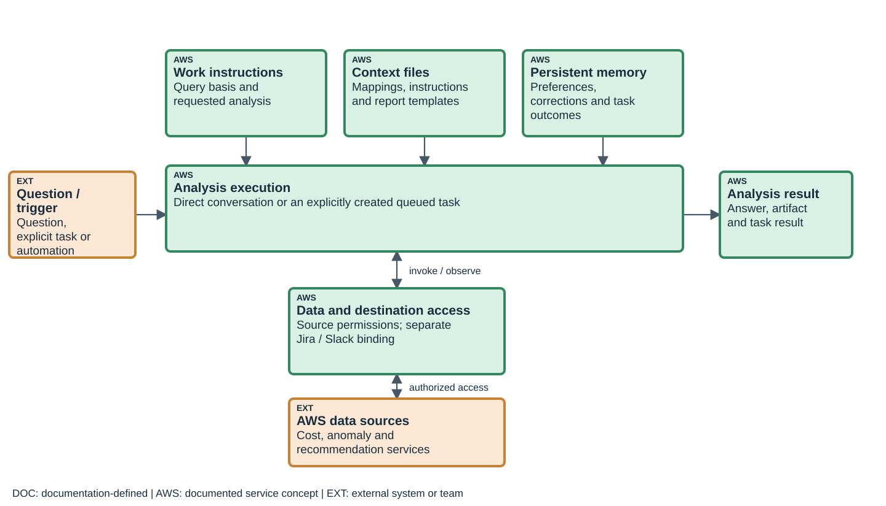
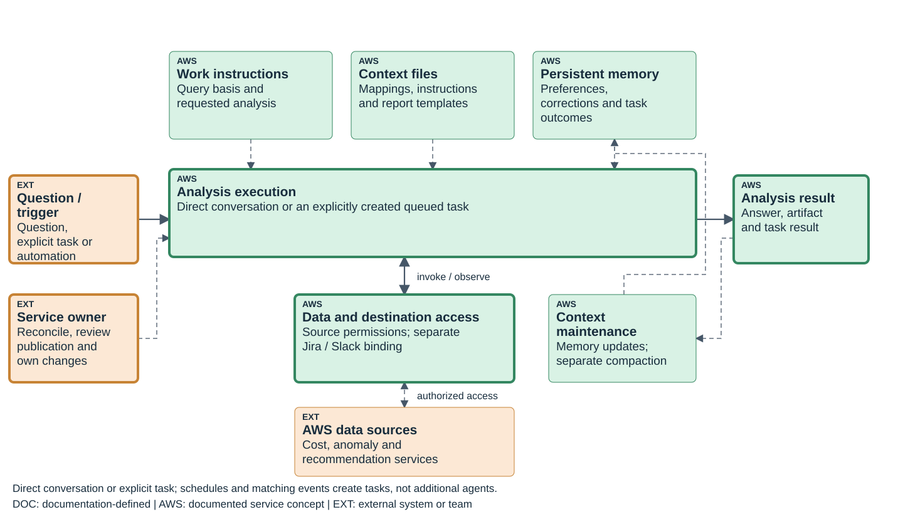
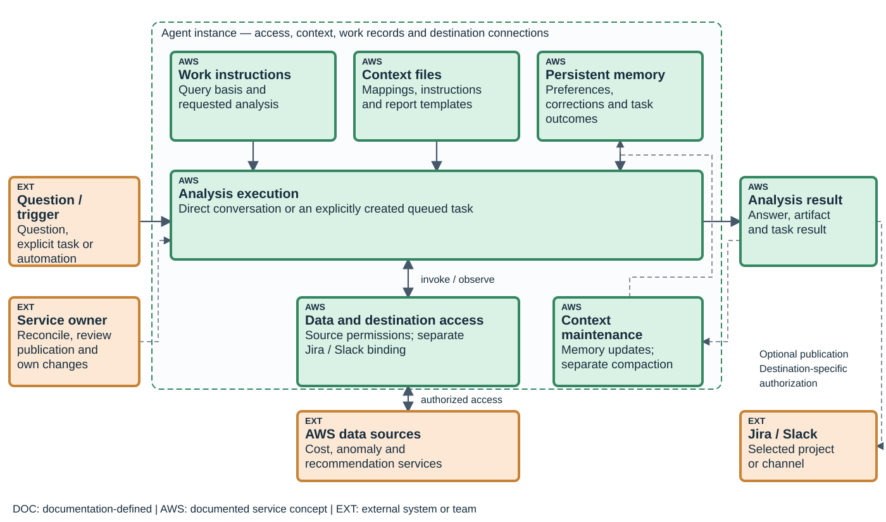
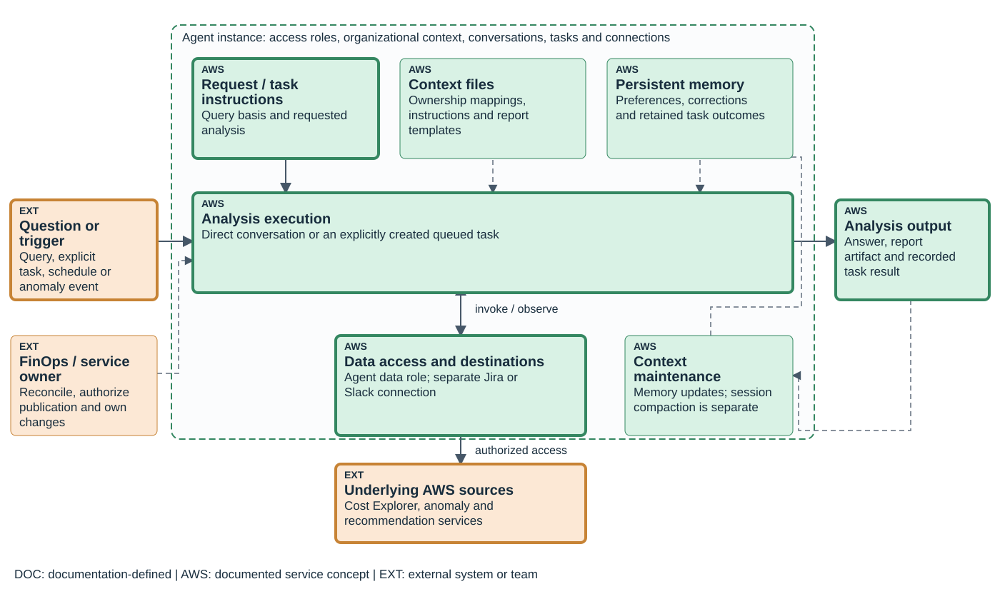
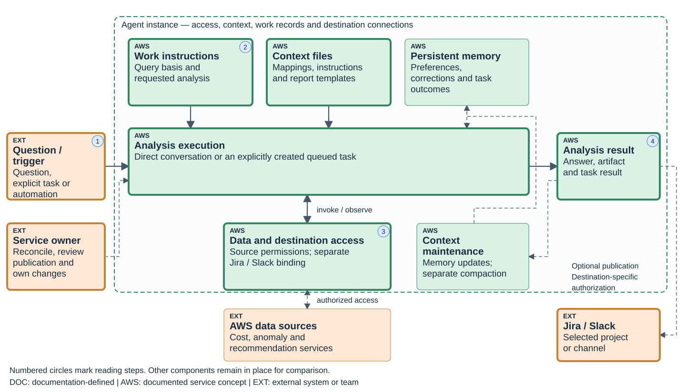
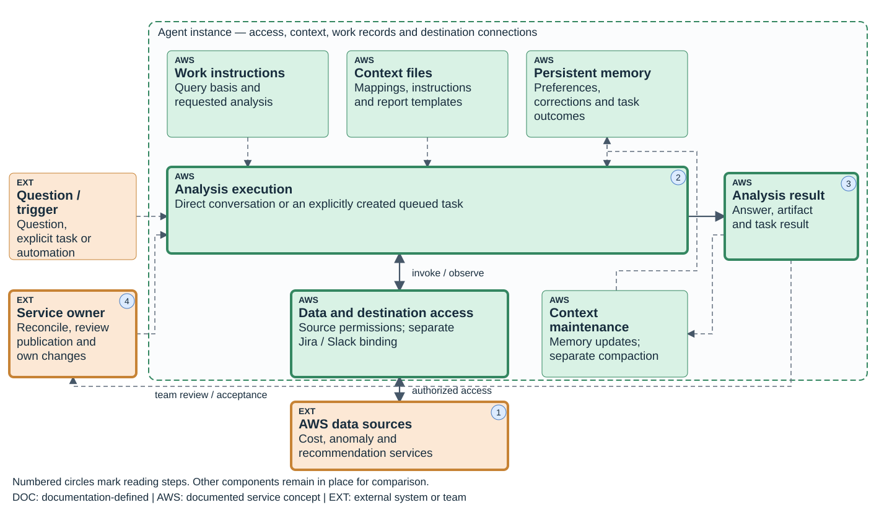

# AWS FinOps Agent: presentation notes

Presentation: 40 minutes, including 8 minutes of prepared-result exercises. Questions and breaks are additional.

## 01. What AWS FinOps Agent does with a request

00:00–03:00 · Analysis, context and instance scope

The labels deliberately differ from DevOps. Uploaded context files are not a native SKILL.md registry, and a requested task is not a custom-agent asset. Recommendation estimates come from their upstream services and must retain their provenance.

Detailed reference: [An analysis request, its context, and the agent execution](../guides/finops.html#F-90)

Detailed reference: [Instance configuration and task instructions](../guides/finops.html#F-11)

Detailed reference: [Cost queries and recommendation provenance](../guides/finops.html#F-M01)

## 02. How conversations, automations and tasks coordinate work

03:00–06:00 · Analysis, context and instance scope

Do not draw each task as another agent. A schedule or supported anomaly event creates a new task from its automation. Disabling that automation stops future creation; current tasks and existing outputs retain their separate lifecycle.

Detailed reference: [How conversations and automations coordinate tasks](../guides/finops.html#F-91)

Detailed reference: [Tasks, schedules, and execution history](../guides/finops.html#F-03)

Detailed reference: [Anomaly events and task creation](../guides/finops.html#F-M05)

## 03. The agent instance and its access boundaries

06:00–09:00 · Analysis, context and instance scope

Registration of an integration and an instance-specific destination connection are distinct. The same source permission does not authorize publication to every channel. Instance-local retained context is not a shared memory across the three AWS products.

Detailed reference: [Agent-instance scope and source access](../guides/finops.html#F-92)

Detailed reference: [Agent instance, access roles and retained state](../guides/finops.html#F-01)

Detailed reference: [Administrator, service, and operator permissions](../guides/finops.html#F-02)

Detailed reference: [Jira projects and Slack channel connections](../guides/finops.html#F-05)

## 04. Analyze historical cost and usage

09:00–12:00 · Cost inquiry, anomaly investigation and reporting

The first analytical task establishes a repeatable query contract. A different cost basis or period can explain two apparently conflicting totals. Preserve failed reads and missing ownership mappings rather than inventing an allocation.

Detailed reference: [Cost-analysis, reporting and optimization workflows](../guides/finops.html#F-93)

Detailed reference: [Cost inquiry, anomaly investigation, and recommendation analysis](../guides/finops.html#F-14)

Detailed reference: [Cost queries and recommendation provenance](../guides/finops.html#F-M01)

## 05. Investigate a cost anomaly

12:00–15:00 · Cost inquiry, anomaly investigation and reporting

An anomaly is a reason to investigate, not proof of cause. EventBridge matching, task creation, analytical completion and destination delivery are distinct inspection points. A nearby CloudTrail event is corroborating evidence only when its relation to the cost change is established.

Detailed reference: [Cost-analysis, reporting and optimization workflows](../guides/finops.html#F-93)

Detailed reference: [Anomaly events and task creation](../guides/finops.html#F-M05)

Detailed reference: [Cost queries and recommendation provenance](../guides/finops.html#F-M01)

## 06. Exercise: explain a cost increase from the supplied evidence

15:00–23:00 · Cost inquiry, anomaly investigation and reporting

Use the committed synthetic cost table and its arithmetic checks. Participants should identify which claim follows from the numbers and which requires service-owner evidence. Do not present the synthetic change as an observed AWS saving or real customer event.

0–2 min | Fix the comparison contract | Same period basis, scope and unit rates

2–4 min | Reconcile the supplied table | Quantity × rate and component totals

4–6 min | Assess the proposed driver | Separate arithmetic attribution from change-event correlation

6–8 min | Assign follow-up | Name missing workload evidence and the responsible owner

Detailed reference: [Cost-variance analysis: worked example](../guides/finops.html#F-U01)

Detailed reference: [Cost queries and recommendation provenance](../guides/finops.html#F-M01)

## 07. Prepare a periodic cost report

23:00–26:00 · Cost inquiry, anomaly investigation and reporting

Reporting reuses source-backed analysis and adds a stable presentation contract. An artifact may originate in a conversation or a task. A scheduled automation creates successive tasks; it does not make their periods or currencies comparable automatically.

Detailed reference: [Cost-analysis, reporting and optimization workflows](../guides/finops.html#F-93)

Detailed reference: [Report generation and artifact management](../guides/finops.html#F-04)

Detailed reference: [Tasks, schedules, and execution history](../guides/finops.html#F-03)

## 08. Publication controls depend on the action and invocation

26:00–29:00 · Cost inquiry, anomaly investigation and reporting

Do not teach a universal human-approval switch. The action and invocation mode determine the documented behavior. The destination audience and permitted content must be reviewed before enabling an unattended publication path.

Action | Conversation / on-demand task | Scheduled / event automation

Create Jira issue or comment | Approval request | Authorization established during automation setup

Post Slack message | No per-message approval prompt | No per-message approval prompt

Read cost or recommendation data | Source permissions apply | Source permissions apply

Verify delivery | Inspect destination and action result | Inspect task result and destination

Detailed reference: [Publication permissions and approvals](../guides/finops.html#F-M06)

Detailed reference: [Jira projects and Slack channel connections](../guides/finops.html#F-05)

## 09. Forecasting and commitment coverage answer different questions

29:00–32:00 · Planning, optimization and review

These are two approved cases, not two labels for one output. A forecast concerns expected expenditure; coverage concerns eligible usage and commitments. Retain the distinct query basis and completion criteria.

Analysis | Question | Required interpretation

Cost forecast | What expenditure is projected for the selected horizon? | Source, period, scope and uncertainty

Commitment coverage | What eligible usage is covered by existing commitments? | Commitment type, eligible usage and period

Comparison | Are assumptions and filters compatible? | Do not combine unlike denominators

Decision | What follow-up is justified? | Agent analysis is not purchase authorization

Detailed reference: [Cost-analysis, reporting and optimization workflows](../guides/finops.html#F-93)

Detailed reference: [Cost inquiry, anomaly investigation, and recommendation analysis](../guides/finops.html#F-14)

## 10. Prioritize recommendations and measure an implemented change

32:00–35:00 · Planning, optimization and review

Show the two separate objectives on the same path. First prioritize candidates; later measure the actual outcome of an implemented action. They use different evidence and are not one automatic optimization loop.

Detailed reference: [Cost-analysis, reporting and optimization workflows](../guides/finops.html#F-93)

Detailed reference: [Cost inquiry, anomaly investigation, and recommendation analysis](../guides/finops.html#F-14)

Detailed reference: [Cost queries and recommendation provenance](../guides/finops.html#F-M01)

## 11. Prepare the cost-management contribution to an operational review

35:00–37:00 · Planning, optimization and review

The shared operational-review case has a cost-management profile. That profile is authored setup guidance, not a platform resource. The team receives evidence from separately scoped work and decides what happens next.

Detailed reference: [Cost-analysis, reporting and optimization workflows](../guides/finops.html#F-93)

Detailed reference: [Context and evidence in reporting and anomaly use cases](../guides/finops.html#F-10)

## 12. Diagnose data, context, execution and delivery separately

37:00–40:00 · Planning, optimization and review

Return to the diagram: each symptom belongs to a specific object or path. The operator should be able to distinguish a missing source result from a stale mapping and a failed delivery. Use the detailed guide for lifecycle procedures and preview constraints.

Symptom | Inspect | Do not infer

Totals disagree | Dates, basis, scope and filters | That one answer is correct because it is generated

Wrong ownership | Source mapping and retained preference | That editing a file updates every memory

Work did not start | Automation condition and task history | That an existing automation proves execution

No destination result | Connection and action outcome | That analytical completion proves publication

Old context persists | File, memory and conversation lifecycle | That compaction or cancellation deletes stored content

Detailed reference: [Data, task, and integration failures](../guides/finops.html#F-06)

Detailed reference: [Context-file preparation and management](../guides/finops.html#F-M02)

Detailed reference: [Persistent preferences and corrections](../guides/finops.html#F-M03)

Detailed reference: [Conversation summarization and context limits](../guides/finops.html#F-M04)

Detailed reference: [Retention, cancellation, and deletion](../guides/finops.html#F-M07)
