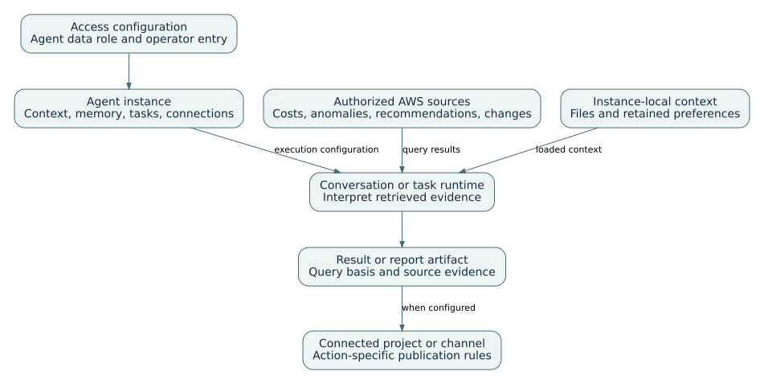
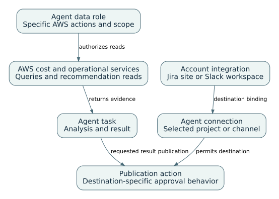
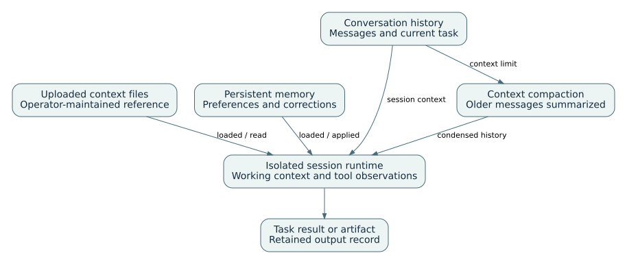
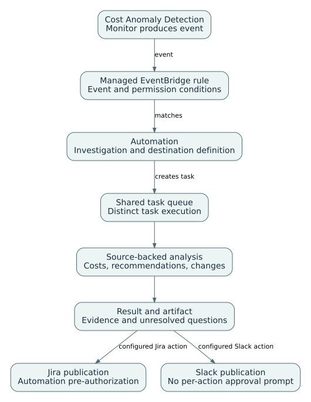

# AWS FinOps Agent: presentation notes

Presentation: 49 minutes, including 8 minutes of prepared-result exercises. Questions and breaks are additional.

## 01. FinOps Agent instance and execution architecture

00:00–02:00 · Service architecture

The instance owns its roles, context, queue, and connections. Data sources supply evidence to a session or task, which produces an answer or artifact and may publish through a configured destination.

Detailed reference: [The agent instance and its execution environment](../guides/finops.html#F-01)

Detailed reference: [Supported data sources and publication destinations](../guides/finops.html#F-08)

## 02. Product functions and agent instance resource model

02:00–05:00 · Service architecture

Agent configuration, source evidence, queued work and publication effects are separate layers.

Layer | Primary objects | Purpose | Evidence

Access | Administrator, agent role, operator role and user permission | Separate configuration, data and daily-use authority | Role ARN, policy and successful sign-in

Context | Reference files, memory and conversation | Supply organizational facts and preferences | File state, remembered item and current conversation

Work | On-demand task, schedule or event automation | Create queued execution | Task and automation records

Data sources | Cost, recommendation, anomaly and change APIs | Supply source evidence | Query filters and source provenance

Outputs | Answer, report artifact, Jira issue or Slack post | Deliver reviewable result | Artifact and destination history

Detailed reference: [The agent instance and its execution environment](../guides/finops.html#F-01)

## 03. Data-source access and collaboration connections

05:00–07:00 · Integrations and access

AWS source access is controlled by the agent data role. Collaboration uses account-level registration and an agent-specific destination. Successful source retrieval and successful publication are independent checks.

Detailed reference: [Supported data sources and publication destinations](../guides/finops.html#F-08)

Detailed reference: [Jira projects and Slack channel connections](../guides/finops.html#F-05)

## 04. Cost-data and publication connections

07:00–09:00 · Integrations and access

Data-role permissions control AWS evidence retrieval. Provider registration and agent connections control the available collaboration destinations.

Source or destination | Information supplied | Interpretation

Cost Explorer | Cost and usage results, forecasts, coverage | Preserve dates, metric, account scope, and grouping.

Cost Anomaly Detection | Deviation and supported event source | A trigger for investigation, not proof of cause.

Cost Optimization Hub / Compute Optimizer | Upstream recommendation and estimate | Review assumptions; estimate is not realized saving.

CloudTrail | Recorded operational changes | Temporal association requires additional causal evidence.

Jira Cloud / Slack | Supported publication actions | Destination and invocation type determine the approval behavior.

Detailed reference: [Supported data sources and publication destinations](../guides/finops.html#F-08)

## 05. Jira and Slack publication controls

09:00–11:00 · Integrations and access

Approval behavior depends on both the action and the invocation path.

Action | Interactive or on-demand | Scheduled or event automation | Review point

Create Jira issue | Approval prompt | Pre-authorized during setup | Project, content and owner

Add Jira comment | Approval prompt | Pre-authorized during setup | Issue and disclosure scope

Post Slack message | No approval prompt | No approval prompt | Channel and sensitive content

Register integration | Account-level authorization | Same registration reused | Provider account/workspace

Bind destination | Agent-specific project or channel | Automation uses this binding | Actual connection and app membership

Detailed reference: [Jira projects and Slack channel connections](../guides/finops.html#F-05)

Detailed reference: [Publication permissions and approvals](../guides/finops.html#F-M06)

## 06. Access roles and source dependencies

11:00–14:00 · Integrations and access

Data access and team access should be tested independently and with known expected results.

Responsibility | Purpose | Source dependency | Acceptance test

Administrator permission | Create agent and permitted roles | Service setup APIs | Configured instance exists

Agent data role | Read cost, recommendation and event sources | Cost Explorer, CloudTrail and optimization services | Known query and source provenance

Operator role | Use supported web-app operations | Agent web application | Intended operator performs task

User permission | Enter the specific agent | Identity Center or IAM access | Non-admin user signs in

Event-rule permission | Manage service-owned matching rule | EventBridge and anomaly monitor | Automation and managed rule visible

Detailed reference: [Administrator, service, and operator permissions](../guides/finops.html#F-02)

Detailed reference: [Cost queries and recommendation provenance](../guides/finops.html#F-M01)

## 07. Persistent context and session-local working state

14:00–16:00 · Knowledge and behavior

Uploaded files and conversational memory persist within an instance. They are loaded into an isolated ephemeral session runtime. Older messages may be summarized; that is separate from editing a file or a retained preference.

Detailed reference: [Context-file preparation and management](../guides/finops.html#F-M02)

Detailed reference: [Persistent preferences and corrections](../guides/finops.html#F-M03)

Detailed reference: [Conversation summarization and context limits](../guides/finops.html#F-M04)

## 08. Context files, memory and conversation compaction

16:00–19:00 · Knowledge and behavior

File retrieval, cross-session memory and within-session compaction require separate tests.

Mechanism | Producer | Typical content | Lifecycle

Reference file | Operator upload | Account ownership, allocation rules and reporting standards | Upload, soft delete and restore

Conversational memory | Explicit remember/update/forget request | Preferences, corrections and ownership details | Update or forget across sessions

Conversation context | Current interaction | Recent messages and summarized older messages | Compaction near context limit

Ephemeral runtime | Service execution | Loaded persistent context for a session | Destroyed after session

Agent-instance boundary | Agent configuration | Instance-specific files, memory and queue | No shared memory across instances

Detailed reference: [Context-file preparation and management](../guides/finops.html#F-M02)

Detailed reference: [Persistent preferences and corrections](../guides/finops.html#F-M03)

Detailed reference: [Conversation summarization and context limits](../guides/finops.html#F-M04)

## 09. Anomaly-to-task and publication workflow

19:00–21:00 · Execution workflows

A supported anomaly event matches a configured automation and creates a queued task. Result generation and destination publication are separate stages; authorization depends on action and invocation path.

Detailed reference: [Anomaly events and task creation](../guides/finops.html#F-M05)

Detailed reference: [Publication permissions and approvals](../guides/finops.html#F-M06)

## 10. Anomaly investigation and cost driver analysis

21:00–24:00 · Execution workflows

Numerical contribution, correlated change and established cause are different conclusions.

Evidence source | Question answered | Typical conclusion | Limit

Cost Anomaly Detection | What deviation was detected? | Affected service, account and impact | Detection is not causal proof

Cost Explorer | Was movement usage, rate or both? | Dimensioned contribution | Depends on chosen basis and filters

CloudTrail event history | Which API activity occurred nearby? | Candidate operational change | Temporal correlation only

Workload owner evidence | Did behavior or volume change? | Service-specific explanation | May remain unavailable

Automation history | Was the event matched and processed? | Task and delivery result | Delivery failure differs from investigation failure

Detailed reference: [Cost queries and recommendation provenance](../guides/finops.html#F-M01)

Detailed reference: [Anomaly events and task creation](../guides/finops.html#F-M05)

## 11. Optimization recommendation review

24:00–26:00 · Execution workflows

The agent surfaces and contextualizes recommendations; it does not authorize infrastructure or financial changes.

Review element | Source | Decision question | Record

Recommendation | Cost Optimization Hub or Compute Optimizer | What action and assumptions are proposed? | Recommendation ID and source

Estimated benefit | Upstream recommendation model | Does it overlap with another candidate? | Estimate and exclusions

Operational constraint | Service owner and telemetry | What reliability, performance or recovery requirement applies? | Accepted constraint

Authorization | Normal engineering and financial process | Who approves the change or commitment? | Change or purchase record

Measurement | Post-change cost and service data | Was the expected effect observed on a comparable basis? | Measured outcome and attribution limit

Detailed reference: [Cost queries and recommendation provenance](../guides/finops.html#F-M01)

## 12. Tasks, schedules and event automations

26:00–29:00 · Execution workflows

An automation is a task factory; it is not the task or the external message.

Object | Creation path | Execution behavior | Stop control

On-demand task | User request | Enters shared task queue | Cancel running task where supported

Scheduled automation | Prompt plus schedule | Creates a task at each match | Disable or delete future starts

Event automation | Prompt plus COST_ANOMALY trigger | Managed rule creates a task for matching event | Disable/delete automation

Task record | Created by request or automation | Tracks status and result | Record remains after automation removal

Delivery result | Task invokes configured destination | Records post/issue outcome | Inspect independently from analysis result

Detailed reference: [Tasks, schedules, and execution history](../guides/finops.html#F-03)

Detailed reference: [Anomaly events and task creation](../guides/finops.html#F-M05)

## 13. Report artifacts and data lifecycle

29:00–31:00 · Execution workflows

Stopping future work, cancelling current work and removing retained data are different operations.

Object | Create or revise | Remove or stop | What may remain

Report artifact | Generate and request revision | Delete artifact | Externally copied report

Context file | Upload and restore | Soft delete | Retained recoverable content

Memory item | Remember or update | Forget | Independent file or conversation text

Task | Request or automation | Cancel execution | Task record and published output

Automation | Schedule or event trigger | Disable or delete | Previously created tasks

Agent instance | Create and configure | Delete whole instance | External artifacts and destinations

Detailed reference: [Report generation and artifact management](../guides/finops.html#F-04)

Detailed reference: [Retention, cancellation, and deletion](../guides/finops.html#F-M07)

## 14. FinOps use case taxonomy and delivery modes

31:00–33:00 · Operational use cases

The catalog separates analytical functions from scheduled execution and external publication.

Use case family | Representative work | Delivery | Primary control

Cost inquiry | Breakdowns, comparisons, trends and forecasts | Conversational native function | Query contract and source permissions

Anomaly and optimization | Root-cause analysis and recommendation triage | Native function using upstream services | Source provenance and operational review

Recurring reporting | Daily, weekly, monthly and operational review packs | Scheduled task and report artifact | Schedule, audience and report basis

Event automation | Investigate matching anomaly and publish result | Cost Anomaly Detection plus managed rule | Automation condition and destination

Collaboration | Jira follow-up and Slack publication | Configured integration | Action- and invocation-specific approval

Detailed reference: [The agent instance and its execution environment](../guides/finops.html#F-01)

Detailed reference: [Tasks, schedules, and execution history](../guides/finops.html#F-03)

Detailed reference: [Report generation and artifact management](../guides/finops.html#F-04)

Detailed reference: [Jira projects and Slack channel connections](../guides/finops.html#F-05)

## 15. Cost inquiry and reporting use cases

33:00–36:00 · Operational use cases

A usable report begins with a reproducible cost-query definition.

Use case | Required query contract | Output | Independent check

Cost breakdown | Dates, metric, currency, accounts and dimension | Service/account/Region/tag totals | Reproduce a material total

Period comparison | Complete comparable windows and same cost basis | Delta and ranked contributors | Check arithmetic and filters

Forecast review | Forecast horizon and source assumptions | Forecast and uncertainty | Separate forecast from observed spend

Commitment coverage review | Relevant commitment and utilization scope | Coverage and candidate gaps | Inspect source recommendation

Custom report | Audience, sections, figures and source basis | HTML, PDF or editable presentation artifact | Reconcile displayed values

Detailed reference: [Cost queries and recommendation provenance](../guides/finops.html#F-M01)

Detailed reference: [Report generation and artifact management](../guides/finops.html#F-04)

## 16. Recurring reports and operational reviews

36:00–39:00 · Operational use cases

Report cadence, source window, audience and ownership should be configured explicitly.

Use case | Cadence | Core content | Audience

Daily cost pulse | Daily | Material movement, anomaly status and unresolved gaps | FinOps operations

Weekly service report | Weekly | Cost by service, owner, driver and recommendation status | Engineering and FinOps owners

Monthly management report | Monthly | Trend, forecast, commitment and actions | Leadership and finance

FinOps operational review | Weekly or monthly | Decisions, owners, rejected items and measured outcomes | Cross-functional review

Optimization backlog report | Scheduled | Candidate, source, estimated benefit, constraint and status | Platform and workload owners

Detailed reference: [Tasks, schedules, and execution history](../guides/finops.html#F-03)

Detailed reference: [Report generation and artifact management](../guides/finops.html#F-04)

## 17. Worked example: cost increase decomposition

39:00–47:00 · Worked example

Prepared quantities and rates demonstrate reconciliation, not AWS pricing or realized savings.

0–2 min | Confirm comparison contract | Two complete windows, same scope, metric, currency and basis

2–4 min | Reconcile totals | 1,400 baseline; 1,974 comparison; delta 574

4–6 min | Attribute arithmetic | Storage +200; requests +100; transfer +274

6–8 min | Assess causal evidence | Prepared export evidence supports transfer only; storage and request causes remain unresolved

Detailed reference: [Cost-variance analysis: worked example](../guides/finops.html#F-U01)

## 18. Troubleshooting matrix and preview limits

47:00–49:00 · Troubleshooting and references

Validate data, retained context, execution and external effects as separate layers.

Symptom | First object to inspect | Second check | Interpretation

Total differs | Metric, dates, filters and dimensions | Accessible source and currency | Query contract failure

Context ignored | File state or memory item | New session and exact preference | Retrieval/retention failure

Automation did not run | Trigger, status and last-triggered time | Managed rule and event condition | Event matching failure

Task ran, no message | Task result | Destination connection and action result | Publication failure

Unexpected write | Action and invocation approval rule | Destination and automation setup | Control-model misunderstanding

Detailed reference: [Data, task, and integration failures](../guides/finops.html#F-06)

Detailed reference: [Documentation coverage and references](../guides/finops.html#F-07)
