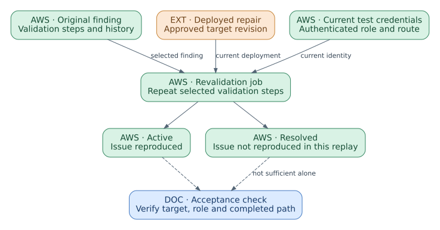

# AWS Security Agent: presentation notes

Presentation: 60 minutes, including 8 minutes of prepared-result exercises. Questions and breaks are additional.

## 01. Shared configuration and application Agent Spaces

00:00–02:00 · Product-specific resource model

Shared registrations and requirement packs are separate from application-scoped configuration. An Agent Space selects sources and users. The target application and published issue retain external ownership.

Detailed reference: [Shared configuration, Agent Spaces and assessments](../guides/security.html#S-01)

## 02. Assessment configuration, run, and finding identities

02:00–05:00 · Product-specific resource model

Identify the actual product object before configuring, invoking, correcting or removing it. The resource kind determines which operation is meaningful.

Object | Identity or membership | Lifecycle distinction

Agent Space | Application or project scope | Shared integration registration is separate

Penetration test | Saved configuration and independent run | Record current target revision and test identity

Code review | Full-scan configuration or repository event settings | Keep the actual reviewed revision

Design review | Individual assessment | Cloning creates a new review

Finding and revalidation | Original finding plus separate job | Our normalized result association is not a native API resource

Detailed reference: [Assessment configurations, runs and result identities](../guides/security.html#S-10)

## 03. Assessment configurations and distinct execution lifecycles

05:00–08:00 · Product-specific resource model

Penetration tests, full-code reviews, and threat models have reusable configurations and separate runs. A design review is a one-off assessment. Record the assessed revision and scope for each execution.

Detailed reference: [Assessment configurations, runs and result identities](../guides/security.html#S-10)

## 04. Application-source registration and selection

08:00–10:00 · Integrations and access

The account registration authorizes a provider. The application selects resources from it. Sources are shared across eligible assessments, while repository write actions are separately enabled.

Detailed reference: [Supported source and collaboration integrations](../guides/security.html#S-09)

## 05. Repository, documentation, and Jira connections

10:00–12:00 · Integrations and access

Register the provider, grant its required permissions, and select application resources. Repository comments, remediation proposals, and Jira publication are separate configured operations.

Provider family | Documented support | Selection or effect

GitHub | Cloud-hosted GitHub and Enterprise; self-hosted Enterprise Server | Select application repositories; private servers may require private connectivity.

GitLab and Bitbucket | GitLab cloud and Self-Managed; Bitbucket Cloud | Provider-specific repository context and eligible review/remediation settings.

Azure DevOps | Git repositories; TFVC unsupported | Entra authorization, organization permissions, repository selection; writes configured separately.

Documentation | Confluence Cloud | Selected pages provide read-only application context.

AWS objects | Same-account S3 resources | Select relevant sources; code-review archives have their own format requirements.

Work tracking | Jira Cloud | Select projects and independently permit issue creation or comments.

Detailed reference: [Supported source and collaboration integrations](../guides/security.html#S-09)

## 06. Identity, repository and target configuration

12:00–15:00 · Integrations and access

Registration, connection, reachability and authorization must be validated separately.

Configuration area | Decision | Confirmation | Typical failure

Operator identity | Who can use the web application | Intended user can open the space | Setup administrator only

Repository registration | Provider authorization at account level | Integration visible | Registered but not connected to application

Repository connection | Repository and branch/source selection | Expected revision available | Latest branch differs from deployed target

Target rules | Target, accessible dependency and out-of-scope entries | Preflight shows intended reachability | Dependency accidentally treated as attack target

Private access | VPC route, DNS and security groups | Application endpoint reachable | Network error mistaken for login error

Detailed reference: [User access and repository connections](../guides/security.html#S-02)

Detailed reference: [Test targets, dependencies, and exclusions](../guides/security.html#S-03)

## 07. Repository, pipeline and external tracking integrations

15:00–17:00 · Integrations and access

Integrations move source material, triggers and evidence; they do not broaden the authorized target scope.

Integration | Primary use | Trigger or action | Boundary

Repository provider | Source access and code review | Configured scan or supported change event | Provider and source support vary

S3 source | Code package or design/context material | Selected when creating assessment | Shared across supported capabilities

CI/CD pipeline | Start configured assessment from delivery workflow | Server-side job invocation | Runner is not the assessment engine

Jira | Track findings and revalidation updates | Create issue or add result comment | Project and audience must be appropriate

Evidence export | Point-in-time review or audit record | Download supported report or finding content | Export is not a security certificate

Detailed reference: [User access and repository connections](../guides/security.html#S-02)

Detailed reference: [Finding review and code remediation](../guides/security.html#S-05)

Detailed reference: [Code review, design review, and threat modeling](../guides/security.html#S-06)

## 08. Application context and assessment criteria

17:00–19:00 · Knowledge and behavior

Source evidence and scope documents have different jobs. The assessment uses selected evidence and applicable criteria; a finding is an output of that execution rather than an automatically shared memory.

Detailed reference: [Application-context construction and reuse](../guides/security.html#S-M07)

Detailed reference: [Requirement applicability and evaluation](../guides/security.html#S-M03)

## 09. Authentication reuse and finding personalization

19:00–21:00 · Knowledge and behavior

Login Optimization reuses navigation. Findings Personalization reuses eligible edits. Neither establishes that the application was repaired.

Detailed reference: [Credential retrieval and application login](../guides/security.html#S-M01)

Detailed reference: [Login-workflow retention and reuse](../guides/security.html#S-M02)

Detailed reference: [Finding review and code remediation](../guides/security.html#S-05)

## 10. Login Optimization and retained authentication procedures

21:00–23:00 · Knowledge and behavior

Login Optimization reuses authentication navigation; it is not general vulnerability memory.

First successful login | The service discovers the authorized navigation and authentication sequence.

Saved login procedure | The successful workflow is retained as a skill for the assessment configuration.

Later session or run | The retained procedure can be reused instead of rediscovering the login path.

Changed application flow | Verify the actual authenticated identity and update behavior rather than assuming reuse remains valid.

Detailed reference: [Login-workflow retention and reuse](../guides/security.html#S-M02)

## 11. Security requirements and requirement packs

23:00–26:00 · Knowledge and behavior

Requirement generation replaces pack contents; evaluation applies the reviewed criteria to an assessment.

Operation | Input | State change | Control

Create or edit requirement | Applicability, compliance and remediation text | Pack content changes | Human review of criteria

Enable pack | Reviewed requirements | Available to subsequent eligible reviews | Assessment must select requirement evaluation

Evaluate requirement | Component evidence and enabled pack | Compliant, violating or inapplicable result | Inspect applicability and evidence

Generate from documents | Authoritative policy sources | Pack contents are regenerated | Replacement review before enablement

Version outside service | Governed source in Git or policy system | Independent change history | Do not rely on generated pack as sole authority

Detailed reference: [Requirement applicability and evaluation](../guides/security.html#S-M03)

Detailed reference: [Requirement generation and replacement](../guides/security.html#S-M04)

## 12. Finding replay and verification boundaries

26:00–28:00 · Execution workflows

Revalidation creates a linked job. Interpret non-reproduction only after checking the actual target, identity and reached path.

Detailed reference: [Finding revalidation and evidence lineage](../guides/security.html#S-M05)

Detailed reference: [Finding review and code remediation](../guides/security.html#S-05)

## 13. Credential resolution and application authentication

28:00–31:00 · Execution workflows

Credential retrieval can succeed while application authentication still fails.

Credential strategy | Service access requirement | Application step | Evidence

Direct test credential | Configured test account | Enter through documented login flow | Observed application role

Secrets Manager | Read access and same-account resource | Map secret fields to login controls | Successful retrieval and login

Role assumption | Trust and role permissions | Use returned temporary credentials | Assumed identity and protected path

Credential Lambda | Invoke permission and response contract | Apply dynamic credential within timeout | Invocation result and login

MFA/login instruction | Current instructions and required factors | Complete the application-specific flow | Save & Test result

Detailed reference: [Credential retrieval and application login](../guides/security.html#S-M01)

## 14. Assessment configuration and run lifecycle

31:00–33:00 · Execution workflows

A completed run confirms execution, not exhaustive route or vulnerability-class coverage.

Object or state | Meaning | Operator action | Evidence

Draft | Incomplete setup | Finish prerequisites or discard | Missing fields

Saved configuration | Reusable target, credentials and options | Review before each run | Configuration revision

Run | Assessment against then-current target | Monitor, stop or inspect | Run ID, task hours and findings

Scheduled run | Future execution from the configuration | Review schedule and current credentials | Separate run history

Design review | Different one-off lifecycle | Clone to create new work | Independent review record

Detailed reference: [Assessment configuration and run lifecycle](../guides/security.html#S-04)

## 15. Finding lineage, remediation and revalidation

33:00–36:00 · Execution workflows

A Resolved revalidation result applies to the selected finding and execution conditions.

Original finding | Affected target, revision, identity and validation steps.

Remediation change | Reviewed code or configuration change linked to the finding.

Deployed repair | Known revision on the same authorized test environment.

Revalidation job | Current credentials repeat selected validation steps and preserve the original finding.

Detailed reference: [Finding review and code remediation](../guides/security.html#S-05)

Detailed reference: [Finding revalidation and evidence lineage](../guides/security.html#S-M05)

## 16. Customer-managed encryption and service identities

36:00–38:00 · Execution workflows

Encryption configuration and processing geography are separate controls.

Element | Role in the mechanism | Review question

Customer KMS key | Protects service branch keys | Does the policy allow the intended service identities?

Branch key | Resource-specific stored key material | Which resource and encryption context apply?

Derived wrapping key | Protects data-encryption keys | Is the expected context present?

Administrator identity | Configures resources and key use | Is setup authority separated from daily use?

Web app / assessment / async identity | Performs different data operations | Does each path have the required and only required access?

Detailed reference: [Encryption keys, identities, and access](../guides/security.html#S-M06)

## 17. Application, source and design assessment objectives

38:00–41:00 · Operational objectives and implementation

Follow the operational objective through its workflow, configured mechanisms and independent completion evidence. The catalog links each dependency to its detailed guide.

Operational outcome | Completion evidence | Implementation boundary

Assess a running application for vulnerabilities | Target revision and owner authorization are retained. | Configured application assessment

Review source code for security issues | Review mode and exact revision are known. | Preview assessment

Review a proposed application design | Design revision and assumptions are explicit. | Preview assessment

Develop and review an application threat model | Boundaries and flows are reviewed before threats. | Preview assessment

Detailed reference: [Shared configuration, Agent Spaces and assessments](../guides/security.html#S-01)

Detailed reference: [Code review, design review, and threat modeling](../guides/security.html#S-06)

## 18. Finding disposition, repair and verification

41:00–44:00 · Operational objectives and implementation

Follow the operational objective through its workflow, configured mechanisms and independent completion evidence. The catalog links each dependency to its detailed guide.

Operational outcome | Completion evidence | Implementation boundary

Triage and prioritize security findings | Impact and evidence are reviewed. | Native operation

Prepare a code-remediation proposal | The proposal matches the affected revision. | Configured remediation

Revalidate a finding after deployment of a repair | The intended repair is deployed to the target. | Native operation

Consolidate and maintain security requirements | Conflicting policy sources are reconciled. | Composed workflow

Detailed reference: [Finding review and code remediation](../guides/security.html#S-05)

Detailed reference: [Finding revalidation and evidence lineage](../guides/security.html#S-M05)

Detailed reference: [Requirement generation and replacement](../guides/security.html#S-M04)

## 19. Application assessment: independent configuration choices

44:00–47:00 · Operational objectives and implementation

Follow the operational objective through its workflow, configured mechanisms and independent completion evidence. The catalog links each dependency to its detailed guide.

Choice | Supporting mechanism | Control preserved

Network path | Target scope and public/private connectivity | Reachability does not enlarge owner authorization.

Application role | Credential resolution, login and optional procedure reuse | Failed login leaves protected paths unassessed.

Invocation | Manual, recurring or supported pipeline path | Every run records current revision and coverage.

Criteria and closure | Findings, source evidence and separate revalidation | Non-reproduction is scoped to the selected issue and valid test conditions.

Detailed reference: [Test targets, dependencies, and exclusions](../guides/security.html#S-03)

Detailed reference: [Credential retrieval and application login](../guides/security.html#S-M01)

Detailed reference: [Login-workflow retention and reuse](../guides/security.html#S-M02)

Detailed reference: [Assessment configuration and run lifecycle](../guides/security.html#S-04)

Detailed reference: [Finding revalidation and evidence lineage](../guides/security.html#S-M05)

## 20. Original findings and revalidation history

47:00–50:00 · Operational objectives and implementation

Preserve the original finding identity through proposal, deployment, and revalidation. The documentation-defined result association records the outcome of a particular revalidation job; it is not an additional AWS API resource.

Detailed reference: [Finding lineage from assessment to repair verification](../guides/security.html#S-11)

## 21. Worked example: authorization finding through revalidation

50:00–58:00 · Worked example

Prepared staging evidence traces the finding, deployed repair and scoped revalidation result.

0–2 min | Inspect original finding | User A received account B test invoice in revision demo-r1

2–4 min | Inspect reviewed change | Ownership check added and revision demo-r2 deployed

4–6 min | Inspect revalidation context | Actual user A identity and selected path reached

6–8 min | Interpret result | Prepared denial supports the selected path; it does not establish whole-application security

Detailed reference: [Authorization-finding remediation: worked example](../guides/security.html#S-U01)

Detailed reference: [Finding revalidation and evidence lineage](../guides/security.html#S-M05)

## 22. Troubleshooting matrix and assessment limits

58:00–60:00 · Troubleshooting and references

Troubleshooting follows the first failed prerequisite in the assessment chain.

Symptom | First object to inspect | Second check | Interpretation

No source available | Integration registration and repository connection | Branch or source package | Source setup failure

Target unreachable | Target/access/out-of-scope rules | VPC route, DNS and security groups | Network scope failure

Credential obtained, login failed | Login instructions and application changes | Actual test identity | Authentication failure

Requirement not evaluated | Pack enabled state | Assessment review mode | Criteria setup failure

Revalidation inconclusive | Deployment revision and target | Authentication and reached path | Do not close finding

Detailed reference: [Assessment failures and operating limits](../guides/security.html#S-07)

Detailed reference: [Documentation coverage and references](../guides/security.html#S-08)
