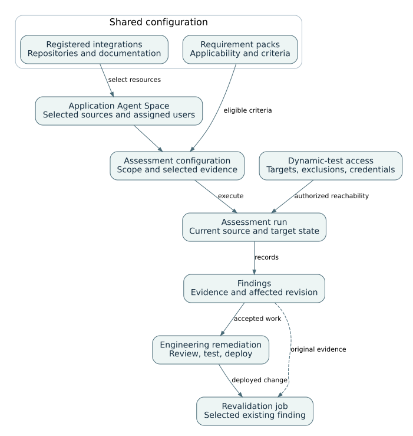
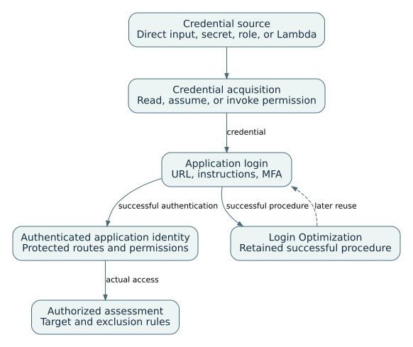

# AWS Security Agent: presentation notes

Presentation: 56 minutes, including 8 minutes of prepared-result exercises. Questions and breaks are additional.

## 01. Security Agent application and assessment architecture

00:00–02:00 · Service architecture

Shared account resources are selected for an application Agent Space. Assessment configuration combines sources, criteria, and authorized target access. Runs produce findings that can be reviewed and revalidated.

Detailed reference: [The agent, application space, and assessment](../guides/security.html#S-01)

Detailed reference: [Supported source and collaboration integrations](../guides/security.html#S-09)

## 02. Product functions and security resource model

02:00–05:00 · Service architecture

Application scope, assessment configuration, execution and finding lifecycle are different resource layers.

Layer | Primary objects | Purpose | Evidence

Account resources | Integrations, identity and requirement packs | Shared setup and reusable criteria | Provider registration and enabled packs

Agent Space | Application sources, users and settings | Application-specific boundary | Space ID and source connections

Assessment configuration | Targets, credentials, criteria and limits | Reusable definition for eligible assessment types | Saved configuration and revision

Execution | Run, job or review | Assess the current target or source | Status, identity and findings

Finding lifecycle | Finding, remediation, Jira link and revalidation | Track evidence through repair | Original and linked verification records

Detailed reference: [The agent, application space, and assessment](../guides/security.html#S-01)

## 03. Application-source registration and selection

05:00–07:00 · Integrations and access

The account registration authorizes a provider. The application selects resources from it. Sources are shared across eligible assessments, while repository write actions are separately enabled.

Detailed reference: [Supported source and collaboration integrations](../guides/security.html#S-09)

## 04. Repository, documentation, and Jira connections

07:00–09:00 · Integrations and access

Account-level registration authorizes a provider; application-level selection supplies resources. Repository writes and Jira effects require their own settings.

Provider family | Documented support | Selection or effect

GitHub | Cloud-hosted GitHub and Enterprise; self-hosted Enterprise Server | Select application repositories; private servers may require private connectivity.

GitLab and Bitbucket | GitLab cloud and Self-Managed; Bitbucket Cloud | Provider-specific repository context and eligible review/remediation settings.

Documentation | Confluence Cloud | Selected pages provide read-only application context.

AWS objects | Same-account S3 resources | Select relevant sources; code-review archives have their own format requirements.

Work tracking | Jira Cloud | Select projects and independently permit issue creation or comments.

Detailed reference: [Supported source and collaboration integrations](../guides/security.html#S-09)

## 05. Identity, repository and target configuration

09:00–12:00 · Integrations and access

Registration, connection, reachability and authorization must be validated separately.

Configuration area | Decision | Confirmation | Typical failure

Operator identity | Who can use the web application | Intended user can open the space | Setup administrator only

Repository registration | Provider authorization at account level | Integration visible | Registered but not connected to application

Repository connection | Repository and branch/source selection | Expected revision available | Latest branch differs from deployed target

Target rules | Target, accessible dependency and out-of-scope entries | Preflight shows intended reachability | Dependency accidentally treated as attack target

Private access | VPC route, DNS and security groups | Application endpoint reachable | Network error mistaken for login error

Detailed reference: [User access and repository connections](../guides/security.html#S-02)

Detailed reference: [Test targets, dependencies, and exclusions](../guides/security.html#S-03)

## 06. Repository, pipeline and external tracking integrations

12:00–14:00 · Integrations and access

Integrations move source material, triggers and evidence; they do not broaden the authorized target scope.

Integration | Primary use | Trigger or action | Boundary

Repository provider | Source access and code review | Configured scan or supported change event | Provider and source support vary

S3 source | Code package or design/context material | Selected when creating assessment | Shared across supported capabilities

CI/CD pipeline | Start configured assessment from delivery workflow | Server-side job invocation | Runner is not the assessment engine

Jira | Track findings and revalidation updates | Create issue or add result comment | Project and audience must be appropriate

Evidence export | Point-in-time review or audit record | Download supported report or finding content | Export is not a security certificate

Detailed reference: [User access and repository connections](../guides/security.html#S-02)

Detailed reference: [Finding review and code remediation](../guides/security.html#S-05)

Detailed reference: [Code review, design review, and threat modeling](../guides/security.html#S-06)

## 07. Application context and assessment criteria

14:00–16:00 · Knowledge and behavior

Source evidence and scope documents have different jobs. The assessment uses selected evidence and applicable criteria; a finding is an output of that execution rather than an automatically shared memory.

Detailed reference: [Application-context construction and reuse](../guides/security.html#S-M07)

Detailed reference: [Requirement applicability and evaluation](../guides/security.html#S-M03)

## 08. Credential retrieval and authenticated test access

16:00–18:00 · Knowledge and behavior

Credential acquisition, login navigation, and application authorization are distinct stages. A retained login procedure can support later navigation, but actual identity still needs verification.

Detailed reference: [Credential retrieval and application login](../guides/security.html#S-M01)

Detailed reference: [Login-workflow retention and reuse](../guides/security.html#S-M02)

## 09. Login optimization

18:00–20:00 · Knowledge and behavior

Login Optimization reuses authentication navigation; it is not general vulnerability memory.

First successful login | The service discovers the authorized navigation and authentication sequence.

Saved login procedure | The successful workflow is retained as a skill for the assessment configuration.

Later session or run | The retained procedure can be reused instead of rediscovering the login path.

Changed application flow | Verify the actual authenticated identity and update behavior rather than assuming reuse remains valid.

Detailed reference: [Login-workflow retention and reuse](../guides/security.html#S-M02)

## 10. Security requirements and requirement packs

20:00–23:00 · Knowledge and behavior

Requirement generation replaces pack contents; evaluation applies the reviewed criteria to an assessment.

Operation | Input | State change | Control

Create or edit requirement | Applicability, compliance and remediation text | Pack content changes | Human review of criteria

Enable pack | Reviewed requirements | Available to subsequent eligible reviews | Assessment must select requirement evaluation

Evaluate requirement | Component evidence and enabled pack | Compliant, violating or inapplicable result | Inspect applicability and evidence

Generate from documents | Authoritative policy sources | Pack contents are regenerated | Replacement review before enablement

Version outside service | Governed source in Git or policy system | Independent change history | Do not rely on generated pack as sole authority

Detailed reference: [Requirement applicability and evaluation](../guides/security.html#S-M03)

Detailed reference: [Requirement generation and replacement](../guides/security.html#S-M04)

## 11. Finding, deployment, and revalidation lineage

23:00–25:00 · Execution workflows

The finding, proposed code change, deployed revision, and revalidation job are separate records. Revalidation repeats selected evidence using the current target and authentication configuration.

Detailed reference: [Finding revalidation and evidence lineage](../guides/security.html#S-M05)

Detailed reference: [Finding review and code remediation](../guides/security.html#S-05)

## 12. Credential resolution and application authentication

25:00–28:00 · Execution workflows

Credential retrieval can succeed while application authentication still fails.

Credential strategy | Service access requirement | Application step | Evidence

Direct test credential | Configured test account | Enter through documented login flow | Observed application role

Secrets Manager | Read access and same-account resource | Map secret fields to login controls | Successful retrieval and login

Role assumption | Trust and role permissions | Use returned temporary credentials | Assumed identity and protected path

Credential Lambda | Invoke permission and response contract | Apply dynamic credential within timeout | Invocation result and login

MFA/login instruction | Current instructions and required factors | Complete the application-specific flow | Save & Test result

Detailed reference: [Credential retrieval and application login](../guides/security.html#S-M01)

## 13. Assessment configuration and run lifecycle

28:00–30:00 · Execution workflows

A completed run confirms execution, not exhaustive route or vulnerability-class coverage.

Object or state | Meaning | Operator action | Evidence

Draft | Incomplete setup | Finish prerequisites or discard | Missing fields

Saved configuration | Reusable target, credentials and options | Review before each run | Configuration revision

Run | Assessment against then-current target | Monitor, stop or inspect | Run ID, task hours and findings

Scheduled run | Future execution from the configuration | Review schedule and current credentials | Separate run history

Design review | Different one-off lifecycle | Clone to create new work | Independent review record

Detailed reference: [Assessment configuration and run lifecycle](../guides/security.html#S-04)

## 14. Finding lineage, remediation and revalidation

30:00–33:00 · Execution workflows

A Resolved revalidation result applies to the selected finding and execution conditions.

Original finding | Affected target, revision, identity and validation steps.

Remediation change | Reviewed code or configuration change linked to the finding.

Deployed repair | Known revision on the same authorized test environment.

Revalidation job | Current credentials repeat selected validation steps and preserve the original finding.

Detailed reference: [Finding review and code remediation](../guides/security.html#S-05)

Detailed reference: [Finding revalidation and evidence lineage](../guides/security.html#S-M05)

## 15. Customer-managed encryption and service identities

33:00–35:00 · Execution workflows

Encryption configuration and processing geography are separate controls.

Element | Role in the mechanism | Review question

Customer KMS key | Protects service branch keys | Does the policy allow the intended service identities?

Branch key | Resource-specific stored key material | Which resource and encryption context apply?

Derived wrapping key | Protects data-encryption keys | Is the expected context present?

Administrator identity | Configures resources and key use | Is setup authority separated from daily use?

Web app / assessment / async identity | Performs different data operations | Does each path have the required and only required access?

Detailed reference: [Encryption keys, identities, and access](../guides/security.html#S-M06)

## 16. Security use case taxonomy and availability

35:00–37:00 · Operational use cases

Availability must be checked for the exact assessment type and integration.

Use case family | Representative work | Delivery | Availability boundary

Dynamic assessment | On-demand, authenticated and private penetration testing | Native assessment | On-demand penetration testing GA

Finding operations | Review, Jira tracking, remediation and revalidation | Native plus integrations | Feature-specific

Source review | Full, change-focused or differential code review | Configured review | Preview

Design analysis | Design review and threat modeling | Configured assessment | Preview

Security criteria | Requirement packs and policy evaluation | Configured reusable criteria | Preview workflows

Detailed reference: [The agent, application space, and assessment](../guides/security.html#S-01)

Detailed reference: [Assessment configuration and run lifecycle](../guides/security.html#S-04)

Detailed reference: [Code review, design review, and threat modeling](../guides/security.html#S-06)

## 17. Application assessment use cases

37:00–40:00 · Operational use cases

Domain verification, network access, credential retrieval and application login are separate prerequisites.

Use case | Required scope | Authentication | Output

On-demand penetration test | Verified staging target and written authority | Optional or required by route | Run findings and evidence

Authenticated workflow assessment | Representative test roles and protected routes | Direct or AWS-native credential strategy | Coverage by actual identity

Private application assessment | VPC route, DNS and security groups | Same application login model | Reachability and findings

Recurring assessment | Stable configuration and schedule | Current credentials at execution time | Separate scheduled runs

Login procedure reuse | Successful first authentication flow | Login Optimization enabled | Saved procedure used by later sessions

Detailed reference: [Test targets, dependencies, and exclusions](../guides/security.html#S-03)

Detailed reference: [Credential retrieval and application login](../guides/security.html#S-M01)

Detailed reference: [Login-workflow retention and reuse](../guides/security.html#S-M02)

Detailed reference: [Assessment configuration and run lifecycle](../guides/security.html#S-04)

## 18. Findings, remediation and verification use cases

40:00–43:00 · Operational use cases

A proposed patch, deployed revision and revalidation result are separate records.

Use case | Input | Output | Closure evidence

Finding review and prioritization | Impact, confidence, reproduction and affected role | Disposition and remediation owner | Recorded decision and scope

Jira remediation tracking | Finding and approved project | Issue linked to finding | Issue state and comments

Proposed code remediation | Accepted finding and repository access | Patch or pull request | Independent review and tests

Finding revalidation | Deployed fix and selected original finding | Separate revalidation job | Linked Active or Resolved result

Broader regression assessment | Material application change | New full penetration test | New run rather than narrow replay

Detailed reference: [Finding review and code remediation](../guides/security.html#S-05)

Detailed reference: [Finding revalidation and evidence lineage](../guides/security.html#S-M05)

## 19. Shift-left review use cases

43:00–46:00 · Operational use cases

Code, design, threat-model and requirement workflows have different inputs and lifecycles.

Use case | Primary input | Evaluation basis | Output

Repository code review | Repository or supported source package | Vulnerability analysis and configured requirements | Code findings and locations

Change-focused review | Pull request, merge request or differential source | Changed code and configured criteria | Revision-specific findings

Security requirement evaluation | Enabled requirement pack | Applicability and compliance criteria | Requirement findings

Design review | Current design material | Security requirements and design evidence | Design findings

Threat model | Architecture and scope sources | Assets, trust boundaries, flows and threats | Reusable model and findings

Detailed reference: [Requirement applicability and evaluation](../guides/security.html#S-M03)

Detailed reference: [Requirement generation and replacement](../guides/security.html#S-M04)

Detailed reference: [Code review, design review, and threat modeling](../guides/security.html#S-06)

## 20. Worked example: authorization finding through revalidation

46:00–54:00 · Worked example

Prepared staging evidence traces the finding, deployed repair and scoped revalidation result.

0–2 min | Inspect original finding | User A received account B test invoice in revision demo-r1

2–4 min | Inspect reviewed change | Ownership check added and revision demo-r2 deployed

4–6 min | Inspect revalidation context | Actual user A identity and selected path reached

6–8 min | Interpret result | Prepared denial supports the selected path; it does not establish whole-application security

Detailed reference: [Authorization-finding remediation: worked example](../guides/security.html#S-U01)

Detailed reference: [Finding revalidation and evidence lineage](../guides/security.html#S-M05)

## 21. Troubleshooting matrix and assessment limits

54:00–56:00 · Troubleshooting and references

Troubleshooting follows the first failed prerequisite in the assessment chain.

Symptom | First object to inspect | Second check | Interpretation

No source available | Integration registration and repository connection | Branch or source package | Source setup failure

Target unreachable | Target/access/out-of-scope rules | VPC route, DNS and security groups | Network scope failure

Credential obtained, login failed | Login instructions and application changes | Actual test identity | Authentication failure

Requirement not evaluated | Pack enabled state | Assessment review mode | Criteria setup failure

Revalidation inconclusive | Deployment revision and target | Authentication and reached path | Do not close finding

Detailed reference: [Assessment failures and operating limits](../guides/security.html#S-07)

Detailed reference: [Documentation coverage and references](../guides/security.html#S-08)
